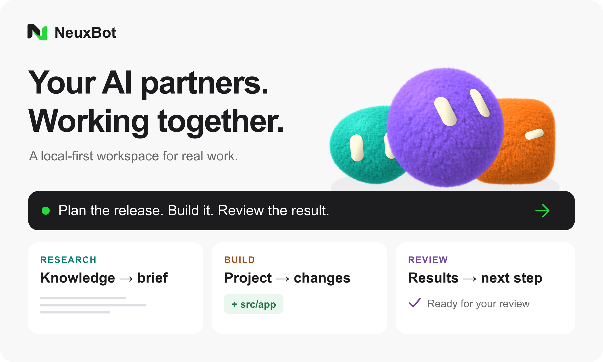
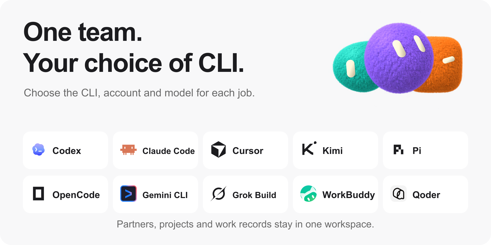

<div align="center">

**English** · [简体中文](README.zh-CN.md)

<h1>NeuxBot</h1>

<p><strong>Your AI partners, working together.</strong><br />
A local-first workspace for AI teamwork, knowledge, and automation.</p>

[](LICENSE)


[Releases](https://github.com/JieWaZi/NeuxBot/releases) · [Documentation](docs/README.md) · [Contributing](CONTRIBUTING.md)



<sub>Product concept illustration</sub>

</div>

Give a goal to a partner or a team, work through it together, and review the files, code changes, and reports in the same workspace. NeuxBot brings persistent AI partners, local CLI agents, knowledge, and repeatable workflows together in a desktop app or your local browser.

## Why NeuxBot?

- **A team that can divide the work.** A leader delegates to specialist partners, coordinates task dependencies, and collects their reports. Follow the shared conversation, open a member's work, and review the delivered result.
- **Partners with lasting context.** Give each partner a role, profile, appearance, projects, memory, and installed resources. Keep using that identity across conversations and team assignments; choose the CLI, account, and model for each job.
- **Work you can inspect and continue.** Read the execution process, answer questions and approvals, and inspect files, Git changes, browser pages, and terminals alongside the conversation. Use the work board to find active work, pending actions, and results to read.

## Bring your own agents

Use existing CLI logins or separately managed AI accounts. Partners and their resources live in NeuxBot; the selected local CLI handles model and tool execution.

**Supported CLIs:** Codex · Claude Code · Cursor · Kimi · Pi · OpenCode · Gemini CLI · Grok Build · WorkBuddy · Qoder



Models, permissions, MCP support, and live input depend on the installed CLI and account. See [agents and accounts](docs/guide/agents-and-accounts-cn.md) for setup and capability boundaries.

## Make the work reusable

- **Knowledge libraries and memory.** Upload source material, organize it into Wiki pages, search it, and explore its graph. Use local libraries or connect a remote library, including WeKnora. Maintain reusable knowledge in partner or project memory with explicit remember, update, and forget actions.
- **Plugins, skills, and MCP.** Install plugins from the catalog, import independent skills from GitHub or ZIP, and connect external tools through MCP. Choose resources for each partner; invoke plugins and skills with `/`, or connectors with `#`. [Resources and memory →](docs/guide/resources-cn.md)
- **Workflows built through conversation.** Describe inputs, stages, and deliverables to create a reusable workflow. Run a selected version, follow its steps on the canvas, handle human questions, and inspect outputs and run history. [Teams and workflows →](docs/guide/teams-and-workflows-cn.md)
- **Scheduled work, API triggers, and IM.** Schedule a partner, team, or workflow, or trigger an automatic task through the local API. Authorize an IM chat to work with a partner or team and receive results. Knowledge can also be exposed to external agents through scoped API and MCP access. [Automation and IM →](docs/guide/automation-and-im-cn.md)

Partners, configuration, and work records are stored locally. AI requests and connected services use the providers you choose. Scheduled tasks and IM reception depend on the app running and the device being awake and connected.

## What can you put to work?

- **Take a change through review.** Ask a team to implement a feature, review the code, and run checks. Follow each partner's work, inspect the diff, and handle acceptance from the task.
- **Turn research into reusable knowledge.** Collect source documents in a library, have partners investigate different angles, and bring their findings into a report you can inspect alongside the Wiki and original material.
- **Keep routine work moving.** Create a project-update workflow through conversation, schedule it, and use an authorized IM chat to ask for follow-up work and receive results.

## Get started

Find an installer in [Releases](https://github.com/JieWaZi/NeuxBot/releases), or run from source below. Connect a supported CLI and account, create a partner, and give it a project to work on.

<details>
<summary>Run from source</summary>

Requires **Node.js 22**, **pnpm 10.34.4**, and the Go version in [go.mod](server/go.mod).

```sh
git clone https://github.com/JieWaZi/NeuxBot.git
cd NeuxBot
pnpm install --frozen-lockfile
go -C server mod download
pnpm dev:native
```

For the local browser version, run `pnpm dev:web` instead and open the address printed in the terminal; no pairing code is required. Run only one Core against a data directory. Use `pnpm package:web` for a standalone local Web bundle and `pnpm build:native` for a desktop installer. See [build and release](docs/development/build-and-release-cn.md) for runtime requirements and startup.

To review unpublished plugins from an explicit local checkout, install that checkout's locked dependencies with `npm ci`, then run `pnpm dev:native:plugins --plugins ../neux-plugins`. This builds the real packages into that checkout's `.cache/development/catalog` and hosts their downloads for the development process. The normal startup continues to use the published catalog.

</details>

See the [user guides](docs/README.md) for setup and usage, the [botcli capability reference](server/cmd/botcli/README.md) for available system operations, or [CONTRIBUTING.md](CONTRIBUTING.md) to help build NeuxBot. These documents are currently in Simplified Chinese.

---

[MIT License](LICENSE) · [Third-Party Notices](THIRD_PARTY_NOTICES.md) · [Issues](https://github.com/JieWaZi/NeuxBot/issues) · By [Ryan Wu / JieWaZi](https://github.com/JieWaZi)
