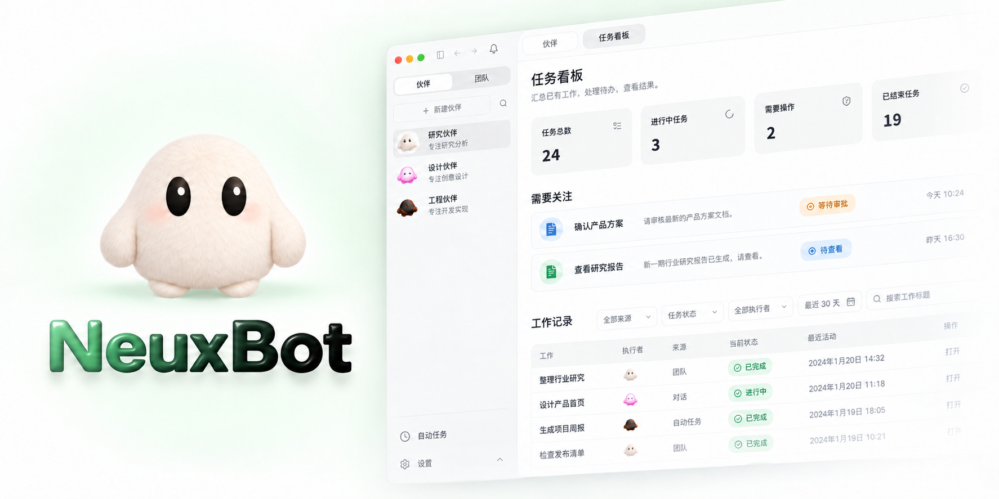
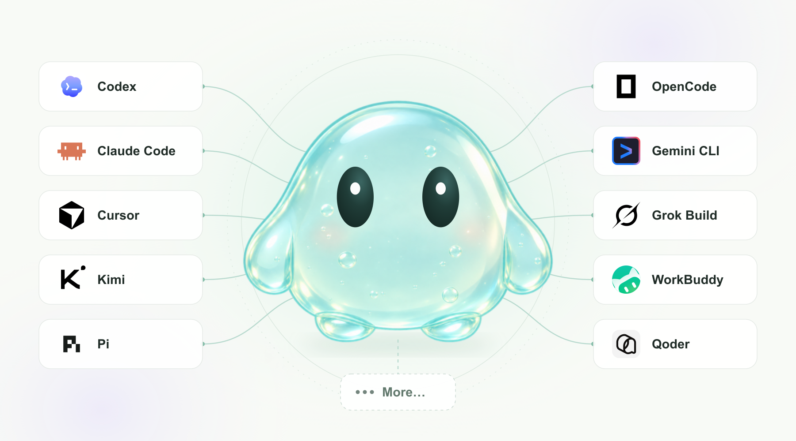

<div align="center">

[English](README.md) · **简体中文**

<h1>NeuxBot</h1>

<p><strong>和你的 AI 伙伴，一起把事情做好。</strong><br />
本地优先的桌面工作台，让你与 AI 团队一起工作。</p>

[](LICENSE)


[下载安装](https://github.com/JieWaZi/NeuxBot/releases) · [使用文档](docs/README.md) · [参与贡献](CONTRIBUTING.md)



<sub>产品示意图 · 示例数据 · 中文界面</sub>

</div>

NeuxBot 把 AI 工具、项目上下文与分工协作放进同一个本地桌面工作台。围绕自己的工作建立伙伴团队，从提出目标，到查看文件、代码改动与报告。

## 为什么用 NeuxBot？

- **让伙伴带着项目知识工作。** 为伙伴配置角色、档案、项目知识及所需的技能与资源，在日常任务、团队分工和工作流中复用这套配置。
- **自由选择工具与账号。** 根据任务选择 CLI、账号和模型，在同一处管理伙伴。既可沿用 CLI 原生登录，也可独立管理 AI 账号。
- **让协作形成可复用的工作。** 由团队负责人协调不同专长的伙伴、汇总成果；把经常做的事情通过对话编排成工作流，随时查看过程、处理审批与检查产出。

**支持的 CLI：** Codex · Claude Code · Cursor · Kimi · Pi · OpenCode · Gemini CLI · Grok Build · WorkBuddy · Qoder



<sub>多 CLI 支持示意图</sub>

伙伴与工作记录保存在本机，AI 请求使用你选择的服务商；模型与工具能力取决于实际 CLI 和账号。

## 可以交给它什么？

- **推进项目开发。** 让伙伴分工实现需求、审查改动与执行验证，在对话旁查看代码和报告。
- **完成专题研究。** 让不同伙伴从多个角度收集资料，汇总观点与来源，形成研究报告。
- **持续处理例行工作。** 通过对话创建项目周报工作流，按计划运行；也可从授权的 IM 聊天交办任务、接收成果。

## 开始使用

在 [Releases](https://github.com/JieWaZi/NeuxBot/releases) 查找安装包，或按下方步骤从源码运行。连接支持的 CLI 与账号，创建一位伙伴，把项目交给它。

<details>
<summary>从源码运行</summary>

准备 **Node.js 22**、**pnpm 10.34.4**，以及 [go.mod](server/go.mod) 指定的 Go 版本。

```sh
git clone https://github.com/JieWaZi/NeuxBot.git
cd NeuxBot
pnpm install --frozen-lockfile
go -C server mod download
pnpm dev:native
```

使用本机浏览器版时改为运行 `pnpm dev:web`，并输入终端输出的一次性配对码。同一数据目录只运行一个 Core。`pnpm package:web` 生成独立本机 Web 包，`pnpm build:native` 生成桌面安装包；运行要求与配对方式见[构建与发布](docs/development/build-and-release-cn.md)。

</details>

配置与使用见 [使用指南](docs/README.md)，系统命令能力见 [allycli 完整说明](server/cmd/allycli/README.md)，参与开发见 [贡献指南](CONTRIBUTING.md)。这些文档目前提供简体中文版本。

---

[MIT 许可证](LICENSE) · [第三方声明](THIRD_PARTY_NOTICES.md) · [问题反馈](https://github.com/JieWaZi/NeuxBot/issues) · 作者 [Ryan Wu / JieWaZi](https://github.com/JieWaZi)
