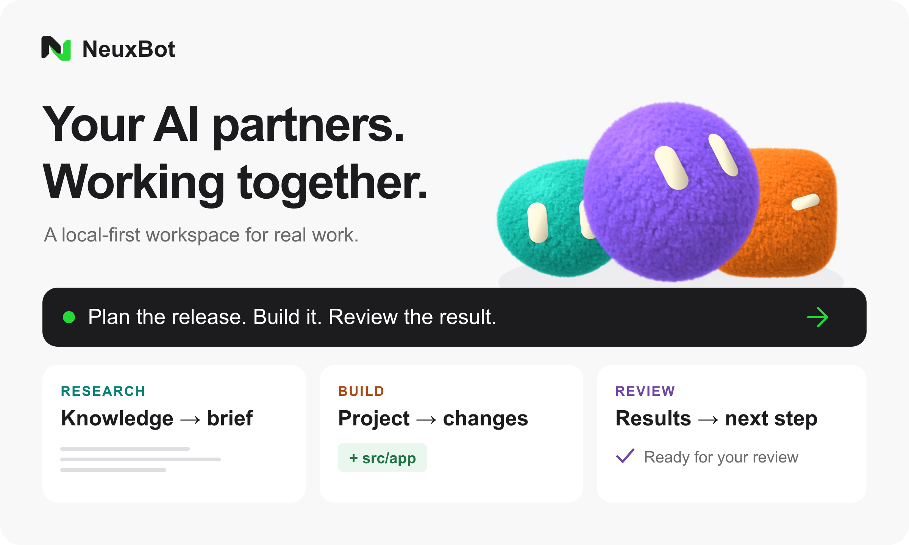
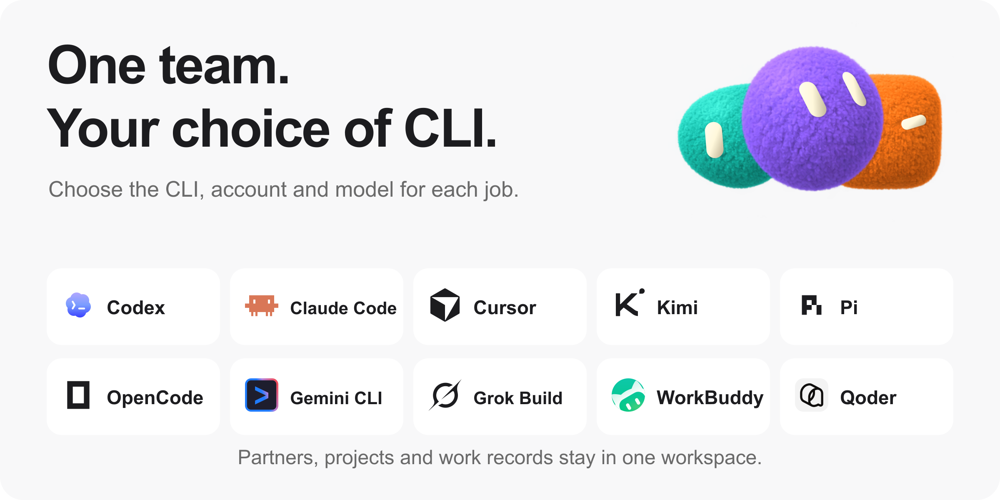

<div align="center">

[English](README.md) · **简体中文**

<h1>NeuxBot</h1>

<p><strong>和你的 AI 伙伴，一起把事情做好。</strong><br />
本地优先的 AI 工作台，连接伙伴协作、知识与自动化。</p>

[](LICENSE)


[下载安装](https://github.com/JieWaZi/NeuxBot/releases) · [使用文档](docs/README.md) · [参与贡献](CONTRIBUTING.md)



<sub>产品能力示意图</sub>

</div>

把目标交给一位伙伴或一支团队，一起推进工作，并在同一个工作台查看文件、代码改动与报告。NeuxBot 将长期伙伴、本机 CLI 智能体、知识与可复用工作流放在一起，可通过桌面应用或本机浏览器使用。

## 为什么用 NeuxBot？

- **让团队真正分工。** 负责人将任务委派给不同专长的伙伴，协调任务依赖并收集成员报告。在主会话跟进协作，进入成员会话查看具体工作，再验收交付结果。
- **让伙伴带着上下文持续工作。** 为伙伴配置角色、档案、形象、项目、记忆和已安装资源，在不同对话与团队任务中延续这个工作身份；按每次工作的需要选择 CLI、账号和模型。
- **让过程与成果都能查看。** 阅读执行过程、回答问题与处理审批，在对话旁查看文件、Git 改动、浏览器与终端。通过工作看板找到进行中的工作、待处理事项与待查看成果。

## 使用你选择的智能体

既可沿用 CLI 原生登录，也可独立管理 AI 账号。伙伴身份与资源由 NeuxBot 管理，实际模型和工具执行交给所选的本机 CLI。

**支持的 CLI：** Codex · Claude Code · Cursor · Kimi · Pi · OpenCode · Gemini CLI · Grok Build · WorkBuddy · Qoder



模型、权限、MCP 支持与运行中输入能力取决于实际安装的 CLI 和账号。配置及能力边界见[智能体与账号](docs/guide/agents-and-accounts-cn.md)。

## 让工作可以积累和复用

- **知识库与记忆。** 上传原始资料、整理为 Wiki、搜索知识并浏览图谱。使用本地知识库，或接入包括 WeKnora 在内的远端知识库。通过明确的记住、更新与遗忘操作，在伙伴或项目记忆中维护可复用知识。
- **插件、技能与 MCP。** 从目录安装插件，通过 GitHub 或 ZIP 导入独立技能，使用 MCP 连接外部工具。按伙伴选择资源，在输入框用 `/` 调用插件或技能，用 `#` 选择连接器。[资源与记忆 →](docs/guide/resources-cn.md)
- **通过对话创建工作流。** 描述输入、阶段和交付物，将工作编排为可复用流程。运行选定版本，在画布跟进步骤、处理人工问题，并查看产出和运行历史。[团队与工作流 →](docs/guide/teams-and-workflows-cn.md)
- **定时、API 与 IM。** 为伙伴、团队或工作流安排定时工作，或通过本机 API 触发自动任务。为指定 IM 聊天授权伙伴或团队，交办工作并接收成果；也可通过限定范围的 API 和 MCP 将知识提供给外部智能体。[自动任务与 IM →](docs/guide/automation-and-im-cn.md)

伙伴、配置与工作记录保存在本机；AI 请求与外部服务使用你选择的服务商。定时任务与 IM 接收依赖应用运行，以及设备保持唤醒和连接。

## 可以交给它什么？

- **把需求推进到验收。** 让团队实现功能、审查代码并执行检查，跟进各伙伴的工作，在工作台查看差异，并从任务入口处理验收。
- **让研究成为可复用知识。** 将原始资料放入知识库，让不同伙伴从多个角度研究，汇总为报告，并结合 Wiki 与原件检查结论。
- **持续处理例行工作。** 通过对话创建项目周报工作流并按计划运行，从授权的 IM 聊天交办后续工作、接收成果。

## 开始使用

在 [Releases](https://github.com/JieWaZi/NeuxBot/releases) 查找安装包，或按下方步骤从源码运行。连接支持的 CLI 与账号，创建一位伙伴，把项目交给它。

<details>
<summary>从源码运行</summary>

准备 **Node.js 22**、**pnpm 10.34.4**，以及 [go.mod](server/go.mod) 指定的 Go 版本。

```sh
git clone https://github.com/JieWaZi/NeuxBot.git
cd NeuxBot
pnpm install --frozen-lockfile
go -C server mod download
pnpm dev:native
```

使用本机浏览器版时改为运行 `pnpm dev:web`，按终端地址打开网页即可进入工作台，无需配对码。同一数据目录只运行一个 Core。`pnpm package:web` 生成独立本机 Web 包，`pnpm build:native` 生成桌面安装包；运行要求与启动方式见[构建与发布](docs/development/build-and-release-cn.md)。

审查尚未发布的本机插件源码时，先在明确选择的插件仓库运行 `npm ci`，再运行 `pnpm dev:native:plugins --plugins ../neux-plugins`。命令将真实包构建到该仓库的 `.cache/development/catalog`，并在开发进程期间提供下载服务；普通启动继续使用正式发布目录。

</details>

配置与使用见 [使用指南](docs/README.md)，系统命令能力见 [botcli 完整说明](server/cmd/botcli/README.md)，参与开发见 [贡献指南](CONTRIBUTING.md)。这些文档目前提供简体中文版本。

---

[MIT 许可证](LICENSE) · [第三方声明](THIRD_PARTY_NOTICES.md) · [问题反馈](https://github.com/JieWaZi/NeuxBot/issues) · 作者 [Ryan Wu / JieWaZi](https://github.com/JieWaZi)
