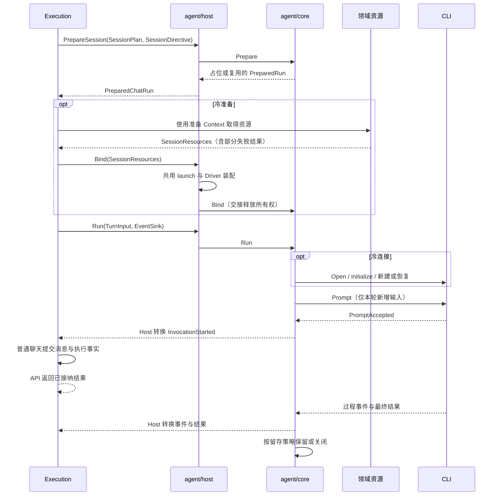
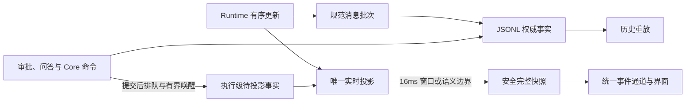

# 聊天与执行

## 数据与职责

Chat 是消息与原生会话的容器。用户输入、结构化执行事件和终态结果写入追加式 JSONL；查询索引与当前消息投影可以重建。SQLite 保存聊天聚合摘要、查询定位和其他业务数据，不另存一套 Execution 状态或可编辑聊天正文。

Execution 负责中立工作意图、权限和配置校验、业务接纳、执行终态及取消。`server/internal/agent/host` 将产品请求、资源、日志和交互端口接入执行内核，只保存工作区到 Runtime 的关联。

`agent/core` 的 Runtime 唯一维护技术会话、原生句柄、静态配置兼容性、活动调用和资源释放栈，不访问业务数据库。`agent/environment` 维护安装与探测事实；聊天、独立调用和管理操作共用其中的启动与认证生命周期。CLI 工厂和技术能力只在内核的 native Descriptor 注册表维护。职责详见[智能体与账号](runtimes-and-accounts-cn.md)。

## 输入与接纳

草稿在首次发送前保持本地。服务在真实接纳点形成执行身份与消息事实；未接纳输入不能伪装成已发送。客户端请求身份区分正在接纳、成功接纳与结果不确定，避免重复首次发送。

客户端先按实际请求内容准备已有幂等身份，再创建临时消息和提交请求。用户与助手消息、安全事件及接纳回执复用同一 `submissionId` 关联；首发映射创建请求的 `clientRequestId`，续聊从发送入口传递原提交身份。持久事实可以先于 HTTP 回执抵达，前端按明确关联接管临时输入，不比较正文或猜测下一个消息。

点击发送后，界面立即沿本次提交状态显示“工作中”和停止入口，不等待 Chat ID 或后端接纳；准备失败后恢复输入并显示对应错误。该交互反馈不提前生成已接纳的服务端消息事实。

续聊使用原 Chat 的工作范围和可用原生会话。运行中输入按能力进入即时输入或临时队列；输入未被接纳前仍可编辑。队列不作为已提交消息权威。

执行准备分开读取当前 Chat/原生续接、精确提交收据、指定执行和明确历史交接，不使用完整消息聚合作为通用上下文。一次已有 Chat 接纳在原操作占位中读取一次当前上下文；热续发不读取历史窗口。新原生会话才按配置选择最近可交接的完整成功轮，再读取所需正文并应用总量上限；失败、取消和内部消息不占用完整成功轮的数量，正文超限按既有规则裁剪。

指定执行、首次执行与原提交收据通过可重建定位索引找到 JSONL 的准确位置。定位索引只保存原身份、序号及已覆盖游标，不拥有状态或消息；覆盖落后只追平日志尾部，缺失和损坏走原权威恢复。详情文件差异、真实分叉和显式摘要继续按各自需求读取，不进入普通热续聊。

聊天目录只返回游标页，不附带默认项目的全历史查询。普通伙伴与团队草稿在所属伙伴确定后按需查询最近可用项目；候选按活动游标有界推进，失效项目不会令有效的更早候选被任意截断。已有 Chat、运行中发送和终态不重新查询草稿默认项目。

聊天采用 `Prepare → 冷路径取得资源 → Bind → Run`。SessionPlan 固定程序、工作范围和静态能力；TurnInput 携带当前消息、资源选择及交互；SessionResources 交接实际物化结果及释放能力。Runtime 在唯一会话锁下占用并判断复用，关闭不兼容消费者；冷资源由 Execution 顺序取得，不通过 Core → Host → Execution 的回调链获取。

Bind 后技术资源归 Core，实际插件版本和原生范围等具名事实供 Execution 构造接纳记录。Run 显式接收本轮输入与处理器，冷路径此时才打开连接。普通聊天在原生输入已接纳事件后提交用户消息和执行事实，再返回 API 接纳结果；持久编排入口按其既有接纳策略执行，不把资源准备成功当作模型已接收输入。

热续聊保留原生消费者及其租约，不重复取得账号和插件。每轮选择、使用引用、审批、提问和软件授权独立更新；本轮授权结束不提前释放热会话文件。准备被放弃时，冷资源回收，兼容热消费者保留。账号或插件管理由 Runtime 统一检查并回收闲置消费者，活动调用返回 Busy。关闭失败保留原资源及依赖，只重试清理。隐藏摘要以只读交接策略经过同一准备路径，并强制关闭临时消费者。

热插件兼容判断只取得当前伙伴已启用的固定版本、内容摘要、信任事实和配置修订，不展开所有版本、其他伙伴安装或解密配置。实际版本包、普通配置和秘密归冷 Acquire；私有身份材料继续在原身份占用取得后读取。管理读取不进入这条执行声明路径。

## 实时与恢复

持久事件使用领域游标，临时流式事件只描述当前过程。事件通过统一资源通道交付；连接中断、序号缺口和缓冲超限后读取权威历史或快照。恢复期间保留已有内容及未知状态，不假定执行结束。

聊天查询各有明确用途：接纳回执提供已经提交的聊天事实，实时流展示尚未持久化的过程；连续持久事件携带完整安全消息快照，合并原消息 Query Cache 并推进持久游标。正常终态不重复读取最近五十条；首次进入、刷新、断线、缺口及无法证明连续性时才补读权威快照或增量。只取最新一条不能替代完整恢复。插件输入候选按所选伙伴读取轻量固定版本引用，只随相关安装、启停、版本或展示资料变化更新；共享配置、授权与使用变化不重取候选。分叉能力随消息窗口和原持久事件增量投影，不另读全历史候选；忙碌条件由会话事实决定，仅末轮能力使用最新窗口的目标身份，旧分页不提供该全会话身份。伙伴聊天活动不触发无关团队目录刷新。同查询的事件合并与隐藏恢复遵守[查询与事件所有权](notifications-and-work-board-cn.md#查询与事件所有权)。

消息所有者统一处理初始窗口、连续事件、分页、游标和临时消息接管。页面只装配输入、路由和元数据刷新，不在执行完成回调中决定是否重读消息；不保存另一份需要被动同步的权威历史。原始持久事件先完整投影，渲染批次才可按消息合并；临时流不推进持久游标，迟到快照不能覆盖较新事实。

首发接纳保留已有消息、头像和聊天组件的呈现身份；草稿转真实 Chat 时不以身份同步或后台补读为由切回骨架屏。没有内容的首次加载仍显示骨架。运行标记服从执行终态，正文已显示不等于 CLI 已结束；CLI 返回前可能仍有工具或原生收尾，不能由最后一个文本片段推测终态。

Scene 或嵌入工作区既有身份拥有消息视图生命周期，服务器 Chat ID 只绑定数据源。首发交接沿用原呈现身份；真正切换聊天时重建对应消息所有者及 assistant-ui view，不能先显示上一会话再通过 Effect 修正。

每次 Runtime 调用的原始停止原因、归一化终止原因与失败诊断随 Invocation 写入 JSONL。指定 Execution 的 outcome 从同一份日志读取该执行最后一次已持久调用；旧日志和没有调用事实的执行返回 unknown，不根据退出码或最新回复推断正常。普通聊天的 Completed 保留既有生命周期语义；要求完整结果的调用方还必须检查正常终止和调用失败事实。

最近一条助手消息使用动态头像；更早的助手消息保留名称并使用同风格的普通静态图片，不挂载动画引擎。末尾追加用户消息不改变最近助手头像的动态资格。

过程投影按发生顺序组合说明、思考与工具活动。最终正文独立显示，工具名称、输入和结果经过统一语义摘要；文件、敏感值与原始诊断遵守展示边界。

工具开始、累计参数快照、执行进度与终态分别归一为 `tool_use`、`tool_input_snapshot`、`tool_update` 和 `tool_result`。工具展示身份由 Invocation 与原生工具标识共同确定，原生标识仍用于审批与原生定位，前端按展示身份区分重试中重复的原生标识。同一调用更新现有部件，不表示再次执行；开始事实立即持久化，连续参数只保留最新字段，到正文、其他工具、执行进度或调用结束时提交。

工具展示按当前安全事实重新派生，不能把部分路径或命令的早期推断固化为最终值。省略字段沿用，显式空输入清除旧参数；ACP Content 与 Locations 按完整集合替换，显式 `[]` 清除旧集合，传输编码不能抹去这一区别。Content 更新保留原始顺序，终端或 MCP 的增量依其明确协议字段解释，不把所有工具正文猜成累计快照或 Token 增量。同一工具的进度达到 128 项或 256 KiB 时提交，消息边界与取消时提交余量；单条超过阈值的更新不截断。连续完整工具快照由 `eventlog` 文件编解码层在差量更小时压缩，所有日志读取入口在返回记录前恢复完整规范事件并校验基准。Execution 与 MessageView 不持有差量基准、不解释文件补丁；规范工具身份统一使用 Runtime 输出的 `toolCallId`，不再猜测原生字段别名。公开历史和实时投影只持有当前有界安全事实，完整参数与 Diff 由权威日志按需重放。压缩前后必须产生相同的最终公开投影。

高频正文、工具进度和参数先逐条进入唯一实时状态，最多每 16ms 生成并广播一份完整安全快照；工具开始、工具终态与执行收尾立即交付。窗口只合并公开快照，不丢弃原始内容。即使没有下一条更新，定时窗口仍公开最新状态；收尾取消旧窗口并使迟到回调失效，避免终态后重新出现实时消息。JSONL 游标仍仅由权威提交推进。

连续文本只解码新片段并追加到唯一文本缓冲，类型切换或持久化边界才编码完整语义段；实时正文和展示段引用缓冲的不可变前缀，追加不能改写已经交付的旧快照。不能逐 Token 反复解码、拼接和重编码已经累积的全文，否则即使广播限频，文本分配仍随长度平方增长。

审批、问答与 Core 命令先提交权威事实，再进入执行级待投影队列。容量为 1 的唤醒只合并通知，不覆盖事实；执行开始前显式启动唯一消费者，结束时先停止消费者，再追平余量并提交终态。Runtime 更新、显示窗口和 Flush 都由同一实时投影消费这些事实，不能让后续 transient 覆盖已持久的审批结果。原生交互的 Invocation 来自 Runtime Bridge，不能从最后出现的工具或当前界面推断；旧调用迟到的批准不能作用于复用同一原生工具标识的新调用。

历史消息按索引窗口单次折叠权威事件，文件变更摘要在生成消息快照时统一派生，不在每条事件之后重新扫描历史。公开历史、实时快照和工作成果判断不计算完整文件 Diff；分叉和文件详情需要的完整差异在内部消息快照边界计算，继承消息保留已有差异。上述视图均从 JSONL 派生，不另存一份消息正文或持久快照缓存。

消息列表首屏只读取最近五十条，上滚接近顶部时按创建游标加载更早窗口，并保留手动加载入口。滚动、按钮和成果定位共用在途翻页，前插消息补偿滚动位置；失败停止自动重试，切换会话后旧请求不能恢复新会话的滚动位置。最新窗口始终向服务端对账，已加载且游标完全匹配的旧窗口复用 Query Cache；新消息改变分页边界时按新游标读取，避免历史缺口。隐藏会话暂停历史查询和实时消费，恢复可见后按原游标对账。

实时投影从当前执行的事实范围建立，能力鉴权只追平并读取 Chat 身份与活动执行。日志身份和版本未变化时复用已恢复的索引作用域，仍校验索引锚点；事件恢复在游标前只折叠状态，游标后才生成公开快照。订阅交付完积压后释放中间快照，前端持久游标在事件批次实际投影后推进，避免隐藏或切换时丢弃未显示批次却跳过恢复。

## 错误与重试

配置和发送错误在对应操作区域反馈；执行失败保留在消息中。CLI 结构化证据与可读原因分别保存，错误恢复成功后清除对应操作错误。

重放必须同时满足可证明的安全条件，包括执行归属、最后一次执行、可靠原生会话及副作用边界。未知外部效果保留失败事实，不自动重复执行。团队和工作流使用各自控制入口。

会话分叉根据 Runtime 明确能力执行，保留来源回合与所需配置。消息投影只公开安全可用性、末轮约束和禁用原因；原生句柄与位置留在 Core 内部。实际 POST 仍重读权威事实核验目标、原生位置与会话状态。未知格式或不支持的原生能力返回不可用，不伪造分叉会话。

## 阶段耗时

Execution 记录 `input_preparation`（业务输入、范围和静态声明准备）与 `resource_preparation`（冷资源取得、物化和绑定）。Core 通过宿主注入的标准 Logger 记录 `cli_initialization`（原生连接及会话初始化）与 `input_acceptance`（提交本轮输入至真实接纳）；诊断不进入聊天消息、领域事件或模型输入。

各阶段使用 `elapsed_ms`，资源准备和 CLI 初始化以 `reused=true`、零初始化耗时明确表示热复用。业务阶段携带 Chat、Execution 和 Runtime 身份；技术阶段携带工作区、Invocation 和技术会话身份。CLI 初始化与输入接纳分别计时，不能把整轮模型响应时间算作初始化。日志不记录输入正文、凭据和环境；实际协议错误仍由原故障边界负责。

代码入口为 `services/chat`、`services/execution`、`internal/agent/{core,host,environment}`、`internal/chat/{eventlog,eventstream,messageview}` 及前端 `modules/chat`。
