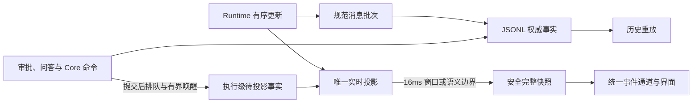

# 聊天与执行

## 数据与职责

Chat 是消息与原生会话的容器。用户输入、结构化执行事件和终态结果写入追加式 JSONL；查询索引与当前消息投影可以重建。SQLite 保存执行状态、查询所需索引和其他业务数据，不形成另一份可编辑聊天正文。

Execution 负责中立工作意图、权限和配置校验、运行生命周期及取消。Runtime 负责启动智能体、交付输入、原生会话与协议事件，不访问业务数据库。

## 输入与接纳

草稿在首次发送前保持本地。服务在真实接纳点形成执行身份与消息事实；未接纳输入不能伪装成已发送。客户端请求身份区分正在接纳、成功接纳与结果不确定，避免重复首次发送。

续聊使用原 Chat 的工作范围和可用原生会话。运行中输入按能力进入即时输入或临时队列；输入未被接纳前仍可编辑。队列不作为已提交消息权威。

## 实时与恢复

持久事件使用领域游标，临时流式事件只描述当前过程。事件通过统一资源通道交付；连接中断、序号缺口和缓冲超限后读取权威历史或快照。恢复期间保留已有内容及未知状态，不假定执行结束。

每次 Runtime 调用的原始停止原因、归一化终止原因与失败诊断随 Invocation 写入 JSONL。指定 Execution 的 outcome 从同一份日志读取该执行最后一次已持久调用；旧日志和没有调用事实的执行返回 unknown，不根据退出码或最新回复推断正常。普通聊天的 Completed 保留既有生命周期语义；要求完整结果的调用方还必须检查正常终止和调用失败事实。

过程投影按发生顺序组合说明、思考与工具活动。最终正文独立显示，工具名称、输入和结果经过统一语义摘要；文件、敏感值与原始诊断遵守展示边界。

工具开始、累计参数快照、执行进度与终态分别归一为 `tool_use`、`tool_input_snapshot`、`tool_update` 和 `tool_result`。工具展示身份由 Invocation 与原生工具标识共同确定，原生标识仍用于审批与原生定位，前端按展示身份区分重试中重复的原生标识。同一调用更新现有部件，不表示再次执行；开始事实立即持久化，连续参数只保留最新字段，到正文、其他工具、执行进度或调用结束时提交。

工具展示按当前安全事实重新派生，不能把部分路径或命令的早期推断固化为最终值。省略字段沿用，显式空输入清除旧参数；ACP Content 与 Locations 按完整集合替换，显式 `[]` 清除旧集合，传输编码不能抹去这一区别。Content 更新保留原始顺序，终端或 MCP 的增量依其明确协议字段解释，不把所有工具正文猜成累计快照或 Token 增量。同一工具的进度以有界批次保存，达到 128 项或 256 KiB 时提交，消息边界与取消时提交余量。公开历史和实时投影只持有当前有界安全事实，完整参数与 Diff 由权威日志按需重放。压缩前后必须产生相同的最终公开投影。

高频正文、工具进度和参数先逐条进入唯一实时状态，最多每 16ms 生成并广播一份完整安全快照；工具开始、工具终态与执行收尾立即交付。窗口只合并公开快照，不丢弃原始内容。即使没有下一条更新，定时窗口仍公开最新状态；收尾取消旧窗口并使迟到回调失效，避免终态后重新出现实时消息。JSONL 游标仍仅由权威提交推进。

连续文本只解码新片段并追加到唯一文本缓冲，类型切换或持久化边界才编码完整语义段；实时正文和展示段引用缓冲的不可变前缀，追加不能改写已经交付的旧快照。不能逐 Token 反复解码、拼接和重编码已经累积的全文，否则即使广播限频，文本分配仍随长度平方增长。

审批、问答与 Core 命令先提交权威事实，再进入执行级待投影队列。容量为 1 的唤醒只合并通知，不覆盖事实；执行开始前显式启动唯一消费者，结束时先停止消费者，再追平余量并提交终态。Runtime 更新、显示窗口和 Flush 都由同一实时投影消费这些事实，不能让后续 transient 覆盖已持久的审批结果。原生交互的 Invocation 来自 Runtime Bridge，不能从最后出现的工具或当前界面推断；旧调用迟到的批准不能作用于复用同一原生工具标识的新调用。

历史消息按索引窗口单次折叠权威事件，文件变更摘要在生成消息快照时统一派生，不在每条事件之后重新扫描历史。公开历史、实时快照和工作成果判断不计算完整文件 Diff；分叉和文件详情需要的完整差异在内部消息快照边界计算，继承消息保留已有差异。上述视图均从 JSONL 派生，不另存一份消息正文或持久快照缓存。

消息列表首屏只读取最近五十条，上滚接近顶部时按创建游标加载更早窗口，并保留手动加载入口。滚动、按钮和成果定位共用在途翻页，前插消息补偿滚动位置；失败停止自动重试，切换会话后旧请求不能恢复新会话的滚动位置。最新窗口始终向服务端对账，已加载且游标完全匹配的旧窗口复用 Query Cache；新消息改变分页边界时按新游标读取，避免历史缺口。隐藏会话暂停历史查询和实时消费，恢复可见后按原游标对账。

实时投影从当前执行的事实范围建立，能力鉴权只追平并读取 Chat 身份与活动执行。日志身份和版本未变化时复用已恢复的索引作用域，仍校验索引锚点；事件恢复在游标前只折叠状态，游标后才生成公开快照。订阅交付完积压后释放中间快照，前端持久游标在事件批次实际投影后推进，避免隐藏或切换时丢弃未显示批次却跳过恢复。

## 错误与重试

配置和发送错误在对应操作区域反馈；执行失败保留在消息中。CLI 结构化证据与可读原因分别保存，错误恢复成功后清除对应操作错误。

重放必须同时满足可证明的安全条件，包括执行归属、最后一次执行、可靠原生会话及副作用边界。未知外部效果保留失败事实，不自动重复执行。团队和工作流使用各自控制入口。

会话分叉根据 Runtime 明确能力执行，保留来源回合与所需配置。未知格式或不支持的原生能力返回不可用，不伪造分叉会话。

代码入口为 services/chat、services/execution、internal/chat/{eventlog,eventstream,messageview} 及前端 modules/chat。
