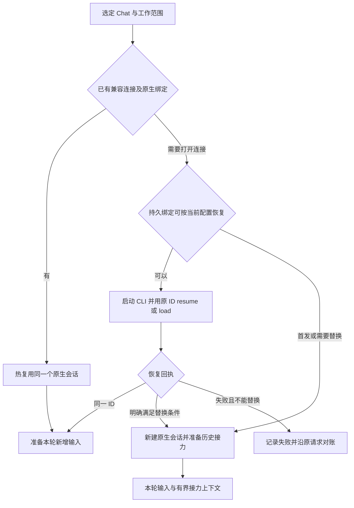

# 会话身份、续接与恢复

重启 Core 后，下一次发送优先用新的 CLI 进程恢复原来的原生会话 ID。Codex 恢复已有线程走 `thread/resume`，新建线程才走 `thread/start`。恢复成功时，Core 向原生会话发送当前输入及其本轮上下文。只有选择或回退到新原生会话时，才需要从 Core 的记录接力历史。

## 会话身份

| 对象 | 用途与持久边界 |
| --- | --- |
| 伙伴或团队的主会话 | 每个主体有一个固定的公开时间线，保存用户交办和发给用户的结果。SQLite 保存公开消息及它们关联的来源。 |
| 普通对话 | 独立的 Chat。点「＋」先打开草稿，首次发送接纳后确定 Chat 和工作范围。后续输入沿用该 Chat。 |
| 来源工作记录 | 主会话背后的 Chat。保存工具过程、实际结果、工作范围和原生会话绑定，也可以在这里续聊。 |
| 原生会话 | Codex、Claude 等 CLI 持有的历史身份。一个 Chat 随时间可以绑定不同的原生会话。Core 保存有效绑定，CLI 管理其厂商历史。 |
| CLI 进程或连接 | 运行中的原生客户端。可以随 Core 退出、闲置或配置变化关闭。重新拉起客户端仍可以恢复原生会话。 |
| 本轮执行 | 一次已接纳的输入及其处理过程。普通续聊通常新增执行，并复用原 Chat 和原生会话。 |

主会话里直接交办时，Core 按主会话、实际执行伙伴和授权工作范围选择来源 Chat。同一来源可以承载多轮。切换到另一个项目、变更项目授权范围，或团队新交办改由新负责人执行时，可能选中另一个来源。引用原消息、从原工作记录发言时，Core 先校验权限，再沿原来源继续。主会话与工作记录里的交互、发言和阅读规则见[聊天与执行](chat-and-execution-cn.md#主会话和来源工作记录)。

面板既能展示旧消息，也可能因为厂商历史文件缺失而无法恢复旧原生会话。前者由 Core 的 SQLite 和 JSONL 支持，后者取决于原生绑定、授权范围和 CLI 实际保存的历史。存储位置见[工作区与存储](workspace-and-storage-cn.md#存储目录)。

## 一条输入如何选择原生会话

| 场景 | 实际路径 |
| --- | --- |
| 同一 Chat 有可用连接，配置可继续使用 | 热复用。原生会话 ID 保持，支持会话 setter 的设置可就地修改。 |
| Core 或 CLI 重启，或者需要重开进程，但原生历史身份仍兼容 | 冷恢复。重开连接，优先 `resume`，没有 Resume 能力时尝试 `load`。恢复回执须对应原 ID。 |
| 关闭窗口或重新载入界面 | 桌面关闭窗口一般是隐藏，Core 仍在运行。界面重读旧消息沿持久记录进行。真正退出或进程重启的行为见[桌面生命周期](desktop-lifecycle-cn.md#进程)。 |
| 首次发送，或该 Chat 没有可用的持久绑定 | 创建原生会话。已有可交接的历史时按规则携带。 |
| 用户选择重新创建原生会话，或者原生历史身份与配置不再兼容 | 创建原生会话。常见差异包括不同的执行智能体、账号主体、历史目录、授权工作范围或启动权限。指令和资源变化能否沿原 ID 恢复取决于 CLI 的重载能力。 |
| 原生明确报告旧会话不存在，或 CLI 同时缺少 Resume 与 Load | 在允许替换时新建原生会话。需要保留原生身份的上下文档位变更，以及仍待确认消费的历史接力，会阻止这次替换。 |
| Codex 明确返回本次请求的原线程缺少持久历史 | 主会话及来源工作记录的用户输入在实际接纳前可以尝试一次替换。前提包括原绑定没有待处理的交接、当前配置允许新会话，且请求仍有效。普通对话的通用恢复失败不走这一特例。 |
| 会话忙、占用、传输中断、超时或原生只返回模糊的失败 | 保留失败边界并沿原提交核对。以上现象本身不构成允许自动换会话的证据。 |
| 从这里分支 | 用户发起独立的原生分支，由 CLI 在所选回合创建分支，Core 发布新的普通 Chat。具体支持取决于原生能力和回合位置。 |

重启发生在上一轮进行中时，需要独立判断上一轮是否已接纳以及原生执行是否已产生终态。系统用原提交标识对账。新的续聊会话和上一轮回执恢复分别处理，未知外部效果不会靠自动重发补齐。执行与恢复的边界见[聊天与执行](chat-and-execution-cn.md#输入与接纳)。

## 历史接力与自动任务

普通的热复用和恢复同一个原生会话依赖 CLI 已持有的历史。只有新原生会话需要历史接力时，Core 默认选择同一 Chat 最近五个完整成功轮次。显式设置最多二十轮，合计历史正文不超过 64 KiB。未完成、失败、取消及内部消息不占完整轮次。用户显式选择总结时，可在可验证的旧原生会话上生成私有交接；总结不可用时可沿现有规则使用近期轮次。待确认的交接按原消费回执核对，已确认的交接不会随每条输入重复携带。[历史接力实现](../../server/internal/agent/history_handoff.go)

自动任务每次接纳新的触发机会，会按执行目标建立本次 Chat、团队对话或工作流运行。这是业务运行隔离。恢复同一个触发机会沿原回执核对，任务的普通续聊依然遵循上面的 CLI 续接规则。[自动任务与 IM](automation-and-im-cn.md#自动任务)

## 从日志确认实际走了哪条路

桌面托管 Core 的日志写入应用数据目录的 `logs/desktop.log`。独立 Core 使用其启动环境的日志输出。用 `chat_id` 看同一对话、用 `execution_id` 看单轮、用 `trace_id` 串联 HTTP 与适配器诊断。

每次走到原生会话选择时，Core 记录一条 `native session decision`。`result=ready` 表示会话和本轮接力准备完成，后续输入接纳和执行终态仍由各自记录确认。`previous_session_ref` 与 `session_ref` 是同一套稳定摘要，可跨进程比较，缺失时为 `-`。

| 日志组合 | 如何解读 |
| --- | --- |
| `action=reuse reason=compatible_session` | 本轮沿用活跃连接上的原生会话。 |
| `action=resume` 或 `action=load`，`result=ready` | 重开连接后恢复原绑定。正常情况下前后两个会话摘要相同。 |
| `action=start reason=no_binding` | 没有可用的旧绑定，调用了新建。 |
| `action=start reason=explicit_new`、`provider_changed`、`account_subject_changed`、`history_identity_changed` 或 `resources_or_instructions_changed` | 根据显式选择或兼容性判断调用了新建。 |
| `action=start reason=native_session_missing`、`native_restore_unsupported` 或 `missing_persisted_history` | 恢复路径符合自动替换条件，调用了新建。`handoff=recent` 或 `summary` 分别表示准备了近期轮次或私有总结。 |
| `action=resume` 或 `action=load`，`result=failed` | 本轮恢复失败。用同一 `trace_id` 查 `native agent operation failed`，读取实际操作、RPC 错误码和安全原因。已知忙碌记录为 `native_busy`。无法确认原因时保留通用诊断。 |

输入接纳前的 `native execution preparation failed` 给出工作 Chat、执行标识和失败阶段。已经接纳的执行在后台失败时，`native execution settlement failed` 区分原生执行、存储、事件交付和清理故障。日志只保留诊断所需的身份和枚举原因，不携带消息正文、历史内容或凭据。

## 实现与验证入口

- [主会话交办](../../server/apis/main_conversations/send.go) 与[工作来源](../../server/services/mainconversation/work_source.go) 负责把公开交办路由到实际 Chat。
- [ThreadLifecycle](../../server/internal/agent/thread_lifecycle.go) 负责热复用、冷恢复与新建决策，[原生日志](../../server/internal/agent/agent_diagnostics.go) 记录决策和安全原因。
- [续聊契约测试](../../server/internal/agent/thread_lifecycle_test.go) 对照真实协议请求验证同一 Chat 的首轮、热复用和冷恢复。[执行层测试](../../server/services/execution/native_turn_test.go) 验证缺少旧历史时的来源工作恢复边界。
