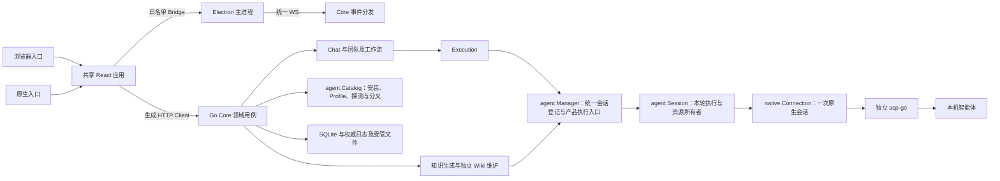

# 架构总览

NeuxBot 是本地优先的伙伴工作台。Web 和 Electron 各自承载宿主能力，共享 React 应用承载界面，Go Core 拥有业务规则、文件、Git、终端执行与持久化，智能体适配隐藏原生 CLI 的协议差异。

下图表示主要调用方向。

## 所有权

- Chat 保存消息权威日志与原生会话关联；Execution 管理接纳、执行、取消和失败恢复。
- 普通聊天、团队、工作流、自动任务和 IM 共用 Execution 的单一 Runtime 端口；领域能力通过既有授权与资源端口注入，Session 不接管业务编排。
- 应用只装配一个 `agent.Manager`，统一登记聊天工作区与独立任务的临时 Session。每个 `agent.Session` 唯一拥有稳定计划、配置兼容依据、当前 Turn、真实原生句柄、连接和可重试资源释放进度；Manager 只管理索引、接纳和根生命周期。
- 聊天和独立任务共用 `Prepare → 冷路径取得资源 → Bind → Run`：Prepare 占用本轮并判断复用，调用方显式取得领域资源，首次冷 Bind 接管实际或部分资源，Run 才打开必要的原生连接并提交输入。热续聊沿用资源，当前授权单独撤销；关闭失败保留同一所有者，只重试清理。
- `agent.Catalog` 保存安装、Profile、探测和启动事实并编排无 Prompt 的 Probe/Fork。`agent/native` 只提供一次原生连接、唯一 Descriptor/工厂、启动认证 `LaunchLease` 和独立 Management；它不反向依赖根 Agent。软件能力目录、授权与回执归 `agent/capability`，allycli 客户端归 `agent/cli`。
- Channel 管理团队成员、任务与协作；Workflow 管理源码版本、编译产物和运行状态。
- 自动任务和 IM 管理触发、授权及交付关系，复用已有执行入口。
- 伙伴、项目、插件、技能、连接器、账号和记忆各自维护其业务事实。
- 工作看板与通知读取原领域状态，不复制执行生命周期。

前端服务器事实由 TanStack Query 管理，资源事件用于增量更新或精确失效。Native 通过 Electron 主进程、Web 通过浏览器各自持有一条 Core 全局 WebSocket；文件与 Git 的原生文件事件复用该连接。PTY 字节流使用专用受认证连接。普通业务操作继续使用 REST。

## 代码导航

| 路径                           | 职责                                          |
| ------------------------------ | --------------------------------------------- |
| packages/frontend/src/app      | 路由、Scene 和跨模块装配                      |
| packages/frontend/src/modules  | 产品领域界面与查询                            |
| packages/frontend/src/shared   | 组件、API、主题与平台服务                     |
| desktop/src / desktop/electron | 原生入口、窗口、preload、系统能力与嵌入浏览器 |
| web/src                        | 本机会话生命周期与浏览器宿主                  |
| packages/platform-contracts    | 中立能力接口和事件协议                        |
| server/internal/agent          | Manager、Session、产品合同、资源装配、目录与诊断 |
| server/internal/agent/native   | 一次原生连接、协议、CLI 工厂、启动认证与管理连接 |
| server/internal/agent/capability | 命令目录、精确授权、有界观察与领域回执 |
| server/internal/agent/cli      | allycli 参数解析、发现与客户端调用 |
| packages/terminal-runtime      | Core 管理的 PTY 与终端屏幕运行时              |
| server/apis                    | HTTP Operator、校验及单入口用例               |
| server/services                | 多入口复用业务与后台生命周期                  |
| server/repositories            | 持久化模型、查询及事务实现                    |
| server/internal                | Runtime、日志、文件、编译器等内部能力         |
| skills/ally                    | 随应用交付的系统任务知识                      |

当前交付方式包括原生应用和浏览器访问本机回环 Core。Web 包使用 Node.js 22+ 启动器；Native 使用随 Electron 交付的运行时。产品与主仓库名称为 NeuxBot，内部 workspace 包使用 `@neuxbot/*`，Go 模块使用 `github.com/JieWaZi/NeuxBot/server`；整个 Agent 子系统属于该模块，没有独立 `go.mod`。acp-go 继续在独立仓库维护并固定依赖版本。`allycli`、`ALLY_*`、已有 `NEUXALLY_*` 插件环境变量、`neuxally-auth/1`、`neuxally-resource://` 和知识集成的服务身份继续作为稳定技术契约；独立插件源位于 `JieWaZi/neux-plugins`。受管文件根目录与程序数据目录分别管理，具体布局见 [工作区与存储](workspace-and-storage-cn.md)。Agent 的调用、并发和清理边界见 [Agent 子系统](../../server/internal/agent/README.md)。

修改前阅读根目录 AGENTS.md，具体数据边界见 [工作区与存储](workspace-and-storage-cn.md)。

插件资源、伙伴安装、共享授权与版本快照见 [插件资源](plugin-resources-cn.md)。

知识库的独立核心、SQLite 权威、原件与本地／远端执行边界见 [知识库](knowledge-cn.md)。
