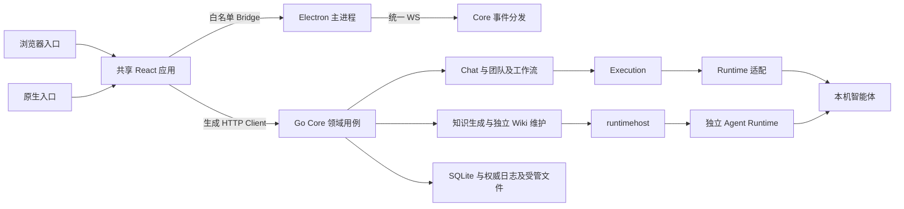

# 架构总览

NeuxBot 是本地优先的伙伴工作台。Web 和 Electron 各自承载宿主能力，共享 React 应用承载界面，Go Core 拥有业务规则、文件、Git、终端执行与持久化，智能体适配隐藏原生 CLI 的协议差异。

## 所有权

- Chat 保存消息权威日志与原生会话关联；Execution 管理接纳、执行、取消和失败恢复。
- Channel 管理团队成员、任务与协作；Workflow 管理源码版本、编译产物和运行状态。
- 自动任务和 IM 管理触发、授权及交付关系，复用已有执行入口。
- 伙伴、项目、插件、技能、连接器、账号和记忆各自维护其业务事实。
- 工作看板与通知读取原领域状态，不复制执行生命周期。

前端服务器事实由 TanStack Query 管理，资源事件用于增量更新或精确失效。Native 通过 Electron 主进程、Web 通过浏览器各自持有一条 Core 全局 WebSocket；文件与 Git 的原生文件事件复用该连接。PTY 字节流使用专用受认证连接。普通业务操作继续使用 REST。

## 代码导航

| 路径                           | 职责                                          |
| ------------------------------ | --------------------------------------------- |
| packages/frontend/src/app      | 路由、Scene 和跨模块装配                      |
| packages/frontend/src/modules  | 产品领域界面与查询                            |
| packages/frontend/src/shared   | 组件、API、主题与平台服务                     |
| desktop/src / desktop/electron | 原生入口、窗口、preload、系统能力与嵌入浏览器 |
| web/src                        | 本机会话生命周期与浏览器宿主                  |
| packages/platform-contracts    | 中立能力接口和事件协议                        |
| packages/agent-runtime         | 独立调用、会话、最终结果与公开 ACP 驱动       |
| server/internal/runtimehost    | CLI 启动事实、账号租约与独立任务装配          |
| packages/terminal-runtime      | Core 管理的 PTY 与终端屏幕运行时              |
| server/apis                    | HTTP Operator、校验及单入口用例               |
| server/services                | 多入口复用业务与后台生命周期                  |
| server/repositories            | 持久化模型、查询及事务实现                    |
| server/internal                | Runtime、日志、文件、编译器等内部能力         |
| skills/ally                    | 随应用交付的系统任务知识                      |

当前交付方式包括原生应用和浏览器访问本机回环 Core。Web 包使用 Node.js 22+ 启动器；Native 使用随 Electron 交付的运行时。产品与主仓库名称为 NeuxBot，内部 workspace 包使用 `@neuxbot/*`，Go 模块使用 `github.com/JieWaZi/NeuxBot/server`。`allycli`、`ALLY_*`、已有 `NEUXALLY_*` 插件环境变量、`neuxally-auth/1`、`neuxally-resource://` 和知识集成的服务身份继续作为稳定技术契约；独立插件源位于 `JieWaZi/neux-plugins`。受管文件根目录与程序数据目录分别管理，具体布局见 [工作区与存储](workspace-and-storage-cn.md)。

修改前阅读根目录 AGENTS.md，具体数据边界见 [工作区与存储](workspace-and-storage-cn.md)。

插件资源、伙伴安装、共享授权与版本快照见 [插件资源](plugin-resources-cn.md)。

知识库的独立核心、SQLite 权威、原件与本地／远端执行边界见 [知识库](knowledge-cn.md)。
