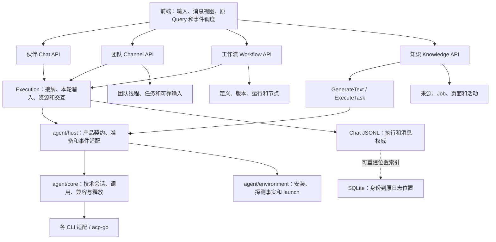

# 四类执行入口的请求与读取审计

## 范围与结论

本文沿普通伙伴、团队、工作流、后台直接任务四条实际调用链，记录接口时机、事实所有者及后台读取范围。修复围绕公共执行读取、热插件声明和查询刷新职责展开；不通过延长缓存、增加请求身份或锁隐藏重复工作。

REST 路径省略 `/api/v1`。表中只列调用时机与关键参数，完整字段以 [OpenAPI](../../server/openapi.json) 为准。审批、提问、取消、缺口恢复和准确成果阅读保留；插件安装、授权及外部插件实现不变。用户已反馈完成本次实际使用验证；自动化结果与用户自测分别记录。

实现边界见 [实施方案](agent-entry-query-repair-plan-cn.md)。公共执行、团队、工作流及知识任务已完成统一审查，发现的问题经修复及定向复核闭合。验证涵盖受影响Go包、真实SQLite读取预算/查询计划/事务故障、前端定向回归、类型与Lint、API生成契约，以及桌面Core和allycli构建；知识核心也已固定发布版本并关闭go.work验证。以下预算对应这些具体场景，不表示所有业务读取具有固定成本。

## 主链和职责

| 所有者                         | 负责的事实和生命周期                                             | 不承担的工作                                           |
| ------------------------------ | ---------------------------------------------------------------- | ------------------------------------------------------ |
| 页面 / Scene                   | 本次输入、立即显示工作中、接纳身份交接、审批/取消/结果交互       | 另存权威消息、根据最后正文猜测完成、隐身时维持页面查询 |
| 消息来源 / 原 Query            | 首屏和分页、持久增量提交、临时消息接管、缺口恢复                 | 页面回调、领域事件、终态各自补同一份快照               |
| Chat / Execution               | 原日志权威、接纳幂等、准确执行读取、工作范围和本轮资源           | 为一个执行展开整个聊天、为热续聊装配插件管理数据       |
| Channel / Workflow / Knowledge | 各自编排、队列、领域状态、结果和恢复                             | 复制公共技术会话管理、用任意进度事件刷新全部资源       |
| Host                           | SessionPlan、TurnInput、SessionResources 装配和产品事件/交互适配 | 维护第二套技术会话状态、拥有业务查询权威               |
| Core                           | 原生消费者、会话兼容、活动调用、真实终态、资源释放               | 查询产品数据库、按业务入口或CLI名称分支                |
| Environment / 各CLI适配        | 持久安装/探测事实、统一启动；原生协议和认证差异内聚适配          | 普通续聊重复探测、代插件做远端授权/健康预检            |

普通聊天兼容续聊复用原消费者；GenerateText 每次调用、ExecuteTask 每个独立任务结束后释放。独立维护的多次工具调用共用任务原生会话。参见 [Runtime 职责 spec](agent-runtime-boundaries-spec-cn.md)、[聊天与执行](../architecture/chat-and-execution-cn.md)。

## 一、普通伙伴：发送到结束

真实入口是 [ChatPageContent](../../packages/frontend/src/modules/chat/pages/chat-page.tsx) → Chat API → Execution.Start。

| 时机                                    | 接口 / 订阅及关键数据                                                                                        | 用途与职责                                                                          |
| --------------------------------------- | ------------------------------------------------------------------------------------------------------------ | ----------------------------------------------------------------------------------- |
| 进入伙伴、配置实际变化                  | GET `/wakers`、`/runtimes`、`/ai-accounts`、`/wakers/W/projects`、`/wakers/W/skills`、`/wakers/W/connectors` | 输入和执行配置候选；同key共享，不逐轮安装/登录/探测                                 |
| 进入伙伴、插件引用实际变化              | GET `/wakers/W/plugin-references`                                                                            | 窄列 `id/name/description/version/versionId`；发送/结束不重查，不读包/配置/授权     |
| 聊天目录进入、分页和真实活动变化        | GET `/chats?wakerId=W&limit=50&beforeUpdatedAt&beforeId`                                                     | 只返回聊天目录页；删除 `recentProjectId` 附带全历史项目查找                         |
| 真正进入新对话草稿                      | GET `/wakers/W/recent-project`                                                                               | 返回 `projectId`；游标批量候选找到最近有效项目，已有Chat不调用，不固定截断前N个候选 |
| 打开已有Chat、准确摘要变化              | GET `/chats/C`                                                                                               | 身份、工作区、配置、活动执行和待交互；摘要索引增量追平，不投影全部消息              |
| 首次进入、刷新、向上分页、缺口/重连恢复 | GET `/chats/C/messages?limit=50&beforeSequence`                                                              | 消息窗口与 `latestSequence/hasMore/nextBeforeSequence`；最新窗口附分叉目标身份      |
| 新对话首条                              | POST `/chats`，`clientRequestId/wakerId/projectId或workingDirectory` 及本轮输入/选择                         | 一次创建并接纳，返回完整 `chat/execution/replayed`；不先空建Chat再发消息            |
| 已有Chat续发                            | POST `/chats/C/messages`，`submissionId/text`、执行选择及本轮引用                                            | 共享接纳流程冻结本轮；精确查submission和当前上下文，不传全部历史                    |
| 持续过程和终态                          | 原全局WS，topic=`chat`，resource=`chat:C`                                                                    | 持久序号合入原消息Query，临时流只呈现；终态按原事实结束，不以正文尾片猜测           |
| 审批 / 回答 / 停止                      | PUT `/chats/C/approvals/A`；PUT `/chats/C/elicitations/Q`；POST `/chats/C/cancel`                            | `optionId`、`content/declined`、当前执行；真实交互保留                              |
| 主动附件 / 重试 / 分叉 / 差异           | `/uploads`；POST `.../executions/E/retry`、`.../fork`；GET `.../messages/M/file-changes?path=F`              | 明确操作才读对应目标或差异；删除独立 `fork-targets` 查询                            |
| 成果实际呈现                            | GET `/work-board/results/chat/C`；POST `.../view`                                                            | 准确结果版本和阅读确认；不作为消息历史替代来源                                      |

健康、连接连续、配置兼容的普通续聊：一个发送POST，新增消息历史GET、分叉候选GET、插件候选GET均为零。目录和摘要根据真实活动/排序变化刷新，不承担正文对账。

后端读取按事实分开：

1. submission、execution、首次执行和Outcome通过派生位置索引定位原JSONL事实；状态读取不投影正文。SQLite仅保存身份与原位置/覆盖游标，不复制执行状态、正文和结果。
2. 当前Chat/工作区/原生会话在原操作边界内读取准备上下文，不在去重、解析、占位后重复装配完整历史。
3. 新原生会话明确要求交接时，才取得最近可交接完整成功轮和所需正文；热续聊不读取历史。失败/取消不能把用户选择的完整轮数变为固定原始消息条数。
4. 模型提问按当前execution读取原记录，保留请求摘要、原提交锁及先订阅后检查；不全读Chat再过滤。
5. 热插件只查当前伙伴启用的固定版本、摘要、信任和配置修订；冷Acquire才取得实际包/配置，秘密交付沿原IdentityLease和释放栈。

索引缺失、格式升级或损坏允许重建；健康查询不反复重扫已覆盖记录。完整Store仍保留首尾原日志行一致性校验，大末行的字节成本与执行定位读取预算分开，不能把局部常量读取测试宣称为整个API恒定字节。

## 二、团队：负责人聊天、成员任务和待投递输入

真实入口为 [TeamThreadPage](../../packages/frontend/src/modules/team/pages/team-thread-page.tsx) 与 [TeamChatPageContent](../../packages/frontend/src/modules/chat/pages/team-chat-page.tsx)。团队timeline有待投递输入、任务报告等领域投影，不能简单替换成普通messages接口。

| 时机                                   | 接口 / 订阅及关键数据                                                                      | 用途与职责                                                                                           |
| -------------------------------------- | ------------------------------------------------------------------------------------------ | ---------------------------------------------------------------------------------------------------- |
| 团队与线程导航                         | GET `/channels`、`/channels/K`、`/channels/K/threads`                                      | 成员默认值、活动摘要和游标目录；timeline使用独立Query根，不因目录失效重取全部消息页                  |
| 打开线程、准确团队事实变化、恢复       | GET `/channels/K/threads/T`                                                                | `thread/members/tasks/leadActiveExecutionId/pendingInteractions/eventCursor`；团队状态，不带全部正文 |
| 首次进入、上翻、团队投影变化或缺口恢复 | GET `.../threads/T/timeline?limit=50&cursor`                                               | 负责人Chat窗口加pending投影；原Infinite Query持有已加载连续区间                                      |
| 团队草稿首发                           | POST `/channels/K/threads`，`clientRequestId/text/mentionWakerId/memberConfigs` 与本轮范围 | 建立团队身份和成员Chat，接纳负责人；已有accepted Chat直接交给共享Query                               |
| 已有线程续发                           | POST `.../threads/T/messages`，`submissionId/text/mentionWakerId` 与本轮引用               | 负责人可靠输入、成员任务或补充；回执交接已确认事实，不再无条件刷新全部来源                           |
| 消息过程                               | 同一WS的 `chat:ChatID`                                                                     | 持久消息直接提交原timeline，健康Chat终态不强制GET；成员Chat使用普通消息来源                          |
| 团队事实                               | 同一WS的 `team:thread:T`                                                                   | 只有真实团队输入/报告等变化刷新timeline投影，详情和导航按自己的事实更新                              |
| 打开成员对话                           | 原Chat详情、messages首屏及后续POST/WS                                                      | 不另造成员执行状态；非活动Scene不挂载隐藏消息查询                                                    |
| 全队/任务停止、验收                    | POST `.../work/stop`、`.../tasks/J/stop`、`.../tasks/J/review`                             | 验收 `approved/feedback`；编排持久变化并协调真实Execution                                            |
| 断线、缺口、隐藏后恢复                 | 原详情和timeline查询所有者对账                                                             | 与连续事件共用同一Query，不能多订阅各自补读                                                          |

后端watcher使用原Hub的精确execution生命周期订阅，先注册再补偿准确Outcome；发布侧过滤范围并跳过Live/正文复制，不从零构建公开UI消息。成员报告仅终态读目标execution正文。

pending follow-up先按原thread任务集合和时间/角色游标过滤，每任务有序limit后有界合并，不逐任务展开全部补充历史。使用原字段的partial表达式索引，真实SQLite计划验证按thread与task/time搜索且无临时排序；同毫秒顺序与分页游标一致。

团队恢复须保留已加载消息区间，不能新头部50条直接替换后仍沿用旧页造成中间缺口；请求期间出现新领域变化必须由同一刷新所有者补偿，不能复用变化前Promise后清除dirty。这两条均已由定向回归和复核确认。旧页分页不能当作头部恢复：原Query所有者等待分页正常提交，再补读所需头部，完成后才结束恢复命令。

## 三、工作流：创作、运行和worker

真实入口为 [WorkflowChatPane](../../packages/frontend/src/modules/workflow/components/workflow-chat-pane.tsx) → RetainedChatPageContent → ChatPageContent；废弃无生产调用ChatPane入口已删除。

| 时机                           | 接口 / 订阅及关键数据                                                    | 用途与职责                                                                                                     |
| ------------------------------ | ------------------------------------------------------------------------ | -------------------------------------------------------------------------------------------------------------- |
| 打开工作流 / 切换版本          | GET `/workflows/W`、`/workflows/W/revisions`、`/workflows/W/runs`        | 定义、创作会话、批注及版本/运行游标页；版本列表仅摘要列，不读manifest后丢弃                                    |
| 新工作流首发                   | POST `/workflows` → POST `/workflows/W/creation/messages`                | `requestId/sessionId/content/defaults` 和本轮引用；Workflow持有创作身份，Execution持有Chat执行                 |
| 创作续发 / 新创作会话          | POST `.../creation/messages`                                             | 完整accepted Chat/Execution直接交接；重放精确读取原执行，不为回执重放全部聊天                                  |
| 阶段修改                       | POST `/workflows/W/annotations` → 创作消息POST                           | `requestId/baseRevisionId/nodeId/text`；原版本批注和创作接纳分别幂等，第二步失败可恢复                         |
| 创作 / worker显示、审批、取消  | 原Chat查询、POST/PUT和WS                                                 | 共用普通消息权威，不另建工作流正文来源                                                                         |
| 定义、会话、版本、批注实际变化 | WS topic=`workflow`，resource=`workflow:W`                               | `definition/creation/revision/annotation`各刷新依赖查询；版本事件才读源码与版本，运行创建/历史变化才读运行目录 |
| 启动运行                       | POST `/workflows/W/runs`，`requestId/revisionId/args/defaults`           | 固定本次版本/参数，后台Runner推进，前端不调度worker                                                            |
| 打开Run / 选中节点             | GET `.../runs/R`、`.../runs/R/instances/I`                               | Run摘要与当前节点attempt/操作/worker身份；各自查询所有者                                                       |
| 运行日志                       | GET `/workflows/W/events/history?after&runId&logsOnly=true` 与原运行事件 | 有界日志游标；日志事件不失效整Run及全部实例                                                                    |
| 人工输入 / 操作许可            | POST `.../humans/H/answer`、`.../operations/O/answer`                    | `requestId/value/skip`、`descriptorDigest/allowed`；保留领域版本/期限与许可校验                                |
| 停止运行 / 跳过节点            | POST `.../cancel`、`.../instances/I/skip`                                | 整Run取消和准确attemptGeneration；不以普通Chat取消替代                                                         |
| 隐藏worker贡献槽               | GET `/workflows/chat-results?chatId=C`                                   | 仅hidden Chat且贡献启用时挂载；普通伙伴不查询，不再用isRunning重复失效                                         |

删除 `refreshWorkflow` 宽刷新和接纳/终态纯转发回调。原事务发出 `workflow.creation.changed`，定义流统一消费，不因解释性聊天重取未变版本/运行。

后台tick的worker Inspect只确认原首次execution状态，完成才读该执行结果，不倒翻整个Chat。runLoop复用tick已加载结果，随后仅核对Run当前行；派发仍重新核验fence、租约和当前effect。单次业务tick所需RunState聚合保留，删除紧接着的第二次同聚合。

## 四、后台直接任务：知识整理与独立Wiki维护

文档整理走 Generator.Generate → Host.GenerateText；独立维护走 MaintenanceRunner.Run → Host.ExecuteTask。两者没有产品Chat/Execution/聊天JSONL。定期Wiki自动任务仍是WorkIntent入口，走公共Execution，不能混计为独立任务。

| 时机                           | 接口 / 内部端口                                                                             | 用途与职责                                                                   |
| ------------------------------ | ------------------------------------------------------------------------------------------- | ---------------------------------------------------------------------------- |
| 打开整理表单                   | GET `/knowledge/libraries/L/execution-defaults`、`.../sources`                              | 默认模型与完整可整理来源选择；来源每页100并遍历完整结果，不固定前N个         |
| 接纳整理 / 重建                | POST `.../organize`，`requestId/sourceVersionIds/rebuild`及执行选择/要求                    | 冻结范围和配置，返回 `receipt/configuration/noop`；核心Job与宿主引用各自持久 |
| 接纳独立Wiki维护               | POST `.../maintain`                                                                         | 一个Job一次ExecuteTask，工具共用本任务原生会话和资源                         |
| 展示任务 / 展开报告            | GET `.../jobs?offset=0&limit=1`、`.../jobs/J`                                               | 最近/队首与准确任务详情；不每次读完整任务历史和全部报告                      |
| 打开活动 / 内容                | GET `.../activity?afterId&limit`；库详情、page-directory、themes、按页正文                  | 活动游标与真实可见内容；导航完整分页属于明确页面需求                         |
| 任务接纳、进度、结束、恢复确认 | `knowledge.task.changed`                                                                    | jobs/job/activity/sources/source等任务事实刷新，不重读未变Wiki树/主题/正文   |
| 实际发布 / 单页写入            | `knowledge.content.changed`                                                                 | 内容、目录、统计刷新；普通资源增删配置仍用 `knowledge.changed`               |
| 本地POST成功                   | 原事件消费者                                                                                | 不再HTTP成功与事件各失效整库；原回执恢复确认也发任务事件，不依赖是否队首     |
| 无本地推送的远端POST成功       | 原明确查询刷新                                                                              | 远端成功保留对账，不套用本地事件假设                                         |
| 重试 / 恢复 / Chat明确委托     | POST `.../jobs/J/retry或resume`；`knowledge.jobs.start/get/wait`、`knowledge.wiki.maintain` | 稳定原身份/范围；wait先订阅后查，超时不取消Job                               |

宿主只驱动持久队首，同库后续排队Job不启动模型准备、不反复争抢核心文件锁；完成/取消沿原恢复逻辑推进下一项。核心跨进程锁仍是原运行保护，不新增等待状态或第二套队列。

独立核心来源查询的验收应同时看Go物化量与真实SQL计划：不能以每条source相关子查询反复展开全库Job.source_version_ids。接纳/重试时建立可由原source/work身份反查的事实，状态读取再核对原Job当前attempt/state；保留queued、处理中、done/dead、旧来源版本占用、取消和归档语义，过滤计数仍准确。修复已在独立模块分支 `codex/knowledge-entry-query-repair` 发布为 `020f20c93f3d`，主仓以 [go.mod](../../server/go.mod) 固定可获取版本；发布文件与审查候选逐文件校验一致，不只依赖临时 go.work。

非Wiki批次不读取无用Pages；Wiki算法真正需要去重、旧正文合并、摘要链接和索引的内容输入保留。GenerateText每调用、维护每任务的Temporary合同不改成跨任务共享上下文。

## 删除与读取预算

| 原问题                           | 收拢位置与替代方式                              | 验收重点                                      |
| -------------------------------- | ----------------------------------------------- | --------------------------------------------- |
| C1：多次完整Chat准备             | 公共Journal精确身份定位、单操作准备、冷历史独立 | 前缀与当前正文增长分开；不只统计HTTP          |
| C2：热插件完整管理装配           | 执行声明窄投影 + 冷Acquire                      | 实际读取列、固定版本、秘密和交付材料边界      |
| C3：目录附带全量默认项目         | 草稿专属recent-project，游标候选                | 已有Chat零调用；超过100无效候选仍找到正确结果 |
| T1/T3：导航/回调/事件重复刷新    | 独立timeline key、原Query增量提交和统一对账     | 真实生产key、连续旧页、请求期间变化           |
| T2：观察者从零公开历史           | Hub精确execution生命周期订阅                    | 注册后补偿、快速终态、发布侧不复制正文        |
| T4：全部follow-up后内存分页      | 持久层有序limit后合并                           | 实际SQLite搜索和顺序，无TEMP排序              |
| W1/W3：worker全日志与重复Run聚合 | 精确首次执行、tick复用、摘要列                  | 页面关闭后的后台读取也计入                    |
| W2：创作终态/日志宽刷新          | 精确领域事件所有者                              | 没有版本/运行变化时不重查对应目录             |
| B1/B2：进度刷内容、成功双失效    | task/content事件分开、本地事件统一驱动          | 首次GET在途、未知结果确认、远端无推送         |
| 知识来源反复全在途投影           | 原source/work反查及Job当前尝试                  | 物理SQL计划，不能只以返回行数证明无扫描       |

健康普通消息历史/分叉/插件新增GET为零，与首次进入、分页、显式差异、冷会话交接、恢复的必要读取分别验收。删除 `loadChatDetail/chatDetail`、执行侧 `InstalledStates/preparePluginStates`、宽 `refreshWorkflow` 和无生产调用ChatPane；不保留旧入口或纯转发层作兼容。
