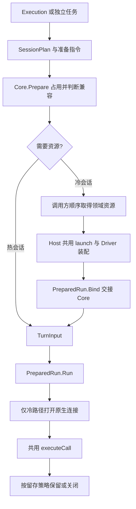
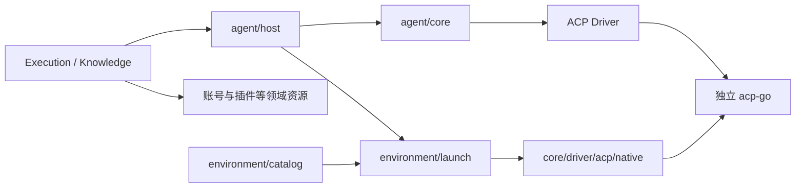

# Agent 会话模型与统一准备流程 Spec

## 目标与约束

本轮删除无生产用途的会话入口与自制 Checkpoint 往返，收紧静态声明、每轮输入和实际资源边界，取消纯转发层并合并零散文件。统一 Prepare / Bind / Run 流程继续保留。目录保持 `server/internal/agent/{core,host,environment}`，同属 server Go module；acp-go 独立维护并固定版本。聊天、团队、工作流和知识独立任务最终使用同一 Core 准备与执行流程。

不增加 Runtime HTTP 服务、远端调度、历史兼容层或聊天插件授权预检；不修改插件本身。CLI 自己加载配置、MCP、技能或执行工具的行为仍由 CLI 决定。用户已自行测试并反馈完成本次实际使用验证。本 Spec 替代旧混合请求及两级 Factory/Acquire 准备设计；消息持久化、业务接纳和最终输出证据规则继续成立。

## 三个模型

| 模型             | 内容与生命周期                                                                               | 明确排除                                           |
| ---------------- | -------------------------------------------------------------------------------------------- | -------------------------------------------------- |
| SessionPlan      | 稳定程序、模型、工作区、静态指令和能力、原生配置、资源一致性依据、权限上界和资源标签         | 本轮消息和选择、交互处理器、秘密凭据、资源获取函数 |
| TurnInput        | 本轮正文、附件、代码引用、选中技能与连接器、交互和输出策略、预算及观察端口                   | 账号租约、插件物化结果、静态配置回写、兼容摘要     |
| SessionResources | 冷准备取得的账号、插件、技能、连接器、启动环境及释放能力；交接后由 Core 持有至原生消费者退出 | 本轮消息、完整请求镜像、Data any、重新获取回调     |

新建、恢复、真实原生句柄、只读交接和留存策略属于准备指令；有界历史只在 TurnInput.Seed 交付，内部 OpenRequest.Seed 仅用于首次打开新会话。恢复直接使用 NativeHandle，不构造 Ref / Checkpoint 或再生成摘要证明同一份计划。资源物化后确实改变会话配置时，显式交接实际 SessionPlan；资源不能改写 TurnInput。产品 SessionResources 携带具名插件快照、原生插件范围、范围提交和使用引用端口；Execution 不通过 any 或 Host 私有类型断言读取业务事实，也不建立第二个热资源表。

## 唯一准备与执行流程

Prepare 不调用 Factory，不启动原生进程；只在唯一会话锁下占位、判断兼容和关闭不兼容旧消费者。调用方立即登记 defer Close。冷路径使用准备句柄 Context 取得资源，再 Bind 交接；Bind 只接管资源和编译实际配置。Run 才打开原生连接并提交本轮输入。

聊天与独立任务都使用 Prepare → 冷取得资源 → Bind → Run → Close。差异在准备指令、输入策略和留存策略：普通聊天成功且支持复用时保留连接，独立任务和只读交接结束后关闭。不存在第二条 Invoke/Run/admit/prepare 准备入口。无需为旧入口无生产消费者的通用多会话模式增加 Slot 或兼容分派。

完整产品请求不在 Execution、Host、Core 之间往返。静态会话、实际资源、本轮输入分别转换；不再重复构造完整 chatSpec 只为提取 Input。Fork 只消费会话配置与原生身份。技能及连接器的 Selected 属 TurnInput，静态资源声明不保存本轮选择。

## 公共契约与模型边界

Core 的 SessionPlan 保留 Profile、Workspace、Contributions、SessionPolicies、ResourceKey、Configuration、Grants、Tags。PrepareRequest 仅包含 Plan、Session、Mode、Lifetime；SessionDirective 仅包含 Mode 与真实 NativeHandle。删除调用身份预留、公开 Ref / Checkpoint / Session.Seed、SessionCheckpoint、Result.Checkpoint 和未被消费的 ContextDigest、SecurityScopeKey、ExecutionDigest。兼容判断只使用 preparationKey(SessionPlan)，权限和目录上界校验保留。

Core Runtime 直接拥有准备、执行和关闭实现，不再有 runtime → internal/engine 纯转发。公开入口保留 New、Start、Prepare、Close、CloseIdle；删除无生产消费者的 NewInvocationID、Cancel、CloseSession、pending 表及预算配置。取消由准备和执行 Context、Runtime.Close 负责，不新增替代身份或门禁。删除仅供两个测试使用的 NewCodex / CodexConfig，测试使用通用 Driver 与 Factory。

Host 的 SessionPlan.Target 改为窄 SessionTarget，只含 RuntimeID、AccountID、Binary、PrefixArgs、ConfigHome 及原生插件/模型设置的稳定选择，不包含 Environment、RefreshCredentials、Isolated、CloseAfterRun，不 embed 宽 RuntimeTarget。宽 RuntimeTarget 仍是账号准备、原生环境和启动资源的操作值，只能在 SessionResources / 管理启动边界使用。

静态 ConnectorDeclaration 不含 Environment / Headers，实际 Connector 及其秘密配置只在 SessionResources。DeclareTarget 与 DeclareConnectors 负责准确静态投影。SessionPlan 不再依赖调用方把秘密字段手工置空的约定。

TurnInput 包含 Message、History、SelectedSkills、SelectedConnectors 及当轮交互端口；LaunchEnvironment 是本轮软件授权准备提供的启动贡献，冷资源取得时合入 SessionResources.Target.Environment，不进入静态摘要或 Core Prompt。热续聊继续使用稳定连接文件路径并轮换文件内授权，不重启消费者、不继承首轮授权。账号秘密、刷新和关闭约束仍仅在实际资源中。

technicalSessionPlan 只转换静态声明，不再顺便产生 ResourceBinding。实际技能路径、MCP 环境和请求头仅在 Bind 从 SessionResources 构造。独立文本和工具任务共用同一原生资源装配与 Core 准备链。

## 所有权与取消

| 对象                                           | 唯一所有者                                   |
| ---------------------------------------------- | -------------------------------------------- |
| Chat、业务 Execution、消息日志和持久续接索引   | 原 Execution / Journal / Knowledge 领域      |
| 工作区到 Runtime 的关联                        | Host；不镜像技术活动状态、摘要、句柄或释放栈 |
| 技术会话、调用、兼容判断、原生句柄与释放栈     | Core Runtime                                 |
| 原生协议和进程操作                             | Driver / acp-go，受 Core 生命周期约束        |
| 账号配置、登录、凭据 CAS；插件安装、版本和授权 | 原账号与插件领域                             |
| 启动及认证刷新入口的装配与清理                 | Environment.launch，账号权威不迁入 launch    |
| 本轮软件授权、审批和提问                       | Execution，本轮结束撤销，不混入热会话资源    |

取得资源前归调用方；首次冷 Bind 被调用后，包括部分失败结果，都交给 Core。重复 Bind 或已经显式 Close 后再 Bind 属调用方违约，不转移新资源；不为无效重复调用增加另一套所有者。取得资源失败也必须交接部分结果及释放能力。Prepare 的 Context 仅约束准备与冷资源取得，成功 Bind 后解除该短 Context 的取消转发；热准备返回前完成同样的交接。Run 使用独立执行 Context，接纳请求结束不能取消已交给后台的工作。Acquire 期间 Cancel/Runtime.Close 取消准备 Context 并有界等待，不提前遗弃占位；迟到结果仍有所有者。调用方用 defer Close 覆盖每个提前退出分支。

关闭顺序是原生会话、Driver、启动认证资源、领域资源。失败保留同一释放步骤及其依赖；只重试清理，禁止重放 Prompt。未提交冷准备回收，未提交热准备保留已有消费者。只读交接完成后强制关闭。

## 依赖与适配边界

Core 不导入 Host、Environment、业务常量、数据库或服务。config 是启动/探测事实叶子；catalog 管发现、探测、独立 Fork，不在聊天主链做远端健康或授权预检。launch 只消费冻结配置及刷新、释放端口。CLI 工厂、完成策略、原生模式、技能语法、system role 与厂商配置转换归原生适配层，Engine 不按 CLI 名称分支。

## 目录与文件组织

- core/contract/execution.go 集中会话声明、准备指令、TurnInput、SessionResources 和结果；completion 枚举并入 driver.go。资源租约仍可在独立 resources 文件内保持秘密边界，不为一个投影或枚举再开文件。
- core/runtime 直接实现运行时，按整体生命周期、准备执行、资源释放、事件交付四个共同变化的职责组织；删除 internal/engine 包与转发 facade，不保留别名或兼容 wrapper。
- core/internal/plan 保留无状态输入及权限规则；删除无消费者的证明摘要。core/internal/output 保留最终结果证据状态机。
- core/driver/acp/input.go 集中首次贡献、历史和每轮输入编码；删测试便捷 codex.go。native 注册声明与工厂归位，厂商语法留适配层，不按 CLI 新增零散小文件。
- host/standalone.go 集中独立文本与工具任务、授权撤销及清理所有者；host/native_resources.go 集中共用原生资源装配。聊天的输入、事件、交互可以按产品边界就近组织，不混入 Core 所有权。
- environment/config 的 LaunchFacts 合并到现有配置值文件；diagnostic 的类型和分类合并；WorkBuddy 私有目录转换并回 ACP binding；registry 改为 profiles，mcp 改为 connector_compatibility，启动中的 codex 改为 codex_credentials。
- services/execution 继续拥有接纳、本轮授权、资源取得、日志及终态，不能把无用 Core 状态机迁到业务层。

物理文件减少只作组织结果，不是验收目标。不得为减少文件把协议输出、最终结果收集、原生管理连接和技术资源释放混成同一状态机。

## 实施计划

### 任务一：Core 删除与取消转发层

- [x] 修改 core/contract、runtime、internal/plan、driver/acp 及直接测试；删除旧入口和无消费者字段。
- [x] 冷恢复直接交付 NativeHandle；新会话历史只走 TurnInput.Seed；移除自制检查点与重复编译。
- [x] 运行时实现收进 runtime，删除 internal/engine 和 facade；合并契约与输入文件，测试改用实际公共准备协议。
- [x] 保留热复用、权限上界、部分失败、迟到首次 Bind、短接纳取消交接、只读交接及关闭重试的行为回归和关键 race。

### 任务二：产品模型边界与 Host 内聚

- [x] SessionPlan.Target 使用窄静态类型，连接器声明与实际秘密配置分型；实际环境、刷新和关闭事实仅归资源。
- [x] prepareAgent 通过当轮输入的启动贡献交付连接文件；冷准备合并，热续聊只更新文件内授权。
- [x] 静态转换不创建实际绑定，Bind 统一装配；text/task 合并 standalone，adapters 更名 native_resources。
- [x] 迁移 Host、Execution、独立知识调用及对应测试；覆盖本轮授权、scope、usage、实际环境和资源清理。

### 任务三：Environment 文件内聚

- [x] LaunchFacts 并 config/types；diagnostic/types 并 failure；WorkBuddy 三个私有函数并 ACP binding。
- [x] profiles、connector_compatibility、codex_credentials 按职责命名，删除旧源文件，保留原行为与账号资源合同。
- [x] gofmt 和环境相关包的定向测试，受控协议进程允许本机临时端口，禁止启动用户真实 CLI。

### 任务四：整合、统一 review 与文档

- [x] 外部业务 fixture 使用显式 SessionResources 观察真实启动环境，不保留混合旧请求来掩盖模型边界。
- [x] 实现结束统一 review，重点审查被删除抽象的真实消费者、冷/热恢复、取消释放与三模型边界；发现项只做覆盖回归和限定复核。
- [x] 更新 Agent README、Core README、架构总览、智能体与账号、聊天执行及后端约定，清除旧入口和已删除路径说明。
- [x] 定向测试/race、相关 vet、Agent 依赖检查、GOWORK=off 的 Core/allycli 构建及 pnpm docs:check 通过。
- [x] 对照阶段开始的文件摘要确认独立插件包未改；并行修改纳入统一审查。
- [x] 用户已自行测试并反馈完成本次实际使用验证；具体 CLI、模型与耗时未另行登记。

## 本阶段验证与审查

Core 与产品模型分别完成统一审查，未发现阻断项；文档检查的一处图中文字重复已修正。Core 验证冷恢复句柄直通、热恢复能力、静态配置变化新建、唯一历史输入、权限上界、取消交接及迟到部分资源释放。Host / Execution 验证窄静态类型、当轮授权进入实际资源、稳定连接文件轮换、任务最终启动环境、usage 先于 Chat 释放及绑定失败所有权。

Core 六个相关包测试、Runtime / ACP race、Core vet 通过；Host 三包测试、Execution 定向测试和关键 race、Knowledge Generator 与真实 Core / 公开 ACP 受控维护集成通过。工作流、自动任务的真实 Host 派发、创作/接纳/重启场景、global 退出依赖顺序、相关 vet、Agent 依赖检查及正式 Core / allycli 构建通过。文档链接与 diff 格式检查通过。

阶段前后 Agent 生产 Go 文件由 61 个 / 12,003 行变为 51 个 / 11,742 行；Core 为 25 → 20，Host 为 15 → 13，Environment 为 21 → 18。模型严格分型增加了必要声明，主要逻辑删减来自旧身份预留、自制 Checkpoint、证明摘要和纯转发层，文件合并没有引入替代状态机或兼容包装。

独立插件包与阶段开始的摘要一致；并行修改纳入统一审查。测试使用受控 Driver、协议进程和软件能力 allycli；自动化未启动用户桌面或真实模型 CLI；用户已另行自测并反馈完成。
