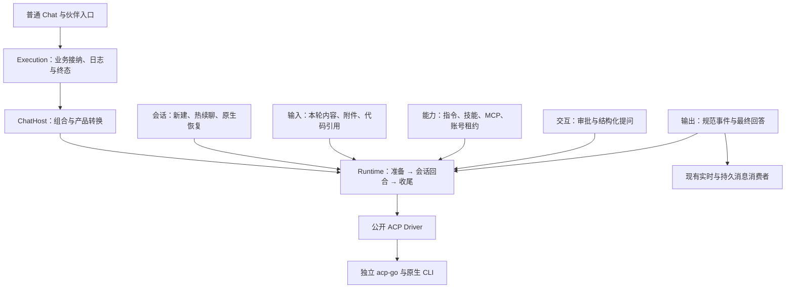

# 普通 Chat Runtime 迁移

> 历史阶段记录：本文的目录、独立 Go module 方案、迁移顺序和验收结果均以当时为准，不作为当前实现或重新验收的依据。当前执行能力已归入 `server/internal/agent/{core,host,environment}` 并属于 `server` 主模块；会话、启动与认证所有权以[职责收拢 Spec](agent-runtime-boundaries-spec-cn.md)及[当前架构说明](../architecture/runtimes-and-accounts-cn.md)为准。

## 设计约束

主链负责配置冻结、接纳、准备、回合执行和收尾。会话、输入、能力、交互、输出各自维护实现，通过类型明确的端口装配。没有真实消费者时不增加注册表、通用 Hook 或插件框架；不为预测性的风险增加身份、锁或重复校验。

保留持久 Chat/Execution 身份、真实原生会话句柄、单会话并发占用和业务幂等。引擎是技术会话与租约的唯一所有者，宿主只关联产品范围与实际会话。新能力不能往执行主链添加厂商分支。

## 装配关系



普通 Chat 的 create/send/retry 明确调用 StartChat；团队成员由权威团队范围识别，其他编排仍走原 Start，避免全局替换扩大迁移范围。原生分叉保持为独立注入能力，不将旧 Run 包进新宿主。

## 目录与职责

```text
packages/agent-runtime/
  contract/                         请求、结果与类型明确的能力端口
  runtime/                          公开调用、取消、检查点和关闭入口
  internal/engine/
    engine.go                       接纳 → 准备 → 回合执行 → 收尾
    session.go                      会话、恢复校验与资源所有权
    stream.go                       事件交付、交互及预算
  driver/acp/
    driver.go / session.go          原生连接与回合生命周期
    input.go                        本轮输入、附件和代码快照
    capabilities.go                 公开 MCP 连接声明
    interaction.go                  审批和结构化提问
    output.go                       公开事件到规范事实
server/internal/runtimehost/
  chat.go                           Chat 装配、会话关联与租约交接
  chat_input.go                     产品输入及原生模式配置
  chat_interaction.go               产品审批与提问端口
  chat_output.go                    实时事件、用量与终态转换
```

会话文件继续使用引擎已有锁和集合，未额外建立 SessionManager。能力通过 Driver、Resources、Credentials、InteractionHandler、Observer 等明确接口接入；原生 CLI 差异在宿主和驱动边界处理。

## 会话与资源

新会话只播种一次有界历史，后续回合只交付新增输入；冷恢复通过实际握手选择 Resume 或 Load，恢复过程的历史通知不成为新消息。配置变化显式新建并播种，不叠加复杂的原地配置回滚机制。原生句柄、恢复能力与分叉事实集中在同一 NativeSessionInfo 中。

隐藏摘要是独立的宿主操作：关闭原会话使用者后，以真实原生句柄和只读配置恢复并请求摘要，不将近期历史播种冒充完整会话摘要。无法原生恢复时，沿用业务层已有的近期历史回退。

系统账号可保留热会话。受管账号投射使用实际固定路径时，必须先关闭旧原生使用者再覆盖投射；账号和插件租约转交内核，关闭失败时保留资源，只重试清理。不得因为回合返回就提前交还仍在使用的凭据。

原生工作区文件作为独立准备能力复用；Chat 使用已物化的指令/技能文件，不重复拼接静态前缀。独立知识任务保留普通文本前缀策略。输入、MCP 连接、审批选项、问题表单及工具内容均由公开类型表达，不传递整份厂商私有协议。

## 并行实施

- [x] 会话所有者：热续聊、冷恢复、首次历史、检查点及生命周期。
- [x] 能力所有者：输入、MCP、交互和富工具输出，保持主链简洁。
- [x] Chat 宿主：显式路由、账号和插件租约、原生模式及事件转换。
- [x] 组合根：生命周期和 API 接线，旧路径仅供尚未迁移入口。
- [x] 连续回合、恢复、配置切换、审批提问、实时与重放一致、取消和资源释放的定向验证。
- [x] 阶段完成后统一 review、必要修复与提交。

不运行真实账号、生产数据或 UI；只运行受影响包和必要协议夹具。acp-go 独立维护，本阶段不新增 Runtime HTTP 或企业功能。

## 验证范围

独立模块已通过 contract、plan、runtime、ACP 的定向包测试及会话、交互、输出相关 race；宿主与 Execution 通过定向组合测试及 vet。组合根、Chat API 和既有知识生成与维护的直接回归通过。上述测试使用公开 ACP 传输、驱动替身及临时业务存储，不代表 11 种 CLI 的真实账号、模型或界面验收。

已接收通知和已接纳交互在回合结束时排空；只有 SessionID 的原生协议无法识别跨下一轮才真正到达的厂商旧通知，不增加任意延时或本地伪造身份来掩盖这一边界。标准工具事实保留 Kind、Title、Input、Content 与 Locations；厂商私有工具和 Skill 身份尚未作为公开契约接入。

## 阶段审查与修复

本阶段进行一次集中 review，确认并修复 5 项实际问题：原生取消终态、关闭后配置变化的会话选择、最终回合用量交付、公开富工具内容及 Cursor 升级错误分类。对应定向回归均通过，宿主与 Execution 的 vet、Chat 宿主 race、组合根和既有知识入口的直接回归通过；Chat API 完成编译检查，未冒充接口端到端验收。

关闭后的同一会话记录只保留原生句柄与配置摘要，释放 Runtime、账号和插件租约；已知配置变化新建并播种近期历史。进程重启时，普通 Chat 复用权威日志中的上次模型、推理和权限事实判断变化。没有历史静态摘要的外部原生句柄只能表达恢复期望，不能宣称已验证旧配置；原生分叉继续保持真实恢复语义。隐藏摘要不覆盖普通续聊配置。
