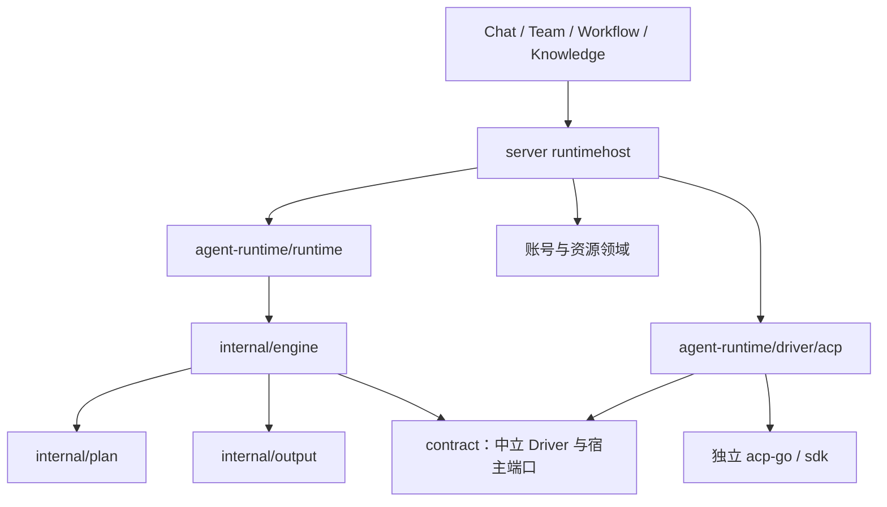

# Agent Runtime 重构实施计划

> **For agentic workers:** 使用 `subagent-driven-development` 执行本计划。用户已要求并行开发；共享契约先固定，按目录所有权并行，依赖任务按门槛衔接。

**Goal:** 建立真正独立、可组合、可验证的 Agent 执行内核，逐批替换功能并删除对应旧职责。

**Architecture:** 工作编排拥有业务规则，能力供给拥有内容与授权，Runtime 拥有技术调用与会话。Runtime 仅依赖中立契约与注入的 Driver；acp-go 独立维护。当前嵌入本机 Core，不做 Runtime HTTP。

**Tech Stack:** Go 1.25.8、标准库、独立 Go module、固定版本 acp-go / SDK。

**Spec:** [Runtime Spec](agent-runtime-refactor-spec-cn.md)、[项目架构](project-architecture-and-editions-spec-cn.md)。

## Global Constraints

- 不兼容旧数据、旧 Session 或旧版本；不删除用户数据。
- 新模块不得导入 `github.com/JieWaZi/NeuxBot/server`，不得转发旧 runtimes 作为实现。
- 不复制 acp-go 的协议、原生 Agent、传输或进程实现，只通过公开 API 引用固定版本。
- 新旧实现仅为未切换功能共存；每项工作只有一个执行所有者，失败不得跨引擎自动重跑。
- 构造函数不启动 goroutine；取消、交付和清理有明确归属与期限。
- Invoke/Run 共享内核；工具权限、配置继承、观察方式、会话寿命分开，不保留 TextOnly 总开关。
- 新增 Go 导出符号和所有结构体字段均有准确中文注释。
- 独立模块使用自有技术 Fault；server 继续使用 status_error，宿主只转换一次。
- 验证限定到修改点和直接受影响包，不运行仓库全量测试、不控制运行中的应用。
- 复杂实现与评审用 Sol 6.1 xhigh；简单工程接入用 Terra 6.1。

## Review Focus

- Prompt 已交付后 Observer 失败：保留执行事实、取消收尾，不重跑；Task 1 验证。
- 同会话重入或配置变化：拒绝重入与不兼容恢复；输入不影响 ContextDigest；Task 1 验证。
- 只有正文，没有最终消息证据：返回 output_unavailable，不拼接所有正文猜测；Task 1/2 验证。
- CLI 隔离/禁工具能力未知：默认 Invoke 在原生准备前失败，不以观察到工具再取消冒充禁工具；Task 1/2 验证。
- 关闭和资源准备竞争：恰好释放一次、停止接纳、有界收敛；Task 1 验证。

## 1. 目标目录与依赖

```text
packages/agent-runtime/               # module github.com/JieWaZi/NeuxBot/agent-runtime
  go.mod
  contract/                          # 值请求、事件、结果、Fault、Driver/宿主端口
  runtime/                           # New、Start、Invoke、Run、Cancel、CloseSession、Close
  internal/
    plan/                            # 校验、深冻结、授权范围、稳定摘要
    engine/                          # 接纳、调用、取消、交付、技术终态
    session/                         # 会话互斥、兼容性、检查点、资源所有权
    output/                          # 有界最终消息收集与可靠性
  driver/acp/                        # 公共 ACP 协议桥，外部 acp-go 负责原生后端
  capability/                        # 后续：Instructions/Skill/MCP 类型化贡献
  resource/                          # 后续：物化、快照与本地资源租约
server/
  internal/runtimehost/              # 业务 DTO/账号/资源/错误与 Runtime 的转换
  internal/knowledge/model/          # 独立生成与维护，不强行创建 Chat
  services/execution/                # 产品接纳、工作范围、业务收尾
  services/chat/                     # 产品历史与执行准备读取
  global/                            # 显式装配、临时迁移路由、关闭顺序
  internal/runtimes/                 # 仅服务未迁移入口，最终删除
```

按实际职责建包，不预建空目录；session 首期若与 engine 共享锁和状态，先放 engine 内聚文件，避免人为拆包。



Engine 不导入具体 Driver。宿主构造 Driver 并注入 Runtime；Driver 不查业务库、不认识 Waker/Chat。凭据只经租约进入启动边界，不进入请求值、日志、摘要或检查点。配置描述与函数端口分开。

## 2. 分阶段替换及功能影响

| 阶段 | 交付与替换点 | 影响的现有功能 | 删除对象 | 切换门槛 |
| --- | --- | --- | --- | --- |
| A 独立内核 | contract/plan/engine/output、共享 Invoke/Run、首个 ACP Driver 前置 | 不切生产；新增独立模块验证 | 新代码不携带旧 server 依赖、TextOnly、正文拼接及全局缓存 | 独立构建、生命周期、输出、并发与依赖检查 |
| B 纯生成 | runtimehost 凭据桥、Knowledge Generator，按 CLI/版本启用 | 知识整理模型生成、用量/推理诊断、账号排队 | 已迁 CLI 的旧 GenerateText 分支和 textCollector | 严格输出、禁工具、配置隔离、真实 CLI/账号验收 |
| C 工具结果任务 | 类型化指令/技能/MCP、工作区、无人值守交互 | 独立 Wiki 维护、单库授权、撤权、工具成果 | 该入口旧 Run 装配及重复目录清理 | 多工具循环、范围拒绝、真实成果、副作用未知与取消 |
| D 交互聊天 | Observer、交互、热/冷 Session、Checkpoint、交接和历史准备 | 新 Chat、续聊、附件、审批、提问、分叉、取消、重试 | 已迁组合旧 bridge/会话缓存、重复全量历史读取 | 连续回合、长历史、重启/分叉、实时与持久化一致 |
| E 复用入口 | 各业务入口单独切换 | Team 报告/依赖、Workflow 版本、自动任务、IM、Chat 型知识维护 | 对应旧装配分支、DTO、过渡路由 | 各业务接纳、幂等、取消和成果交付；无旧 Session 接管 |
| F 收敛 | 剩余 CLI、设置与探测、打包/生命周期 | 全部原有支持、Core/桌面/Web 启退 | 旧 runtimes、临时开关、废弃类型及旧测试资产 | 无旧活动调用/导入，全部支持迁完，构建和退出证据完整 |

每批先停止该范围接纳、收敛活动调用，再从新 Session 启用。不能以保留永久兼容层为目标，也不能为删旧代码而删除尚未迁移的用户功能。每批记录旧→新职责映射、已切调用方和待删清单。

## 3. 不合理设计的处理

| 旧耦合/机制 | 重构决策 |
| --- | --- |
| runtimes 导入 status_error/accountconfig/skills/logx | 产品解析留宿主，技术内核消费窄端口 |
| TextOnly 同时控制隔离/工具/Observer/Session | 四种策略独立，Invoke/Run 同内核 |
| 所有非 commentary 拼成最终答案 | 只接收有证据的最终消息；缺失准确报告 unavailable |
| 仅按启动参数复用进程 | 同时检查上下文和安全域；租约随实际使用者释放 |
| 每轮重放全量历史再裁剪 | Chat 专用快照和有界窗口；Resume 无 Seed |
| 搬全套 binding/万能 Hook/Provider 注册器 | 一个实际边界起步，按验证能力扩展 |
| 新包包装旧 SDK | 禁止；旧实现只作行为参考和服务未切入口 |

## 4. 本次并行开发范围与契约

本批先完成 A，并实现 B 所需的 ACP 协议边界和测试基础。Codex 当前全量禁工具能力尚未证明，故不能宣称 B 已切生产。后续 B–F 按上表门槛继续；不把未验证的输出或安全策略包装为支持。

本批四项开发任务已完成并通过各自及跨模块独立评审。验证包含新模块真实依赖检查、vet、定向测试与 race、Core＋公开 ACP 传输组合回归和文档检查；未运行全仓验证或真实 CLI/账号验收。上述完成状态仅对应本节任务，阶段 B–F 的产品迁移尚未实施。Codex 优先验收、最终性修正和当前阻塞见[后续验收计划](agent-runtime-codex-validation-plan-cn.md)。

首批工程保护默认值：32 个活动调用及最多 32 个待用调用标识、64 个打开 Session、最终正文 1 MiB、单事件 1 MiB、整轮 16384 个事件/64 MiB、观察交付 5 秒、人工交互等待 5 分钟、清理 5 秒；允许显式配置并校验。这是保护值，不是性能验收结论。ACP 队列基线 256 项/16 MiB，不叠加无界事件队列。

共同接口方向：

```go
// 以下为接口签名；完整字段以 Task 1 发布的 contract 文件为共同来源。
runtime.New(Config) (*Runtime, error)
Runtime.Start(context.Context) error
Runtime.Invoke(context.Context, contract.ExecutionSpec) contract.Result
Runtime.Run(context.Context, contract.ExecutionSpec, contract.RunOptions) contract.Result
Runtime.NewInvocationID() (string, error)
Runtime.Cancel(string) bool
Runtime.CloseSession(context.Context, string) error
Runtime.Close(context.Context) error

type Driver interface {
    ID() string
    Capabilities() DriverCapabilities
    Open(context.Context, OpenRequest) (DriverSession, error)
    Close(context.Context) error
}
type DriverSession interface {
    Prompt(context.Context, TurnRequest, DriverSink) DriverResult
    Close(context.Context) error
}
```

ExecutionSpec 只含 Profile、Input、SessionDirective、Workspace、明确策略和限制/资源身份；RunOptions 持有 Observer/交互端口。SessionDirective 区分 New/Resume 和 Seed；Result 分开执行状态、输出状态/可靠性、交付故障、用量/副作用与技术会话身份。事件保留 PromptAccepted、MessageID、Phase、文本和工具事实。调用标识由 Runtime 自动生成，或由宿主提前调用 NewInvocationID 申请；未启动预留数量有界，Cancel 可释放预留，用过的标识不重新接纳，不保存无界已完成标识集。首次未实现的 Fork/Detect/冷恢复不伪造支持。

### Task 1: 独立契约和共享内核（Sol 6.1 xhigh）

**Files:** 仅 `packages/agent-runtime/go.mod`、`contract/`、`runtime/`、`internal/{plan,engine,output}/` 与对应测试。

**Interfaces:** 生产上述公共 API、Driver/Session 契约；只消费标准库和注入端口。Task 2 消费 contract。实现者先发布 API 检查点，后续字段变更由协调者统一。

- [x] 先固定 contract，并通知协调者与 Task 2。可执行接口由此成为两个实现的唯一共同来源。
- [x] 写失败测试：无 final 证据/多消息/工具后 final/超限；Invoke 临时回收；Resume 仅增量且拒绝 Seed；同 Session 重入与跨 Session 并行；摘要稳定/权限不扩张；Observer 失败不重跑；准备失败逆序释放；取消和 Close 竞争；关闭失败保留使用者依赖并可重试，不重复已成功释放项；单项交互撤销不取消健康整轮。
- [x] 记录 RED；实现 plan/output/engine/runtime：深冻结、资源唯一所有、生命周期有界、单一结果与诚实输出。不得调用旧 SDK。
- [x] gofmt；模块内 `GOWORK=off go test ./contract ./runtime ./internal/plan ./internal/engine ./internal/output`；并发包定向 race；基准记录分配，不冒充全性能验收。
- [x] 自查全部字段注释、依赖和错误边界；写报告，由协调者提交和派评审。

### Task 2: ACP Driver 首切片（Sol 6.1 xhigh）

**Files:** 仅 `packages/agent-runtime/driver/acp/`。依赖版本由协调者统一写 go.mod/go.sum，避免并发修改。

**Interfaces:** 消费 Task 1 contract；生产可注入公开 ACP Agent 工厂的 Driver，实现 Open/Prompt/Close。模块依赖 `acp-go v0.0.0-20261027005717-2f0ad2051741`、`sdk v0.0.0-20261026093029-d283676c207f`。

- [x] 接口发布前准备公开 ACP 测试情景与文件组织，发布后只按 contract 实现，不造第二套接口。
- [x] 写失败测试：真实 Prompt 交付后开始；MessageID/Phase 保留；缺 phase 不猜测；取消/排空/重复关闭；不支持的 explicit_only/deny_all 原生准备前拒绝；迟到事件隔离。
- [x] 实现公开 SDK + acpserver 连接与首个 Codex 工厂，原生协议/进程继续归 acp-go；不搬全部 binding。不支持的模型/策略不能静默忽略。
- [x] 通过公开 ACP Fake Agent 与实际本地传输验证 Driver；执行 gofmt、`GOWORK=off go test ./driver/acp` 和对应 race。
- [x] 记录未经真实 CLI 验收的能力；不修改 server 生产装配。报告后协调者提交/评审。

### Task 3: 独立模块工程检查（Terra 6.1，简单任务）

**Files:** `scripts/check-agent-runtime.mjs`、`scripts/check-agent-runtime.test.mjs`、`.github/workflows/ci.yml`。不改 Go、依赖、宿主入口。

**Interfaces:** 命令 `node scripts/check-agent-runtime.mjs`，在 `GOWORK=off` 下用 `go list -deps -test -f '{{.ImportPath}}'` 检查实际依赖，拒绝直接或间接 server 导入；仅对新模块实际包执行显式列表 vet/test。

- [x] 写失败测试，用临时微型 Go module 证明合法输入通过、间接 server 依赖拒绝、Go 命令失败非零；不做源码字符串断言。
- [x] 实现命令，不依赖根 go.work；不存在的模块准确失败，不悄悄跳过。
- [x] 既有 Go CI 加独立检查及新模块 cache key，不重写原工作流。
- [x] Node 定向测试；模块就绪后跑真实检查。B 接入 server/go.mod 后才做实际打包验收，此任务不虚称已接生产。
- [x] 自查和报告，由协调者提交/评审。

### Task 4: 集成与独立评审（协调者）

**Files:** 本计划、设计/开发说明；只做必要集成。

- [x] 写明独立模块的技术 Fault 适用边界，不放宽 server 规则。
- [x] 固定依赖，记录实际支持/限制和删除清单。
- [x] 三项各自评审 spec 符合性与质量；修复后复核。
- [x] 独立模块检查、直接影响的既有 Runtime/知识基线、文档检查；不跑全仓。
- [x] Sol 6.1 xhigh 做最终跨模块评审；报告交付和未切入口，保留隔离分支供下一批继续。
