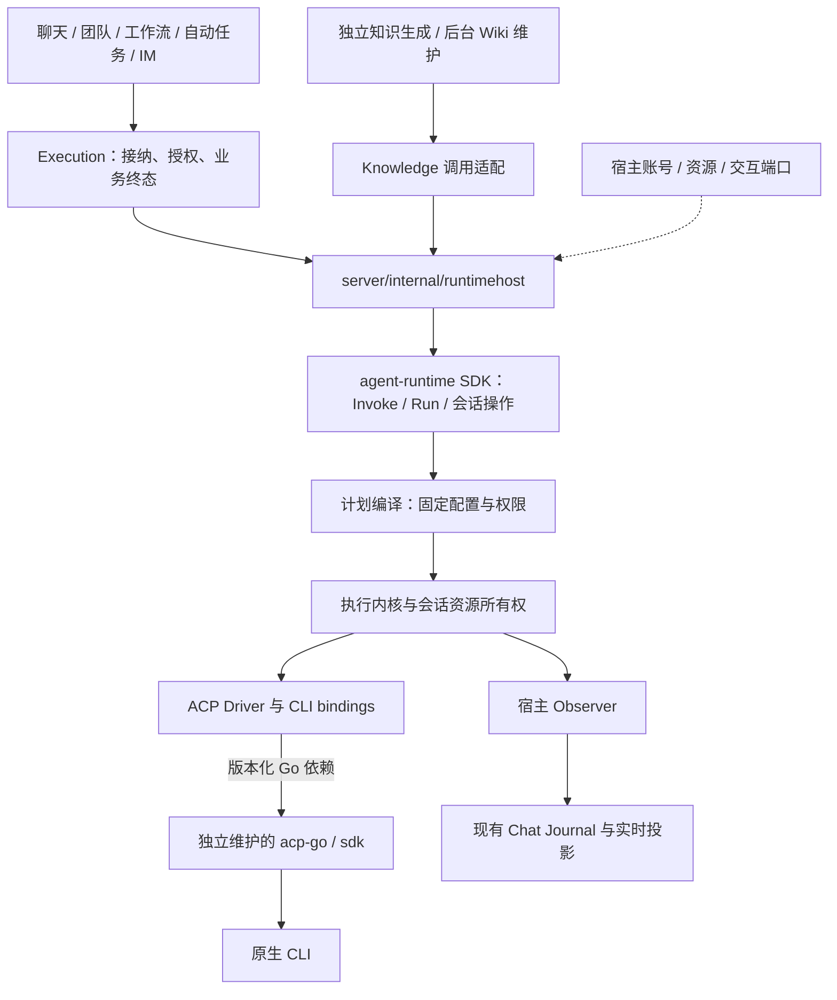
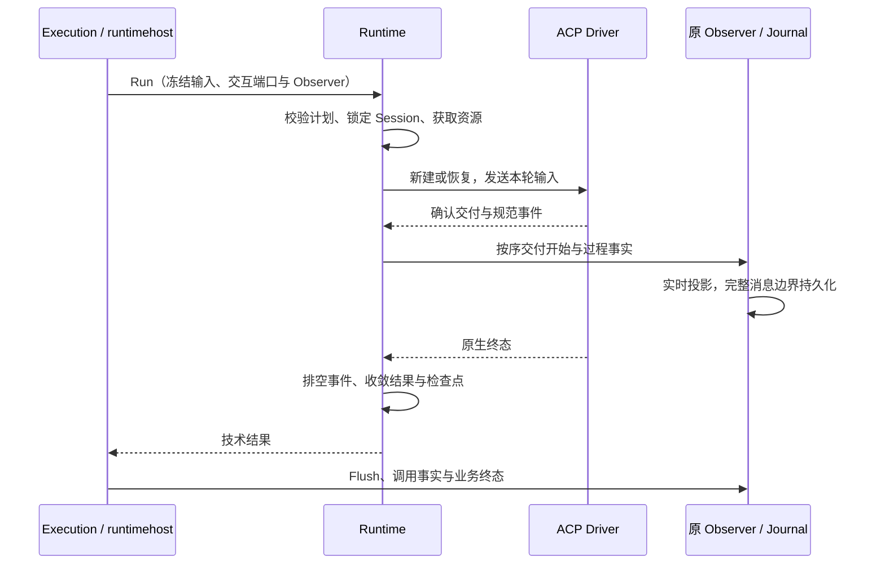
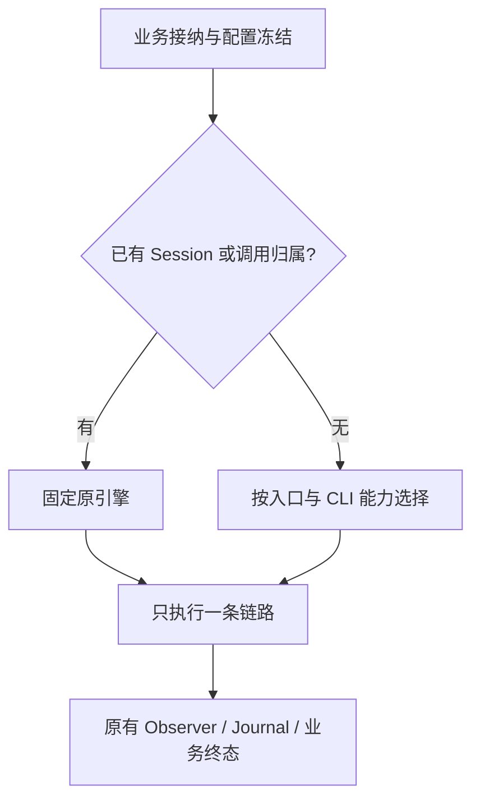

# 独立 Agent Runtime 重构 Spec

> 状态：完整目标设计；独立模块与 Codex 知识入口已完成接入并固定公开依赖，正在补齐全 CLI 结果调用。实际能力以模块说明和验证为准。范围：独立目录、嵌入式 Go module、分批替换现有调用方；不建设 Runtime HTTP 服务。
>
> 代码基线：2026-10-27，提交 `49250f9` 与编写时工作区。知识维护、账号依赖等存在并行未提交修改；本文依据已读取源码描述，实施每批迁移前重新核对差异。

分阶段目录、依赖、功能影响和开发任务见[实施计划](agent-runtime-implementation-plan-cn.md)；独立模块的实际实现及限制见[模块说明](../../packages/agent-runtime/README.md)。本 Spec 保留完整目标，不能据此推定所有阶段已经实现。

项目层次、个人/企业形态与未来部署边界见[项目架构与产品形态 Spec](project-architecture-and-editions-spec-cn.md)。本文只细化 Agent Runtime 子系统；当前仍采用桌面模块化单体，不建设企业平台。

## 1. 目标与范围

将基础 Agent 执行能力放入 `packages/agent-runtime`，形成不依赖 `server` 的 Go module。NeuxBot 通过宿主适配注入账号、工作范围、指令、技能、MCP 和业务工具。新模块先独立构建、验证，再按功能和 CLI 组合替换调用方，最后移除旧执行实现。

用户已确认：不做 HTTP；使用独立目录；允许新旧实现阶段性共存；先迁移和重构，再逐部分替换；重构必须同时审视性能和历史机制；不考虑旧数据、旧会话或旧版本的兼容；acp-go 继续单独维护。本文选择 `packages/agent-runtime` 为目录，以同仓本地依赖接入；acp-go 保持独立仓库和版本化依赖。

完成标准：

- 一个仅依赖新 module 的 Go 程序可以执行 Invoke 和 Run，无需 NeuxBot 数据库或伙伴身份。
- NeuxBot 原有聊天、知识、团队、工作流等入口逐批使用同一内核；每次工作只有一个执行所有者。
- 同一会话的第二轮只发送新增输入；历史读取、内存、事件队列、进程和资源租约均有明确边界。
- 每批切换前收敛活动调用，新链路从新 Session 开始；迁移失败不会重复执行有副作用的任务。

不在本次范围：Runtime HTTP/SSE、远程 Client、异步任务查询服务、多节点租约、通用任务调度器、动态代码插件、模型结果缓存、旧数据迁移与格式兼容、旧 Session 接管、老版本回退兼容。原产品 HTTP/WS、现有 MCP 传输和 `allycli` 回环调用继续使用，不因“不做 HTTP”而删除。正常的聊天历史、续聊、摘要、分叉和同一实现内的重启恢复仍属于本次设计。

## 2. 当前实现与必须保留的行为

| 当前入口或模块 | 已有事实 | 本次处理 |
| --- | --- | --- |
| `internal/runtimes/sdk.go`、`run.go`、`acp_*` | SDK、共用 ACP 后端、CLI binding、进程复用、取消、事件交付已存在 | 复用职责和测试，不重写原生协议 |
| `internal/runtimes/text.go` | GenerateText 使用临时工作区与临时会话；工具或交互触发拒绝；正文收集排除 commentary 后拼接 | 迁入同一内核的显式策略，补最终输出语义；不能只改名为 Invoke |
| `internal/knowledge/model/generator.go` | 知识模型生成独立于 Chat；每次准备账号租约 | 第一批业务迁移，只消费最终结果，保留用量、推理配置诊断 |
| `internal/knowledge/model/maintenance.go` | 独立 Wiki 维护使用 Run、临时工作区和库内授权，不创建 Chat | 独立迁入允许工具的 Invoke，保留真实操作成功判定 |
| `services/knowledge/maintenance.go`、`automatic.go` | 页面 AI 修订、自动维护还会装配 Chat/Execution 和限定工具 | 随所属 Chat 入口迁移，不因名字包含“知识”就改成无历史 Invoke |
| `services/execution/work.go` | 组合工作范围、账号、插件、技能、MCP、历史、原生会话 | 保留业务解析，逐步把技术装配交给宿主适配 |
| `services/execution/runtime_events.go`、`message_facts.go` | 同一规范事件生成实时投影和完整消息日志，并接收已提交业务事实 | 保留一套产品消费者，迁移不引入第二个投影器 |
| `services/execution/recent_history.go`、`handoff.go` | 新会话使用有界近期回合或隐藏交接；恢复会话只发新输入 | 明确历史与原生上下文边界，单独验证历史性能 |
| `services/execution/fork.go`、`internal/runtimes/fork.go` | 原生分叉携带位置、工作区及回执，不通过重放历史模拟 | 纳入正式能力和迁移门槛 |
| `services/runtimeenvironment`、`services/aiaccount` | 探测持久化、账号选择、排队、认证刷新、通知 | 保持业务权威；向新模块提供端口 |

当前 `runtimes` 直接导入 `server/constants`、`status_error`、`accountconfig`、`codexoauth`、`skills`、`logx` 等。新目录不能继续通过这些导入依赖原项目。现有 `RuntimeEnvironment.Detection` 还持久化旧 Runtime 类型；切换时改用新契约重新探测生成，不编写旧 JSON 的兼容解码器。

本 Spec 覆盖原生分叉、隐藏交接、知识不同执行路径及历史全量读取问题；独立服务、远程断线、结果查询体系和历史兼容不进入目标架构。

## 3. 目标架构

下图为目标依赖方向；业务入口到宿主的一次调用仍处于同一 Go 进程。

### 3.1 目录与依赖

| 目标目录 | 职责 |
| --- | --- |
| `packages/agent-runtime/runtime` | SDK 构造、显式启动关闭、调用及会话操作 |
| `packages/agent-runtime/contract` | 中立请求、事件、结果、策略、能力、Fault 与端口 |
| `packages/agent-runtime/internal/engine` | 单次调用状态机、终态收敛、取消、事件与交互路由 |
| `packages/agent-runtime/internal/plan` | 注册校验、贡献合并、配置冻结和摘要 |
| `packages/agent-runtime/internal/session` | 会话互斥、热连接与资源租约、冷恢复 |
| `packages/agent-runtime/internal/output` | 有界最终回答收集与语义校验 |
| `packages/agent-runtime/driver/acp` | 迁移宿主侧 ACP 桥接与薄 binding，通过公开 API 使用独立 acp-go |
| `packages/agent-runtime/capability` | instructions、skills、mcp 的类型化贡献；先按实际变化需要拆文件 |
| `packages/agent-runtime/resource` | 本地资源快照、临时目录与租约默认实现 |
| `server/internal/runtimehost` | NeuxBot DTO、账号、资源、错误、探测配置与新模块的转换 |

新 module 依赖标准库、ACP 和必要技术库，不导入任何 `NeuxBot/server` 包。Engine 不依赖具体 Driver、GORM、Chat、UI 或账号实现。宿主可以依赖新模块，新模块不能通过旧 Runtime 转接来绕过依赖边界。

`server/go.mod` 使用本地 `replace` 接入同仓 agent-runtime module；构建脚本、CI、桌面与 Web 打包须显式带上该目录。独立模块的验证须在不依赖根 `go.work` 的条件下完成。

acp-go 的协议类型、原生 CLI 适配器、私有协议及原生进程实现继续在其独立仓库维护、测试和发布，不复制进 `packages/agent-runtime`，不合并为本仓库子模块。新 Runtime 只负责上层执行策略、会话资源、规范事件与结果；`driver/acp` 负责两者之间的转换和必要薄 binding。

首批沿用当前 `acp-go` 与 `acp-go/sdk` 的固定依赖版本。需要补全最终消息元数据或协议能力时，先在 acp-go 独立仓库提交、测试并产生可引用版本，再更新本仓库依赖并验证集成。提交的构建配置不依赖开发机上的 acp-go 本地路径。新旧 Runtime 暂时共存时，Go 最终依赖图可能选中共同版本，升级 ACP 必须同时验证仍在使用的旧入口，不能假设两个 Runtime 天然隔离了依赖升级影响。

核心技术错误使用模块自己的 `Fault`，业务错误仍使用 `server/constants/status_error`，仅在 runtimehost 边界转换一次。业务枚举继续走原生成规则，不把新 module 的内部技术类型交给 OpenAPI 扫描。实施时须同步明确后端工程约定对独立 module 的适用范围，不能放宽整个 `server` 的错误或生成规则。

### 3.2 所有权

| 事实 | 唯一所有者 | 边界 |
| --- | --- | --- |
| 工作接纳、请求幂等、Chat/任务身份 | 原业务服务与 Journal | Runtime 不接管业务排队、重试和父子任务 |
| 一次调用的取消、技术终态、活动工具 | Runtime Engine | 宿主业务终态只能在技术结果和持久化交付收敛后发布 |
| 原生 Session、热连接、技术配置兼容性 | Runtime SessionManager | 不用 ChatID 查询业务数据 |
| Chat 消息、调用事实、恢复检查点的持久副本 | 原 Chat Journal | 本期不新增 Runtime 数据库或第二份历史日志 |
| 伙伴、账号、插件、项目与工具授权 | 原领域模块 | 传递已冻结资源和明确授权，不传数据库实体 |
| 账号刷新、撤销、排队 | AIAccountService 及宿主凭据端口 | Runtime 持有租约，不复制账号配置权威 |
| 显示历史、业务用量与通知 | 原产品消费者 | Runtime 的交付序号不替代 JSONL 游标 |

本期技术会话元数据在 Runtime 内存中管理；跨 Core 重启通过宿主持有的版本化 SessionCheckpoint 恢复。Checkpoint 由 Runtime 产生，宿主附在现有调用事实中持久化，并在恢复时明确传回；Runtime 不另写 Session 表或 Invocation 表。持久层与运行态不是两份可独立修改的会话配置。

SessionCheckpoint 至少包含格式版本、引擎归属、SessionRef、Driver/版本、原生句柄、上下文兼容摘要、安全范围、有效回合修订和不透明分叉位置。账号凭据、进程句柄、完整历史不进入检查点；模型和配置实际生效值须可恢复。宿主保留 Chat 到 SessionRef 的关联。

新会话与调用的可恢复身份按现有调用接纳、开始、结束持久化边界提交。Checkpoint 交付失败则不得对外宣称可恢复；停止复用对应热会话，并保留已经执行或结果未知的事实。Core 崩溃后的活动调用沿用原中断处理，不能因为缺少最终记录自动重发 Prompt。

## 4. 调用与策略

### 4.1 公开能力

首期提供同步 `Invoke`、`Run`，以及 `Cancel`、`CloseSession`、`ForkSession`、`Detect` 和模块生命周期操作。新会话可在第一次 Run 中延迟建立。调用结果包含 InvocationRef，宿主也可在启动前预分配它用于取消关联。没有后台 Submit/Get/Subscribe 服务或完成结果 TTL 查询接口。

| 维度 | Invoke | Run |
| --- | --- | --- |
| 用途 | 一次性结果任务 | 可观察、可交互、可恢复的执行 |
| 原生工具 | 按明确 ToolPolicy 允许或禁止 | 按明确 ToolPolicy 允许或禁止 |
| 会话 | 临时新建，结束回收 | 显式 New、Resume 或宿主提供的冷恢复检查点 |
| 输出 | 最终结果，不开放过程 Observer | 同一结果契约，并有有序 Observer |
| 用户输入 | 快速返回 interaction_required，并取消收尾 | 通过独立 InteractionHandler 决策 |
| 产品资源 | 默认空；显式装配才启用 | 同样显式装配 |
| 产品过程历史 | 无 | 宿主决定是否接入 Journal |

Invoke 与 Run 共用计划编译、执行状态机和 Driver。输出消费、工具权限、原生配置继承、会话寿命是独立策略，禁止重新用一个 `TextOnly` 布尔量控制全部行为。

NativeConfigPolicy 明确区分 `explicit_only` 与 `inherit_native`：前者只允许本次批准的扩展资源，保留 Agent 必需的原生基础指令和已授权工具；后者允许宿主明确选择的原生环境。当前 Invoke 缺省为前者；调用方按实际需求选择策略，迁移旧 Run 时保持原策略。不挂载产品 Skill/MCP 不能证明 CLI 没有读取 HOME、项目指令、hooks 或全局 MCP；Driver 必须验证隔离能力，不能仅凭空目录宣称隔离，也不能为了隔离一并删除正常工具循环需要的基础指令。

无人值守审批在已授权范围内即时允许，其余即时拒绝；用户输入请求结束为 interaction_required，不建立 UI 待办。Run 的审批和输入端口与 Observer 分离，响应必须携带 InvocationRef、请求身份及有效修订，拒绝重复或迟到响应。

知识生成迁移为 Invoke 时独立启动一次 CLI 会话，传入任务输入，只消费最终结果。宿主不主动注入 AGENTS.md、Skill 或 MCP，不增加配置合并、工具禁用或 MCP 加载控制；CLI 自身的配置发现和工具循环由 CLI 负责。保留所选账号、现有输出格式和模型配置反馈。独立维护按其授权使用工具；Chat 型知识维护继续使用 Run。

隐藏交接在新实现内部恢复切换前的 Session，因此使用 Run 加内存结果消费者，不使用只能新建临时会话的 Invoke。它不接入产品日志，但仍受 Session 互斥、权限、输出和取消约束；这不包含从旧引擎迁入会话。

### 4.2 配置与计划

宿主把业务配置转换为 ExecutionSpec；请求描述与函数端口分离。ExecutionSpec 只包含固定 Profile、输入、授权工作范围、能力绑定、工具/交互/输出策略和 Limits，不能包含数据库对象、明文凭据或任意业务回调。

启动时显式构造 Driver 与内置能力，注入 ResourceProvider、CredentialProvider 等窄端口；仅对真实需要按标识选择的实现建立只读映射，并在启动前完成校验。首期不建立通用插件管理或多套 Provider 注册框架。CapabilityModule 只产生类型化贡献，不启动 CLI、调用业务服务或申请权限。Planner 检查实际能力依赖、资源冲突及 Driver 必需能力，生成不可变计划；Engine 再获取租约和物化资源。

权限取请求与宿主授权的有效交集；能力只声明需求，不能扩权。必需资源缺失立即失败，可选缺失须明确声明。指令、Skill 和 MCP 合并顺序确定，同名不同内容默认冲突。插件安装关系、分享授权、版本选择和 ally 业务工具仍由原领域负责，不能整体迁入通用 capability。

分开计算三个标识：

- **ExecutionDigest**：包含本轮输入与完整执行策略，用于诊断同一调用配置，不作为会话复用键或模型结果缓存键。
- **ContextDigest**：只包含影响模型静态上下文和恢复兼容性的配置、资源版本与确定顺序，不包含本轮输入、随机端口和 InvocationID。
- **SecurityScopeKey**：账号主体、有效授权范围、凭据代际及隔离策略。内容相同也不能跨账号共享不兼容进程。

模型、推理参数变化能否原生热更新，由 Driver 的已验证能力决定；能力未知则关闭旧热连接并按明确会话策略处理。不能把每轮不同输入造成的 ExecutionDigest 变化当成必须新建 Session。

### 4.3 输出与错误

结果分别表达执行状态、输出状态、交付故障、用量和副作用证据。Agent 已完成但最终答案无法提取，保留 completed 与 output_unavailable；Observer 或持久化失败不能变成“业务成功”，也不能把已发生执行抹掉后自动再跑一次。

最终答案必须来自经过验证的消息阶段、边界或 Driver 明确的等价完成语义。当前 ACP 事件转换主要输出 TextDelta/CommentaryDelta，须保留可获得的 MessageID、Phase 和边界；若 acp-go 丢失这些事实，在 acp-go 处理，Engine 不解析厂商私有载荷。缺失能力不能用“全部非 commentary 正文拼接”伪装满足严格最终回答。

严格输出是新 Invoke 默认。尚未验证的 CLI 保持旧入口；迁移 Run 可保留原产品显示流，但结果明确标注输出可靠程度。FinalCollector 只保存有界候选和必要消息状态，不缓存完整过程；拒绝、长度终止、取消、空输出和超限分别报告。迟到工具结果不能误清空最终候选，终态须排空已经接收的事件后收敛。

### 4.4 Run 的交付边界

模块接纳、Prompt 交付和产品持久接纳是不同事实。保留现有 `ExecutionAdmission` 两类入口的提交时机：不能把 Engine 开始准备当作模型已经收到输入。现有 invocation_started 语义仍在输入确认交付后产生；启动前失败只返回准确结果。产品层按原入口的接纳协议持久化，不由 Runtime 统一改写。

Observer 失败立即进入取消收尾；产品最终 Flush 失败仍可使业务交付失败。两者保留真实执行与副作用事实，不能触发自动换引擎重试。UI 断开只释放观察订阅，不改变后台调用 Context 的所有权。

## 5. 新旧共存与逐批替换

### 5.1 路由与所有权固定

过渡期只有宿主迁移路由选择 legacy 或新 Runtime。路由按“生产入口 × CLI/版本 × 已验收能力”配置在装配根，默认 legacy；不新增用户设置页或远程配置系统。每次接纳固定路由版本，活动调用不随开关变化。

新旧实现允许在源码和进程中暂时共存，但不能共享活动 Session、连接缓存或同一任务的执行权。两套实现共用原账号租约和业务接纳机制，不各建一套账号队列。未启用新路由时，新模块不预热 CLI、不启动巡检任务。

调用开始前可以通过纯校验发现能力不支持并仍选择 legacy；一旦已为该调用选择引擎并进入原生资源准备，不进行隐式跨引擎降级，失败交给原调用方处理。Prompt 已交付、存在工具副作用或结果未知时，严禁自动改走旧链路。比较测试使用 FakeDriver 或录制事件，不在真实工作区双执行同一任务。

### 5.2 切换边界

- 分批替换按入口与 CLI 组合推进；未切换部分继续运行原实现，已切换部分使用新实现。临时路由只服务实施过渡，不成为永久兼容层。
- 每批切换前暂停该范围的新接纳，等待活动调用结束或明确取消并完成收尾，然后关闭原会话连接并切换路由；不将进行中的任务转移给另一个引擎。
- 新链路从新的 Chat/Session 和执行记录开始，不导入旧原生句柄、旧检查点或旧聊天历史，不实现跨引擎 Resume、Fork 或隐藏交接。
- 新格式按目标结构设计，不维护旧格式读取、双写、自动升级或降级逻辑。旧探测结果重新生成，验收使用按新契约建立的数据。
- 切换失败时停止该批新接纳并处理已执行调用的真实结果；恢复旧入口只针对以后明确提交的新工作，不自动重发失败或结果未知的调用。

不考虑历史兼容不意味着自动删除用户数据。本 Spec 不安排批量清空、改写或删除旧数据，也不要求新实现读取这些数据。SessionCheckpoint 只用于新实现内的冷恢复和正常分叉；插件冻结事实、分叉位置、回执与请求幂等在新执行中仍须准确记录。

## 6. 历史与上下文机制

### 6.1 三种历史分别管理

| 内容 | 权威与用途 | 重构规则 |
| --- | --- | --- |
| 产品历史 | Chat Journal，供显示、恢复、分叉及业务审计 | 按新契约保存和读取完整消息，不存每个 token；不承担旧格式兼容 |
| 原生上下文 | CLI Session，包含模型和工具循环需要的上下文 | Runtime 管理恢复与寿命，不从显示日志逐轮重建 |
| 新会话播种 | 宿主从已完成回合或交接内容构造 | 有界、显式、仅 New 使用，不是第二份持久聊天记录 |

Invoke“不存过程”指新模块和宿主不写产品过程历史；CLI 自有日志是否可禁用单独报告。工具修改文件或外部数据属于任务副作用，不随临时会话清理回滚。

### 6.2 历史策略

| 场景 | 输入与恢复规则 |
| --- | --- |
| 普通 Resume，配置兼容 | 仅本轮新增消息、附件和明确代码引用；Seed 必须为空 |
| 明确 New，近期历史 | 默认 5 个完整回合，最多 20 个，总正文上限 64 KiB；先保持现有值 |
| 明确 New，自动总结 | 在同一新实现内的前一 Session 上做一次隐藏交接，上限 16 KiB；成功只带交接，失败退回近期完整回合 |
| 切换账号或不兼容资源 | 不能复用旧热进程；由宿主按当前产品规则选择 New 或报告不能恢复 |
| 原生分叉 | 使用原生 Fork 与回执；不能用文本历史播种冒充原生分叉 |
| 团队冷会话 | 保留协调输入和成员报告的身份及去重事实；团队规则仍在宿主 |
| Invoke | 仅显式输入；不自动查询 Chat 或旧 Session |

历史选取只保留已完成用户输入与助手最终回复，不带过程、思考和工具输出。单条文本截断保持 UTF-8 边界并标注省略，完整回合成对选择。继承消息和成员报告继续按现有语义处理。

“默认五轮”与“上下文 token 上限”不是同一个指标。本期保留字节与回合双限制，不以任意字符/token 换算声称精确控制上下文。以后若采用 tokenizer，作为独立可测策略加入。

隐藏总结会推进原生 Session，但不形成普通产品消息：需要技术检查点记录该隐藏回合已发生。重启后不得因“Chat 没有该条消息”再次生成总结。隐藏调用有独立调用身份、输出上限和无工具策略；不能强制落实禁止工具时，不执行隐藏总结，采用近期历史。

### 6.3 历史读取性能

当前 `LoadExecutionContext` 经 `loadChatDetail` 读取并重放完整 JSONL，再复制 `PreviousMessages`；`work.go` 继续过滤和生成近期历史，Resume 期间还可能再次读取日志比较插件冻结信息。因此，发送给模型有界不等于准备成本有界。

改造分两步，并与 Runtime 模块抽取分开验证：

1. **先消除无用工作。** 宿主先确定能否 Resume；确定恢复时不构造 Seed、不复制完整消息数组。把最近有效执行、会话检查点、插件冻结事实放入同一个执行准备快照，避免同一次准备重复全量读日志。历史回合解析继续由 Chat 负责。
2. **再限制读取成本。** 为 Chat 增加专用的执行准备读取契约，使用现有消息索引/投影和版本游标读取所需窗口。Resume 读取元数据及未应用增量；New 按完整回合向前有界取数，满足数量或字节预算即停止。该路径不能简单包装当前全量 `loadChatDetail`。

投影必须可由 Journal 重建，并带格式版本、日志代际及已应用 Sequence。缺失或落后时从可信检查点补增量；没有可信检查点才允许一次冷重放，并在完成后建立可复用投影。读取同一准备快照时元数据、会话和历史窗口须落在一致日志边界，不能混用新旧时刻。追加日志后按已提交事实更新；发现截断、损坏或代际变化则失效重建，不能信任旧游标。

冷恢复允许与历史长度相关，但常规连续回合不能每次全量重放。内存中的热点快照与历史窗口有容量上限，不把完整 Chat 永久缓存为“性能优化”。复用既有 Chat 索引设施；确需新增索引字段或表时列出查询证据，遵循原 Repository 规则，不在新 Runtime 引入 SQLite。

## 7. 性能与资源生命周期

### 7.1 热路径设计

- **计划准备：** 版本固定的资源复用只读快照，避免每轮递归扫描、重新复制技能和重建不变配置。配置或授权变更使相关缓存失效；凭据不进入共享缓存。
- **原生连接：** 只在 ContextDigest、安全范围及 Driver 能力兼容时保留。新模块不能为表面隔离强制让所有 Run 每轮重启，也不能为了速度共享不同账号的原生进程。
- **静态前缀：** 工具名称、Schema、MCP 服务名及指令顺序稳定。临时端口、Token、调用 ID 不进入模型可见身份；挂载路径若会进入提示，则按 Session 稳定，而非每轮随机生成。
- **事件：** 使用类型化中立事件，避免新旧 DTO 反复 JSON 编解码；仅在原 Journal 或传输边界编码。过渡转换至多一次，不建立两套完整事件队列。
- **Invoke：** 不创建空 Chat Sink、实时快照或 EventHub 订阅，不缓存完整工具正文；保留工具状态、活动、审批及副作用所需的最小事实。
- **并发：** 单 Session 单回合；不同 Session 可并行。账号排队沿用原服务，等待必须可取消；Runtime 只做容量接纳和资源治理，不复制业务队列。

当前 ACP 队列上限为 256 项与 16 MiB，产品实时快照窗口为 16 ms，工具进度批次为 128 项与 256 KiB。第一批迁移保留这些基线；队列按实际占用计费，不预分配每个调用的最大正文空间。扩容前先测量，不能以放大缓存掩盖慢消费者。

Runtime Limits 明确约束总活动调用、热 Session、事件项/字节、单事件、最终输出、工具与等待交互数量、截止时间和交付超时。启动时验证这些预算互相兼容；初始输出和全局容量值在基线阶段依据现有负载确定并记录，不在本 Spec 伪称已经验证某个并发容量。

关键状态和工具结果不静默丢弃；累计输入快照可以按原语义合并，工具进度增量不可覆盖。持续背压或超限应停止接纳/取消相关调用并说明原因。不得把静默丢失当成正常完成。

### 7.2 租约与关闭

| 作用域 | 资源 | 释放规则 |
| --- | --- | --- |
| 调用 | 输出候选、事件队列、单轮交互、临时附件 | 终态排空、交互失效后释放 |
| 会话 | 热进程、稳定挂载、仍被使用的 MCP 与账号配置 | Session 关闭、淘汰，或进程退出并转为可恢复检查点后释放 |
| Runtime 实例 | 注册表、探测缓存、全局预算 | 显式 Close，阻止新接纳并有界等待 |

租约取得成功后立即登记逆序清理。回合级账号租约不能在仍有热进程使用时被 `defer` 释放；宿主不能提供会话期租约时，默认关闭进程并保留冷恢复检查点，不无限占住账号队列。保活仅对已验证支持的组合开放，设空闲过期、数量上限和按最近使用淘汰；活动 Session 不淘汰。

取消定位 InvocationRef 与会话修订，旧调用不能取消新回合。终态只提交一次，保留先发生的有效根因；工具运行和等待交互不能因没有正文而误判空闲。清理使用独立且有截止时间的 Context；用户真实工作目录只解除关联，不删除。

Core 退出顺序为：停止业务接纳与生产者 → 取消/等待调用并提交完整消息及终态 → 关闭新旧 Runtime 连接和会话 → 释放凭据、插件资源、Journal 等依赖。当前装配顺序须专门检查，不能直接搬移 SDK.Close 调用；中途初始化失败也按已取得资源逆序退出。

### 7.3 测量与验收预算

所有比较固定代码版本、CLI 版本、输入、模型配置与机器，区分冷启动、热续聊和模型服务时间。FakeDriver 基准度量宿主/Runtime 开销，真实 CLI 验收度量实际生命周期；不拿模型输出时间波动证明框架性能。

| 场景 | 指标与门槛 |
| --- | --- |
| 新旧 FakeDriver 相同事件流 | 记录 P50/P95、B/op、allocs/op；本 Spec 提议热路径 P95 与分配量回归超过 10% 即阻止该批切换，先排除测量噪声 |
| 连续两轮与 100 轮 | 无配置变化时 ContextDigest 稳定，第二轮只发新输入；不重复启动本可保留的进程 |
| 10 / 1000 / 10000 回合历史 | 分别测冷读取与热准备；热 Resume 不随总历史复制正文或全量读日志；New 只取预算窗口及必要索引 |
| 大量文本与工具事件 | 队列在双预算内；追加正文不逐 token 复制已有全文；交付顺序、最终状态与旧投影一致 |
| 并发账号与 Session | 记录排队时间、活跃进程、FD、goroutine、堆占用；无跨账号复用，重复短任务结束后不持续增长 |
| Invoke 完成、取消、超时 | 临时工作区、进程、交互与租约可核对回收；无产品过程记录 |
| 空闲及应用退出 | 无无条件轮询；热 Session 淘汰有界，关闭期限内收敛或准确报告未释放资源 |

10% 是建议的初始回归门槛，实施基线阶段需记录重复测量方式和波动范围；任何放宽都要有具体瓶颈及取舍说明。性能验收不能替代结果、权限和持久化正确性验收。

## 8. 影响的功能

“界面不改”不等于“功能不受影响”。下面是每批切换必须覆盖的用户行为。

| 功能 | 影响点 | 必须保留的行为 | 迁移批次 |
| --- | --- | --- | --- |
| 知识整理的模型生成 | GenerateText → Invoke 策略 | 不创建 Chat；只消费最终结果，用量及错误保持 | B |
| 独立 Wiki 后台维护 | Run → 允许限定工具的 Invoke | 单库授权、每次工具校验、真实操作成果、取消与清理 | C |
| 普通聊天与伙伴 | 新调用、输入资源、续聊、过程显示 | 工作范围、附件/代码引用、技能/MCP、模型选择、终态 | D |
| 新会话、切模型与隐藏总结 | 历史选择和会话配置匹配 | 五轮默认、摘要降级、无重复上下文、切换前账号约束 | D |
| 审批、原生提问、ally 问题 | 交互端口与调用身份 | 回答一次生效、超时失效、旧请求不能作用于新调用 | D |
| 聊天分叉与失败重试 | 原生句柄、分叉位置、回执及副作用证据 | 不模拟分叉，不重复 Prompt，不因新架构扩大可重试范围 | D/E |
| 页面 AI 修订与 Chat 型自动维护 | 限定工作意图和工具贡献 | 当前页/库范围、既有聊天历史、原请求幂等与授权撤销 | E |
| 团队负责人和成员 | 成员执行、报告回流、冷历史播种 | 任务依赖、来源身份、报告去重、共享工作范围 | E |
| 工作流 worker 与创作 Chat | 执行适配与取消传播 | 版本冻结、验收、人工请求、子运行归属和业务成果 | E |
| 自动任务与 IM | 下游复用 Execution | 原接纳幂等、后台生命周期、对外交付和阅读状态 | E |
| Runtime 设置与账号 | 探测类型、模型目录、账号队列和刷新 | 新契约探测配置、账号隔离、禁用/撤销有效；不做旧探测数据转换 | A–E |
| 插件、技能、MCP、ally | 资源快照与物化、动态授权 | 固定安装版本、原生插件语义、稳定工具身份与权限 | C–E |
| 历史、用量、通知与看板 | Observer 转换及提交边界 | 实时与重放一致；Turn 与 Context 用量分开；不新增重复通知 | D–E |
| Core / 桌面 / Web 启停 | 构建依赖与关闭顺序 | 隐藏窗口不取消任务，真正退出有界清理，不新增监听器 | A–F |

前端及现有 OpenAPI 预期保持兼容，初期以宿主转换消化差异；确实需要新增可见错误、字段或状态时，单列最小契约变更并按原命令生成。不得让 UI 解析 Runtime 新私有字段。

## 9. 分批交付与门槛

| 批次 | 交付范围 | 允许切换的入口 | 进入下一批前的证据 |
| --- | --- | --- | --- |
| A：基线与独立骨架 | 契约、独立 go.mod、FakeDriver、最小 Planner、会话/输出内核；建立基线 | 无生产入口 | 脱离 server 可构建；取消、终态、资源失败清理及模块边界通过 |
| B：结果生成 | 迁移一个已验证 CLI 的 ACP binding、凭据桥及严格输出 | 知识 Generator，按 CLI 组合启用 | 最终结果契约、无历史、所选策略能力与真实 CLI 验收；不影响旧 Run |
| C：工具型结果任务 | Instructions/Skills/MCP 贡献、工作范围和无人值守交互 | 独立 Wiki MaintenanceRunner | 多次工具循环后的最终答案、库内授权、撤销、副作用未知与清理 |
| D：交互聊天 | 宿主 Observer、审批、热/冷会话、检查点、隐藏交接、历史准备优化 | 新普通 Chat 的已验收组合 | 连续回合、历史规模、实时/重放一致、原生分叉和重试安全测试 |
| E：复用入口 | 团队、工作流、自动任务、IM、Chat 型知识维护 | 每个入口独立启用，从新 Session 开始 | 每类业务端到端契约；跨入口取消/报告/交付正确；无旧会话接管 |
| F：收敛 | 完成剩余 CLI；清理旧后端、过渡路由与废弃类型 | 全部已支持组合 | 无 legacy 活动调用，原连接已关闭，调用方和打包都已迁移 |

每批允许按 CLI 分多次交付。不能以 Codex 通过推定 Claude、Cursor、Pi 或其他 binding 通过，也不能为了完成删除任务取消尚未迁移的现有支持。

早期允许把本仓库旧 Runtime 的实现和测试复制到新目录后解耦，原路径继续服务未切换功能；这不包括复制 acp-go 源码。过渡不能形成长期双内核。记录旧到新职责映射和必要修复的同步点；某职责调用方全部迁移后直接删除旧入口和废弃类型，不为旧调用方式保留兼容门面。

每批记录代码与 acp-go 依赖版本、启用入口、CLI 能力矩阵、性能对照、切换收尾情况和已知限制。启用真实生产入口以前必须验证，不能仅以 Fake 测试代替各入口所需的最终输出、所选策略及 Resume/Fork 能力证明。

## 10. 验证与实施前待收敛项

### 10.1 定向验证矩阵

- 模块边界：新 module 无 server 导入；内核无具体 Driver；实际打包解析本地 module；无依赖旧目录的测试资源。
- 输入与计划：配置冻结、贡献冲突、权限收敛、可选资源、摘要确定性；每次输入变化不破坏稳定会话上下文。
- 结果：多条助手消息、工具循环、最终标记缺失、迟到结果、空输出、拒绝、长度终止和输出上限。
- 生命周期：同 Session 并发、跨 Session 并发、取消与完成竞争、准备中途失败、凭据刷新/撤销、退出及重复关闭。
- 历史：新实现内 Resume 不带 Seed；New/总结/团队/继承消息按设计规则；长历史不反复全量读取；新日志和检查点可重建与恢复，不测试旧格式兼容。
- 交付：Observer 失败取消；完整消息先持久化再发布终态；实时快照与 Journal 重放等价；业务问题与原生工具事件顺序一致。
- 迁移：未启用零行为变化；路由固定；切换先收敛活动调用；不双执行或导入旧 Session；未知结果不自动回退或重试。
- 分叉：定位精度、旧工作区、回执核对、ReconcileOnly、重复请求和不支持能力，均保留真实原生语义。
- 业务：知识两类入口、普通 Chat、团队、工作流、自动任务、IM 分批验证，保持原授权和幂等规则。

验证只运行修改包及直接影响用例；Go 文件按约定格式化，Race/基准用于会话和事件并发等对应范围。全量测试仅按用户另行要求执行。真实 CLI 验收使用独立临时工作区与明确账号，记录版本和范围，不操作用户正在工作的页面或会话。

### 10.2 需要由证据决定的实现细节

以下不是遗漏的产品需求，而是各批次启用前必须产出的技术结论：

1. 每个 CLI 的严格最终输出、配置继承、工具策略和 Resume/Fork 能力矩阵；入口所选策略不能满足时保留原入口，不悄悄降级。
2. SessionCheckpoint 在新 Journal 契约中的表示与原生分叉记录映射；不得新增双重权威，不受旧格式约束。
3. Chat 现有消息索引能否支撑执行准备窗口；不能支撑时给出最小索引扩展、恢复算法及规模测试。
4. 热 Session 保活与账号租约的兼容组合、空闲上限和全局预算；以真实资源测量确定默认值。
5. ACP 元数据是否足够；不足时在 acp-go 独立仓库补契约、测试并形成依赖版本，再接入 Runtime，禁止在宿主补私有协议解析器。

Spec 的批准只确定目标架构和迁移边界；每批实施仍以当时可运行代码与上述验收证据为准。

## 11. 代码与规范依据

- [领域词汇](../../CONTEXT.md)、[当前架构](../architecture/overview-cn.md)、[后端约定](../development/backend-cn.md)、[文档约定](../development/documentation-cn.md)。
- [Runtime SDK](../../server/internal/runtimes/sdk.go)、[Run](../../server/internal/runtimes/run.go)、[GenerateText](../../server/internal/runtimes/text.go)、[ACP 后端](../../server/internal/runtimes/acp_backend.go)、[ACP 事件](../../server/internal/runtimes/acp_client.go)、[原生分叉](../../server/internal/runtimes/fork.go)、[架构检查](../../server/internal/runtimes/acp_architecture_test.go)。
- [执行装配](../../server/services/execution/work.go)、[执行生命周期](../../server/services/execution/lifecycle.go)、[产品事件消费](../../server/services/execution/runtime_events.go)、[业务消息事实](../../server/services/execution/message_facts.go)、[近期历史](../../server/services/execution/recent_history.go)、[隐藏交接](../../server/services/execution/handoff.go)、[失败重试](../../server/services/execution/retry.go)。
- [Chat Journal](../../server/services/chat/journal.go)、[Chat 历史读取](../../server/services/chat/chat.go)、[Runtime 持久探测配置](../../server/repositories/models/runtime_environment.go)、[历史限制](../../server/constants/common.go)。
- [知识生成](../../server/internal/knowledge/model/generator.go)、[独立知识维护](../../server/internal/knowledge/model/maintenance.go)、[知识模型装配](../../server/global/knowledge_model.go)、[Chat 型知识维护](../../server/services/knowledge/maintenance.go)、[自动知识维护](../../server/services/knowledge/automatic.go)。
- [团队任务](../../server/services/channel/task.go)、[工作流 worker](../../server/services/workflow/worker.go)、[IM 接入](../../server/services/im/inbox.go)、[账号租约](../../server/services/aiaccount/service.go)、[Core 装配](../../server/global/config.go)。
- [通知与工作看板](../architecture/notifications-and-work-board-cn.md)、[桌面生命周期](../architecture/desktop-lifecycle-cn.md)。
