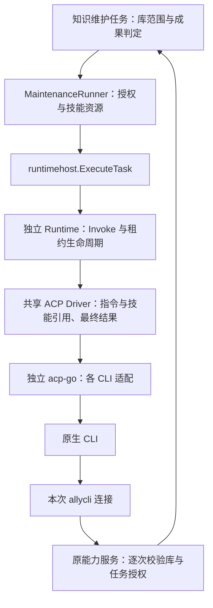

# 独立 Wiki 维护 Runtime 迁移

> 本文保留对应阶段的设计、实施与验证记录；涉及迁移顺序、旧路径和验收状态的叙述以当时为准。当前代码状态见[实施计划](agent-runtime-implementation-plan-cn.md)及 [CLI 收尾计划](agent-runtime-cli-plan-cn.md)，历史真实 CLI 证据不代表当前构建已验收。

## 范围

将独立 `MaintenanceRunner` 接入现有全部 CLI 共用的 Runtime 宿主。知识任务仍拥有库范围、每次领域调用校验、成功操作证据和业务终态；Runtime 拥有原生会话、最终输出、取消和资源释放。普通聊天型 Wiki 修订、自动任务和其他 Chat 入口不在本批迁移。

维护显式提供现有 ally 技能、维护指令与本次授权连接；纯生成不增加这些贡献。不限制 CLI 自身的工具和配置发现，不新增 MCP 机制或 Runtime HTTP。acp-go 继续独立维护。

## 模块关系

宿主共用已有账号准备、启动解析、工厂和清理重试；不复制另一套执行内核。显式指令与技能引用作为首个 ACP Prompt 的静态前缀，不能宣称为原生 system role。技能文件由资源租约物化，Driver 不复制技能正文。

## 并行任务

- [x] ACP Driver 支持现有类型化 Instructions、Skills 和 ResourceBinding；保留无贡献输入原文，覆盖缺失资源与最终输出。
- [x] runtimehost 提供共享任务执行入口，MaintenanceRunner 迁移，保留单库授权、真实成功领域调用证据，拒绝过程拼接或截断报告。
- [x] 删除旧维护专用 Run 装配、maintenanceCollector、modelFailure 和 prepareKnowledgeRuntime；更新受影响的 gated 实测测试接线。
- [x] 完成公开 ACP 到维护授权端口的集成回归，以及取消、关闭失败后重试清理、不重放副作用的定向验证。
- [x] 完成一次阶段末统一 review，集中修复必要问题并提交。

## 关键生命周期

任务结束或取消即撤销领域授权；授权撤销与原生进程成功退出是不同事实。原生关闭失败时保留账号、工作目录和技能资源的租约，后续只重试清理，不重新提交维护 Prompt。准备中失败同样必须由唯一所有者释放已取得资源。

只有真实授权的知识领域调用成功，加上正常结束的可信最终报告，才能作为维护成功。能力发现、模型自述、空输出、拒绝或截断不能替代该证据。任务与库授权在每次实际调用时重新校验。

## 验证范围

只运行直接受影响的模块、宿主、知识维护和服务边界测试，不运行全仓测试。公开 ACP 夹具不代表真实账号或模型质量验收；现有显式开启的真实维护测试保留，但本批不操作用户知识库。

## 完成记录

本阶段完成一次统一 review，无需修复的具体发现。ACP、宿主、知识模型、全局装配和知识服务边界的定向测试通过；资源生命周期与公开 ACP 集成的定向 race 检查通过；相关包 vet 和文档检查通过。

集成回归实际经过 MaintenanceRunner、共享 Host、独立 Runtime、公开 ACP SDK 与能力 Registry，验证技能和指令只传入一次、领域调用成功证据、过程与最终报告分离、授权先撤销和资源后回收。原生模型端使用测试替身；本阶段未启动真实模型、真实账号或对生产 Wiki 执行修改。

旧独立维护 Run 装配、maintenanceCollector、modelFailure、prepareKnowledgeRuntime 已删除，普通 Chat 及其他未迁移入口保留。未增加外部依赖或调整已固定 acp-go 版本。
