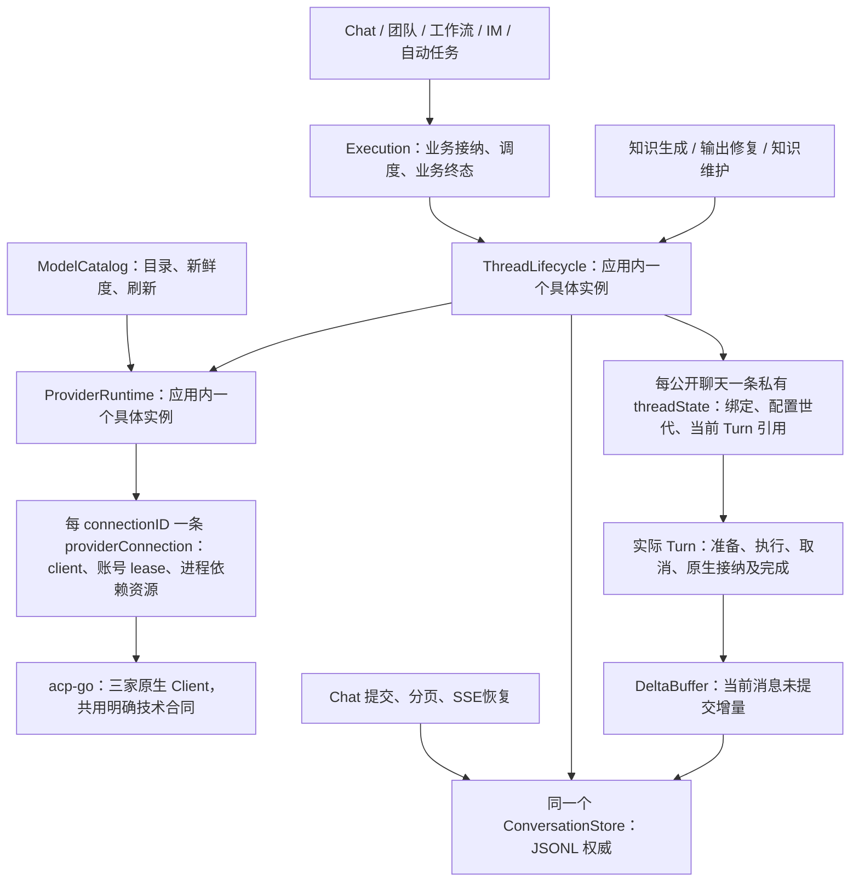
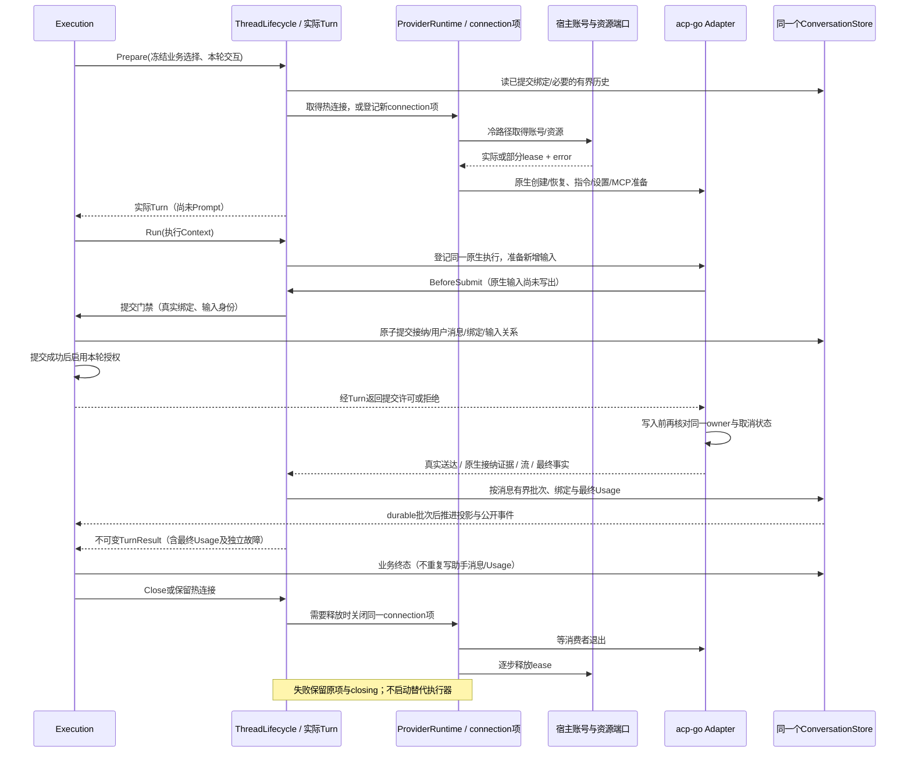

# P0：执行所有权、真实消费者与首批替换

本文是编码输入，不是已实现架构。权威方案为 `docs/superpowers/specs/2026-11-04-agentruntime-rebuild-design.md`。按权威方案第 9.1 节，底座先在临时 `server/internal/agent_next` 完整重建，验收后替换正式 `server/internal/agent`，沿用 `server/go.mod`；首批只有 Codex、Claude Code、Cursor。重写范围代码和测试注释使用英文，本文中文。

## 1. 当前生产链与替换边界

| 生产调用点 | 当前链路与事实 | 新代码直接替换的位置 |
| --- | --- | --- |
| `services/execution/work.go:564`、`lifecycle.go:410` | `PrepareSession → acquireChatSessionResources → Bind → PreparedChatRun.Run`。旧 Manager 登记，旧 Session 同时拥有计划、资源、Turn、原生连接 | `work.go` 改为直接准备实际 `Turn`，`lifecycle.go` 运行同一个 Turn；移除该入口对 Manager、Session、PreparedChatRun 的调用，不在新入口内部调用旧对象 |
| `services/execution/handoff.go:113` | 用同一旧运行入口请求摘要，随后新会话播种历史 | 用同一路径的受限临时 Turn；恢复/替换判定与有界历史交接归 ThreadLifecycle，宿主只决定产品历史模式 |
| `internal/knowledge/model/generator.go:15`、`global/workflow_output.go:21` | 实际消费 `GenerateText`；旧实现最终进入 `agent.go:328` 的临时 Session | `ThreadLifecycle.GenerateText` 编译请求后调用本类同一准备/执行流程；保留知识生成和工作流输出修复限制 |
| `internal/knowledge/model/maintenance.go:22` | `ExecuteTask` 经同一路径挂载知识任务授权与资源 | 同一 Turn 路径接受精确任务授权和资源；不另建知识模型执行器 |
| `services/runtimeenvironment/service.go:429/509`、`services/aiaccount/capabilities.go:66` | 安装/模型探测目前合并在旧 Catalog | 安装与连接事实交 ProviderRuntime，模型刷新交 ModelCatalog；改真实设置服务消费者，不能只在旧 Catalog 外新建 facade |
| `services/execution/runtime_events.go:642`、`services/chat/event_pipeline.go:18` | Execution 聚合助手消息，Journal 经 eventCommitter 写 `eventlog.Store`；JSONL 是现有权威，SQLite 是可重建投影 | 消息聚合移入 Turn 所用 DeltaBuffer；现有 Chat 提交/历史/订阅与 runtime 同时接同一个 ConversationStore 实例，删去被迁移的第二套聚合/写入职责 |
| `global/config.go:451/842` | NewCatalog、NewManager 和宿主 Resolve/Prepare 回调共同装配 | 直接构造 ProviderRuntime、ConversationStore、ThreadLifecycle、ModelCatalog；关闭、账号失效和插件失效直接调用实际所有者 |

旧实现可以暂时供尚未切换的入口使用，分派在接纳前按已声明的 provider 支持范围完成。三家一旦接新底座，错误直接返回新底座的结果，不再调用旧执行器；同一 Chat 不混用两份消息 writer。

## 2. 唯一所有者和实例作用域

**ThreadLifecycle 是公开聊天与原生会话关系的所有者，不是旧 Manager 的包装。** 它直接实现按 thread 的准备、恢复、配置失效、替换和关闭规则。私有 `threadState` 只保存公开聊天标识、已提交的原生绑定引用、准备配置/世代、当前 Turn 引用和关闭状态；不保存另一份 client、资源释放栈或 busy 布尔值。绑定的耐久权威在 ConversationStore，内存记录是运行所需的有限缓存。`Turn` 是从准备到完成的同一个实际执行状态对象，拥有取消函数、交互等待、接纳证据、最终输出/Usage 和提交余量；不另建只转发它的 PreparedTurn 或 TurnLifecycle manager。`turn_lifecycle.go` 是这些内聚方法的文件，不要求再造同名 struct。

**ProviderRuntime 是应用级连接登记与连接生命周期所有者，首批不是 provider 全局共享进程池。** 它以不可复用的 connectionID 登记 `providerConnection`；每项记录 provider/账号/认证世代、实际 client、启动/退出状态、账号 lease、运行所需 MCP/技能物化资源和临时工作目录的释放进度。同一公开 thread 最多引用一个 current connection；不同 Chat 不共享连接。GenerateText/ExecuteTask 使用短命 thread 和独占连接，仍复用同一个运行算法。Codex 上游能支持多 Session，不构成首批必须共享进程的理由；Claude 启动配置与 Cursor 进程级模型、认证读取、MCP加载边界先按独占连接落实。后续只有真实并发与成本证据需要时才讨论共享。

**同一资源始终有一个继续清理的所有者。** ProviderRuntime 在调用账号/资源获取端口前登记 connection 项，端口返回的实际或部分资源立即进入该项；错误也必须携带已取得部分的 release。宿主此后不再独立释放该 lease。ThreadLifecycle 保存连接引用而不是资源副本。释放顺序为原生消费者退出 → 启动认证/MCP服务与账号 lease → 临时文件；成功步骤立即清除，失败保留同一 connection 项及依赖。thread 保持 closing，不能开替代连接绕过失败。根退出、账号切换和插件更新都重试这一项；不能新造 cleanup owner 接管旧栈。

**并发规则在真实对象中落实。** 同一 thread 的预备、热续聊、配置替换和关闭按世代串行；索引锁仅用于选择/登记状态，不能覆盖账号排队、原生 I/O、提交或宿主回调。热复用要求账号、认证世代、指令/资源及后端设置作用域兼容，直接使用现存连接。切账号先使旧世代停止接纳，等当前 Turn 收尾并关闭旧连接，成功后才获取新账号。close 与准备竞态中的迟到资源仍登记回原 connection 项并被清理，不能落到新世代。取消不等于退出，未知接纳和工具执行后的失败不自动重放 Prompt。

## 3. 文件职责表

下表是正式归属的文件职责。隔离实施时路径相对 `server/internal/agent_next`，验收后再替换正式 `server/internal/agent`；不预建空文件。

| owning 文件 / 对象 | 唯一状态及输入输出 | 真实消费者、依赖和失败边界 | OpenBot 参照与拆分理由 |
| --- | --- | --- | --- |
| `thread_lifecycle.go` / `ThreadLifecycle`、私有 `threadState` | 公开绑定、配置世代、当前 Turn 引用；准备返回实际 Turn，关闭/替换返回结果 | Execution、GenerateText、账号/插件失效；依赖具体 ProviderRuntime 和 ConversationStore。原生关闭失败保留引用与 closing | `thread-lifecycle.ts` 的 ensureThread、resumeThread、applyPendingRuntimeRefresh、releaseAgentSessions。公开绑定与原生进程是不同 owner |
| `turn_lifecycle.go` / 实际 `Turn` | 准备/原生接纳/执行/完成证据、交互、取消、最终输出/Usage；Run 返回不可变结果 | Execution.runExecution 和 GenerateText；依赖 providerConnection 与 DeltaBuffer。观察失败、模型失败、提交失败、释放失败分别保留 | `turn-lifecycle.ts` 的 handleNotification、completeTurn、interruptTurnsOf；不用 OpenBot 的产品 failover 和业务回调集合 |
| `provider_runtime.go` / `ProviderRuntime`、私有 `providerConnection` | 连接登记、启动与退出、连接依赖资源和逐步释放；打开返回实际连接引用 | ThreadLifecycle、ModelCatalog、账号/插件关闭；通过 acp-go 构造器运行三家。部分启动/退出失败留原项 | `provider-runtime.ts` 的 ensureAgentClient、startConfined、stopConfined、dispose；实例作用域按本项目独占连接收敛，不搬上游共享池 |
| `agent_client.go` / 多后端执行端口及三家接入 | 无第二份业务生命周期；明确 new/resume/configure/prompt/cancel/close 与原生事实 | providerConnection 直接消费，acp-go 三家实现；ACP类型只在此边界解释，不暴露给宿主 | `agent-client.ts`、`acp-client.ts`、`app-server-client.ts`、`claude-client.ts`。真实协议替换边界；原生厂商修正规则归 acp-go |
| `developer_instructions.go`、`skills.go`、`mcp_configuration.go` | 指令纯组合；受管技能哈希与原子复制；MCP声明到加载配置。只为技能安装清单保留必要状态 | ThreadLifecycle准备时直接调用函数；素材由宿主提供，真实路径直接引用。失败不得继续提交 Prompt | `developer-instructions.ts`、`managed-skill-service.ts`、`mcp-provider-shapes.ts`。按准备职责内聚；监听式MCP桥确有资源时独立归连接释放 |
| `model_catalog.go` / `ModelCatalog` | 账号/认证世代/程序身份对应的目录、来源、新鲜度和刷新任务 | runtimeenvironment、aiaccount capabilities、Turn设置校验。刷新失败保留旧目录但fresh=false，不能冒充本次成功 | `model-catalog.ts:56` 包含分页、重复游标检测、校验、保留旧目录。不能继续让旧 Catalog 做实际发现 |
| `session_settings.go` / 函数组 | 请求设置→能力校验→原生应用→effective回执；不另存第二份模型目录 | ThreadLifecycle 与实际 Turn，保存选择仍经宿主现有配置权威。未知/不支持有明确结果 | `session-settings.ts`。model/effort/Fast同一条设置规则，不各造控制器 |
| `conversation_store.go` / `ConversationStore`；JSONL实现由现有 `internal/chat/eventlog.Store` 承担 | 提交、消息分页、原生绑定、最终Usage和去重身份的唯一耐久来源；格式/文件锁/fsync/尾部修复不进入接口 | Turn、ThreadLifecycle、Chat Journal/历史/重放。Chat与runtime共享同一实例；SQLite仅投影 | `database/conversation-writer.ts`、`conversation-reader.ts`。存储是实际替换边界；复用现有JSONL编解码/锁和索引证据，不新增转发writer对象 |
| `delta_buffer.go` / `DeltaBuffer` | 当前消息未提交内容、revision、定时器和有界阈值 | Turn逐帧消费；单批写Store后才发durable revision。取消/退出flush余量；提交失败保留余量/故障 | `delta-buffer.ts`。从Execution迁入后删旧sink同职责；不再叠Pipeline |
| `usage_collection.go` / 函数与当前Turn累计状态 | 计数scope、基线、最终快照、幂等键；无消费不能补零 | Turn最终提交和GenerateText统计；费用纯函数后续就近补入。配额读取节流有实际消费者时再建gate | `usage-collection.ts`。先保证最终结果与JSONL，不把旧主体审计分层复制为新对象 |

`drain_scheduler.go`、独立 ConversationRuntime、ProviderAccounts、UsageReadGate 都不作为首个可运行包的前置对象。当前 Execution 已拥有业务队列/接纳；先维持这一生产消费者。底座只排斥同thread并发Turn；以后确实由底座承接投递队列时再迁移唯一所有权，不能两处各有queue/busy。账号持久化和秘密目前已有宿主所有者，第一批只接必需端口。

## 4. 直接消费的端口，不造总合同包

下列名称是编码落点，不代表已经存在的API。Options、私有记录和专属请求/结果放在 owning 文件；`TextRequest/TextResult` 保留已有语义后就近迁移，禁止继续扩张旧 `contract.go`。

| 边界 | 具体调用形式与生产消费者 | 实现与精确语义 |
| --- | --- | --- |
| 产品运行 | `ThreadLifecycle.Prepare(ctx, ThreadRequest, TurnRequest, TurnPorts) (*Turn, error)`；`Turn.Run(ctx) TurnResult`、`Turn.Cancel()`、`Turn.Close(ctx)` | Execution.work/lifecycle/handoff直接消费；Prepare取得同thread席位并完成配置/资源准备，不发Prompt；实际Turn包含准备状态，Close释放未启动轮，Run消费一次。不是Prepared包装器，不能内部调用旧Session |
| 文本任务 | `ThreadLifecycle.GenerateText(ctx, TextRequest)`；`ExecuteTask(ctx, TaskRequest)` | knowledge generator、workflow output、knowledge maintenance原消费者；函数编译角色消息，建立临时thread后进入同一Prepare/Run。无公开Chat仍提交可归账的最终Usage/诊断；不创建虚构伙伴/Execution数据库行 |
| 账号lease | owning ProviderRuntime配置中的窄函数 `AcquireAccount(ctx, AccountRequest) (AccountLease, error)`；请求含provider/account/真实cwd/model | global装配到现有AIAccountService.PrepareQueuedLease；ProviderRuntime实际调用。lease含有效启动环境/配置根、刷新能力和Close；失败返回已取得部分；系统账号也显式表达，无需总Host接口 |
| 插件/连接素材 | 窄函数 `AcquireResources(ctx, ResourceSelection) (ResourceLease, error)`；声明是接纳前冻结的实际安装与授权选择 | Execution提供已冻结插件快照/连接器及获取函数；知识维护提供限定资料与工具资源；ProviderRuntime调用并接管部分释放。宿主做业务授权和秘密读取，底座做原生目录安装/注入，不能把旧SessionResources直接塞入新struct |
| 交互与提交后通知 | TurnPorts含按本轮授权的Approval/Input函数及接纳确认/已提交批次/安全live事件函数；不用interface集合 | 实现是Execution审批、elicitation和Chat订阅现有方法；GenerateText提供明确拒绝交互、禁用工具策略。回调有序、锁外调用，接纳确认失败不能自动重发；durable通知失败不回滚JSONL也不丢最终Usage |
| 消息/会话存储 | `ConversationStore.Commit(ctx, Batch)`、`ReadMessages(ctx, Query)`、`ReadBinding(ctx, Key)`、`ReadTurn(ctx, Key)`；产品事件游标恢复和索引查询沿同一实例提供所需读取 | 实现落在现有eventlog.Store，新增/调整真实提交与读取方法实现此消费合同，不在agent内部导入eventlog再套wrapper。eventlog可依赖agent的窄存储数据合同，agent不反向依赖eventlog。Batch包含显式业务事实/消息修订/绑定/最终Usage，不传文件名或任意RPC |
| 多后端技术执行 | 仅AgentClient是实际多实现接口，方法集合由providerConnection实际调用确定 | 三家经acp-go实现；注册表只有技术声明与构造器，不再留旧native.Connection同时做另一套Prompt状态机。首包可以复用已验证的acp-go能力，但技术类型须在边界转换 |

ConversationStore不是把所有 Repository 合并的大接口。既有文件成果、通知、阅读事实和业务事务保留现有所有者。首批存储方法须同时服务runtime提交与实际Chat读取，具体签名以同时迁移的生产调用点收敛；未使用的SQLite管理方法、全文搜索和迁移API不提前加入。

**GenerateText限制必须进入该窄入口并核验：** 新鲜会话、独立临时真实cwd、不挂宿主外部项目/技能/MCP、禁止应用工具/审批/结构化输入，系统角色通过原生指令入口交付，只返回实际最终输出与完成证据；max_tokens/temperature原生不支持时保持当前明确limitation。系统原生账号可能继承CLI自己的全局配置须报告，不能宣称已隔离；不能证明禁工具时按能力报告限制/拒绝，不能虚构成功。ExecuteTask仅在明示工具白名单内放开。两者都归账已观测Usage，取消/事件交付失败也不丢弃。

## 5. 一次真实聊天与失败收尾

`BeforeSubmit` 保留当前 `InvocationAccepted` 的实际业务门禁：提交业务接纳并启用本轮授权发生在原生 Prompt 写入之前。它不是原生已接纳证明；失败必须保证本轮原生输入未写出，成功后取消仍可阻止写入。原生送达/接纳另以真实字节、ACK 或原生输入身份观察。准备、门禁、写入和收尾使用同一个原生所有者，门禁回调在状态锁外执行。Prepare 也不得预写成功绑定；原生 new/load 成功后将真实 ID 与配置回执经 Store 提交，提交失败使该绑定不可用于后续热恢复并关闭同项。原生提交后的持久化失败保留实际接纳和完成证据，取消/清理且不重发。已有完整用户输入不因恢复重复播种；只有确认原生会话缺失并且新会话实际创建时做一次有界历史交接。

JSONL提交是事实边界，订阅是观察。实时回调失败停止或降级观察，仍从原生最终事实形成不可变结果并提交已观测Usage；清理错误不能覆盖模型终态。产品Execution终态与Turn终态分别有职责但不能各生成第二条消息或第二次计费。

## 6. 立即可实施的垂直工作包

不再增加研究阶段。按以下依赖切片编码，每包有真实消费者，首包不以空接口/全文件搬移验收。

1. **存储与执行的第一条实线。** 先给现有eventlog.Store建立窄ConversationStore消费合同及同实例装配，再独立实现三家共享的ThreadLifecycle/Turn/ProviderRuntime。以Codex先跑通受限GenerateText：实际知识生成与workflow output消费者改接新对象，资源失败/取消/观察失败/最终Usage通过该路径回归。首轮不接模型设置UI，但必须保留requested/effective与未知事实；不动尚未切入口。同步建并验证三家技术声明，不能把Codex成功写成三家已支持。
2. **Codex公开Chat切换。** 在同一工作包修改work/lifecycle、Chat Journal/历史/订阅和runtime_events；助手消息缓冲/提交整体交新Turn+DeltaBuffer，Execution留业务接纳、工具回执、文件成果和业务终态。覆盖创建、第二轮、取消、重启恢复、事件失败后Usage、账号切换/close竞态、部分资源清理重试。切换完成后该入口删除旧Prepare/Bind/Run链与重复sink职责。绑定和历史都来自同一JSONL；不引入新目录第二份权威日志。
3. **Claude与Cursor按同一路径接入。** acp-go owning Adapter补齐原生差异，再让GenerateText/Chat走已运行的同一底座；验证Claude原生system append/恢复配置更新、Cursor进程级模型与认证重启/MCP诊断。通过三家各自回归后删除其旧native连接和Catalog执行分支；不复制三套Thread/Turn状态机。
4. **配置与资源的实际闭环。** ModelCatalog直接接runtimeenvironment和aiaccount探测消费者；技能复制、真实目录、原生指令、MCP加载报告与已有设置入口同步交付。账号与插件更新使用ProviderRuntime同一关闭项。此包与前述每家接入所需的最小能力穿插完成，不能先让真实Chat继续依赖旧软链接/自动指令文件，再称新执行入口已完成。

首包在隔离目录直接实现：`agent_next/{thread_lifecycle,turn_lifecycle,provider_runtime,agent_client,conversation_store}.go`，按实际需要补 `developer_instructions.go` 与 `delta_buffer.go`；`internal/chat/eventlog`，`global/config.go`、`global/{knowledge_model,workflow_output}.go`，`internal/knowledge/model/{generator,maintenance}.go`。接Chat时才一起修改`services/execution/{work,lifecycle,runtime_events,session_resources,service}.go`和`services/chat/{journal,event_pipeline,chat}.go`。每个新文件必须落实表中职责；无需用空文件占位。新实现不得调用旧Manager、Session、Catalog；保留旧类型只为未迁移消费者编译，不能由新对象转发使用。

## 7. 证据与当前边界

- 已静态核对上述Neux生产调用点、现有JSONL writer/查询索引和acp-go三家实际构造入口。Cursor当前构造器确实运行cursor-agent的`acp`子命令，不能将旧PTY/检查点自动视为新设计事实。
- OpenBot工作副本HEAD已核对为`f44dbe116c89a944f8d7d085e092c967b3fce0df`；对照其thread/turn/provider/model owning文件。上游thread释放会记录失败并继续，而本项目新方案要求同项保留清理与阻止替代消费者；这里明确独立实现所需语义，不机械复制。上游模型刷新保留旧目录但不标fresh，可直接采用此行为边界。
- 本次只产出P0编码输入，未改产品代码、未运行模型/登录、未打开桌面/浏览器、未声称实现或通过任何原生验收。旧Usage/主体审计只提示最终Usage丢失、账号世代与重复计数风险，不构成旧对象分层必须保留的依据。
