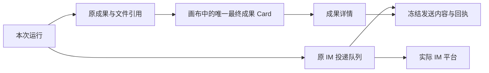

# 工作流与自动任务：成果展示和 IM 交付设计

> 待评审的功能设计。本文说明拟新增行为，不代表功能已经实现。

## 1. 要解决的问题

定时任务和工作流完成后，用户需要直接看到结果，而不必进入后台目录寻找文件。需要推送的内容可以发到 IM；用户也应能在软件中查到哪次运行发给了谁、具体发了什么、是否发送成功。

本次设计围绕三个动作展开：**配置接收点、查看成果、回看发送内容**。

### 已确认的产品决定

- 每次工作流运行在画布中只有一个“最终成果”Card，集中查看完整内容和所有 IM 发送记录。
- Card 提供一目了然的预览，点击后在软件中查看完整内容。
- 即使内容已经发送到 IM，Card 和软件内的阅读入口仍然保留。
- 历史发送内容展示当时实际登记发送的正文及附件，不能用最新结果替代。
- 定时任务需要可以直接配置接收点；接收点必须能明确区分平台、具体连接及聊天。

### 本文的设计建议

正文、数据和附件共用成果详情；运行画布是工作流的主要成果入口。自动任务使用同一套成果展示，不另建报告系统。平台连接与原 IM 发送队列继续复用。

目标数量限制、具体接口字段、数据库迁移和布局尺寸留给后续技术方案，不作为本轮已经确认的产品需求。

## 2. 用户如何使用

以“每天早上整理行业简报，并发到飞书群”为例。

| 阶段       | 用户操作                                 | 软件表现                                               |
| ---------- | ---------------------------------------- | ------------------------------------------------------ |
| 准备接收点 | 配置飞书机器人，为群聊完成授权           | 接收点可按“飞书 / 研究助手 / 行业观察群”识别           |
| 配置任务   | 选择伙伴、团队或工作流，设置时间和接收点 | 保存任务，不要求用户手填连接 ID 或编写发送代码         |
| 执行       | 到时间自动运行                           | 执行记录保存本次运行与过程                             |
| 查看成果   | 打开该次工作流画布                       | 流程末端有一个“最终成果”Card，显示标题、预览及发送概况 |
| 阅读       | 点击 Card                                | 打开本次成果详情，直接阅读简报或查看附件               |
| 核对发送   | 在详情中切换到“发送记录”，打开对应记录   | 看到当时发送给该群的正文、附件与发送状态               |
| 查看历史   | 选择之前某次运行                         | 展示该次成果和该次发送内容，保持原版本                 |

手工运行工作流使用同样的成果入口。伙伴或团队自动任务没有工作流画布，从自动任务运行记录打开同一套成果详情。

## 3. 如何选择接收点

### 3.1 选择的是具体聊天

接收点由“平台、连接、聊天”共同说明。例如两个飞书机器人都加入了同名群，用户仍能通过连接名称区分。内部使用真实聊天授权 ID 定位，不按名称猜测。

选择器按平台与连接分组，支持搜索聊天；选中后保留连接名称及聊天名称。同名连接仍无法区分时，才补充简短身份标识。

| 目标情况                               | 选择器行为                                    |
| -------------------------------------- | --------------------------------------------- |
| 已授权且满足发送条件                   | 可选择                                        |
| 已授权但连接停用、需要登录或缺少上下文 | 显示具体原因，不冒充可发送                    |
| 尚未发现聊天                           | 提供前往 IM 集成的入口，不允许手填任意聊天 ID |
| 已保存的目标后来失效                   | 保留原选择并显示错误，不自动切换到同名目标    |

微信、企业微信和飞书共用选择体验，但按实际能力校验。微信依赖会话上下文，企业微信依赖已认证的连接，飞书依赖应用权限；连接配置存在并不等于可以发送。

### 3.2 自动任务直接配置

创建或编辑自动任务时增加“结果发送到”，配置最终成果的接收点；可选择携带成果附件。未选择时，结果仍在应用内保存和展示。

工作流自动任务提供以下选择：

| 选择           | 行为                                                     |
| -------------- | -------------------------------------------------------- |
| 按工作流设置   | 沿用该次运行固定版本的最终交付设置                       |
| 仅在应用内查看 | 不追加最终成果发送，仍生成成果 Card                      |
| 指定接收点     | 由任务配置负责发送最终成果，覆盖本次工作流的最终交付设置 |

这些选择控制最终成果的自动发送。工作流显式编排的中途发送是业务步骤，不能被“仅在应用内查看”悄悄跳过；界面发现这种步骤时，应就近说明仍会执行，避免用户误以为所有外发都已关闭。

“指定接收点”只发送顶层任务的最终成果一次，不把所有子运行的结果逐条群发。对子运行传递的是关闭默认最终发送的策略；只有顶层明确纳入最终成果的子结果才随顶层交付。joined 和 detached 都遵守该规则，后台子运行晚完成不能自行追加一份最终报告。

### 3.3 工作流如何配置

用户可在工作流创作中说明“把最终报告发到某个聊天”，由 Agent 查询真实目标，明确选择后更新工作流。工作流设置中也提供同一接收点选择器。

界面设置和 Agent 创作修改同一份工作流源码，保存为新版本；不能出现“画布设置一个目标、源码另有一个目标”的两套事实。

简单的最终成果发送交给最终交付配置。需要中途通知、分支发送或等待回复时，继续使用显式 IM 步骤。一旦存在原生步骤发送，一期不允许再叠加自动最终发送；界面说明冲突，让用户保留一种发送安排，防止重复消息。应用不声称能识别任意脚本或外部工具自行发送的消息。

## 4. 画布上展示什么

### 4.1 一个最终成果 Card

每次运行的画布末端保留一个“最终成果”Card。它是运行结果的阅读入口，不是新的执行步骤，也不需要额外调用模型生成内容。

| Card 内容 | 展示规则                                                                 |
| --------- | ------------------------------------------------------------------------ |
| 标题      | 有成果标题时显示标题，否则使用“最终成果”                                 |
| 内容预览  | 展示少量正文；只有结构化数据时展示紧凑数据预览，不把长 JSON 全铺在画布上 |
| 附件      | 有已确认附件时展示数量；没有附件不添加空占位说明                         |
| 发送概况  | 有 IM 交付时展示实际概况，例如“已发送 2/3”；失败和结果不确定明确区分     |
| 查看入口  | 点击 Card 打开完整成果详情                                               |

Card 只有一个，各步骤不再增加独立成果 Card。步骤本身的参数、中间输出与错误继续留在原节点详情；用户要阅读最终内容、核对发送内容时，进入最终成果 Card。

Card 初次随画布布局可见；后续更新不抢占用户的缩放、平移和选中状态。它使用既有 Card、语义背景和留白，不添加常驻边框、阴影或重复解释性标签。

### 4.2 不同阶段的状态

| 当前情况                  | Card 表现                                              |
| ------------------------- | ------------------------------------------------------ |
| 运行尚未产出最终内容      | 等待成果                                               |
| 正文已可读，附件仍在准备  | 可打开正文，附件显示准备状态                           |
| 已完成且有成果            | 展示正文或数据预览，点击查看                           |
| 已完成但没有可读成果      | 无可展示成果                                           |
| 运行失败或取消            | 展示真实运行状态；已完成的步骤发送仍可在发送记录中核对 |
| 成果生成成功，IM 发送失败 | 成果保持可读，发送概况显示失败                         |
| 发送结果不确定            | 显示需要核对，不显示已送达                             |

不能拿上次运行的内容填补本次空结果。点击或看到 Card 预览不自动确认成果已读。

## 5. 点击后看到什么

点击 Card 后复用运行成果详情弹窗。弹窗内只有两个主要阅读位置：**成果、发送记录**。关闭后恢复原画布位置和焦点，不跳转到另一套工作页面。

### 5.1 成果

| 内容       | 阅读方式                                         |
| ---------- | ------------------------------------------------ |
| 正文       | 直接渲染 Markdown，支持标题、列表和表格          |
| 结构化数据 | 保留数据视图；工作流可指定已有字段作为标题和正文 |
| 文件       | 展示正式交付的附件，按已有能力打开或下载         |
| 混合结果   | 正文优先，数据与附件按需查看                     |

标题、正文和文件来自本次已确认输出。工作流通过创作约定这些内容，不要求普通用户手填 JSON Pointer；字段映射作为实现契约处理。没有正文映射的旧工作流保留原数据视图。

仅生成文件也可以交付，但不强制所有正文先写成文件。应用不从任意 JSON 猜测业务图表，不把原始 HTML 当成可执行页面。

### 5.2 发送记录

列出本次运行关联的所有原生 IM 投递，包括最终交付、显式步骤发送以及其子运行的关联投递；子运行来源需要可识别，不能和其他顶层运行混淆。即使工作流最终失败，中途已经发生的发送也必须能查到。detached 子运行晚发生的发送通过原事件刷新记录，不改写顶层最终成果。

记录以实际投递身份区分，至少能看清：发到哪个连接下的哪个聊天、何时登记、当前状态，以及“查看发送内容”。多个目标分别显示；同一目标的多次业务发送也不能只保留最后一条。

尚未登记发送的最终交付显示具体准备状态或阻塞原因，不能把成果预览标成已发送消息。查看记录不依赖 IM 当前在线。

### 5.3 当时究竟发送了什么

打开一条发送记录，读取该次投递已经冻结的正文及附件，而不是重新拼接当前成果。

- 正文包含当时组合的标题、时间和实际消息内容。
- 附件使用该次投递的冻结文件；原文件后来修改或删除不替换历史内容。
- 发送状态与内容一起呈现。存在部分完成或回执不确定时，不把整份待发载荷都宣称为已送达。
- 重试沿用原内容，不能重新调用模型生成另一版报告。
- 连接改名或被删除后仍能识别原接收点，不关联到同名新连接。

软件回看承诺的是发送载荷与平台确认事实，不保证与 IM 客户端像素一致，也不把平台发送成功当成接收人已读。发送快照与原成果分别查看，不能互相冒充。

## 6. 定时任务与历史入口

自动任务详情显示最近一次运行状态，并提供最近可读成果。若展示的是更早运行的成果，必须标清所属时间，不能掩盖最新一次失败。

每条运行记录都能打开自己的成果和发送记录。工作流任务的“查看过程”进入该次运行画布；“查看成果”直接打开同一成果详情。伙伴、团队和工作流复用成果阅读组件及准确来源，不复制另一份报告正文。

历史发送记录与冻结附件使用一致的保留及清理策略；不能仅因为发送成功便清除供回看的内容。用户明确删除或清理后，附件缺失需要如实显示，不用当前同路径文件替代，不承诺永久保存。

## 7. 功能边界与默认规则

| 事项         | 规则                                                                                            |
| ------------ | ----------------------------------------------------------------------------------------------- |
| 运行与发送   | 生成成果成功和 IM 发送成功分别记录；发送失败不重跑整个工作流                                    |
| 权限         | 保存目标与发送前均验证；不因连接存在而授予聊天发送或执行权限                                    |
| 自动任务授权 | 新增发送能力不默认继承旧授权；具体复用或扩展方式由技术方案明确                                  |
| 版本         | 工作流版本、任务配置和目标选择在接纳时固定；后续编辑不改写旧运行                                |
| 重复发送     | 本次最终成果只由工作流或自动任务一方负责；恢复与重复查询不能新增投递                            |
| 子工作流     | 自动任务对最终发送的关闭或覆盖传递到本次子运行，包含 joined 和 detached；显式业务步骤保持原语义 |
| 正文与附件   | 正文可先阅读；要求携带附件的发送必须等待明确交付的附件就绪，不静默漏发                          |
| 大内容及限制 | 按现有正文和文件预算校验，超限明确失败，不静默截断                                              |
| 撤权与离线   | 撤权阻止后续发送；暂时离线按原平台规则等待或失败，不换接收点                                    |
| 结果未知     | 平台回执丢失时保留不确定，用户核对后才允许重新尝试                                              |
| 停用与删除   | 停用任务只阻止新触发；删除遵守原运行和发送屏障，不声称已发内容被撤回                            |
| 应用内阅读   | 只有完整成果实际呈现准确版本才确认阅读，IM 送达和 Card 预览不代替它                             |
| 本地优先     | 依赖应用与设备运行，不新增云端代跑或公网报告发布                                                |
| 知识库整理   | 沿用独立的成果与通知规则，不自动把知识内容发到 IM                                               |

一期不包含邮件、通用 Webhook、任意平台账号或聊天 ID、独立 BI 看板、跨次趋势图及公网分享页。

## 8. 技术方案必须守住的边界

这里限定实现职责，不预先堆叠完整接口与物理表设计。

1. **成果只有一个来源。** Card、详情和任务历史引用同一 Run 或准确 Execution 的结果。节点日志、后续聊天和新运行不能覆盖旧成果。
2. **最终发送只有一个负责人。** 工作流及自动任务入口必须归一到同一运行来源和接收目标，不能各创建一条投递。已存在的步骤发送继续用原 action 身份追溯。
3. **冻结内容复用 IMDelivery。** 原 Outbox 已拥有正文、附件和回执，新增查看入口读取这些事实，不再建一份发送正文库。需补齐自动任务与具体步骤的来源关联及历史目标展示信息。
4. **完成与登记之间可恢复。** 原终态保存后、投递登记前崩溃，恢复能找到未完成交付；文件未就绪也有持久准备事实。不能只靠前端页面或一次完成回调触发发送。
5. **附件是明确产物。** 工作流沿用输出契约中的文件声明；伙伴、团队需要明确交付文件及可核验身份。不能把全部编辑文件或任意散文路径当附件；采集不完整时保留阻塞原因。
6. **查询和发送权限分开。** 当前聊天的出站许可变化会阻止发送，不必删除已有历史；历史私人正文及文件只向获准查看该记录的入口开放。任务 API Key 不能任意改接收点或遍历 IM 历史。
7. **复用既有协议与生命周期。** 使用现有 HTTP、生成客户端、全局资源事件和查询缓存。没有新增页面轮询、独立平台连接或第二份执行状态。
8. **升级不补发历史。** 旧任务缺省维持现状，旧工作流保留数据视图和显式 IM 步骤。新设置从新的接纳运行生效，不能把已有历史批量变成待发或未读。

实现前再给出接口与存储变化、授权用途、原子性及恢复方案；新增数据必须能说明为何原模块不足。实施计划引用本文，不把详细 API 清单当成功能设计主体。

## 9. 如何验收

| 场景                           | 应看到的结果                                         |
| ------------------------------ | ---------------------------------------------------- |
| 两个连接下存在同名聊天         | 能选择正确接收点，保存后不混淆                       |
| 定时任务选择伙伴、团队或工作流 | 都能直接配置最终接收点                               |
| 工作流只在应用内交付           | 画布有且只有一个成果 Card，可打开正文、数据及附件    |
| 工作流只配置发到 IM            | 软件内仍有成果 Card 和发送记录                       |
| 显式发送发生后工作流失败       | 最终 Card 显示失败，发送记录保留已发生的投递及其内容 |
| 多个目标中部分失败             | 分别显示各目标状态，成功项不被重发                   |
| 发送后修改输出或原文件         | 历史发送内容保持原版本                               |
| IM 离线后查看旧记录            | 仍可阅读本机保留的发送正文和附件                     |
| 运行完成或登记过程中重启       | 恢复原交付，不产生重复消息                           |
| 文件采集晚于模型终态           | 正文可读，附件准备状态真实，不提前漏发               |
| 平台回执不确定                 | 不显示已送达，重试前要求明确核对                     |
| 只看画布预览或发送快照         | 不自动确认原成果已读                                 |
| 打开成果详情再关闭             | 保留画布位置、缩放、选中状态及合理焦点               |
| 切换历史运行                   | 不串用其他运行的成果或发送内容                       |

后续实现使用相关包及组件的定向验证；三平台真实发送、Native/Web、浅暗主题、窄容器和键盘操作另行验收。本文完成不代表这些行为已经实现或验收。

## 10. 本轮建议与待评审点

用户已明确选择“一个最终成果 Card”。以下是本文提出、仍需评审的产品安排：

- 成果详情采用“成果 / 发送记录”两个主要阅读位置。
- 普通最终发送由配置完成，复杂发送由显式步骤完成；一期阻止两种方式叠加。
- 手工运行与定时运行共用一套成果体验，历史发送读取原冻结载荷。

API 字段、物理列、每次目标数量和摘要行数由实施者在这些边界内提出具体方案；需要改变产品行为时再回到设计评审。

## 参考与现状依据

- [领域词汇](../../CONTEXT.md)、[自动任务与 IM](../architecture/automation-and-im-cn.md)、[工作流](../architecture/workflows-cn.md)、[通知与工作看板](../architecture/notifications-and-work-board-cn.md)。
- [目标发现与校验](../../server/services/im/management.go)、[IM 交付模型](../../server/repositories/models/im.go)、[持久发送与重试](../../server/services/im/delivery.go)。
- [运行结果详情](../../packages/frontend/src/modules/workflow/components/run-result-dialog.tsx)、[工作流画布](../../packages/frontend/src/modules/workflow/components/workflow-canvas.tsx)、[自动运行导航](../../packages/frontend/src/modules/automatic-task/model/task-navigation.ts)。

当前已存在平台适配、工作流内置 IM 发送和原始结果查询；本文描述的统一接收点配置、单 Card 成果阅读与历史发送查看是待实现设计。源码能力与真实平台验收分别判断。
