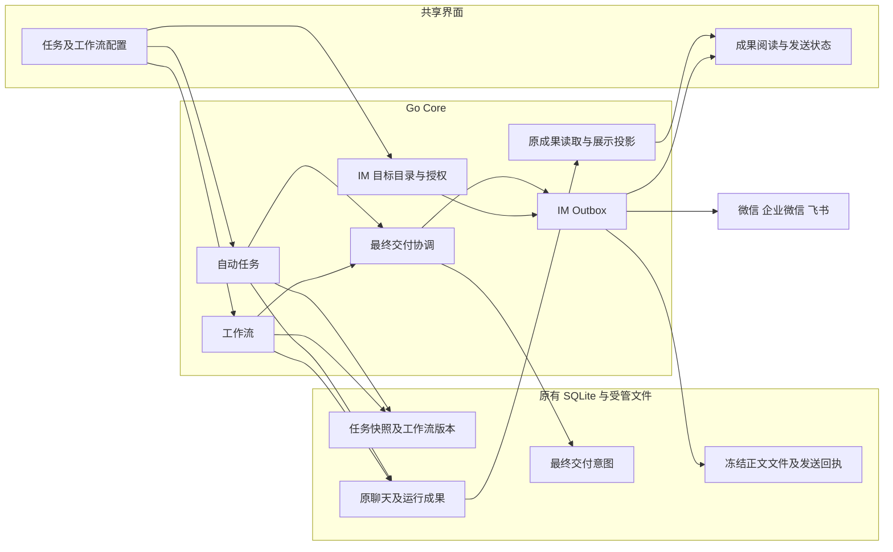
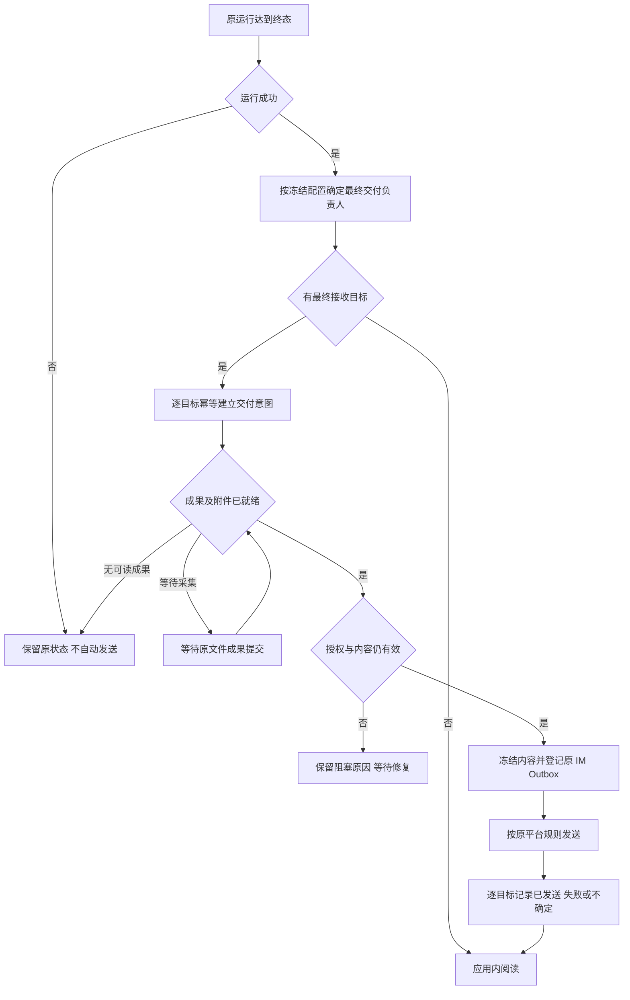
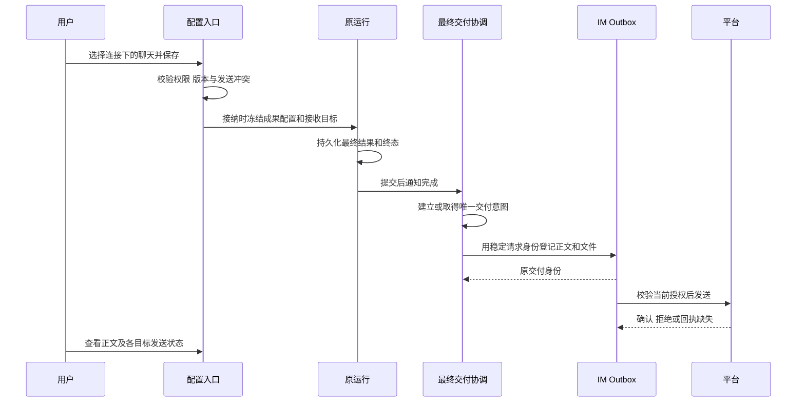

# 自动任务与工作流成果展示、IM 交付概要设计

> 状态：待评审方案，尚未实现。本文提出的字段、接口和界面均不代表当前能力。
> 范围：自动任务（定时与 API 触发）、工作流、应用内成果阅读及已有 IM 平台。

## 1. 引言

### 1.1 背景

用户需要定期生产可直接阅读的内容，并明确选择发送到哪个机器人连接下的哪个聊天。当前实现已有微信、企业微信和飞书传输及持久 IM 交付，但配置和阅读入口尚未形成完整体验。

| 事项           | 当前实现                                   | 本次拟新增                                        |
| -------------- | ------------------------------------------ | ------------------------------------------------- |
| IM 平台        | 三个平台均已注册发送适配器，平台条件不同   | 如实展示各目标的可发送性与限制                    |
| 目标选择       | 工作流 Agent 查询目标 ID，摘要不含连接名称 | 按平台、连接、聊天选择，界面与 Agent 使用相同目录 |
| 工作流发送     | 源码通过内置 IM action 发送正文及文件      | 保留步骤发送，增加可配置的最终成果发送            |
| 自动任务接收点 | 没有独立接收目标配置                       | 为伙伴、团队和工作流任务配置最终接收目标          |
| 应用内成果     | 进入原聊天或工作流结果，后者偏数据展示     | 直接阅读正文、查看附件及按运行浏览历史            |
| 平台送达       | 原 Outbox 保存冻结内容与独立状态           | 增加来源关联与就近查看、恢复操作                  |

### 1.2 目的

让用户配置一次“做什么、何时做、结果发到哪里”，完成后直接阅读成果。成果始终保存在原工作中；外部发送使用明确授权的接收点。执行完成、成果可读、IM 送达、应用内已读分别表达。

本方案采用以下设计建议，等待评审：一期支持 Markdown 正文、数据和附件、成功后发送、最多五个 IM 接收点；异常条件推送、跨次趋势图、邮件、通用 Webhook、公网报告发布留待后续需求，不纳入一期承诺。知识库整理继续遵守其独立成果与通知规则，不因本方案自动产生报告或发送知识内容。

### 1.3 参考资料

- [领域词汇](../../CONTEXT.md)、[架构总览](../architecture/overview-cn.md)。
- [自动任务与 IM](../architecture/automation-and-im-cn.md)、[工作流](../architecture/workflows-cn.md)、[通知与工作看板](../architecture/notifications-and-work-board-cn.md)。
- [UI 标准](../development/ui-cn.md)、[桌面生命周期](../architecture/desktop-lifecycle-cn.md)。
- 当前代码：[目标发现与授权](../../server/services/im/management.go)、[持久交付](../../server/services/im/delivery.go)、[工作流交付调用](../../server/services/im/capability.go)。
- 当前数据：[自动任务](../../server/repositories/models/automatic_task.go)、[IM](../../server/repositories/models/im.go)、[成果引用与阅读](../../server/repositories/models/work_result.go)。
- 当前入口：[自动运行导航](../../packages/frontend/src/modules/automatic-task/model/task-navigation.ts)、[工作流结果](../../packages/frontend/src/modules/workflow/components/run-result-dialog.tsx)、[工作流触发配置](../../server/apis/workflows/save_workflow_triggers.go)。

## 2. 需求编号

需求编号待补充，本文用以下标识建立评审与验收对应关系。

| 标识 | 需求                 | 一期结果                                         |
| ---- | -------------------- | ------------------------------------------------ |
| R1   | 能区分并选择具体连接 | 同平台、同名聊天也能定位到唯一目标               |
| R2   | 定时任务有直接接收点 | 创建、编辑任务时配置 IM 接收目标，无须改工作指令 |
| R3   | 工作流支持便捷交付   | 最终成果发送可配置，复杂流程仍支持步骤发送       |
| R4   | 内容直接展示         | 正文可阅读，原始数据与文件仍可查看               |
| R5   | 可靠送达与恢复       | 重启可恢复，失败可处理，不确定结果不盲目重发     |
| R6   | 保持权限与兼容       | 不扩大既有聊天授权，不补发历史，不重复提醒或发送 |

## 3. 总体设计

### 3.1 功能概述

统一使用 **IM 接收目标** 表达“某个连接下的某个已授权聊天”。目标 ID 沿用 `IMBinding.ID`；平台、连接名称、聊天名称用于展示，不参与按名称寻址。用户无需接触内置工具的 `connectorId`。

| 配置入口                 | 新增行为                                   | 配置权威                                  |
| ------------------------ | ------------------------------------------ | ----------------------------------------- |
| 自动任务创建、编辑       | 配置接收目标及是否携带附件                 | AutomaticTask，运行接纳时冻结             |
| 工作流最终成果设置       | 配置最终结果的接收目标、正文映射及附件     | 完整工作流源码，编译后进入不可变 Revision |
| 工作流创作聊天           | Agent 查询同一目标目录，用户指定后写入源码 | 同上                                      |
| 工作流运行、自动任务详情 | 阅读结果、查看逐目标发送状态及失败原因     | 原结果与 IMDelivery                       |
| IM 聊天授权              | 分别允许工作流发送、自动任务发送           | IMBinding                                 |

一期最多五个不重复目标；支持单聊或群聊以平台实际发现与权限为准。仅支持应用已经发现的聊天，不允许输入任意平台聊天 ID 或从通讯录推测收件人。

### 3.2 总体架构



交付协调由自动任务完成入口、工作流完成入口与后台恢复共同复用；只负责把准确成果交给原 IM Outbox，不承担模型执行、平台重连或另一套业务运行状态。文件只在原 Outbox 冻结，应用内展示读取原成果，不另建报告正文库。

## 4. 外部接口

以下路径以现有 Core 管理路由前缀为基准，响应封装、认证、稳定错误沿用现有 ginx 约定。新增接口为拟议契约；实现时通过命令生成 OpenAPI、前端 Client 与 SDK。

| 操作                 | 方法与路径                                                             | 变化                                                                                                                             |
| -------------------- | ---------------------------------------------------------------------- | -------------------------------------------------------------------------------------------------------------------------------- |
| 查询目标             | 新增 `GET /im/targets`                                                 | 按 `usage=workflow\|automatic`、`connectionId`、`search`、`offset` 查询；固定每批 50 项，返回 `resources,totalSize,offset,limit` |
| 修改聊天授权         | 现有 `PUT /im/bindings/:bindingId`                                     | 增加 `allowAutomaticDelivery`，沿用原 `revision`                                                                                 |
| 创建任务             | 现有 `POST /wakers/:wakerId/automatic-tasks`                           | 增加 `resultDelivery`                                                                                                            |
| 读取、修改、删除任务 | 现有任务 GET、PUT、DELETE                                              | GET 返回配置；PUT 按版本更新；DELETE 同步处理未发送的交付意图                                                                    |
| 工作流源码           | 现有 `GET/PUT /workflows/:id/source`                                   | `meta.resultDelivery`、`meta.resultView` 进入编译契约；不增加独立配置存储                                                        |
| 工作流触发器         | 现有 `PUT /workflows/:id/triggers`                                     | 公共配置携带 `resultDelivery`，所有生成的任务适用同一规则                                                                        |
| 运行历史             | 现有 `GET /wakers/:wakerId/automatic-tasks/:taskId/runs`               | 追加有界成果摘要及交付概览；保留 `pageNum,pageSize`，默认 1、20，最大 100，响应含 `resources,totalSize,pageNum,pageSize`         |
| 成果阅读             | 新增 `GET /wakers/:wakerId/automatic-tasks/:taskId/runs/:runId/result` | 返回准确原成果引用、展示投影及附件，不返回任意本机路径                                                                           |
| 发送记录             | 新增 `GET /im/deliveries`                                              | 按原运行来源筛选；`offset` 分页，每批 50，响应含 `resources,totalSize,offset,limit`；不返回冻结私人正文                          |
| 重试发送             | 新增 `POST /im/deliveries/:deliveryId/retry`                           | 复用现有 RetryDelivery；未知结果需 `confirmedUnknown=true`，只重试原冻结载荷                                                     |
| 修复登记阻塞         | 新增 `POST /result-deliveries/:id/retry`                               | 无 IMDelivery 时重新登记同一成果与目标；已有 IMDelivery 时返回其身份，不另建投递                                                 |

`/im/targets` 仅返回对应 usage 已授权目标及其可用性；停用、缺少登录或上下文的已授权目标保留为禁选项并给出原因。未授权目标不暴露给 Agent。已保存但失效的 ID 返回占位错误，不能当作空选择或换成同名聊天。

代表性创建请求（省略既有执行配置；ID 为虚构占位）：

```json
{
  "name": "每日行业简报",
  "targetKind": "waker",
  "executorWakerId": "waker-example",
  "instruction": "整理今日行业动态，直接给出可阅读的正文。",
  "trigger": "schedule",
  "schedule": {
    "kind": "daily",
    "timezone": "Asia/Shanghai",
    "hour": 9,
    "minute": 0
  },
  "resultDelivery": {
    "mode": "custom",
    "targetIds": ["binding-example"],
    "includeFiles": true
  }
}
```

创建响应沿用现有身份回执，不把完整任务配置塞入创建响应：

```json
{ "taskId": "task-example" }
```

目标目录响应示意：

```json
{
  "resources": [
    {
      "id": "binding-example",
      "name": "行业观察群",
      "platform": "feishu",
      "kind": "group",
      "connectionId": "connection-example",
      "connectionName": "研究助手机器人",
      "availability": "ready",
      "reasonCode": ""
    }
  ],
  "totalSize": 1,
  "offset": 0,
  "limit": 50
}
```

| 新增业务参数                  | 类型、默认值与约束                                                                                                 |
| ----------------------------- | ------------------------------------------------------------------------------------------------------------------ |
| `resultDelivery.mode`         | 自动任务取 `none/workflow/custom`；伙伴及团队缺省 `none`，工作流任务缺省 `workflow`；`workflow` 仅适用于工作流目标 |
| `resultDelivery.targetIds`    | 目标 ID 数组；`custom` 下 1–5 个且去重；其他模式必须为空                                                           |
| `resultDelivery.includeFiles` | 布尔，默认 false；只包含原成果声明交付的文件                                                                       |
| `meta.resultDelivery`         | 工作流源码中的最终发送配置，含 `targetIds,includeFiles`；缺省不追加发送                                            |
| `meta.resultView`             | 可选 `titlePath,bodyPath`，使用 JSON Pointer 指向最终结果中的字符串；编译校验 Schema，运行校验实际值               |
| `allowAutomaticDelivery`      | 聊天授权布尔，新增默认 false；与现有 `allowWorkflowDelivery` 独立                                                  |

外部 API Key 继续只能触发已授权任务、读取自身运行结果；调用参数不能覆盖接收目标、发送权限或展示契约。本机管理 API 和受限 Agent 能力目录均映射到同一业务校验，不签发跨任务的交付管理权限。

## 5. 功能设计

### 5.1 功能逻辑

#### 5.1.1 权限与目标身份

- 连接只决定机器人账号；聊天授权决定唯一接收点。`bindingId → connectionId + externalChatId` 由 Core 解析，界面和模型不能提交不同的组合。
- 目标目录扩展现有 `Targets` 服务，补齐连接 ID、连接名称及实际可用性，供管理界面与 `workflow.resources.list(kind:imTargets)` 共用。内部操作的 connector ID 仍通过 builtinActions 发现。
- 自动任务自定义目标要求 `approved + allowAutomaticDelivery`；工作流最终交付与步骤交付要求 `approved + allowWorkflowDelivery`。工作流任务沿用工作流交付时按后者检查，自定义交付按前者检查。
- 新增可信交付来源区分 `automatic_final`、`workflow_final` 与既有步骤调用。它由 Core 根据冻结负责人签发，发送阶段据此选择权限规则；不能仅用 `WorkflowRunID` 是否存在判断权限，也不允许模型或 API Key 指定该来源。
- 这是显式的出站发送授权，不授予聊天新的入站执行、目录访问或模型调用权限。一期仍以已发现并完成现有聊天授权的 Binding 为对象，不新增“仅发送”授权类型。
- 所有保存入口验证目标权限与配置；正式发送前重新验证最新授权。停用、撤销授权后阻止后续片段，已送出的消息不尝试撤回。
- 不新增菜单权限体系。现有本机管理入口提供配置；Agent 仅能发现其入口获准的目标，不能改聊天授权。新增开关必须由用户显式设置。

#### 5.1.2 配置与阅读体验

**接收目标选择**：复用同一个可搜索多选组件，按平台和连接分组，行内显示聊天名称及类型。选中后保留“连接名称 / 聊天名称”，同名连接再显示短 ID 辅助区分。平台或连接筛选只缩小目录，不改变已选 ID；零目标时提供前往 IM 集成的入口，不自动新建或批准聊天。

**自动任务**：表单增加“结果发送到”字段，默认仅应用内查看；选目标后可启用“携带附件”。工作流目标提供“按工作流设置 / 仅应用内 / 指定聊天”选择。执行目标仍使用原字段，不能混淆执行伙伴与接收聊天。

**工作流**：最终成果设置提供目标选择、附件开关及可选正文映射。保存时沿用完整源码编辑与 CAS 编译，创建新 Revision；表单只是源码投影，不能单独写另一份目标设置。创作 Agent 能识别并修改同一声明，不要求用户手填 ID。复杂的中途通知、等待回复继续由显式 action 编排。

**成果阅读**：任务详情优先显示最近一次具有可读成果的运行，明确标注时间；最近一次执行失败时同时保留失败状态，不能把上次成果当作本次成果。历史按原运行分页。正文、附件和“查看过程”就近排列；无正文只有文件时显示文件，无可读结果时不生成空报告。

**发送状态**：正文旁提供紧凑的逐目标状态，例如“研究助手 / 行业观察群 · 已发送”，失败后在原处修复或重试。五个目标分别处理，不以一个成功表示全部成功。界面通过排版与留白分层，使用共享组件、语义色和 Skeleton，避免重复说明、常驻卡片边框与装饰性标签。

#### 5.1.3 发送归属与防重复

| 运行来源                   | 最终成果交付负责人            | 规则                                                 |
| -------------------------- | ----------------------------- | ---------------------------------------------------- |
| 手工工作流运行             | 当前 Revision 的最终交付配置  | 运行成功且具有有效成果后发送                         |
| 伙伴、团队自动任务         | AutomaticRun 冻结的自定义配置 | 只读取本次准确执行的最终成果                         |
| 工作流自动任务：`workflow` | 当前运行固定 Revision         | 自动任务不再追加发送                                 |
| 工作流自动任务：`none`     | 无最终自动交付                | 抑制本次 Revision 的最终交付；显式步骤仍按原业务执行 |
| 工作流自动任务：`custom`   | AutomaticRun 冻结配置         | 抑制本次 Revision 的最终交付，只按任务目标发送       |

意图来源必须归一：伙伴、团队及 `custom` 工作流任务统一使用 `source_kind=automatic_run,source_id=AutomaticRun.ID`；手工工作流及 `workflow` 模式使用 `source_kind=workflow_run,source_id=WorkflowRun.ID`。两个完成入口和恢复入口都从接纳快照读取该唯一来源，不能按自己当前处理的对象另选来源；`none` 不建立最终交付意图。

`none/custom` 的最终发送抑制递归传给该次运行接纳的全部子运行，包含 joined 与 detached；detached 只改变等待和取消关系，不脱离本次发送策略。此上下文由 Core 传递、持久保存，模型不能覆盖。显式步骤仍按原规则执行；因此“仅应用内”的完整说明为“不追加最终发送，工作流内显式发送步骤仍会执行”。

一期为原生显式 IM 步骤设置保守冲突规则：若所选 Revision 或其子工作流含 IM 发送 action，不允许同时设置 `meta.resultDelivery`，也不允许自动任务配置 `custom`。界面提示“工作流已包含发送步骤”，由用户在创作中移除步骤或保留工作流控制。`none` 的界面明确说明不能关闭这些显式步骤。

依赖检查区分“步骤发送”和“最终发送”；手工运行及 `workflow` 模式下，子工作流的最终发送由各自固定版本控制，父级开启最终发送或自动任务 `custom` 时也视为冲突。`none` 模式递归抑制子运行的最终发送。一期不依赖正文相似度去重，不宣称能识别任意 HTTP、脚本或第三方工具自行发送的消息。

任务跟随当前工作流版本时，每次接纳重新检查冲突；新版本引入发送步骤造成冲突，拒绝该次接纳并提示修复，不能静默改变负责人。已接纳运行固定原配置，不受后续编辑影响。

#### 5.1.4 成果与发送内容

- 普通伙伴读取准确 Execution 的最终助手正文；团队读取本次团队运行的负责人最终结论，不收集成员过程消息。封闭后续聊不改变本次交付。
- 伙伴及团队的附件候选只来自上述最终正文中明确的本地文件链接，沿用既有 Markdown 文件链接解析与授权范围，须解析到该执行已确认的文件成果身份和摘要；不把所有发生编辑的文件自动当作附件，不按扩展名或散文路径推测。团队只接收负责人最终结论明确交付的文件，不能扫描成员目录。没有可核验文件成果的候选显示“附件无法核验”，交付阻塞。
- 工作流优先按 `meta.resultView` 读取标题、正文；无映射时，字符串直接展示，结构化值按已有数据视图展示。映射缺失或类型错误时回退数据视图并提示，最终发送标记内容准备失败，不使用模型补写。
- 正文复用共享 Markdown 渲染，不执行代码或原始 HTML。结构化结果提供“数据”视图；一期不由任意 JSON 猜测业务图表。
- 工作流展示配置只引用原 `Run.result`；读到后续文件变更或新聊天消息不能替换历史成果。应用内阅读仍提交原 `WorkResultReference` 的准确版本。
- IM 发送内容为成果标题、运行时间及完整可发送正文；结构化结果无正文映射时按确定性的 JSON 文本发送。超出既有 200000 字节正文预算时阻塞发送并提示调整正文映射，不能静默截断或把绝对本机路径发给远端用户。
- 勾选附件只包含原成果登记且在授权范围内的最终文件，沿用最多十个附件与原有文件大小、平台类型限制；超限阻塞整个目标的登记，不自动漏发。文件在登记时由 Outbox 冻结。若尚未冻结前原文件已丢失或改变，则阻塞并提示，不能发送变化后的文件冒充原成果。
- 不生成需要公网访问的报告链接。Native/Web 的本机路由仅在应用内使用；IM 消息本身携带可读内容，文件按平台能力送出。

#### 5.1.5 主流程与失败恢复





执行成功不等待 IM 送达，不因发送失败把原运行改成失败或重新运行模型。最终交付意图覆盖“终态已保存、Outbox 尚未登记”的故障窗口；恢复按首次启用边界和冻结配置增量对账，不扫描并补发全部历史。

**附件就绪边界**：不携带附件时，准确最终正文持久化即可登记；携带附件时，在原终态后先建立 `pending` 意图，固定最终消息及文件声明，等待原文件采集的持久终态。采集 `pending` 时不得先发正文后补附件；`ready` 时解析并一次性封存原成果版本、文件清单、大小与摘要，设置 `prepared_at` 后登记 Outbox；`partial/unavailable/incomplete` 时阻塞整份发送并指出原因。没有文件声明则正文可直接发送。工作流文件沿用输出 Schema 中的文件声明及原运行文件登记，全部可核验后才就绪。

正文可先在应用内阅读，附件采集不延迟模型终态。文件采集提交后事件唤醒同一协调器；重启读取 `pending` 且 `prepared_at` 为空的意图关联的原文件记录恢复。原运行增加 `final_delivery_prepared` 内部进度位；仅在同一数据库事务中建立完整目标意图集合后，或明确判定无需交付后置 true。恢复有界读取终态且进度位为 false 的来源，补齐终态已落盘但意图尚未建立的窗口。它只记录协调进度，不代替原执行或文件采集状态。

| 情况                         | 行为                                                                                                              |
| ---------------------------- | ----------------------------------------------------------------------------------------------------------------- |
| 接收目标在保存时失效         | 拒绝保存，指向具体目标与原因                                                                                      |
| 最终发送目标在运行中失效     | 业务继续，交付意图阻塞；保持原目标，不换连接                                                                      |
| 旧工作流显式发送步骤失效     | 保留原 action 接纳与失败规则，不改变既有业务成功条件                                                              |
| 连接暂时离线                 | 按原 Outbox 等待恢复；界面显示等待连接                                                                            |
| 微信缺少或已失效的会话上下文 | 显示需要在微信聊天中恢复上下文；不承诺任意时间主动送达                                                            |
| 登记后进程退出               | 同一请求键取得原 IMDelivery；已确认片段不重发                                                                     |
| 平台明确失败                 | 允许用户重试剩余片段，沿用已冻结内容与最新授权                                                                    |
| 平台结果未知                 | 保留 unknown；核对后显式确认才允许重试，不声称端到端 exactly-once                                                 |
| 某个目标失败                 | 其余目标独立完成，不重发已成功目标                                                                                |
| 停用自动任务                 | 阻止新运行，已接纳运行与已登记交付继续；停止发送通过撤销目标授权                                                  |
| 删除任务或运行               | 进入既有删除屏障，取消尚未发送的意图与 pending 交付；正在发送时等待当前交付离开发送临界区或拒绝删除，不冒充已撤回 |

连接或聊天删除的依赖预览扩展为当前任务、当前工作流版本和未封闭交付意图。仅历史引用不阻止删除，保留快照供阅读；删除操作不得把旧引用转给同名新目标。

#### 5.1.6 存储归属

继续使用原应用 SQLite 数据库。以下为拟议物理列，JSON 属性不另拆列；所有新增 Go 结构体字段使用准确中文注释。

| 表                                | 字段 / 类型                                 | 默认值及职责                                                                                   |
| --------------------------------- | ------------------------------------------- | ---------------------------------------------------------------------------------------------- |
| `im_bindings`                     | `allow_automatic_delivery` / BOOLEAN        | false，自动任务出站许可；原工作流许可不迁移为此许可                                            |
| `automatic_tasks`                 | `result_delivery` / TEXT JSON               | 空对象，按目标类型解释缺省；保存 mode、targetIds、includeFiles                                 |
| `automatic_runs`                  | 原 `configuration` / TEXT JSON              | 接纳快照包含 resultDelivery；新增配置不回写旧运行                                              |
| `workflow_revisions`              | 原源码及 Manifest                           | 编译保存 meta.resultDelivery、meta.resultView 和带用途的 IM 依赖，不增加独立配置表             |
| `workflow_runs`                   | `final_delivery` / TEXT JSON                | 空对象；接纳时冻结负责人、目标及附件选择，直接运行也使用同一快照结构                           |
| `result_delivery_intents`（新增） | `id` / VARCHAR(32)                          | 稳定主键                                                                                       |
| 同上                              | `source_kind,source_id,target_id` / VARCHAR | 来源 automatic_run 或 workflow_run；组合唯一，每个运行、每个目标只有一个最终交付意图           |
| 同上                              | `result_reference` / TEXT JSON              | 原准确成果引用、版本及声明文件身份；不复制正文                                                 |
| 同上                              | `target_snapshot` / TEXT JSON               | 连接 ID、外部聊天身份及当时展示名称；与当前 Binding 身份核验，改名不影响发送                   |
| 同上                              | `delivery_id` / VARCHAR(32)                 | 空；Outbox 登记后关联原 IMDelivery                                                             |
| 同上                              | `state,error_code` / VARCHAR                | 意图状态仅 pending、blocked、registered、cancelled；registered 后的发送状态完全读取 IMDelivery |
| 同上                              | `created_at,updated_at` / BIGINT            | Unix 毫秒，恢复及有界分页依据                                                                  |
| `im_deliveries`                   | `automatic_run_id` / VARCHAR(32)            | 空；补齐自动任务来源，工作流来源继续沿用原字段                                                 |
| `work_result_receipts`            | 不变                                        | 仍只保存原成果引用、版本及阅读，不保存 IM 状态                                                 |

唯一发送请求键由交付意图 ID 稳定派生；创建意图和关联 Outbox 均可重入。文件冻结与平台调用不放在数据库事务内。Outbox 登记成功但写回 delivery_id 之前崩溃时，用同一请求键恢复原投递，不能重新准备不同载荷。

意图在首次登记前按原文件身份及摘要校验；首次 Outbox 已登记后只读既有冻结载荷。准备完成后，运行后续变化不更新该意图的 result_reference。无交付配置的旧运行不建立意图。界面状态由意图登记状态与 IMDelivery 组合投影，不持久保存第二份“已发送”。

补充物理列：`automatic_runs`、`workflow_runs` 各增加 `final_delivery_prepared BOOLEAN DEFAULT false`，无交付负责权的运行在接纳时置 true，旧运行通过缺省空配置排除恢复；`result_delivery_intents.prepared_at BIGINT NULL` 标识本次准确引用与附件清单已经固定的时间。

可信交付来源作为 `im_deliveries.delivery_origin` 字符串列持久化，缺省空值保持既有入口校验；来源不是对外可编辑字段。自动任务执行工作流时同时保留 `automatic_run_id` 和 `workflow_run_id`，以便两个入口查看同一发送；负责人以冻结来源和 delivery_origin 为准，不能按这两个关联字段是否非空重新推导。

#### 5.1.7 事件、通知与验证方向

复用现有全局 WebSocket、IM 交付资源事件与 `work-results` 阅读事件。意图变化通过同一事件通道声明来源运行和意图身份，提交后精确失效任务成果与发送查询；首次加载、重连和缺口读取权威快照，隐藏页面释放消费，不新增永久前端轮询。

成果仅由原成果收据产生未读；IM 已发送不自动确认应用内已读。发送失败在原成果中提供关注原因，同一来源、目标和失败版本去重，不新建一条工作或重复成果通知。知识库整理的现有通知排除规则不变。

实施验收重点覆盖 R1–R6：同名连接区分、三类执行目标、工作流发送冲突及版本漂移、精确结果归属、多个目标部分失败、撤权、冻结前文件变化、跨登记崩溃恢复、unknown 重试、删除竞态及准确阅读。分别运行相关 Go 包和前端组件定向检查，协议变化验证生成契约。三平台真实发送、微信上下文失效、企业微信连接替换，以及 Native/Web、浅暗主题和键盘交互需要单独实际验收；本设计未执行这些验收。

### 5.2 性能

一期每次运行最多五个最终交付意图，最多十个附件；内容与冻结文件开销沿用现有 IM 预算。平台限流与同目标串行交付沿用原 Service，不为每个页面建立平台连接。

目录在 `im_bindings` 单表过滤授权、连接和名称，确定分页窗口后批量读取连接摘要；跨连接名称搜索先取得匹配连接身份再进行索引过滤，不用 JOIN 拼展示字段。运行列表只返回摘要及逐目标计数，正文按需读取，禁止逐运行展开全部消息或冻结文件。

意图的来源唯一索引及待登记状态索引支持增量恢复；Outbox 继续使用原待发送查询。新查询必须提供真实 SQLite 查询计划和规模测试，验证无 N+1、稳定排序和准确总量。设备上的合理恢复批量及正文预览上限由实现者按现有预算确定并用证据验证，不在概要承诺未经测量的吞吐量。

### 5.3 现网升级方式

- 增量建列、建表和索引；新增自动任务发送许可默认 false，老任务保持原行为。
- 原工作流显式 IM action 及其授权保持不变；旧 Revision 不含新 meta 字段时不追加最终交付。
- 新成果阅读兼容旧结果：正文按既有准确引用读取，缺少映射时用数据视图；升级不把旧结果批量变成新未读或待发送。
- 旧客户端 PUT 未携带新增授权或交付字段时，服务端保留既有值；新客户端显式传 false 或 mode=none 表达关闭，不能把字段缺失误解为清空。涉及 JSON 全量替换的入口先归一化缺失字段，CAS 仍有效。
- 跟随当前版本的任务在下次接纳时采用新 Revision；固定版本任务不变。保存最终成果设置只产生新 Revision，不重写历史运行。
- 回退前先停用新增最终交付并等待发送临界区结束；旧二进制不能识别新交付声明的 Revision，不把该版本交给旧运行器。新字段与表保留，恢复新版后按已有意图和回执对账，不自动重放历史。

### 5.4 继承性分析

继承性关注升级前后既有功能、接口和统计口径的一致性。

1. 是否涉及网元间信元、消息变更：不涉及
2. 是否涉及话统及KPI变更：不涉及
3. 是否涉及和华为侧平台接口变更：不涉及
4. 是否涉及MML配置或者web前台操作变更：涉及，任务、工作流及 IM 授权增加配置与阅读操作。
5. 是否涉及规格负向变更：涉及，新增最终交付与原生步骤交付互斥，既有仅步骤发送保持原行为。
6. 是否涉及新增业务功能默认开启：涉及，成果阅读改进默认可用，新增外部最终发送缺省关闭。
7. 新增功能是否前向兼容：涉及，接口新增可选字段，旧版本运行保持原配置；旧二进制运行新声明存在回退边界。
8. 是否涉及告警及License变更：不涉及

### 5.5 可服务性需求

1. 当前需求是否需要新增话统及KPI：不涉及
2. 当前需求是否需要新增告警：不涉及
3. 当前需求是否需要MML配置及web前台操作功能：涉及，提供目标选择、正文阅读与发送恢复。
4. 当前需求是否需要批量配置功能：不涉及
5. 当前需求是否需要新增License：不涉及
6. 是否涉及信息采集：涉及，诊断记录意图、原运行、目标及交付身份和稳定错误，不采集私人正文或凭据。
7. 是否涉及健康检查：涉及，使用平台既有连接事实及目标实际限制，不把配置存在当成可发送。
8. 是否涉及工具需求：涉及，同步生成 API、前端 Client 及工作流 SDK，增加必要的文档和契约检查。
9. 是否涉及软调或者测试补丁：不涉及
10. 功能是否与环境相关，需要在华为环境上测试：不涉及

平台与桌面环境验证要求统一见 5.1.7，不依赖特定客户网络。
