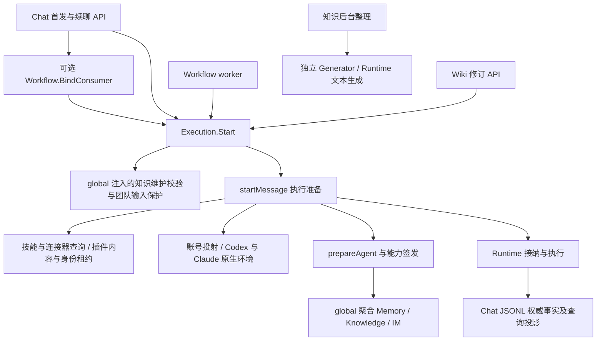
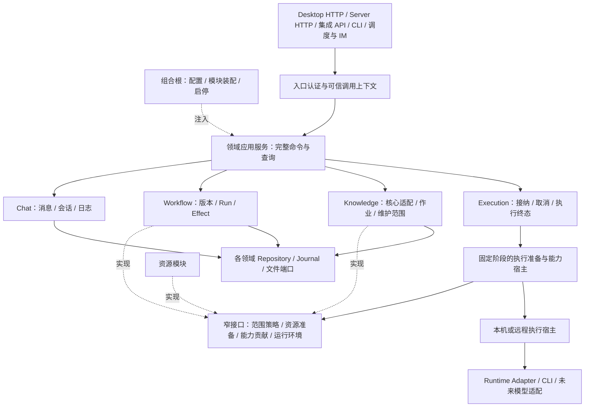

# 后端模块边界、能力扩展与 PaaS 演进设计

> 状态：架构评审提案，尚未实施。分析日期：2026-10-23，源码基线：`abc02b8`。本轮只分析和设计，不修改业务实现、数据库、协议或工程约定。文中目标结构与接口名是设计建议，不代表当前能力。

## 1. 架构结论

当前后端已有明确的数据权威、执行入口、Runtime 适配和恢复机制，适合继续演进。主要问题是**领域扩展开始侵入执行准备、HTTP 用例和全局装配，部分领域不变量靠跨层协调维持**。增加功能时，开发者需要同时理解多个模块的状态、锁和提交顺序，才敢修改一个入口。

建议目标是：**以领域为边界的模块化单体，以 Go 窄接口和显式装配实现能力扩展，以稳定的执行契约为未来控制面与执行节点分离做准备。**

这不是按 `api/service/internal` 再加几层，也不是立即拆微服务。先让同一进程里的所有权和依赖方向清楚，再选择有独立部署收益的边界。

评审中用“侵入”表示：某项变化必须进入不拥有该规则的模块，或调用方必须知道被调用方内部的锁、状态和释放顺序。它不等于已经出现功能错误。下面的风险结论来自静态代码和调用链检查，未做真实模型、并发压测或多实例运行验证。

## 2. 当前 Chat 链路与扩展影响

源码入口：[创建聊天](../../server/apis/chats/create_chat.go)、[发送消息](../../server/apis/chats/send_message.go)、[执行意图](../../server/services/execution/intent.go)、[执行准备](../../server/services/execution/work.go)、[全局装配](../../server/global/config.go)。

三项新增能力的影响不同：

| 能力 | 当前接入方式 | 对维护的实际影响 |
| --- | --- | --- |
| 资源库 | Execution 直接读取技能、连接器、插件安装，冻结版本，解析凭据和原生环境 | 侵入最明显；供应商和 Runtime 配置变化会直接触及普通聊天接纳路径 |
| 知识库 | 后台整理独立；Chat 通过能力绑定接入；Wiki 维护有专属前置保护 | 内容核心隔离较好；宿主接入仍通过 Execution 回调、特判和 API 内编排维持限制 |
| 工作流 | API 预先绑定使用能力；创作与 worker 复用 Execution；Runner 拥有运行事实 | 执行方向基本合理；API、Service、internal/state 共同操作工作流状态与协调锁 |

Chat Service 的生产导入没有直接指向知识库或工作流 Service，不能说整个 Chat 已被这两个领域污染。风险集中在 **Execution 周围的准备、授权、装配和跨领域用例**。

## 3. 具体侵入点与维护风险

### 3.1 执行准备混合了多种变化原因：优先级高

[work.go](../../server/services/execution/work.go) 共 1,944 行，`startMessage` 位于 243–827 行。一个入口同时处理幂等、账号选择、Chat 占位、工作目录、附件、技能与连接器、插件版本、原生环境、能力授权和接纳时机。

其中直接判断 Codex/Claude、读取对应 home 环境变量、配置原生插件；还识别飞书和 GitHub 的环境标记并追加专属指令。[plugins.go](../../server/services/execution/plugins.go) 另有 710 行，包含内容校验、配置展开、目标选择、供应商账号和资源快照。

这是单一职责与依赖倒置不足的具体表现：Execution 本应决定“准备成功后何时接纳和执行”，却同时理解“某种插件和某种 CLI 如何准备”。一个新供应商或原生配置变化，可能影响普通发送、续聊、重试与资源释放。

**目标：**资源模块返回已冻结的资源准备结果，运行环境适配返回可执行环境，Execution 保留接纳状态机和资源生命周期的统一所有权。把业务搬出后再按职责分文件，不能仅把大函数分割成更多 `m.xxx()`。

### 3.2 没有直接 import，也存在语义耦合：优先级高

[global/config.go](../../server/global/config.go) 的 `loadChat` 注入了知识维护校验、团队输入保护、Memory/Knowledge/IM 能力聚合。闭包读取之后才赋值的全局 Service，并用 `nil` 判断处理装配时序。能力聚合没有 Context 参数，知识绑定使用 `context.Background()`。

[execution/agent.go](../../server/services/execution/agent.go) 又直接识别 `knowledge.jobs.start`，为自动任务去重。Execution 虽未导入 knowledge 包，却知道知识命令的业务身份和来源规则。

[knowledge/wiki_chat.go](../../server/services/knowledge/wiki_chat.go) 的 `ValidateWorkIntent` 会对普通发送路径检查维护锚点；这道保护确有必要，不能移到专属 API 后就删除，否则普通续聊或重试可能丢失维护限制。

问题属于隐藏依赖和时间耦合，也说明扩展点尚不完整。新增能力时，开发者既要改领域模块，又要记住 global、Execution 中的配套规则。

**目标：**显式注册带 Context 的能力提供者；由宿主统一完成作用域合并和重复操作检查；持久 Chat 限制通过统一接纳策略进入所有发送、续聊和重试路径。知识库仍拥有“单页维护”的业务判断。

### 3.3 领域用例按入口数量拆散：优先级高

[Wiki 修订入口](../../server/apis/knowledge/send_maintenance_message.go) 自己计算 Chat/Execution 身份、检查页面版本、保存操作锚点、绑定工具、设置只读权限和追加指令；知识 Service 另行实现维护校验与工具提交。

[工作流创作入口](../../server/apis/workflows/send_creation_message.go) 自己持有创作锁、编排事务、处理幂等回执和执行接纳。它通过 [dependencies.go](../../server/apis/workflows/dependencies.go) 获得 Repository、共享状态和取消适配。

这些实现符合当前[后端约定](../development/backend-cn.md)中“单入口业务留在 API，Service 需要两个真实入口”的规则。问题不是开发者没有遵守约定，而是这条规则把“是否复用”置于“谁拥有领域不变量”之前，对当前复杂度已不够合适。

**目标：**具有持久状态机、授权不变量、幂等接纳或恢复语义的完整领域命令，由所属领域的应用服务拥有，即使当前只有一个 HTTP 入口。简单、无这些约束的 CRUD 可以继续就地组织。迁移必须搬走完整规则和测试，不能新增纯转发 Service。

这需要先调整工程约定；本提案不擅自改写当前规则。

### 3.4 internal/state 承担业务协调并向外暴露锁：优先级高

[workflow/state/state.go](../../server/internal/workflow/state/state.go) 的 Coordinator 同时拥有公开 `Commands`、`CreationCommands` 锁、运行租约、效果集合、状态提交和可变 `AgentBindings`。Workflow Service 在 Start/Close 中修改该绑定，API 直接访问协调者。

`internal` 在 Go 中首先是导入可见性限制，本身不等于基础设施层，所以问题不在目录名。问题是外部代码必须知道何时加锁、如何取租约、怎样提交，才能维护工作流不变量。把 Repository 接口传进去也没有解决封装不足。

**目标：**运行命令、创作命令与后台推进都通过工作流拥有的行为方法提交；协调锁与事务由方法内部管理。DSL、表达式、文件解析等纯能力继续留在独立深模块。已有 fence、CAS、效果回执保持原语义。

### 3.5 鉴权已形成机制，但边界仍不纯：优先级高

[LocalTokenAuth](../../server/apis/middleware/local_token_auth.go) 除认证外，还识别 `/workflows/.../files` 并设置上传大小限制。通用认证因此需要知道具体产品路由。

[integration/authorization.go](../../server/services/integration/authorization.go) 已正确区分 Authenticate、Authorize、AcquireGuard，并保存凭据代次与授权版本。应保留这些语义。但 [knowledge.go](../../server/services/integration/knowledge.go) 直接理解知识核心 PermissionSnapshot，[invocation.go](../../server/services/integration/invocation.go) 理解任务知识范围，[tasks.go](../../server/services/integration/tasks.go) 通过包装 Repository 写方法串行化撤权。

这不是当前已知的越权漏洞，而是通用授权、领域范围判断和持久化入口混在一起，未来每增加一种可发布资源，都容易继续扩展中央授权模块。

**目标：**认证只产出可信主体；通用授权负责身份代次、资源与动作；知识和任务模块分别校验自己的业务范围，并在同一提交屏障下完成必要重检。上传限制归具体路由适配。撤权屏障不能在“解耦”过程中被弱化成仅在 HTTP 入口检查一次。

### 3.6 调度服务仍承载 HTTP 监听职责：优先级中

[schedule/service.go](../../server/services/schedule/service.go) 包含 `LocalHandlerFactory`、`APIListener`、监听状态和地址操作；`Start` 仍要求 APIHandler 非空。生产入口已使用 [NewPublishedHandler](../../server/apis/integrations/published_router.go)，但调度保留独立监听分支。

这会使未来无 HTTP 的 worker 也需要理解监听装配。旧任务 Token handler 仍被若干测试使用，但生产入口选择的是统一集成 Key；不能据此宣称生产同时公开两套认证。

**目标：**发布监听由组合根拥有，调度只负责触发与接纳；迁移测试到实际生产装配路径。是否删除旧 handler，以调用方核对结果决定，不靠文件名判断。

### 3.7 单进程协调尚不能直接用于 PaaS 多副本：部署前必须解决

[首次请求占位](../../server/services/execution/create_request_registry.go)、执行注册表、能力 Registry 和集成授权屏障都包含进程内状态。已有 JSONL 幂等回执与工作流持久租约是基础，但不能因此推导整个 Core 已具备跨副本独占。

例如两台进程各自持有一个 `RWMutex`，不能保证“某台撤权成功后另一台不再提交”。JSONL、原生 Session、账号目录和运行中子进程也有实际宿主归属。

**目标：**先维持每个工作空间单所有者；需要横向扩展时，增加持久所有权、fencing 与明确的远程执行协议。不能简单复制 Core 进程并挂同一目录。

### 3.8 文件组织：同时存在大职责集合与跨层分散

以下统计排除 `_test.go` 和带生成标记的文件，行数含注释与空行，仅用于定位审查点：

| 目录 | 生产 Go 文件 | 总行数 | 不超过 80 行的文件 |
| --- | ---: | ---: | ---: |
| services/execution | 17 | 6,598 | 2 |
| services/chat | 12 | 4,357 | 0 |
| services/knowledge | 13 | 2,823 | 3 |
| services/workflow | 9 | 4,335 | 0 |
| apis/chats | 17 | 835 | 15 |
| apis/knowledge | 54 | 3,340 | 44 |
| apis/workflows | 35 | 2,901 | 22 |

因此不能得出“后端普遍过度拆成小文件”的结论。API 的小文件多数源于“一 Operator 一文件”的约定，有合理导航价值。更明显的问题是复杂用例跨 API/Service/internal 维护，以及执行准备混入多种独立变化原因。

## 4. 借鉴 DeepSeek Harness，采用 Go 的实现方式

DeepSeek Harness 官方架构把模型、工具、会话和循环等实现作为可组合插件，通过 profile/bundle 装配。其 Cordis 机制包括声明依赖、类型化事件及可释放的注册效果。这些是架构参考，不要求 NeuxBot 迁移 TypeScript 或采用相同运行时。[官方架构](https://github.com/deepseek-ai/deepseek-harness/blob/master/docs/architecture.md)、[Cordis 说明](https://github.com/deepseek-ai/deepseek-harness/blob/master/docs/cordis-primer.md)。

它的工具管线还区分扩展拦截与单向收紧的策略约束；作用域注册把可见性和释放生命周期关联起来。[工具合同](https://github.com/deepseek-ai/deepseek-harness/blob/master/docs/subsystems/tools.md)、[作用域合同](https://github.com/deepseek-ai/deepseek-harness/blob/master/docs/subsystems/scope.md)。

以下是针对本项目的设计选择，不是对 DeepSeek Harness 的实现描述：

| 借鉴的目标 | Go 中的建议实现 |
| --- | --- |
| 增加能力不修改执行主循环 | 消费方定义窄接口，领域提供实现，组合根一次性注册 |
| 依赖明确且可检查 | 构造函数显式注入；少量模块描述校验必需依赖、版本和重复注册；不开放任意字符串服务查找 |
| 能力有自己的作用域与寿命 | 每次执行的准备句柄、资源快照和幂等释放；沿用现有能力 Registry 的执行校验 |
| 不同交付方式组合同一内核 | Desktop、Server、Worker 使用显式启动配置，复用同一领域服务 |
| 扩展行为可观察 | 固定阶段的追踪与提交后事件；关键状态转换仍为直接类型化调用 |

区分两类“插件”：

- **内置领域模块**：知识、工作流、资源等受信 Go 包，通过编译期接口组合。它们可选装配，但不是普通用户可随意替换的第三方代码。
- **第三方资源能力**：已有 Skill、MCP、包内授权桥接及以后需要的独立进程扩展，走明确协议和授权范围，不取得 DB、全局服务容器或任意宿主文件权限。

本轮不引入 Go 动态共享库、反射 DI、任意事件名总线或通用脚本 Hook。替换存储、认证或执行实现只能由受信部署装配完成，并满足同一行为合同；“实现可替换”不表示“不变量可被插件绕过”。

## 5. 目标架构与所有权

图中 APP 是领域应用服务的集合，不是新增一个调用所有模块的万能 ApplicationService。PORT 是多个具体接口，也不是一个拥有所有方法的扩展接口。

| 模块 | 唯一拥有的规则与事实 | 对外主要能力 | 不应知道 |
| --- | --- | --- | --- |
| Chat | 消息权威日志、原生 Session 关联、投影与日志恢复 | 查询上下文、追加事实、读取结果 | 知识算法、插件供应商、工作流 DSL |
| Execution | 一次接纳、运行、取消、终态；资源释放顺序 | Submit/Cancel/ReadOutcome 的对应现有语义 | 飞书配置、知识命令名、HTTP 路由 |
| 资源领域 | 安装、版本、配置、信任与共享身份租约 | 描述资源、冻结交付、连接诊断 | Chat 如何提交终态、Workflow 如何推进 |
| Knowledge | 知识库内容和任务核心、宿主引用、维护授权范围 | 查询、整理、维护、贡献知识能力 | HTTP/Gin、桌面生命周期、执行注册表内部 |
| Workflow | 定义、版本、创作、运行、节点及效果不变量 | 保存、接纳、控制运行、贡献工作流能力 | 特定 CLI 目录、插件凭据投射 |
| Schedule / IM | 触发、原调用身份、交付与对账 | 接纳目标领域命令 | HTTP 监听实现、目标领域的内部锁 |
| Integration Access | 集成主体、授权代次、通用资源动作判定 | 认证、授权、提交屏障 | Wiki 页面版本、任务知识来源子集算法 |
| Runtime / 执行宿主 | 进程、协议、原生环境、文件物化 | 执行已授权请求、返回事件和结果 | 业务 DB 和入口权限推断 |

资源库是 UI 聚合，不必变成包含技能、插件、连接器、知识库的巨型 ResourceService。保留各资源的真实生命周期，只共享执行准备真正需要的行为。

## 6. 核心设计：固定管线与窄扩展点

### 6.1 执行请求与运行时句柄分离

当前 WorkIntent 中 ToolCapabilities 包含函数闭包，适合进程内调用，不能直接作为远程 worker 协议。目标分成两部分：

| 数据 | 内容与存储规则 |
| --- | --- |
| 执行描述 | 请求身份、原调用来源、Chat/Execution 身份、冻结范围、模型选择、资源版本和能力范围引用；可版本化序列化 |
| 准备结果 | 本次有效工具绑定、内容与账号租约、临时凭据、回滚和释放句柄；仅在所属进程内存在 |

执行描述复用现有 JSONL 事件、插件快照、工作流版本和知识操作锚点，按实际恢复缺口补字段。不要先建一张大 ExecutionPlan 表复制所有领域数据。重启按原描述向资源所有者重建句柄，缺版本、授权失效或无法安全恢复时明确失败，不换成最新资源偷偷继续。

### 6.2 管线阶段与所有者

1. **规范化请求。**入口解析协议；领域用例确定稳定请求身份，统一处理同 ID 不同内容的冲突。
2. **解析作用域。**从服务端事实确定 Chat、工作空间、来源和维护限制。客户端传入的 ID 或路径不能直接成为授权。
3. **执行接纳策略。**团队输入、Wiki 单页维护、工作流创作等策略各自验证所属不变量；所有发送入口必须经过这一步。
4. **准备资源与能力。**资源模块冻结插件和连接器；知识、工作流等提供者贡献精确能力；宿主校验冲突及限制，保存可释放句柄。
5. **准备运行环境。**本机适配负责 CLI 配置、工作目录和秘密注入，Execution 不识别供应商品牌。
6. **按现有策略接纳。**保留 `CommitOnRuntimeAccept` 与 `CommitBeforeDispatch` 的真实语义；不把所有路径机械改为“先保存已发送”。
7. **运行、收敛、提交终态。**取消与终态由 Execution 拥有；先收束在途工具和完整消息，再释放资源并交付终态。持久事件与临时流继续区分。

这是一条可读的显式流程，不是插件可以任意重排的 Hook 链。稳定阶段调用直接接口；扩展只贡献其拥有的结果或拒绝理由。

### 6.3 建议端口及约束

下列是语义端口草案，实现时按真实消费者压缩，不要求每个名称建立一个包或文件：

| 端口 | 输入与输出 | 约束 |
| --- | --- | --- |
| AdmissionPolicy | 可信来源、持久范围、请求 → 校验结果或更窄限制 | 必需策略缺失即拒绝；不能靠 nil 跳过 |
| ResourcePreparer | 已选资源、版本、Runtime 能力、使用者 → 快照与准备句柄 | 不读取 Chat Repository；不保存第二套执行状态 |
| CapabilityContributor | 执行作用域与已授权引用 → 操作绑定、静态指引、范围引用 | 不得改写账号、Execution ID、接纳策略或别的领域权限 |
| EnvironmentPreparer | 冻结选择、工作空间、资源投射 → Runtime 请求与清理句柄 | 只负责技术物化；不重新决定授权 |
| ExecutionHost | 已冻结执行描述 → 接纳回执、事件、查询和取消 | 首先实现本机版本；远程版本后续定义独立协议 |

接口放在消费方拥有的边界，使用所属领域的稳定值类型；共享的纯执行输入优先沿用 `internal/workinput`。只有确有跨包循环或协议共享需要时，提取小型契约包。Provider 不需要反向依赖 Execution 的实现，Execution 也不导入具体 knowledge/workflow/plugininstallation 服务。

### 6.4 能力合并和授权不能依赖注册顺序

- 提供者 ID、操作 ID、配置版本稳定；重复注册、缺依赖和版本不兼容在启动时显式失败。
- 能力范围由部署允许范围、调用主体、原工作范围、资源授权及本次请求共同收紧。后注册 Provider 不能扩大前面作出的拒绝。
- 默认贡献与明确选择引用同一操作时，由宿主按稳定身份和范围检查等价关系；不等价即冲突，不能“最后写入覆盖”。移除 Execution 中对 `knowledge.jobs.start` 的专属判断。
- “可用能力发现失败”和“必须满足的授权校验失败”分开。普通可选知识能力可按当前拒绝绑定语义报告不可用；Wiki 维护的强制边界失败必须阻止接纳。
- 工具名、Schema 和指引顺序确定；令牌、随机目录及临时端口不得进入模型静态工具身份，保留续聊前缀稳定性。
- Provider 准备必须继承请求取消；接纳后切换到明确的执行生命周期 Context。移除业务准备中的无界 Background 调用，但不把请求断开误当成已接纳工作结束。

### 6.5 生命周期必须可收敛

模块启动分为构造、校验注册、启动后台恢复、开放入口；不能在运行中靠补写全局变量才补全必要依赖。

执行准备失败按已取得资源的逆序清理；接纳后把资源所有权完整移交执行生命周期；结束时先拒绝新工具调用，再取消并等待在途调用，提交完整事实，最后释放身份与内容租约。释放可重复调用并等待同一完成结果，不能只删 map 就宣称停止。

内置模块首阶段只支持进程启动时组合，不承诺热卸载。以后插件升级先停止新的租约，现有执行继续固定原版本；无法收敛的旧任务不能被新版本静默接管。持久回执和业务资源不随模块卸载删除。

### 6.6 用新增能力验证架构，而非只看目录图

以“新增一个外部数据检索能力”为例，期望改动是：所属资源/能力模块及其测试、必要的操作契约与生成物、组合根注册、确有需要的 API/UI。普通 Execution 主流程、Chat 日志实现、通用鉴权中间件不增加该供应商分支。

若新增的是一种全新的副作用或审批语义，允许有意识地演进公共合同，不能为了“零修改核心”把安全语义藏到 `map[string]any` 或绕过现有审批。

## 7. API 与鉴权的完整边界

入口认证应区分：桌面管理身份、未来 Web 用户会话、集成 Key、Agent 执行能力令牌。AI 模型账号和插件供应商凭据属于出站认证，不能充当应用用户或租户身份。

HTTP 适配负责绑定、格式/大小约束和响应；领域应用服务负责业务范围、接纳、幂等及事务；Repository 负责持久化条件。来自 HTTP、CLI、调度、IM 的同一领域命令应得到相同业务判定，避免只有 HTTP 中间件有效。

通用授权与领域策略组合时，保留现有不同语义：直接知识 API 依赖原 Key 的知识授权；自动任务产生的整理依赖原任务调用及冻结知识范围，不凭空增加直接知识 Key 权限。维护单页权限也不能被普通检索/摄入权限替代。

对实际写入，授权版本校验必须与提交共享有效屏障。单进程阶段保留原 guard 语义；跨进程阶段必须由写入所有者串行化撤权与提交，或在其原子提交条件中验证 fence/授权代次。跨数据库不能仅“先远程问一次允许，再本地提交”；这是明确的部署设计门槛。

API Key 撤销阻止后续受保护提交，不代表能撤回已经完成的外部动作。外部结果未知必须保留原效果和回执入口，不能用通用重试中间件重复发送。

公开路由与授权清单继续同源生成合同。建议把新路由默认策略从隐式读取改成显式登记；未声明资源解析与能力要求就不发布。管理合同和集成合同保持独立。

## 8. PaaS 演进：先明确部署单元

插件化、可独立启动和多租户服务化是三个不同目标，不能互相替代。

### 8.1 模块化单体阶段

一个 Core 拥有数据库、日志和执行宿主。通过显式配置选择桌面或服务入口；关闭发布 API 不关闭调度。现有 SQLite 模式与 JSONL 权威不变，也不为了提案添加消息中间件。

与已有 [Desktop/Web 拆分提案](../superpowers/specs/2026-10-23-desktop-web-split-design.md) 配合：前端和认证入口拆分不等于已经完成后端多租户化，复用同一领域应用边界。

### 8.2 托管服务的第一步

建议优先评估“每个租户或工作空间独立 Core 执行单元”，上层控制面管理路由、部署配置与配额。它更贴近当前本机目录、CLI 账号和日志所有权，改造风险比立即共享全部表与进程小。

这仍需要真实进程/文件/凭据隔离和可信入口映射；单纯使用不同目录名不构成租户隔离。它也有实例资源开销，是否采用应结合部署规模确认。

### 8.3 控制面与执行宿主分离

控制面拥有主体、配置和任务接纳；执行节点拥有 CLI、账号物化、受管工作目录和活跃调用。协议至少覆盖：版本、幂等请求身份、所属工作空间、资源快照引用、attempt/fence、接纳回执、事件游标、心跳、取消和结果查询。

Runtime Session 固定归属执行节点；不支持迁移的原生会话不能假装可迁移。执行节点断联只能表示未知，不能直接发布成功或安全重试。执行令牌不跨节点复制，按持久授权重新签发。

Chat 日志在拆分时必须选择唯一拥有者：由日志服务持有，或由受分片所有权保护的执行单元持有；不能控制面和 worker 各写一份权威正文。原件等不可变文件可通过对象身份传递，活跃 CLI 工作目录仍由实际宿主管理。

### 8.4 共享多租户和多副本的前置条件

| 维度 | 必须补齐的行为 |
| --- | --- |
| 主体与资源归属 | 明确 tenant/workspace/principal；Waker 是业务身份，不作为租户安全边界；Repository 查询和唯一约束体现归属 |
| 执行独占 | 持久租约、递增 fence、所有者校验；旧 worker 的迟到结果不能提交 |
| 授权撤销 | 原身份、授权代次、领域策略与实际提交有可证明的原子顺序 |
| 幂等 | 请求按租户/主体/操作/目标隔离；响应丢失后查原回执，不能重建新任务 |
| 持久化 | SQL 方言和迁移策略另行 ADR；AutoMigrate 与本地 SQLite 约定不能直接当托管升级方案 |
| 文件与秘密 | 上传对象、工作范围、凭据和缓存键按租户隔离；禁止客户端任意宿主绝对路径 |
| 事件与审计 | 提交后发布、可恢复游标、主体/执行/效果关联；有跨服务交付需求时再引入 outbox 等机制 |
| 配额与背压 | 每租户并发、资源占用、超时与队列容量，不能只依赖某进程内的请求计数 |

上述内容是 PaaS 的设计门槛，不在第一阶段重构里预建完整平台。

## 9. 目录与文件：围绕共同变化组织

先保留 `apis/services/repositories/internal`，在既有领域目录内收拢规则，避免一次目录迁移掩盖行为变化。它们表达技术分层，领域所有权跨这些目录保持一致。

建议的职责归并如下，名称仅作候选：

| 当前散布位置 | 目标所有者与文件组织 |
| --- | --- |
| Execution 的插件准备、资源诊断中的共享校验 | 资源领域；可演进现有 plugininstallation 服务承载真实共享准备，供应商技术实现留在 internal/plugins；若职责扩展后名称失真再统一改名 |
| work.go 内原生 home、CLI 插件投射与私有环境 | 既有 internal/plugins/native_environment 与 Runtime 环境适配；Execution 只消费结果 |
| work.go 的 Chat 接纳、工作范围与文件、Runtime 请求构造 | 在 execution 包内按 admission、workspace、runtime_request 三个真实变化原因组织；相关辅助函数随主职责放置 |
| Wiki 修订 API、wiki_chat 校验与维护锚点 | knowledge 的 maintenance_chat 职责文件；相关命令、范围校验和恢复就近维护 |
| Workflow API 的创作接纳、运行控制与 state 暴露的协调 | workflow 的 authoring、run_commands 与内部 coordinator；锁不导出给 API |
| global 中业务绑定闭包 | 各领域能力实现 + 显式组合根注册；global 不判断自动任务或知识命令业务 |
| Schedule 的 HTTP 监听 | 发布入口与组合根；schedule 保留触发与接纳 |

不为上述每项再建 `manager/facade/provider/service` 四层。没有独立依赖或测试边界的辅助函数放回同一文件；接口通常和消费者职责同文件。可保留较大的规则文件，只要它服务单一完整目的。

独立 Operator、平台编译变体、生成文件继续分开。评审文件时回答四个问题：谁拥有规则、为何会变化、调用者是否需要知道内部顺序、修改一个规则需要跨几个所有者。行数是提示，不是质量分数。

未来真正拆出部署单元时，再迁移其完整模块和必要契约；不要现在为每个数据库实体建立微服务或独立 Go module。

## 10. 实施顺序与验收

| 阶段 | 具体改动 | 验收标准 |
| --- | --- | --- |
| 0：确认边界 | 调整 Service 准入规则；确定领域所有者、扩展端口和本阶段不变契约 | 复杂用例归属明确；原接纳、撤权和恢复语义有对应回归用例 |
| 1：抽离执行资源准备 | 从 Execution 迁出供应商、插件解析和原生环境细节；复用已有租约与快照 | 增加/修改供应商无需改 startMessage；首发、续聊、重试、失败释放保持行为 |
| 2：收拢领域命令 | Wiki 修订、Workflow 创作与运行控制回到所属应用服务；隐藏协调锁 | HTTP 与其他入口不再自行拼装领域锁与提交顺序；仍只有一个权威事实源 |
| 3：显式能力组合 | 领域提供者、确定性合并、必需策略、执行作用域与启动校验 | Execution 不识别具体知识命令；缺必要模块拒绝启动或接纳；准备失败完整清理 |
| 4：净化入口与装配 | 去掉 API 对可变全局服务的依赖；监听从 Schedule 移出；拆开认证与领域策略 | 同一进程测试能构建隔离应用实例；无 HTTP 的调度可启动；路由合同不变 |
| 5：服务部署 | 服务入口与执行宿主端口；优先验证单所有者部署 | 无 Electron 可启动；资源路径、取消、重启恢复、认证边界均明确 |
| 6：按需求拆部署单元 | 引入租户上下文、远程宿主、持久 fence 和授权提交机制 | 跨实例并发、撤权、断网与迟到结果测试通过，才宣称相应 PaaS 能力 |

每一步以一个完整用例或一个资源生命周期为迁移单位；不同时迁移存储格式、改写权限语义和变更公开 API。生产执行走唯一实现，不通过双跑模型或外部副作用比较新旧结果。保持行为的模块迁移可通过代码回退恢复；新增持久合同另做前向/回退设计，不承诺旧版本自动可读。

### 必须保留或补充的定向回归

| 范围 | 已有证据入口 | 重构后的验收行为 |
| --- | --- | --- |
| Chat 接纳 | [submission_receipt_test.go](../../server/services/execution/submission_receipt_test.go)、[intent_guard_test.go](../../server/services/execution/intent_guard_test.go) | 重复接纳返回原身份；不同输入冲突；首发、续聊、重试都不能绕过必需策略 |
| 插件与身份 | [plugins_test.go](../../server/services/execution/plugins_test.go)、[plugin_authentication_test.go](../../server/services/execution/plugin_authentication_test.go) | 固定版本/配置；共享身份与内容租约；精确端点注入；准备失败不泄露或遗留占用 |
| Wiki 维护 | [send_maintenance_message_test.go](../../server/apis/knowledge/send_maintenance_message_test.go) | 只读工作区、单库单页、原执行终态与普通续聊限制保持一致 |
| 知识整理 | [published_guard_test.go](../../server/services/knowledge/published_guard_test.go)、[recovery_regression_test.go](../../server/services/knowledge/recovery_regression_test.go) | 迟到生成与重启不恢复被撤销权限；冻结配置与队列范围不变化；不创建 Chat/Execution |
| 工作流 | [authoring_test.go](../../server/services/workflow/authoring_test.go)、[terminal_receipt_test.go](../../server/services/workflow/terminal_receipt_test.go)、[recovery_commands_test.go](../../server/apis/workflows/recovery_commands_test.go) | 原版本固定、重复命令对账、旧能力失效、终态不被迟到回执改写 |
| API 集成 | [authorization_test.go](../../server/services/integration/authorization_test.go)、[invocation_test.go](../../server/services/integration/invocation_test.go)、[published_router_test.go](../../server/apis/integrations/published_router_test.go) | 认证/授权/提交重检分离；撤权顺序保持；只发布登记路由 |
| 模块结构 | [现有结构测试](../../server/internal/architecture/workflow_structure_test.go) | 增加依赖方向和禁止供应商分支的针对性检查；检查核心行为，不仅检查文件数量 |

新增组合测试覆盖：某 Provider 准备失败、重复能力、缺依赖、关闭期间新请求、取消等待、资源逆序释放；服务化阶段再增加两个独立进程的 fence 和撤权竞争测试，进程内 Fake 无法证明该性质。

本轮没有执行这些 Go 测试，也没有把测试文件存在当作行为已经通过；它们是后续迁移的验证起点。只对新增提案运行文档检查。

## 11. 需要形成的架构决策

建议先采纳三项决定：复杂领域命令按不变量归属进入应用服务；Execution 通过窄端口消费资源与能力；Go 模块采用显式装配和固定扩展阶段。随后以“插件资源准备脱离 Execution”作为第一条完整迁移链路，用实际改动证明新增能力不再侵入聊天主流程。

应推迟的决定是具体 RPC 框架、消息中间件、共享数据库选型和热插件机制。它们需要真实部署、隔离与吞吐要求；当前维护问题首先由所有权、依赖和生命周期的整理解决。
