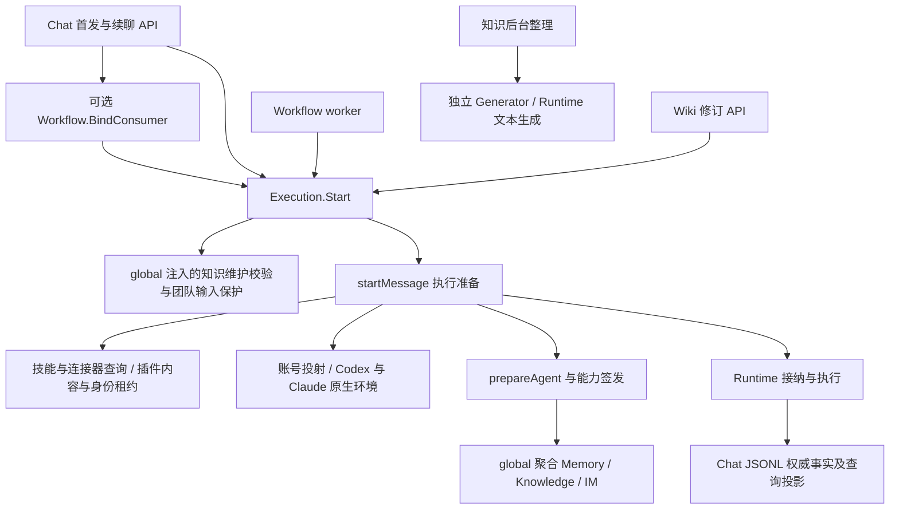
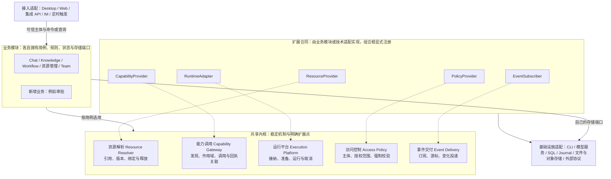
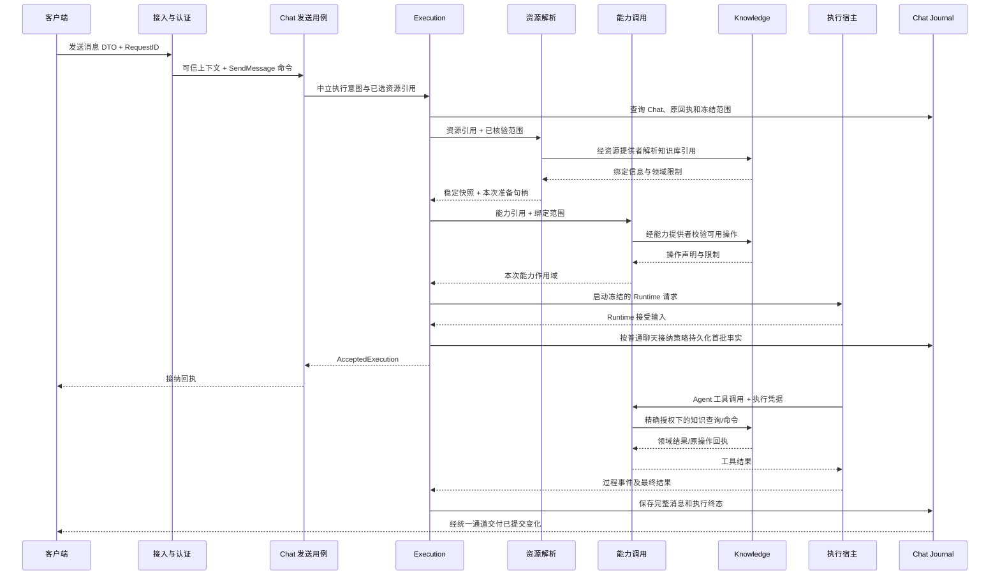
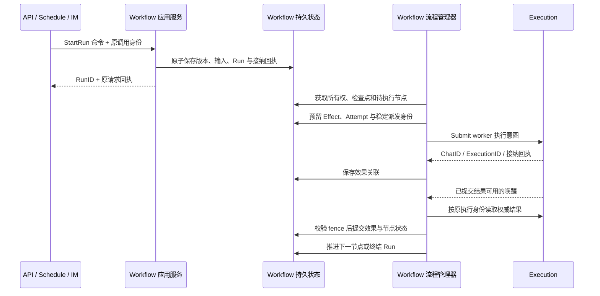

# 后端模块边界、能力扩展与 PaaS 演进设计

> 状态：架构评审提案，尚未实施。代码诊断基于 2026-10-23 的 `abc02b8`；系统设计于 2026-10-24 补充。代码行数与定位属于诊断时快照，不代表后续提交已重新审计。本提案不修改业务实现、数据库、协议或工程约定。目标结构与接口名是设计建议，不代表当前能力。

阅读顺序：先看[系统模块、层级、数据流与设计模式](#5-目标架构模块层级数据流与设计模式)，再看第 3 节代码问题，最后看第 6–10 节具体机制与迁移。系统架构决定模块之间的责任与合同，代码分层和文件位置服从这些边界。

## 1. 架构结论

当前后端已有明确的数据权威、执行入口、Runtime 适配和恢复机制，适合继续演进。主要问题是**领域扩展开始侵入执行准备、HTTP 用例和全局装配，部分领域不变量靠跨层协调维持**。增加功能时，开发者需要同时理解多个模块的状态、锁和提交顺序，才敢修改一个入口。

建议目标是：**业务模块拥有规则和事实，资源解析、能力调用、运行平台、访问控制、事件交付组成共享内核；通过 Go 窄接口和显式装配扩展，以稳定的执行契约为未来控制面与执行节点分离做准备。**先采用模块化单体部署。

这不是按 `api/service/internal` 再加几层，也不是立即拆微服务。先让同一进程里的所有权和依赖方向清楚，再选择有独立部署收益的边界。

评审中用“侵入”表示：某项变化必须进入不拥有该规则的模块，或调用方必须知道被调用方内部的锁、状态和释放顺序。它不等于已经出现功能错误。下面的风险结论来自静态代码和调用链检查，未做真实模型、并发压测或多实例运行验证。

## 2. 当前 Chat 链路与扩展影响



源码入口：[创建聊天](../../server/apis/chats/create_chat.go)、[发送消息](../../server/apis/chats/send_message.go)、[执行意图](../../server/services/execution/intent.go)、[执行准备](../../server/services/execution/work.go)、[全局装配](../../server/global/config.go)。

三项新增能力的影响不同：

| 能力   | 当前接入方式                                                            | 对维护的实际影响                                                           |
| ------ | ----------------------------------------------------------------------- | -------------------------------------------------------------------------- |
| 资源库 | Execution 直接读取技能、连接器、插件安装，冻结版本，解析凭据和原生环境  | 侵入最明显；供应商和 Runtime 配置变化会直接触及普通聊天接纳路径            |
| 知识库 | 后台整理独立；Chat 通过能力绑定接入；Wiki 维护有专属前置保护            | 内容核心隔离较好；宿主接入仍通过 Execution 回调、特判和 API 内编排维持限制 |
| 工作流 | API 预先绑定使用能力；创作与 worker 复用 Execution；Runner 拥有运行事实 | 执行方向基本合理；API、Service、internal/state 共同操作工作流状态与协调锁  |

Chat Service 的生产导入没有直接指向知识库或工作流 Service，不能说整个 Chat 已被这两个领域污染。风险集中在 **Execution 周围的准备、授权、装配和跨领域用例**。

## 3. 具体侵入点与维护风险

### 3.1 执行准备混合了多种变化原因：优先级高

[work.go](../../server/services/execution/work.go) 共 1,944 行，`startMessage` 位于 243–827 行。一个入口同时处理幂等、账号选择、Chat 占位、工作目录、附件、技能与连接器、插件版本、原生环境、能力授权和接纳时机。

其中直接判断 Codex/Claude、读取对应 home 环境变量、配置原生插件；还识别飞书和 GitHub 的环境标记并追加专属指令。[plugins.go](../../server/services/execution/plugins.go) 另有 710 行，包含内容校验、配置展开、目标选择、供应商账号和资源快照。

这是单一职责与依赖倒置不足的具体表现：Execution 本应决定“准备成功后何时接纳和执行”，却同时理解“某种插件和某种 CLI 如何准备”。一个新供应商或原生配置变化，可能影响普通发送、续聊、重试与资源释放。

**目标：**资源模块返回已冻结的资源准备结果，运行环境适配返回可执行环境，Execution 保留接纳状态机和资源生命周期的统一所有权。把业务搬出后再按职责分文件，不能仅把大函数分割成更多 `m.xxx()`。

### 3.2 没有直接 import，也存在语义耦合：优先级高

[global/config.go](../../server/global/config.go) 的 `loadChat` 注入了知识维护校验、团队输入保护、Memory/Knowledge/IM 能力聚合。闭包读取之后才赋值的全局 Service，并用 `nil` 判断处理装配时序。能力聚合没有 Context 参数，知识绑定使用 `context.Background()`。

[execution/agent.go](../../server/services/execution/agent.go) 又直接识别 `knowledge.jobs.start`，为自动任务去重。Execution 虽未导入 knowledge 包，却知道知识命令的业务身份和来源规则。

[knowledge/wiki_chat.go](../../server/services/knowledge/wiki_chat.go) 的 `ValidateWorkIntent` 会对普通发送路径检查维护锚点；这道保护确有必要，不能移到专属 API 后就删除，否则普通续聊或重试可能丢失维护限制。

问题属于隐藏依赖和时间耦合，也说明扩展点尚不完整。新增能力时，开发者既要改领域模块，又要记住 global、Execution 中的配套规则。

**目标：**显式注册带 Context 的能力提供者；由宿主统一完成作用域合并和重复操作检查；持久 Chat 限制通过统一接纳策略进入所有发送、续聊和重试路径。知识库仍拥有“单页维护”的业务判断。

### 3.3 领域用例按入口数量拆散：优先级高

[Wiki 整理入口](../../server/apis/knowledge/maintain_wiki.go) 接纳独立知识任务；[知识 Service](../../server/services/knowledge/direct_maintenance.go) 复用任务队列、范围校验和知识工具，通过独立 ACP 执行维护。该流程不创建 Chat 或 Execution。

[工作流创作入口](../../server/apis/workflows/send_creation_message.go) 自己持有创作锁、编排事务、处理幂等回执和执行接纳。它通过 [dependencies.go](../../server/apis/workflows/dependencies.go) 获得 Repository、共享状态和取消适配。

这些实现符合当前[后端约定](../development/backend-cn.md)中“单入口业务留在 API，Service 需要两个真实入口”的规则。问题不是开发者没有遵守约定，而是这条规则把“是否复用”置于“谁拥有领域不变量”之前，对当前复杂度已不够合适。

**目标：**具有持久状态机、授权不变量、幂等接纳或恢复语义的完整领域命令，由所属领域的应用服务拥有，即使当前只有一个 HTTP 入口。简单、无这些约束的 CRUD 可以继续就地组织。迁移必须搬走完整规则和测试，不能新增纯转发 Service。

这需要先调整工程约定；本提案不擅自改写当前规则。

### 3.4 internal/state 承担业务协调并向外暴露锁：优先级高

[workflow/state/state.go](../../server/internal/workflow/state/state.go) 的 Coordinator 同时拥有公开 `Commands`、`CreationCommands` 锁、运行租约、效果集合、状态提交和可变 `AgentBindings`。Workflow Service 在 Start/Close 中修改该绑定，API 直接访问协调者。

`internal` 在 Go 中首先是导入可见性限制，本身不等于基础设施层，所以问题不在目录名。问题是外部代码必须知道何时加锁、如何取租约、怎样提交，才能维护工作流不变量。把 Repository 接口传进去也没有解决封装不足。

**目标：**运行命令、创作命令与后台推进都通过工作流拥有的行为方法提交；协调锁与事务由方法内部管理。DSL、表达式、文件解析等纯能力继续留在独立深模块。已有 fence、CAS、效果回执保持原语义。

### 3.5 鉴权已形成机制，但边界仍不纯：优先级高

[LocalTokenAuth](../../server/apis/middleware/local_token_auth.go) 除认证外，还识别 `/workflows/.../files` 并设置上传大小限制。通用认证因此需要知道具体产品路由。

[integration/authorization.go](../../server/services/integration/authorization.go) 已正确区分 Authenticate、Authorize、AcquireGuard，并保存凭据代次与授权版本。应保留这些语义。但 [knowledge.go](../../server/services/integration/knowledge.go) 直接理解知识核心 PermissionSnapshot，[invocation.go](../../server/services/integration/invocation.go) 理解任务知识范围，[tasks.go](../../server/services/integration/tasks.go) 通过包装 Repository 写方法串行化撤权。

这不是当前已知的越权漏洞，而是通用授权、领域范围判断和持久化入口混在一起，未来每增加一种可发布资源，都容易继续扩展中央授权模块。

**目标：**认证只产出可信主体；通用授权负责身份代次、资源与动作；知识和任务模块分别校验自己的业务范围，并在同一提交屏障下完成必要重检。上传限制归具体路由适配。撤权屏障不能在“解耦”过程中被弱化成仅在 HTTP 入口检查一次。

### 3.6 调度服务仍承载 HTTP 监听职责：优先级中

[schedule/service.go](../../server/services/schedule/service.go) 包含 `LocalHandlerFactory`、`APIListener`、监听状态和地址操作；`Start` 仍要求 APIHandler 非空。生产入口已使用 [NewPublishedHandler](../../server/apis/integrations/published_router.go)，但调度保留独立监听分支。

这会使未来无 HTTP 的 worker 也需要理解监听装配。旧任务 Token handler 仍被若干测试使用，但生产入口选择的是统一集成 Key；不能据此宣称生产同时公开两套认证。

**目标：**发布监听由组合根拥有，调度只负责触发与接纳；迁移测试到实际生产装配路径。是否删除旧 handler，以调用方核对结果决定，不靠文件名判断。

### 3.7 单进程协调尚不能直接用于 PaaS 多副本：部署前必须解决

[首次请求占位](../../server/services/execution/create_request_registry.go)、执行注册表、能力 Registry 和集成授权屏障都包含进程内状态。已有 JSONL 幂等回执与工作流持久租约是基础，但不能因此推导整个 Core 已具备跨副本独占。

例如两台进程各自持有一个 `RWMutex`，不能保证“某台撤权成功后另一台不再提交”。JSONL、原生 Session、账号目录和运行中子进程也有实际宿主归属。

**目标：**先维持每个工作空间单所有者；需要横向扩展时，增加持久所有权、fencing 与明确的远程执行协议。不能简单复制 Core 进程并挂同一目录。

### 3.8 文件组织：同时存在大职责集合与跨层分散

以下统计排除 `_test.go` 和带生成标记的文件，行数含注释与空行，仅用于定位审查点：

| 目录               | 生产 Go 文件 | 总行数 | 不超过 80 行的文件 |
| ------------------ | -----------: | -----: | -----------------: |
| services/execution |           17 |  6,598 |                  2 |
| services/chat      |           12 |  4,357 |                  0 |
| services/knowledge |           13 |  2,823 |                  3 |
| services/workflow  |            9 |  4,335 |                  0 |
| apis/chats         |           17 |    835 |                 15 |
| apis/knowledge     |           54 |  3,340 |                 44 |
| apis/workflows     |           35 |  2,901 |                 22 |

因此不能得出“后端普遍过度拆成小文件”的结论。API 的小文件多数源于“一 Operator 一文件”的约定，有合理导航价值。更明显的问题是复杂用例跨 API/Service/internal 维护，以及执行准备混入多种独立变化原因。

## 4. 借鉴 DeepSeek Harness，采用 Go 的实现方式

DeepSeek Harness 官方架构把模型、工具、会话和循环等实现作为可组合插件，通过 profile/bundle 装配。其 Cordis 机制包括声明依赖、类型化事件及可释放的注册效果。这些是架构参考，不要求 NeuxBot 迁移 TypeScript 或采用相同运行时。[官方架构](https://github.com/deepseek-ai/deepseek-harness/blob/master/docs/architecture.md)、[Cordis 说明](https://github.com/deepseek-ai/deepseek-harness/blob/master/docs/cordis-primer.md)。

它的工具管线还区分扩展拦截与单向收紧的策略约束；作用域注册把可见性和释放生命周期关联起来。[工具合同](https://github.com/deepseek-ai/deepseek-harness/blob/master/docs/subsystems/tools.md)、[作用域合同](https://github.com/deepseek-ai/deepseek-harness/blob/master/docs/subsystems/scope.md)。

以下是针对本项目的设计选择，不是对 DeepSeek Harness 的实现描述：

| 借鉴的目标               | Go 中的建议实现                                                                      |
| ------------------------ | ------------------------------------------------------------------------------------ |
| 增加能力不修改执行主循环 | 消费方定义窄接口，领域提供实现，组合根一次性注册                                     |
| 依赖明确且可检查         | 构造函数显式注入；少量模块描述校验必需依赖、版本和重复注册；不开放任意字符串服务查找 |
| 能力有自己的作用域与寿命 | 每次执行的准备句柄、资源快照和幂等释放；沿用现有能力 Registry 的执行校验             |
| 不同交付方式组合同一内核 | Desktop、Server、Worker 使用显式启动配置，复用同一领域服务                           |
| 扩展行为可观察           | 固定阶段的追踪与提交后事件；关键状态转换仍为直接类型化调用                           |

区分两类“插件”：

- **内置领域模块**：知识、工作流、资源等受信 Go 包，通过编译期接口组合。它们可选装配，但不是普通用户可随意替换的第三方代码。
- **第三方资源能力**：已有 Skill、MCP、包内授权桥接及以后需要的独立进程扩展，走明确协议和授权范围，不取得 DB、全局服务容器或任意宿主文件权限。

本轮不引入 Go 动态共享库、反射 DI、任意事件名总线或通用脚本 Hook。替换存储、认证或执行实现只能由受信部署装配完成，并满足同一行为合同；“实现可替换”不表示“不变量可被插件绕过”。

## 5. 目标架构：模块、层级、数据流与设计模式

### 5.1 统一抽象：业务模块挂接共享内核

目标架构是：**接入适配 → 业务模块 → 共享内核 → 基础设施适配**。业务模块回答“要完成什么、什么结果才合法”；共享内核回答“如何提供资源、调用能力、运行智能体、执行访问控制和交付变化”。内核不知道具体知识页面或工作流节点的业务含义。

Chat、Knowledge、Workflow 是内核的使用者和扩展提供者，不是平台抽象本身。抽象从反复出现的协作合同中提取：

| 统一概念                    | 含义                                             | 同一概念的不同实例                         | 刻意不统一的部分                                 |
| --------------------------- | ------------------------------------------------ | ------------------------------------------ | ------------------------------------------------ |
| Resource：资源              | 可以引用、授权、选定版本和绑定使用的对象         | 技能包、连接器配置、知识库引用、工作流版本 | 正文、存储表、编辑规则；不存在万能 Resource CRUD |
| Capability：能力            | 对明确目标执行的一项受控操作                     | 检索知识、启动工作流、发送消息             | 各操作的参数和业务事务；内部调用保留强类型       |
| RunSpec：运行描述           | 一次运行需要的输入、资源引用、能力范围和后端选择 | 聊天的智能体执行、知识作业的一次文本生成   | Chat、Workflow Run、Knowledge Job 各自的状态机   |
| Scope：授权范围             | 主体在本次调用中获准访问的目标、动作与约束       | 某页只读、某连接器可用、某项目目录可写     | 领域规则本身；Scope 不代替页面版本或任务状态校验 |
| Receipt / Event：回执与事实 | 结果如何关联、重读，以及已提交变化如何交付       | 消息已接纳、知识已更新、工作流等待回答     | 权威事实存储；事件平台不接管所有领域的数据       |

这些概念分别解决“用什么、能做什么、怎么运行、允许做什么、如何得知结果”。一个对象可以参与多个合同：知识库是 Resource，检索知识是 Capability，整理知识是 Knowledge Job。不能因为它们都属于知识功能，就把它们塞进一个通用插件执行函数。

### 5.2 目标模块图与功能接入位置

下面是目标逻辑结构。实线表示使用关系，虚线表示实现并注册扩展合同；不是每个请求都依次经过五个内核模块。一个框不等于一个进程或一个 Go 包。



图中省略的内核协作只有明确的端口调用：运行平台使用资源解析准备输入，使用能力调用建立工具范围；资源解析、能力调用和运行接纳在各自边界强制访问控制；各所有者提交事实后交付事件。事件订阅者不决定本次请求是否允许，业务也不能通过“通用内核上下文”取得全部服务。

**五个内核模块分别管什么：**

| 模块     | 稳定职责                                                                       | 扩展提供什么                                                   | 不能放进去的内容                                               |
| -------- | ------------------------------------------------------------------------------ | -------------------------------------------------------------- | -------------------------------------------------------------- |
| 资源解析 | 按资源种类定位提供者，取得选定版本、准备结果和释放句柄；合并冲突在准备阶段失败 | ResourceProvider 解释该类引用、验证可用性、准备绑定            | 插件安装 CRUD、知识页面正文、供应商专属环境判断                |
| 能力调用 | 声明发现、执行作用域、逐次授权、调用分派、调用与领域回执关联                   | CapabilityProvider 声明操作并适配到所属模块的用例              | `knowledge.jobs.start` 特判、工作流锁、业务写表、通用自动重试  |
| 运行平台 | 统一资源准备和宿主技术边界；Agent 执行保留接纳、取消、清理合同                 | RuntimeAdapter 屏蔽 CLI/模型协议；运行所需资源由资源提供者供给 | 各业务的长流程状态机；不能把所有后台任务改造成 Chat            |
| 访问控制 | 认证主体、动作与范围组合、强制检查点、撤权协调合同                             | Authenticator 适配入口身份；PolicyProvider 提供资源或领域约束  | 某条上传路由的请求体限制、飞书业务逻辑、用事件代替同步撤权屏障 |
| 事件交付 | 分发已提交事实和可恢复变化提示，支持游标读取合同                               | EventSubscriber 做通知、搜索投影或外部交付                     | 复制一套工作状态、替业务提交成功、默认认为消息必达一次         |

“运行平台”是两个已有使用路径的共同技术边界：有接纳语义的 Agent Execution 与独立 Generator；二者可共享 Runtime 和账号适配，但保留各自的调用合同。RunSpec 是合同族，不是把不同输入堆进一个带大量可选字段的结构体。事件交付同样复用原 Journal/领域提交来源；需要耐久跨服务投递时才增加相应机制。

### 5.2.1 一个新功能如何选择位置

按以下顺序判断，而不是先问“这个函数放 API 还是 Service”：

1. **有新的业务事实或状态规则吗？**先找领域所有者。属于既有领域就扩展它；拥有独立生命周期才增加业务模块。
2. **需要给人或其他系统调用吗？**在所属模块定义命令/查询，入口只适配协议。相同用例由不同入口复用。
3. **需要供智能体调用吗？**增加 CapabilityProvider，把工具请求适配到同一个用例；不再实现第二份业务逻辑。
4. **需要被选择、固定版本或准备进运行环境吗？**增加 ResourceProvider；普通业务实体不因此都要接入资源解析。
5. **改变的是模型/CLI/远程执行方式吗？**增加 RuntimeAdapter；改变的是访问限制则由所属领域增加 PolicyProvider。
6. **只是读取结果、通知或建立索引吗？**增加查询投影或 EventSubscriber，不改运行主流程。

| 新需求                          | 业务所有者                                           | 接入内核的位置                                                                               | 应保持稳定的模块                      |
| ------------------------------- | ---------------------------------------------------- | -------------------------------------------------------------------------------------------- | ------------------------------------- |
| 新知识来源，例如文档系统        | Knowledge 的导入用例和来源适配；凭据引用复用账号模块 | 需要智能体主动导入时提供 Capability；只有运行绑定有新语义才加 ResourceProvider               | Chat、Execution 接纳、Workflow        |
| 新模型后端                      | 运行平台的技术适配                                   | RuntimeAdapter；独立声明工具、会话和生成支持范围                                             | Knowledge/Workflow 业务规则与资源安装 |
| 新外部工具，例如工单创建        | 新外部服务适配；本地工单管理有独立状态时才建业务模块 | CapabilityProvider；可配置连接通过资源提供者绑定                                             | Chat 主流程、模型 Runtime             |
| 工作流增加人工确认节点          | Workflow 的节点状态、等待和恢复                      | Workflow 内部动作处理器；结果供看板读取                                                      | 运行平台、资源解析                    |
| 跨 Chat/Workflow 使用的审批中心 | Approval 拥有申请、决定和审批人规则                  | CapabilityProvider 暴露申请/查询；PolicyProvider 校验准确的批准范围；Workflow 只保存申请引用 | Chat 和 Execution 不认识审批表结构    |
| 新第三方 API Key 入口           | 接入认证与 Integration 的授权用例                    | Authenticator + 既有 Access；HTTP 路由调用已有命令                                           | Knowledge/Workflow 的提交规则         |
| 新通知渠道                      | 交付模块                                             | EventSubscriber + 渠道适配，自己的重试回执                                                   | 原业务状态机与执行终态                |

审批不通过“执行前暂停整个调用栈”实现：申请在所属领域持久保存，工作流保存等待检查点。批准绑定具体操作、目标、版本与有效范围；恢复时重新授权，原调用范围不因批准而无条件扩大。

**判断设计是否过度通用的标准：**新功能通常只修改所属业务模块、它真正需要的扩展实现及组合根登记。注册和公开契约是正常变更；若每次都要修改内核，说明扩展边界不足。若把复杂业务写成大量无类型配置才能接入，说明内核抽象过度。真正新增平台机制时允许修改内核，但必须明确不能由现有合同表达的共性需求。

### 5.2.2 Go 中的插件化如何落地

这里的业务模块使用编译期组合与构造函数注入，不要求使用 Go 动态库或让所有模块实现巨大的 Plugin 接口。每个模块只实现需要的扩展合同；组合根创建实例、显式登记，再启动后台工作。重复能力身份、缺失资源提供者、缺失必需策略等在启动或接纳时明确失败。

同进程内，HTTP、工具和后台流程可以经不同薄适配调用同一个强类型应用方法。只有智能体工具的动态边界需要声明参数 Schema；通用 `map[string]any` 不扩散到整个业务层。ResourceProvider、CapabilityProvider 等名称表示窄接口族，不要求每类只允许一个万能接口。领域命令之间也不需要统一 CommandBus。

包依赖为：业务模块依赖所消费的内核合同；内核不 import 具体业务模块；适配实现合同；组合根 import 并连接双方。能力调用在运行时回到 Knowledge/Workflow 用例，不形成源码循环。工具发起子工作保留父身份和原范围，不能递归复用当前执行锁。

现有 `internal/agentcapability.Registry` 是能力调用的起点，不另建竞争注册表；现有 Execution 是运行平台的 Agent 路径起点；资源准备从 Execution 的供应商分支中提取；授权与事件交付复用现有模块。五个框表示要收拢的职责，不是要求新增五套并行框架。

### 5.3 模块清单、数据所有权和公开合同

每个模块必须能说明：它拥有什么数据、哪些操作只能由它提交、其他模块可以得到什么结果。下表的操作名称是语义示意，并非新 HTTP API 清单。

| 模块                       | 拥有的数据与不变量                                                     | 公开合同                                       | 依赖的业务能力                             |
| -------------------------- | ---------------------------------------------------------------------- | ---------------------------------------------- | ------------------------------------------ |
| Waker / Project            | 伙伴身份、档案、项目配置；项目不等同于租户                             | 读取工作配置、解析并冻结工作范围               | 文件范围验证                               |
| Chat                       | 消息、原生会话关联、JSONL 权威日志和可重建投影                         | 发送用例、读取上下文、提交执行事实、读取历史   | Execution 提交端口；Journal 内部存储       |
| Team                       | 成员快照、团队任务、依赖、交付与验收                                   | 开始协作、分派任务、交付结果、控制任务         | Execution、Chat 查询和结果提交端口         |
| Workflow                   | 定义、不可变版本、Run、节点尝试与 Effect                               | 保存版本、启动、暂停等待、回答、取消、读取效果 | Execution、领域动作端口                    |
| Execution                  | 一次智能体工作的接纳、取消和终态协议；当前事实仍通过 Chat Journal 保存 | 提交执行、取消指定执行、读取结果               | Chat Journal、范围策略、能力宿主、执行宿主 |
| Knowledge                  | 核心拥有内容与整理作业；宿主拥有连接、模型选择和操作锚点               | 检索、摄入、整理、单页维护、查询原回执         | 核心适配、生成接口、访问策略               |
| Memory                     | 伙伴/项目记忆、搜索索引及遗忘规则                                      | 记忆读取、写入、搜索、遗忘                     | 存储和嵌入适配                             |
| Plugin / Skill / Connector | 各自资源、安装关系、版本、信任和配置                                   | 安装、管理、冻结执行资源、诊断                 | 内容存储、供应商授权适配                   |
| AI Account / Runtime       | 模型账号租约、运行配置、Runtime 能力及技术适配                         | 冻结账号、准备环境、Agent 执行、独立文本生成   | 秘密存储、进程、外部协议                   |
| Schedule / IM              | 触发配置、发生记录、原调用身份、外部消息绑定及交付                     | 触发领域命令、查询原结果、交付                 | Team/Workflow/Execution 等目标端口         |
| Access / Integration       | 可信主体、集成 Key、授权版本和通用资源动作判定                         | Authenticate、Authorize、提交前复核            | 主体与授权存储；领域提供的资源范围校验     |
| 查询与观察                 | 可重建查询视图；通知自己的阅读/收起事实                                | 列表、详情、待办、未读、事件订阅               | 原领域查询及已提交事件                     |

“Chat 发送用例”和“Chat Journal”是同领域的不同消费端口。Execution 不能调用 Chat 的发送入口，Chat 也不能直接启动 Runtime；这样避免循环业务编排。端口可以在同一领域内按真实依赖划分，不需要制造两个 Chat 状态源。

资源库是产品入口，内部仍由 Plugin、Skill、Connector 各自拥有事实。能力宿主是组合机制，不保存一份可编辑的插件、知识库或工作流资源。

### 5.4 层级：领域纵向划分，每个领域内部再分层

不能把“API、Service、internal”当作三个业务模块。正确的两个维度是：**横向按职责分层，纵向按领域隔离**。

| 逻辑层 | 回答的问题                   | 输入与输出                                         | 不承担                                  |
| ------ | ---------------------------- | -------------------------------------------------- | --------------------------------------- |
| 接入层 | 请求来自哪里，协议是否合法？ | HTTP/CLI/IM 消息 ↔ 命令、查询与协议响应            | 业务状态机、领域事务、内部加锁顺序      |
| 应用层 | 这次用户意图如何完成？       | 可信调用上下文 + 命令 → 回执或领域结果             | SQL、CLI 私有参数、直接修改别的领域数据 |
| 领域层 | 什么状态和操作才合法？       | 当前事实 + 操作 → 新状态或拒绝原因                 | Gin、网络监听、全局容器、后台 goroutine |
| 适配层 | 如何读写和执行？             | 领域定义的存储/运行端口 ↔ DB、日志、文件、外部协议 | 发明新的业务权限或覆盖领域判定          |

运行时请求从接入进入应用，由应用调用规则和端口；**源码依赖指向业务合同**：HTTP 适配依赖应用合同，应用依赖领域规则及所需端口，数据库/Runtime 适配实现端口。业务不因运行时要访问数据库，就必须依赖数据库实现。

组合根位于这些层之外，负责把实现接到端口上以及按顺序启停。日志、时钟等小型技术能力可横切复用；业务模块不能随时从组合根查找任意服务。

Go 中，简单领域的应用方法和状态规则可以同包甚至同文件；复杂规则才独立成包。层级首先是职责和依赖约束，不是强制每个领域生成四个目录。

### 5.5 数据怎样传：六种合同，不用一个万能上下文

| 合同                    | 由谁产生 → 谁消费                       | 关键内容                                             | 生命周期                                           |
| ----------------------- | --------------------------------------- | ---------------------------------------------------- | -------------------------------------------------- |
| 调用上下文              | 认证入口 → 应用服务与授权策略           | 主体、来源、请求关联；PaaS 时补可信租户/工作空间     | 请求级；后台工作保存必要原身份，不保存整个 Context |
| 命令 Command            | 接入/编排 → 所属领域                    | 用户意图、目标、参数、幂等 ID、预期版本              | 返回接纳/提交回执；同 ID 不同内容拒绝              |
| 查询 Query              | 接入/投影 → 领域查询端口                | 已授权范围、过滤、分页和游标                         | 返回只读结果；不能靠查询创建新的业务事实           |
| 执行描述 ExecutionSpec  | 工作所属领域与 Execution → 执行宿主     | 执行身份、冻结配置、目录范围、资源版本与能力范围引用 | 可持久恢复的值；不包含函数、锁或明文凭据           |
| 准备句柄 PreparedHandle | 资源/能力适配 → 本次执行生命周期        | 本机绑定、租约、私有环境及清理操作                   | 仅进程内；不能把它当 RPC 消息或重启回执            |
| 回执与事实              | 数据所有者 → 调用方、流程管理器及观察者 | 原命令身份、结果身份、版本、结果状态、事件游标       | 回执可重读；事实只在真实提交后产生                 |

这些是有限的边界类型，不要求把每张 Model 复制成 DTO、Entity、BO 四份。内部只读值可复用稳定类型；公开响应和远程协议不能携带 GORM 对象、可变共享指针或宿主秘密。持久合同明确版本与兼容范围。

同进程内直接调用 Go 方法并传结构体，接口实现负责隔离可变切片/map。跨进程时才把稳定合同编码为版本化 RPC 消息；网络超时是“结果可能未知”，不等于“尚未执行”。

三个标识必须分清：`RequestID` 用于一次请求的幂等，`ExecutionID` 用于已接纳的工作，`Attempt/Fence` 用于某次派发及拒绝旧执行者。重试传输复用 RequestID；重新执行有副作用的工作需沿领域明确的重试规则创建新尝试。

### 5.6 一次带知识能力的聊天如何流转



这个示意保留普通聊天的 Runtime 接受后提交语义；后台持久编排的先接纳后派发另按既有策略执行。省略的账号、文件准备仍由各自适配完成，不移进知识模块。

关键数据边界：发送消息不等于自动检索全库；知识能力按已授权范围提供。读取知识不修改 Chat；写知识由 Knowledge 自己提交；Chat 只记录工具活动和结果引用，不拥有知识正文。

如果准备失败，Execution 回收已取得句柄，不产生成功接纳；Runtime 已接受但首批事实提交失败时，保留现有取消和故障处理语义，不能返回成功。客户端丢失接纳响应后用原 RequestID 对账，不发送第二份工作。

### 5.7 一次工作流运行如何流转



在“Execution 已接纳、Workflow 尚未保存关联”时崩溃，流程管理器根据预留的稳定派发身份查询原执行，不重新生成请求。等待人工回答时保存检查点并释放活动调用资源，不占一个数据库事务等待用户。

Workflow 运行是流程管理器，Execution 是它调用的执行能力。确定性 HTTP、脚本或领域动作继续走相应动作端口，不强制创建 Chat。Chat 终态不能直接替代 Workflow 成功，流程管理器还要核验所需结果和效果回执。

知识整理也遵循同样的所有权原则：`Organize 命令 → Knowledge 作业 → Generator → Knowledge 提交页面/索引 → 作业结果`，不经过 Chat/Execution。可以共享账号与 Runtime 技术适配，不能复制成第二套聊天生命周期。

### 5.8 数据放哪里，以及跨模块怎样保证一致

| 事实                 | 唯一权威                       | 其他模块能保存什么                     |
| -------------------- | ------------------------------ | -------------------------------------- |
| 消息正文和执行事件   | Chat Journal，当前为 JSONL     | 身份、游标、可重建投影                 |
| 工作流源码与运行     | Workflow Repository            | RevisionID、RunID、EffectID 与结果引用 |
| 知识内容与整理状态   | 独立知识核心                   | 完整库引用、宿主配置、原请求回执关联   |
| 插件安装、信任与配置 | 资源领域 Repository 与受管内容 | 固定版本和配置摘要、内容引用           |
| 凭据与共享身份       | 账号/供应商授权模块            | 非秘密身份引用和授权代次               |
| 通知已读与收起       | 通知自己的记录                 | 不得写回原工作为已处理或已成功         |

同一数据库里可以有多个模块的表，但写入必须通过数据所有者。先用代码和测试约束这条边界；一个共享 `models` 包不自动等于可以任意跨模块写表。

一致性分三种处理：

1. **单领域原子变更：**一个命令在一个短事务内完成状态、CAS 与回执；Chat 的日志追加继续遵守自己的原子与恢复合同。
2. **必须同步成立的跨域约束：**例如撤权和实际受保护提交，保留可证明的协调屏障。同库可由明确用例调用领域写端口加入同一事务；跨库/进程必须选择能串行化的所有者或具备等价保证的协议，不能改成异步事件后声称原语义不变。
3. **长流程与跨存储：**用持久操作锚点、稳定请求、回执及补偿/恢复推进。例如文件准备失败可清理暂存；已经发出的外部消息无法通过数据库回滚撤回，未知结果应停止并对账。

事件用于通知“发生了什么”，不能代替“是否允许执行”的同步判断。跨进程需要耐久交付时，才增加 outbox/消费去重；原 JSONL 已有事件游标的场景复用日志，不为统一形式再造一份业务事件权威。

### 5.9 当前问题分别用什么设计模式解决

| 当前问题                             | 采用的模式                                       | 在本项目中的具体落点                                                                        | 验证标准                                               |
| ------------------------------------ | ------------------------------------------------ | ------------------------------------------------------------------------------------------- | ------------------------------------------------------ |
| 领域规则跨 API/Service/internal 分散 | 限界上下文 + Application Service + 聚合边界      | Wiki 维护、Workflow 创作/运行命令回到所属模块；聚合表达需要一起校验的状态，不按每张表建聚合 | 修改一个业务不变量主要在一个模块完成；所有入口行为一致 |
| Execution 识别供应商和具体命令       | Ports and Adapters + Strategy                    | Execution 只依赖资源准备、范围策略、运行环境端口；供应商适配实现具体策略                    | 新供应商不增加 Execution 分支                          |
| 每加能力都修改全局回调与主流程       | 微内核式能力宿主 + Provider 注册                 | Provider 提供声明、范围绑定和操作实现；宿主管生命周期                                       | 新能力只改自身模块、契约和显式注册；冲突启动失败       |
| 通过 global 查服务、依赖后赋值对象   | Constructor Injection + Composition Root         | 构造函数收窄依赖，组合根构造并校验完整实例后启动                                            | 测试可创建两个互不影响的应用实例；没有业务 nil 跳过    |
| API 操作工作流锁和状态提交           | 封装的状态机 + 领域命令                          | `Answer/Cancel/Retry` 在模块内部核验状态、加锁与提交                                        | 外部拿不到领域锁；非法状态转换在统一入口拒绝           |
| 长任务中断、跨库提交、外部结果不确定 | Process Manager + 幂等回执；必要时 Saga 式补偿   | 复用 Workflow Runner、知识作业及持久操作锚点                                                | 崩溃后恢复原工作；有副作用的未知结果不盲重试           |
| 鉴权混入业务与资源细节               | Policy/Specification + 入口 Middleware/Decorator | 认证产出主体；领域策略判断资源约束；提交边界强制再校验                                      | 普通入口、工具入口和后台恢复都不能绕过同一约束         |
| 查询展示牵动执行状态                 | 轻量 CQRS + 领域事件                             | 写命令走领域；历史/看板读投影；提交后事件唤醒对账                                           | 展示故障不改业务状态；丢失唤醒后能恢复                 |
| 上游知识和 CLI 变化传播到业务        | Adapter + Anti-Corruption Layer                  | 既有知识核心桥接、Runtime 适配映射外部类型、错误与能力限制                                  | 上游协议变化集中在适配；业务不猜上游字符串             |
| 多阶段准备容易遗留占用               | 作用域资源所有权 + 组合释放                      | 准备结果携带本次句柄，失败逆序释放，接纳后移交执行生命周期                                  | 任一步失败、取消和重复关闭都不泄漏租约或进程           |

模式解决的是可观察的问题，不是代码必须符合某种模板。这里不采用通用 CommandBus 包装全部 Go 调用，不把所有表改成事件溯源，也不把 Pipeline 做成可任意重排的责任链。权限校验、提交和终态这些关键阶段必须有固定顺序。

### 5.10 架构如何支持演进，而不增加维护负担

| 未来变化                   | 主要变动模块                               | 应保持稳定的部分                             |
| -------------------------- | ------------------------------------------ | -------------------------------------------- |
| 增加一个资源供应商         | 资源适配、声明、供应商测试与注册           | Chat、Execution 生命周期、Workflow 状态机    |
| 增加一个 Runtime           | Runtime 适配、能力声明与合同测试           | 知识/工作流业务规则及入口授权                |
| 增加一个工作流节点类型     | Workflow DSL/动作处理器及测试              | Chat 接纳、插件供应商实现                    |
| 增加 Web 或第三方 API 入口 | 接入适配、认证、公开合同                   | 已有领域命令及事务规则                       |
| 本机执行改为远程 worker    | ExecutionHost 适配、可靠派发与恢复协议     | 领域命令的意义、资源版本和授权范围           |
| 共享多租户                 | 主体和数据归属、查询、缓存、存储及执行隔离 | 可复用已有模块边界，但绝不是只换一个 Adapter |

这张表是验收架构好坏的依据：预期变化应集中落在预期模块，新增代码量和跨模块修改范围可解释。第 9 节描述如何在当前目录中逐步落实这些边界。

## 6. 核心设计：固定管线与窄扩展点

### 6.1 执行请求与运行时句柄分离

当前 WorkIntent 中 ToolCapabilities 包含函数闭包，适合进程内调用，不能直接作为远程 worker 协议。目标分成两部分：

| 数据     | 内容与存储规则                                                                                        |
| -------- | ----------------------------------------------------------------------------------------------------- |
| 执行描述 | 请求身份、原调用来源、Chat/Execution 身份、冻结范围、模型选择、资源版本和能力范围引用；可版本化序列化 |
| 准备结果 | 本次有效工具绑定、内容与账号租约、临时凭据、回滚和释放句柄；仅在所属进程内存在                        |

执行描述复用现有 JSONL 事件、插件快照、工作流版本和知识操作锚点，按实际恢复缺口补字段。不要先建一张大 ExecutionPlan 表复制所有领域数据。重启按原描述向资源所有者重建句柄，缺版本、授权失效或无法安全恢复时明确失败，不换成最新资源偷偷继续。

### 6.2 管线阶段与所有者

1. **规范化请求。**入口解析协议；领域用例确定稳定请求身份，统一处理同 ID 不同内容的冲突。
2. **解析作用域。**从服务端事实确定 Chat、工作空间、来源和维护限制。客户端传入的 ID 或路径不能直接成为授权。
3. **执行接纳策略。**团队输入、Wiki 单页维护、工作流创作等策略各自验证所属不变量；所有发送入口必须经过这一步。
4. **准备资源与能力。**资源模块冻结插件和连接器；知识、工作流等提供者贡献精确能力；宿主校验冲突及限制，保存可释放句柄。
5. **准备运行环境。**本机适配负责 CLI 配置、工作目录和秘密注入，Execution 不识别供应商品牌。
6. **按现有策略接纳。**保留 `CommitOnRuntimeAccept` 与 `CommitBeforeDispatch` 的真实语义；不把所有路径机械改为“先保存已发送”。
7. **运行、收敛、提交终态。**取消与终态由 Execution 拥有；先收束在途工具和完整消息，再释放资源并交付终态。持久事件与临时流继续区分。

这是一条可读的显式流程，不是插件可以任意重排的 Hook 链。稳定阶段调用直接接口；扩展只贡献其拥有的结果或拒绝理由。

### 6.3 建议端口及约束

下列是语义端口草案，实现时按真实消费者压缩，不要求每个名称建立一个包或文件：

| 端口                  | 输入与输出                                            | 约束                                               |
| --------------------- | ----------------------------------------------------- | -------------------------------------------------- |
| AdmissionPolicy       | 可信来源、持久范围、请求 → 校验结果或更窄限制         | 必需策略缺失即拒绝；不能靠 nil 跳过                |
| ResourcePreparer      | 已选资源、版本、Runtime 能力、使用者 → 快照与准备句柄 | 不读取 Chat Repository；不保存第二套执行状态       |
| CapabilityContributor | 执行作用域与已授权引用 → 操作绑定、静态指引、范围引用 | 不得改写账号、Execution ID、接纳策略或别的领域权限 |
| EnvironmentPreparer   | 冻结选择、工作空间、资源投射 → Runtime 请求与清理句柄 | 只负责技术物化；不重新决定授权                     |
| ExecutionHost         | 已冻结执行描述 → 接纳回执、事件、查询和取消           | 首先实现本机版本；远程版本后续定义独立协议         |

接口放在消费方拥有的边界，使用所属领域的稳定值类型；共享的纯执行输入优先沿用 `internal/workinput`。只有确有跨包循环或协议共享需要时，提取小型契约包。Provider 不需要反向依赖 Execution 的实现，Execution 也不导入具体 knowledge/workflow/plugininstallation 服务。

### 6.4 能力合并和授权不能依赖注册顺序

- 提供者 ID、操作 ID、配置版本稳定；重复注册、缺依赖和版本不兼容在启动时显式失败。
- 能力范围由部署允许范围、调用主体、原工作范围、资源授权及本次请求共同收紧。后注册 Provider 不能扩大前面作出的拒绝。
- 默认贡献与明确选择引用同一操作时，由宿主按稳定身份和范围检查等价关系；不等价即冲突，不能“最后写入覆盖”。移除 Execution 中对 `knowledge.jobs.start` 的专属判断。
- “可用能力发现失败”和“必须满足的授权校验失败”分开。普通可选知识能力可按当前拒绝绑定语义报告不可用；Wiki 维护的强制边界失败必须阻止接纳。
- 工具名、Schema 和指引顺序确定；令牌、随机目录及临时端口不得进入模型静态工具身份，保留续聊前缀稳定性。
- Provider 准备必须继承请求取消；接纳后切换到明确的执行生命周期 Context。移除业务准备中的无界 Background 调用，但不把请求断开误当成已接纳工作结束。

### 6.5 生命周期必须可收敛

模块启动分为构造、校验注册、启动后台恢复、开放入口；不能在运行中靠补写全局变量才补全必要依赖。

执行准备失败按已取得资源的逆序清理；接纳后把资源所有权完整移交执行生命周期；结束时先拒绝新工具调用，再取消并等待在途调用，提交完整事实，最后释放身份与内容租约。释放可重复调用并等待同一完成结果，不能只删 map 就宣称停止。

内置模块首阶段只支持进程启动时组合，不承诺热卸载。以后插件升级先停止新的租约，现有执行继续固定原版本；无法收敛的旧任务不能被新版本静默接管。持久回执和业务资源不随模块卸载删除。

### 6.6 用新增能力验证架构，而非只看目录图

以“新增一个外部数据检索能力”为例，期望改动是：所属资源/能力模块及其测试、必要的操作契约与生成物、组合根注册、确有需要的 API/UI。普通 Execution 主流程、Chat 日志实现、通用鉴权中间件不增加该供应商分支。

若新增的是一种全新的副作用或审批语义，允许有意识地演进公共合同，不能为了“零修改核心”把安全语义藏到 `map[string]any` 或绕过现有审批。

## 7. API 与鉴权的完整边界

入口认证应区分：桌面管理身份、未来 Web 用户会话、集成 Key、Agent 执行能力令牌。AI 模型账号和插件供应商凭据属于出站认证，不能充当应用用户或租户身份。

HTTP 适配负责绑定、格式/大小约束和响应；领域应用服务负责业务范围、接纳、幂等及事务；Repository 负责持久化条件。来自 HTTP、CLI、调度、IM 的同一领域命令应得到相同业务判定，避免只有 HTTP 中间件有效。

通用授权与领域策略组合时，保留现有不同语义：直接知识 API 依赖原 Key 的知识授权；自动任务产生的整理依赖原任务调用及冻结知识范围，不凭空增加直接知识 Key 权限。维护单页权限也不能被普通检索/摄入权限替代。

对实际写入，授权版本校验必须与提交共享有效屏障。单进程阶段保留原 guard 语义；跨进程阶段必须由写入所有者串行化撤权与提交，或在其原子提交条件中验证 fence/授权代次。跨数据库不能仅“先远程问一次允许，再本地提交”；这是明确的部署设计门槛。

API Key 撤销阻止后续受保护提交，不代表能撤回已经完成的外部动作。外部结果未知必须保留原效果和回执入口，不能用通用重试中间件重复发送。

公开路由与授权清单继续同源生成合同。建议把新路由默认策略从隐式读取改成显式登记；未声明资源解析与能力要求就不发布。管理合同和集成合同保持独立。

## 8. PaaS 演进：先明确部署单元

插件化、可独立启动和多租户服务化是三个不同目标，不能互相替代。

### 8.1 模块化单体阶段

一个 Core 拥有数据库、日志和执行宿主。通过显式配置选择桌面或服务入口；关闭发布 API 不关闭调度。现有 SQLite 模式与 JSONL 权威不变，也不为了提案添加消息中间件。

与已有 [Desktop/Web 拆分提案](../superpowers/specs/2026-10-23-desktop-web-split-design.md) 配合：前端和认证入口拆分不等于已经完成后端多租户化，复用同一领域应用边界。

### 8.2 托管服务的第一步

建议优先评估“每个租户或工作空间独立 Core 执行单元”，上层控制面管理路由、部署配置与配额。它更贴近当前本机目录、CLI 账号和日志所有权，改造风险比立即共享全部表与进程小。

这仍需要真实进程/文件/凭据隔离和可信入口映射；单纯使用不同目录名不构成租户隔离。它也有实例资源开销，是否采用应结合部署规模确认。

### 8.3 控制面与执行宿主分离

控制面拥有主体、配置和任务接纳；执行节点拥有 CLI、账号物化、受管工作目录和活跃调用。协议至少覆盖：版本、幂等请求身份、所属工作空间、资源快照引用、attempt/fence、接纳回执、事件游标、心跳、取消和结果查询。

Runtime Session 固定归属执行节点；不支持迁移的原生会话不能假装可迁移。执行节点断联只能表示未知，不能直接发布成功或安全重试。执行令牌不跨节点复制，按持久授权重新签发。

Chat 日志在拆分时必须选择唯一拥有者：由日志服务持有，或由受分片所有权保护的执行单元持有；不能控制面和 worker 各写一份权威正文。原件等不可变文件可通过对象身份传递，活跃 CLI 工作目录仍由实际宿主管理。

### 8.4 共享多租户和多副本的前置条件

| 维度           | 必须补齐的行为                                                                                           |
| -------------- | -------------------------------------------------------------------------------------------------------- |
| 主体与资源归属 | 明确 tenant/workspace/principal；Waker 是业务身份，不作为租户安全边界；Repository 查询和唯一约束体现归属 |
| 执行独占       | 持久租约、递增 fence、所有者校验；旧 worker 的迟到结果不能提交                                           |
| 授权撤销       | 原身份、授权代次、领域策略与实际提交有可证明的原子顺序                                                   |
| 幂等           | 请求按租户/主体/操作/目标隔离；响应丢失后查原回执，不能重建新任务                                        |
| 持久化         | SQL 方言和迁移策略另行 ADR；AutoMigrate 与本地 SQLite 约定不能直接当托管升级方案                         |
| 文件与秘密     | 上传对象、工作范围、凭据和缓存键按租户隔离；禁止客户端任意宿主绝对路径                                   |
| 事件与审计     | 提交后发布、可恢复游标、主体/执行/效果关联；有跨服务交付需求时再引入 outbox 等机制                       |
| 配额与背压     | 每租户并发、资源占用、超时与队列容量，不能只依赖某进程内的请求计数                                       |

上述内容是 PaaS 的设计门槛，不在第一阶段重构里预建完整平台。

## 9. 目录与文件：围绕共同变化组织

先保留 `apis/services/repositories/internal`，在既有领域目录内收拢规则，避免一次目录迁移掩盖行为变化。它们表达技术分层，领域所有权跨这些目录保持一致。

目标逻辑层级如下。它是模块导航，不是要求立即建立同名文件夹，也不是再建一层封装：

```text
NeuxBot Backend
├── 应用装配
│   └── 配置、依赖绑定、启动恢复、入口开放、有序退出
├── 接入适配
│   └── 桌面管理、未来 Web、集成 API、Agent CLI
├── 业务模块：用例、规则、事实与消费端口
│   ├── 工作配置：Waker、Profile、Project
│   ├── 协作：Chat、Team、Workflow
│   ├── 知识：Knowledge、Memory
│   ├── 资源：Plugin、Skill、Connector
│   ├── 触发与交付：Schedule、IM
│   └── 读取与交付：通知、工作看板、历史投影
├── 共享内核：通用机制与扩展合同
│   ├── Resource Resolver：资源解析、版本绑定与释放
│   ├── Capability Gateway：能力发现、作用域与分派
│   ├── Execution Platform：Agent 接纳与运行、独立生成端口
│   ├── Access Policy：可信主体、授权范围与强制检查
│   └── Event Delivery：已提交变化的订阅与交付
└── 适配实现
    ├── 业务扩展：资源提供者、能力提供者、领域策略、事件订阅者
    └── 技术适配：Runtime、账号与秘密、数据库、Journal、文件、外部协议
```

业务扩展与领域实现就近放置。例如 Knowledge 的应用用例、资源绑定、能力包装和维护策略属于同一模块；不要为了对齐图而把它们分散进四个全局 plugins 目录。适配层是依赖角色，不是强制的物理目录。

例如 Workflow 应用命令收拢在 `services/workflow`，HTTP Operator 留在 `apis/workflows`，Repository 留在其现有目录，DSL 纯能力留在 `internal/workflow/dsl`。应用命令和同职责的内部规则可以同文件；不用为每条命令创建 Handler、Manager、Facade 和 Interface 各一个文件。若未来需要物理上按领域聚合目录，应整模块迁移并同步工具链，不能同时保留新旧两套领域实现。

建议的职责归并如下，名称仅作候选：

| 当前散布位置                                           | 目标所有者与文件组织                                                                                                              |
| ------------------------------------------------------ | --------------------------------------------------------------------------------------------------------------------------------- |
| Execution 的插件准备、资源诊断中的共享校验             | 资源领域；可演进现有 plugininstallation 服务承载真实共享准备，供应商技术实现留在 internal/plugins；若职责扩展后名称失真再统一改名 |
| work.go 内原生 home、CLI 插件投射与私有环境            | 既有 internal/plugins/native_environment 与 Runtime 环境适配；Execution 只消费结果                                                |
| work.go 的 Chat 接纳、工作范围与文件、Runtime 请求构造 | 在 execution 包内按 admission、workspace、runtime_request 三个真实变化原因组织；相关辅助函数随主职责放置                          |
| Wiki 修订 API、wiki_chat 校验与维护锚点                | knowledge 的 maintenance_chat 职责文件；相关命令、范围校验和恢复就近维护                                                          |
| Workflow API 的创作接纳、运行控制与 state 暴露的协调   | workflow 的 authoring、run_commands 与内部 coordinator；锁不导出给 API                                                            |
| global 中业务绑定闭包                                  | 各领域能力实现 + 显式组合根注册；global 不判断自动任务或知识命令业务                                                              |
| Schedule 的 HTTP 监听                                  | 发布入口与组合根；schedule 保留触发与接纳                                                                                         |

不为上述每项再建 `manager/facade/provider/service` 四层。没有独立依赖或测试边界的辅助函数放回同一文件；接口通常和消费者职责同文件。可保留较大的规则文件，只要它服务单一完整目的。

独立 Operator、平台编译变体、生成文件继续分开。评审文件时回答四个问题：谁拥有规则、为何会变化、调用者是否需要知道内部顺序、修改一个规则需要跨几个所有者。行数是提示，不是质量分数。

未来真正拆出部署单元时，再迁移其完整模块和必要契约；不要现在为每个数据库实体建立微服务或独立 Go module。

## 10. 实施顺序与验收

| 阶段                | 具体改动                                                                | 验收标准                                                                 |
| ------------------- | ----------------------------------------------------------------------- | ------------------------------------------------------------------------ |
| 0：确认边界         | 调整 Service 准入规则；确定领域所有者、扩展端口和本阶段不变契约         | 复杂用例归属明确；原接纳、撤权和恢复语义有对应回归用例                   |
| 1：抽离执行资源准备 | 从 Execution 迁出供应商、插件解析和原生环境细节；复用已有租约与快照     | 增加/修改供应商无需改 startMessage；首发、续聊、重试、失败释放保持行为   |
| 2：收拢领域命令     | Wiki 修订、Workflow 创作与运行控制回到所属应用服务；隐藏协调锁          | HTTP 与其他入口不再自行拼装领域锁与提交顺序；仍只有一个权威事实源        |
| 3：显式能力组合     | 领域提供者、确定性合并、必需策略、执行作用域与启动校验                  | Execution 不识别具体知识命令；缺必要模块拒绝启动或接纳；准备失败完整清理 |
| 4：净化入口与装配   | 去掉 API 对可变全局服务的依赖；监听从 Schedule 移出；拆开认证与领域策略 | 同一进程测试能构建隔离应用实例；无 HTTP 的调度可启动；路由合同不变       |
| 5：服务部署         | 服务入口与执行宿主端口；优先验证单所有者部署                            | 无 Electron 可启动；资源路径、取消、重启恢复、认证边界均明确             |
| 6：按需求拆部署单元 | 引入租户上下文、远程宿主、持久 fence 和授权提交机制                     | 跨实例并发、撤权、断网与迟到结果测试通过，才宣称相应 PaaS 能力           |

每一步以一个完整用例或一个资源生命周期为迁移单位；不同时迁移存储格式、改写权限语义和变更公开 API。生产执行走唯一实现，不通过双跑模型或外部副作用比较新旧结果。保持行为的模块迁移可通过代码回退恢复；新增持久合同另做前向/回退设计，不承诺旧版本自动可读。

### 必须保留或补充的定向回归

| 范围       | 已有证据入口                                                                                                                                                                                                                                      | 重构后的验收行为                                                                |
| ---------- | ------------------------------------------------------------------------------------------------------------------------------------------------------------------------------------------------------------------------------------------------- | ------------------------------------------------------------------------------- |
| Chat 接纳  | [submission_receipt_test.go](../../server/services/execution/submission_receipt_test.go)、[intent_guard_test.go](../../server/services/execution/intent_guard_test.go)                                                                            | 重复接纳返回原身份；不同输入冲突；首发、续聊、重试都不能绕过必需策略            |
| 插件与身份 | [plugins_test.go](../../server/services/execution/plugins_test.go)、[plugin_authentication_test.go](../../server/services/execution/plugin_authentication_test.go)                                                                                | 固定版本/配置；共享身份与内容租约；精确端点注入；准备失败不泄露或遗留占用       |
| Wiki 维护  | [direct_maintenance_test.go](../../server/services/knowledge/direct_maintenance_test.go)                                                                                                                                                          | 独立 ACP、同库工具授权、真实报告及任务尝试边界保持一致                          |
| 知识整理   | [published_guard_test.go](../../server/services/knowledge/published_guard_test.go)、[recovery_regression_test.go](../../server/services/knowledge/recovery_regression_test.go)                                                                    | 迟到生成与重启不恢复被撤销权限；冻结配置与队列范围不变化；不创建 Chat/Execution |
| 工作流     | [authoring_test.go](../../server/services/workflow/authoring_test.go)、[terminal_receipt_test.go](../../server/services/workflow/terminal_receipt_test.go)、[recovery_commands_test.go](../../server/apis/workflows/recovery_commands_test.go)    | 原版本固定、重复命令对账、旧能力失效、终态不被迟到回执改写                      |
| API 集成   | [authorization_test.go](../../server/services/integration/authorization_test.go)、[invocation_test.go](../../server/services/integration/invocation_test.go)、[published_router_test.go](../../server/apis/integrations/published_router_test.go) | 认证/授权/提交重检分离；撤权顺序保持；只发布登记路由                            |
| 模块结构   | [现有结构测试](../../server/internal/architecture/workflow_structure_test.go)                                                                                                                                                                     | 增加依赖方向和禁止供应商分支的针对性检查；检查核心行为，不仅检查文件数量        |

新增组合测试覆盖：某 Provider 准备失败、重复能力、缺依赖、关闭期间新请求、取消等待、资源逆序释放；服务化阶段再增加两个独立进程的 fence 和撤权竞争测试，进程内 Fake 无法证明该性质。

本轮没有执行这些 Go 测试，也没有把测试文件存在当作行为已经通过；它们是后续迁移的验证起点。只对新增提案运行文档检查。

## 11. 需要形成的架构决策

建议先采纳三项决定：复杂领域命令按不变量归属进入应用服务；Execution 通过窄端口消费资源与能力；Go 模块采用显式装配和固定扩展阶段。随后以“插件资源准备脱离 Execution”作为第一条完整迁移链路，用实际改动证明新增能力不再侵入聊天主流程。

应推迟的决定是具体 RPC 框架、消息中间件、共享数据库选型和热插件机制。它们需要真实部署、隔离与吞吐要求；当前维护问题首先由所有权、依赖和生命周期的整理解决。
