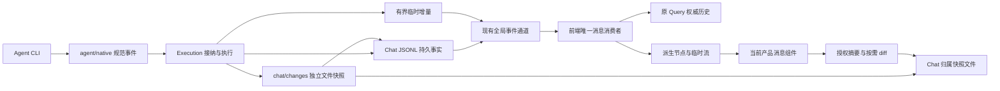

# 聊天消息展示与文件成果重构 Spec

## 1. 状态、目标与范围

本文是待实施规格，本次交付不表示代码已迁移或性能验收已通过。实施顺序、测试场景和交付证据见[实施与验收计划](chat-presentation-refactor-plan-cn.md)。

目标是采用 DeepSeek Harness 的增量消息消费、稳定展示节点、Markdown 与代码高亮实现，以及独立工作区快照机制，减少重复投影和路径替换，同时保留当前聊天的视觉与交互。

覆盖普通伙伴聊天，以及复用聊天展示的团队、工作流创作等入口。服务端与前端的接入均以现有 Agent、Chat 和统一事件通道为基础。领域接纳、账号、授权、审批、输入队列、执行生命周期、成果阅读和通知继续归各自原模块。

本次不增加四档详情设置、轮次导航栏、消息选区操作、输入编辑器替换或全局虚拟列表；不迁入 Harness 的完整 Cordis 宿主、插件装配、账号和 Session 后端；不重构无关页面的富文本组件。滚动先保留现有行为并补齐稳定锚点，不整套引入 Harness 的折叠动画协调系统。

## 2. 已确认的产品约束

### 2.1 保留当前展示

用户提供的截图作为行为参照，其文件不加入仓库。自动化使用不含私人数据的等价固定样例：

```text
用时 13.5s                         [过程展开入口]
我来看看今天的主要新闻。           [过程说明]
🌐 已访问网络                     [活动组展开入口]
    🌐 搜索网页                   [具体工具动作]
    收起
────────────────────────────────
最终答复，支持正文、列表、强调和链接。
```

必须保留耗时入口、过程说明、活动分组、图标、具体动作、收起入口、最终答复独立区域及分隔。沿用现有语义 Token、字体、间距、浅暗主题、减少动态效果、可访问名称和默认展开/折叠行为。新渲染器承载这些产品组件，不直接采用 Harness 的默认视觉和折叠偏好。

中途回复、过程说明、思考、工具和最终答复的分类依据既有规范消息阶段与生命周期证据；不得以“最后一段文本”、是否包含工具或时间间隔重新猜测最终答案。失败与取消继续保持可读内容和实际状态。未完成的执行不提前展示完成耗时或最终成果。

### 2.2 简化路径展示

- 文件事实保存完整路径；绝对路径允许正常展示，不以隐藏绝对路径作为展示要求。
- 正文、代码原文和人工链接标题保持原文。删除为隐藏路径而做的正文替换、项目名前缀反复增删和自动标题相对化。
- 单行长路径只做 CSS 省略，悬停和复制提供完整路径。显示字符串不能用于反推文件身份，也不能清空超过 120 字符的有效路径。
- 工具动作可以保留短标题；目标路径作为独立完整事实传递。标题使用文件名不改变真实目标。
- 链接语法识别、URI 编码、行列信息、授权目录映射和真实路径校验继续存在。`projects/` 等旧逻辑地址只在统一解析边界解释，不再作为多层展示替换规则。
- 打开、复制路径、历史 diff 和当前文件预览各自消费明确的目标身份。历史消息必须使用原 Chat/执行的范围，不能使用当前页面所选成员或项目重新解释。

## 3. 现状与问题定位

本次源码核对基线为主仓库 `da871f8`。实施前重新记录 HEAD 与工作区差异；下列位置用于定位职责，不要求保留其现有文件布局。

| 当前位置                                            | 已确认问题或需要替换的职责                                                                           |
| --------------------------------------------------- | ---------------------------------------------------------------------------------------------------- |
| `server/services/execution/runtime_events.go`       | 后端按 16ms 物化完整安全消息快照，发布成本随累计内容增长                                             |
| `server/internal/chat/messageview`                  | 同时承担消息投影、工具短语和文件成果推导；文件统计累加与首次/末次文本 diff 口径不同                  |
| `server/services/chat/chat.go` 的文件差异读取       | 请求单个文件时重放该消息工具记录，再合成文件差异集合                                                 |
| `modules/chat/runtime/chat-event-batcher.ts`        | 前端再次按 16ms 合并完整消息快照                                                                     |
| `modules/chat/runtime/chat-projection.ts`           | 当前消息变化时重新构造全部展示 Part 和工具参数对象                                                   |
| `modules/chat/components/chat-thread.tsx`           | 工具组订阅完整消息内容并重复汇总；文件成果放在工具折叠内容内                                         |
| `modules/chat/components/chat-message-content.tsx`  | 正文另有逐字平滑与 deferred 调度；已有 Streamdown 优化需用基准比较，不能先认定 Markdown 替换必然提速 |
| `modules/chat/components/workspace-file-viewer.tsx` | 读取全文后在前端比较；主题/单双栏变化重新生成 diff；diff 查询缺少活跃性条件                          |
| `shared/workspace/file-reference.ts` 与后端工具摘要 | 展示地址、逻辑映射和文件身份转换分散；长路径上限影响可用目标                                         |

现有稳定历史消息引用、分页、精确 submissionId、持久游标、缺口恢复及 Query 唯一刷新所有权属于有效基线，必须保留。不能将“当前消息重复转换”扩大表述为“全部历史 DOM 每次重绘”。

## 4. Harness 复用范围

上游固定为 `deepseek-ai/deepseek-harness` 的 `ce7073d51254c26cd63b22a60835b8f948deb447`。升级上游须作为单独变更记录理由、差异及回归，不跟随浮动分支自动更新。

| 上游实现                                                                                                                                                                                                | 采纳内容                                                         | 本项目适配                                                                                   |
| ------------------------------------------------------------------------------------------------------------------------------------------------------------------------------------------------------- | ---------------------------------------------------------------- | -------------------------------------------------------------------------------------------- |
| [MarkdownText 与增量解析](https://github.com/deepseek-ai/deepseek-harness/tree/ce7073d51254c26cd63b22a60835b8f948deb447/packages/client/ui-primitives/src/markdown)                                     | 稳定块缓存、尾部增量解析、未闭合代码围栏、流式/结束态解析及测试  | 现有排版、中文、Mermaid、表格操作、禁用原始 HTML、远程图片默认不加载、平台外链和授权文件入口 |
| 同目录的高亮与可视区域控制                                                                                                                                                                              | 语言懒加载、单例高亮、流式高亮缓存                               | 当前主题 Token；验证现有 Shiki 版本兼容后决定最小依赖调整                                    |
| [Conversation assembly](https://github.com/deepseek-ai/deepseek-harness/blob/ce7073d51254c26cd63b22a60835b8f948deb447/packages/client/ui-conversation/src/client/conversation/assembly.ts) 与节点构建器 | 增量折叠、dirty 节点、稳定身份、按节点订阅、流与结构不同发布节奏 | 本项目规范事件、Query 权威历史、临时流和现有分组外观；不引入完整注册框架                     |
| [Tool 节点与展示](https://github.com/deepseek-ai/deepseek-harness/tree/ce7073d51254c26cd63b22a60835b8f948deb447/packages/client/ui-tool)                                                                | 一个调用贯穿准备/执行/结果，按需参数读取、通用兜底               | 保留当前简短动作、图标、审批结果和业务命令回执；只为已存在的产品详情接入渲染器               |
| [workspace-changes](https://github.com/deepseek-ai/deepseek-harness/tree/ce7073d51254c26cd63b22a60835b8f948deb447/packages/deliverables/workspace-changes)                                              | 执行前后私有 Git tree、隔离 index/对象、摘要与按需 diff          | Go 实现、冻结多目录范围、持久历史、非 Git 目录快照和统一文件授权                             |

优先移植可独立复用的源码及行为测试。适配代码集中在真实依赖边界，不复制与本项目无关的插件服务。移植清单记录每个来源文件、commit、本地归属和改动原因；版权与许可集中登记于根 `THIRD_PARTY_NOTICES.md`，保留需要随源码交付的声明。

## 5. 唯一所有权与依赖



| 所有者                                 | 负责                                                | 不负责                                                 |
| -------------------------------------- | --------------------------------------------------- | ------------------------------------------------------ |
| Agent/Native                           | 规范技术事件、原生身份、阶段和完成事实              | 文件成果采集、项目路径隐藏、产品卡片和折叠规则         |
| Execution                              | 冻结工作范围、在执行边界调用采集、提交实际执行终态  | 第二套技术会话状态或前端显示状态                       |
| Chat 日志与存储                        | 持久消息、文件成果引用、游标、分叉与删除归属        | 将可再生索引变成第二份权威内容                         |
| `server/internal/chat/changes`（拟建） | 快照、隔离 Git 调用、净变化比较、有界读写与错误分类 | 解析 CLI 工具消息、修改用户 Git 仓库、决定执行成功失败 |
| 前端消息消费者                         | 历史/临时流衔接、幂等关联、唯一订阅、恢复与分页     | 复制另一份持久历史或自行猜测执行完成                   |
| 派生节点集合                           | 当前窗口的增量展示索引、dirty 状态和节点订阅        | 业务事实持久化或另一份执行生命周期                     |
| 渲染组件                               | 文本、分组、图标、折叠、布局和用户操作              | 配对原生事件、累加成果统计或反推授权路径               |

前端持久服务器事实继续由 TanStack Query 唯一拥有。节点集合是可从窗口重建的呈现投影；临时流仅保留尚未被持久结果接管的部分。隐藏 Scene 释放实时消费，恢复时经同一消息所有者对账，不新增 WS、页面轮询或隐式全历史读取。

## 6. 消息消费与发布契约

### 6.1 传输与恢复

首次加载和恢复继续读取有界快照与分页。健康流使用安全、规范的文本追加、工具字段更新和阶段边界，不再每个窗口发送累计整条消息。安全字段选择仍在 Core 的公开边界执行；不因为参考 Harness 就把任意原始工具输出、账号秘密或环境交给 Renderer。

持久信封继续使用 Chat sequence；临时流单独携带流代次、连续序号、已有消息/执行/Invocation 身份和目标部件身份。消息 revision、流序号和持久游标分别核验，不互相代替。字段及枚举在实施时从唯一公开合同生成，不在本文维护完整 API 副本。

- 累加文本只追加新增片段；需要替换时显式提供目标与版本。省略字段与清空字段有不同语义。
- 客户端收到重复增量不重复追加；收到缺口、代次变化、连接重置或缓冲超限后，停止应用无法证明连续的后缀并走原恢复端口。
- 持久结果按身份和覆盖版本原子接管临时流，不能重复显示，也不能先清空后等待下一帧填回。
- 分页和迟到快照不得覆盖较新事实。健康终态不固定重读消息窗口；仍遵守[既有刷新职责](ordinary-chat-refresh-spec-cn.md)中的请求和游标约束。
- 首发、HTTP 回执晚到、相同正文再次发送、队列、追加指令、团队来源和分叉继续复用已有精确身份。

### 6.2 节点与组件

节点键由消息、Invocation、已记录部件或工具身份组成，不使用列表位置、截断标签、时间戳或随机键。缺失上游部件身份时，在唯一适配边界依据该消息内确定的部件序号生成并冻结，不能每次渲染重新编号。

同一工具的准备、开始、进度和结果更新同一节点。只有相关字段变化才使工具节点及其所属组摘要变脏；纯正文追加不能重建已完成工具节点。节点清空、重试与可见性变化保留仍有意义的身份和展开状态。

消息展示不再通过完整 `AllyChatMessage → ThreadMessage → 全量 Part` 的循环转换。assistant-ui 仅保留仍有实际消费者的输入/附件适配；消息正文、分组和列表不再拥有另一套镜像消息状态。审批、问答、资源引用、伙伴头像及活动、复制、分叉、取消和阅读确认仍使用原入口。

文件成果独立挂到执行结果区域，不依赖最后一个工具组或工具部件是否存在。此处是现有文件卡片位置的有意调整；截图中其他过程展示和默认折叠保持不变。

### 6.3 唯一可见发布调度

前端只设置一个高频节点发布调度者。在下一次 rAF 合并 dirty 节点；无 rAF 的受控环境使用一次微任务。结束、失败、取消、审批/问答和必须立即可见的结构变化取消等待并即时提交。

后端可以按明确字节/时间上限打包新增增量，原始顺序不可丢失；该打包不再物化累计消息。前后端不得同时保留两套固定 16ms 完整快照窗口。移除正文每帧 8 字符的独立逐字队列；本次不另造平滑动画状态机。

单帧合并是调度策略，不承诺固定 16.7ms；高刷新率、后台、减少动态效果和终态要分别验证。计时器、observer、排队帧及订阅必须随所属呈现生命周期释放。

## 7. 独立文件成果

### 7.1 采集边界与覆盖

Execution 在资源与项目入口准备完成后、提交本轮 Agent 输入及允许其运行前保存基线；模型和工具完成或停止后保存结束快照。完成、失败、取消都按实际落盘内容比较。保存原有 `isRunning` 终态的及时性：文件收尾未结束时独立表示 pending，不能让聊天继续假装模型运行。

采集只使用冻结的真实授权目录及获准展示的受管内容目录。解析并去重项目入口、重叠目录和同一仓库；不会因仓库根位于授权目录之上就扩大扫描范围。采集入口必须服务于 Execution 的共享路径，不能只接普通页面。

| 目录情形                                                  | 本次方案                                                                                                                                                               |
| --------------------------------------------------------- | ---------------------------------------------------------------------------------------------------------------------------------------------------------------------- |
| 已有 Git 仓库                                             | 使用私有 index/对象目录保存范围内前后 tree，按 tree 比较，保留可用的 rename 信息                                                                                       |
| 非 Git 目录                                               | 在应用自有快照区域建立私有影子仓库，以相同范围和排除规则保存前后 tree；不在用户目录执行 `git init`                                                                     |
| Host 没有可用 Git                                         | 本轮文件成果明确不可采集；聊天继续运行，不回退解析 CLI diff                                                                                                            |
| `.gitignore` / Git exclude 忽略内容                       | 仓库及祖先 `.gitignore`、`.git/info/exclude` 对未跟踪文件生效；已跟踪文件遵循 Git 语义。影子仓库应用同类目录规则，不导入宿主全局配置或 include，额外忽略由显式策略传入 |
| 仓库内嵌套仓库/子模块                                     | 有独立授权根时独立记录；其他只记录边界信息，不宣称覆盖内部文件                                                                                                         |
| 系统暂存目录、账号/runtime 配置、密钥、内部日志、快照目录 | 排除；用户显式授权的临时项目目录按项目范围处理，但内部秘密目录仍排除                                                                                                   |

非 Git 影子仓库是本项目为外部 CLI 场景增加的适配，不能描述为 Harness 原样实现。它使非 Git 范围内的 shell 修改也独立可采集。首期不新增文件系统写入拦截、不增设 MCP 文件代理、不依赖 CLI 工具名称、参数或 diff 作为成果来源；忽略文件与未授权路径的修改不伪装为已覆盖。

内部目录排除复用现有受管目录与文件授权规则，不根据文件正文中的关键词猜测秘密，也不私自扩大对用户项目的扫描。

文件符号链接只记录获准的链接对象；跨范围跟随和范围变更均须校验。采集不能执行项目 hook、接收交互输入或运行未受控 clean filter；隔离 Git 配置、禁用外部 filter/可选锁及交互提示，验证 split-index、LFS 和属性处理不会向用户仓库写入。用户 index、refs、工作树及对象目录不得由本模块修改。

### 7.2 一份记录服务摘要与 diff

同一执行的一份结果引用不可变的前后内容。摘要与 diff 使用同一比较规则；反复修改后复原的文件不列出，shell、格式化器和代码生成器与编辑器修改等价处理。统计只表示该范围在执行期间的净变化，不宣称全部变化由模型独占产生。

记录归属至少包含 Chat、执行、记录版本、冻结根身份、相对路径、完整目标路径、前后内容引用、文件状态及可选行数。内容寻址键只用于去重，不能作为文件授权凭据。

文件状态区分新增、修改、删除、重命名、二进制、过大和不可读。未知行数保持缺失；二进制、超限、失败均不转换成 `+0 -0`。前后对象不存在与空文件分别表达。过长路径不丢弃，文件名包含空格、中文、控制字符时使用安全编码，不能拼接 shell 命令。

同目录的并发执行、后台进程或手动编辑可能进入多个重叠窗口。保持本轮前后净变化语义，不通过跨执行工具事件合并猜测作者，也不为采集增加全局业务执行锁。并发限制属于原执行/项目政策。

### 7.3 持久性与故障

采用原 Chat 归属文件空间保存快照，日志保存唯一结果引用，索引仅可再生。先完成内容落盘与引用闭包，再提交 JSONL 结果记录，最后发布事件。进程崩溃后不允许已宣布可用的记录引用未完成内容。

若采集晚于执行终态完成，提交结果时推进所属消息/成果的真实版本，经原事件通道更新卡片和相关查询。此前对 pending 内容的阅读不能确认较晚版本已读；成果阅读和通知仍遵循既有准确版本与去重规则，不重新打开执行状态或另造待办。

正常重启后旧记录仍可读。中途退出导致没有结束快照时，恢复为采集未完成；不能把重启后的当前文件当作历史结束状态。原始授权范围仍在每次读取时核验。

分叉必须在继承记录提交前固定可读的快照引用或复制所需内容；来源 Chat 删除后分叉仍能读取自己的继承成果。Chat 删除和失败暂存清理复用现有归属与引用生命周期，不建立第二套业务数据库。

旧日志能恢复原正文、工具、审批和状态。没有独立前后快照的旧执行不补造历史成果，也不继续用旧 CLI 工具合并链生成文件卡片；此类旧文件卡片/diff 不属于新记录覆盖，必要入口明确说明历史记录不可用。此项是历史文件成果的有意兼容边界，不能暗称旧结果已迁移。

### 7.4 初始资源预算

以下是待验证的初始实现预算，不是实测结论；调整需记录实测证据及行为变化。

| 项目                 | 初始上限                            | 达到上限的行为                                                       |
| -------------------- | ----------------------------------- | -------------------------------------------------------------------- |
| 单次采集阶段         | 30 秒，取消可打断                   | 标记失败或部分覆盖，终止子进程；不改变模型执行结果                   |
| Git 命令文本输出     | 8 MiB                               | 拒绝不完整列表，不能把截断输出当完整摘要                             |
| 单次目录枚举         | 50,000 个条目；新增快照内容 256 MiB | 记录覆盖不足，不声称准确完整总数                                     |
| 单记录可展示文件     | 500 个                              | 保留已知完整总数与截断状态，前后内容按可服务文件固定                 |
| 单文件单侧可比较文本 | 2 MiB                               | 保留路径和 oversized 状态，禁止下载全文后再由前端拒绝                |
| 文本差异计算         | 100ms 算法预算；渲染最多 5,000 行   | 返回明确 coarse 或截断状态；摘要与比较保持同口径                     |
| 单 Chat 新增快照内容 | 1 GiB                               | 停止接纳超预算的新内容并标记不可用；保留已提交历史，不自动逐出旧记录 |

预算在所属模块集中定义，计量经过真实去重；不通过当前显示文件数掩盖扫描成本。高亮、文本比较和对象读取不得运行于 React render 中的无界循环。

## 8. Markdown、文件引用与阅读位置

移植的 Markdown 解析/渲染保持一个公开入口，流式和结束态共用语法约定。稳定前缀缓存、尾部解析和代码高亮分别有测试；非追加替换须使缓存失效。公式结束态解析、中文强调、表格、嵌套列表、代码围栏及引用定义不得因性能优化永久失真。

保留现有表格复制/导出、Mermaid 终态渲染与预览、代码复制、链接、授权图片和原始文字回退。不得因上游默认允许网络图片而改变本项目规则。大文件 diff 由 Core 交付有界 hunks；主题和单双栏切换只更新表现，不重新读取快照或重新比较全文。

文件引用不为生成一个简短标签自动发请求。显示原文，打开或显式预览时统一解析；需要提前确认的已有入口按真实路径共享缓存，不把行列号当成另一份文件定位结果。文件身份与原消息范围一起缓存，换 Chat 后失效或分域。

用户在底部时继续跟随；向上阅读后新内容不抢位置。历史前插与异步内容增高使用稳定节点和相对偏移锚定，旧页到达不能重置已展开组。独立工具组滚动不得强迫外层回底。折叠不能隐藏键盘焦点，减少动态效果用户直接完成定位。这里只修复迁移所需行为，不增加新的自动折叠偏好。

## 9. 必须退出的旧链路

完成切换时必须逐项审查：

1. 文件成果从 `ToolSafeSummary`、ACP `oldText/newText` 或工具状态累加/拼接的生产链路。
2. 文件 diff 请求重放整条工具历史的实现，以及前端接收全文后再次比较的路径。
3. 后端与前端叠加的完整消息 16ms 快照窗口、正文独立逐字队列。
4. 每次正文增长时重建整条消息 Part/工具参数、每个工具组扫描完整消息内容的路径。
5. 文件成果对最后工具组的依赖；隐藏 diff 面板继续读取的条件。
6. 为隐藏绝对路径而生成/清理展示前缀、自动改写标题及清空长路径的规则。
7. 已失去消费者的 assistant-ui 消息适配、Streamdown 聊天包装和相关依赖。其他页面仍在使用的依赖保留。

短期开发可以逐阶段切换测试入口，交付时同一入口只能有一个成果生产者和一个消息消费/渲染路径，不保留长期双写、双渲染、模糊回退或空兼容层。

## 10. 验收与文档归属

按[实施与验收计划](chat-presentation-refactor-plan-cn.md)提交行为矩阵、上下游重放证据、性能基线对比、旧链路退出清单和真实平台边界。完成前不能把本讨论写成当前能力。

实施落地时更新[聊天执行](../architecture/chat-and-execution-cn.md)、[工作区与存储](../architecture/workspace-and-storage-cn.md)、[通知与工作看板](../architecture/notifications-and-work-board-cn.md)、[前端约定](../development/frontend-cn.md)及许可清单。与[普通聊天刷新职责](ordinary-chat-refresh-spec-cn.md)有关的当前事实只在对应权威文档维护，避免两份文档同时规定游标与恢复。
