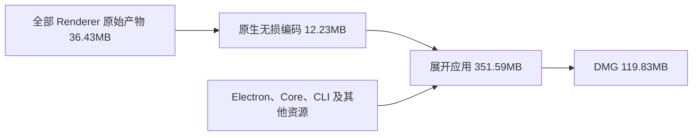

# 桌面交付体积分析

## 度量范围

本次核对 macOS arm64 的本地交付，MB 按十进制、MiB 按二进制计算。安装包下载大小、展开应用、前端全部资源和启动 JS 是不同指标。

用户提到的约 200MB 安装包尚未取得具体文件或版本，不能据此宣称从 200MB 优化到当前值。已核对的 [v0.2.0 公开资产](https://github.com/JieWaZi/NeuxBot/releases/tag/v0.2.0) 为 arm64 DMG 121,519,576 字节、Intel DMG 134,668,487 字节、Windows EXE 139,721,797 字节。它们与本次源码及输入不同，不作为严格前后对照。

## 同输入结果

以相同的 Electron 44.2.0、Core、CLI、终端 worker、Pi bridge、主进程和 preload 构建对照。基线使用优化前保留的原生前端产物及 PTY 文件集合，优化包使用最终修复后产物；安装镜像均使用 ULMO 和相同 16MiB 分块参数。对照逐项核对相关文件 SHA256，没有通过更换运行时或侧车取得收益。

| 指标                                | 优化前 bytes | 优化后 bytes |              减少 |
| ----------------------------------- | -----------: | -----------: | ----------------: |
| 首屏静态 JS                         |      509,449 |      458,878 |     50,571，9.93% |
| 工作台实际启动 JS                   |    4,378,240 |    4,374,875 |   3,365，基本不变 |
| 全部 Renderer 原始产物，含 manifest |   45,921,043 |   36,431,826 | 9,489,217，20.66% |
| 原生 Renderer 交付资源              |   17,248,739 |   12,225,709 | 5,023,030，29.12% |
| 展开应用                            |  356,895,026 |  351,589,241 |  5,305,785，1.49% |
| DMG 下载                            |  124,119,342 |  119,834,987 |  4,284,355，3.45% |

首屏已低于 500,000 字节预算，工作台实际启动链仍完整计入 4,500,000 字节预算。文案后移主要减少欢迎阶段负担，没有把工作台成本从统计中移除，也没有据此宣称启动耗时或内存同比下降。

对照额外包含本次离线 Electron 输入的示例包清理。标准 electron-builder 下载路径原本会删除 `default_app.asar`，本地 `electronDist` 路径则保留自定义内容；本次离线组装确认正式 `app.asar` 后对齐该行为，并重签名。它使最终 DMG 额外减少 38,966 字节，不计为新增产品代码优化，也没有新增冗余清理钩子。

## 哪些需要保留

以下为最终展开应用组成，比例不代表 DMG 压缩字节分摊。

| 组成                     |  展开 bytes | 判断                                                       |
| ------------------------ | ----------: | ---------------------------------------------------------- |
| Electron frameworks      | 251,804,107 | 约占 71.62%；Chromium、Node、V8 及实际动态链接依赖必须保留 |
| Core 与 CLI              |  83,737,348 | 约占 23.82%；承载聊天、存储、执行及命令入口                |
| app.asar                 |  13,043,514 | 含 12,225,709 字节原生前端和主进程等；已按实际功能裁剪     |
| Pi bridge                |   1,523,326 | 有实际 MCP 执行消费者，不改为依赖联网的首次下载            |
| 终端运行资源             |   1,195,507 | 含 worker 与 PTY；保留平台、架构和 ABI 需要的二进制        |
| 其他资源、许可与宿主文件 |     285,439 | 图标、元数据及许可证等                                     |

PDF 的解码 WASM、无 WASM 回退、字符映射和标准字体均有用途，不能全部删除。PDF 的 Liberation TTF 与本次精简的 KaTeX 旧字体不是同一组资源。Excel、文档、幻灯片、代码编辑器与图谱等按功能加载的模块仍需离线交付，延迟加载本身不减少安装包。

Squirrel、ReactiveObjC、Mantle 和 libffmpeg 在 Electron Framework 中存在直接动态链接依赖。SwiftShader 是图形降级资源。Core 的两套 SQLite 分别服务实际数据库与记忆／向量存储，也不是可以按名称去重的重复文件。

## 已处理的问题

- 文件代码预览此前从 Shiki 全量入口交付所有语言和主题；现收窄到文件类型及其嵌入语法可达集合，保留 69 个语法、原别名和两个主题。正文命中的 SCSS、TSX、Pug 等仍按旧流程补载，冷实例逐 token 对照验证。
- 两张无源码消费者的旧欢迎 PNG 共 2,774,904 字节，已删除。
- 原生 KaTeX 仅保留 WOFF2，去掉旧 WOFF／TTF 引用，原始资源减少 816,780 字节。Web 保留原回退，WOFF2 内容逐字节不变。
- 原生 PDF 不再复制没有接入的 QuickJS 表单脚本沙箱两文件，原始资源减少 475,337 字节；其余 PDF 资源及许可保留。
- PTY 过滤补齐测试文件和 source map，当前 arm64 交付净减 65,516 字节，不改原生加载优先级。
- workflow／automaticTask 文案从欢迎入口移至工作台同步注册，保持完整中英文与回退。

原生文本 Brotli、Core 的 `-s -w`、安装镜像压缩和语言裁剪此前已存在，不重复计算为本轮新增收益。粒子 SVG 保持原始质量，经已有无损交付链由 7,124,153 字节编码为 1,878,539 字节。

## 未采用的候选

PTY 的 build 与目标 prebuild 有少量重复，但优先级关系包含 Electron ABI 重编译结果，本轮没有为了数十至数百 KB 调整原生文件选择。

Core 的 MsgPack 框架依赖可通过额外构建标签缩小，但直接开启会触发第三方 ginx 的构建标签缺陷。仅在临时 Go overlay 中测得原始二进制可减 6,027,120 字节，独立 XZ 代理仅减 896,704 字节；这不是实际 DMG 收益。本轮不为此引入第三方 fork 或补丁。额外 `strip -x` 也未取得收益。

## 验证与交付边界

- 头像／侧栏 64 项、文件预览 40 项、启动与文案 5 项相关前端测试通过；最终 7 项 Node 构建、语法一致性与交付过滤测试及 3 项预算脚本测试通过。
- Vite、Electron 编译、启动预算、定向类型与样式／格式检查通过。完整 `desktop build` 的执行因并发设置页 `api-service-settings.tsx` 中的 `Button ref` 类型错误未通过；该无关文件未修改，不能将本次报告当成完整生产检查通过。
- macOS arm64 安装包通过 ad-hoc 签名严格验证、`hdiutil verify` 及应用、Resources、安装包三项体积预算。DMG 为 119,834,987 字节，SHA256 为 `c41f45161c211dcdd56ec414b402b914dcb6efc81ea6162f3d1489ae0df3ef5e`。
- 本轮复用本地既有 Core／CLI／worker，没有重建 sidecar。安装包元数据为 0.2.0，本地构建含未提交工作树，不代表已发布版本。
- 未运行应用、Core 或 UI 冒烟，未安装或发布；Windows／Intel 未重新打包，真实平台、解码耗时和视觉验收仍需独立完成。
