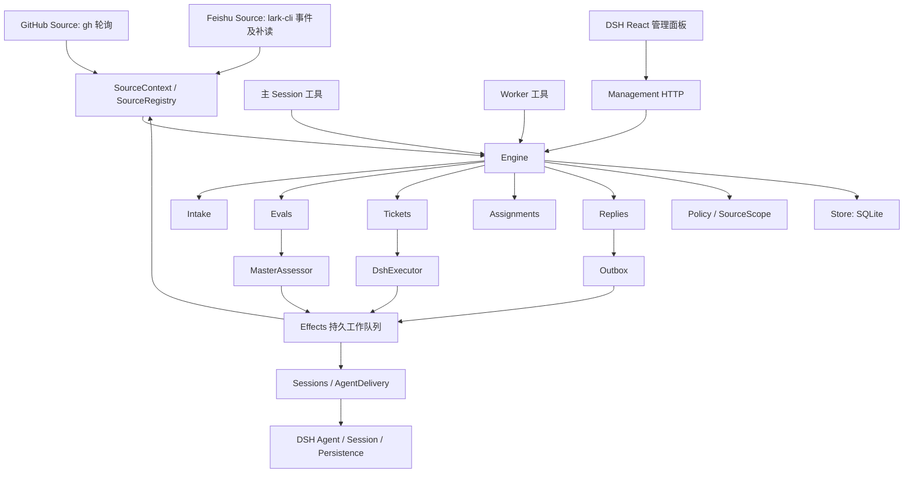
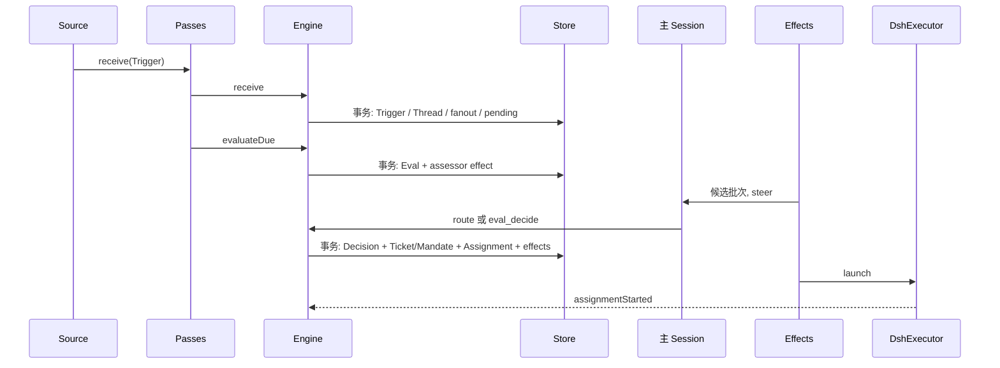

# dsh-superagent 源码分析与 NeuxAlly 原生接入评估

本文以 `deepseek-ai/dsh-superagent-prototype` 的实际实现为基线。原型事实、NeuxAlly 当前事实与迁移判断分别陈述；迁移判断尚未实现，工期是工程估算。本文不把文章里的未来方向、提示词约定或名称相似的模块当成现成能力。

## 1. 基线与结论

- 原型版本：[`8c32a9dc5d72c033816c6a8110b37f40cf94fba4`](https://github.com/deepseek-ai/dsh-superagent-prototype/tree/8c32a9dc5d72c033816c6a8110b37f40cf94fba4)，当前克隆包含一个提交。
- NeuxAlly 基线：`71a29a558da6b13364504eb72c649eefb80f6899` 加本次检查时工作区已有修改；执行、IM、团队和通知代码均按工作区内容核对，不能用 HEAD 单独复现全部结论。
- 用户确定的方向：原生融入 NeuxAlly，按原型已有架构和行为评估，不另行创造一套 Super-agent 产品。
- 原型有 216 个受 Git 管理文件、37,068 行；其中 `src` 为 111 文件 / 15,587 行，`tests` 为 65 文件 / 14,960 行（包含 fixtures），锁文件为 3,302 行。行数包括注释和空行，不等于实施量。
- 原型是 **DeepSeek Harness 的 Cordis bundle**，服务于一个 GitHub 仓库，可接飞书；不是独立模型 SDK。README 明确标为研究原型，且不等同于其内部版本或相关文章。

原生接入的主要工作是：**保留 Source → Trigger/Thread → Policy/Eval → Ticket/Mandate → Assignment/Executor → Report/Channel 的原有业务语义，将 DSH 宿主适配、Node SQLite 和 DSH 前端替换为 NeuxAlly 对应端口。** 单纯复制提示词、增加一个 MCP 或复用团队任务表，均不能承接下文实际存在的状态与恢复行为。[原型入口][entry]、[组合根][runtime]、[核心端口][ports]

按本文列明的完整范围，初估 **81–127 人日**。最大的未确定项是 DSH 会话 hooks 与 NeuxAlly 多 CLI 原生回执能否等价表达。未经该项验证，不承诺“所有现有 CLI 同时等价支持”。详见第 10 节。

## 2. 原型实际架构

这是对原型依赖方向的概括，不表示 Engine 的所有部件都可任意互相调用。`Engine` 内部构造顺序为 Replies、Tickets、Assignments、Evals、Intake；Tickets 依赖 Replies，Assignments 依赖 Tickets/Replies，Evals 和 Intake 依赖 Tickets。所有核心命令同步运行，由 Engine 包住 Repository 事务；外部模型调用、CLI 调用和消息发送交给端口排队，事务后执行。[Engine][engine]

### 2.1 文件规模与实际职责

| 原型目录 | 文件 / 行 | 职责 |
| --- | ---: | --- |
| `src/core` | 15 / 2,088 | 聚合、授权依据、事务命令、接入、评估、工单、尝试、回复、阶段派生、内存 Repository |
| `src/app` 直属 | 28 / 4,230 | Runtime 装配、SQLite、Effects、Sessions、Assessor、Outbox、HTTP、设置及提示词版本、资源读取 |
| `src/app/tools` | 3 / 441 | 主 Session 与 worker 的应用工具、调用参数转换 |
| `src/app/views` | 7 / 621 | 管理面板所读的派生视图 |
| `src/executor` | 2 / 838 | DSH worker 启动、消息投递、并发 slots、后台任务及子代理识别 |
| `src/sources` | 16 / 2,059 | GitHub / 飞书归一化、订阅补读、上下文读取、回写、SourceRegistry |
| `src/client` | 27 / 4,419 | 管理页、导航、表单、草稿、配置历史、文本渲染、轮询 |
| `src/infra` | 5 / 347 | 外部命令、路径、进程环境、健康信息和文本处理 |
| `src` 直属 | 8 / 544 | bundle 入口、部署、设置/授权 Schema、KV 键与限制 |

此外有 15 个 prompts 文件、2 个 Source skills、9 份编号文档、启动脚本及 Cordis 配置。源码分层本身就说明：可按原逻辑迁移的核心仅约 2,000 行，完整接入还涉及约 13,500 行宿主、适配和 UI 代码；不能只看核心体积估成本。

### 2.2 领域概念不能按名称合并

| 原型概念 | 代码里的含义 | 与 NeuxAlly 的区别 |
| --- | --- | --- |
| Source | 来源实现及其启用配置、接收范围、读写适配 | 不是 Runtime，也不是一个 MCP 工具 |
| Trigger | 来源产生的稳定事件，含 actor、human、addressed、threads、channel、meta | 不是一条已经接纳的 Chat 用户消息 |
| Thread | 外部讨论身份，保存订阅、待评估队列、当前 Eval 和关联讨论 | 不是 NeuxAlly `ChannelThread` 或原生 Session |
| Eval / Decision | 一个 Thread 上的一批事件的评估及其结果 | 不是执行结果，也不是独立评审 worker |
| Mandate | accept 时冻结的 strength、policyVersion、basis、actor、scope | 不等于 CLI 文件权限或工具审批 |
| Ticket | 一项持续外部工作的聚合，包含 Inputs、Assignments、关注的 PR 等 | 不等于 `ChannelTask`，也不等于单轮 Execution |
| Assignment | Ticket 当前交给 worker 的一次绑定，可重试/恢复替换 | 同一 Assignment 可跨多个模型回合 |
| Input | 需要交付给该 Ticket worker 的 Trigger 或内部说明，记录投递与读取 | “已入队”“已投递”“已读取”不同 |
| Report | worker 的结构化状态与摘要，可含提问、答复、PR 关联 | 模型最后一段正文不自动等于 Report |
| Subscription | Thread 到 Ticket 的订阅关系，可仅供上下文 | 不是前端 WS 订阅 |
| ChannelRef / Outbox | 原始外部回复地址与可靠发送记录 | 原型 Channel 不是 NeuxAlly 团队 Channel |

以上以 [`core/model.ts`][model]、[`core/ports.ts`][ports] 为准。`TicketStage` 是从这些事实派生的显示阶段，没有另存一份工作看板状态。[阶段派生][stage]

## 3. 从事件到接单的真实流程

### 3.1 Source 先决定收什么

GitHub 来源使用 `gh` 读取通知、Issue/PR、评论、Review 和 CI；来源配置控制额外观察范围。它还轮询已经被 Ticket 订阅的讨论，跟踪工单分支创建的 PR。不是 webhook 服务。默认轮询为 60 秒，连续失败阈值为 3，`observeIssues / observePulls / observeComments / observeCi` 默认均关闭。[GitHub Source][github]

飞书来源使用 `lark-cli` 的实时事件、已配置群/已知私聊的历史补读，以及已订阅话题补读。Thread ID 为 `chat_id + (root_id 或 message_id)`，`parent_id` 关联被回复 Trigger，`thread_id` 保存在元数据中用于补读。收听群、仅提及/观察、私聊开关与允许发起人的名单是不同配置。成员名单同步属于 Policy 配置能力，不等于收到消息就授予所有执行权限。[Feishu Source][feishu]

GitHub 不同读路径不能混为一谈：通知读取跟随 Link 分页，404 重试、410 放弃，失败通知有 24 小时重试窗；仓库观测 stream 则只请求首 100 项，没有同样的 Link 翻页实现。另一个静态边界是换仓复用原 stateDir：部分 ID/cursor 只含 Issue/PR 编号，回写又使用当前 repository，可能混淆旧记录。这里记录原实现限制，不据此扩大为多仓库设计。[GitHub Source][github]

### 3.2 Intake 的顺序

`Engine.receive → Intake.receive` 在事务内执行：

1. 以 Trigger ID 去重；检查 SourceScope。未接收的事件记录 filtered disposition。
2. 保存 Trigger，建立其 Threads 和 correlation。
3. 将事件扇出到对应订阅的 Ticket；context-only 订阅保留上下文属性。
4. 人类消息若已有 worker 负责，则保留在各 owner Ticket，不再正常进入 Eval；主 Session 收到 follow-up 通知，仍可路由显式 stop，不能由此另开同一工作。所有 owner handback 等释放路径发生后才可重新评估。
5. 其余事件进入主 Thread 的 pending，等待 Evals。

主 Session 的 `attach` 是另一个路径：把已存 Trigger 路由到既有 Ticket，撤下当前 Eval，其余批内 Trigger 重新等候评估。它不等同于新建 Ticket。[Intake][intake]、[Engine.attach][engine]

### 3.3 Gate、模型评估与授权

`SourceScope` 判断是否收听；`Policy.gate` 判断事件能否成为工作请求及其 `explicit / inferred` 强度；模型负责路由和语义判断。允许名单、是否提及、来源 admission 表、机器人名单与观察模式共同影响 gate。名单与身份按来源维护，没有跨平台同人归一化。[Policy][policy]

每个 Thread 同时最多一个普通 Eval。pending 事件合批，选择最强可接纳 Trigger 作为 primary；强度相同取相应的较晚 Trigger。Mandate actor/basis 来自 primary，不从整批任意正文猜测。[Evals][evals]

主 Session 通过 `orchestrator_route` 路由显式请求，也可对候选调用 `orchestrator_eval / orchestrator_eval_read / orchestrator_eval_decide`。**MasterAssessor 把候选送到主 Session，并非另外启动一名 evaluator。** 默认 `eval.model` 对应主 Session 新会话的模型选择；worker 使用 `executor.model`。[Assessor][assessment]、[角色模型][rolemodels]

inferred accept 必须覆盖全部启用规则的逐项判断，有命中规则、明确实现意图、确定目标、无需未决设计，以及 `intent_evidence`。`observe` 仍做判断，但把正向判断保存为 `would_accept`，不创建 worker；`off` 在准入层挡住推断候选；`auto` 才允许满足规则的推断请求接单。显式请求不是被这三个模式一概关闭。[Policy.assessmentOutcome][policy]

accept 在一个事务中形成 Decision、Mandate、Ticket、首个 Assignment、Subscriptions，以及需要的 acknowledgement 和 launch 工作。Mandate 后续不改写。Policy 修改会重排进行中的 Eval，并通知受影响的 live Ticket；**并非立即终止全部既有 worker**。已结束 Ticket 被人类后续消息唤醒时，重新验证 Mandate。[Evals][evals]、[Tickets][tickets]

## 4. 执行、补充输入与完成

### 4.1 主 Session 与 worker

原型保存一个 main Session ID；每个 Ticket 按稳定 ID 对应一个独立 worker Session，并配置独立 directory。更换 Assignment 时复用稳定 worker Session ID、目录和已登记的 PR 关系；实际 Git 分支由 prepare/worker 操作，宿主没有替所有 shell 操作保证分支不变。角色模型只在会话尚无 requestHeader 和 model/selection 时播种；已有选择不会因设置修改而被强制覆盖。[Sessions][sessions]、[DshExecutor][executor]、[角色模型][rolemodels]

`DshExecutor.prepare` 分配短名和目录字段，launch 才实际创建目录和会话。prepare 命令、来源环境变量、git/gh/lark shims 都在宿主适配层。默认并发 `maxWorkers=3`、可设 1–16；delivery 中属于 fromPerson 的人类跟进或状态 text 唤醒 idle worker 可额外借一个 slot，不适用于新的 pending launch。slots 以正在运行的 worker 活动、后台任务及子代理等因素判断，不能简单按“尚未结束的 Ticket 数”计数，也不对每个子代理单独计一个 slot。[DshExecutor][executor]、[Background][background]

DSH 的 preset、tools hooks、step/turn hooks、session inbox、`session/event`、sessionPersistence 和 subprocess 是实际运行依赖。Worker 可用原生 subagent 工具，但核心没有 NeuxAlly 式团队成员配置、任务 DAG 和依赖调度器。[Sessions][sessions]、[Cordis bundle][bundle]

入口还显式依赖 workspaceRegistry、permissionPresets、systemPrompt、skills、webServer 和 llm；Session 默认使用 danger-full-access。主通知区分不唤醒的 inject 与可唤醒的 steer；角色模型通过 system-prompt/assemble、agent/request 和 Session 事件装配。飞书图片另外使用模型模态查询和 DSH attachments。两种 preset 配置还引用 DSH compaction 和 tool-result-pruner，长会话压缩不是本仓库 core 自己实现的能力。这些宿主合同都要纳入原生适配核对。[入口][entry]、[Sessions][sessions]、[角色模型][rolemodels]、[Cordis bundle][bundle]

### 4.2 补充消息何时算读过

`Executor.deliver` 先排队，再由 AgentDelivery 以稳定消息 ID 查持久历史和 inbox，避免重投；接着报告 `inputsDelivered`。对 `kind=trigger` 的 Input，只有 Session 将对应消息纳入历史的 `user/message` 事件才报告 `inputsRead` 并写 readAt；内部 note/text/policy-changed 不是同一种读取记录。领域随后结合 Report 和 turn idle 的时序判断结束时哪些人类补充可以放回评估；“已读”不是模型已正确回答的证明。

因此，重启时不能用“HTTP 成功”“Input 已出队”代替“模型已读”。重试或恢复会补送 `readAt === null` 且 `deliveredTo` 属于被替换 Assignment 的 trigger Inputs，并清理仍留在旧 inbox 的重复副本。原本未投递队列仍按原规则推进。SQLite 领域事务与 DSH 会话持久化之间不是一个数据库事务。[AgentDelivery][delivery]、[Assignments][assignments]、[DshExecutor][executor]

worker 可以 `handback` 超出当前 Ticket 的人类补充；所有 owner 放手后才重新进入 Eval。`followForContext` 只提供上下文，不获得该处 follow-up 的处理权，也不会因那里的消息复活已结束 Ticket。[Evals.handback][evals]、[Tickets][tickets]

### 4.3 状态的三个层次

| 层次 | 原型值 | 结束依据 |
| --- | --- | --- |
| Assignment | `pending / running / ended` | 启动、替换、停止等领域命令 |
| Report | `progress / waiting / ready / blocked / failed / dropped` | worker report 工具不接受 waiting；waiting 由宿主 idle 路径推导，failed 也可由宿主产生 |
| TicketStage | `working / idle / person / ended`，含 queued、delivery、answer、review、blocked、failed | 原事实按固定优先级派生 |

`ready` 且不跟踪 PR 时可以 completed；有关联 PR 时可能只是 person/review。Ticket 若自己打开了 PR，需自己打开的 PR 均不再 open；若没自己打开 PR，则要求所关注 PR 均关闭。close 也不能覆盖仍在进行的恢复工作或尚未完成的 follow-up。`dropped` 与人工 stop 不相同：人工 stop 撤销 Mandate，普通 ended Ticket 仍可能被人类消息恢复。[Tickets.followsDone][tickets]、[Assignments.report][assignments]、[stage][stage]

### 4.4 暂停、失败与重启

- pause 限制新 assessment、launch、Input delivery 和 reply，来源仍记录事件，不取消已经在飞的 effect 或运行 turn；relay/notice 没有同一 pause limit。Eval deadline 按暂停时长延后。
- `blocked / failed` 形成自动输入 hold；机器人或 CI 事件不能单独把它当正常工作重新唤醒。新的非 context 人类输入、改变 Report 或人工 retry 可改变该 hold 判定；这不表示所有先前被保留但没进入待送列表的自动事件都会重新投递。
- 暂时模型/网络错误有有界重试；prepare 命令失败不按该模型重试机制重跑。
- 重启时，运行中且需继续的 Assignment 被替换，worker 收到先核对目录、Git 和 GitHub 再重复外部动作的恢复说明。已 waiting/ready/blocked/failed 且没有 `deliveredAt >= report.at` 的尝试保留相应状态，并继续处理其未投递队列。

这些是持久领域状态加 DSH 适配共同实现的结果，不能仅用 NeuxAlly 的进程重启与 Chat 恢复替代。[Engine.evaluateDue][engine]、[Assignments][assignments]、[Executor][executor]

## 5. Store、Effects、Outbox 与管理面板

### 5.1 存储与副作用

Store 使用 Node `node:sqlite` 的同步 `DatabaseSync`，开启 WAL 和 `synchronous=FULL`。表为 `trigger / disposition / trigger_thread / thread / ticket / decision / effect / outbox / kv`；多种聚合以 JSON 保存，用生成列和部分索引读取活跃集合。`atomic` 用 SAVEPOINT 支持嵌套，afterCommit 在最外层提交后执行。当前 schema 为 11，仅支持从 10 升级。[Store][store]

Runtime 对 stateDir 加进程锁；这不是分布式调度。Effects 记录 `(kind,key)`、payload、seq、generation、attempts、error、due，完成与重试时核对所属旧行，避免迟到执行删掉新载荷。这里没有给每项任务建立跨机器租约。[Runtime][runtime]、[Effects][effects]

Outbox 在事务内记录发送身份与 reply effect。原型回执状态只有 `pending / sent / dropped`，失败次数在 effect。来源不再接收或目标永久失效会 dropped；主动撤回则删除 pending receipt 和 effect，不产生第四种状态，若消息已在飞，发送结束后的 settle 可重建 sent/dropped 回执。Source 暂停时保留等待。相同 Ticket、相同讨论的后续消息等待前一 pending 消息，直到前一消息已连续失败 3 次；其他工单不受这个顺序门限制，实际 reply handler 全局并发仍为 1。[Outbox][outbox]、[Store.receipts][store]

### 5.2 直接影响运行成本的默认值

| 项目 | 实现中的值 | 影响 |
| --- | --- | --- |
| 主动准入模式 | observe | 不启动推断 worker，但仍可能消耗主 Session 判断 |
| worker 并发 | 3，范围 1–16；人类 idle wake 可额外借 1 | 不是总工单数或 token 总预算 |
| Eval 超时 | 120 秒，范围 30–600 秒 | 从候选实际交给主 Session 后计算；暂停会延长 |
| Eval 超时重排 | 2 次，第三次 unavailable | 一批事件可能被重复评估 |
| Passes | 每 2 秒及显式 request | 本地调度，不代表每 2 秒模型调用 |
| 一般 effect 退避 | 2 秒起，最大 60 秒 | relay、delivery 等按各 handler 处理 |
| reply 退避 | 5 秒起，最大 300 秒 | 发送重试独立于模型执行 |
| GitHub 轮询 | 默认 60 秒 | 来源 API 请求，不等于模型请求 |
| 订阅补读保留期 | live Ticket 期间及相关最后活动/结束后的两周 | ended 不表示立刻停止讨论观察 |
| 面板 GET 刷新 | 通常 5 秒，后台降低频率 | 原型前端是轮询，不是业务 WS |

来源：[Policy][policy]、[Evals][evals]、[Passes][passes]、[Effects][effects]、[Outbox][outbox]、[GitHub][github]、[订阅轮询][poll]、[面板 API][clientapi]。

存储没有历史自动清理：Trigger、Decision、已结束 Ticket、Outbox 回执、设置/提示词历史等持续增加。不能从这份源码得出固定日增长量或持续运行资源占用。[Store][store]

### 5.3 配置、工具和 UI 的原有范围

主 Session 有 14 个应用工具，涵盖 read、route、retry、request_status、note、trigger_requeue、eval/read/decide、reply、unsubscribe、settings_save、policy_sync、prompts_save。worker 有 6 个应用工具：read、ack、report、thread_unrelated、thread_follow、trigger_handback。它们另依赖 DSH preset 提供的基础工具。[主工具][maintools]、[worker 工具][workertools]

提示词由内置 runtime 默认片段、团队说明、Source skills 和生成模板变量组合；内置片段本身也允许配置覆盖。保存设置和 prompts 都有历史版本，每次请求组装当前提示并登记 Session 使用过的 revision。executor prepare / directory / blocked commands 与账户设置存在 panel-only 边界；部分“只有人工明确要求才允许”的管理工具约束来自描述文字，不能写成全部具有代码级人工审批。[Settings][settings]、[Prompts][prompts]、[主工具][maintools]

管理面板六个顶层 tab 是 Overview、Source、Trigger、Eval、Execution、Settings；Thread/Ticket 是详情，Prompts/Deployment 属于设置组。它使用 DSH sidebar/layout/session 导航与 provider；不是可直接复制到 NeuxAlly 的独立 React 应用。管理 API 的 loopback / Origin 检查属于 DSH 的本机宿主边界。[HTTP][http]、[client 入口][client]、[构建配置][build]

## 6. 哪些只是约定，哪些由宿主执行

| 行为 | 原型实际边界 | 迁入时必须如实描述 |
| --- | --- | --- |
| 不擅自做工作 | Policy gate、assessment 校验与 Mandate；仍包含模型语义判断 | 不等于模型输出永远正确 |
| route stop / attach | stop 检查 explicit 强度及活 Ticket；attach 检查 Trigger、owner、目标及必要的 Mandate 重验 | stop 不强制同 Thread，attach 没有单独 gate；正文是否确实指向目标由模型判断 |
| 自动合并须满足审批、小改动等条件 | Delivery requirements prompt；还依赖 GitHub 仓库保护 | 没有独立 merge 策略引擎 |
| 每 Ticket 独立目录 | 路径、prepare 命令、session directory | 目录不同不等于 OS 沙箱 |
| blocked commands / 账户 shims | 命令名和 PATH 默认入口 | 绝对路径可绕过，不是硬隔离 |
| worker 工具受限 | DSH preset 和 hooks 过滤工具 | 不能推定其他 CLI 有等价的逐工具控制 |
| 手工指示后才修改某些设置 | 一部分为工具描述；特定字段才有 panel-only 拒绝 | 不把 prompt 当成通用审批实现 |
| Policy 缩紧影响工单 | 通知 live Ticket、重排 Eval、恢复时重验 Mandate | 不是所有 live Ticket 自动取消 |
| 可靠发送 | outbox、稳定身份及各 Source 回执/去重行为 | 不能泛化成任何网络失败下绝对 exactly-once |

依据：[Cordis preset][bundle]、[环境 shims][environment]、[Sessions][sessions]、[主工具][maintools]、[Settings][settings]、[Policy][policy]、[原型执行文档][executiondoc]。发现的具体实现边界保留在逐文件审阅附录，未运行的异常路径不宣称已复现。

## 7. NeuxAlly 已有代码能承接什么

这里只列查到的实际接口，不按“看起来类似”计入复用收益。

| 原型需要 | NeuxAlly 代码证据 | 复用边界 |
| --- | --- | --- |
| 独立 worker 会话与模型调用 | [WorkIntent / CreateChatSpec / WorkOptions](../../server/services/execution/intent.go)、[Execution Service](../../server/services/execution/service.go) | 可创建独立 Chat、指定受管 cwd、冻结账号模型、复用会话；仍需实现原 Executor 的 start/deliver/stop 适配 |
| 原生输入身份和消费证据 | [Turn.Steer](../../server/internal/agent/turn_lifecycle.go)、[native outcomes](../../server/internal/agent/native_outcomes.go)、[消费查询](../../server/internal/chat/conversation/query.go) | 有 HostInput 与 InputConsumption；各 CLI 能提供哪些证据必须逐项核实，不能把提交回执当 readAt |
| 会话权威日志及终态 | [Chat Journal](../../server/services/chat/journal.go)、[ConversationStore](../../server/internal/chat/conversation/store.go) | 继续作为 Chat/原生执行权威；原型 Ticket 业务事实属于自己的聚合 |
| 角色工具权限 | [Capability Registry](../../server/internal/agent/capability/capability.go)、[WorkOptions.ToolCapabilities](../../server/services/execution/intent.go) | 可签发主角色/worker 的精确应用操作；不等于能过滤所有 CLI 自带工具 |
| 团队任务 | [ChannelTask / Attempt](../../server/repositories/models/channel_task.go)、[派发](../../server/services/channel/task.go) | 有围栏和恢复的参考实现；不能直接承担 Ticket/Assignment，因为模型与生命周期不同 |
| 飞书传输 | [Feishu SDK 适配](../../server/internal/im/feishu.go)、[平台消息接口](../../server/internal/im/platform.go) | 已有一条连接、持久收件后 ACK；当前群消息只接受提及本 bot 的用户消息，非用户被过滤；parent 映射 QuoteID，root/thread 未完整保留 |
| IM 投递 | [CreateDelivery / sendDelivery](../../server/services/im/delivery.go) | 已有冻结目标、幂等、分片回执和 unknown；当前飞书用 Message.Create(chat_id)+Uuid，原型用原消息 Reply(Markdown)，需适配 |
| GitHub Source | 本次核对的执行、团队和 IM 入口没有原型这套完整监听/游标/PR 跟踪聚合 | 不能以“CLI 能运行 gh”记为已实现 |
| 前端事实同步 | [工作看板查询](../../packages/frontend/src/modules/work-board/components/work-board-content.tsx)、[通知与工作看板](../architecture/notifications-and-work-board-cn.md) | Query + Core 共享 WS 可承载新增视图；不能把原型所有业务状态改名塞入已有运行状态 |
| 生命周期 | [桌面生命周期](../architecture/desktop-lifecycle-cn.md) | Core 管理后台工作；关窗口继续，真正退出停止；没有从这里推出 24 小时云端常驻能力 |

现有团队 Thread 一位成员固定一个 Chat，任务有最大数量及依赖语义；原型则一张 Ticket 一个 worker Session，允许长期等待外部 PR。把一个 Source 永久绑到一个团队 Thread，或把每个 Assignment 当新团队任务，都会改变原行为。[团队模型](../../server/repositories/models/channel_thread.go)、[原型 Executor][executor]

## 8. 按原架构做原生迁移的具体边界

以下是源码端口到 NeuxAlly 的迁移落点，属于评估方案，不是当前已实现能力。保持原型的一个受管 GitHub 仓库、可选飞书、主 Session 与 Ticket workers 的模型，不额外引入多仓库平台、团队 DAG、自动成本计价或新的主动工作来源。

### 8.1 原型核心和数据模型

将 `core/{model,intake,evals,tickets,assignments,replies,stage}` 和 `policy/admission` 的规则按原结构移植为 Go 内部模块。保留 Trigger disposition、Evaluation.primary、Mandate.basis、context-only subscription、Input.readAt、Assignment.report、Ticket.follows/ended 等事实；不删除看起来可以由文本推断的字段。

Repository 保持 Engine 一次命令一个事务，以及 enqueue effect 同事务的顺序。实现进入 NeuxAlly Repository Controller；JSON 聚合、active 查询和 KV 版本的物理实现需按原测试核对。原型开启 WAL，NeuxAlly 业务 SQLite 明确禁止 WAL，故不能复制初始化 SQL；采用既有 GORM/事务约定，需要真实临时 SQLite 回归，而不是默认两者并发行为相同。[后端约定](../development/backend-cn.md)

这部分没有把 Event、Ticket 或 Assignment 合并进 Chat/Execution。原型本来就把领域状态与 DSH 会话日志分开；NeuxAlly 同样由现有日志保存模型执行，Ticket 聚合保存外部工作事实与关联身份。

### 8.2 原型 Sessions / Assessor / Executor

| 原型动作 | 原生迁移工作 |
| --- | --- |
| `Sessions.ensure(master)` | 关联一个持久主 Chat，保存其身份并使用原主角色指令、工具集合及角色模型 |
| `MasterAssessor.request` | 保留候选、批次和 Eval deadline 语义；通过现有 Execution 投递到主 Chat，不新增 evaluator 角色 |
| `DshExecutor.prepare/start` | 保留 Ticket 稳定身份、独立目录、prepare 和 Assignment；通过 WorkIntent 建立或恢复该 Ticket 的 worker Chat |
| `Executor.deliver` | 保留 Input 稳定 ID、投递去重、inbox/read 区分；适配原生 steering 或已有回合接纳路径 |
| `inputsRead / turnEnded` | 用已证实的原生消费和终态回执映射，不能以收到助手文本推测 |
| `stop / retry / assignmentInterrupted` | 仍由 Engine 先处理领域状态；取消准确的原执行，恢复同 Ticket Chat 与目录，保持原 read/unread 补偿 |
| WorkerSlots / background hooks | 对照原型 turn、job、subagent 事件计算；现有 Runtime 不能提供的事件列为不等价项 |
| `agent/created`、`tools.restrict/guard`、`agent-preset/selected` | 原型借这些 hooks 绑定并约束工具、恢复角色 preset；迁入后应用工具与 CLI 原生工具分别核对对应能力 |
| inject / steer、compaction、tool-result-pruner、图片附件 | 分别核对静默注入/唤醒、长会话压缩、工具结果裁剪和模态附件，不能以“都能聊天”判定等价 |

**第一项必须做的技术验证**是这张表的会话合同：主 Chat 忙时能否合批接收、worker 稳定 Input 是否能证明消费、Report 与 turn 结束先后、后台子任务、取消及恢复。该验证只针对原型依赖，不另加需求。

### 8.3 Source 与 Channel

GitHub 依原型拆分 read / trigger / pull / channel，保留通知拉取、订阅补读、CI 指纹、PR 跟随、回复地址和回执行为。原型账户配置使用 `gh` 包装命令，原生版本可先保留此外部调用边界；若改用 GitHub SDK，是额外传输替换成本，本文未将其计作现成复用。

飞书保留 SourceScope、Trigger、Thread correlation、admission context 与 Channel 逻辑，但传输接已有 IM 官方 SDK 连接。必须补齐原型所用的 root/thread/reply 身份、未提及的群观察消息、历史与订阅话题补读；当前群聊只接提及的 normalizeFeishu 不能无改动提供完整语义。事件应从现有耐久收件向原型 Engine 交付，不能同时又按普通 IM 路由重复启动一次工作。

原型回写与 NeuxAlly IM Outbox 有不同状态集合：前者 pending/sent/dropped，后者还显式区分发送结果 unknown。接入时需建立两者的映射，并保留平台不确定事实；这属于适配差异，不能宣称字节级照搬。thread reply、review comment fallback、图片上下文和来源原文读取也在同一迁移范围内。

### 8.4 配置、工具、UI 和启动

应用工具保持原 14/6 个能力的职责、参数语义与角色读取范围，接现有 Capability/allycli 端口；工具名或传输包装变化要同步原 prompts 与 model-surface 测试，不能只把 prompt 文件复制过去。

保留原 policy/eval/executor/source/pause 配置分块、乐观修订号、配置和 prompt 历史及预览。DSH provider/model 的表示映射到 NeuxAlly 已有 Runtime/account/model/reasoning，不能把 DSH provider ID 直接当 NeuxAlly Runtime ID。

UI 保留原型已有页面的信息与操作；移除 DSH sidebar、layout、session navigation、module loader 依赖，接现有 React 路由、共享控件、API 生成链及 Core WS。原型的页面 GET 轮询在 NeuxAlly 中转换成初始快照与事件失效；GitHub/飞书协议本身的轮询另按 Source 原语义保留。

Runtime 先注册管理 HTTP，再执行 setup → hooks → main Session → policy sync → resume → passes/effects；此顺序由 Core 生命周期承接。Setup 的 CLI 身份/仓库检查属于设置与来源准备，不加到普通 Chat 发送、steering、恢复或分叉的模型前置探测中。tmux 脚本和 DSH Web profile 不进入原生运行链。[原型 Runtime][runtime]、[原型 Setup][setup]、[NeuxAlly 执行约定](../development/backend-cn.md#82-执行关键路径禁止诊断探测)

### 8.5 建议的代码归属

| 现有原型边界 | NeuxAlly 落点（拟新增/扩展） |
| --- | --- |
| core、policy、Source 纯归一化 | `server/internal/superagent/` 下按原职责划分 |
| Runtime、Assessor、Executor、Effects 的多入口编排 | `server/services/superagent/`，调用现有 Execution、Chat、IM 端口 |
| Store 的领域持久化与查询 | `server/repositories/models`、`controllers` 中的 superagent 所属文件 |
| management HTTP 与 views | `server/apis/superagent/`，按现有单入口用例规则组织 |
| 模型工具 | `server/internal/agent/capability` 原目录注册，对接 superagent 领域操作 |
| panel | `packages/frontend/src/modules/superagent/`，保留原页面职责并复用现有宿主 |
| 飞书协议缺失字段 | 扩展 `server/internal/im` 及耐久收件合同，仍使用原连接所有者 |

这里只建议归属，不预建空包装层，也不把原 TS 的每个小文件机械翻译成一个 Go 文件。

## 9. 按原测试验证迁移是否等价

原型已经提供大量 tests。阅读测试能确认作者写下的合同，但本次未安装 DSH 依赖、未运行模型或外部平台流程，不能据此宣称测试已通过。原生迁移应至少保留以下测试族的行为：

| 原测试族 | 必须保留的合同 |
| --- | --- |
| core-engine / policy / stage / followups | gate、批次、Mandate、resume、handback、context-only、PR 结束及阶段优先级 |
| store / migration / effects / outbox / queue | 原子提交、活跃查询、旧 generation 不覆盖新工作、发送顺序与去重 |
| delivery / runtime-concurrency / passes | 接纳与读取不同、迟到投递、暂停、取消、恢复和并发启动 |
| runtime / background / retry-health / role-models | DSH 依赖迁移后的事件等价、模型设定和 slots |
| sources / github-read / feishu-read / admission-context | 来源身份、分页、cursor、讨论关联、原文上下文与失败补读 |
| tools / prompts / cards / model-surface | 角色读取范围、参数 Schema、提示词与工具一致性 |
| HTTP、settings、views、panel 系列 | 配置竞态、同源入口、状态派生、页面操作与恢复 |

真实模型验证需要分别覆盖首发、忙时补充、阻塞后人类恢复、同 Ticket retry、宿主重启、PR close/merge 和外部发送回执丢失。仅 Go 单测或模拟原生协议不能证明完整平台等价。

## 10. 成本：代码迁移量、运行量与估算边界

### 10.1 完整原生迁移的人日

口径：保留本文列明的原型功能；Go Core 原生实现，完整管理面板，GitHub + 飞书；复用现有 Execution/IM；不修改 DSH 上游、不增加新来源、不做多仓库扩展。人日包含对应定向测试，最后一项为跨模块验收与故障回归，避免把全部测试重复计算。

| 工作包 | 代码依据 | 估计人日 |
| --- | --- | ---: |
| core 五部分、领域结构与派生状态 | 15 个 core 文件 | 10–15 |
| Policy、admission、MasterAssessor | policy/admission/assessment/context | 6–9 |
| Store、Effects、Outbox 与恢复事务 | store/store-read/effects/outbox/migration | 8–12 |
| Sessions、Executor、消息消费和后台活动适配 | sessions/delivery/executor/background | 12–20 |
| 应用工具、资源读取、prompts/history | tools/resources/prompts/versions | 6–9 |
| GitHub Source/Channel/PR 跟踪 | sources/github* | 8–12 |
| 飞书 Source/Channel/原文与话题语义 | sources/feishu* + 现 IM 合同缺口 | 6–10 |
| 设置、Setup、部署配置适配 | settings/setup/deployment/environment | 4–7 |
| 全部原面板功能的前端迁移 | client + app/views | 8–12 |
| Core 生命周期、事件与装配 | runtime/index + 现 Core 入口 | 3–5 |
| 跨链路、真实 CLI/平台与故障验收 | 对应原测试族及真实回执差异 | 10–16 |
| **合计** | **中低置信度的工程预估** | **81–127** |

这不是原仓库提供的工期，也不是按行数乘固定速度得到的结果。估算主要依据宿主替换数量、事务和消费确认合同、来源差异与前端依赖。若配置 2 名后端、1 名前端并分担验证，考虑依赖顺序后可按约 **8–12 个工作周**做预算；不是保证交付日期。现有 CLI 无法表达必要 hooks 时，要么收窄经验证的 Runtime 支持面，要么增加原生适配工作，后者不应隐藏在人日下限里。

实际顺序应为：先验证 Sessions/Executor 消费合同；再迁 core/policy/store；然后贯通 GitHub accept→worker→Report→PR end；随后飞书、管理面板、设置历史；最后覆盖补充、暂停、失败与重启。阶段性贯通只用于收敛风险，不等于完整移植完成。

### 10.2 运行成本不能从源码直接报人民币

原型没有给出真实流量、平均 token、每日工单数、成功率或长时间资源基准，因此不能据此声称“每天多少元”或“比 NeuxAlly 多几倍”。实际模型调用由主 Session 的路由/评估/报告处理和各 worker 的执行、跟进、子代理共同构成。

可以直接从实现确定的影响因素：

- pending 合批减少一事件一判断，但候选和 follow-up 仍会进入主 Session；不是免主模型成本。
- 同一人类 follow-up 可能同时到达多个 worker，并产生主 Session relay；机器人/CI 也可能既 fanout 又单独进入 Eval。普通 progress 不额外唤主 Session，纯 notice 用 inject 而非 steer。
- observe 只阻止推断工作真正启动，仍有判断成本。
- 初始评估上下文默认最多 10 页、15 秒，后续仍可按需读原文和图片。prompt 配置字符上限与 model-surface 测试字符阈值均不是 token 预算。
- 原生会话复用保留上下文，工具循环和后续 PR 跟进还会消耗输入/输出；不能把“一个 Ticket”当成“一次模型请求”。
- transient retry、Eval timeout 重排、worker retry 与 host recovery 可能带来额外调用。
- `maxWorkers` 控制并发，不是每日 token、总执行时长或子代理总调用预算。
- 来源轮询主要产生 API/CLI/网络请求；长期记录不自动清理，会增加 SQLite 和日志体积。

可实测的核算式为 `总用量 = 主 Session 各实际调用用量 + 所有 worker/子代理各实际调用用量`；缓存读写、普通输入、输出按现有规范原生计数区分，未知不补零。人民币费用要另给真实模型账单或当时价格与实测调用量。本文未查询价格，也未假定选定模型。

### 10.3 许可与交付

该仓库采用 MIT，移植其源码、提示词或可辨认的实现时保留原版权和许可；NeuxAlly 按现有规则集中登记第三方来源。MIT 允许使用不等于 DSH 宿主全部依赖已被本次审阅；本次 clone 没有包含那些依赖的源码。[LICENSE][license]、[package.json][package]

原生迁移完成后不需要把 DSH Web profile、Cordis 宿主和 tmux 管理脚本作为运行必需品；这是按本文选择替换宿主后的结果。当前原型实际依赖 DSH Cordis Web host；tmux、Python 和相关 Unix 命令是随附启停脚本的依赖，不能与核心逻辑依赖混为一谈。

原型包要求 Node `^22.19.0 || >=24.0.0` 和 DSH `^0.2.1-alpha.2`；部署文档安装命令固定公开 `0.2.1-rc.3`，该组合未在本次联调。还需可写且独占的 stateDir、已配置模型、git、对目标 github.com 仓库有 push 权的用户 gh CLI；飞书 bot 和 lark-cli 为可选来源前提。本次没有把安装说明当成已通过的兼容性测试。[部署文档](https://github.com/deepseek-ai/dsh-superagent-prototype/blob/8c32a9dc5d72c033816c6a8110b37f40cf94fba4/docs/006-deployment.md#prerequisites)、[package.json][package]

## 11. 本次阅读与验证记录

两名 `gpt-6.1-sol / xhigh` 分别负责领域/执行与来源/前端/部署，主审查 NeuxAlly 拥有对应职责的代码和迁移映射。两份逐文件清单与 `git ls-files` 合并核对：215 个文件登记完整阅读，剩余 `pnpm-lock.yaml` 作结构检查；其中 111 个源码文件、59 个 spec 和 6 个 fixture 全部有完整阅读登记。外部 DSH 包实现不在已读范围内；“覆盖登记完整”不等于证明没有理解遗漏。

- [执行、领域、权限、恢复与测试详细证据](dsh-superagent-execution-review-cn.md)
- [来源、部署、工具、管理面板与测试详细证据](dsh-superagent-surface-review-cn.md)
- [216 个文件的阅读覆盖核对](dsh-superagent-reading-coverage-cn.md)

本次进行了 clone、固定提交与文件清单/规模核对、静态源码及测试阅读；未启动原型服务、未安装依赖、未调用真实模型、未向 GitHub/飞书发送消息、未打开或截图运行中的应用。原型运行能力与本机平台兼容性仍需后续实测。文档检查结果以本次实际命令输出为准。

[entry]: https://github.com/deepseek-ai/dsh-superagent-prototype/blob/8c32a9dc5d72c033816c6a8110b37f40cf94fba4/src/index.ts
[runtime]: https://github.com/deepseek-ai/dsh-superagent-prototype/blob/8c32a9dc5d72c033816c6a8110b37f40cf94fba4/src/app/runtime.ts#L61
[ports]: https://github.com/deepseek-ai/dsh-superagent-prototype/blob/8c32a9dc5d72c033816c6a8110b37f40cf94fba4/src/core/ports.ts
[engine]: https://github.com/deepseek-ai/dsh-superagent-prototype/blob/8c32a9dc5d72c033816c6a8110b37f40cf94fba4/src/core/engine.ts#L25
[model]: https://github.com/deepseek-ai/dsh-superagent-prototype/blob/8c32a9dc5d72c033816c6a8110b37f40cf94fba4/src/core/model.ts
[stage]: https://github.com/deepseek-ai/dsh-superagent-prototype/blob/8c32a9dc5d72c033816c6a8110b37f40cf94fba4/src/core/stage.ts
[intake]: https://github.com/deepseek-ai/dsh-superagent-prototype/blob/8c32a9dc5d72c033816c6a8110b37f40cf94fba4/src/core/intake.ts
[policy]: https://github.com/deepseek-ai/dsh-superagent-prototype/blob/8c32a9dc5d72c033816c6a8110b37f40cf94fba4/src/policy.ts#L38
[evals]: https://github.com/deepseek-ai/dsh-superagent-prototype/blob/8c32a9dc5d72c033816c6a8110b37f40cf94fba4/src/core/evals.ts
[tickets]: https://github.com/deepseek-ai/dsh-superagent-prototype/blob/8c32a9dc5d72c033816c6a8110b37f40cf94fba4/src/core/tickets.ts
[assessment]: https://github.com/deepseek-ai/dsh-superagent-prototype/blob/8c32a9dc5d72c033816c6a8110b37f40cf94fba4/src/app/assessment.ts
[assignments]: https://github.com/deepseek-ai/dsh-superagent-prototype/blob/8c32a9dc5d72c033816c6a8110b37f40cf94fba4/src/core/assignments.ts
[rolemodels]: https://github.com/deepseek-ai/dsh-superagent-prototype/blob/8c32a9dc5d72c033816c6a8110b37f40cf94fba4/src/app/role-models.ts
[executor]: https://github.com/deepseek-ai/dsh-superagent-prototype/blob/8c32a9dc5d72c033816c6a8110b37f40cf94fba4/src/executor/dsh.ts
[sessions]: https://github.com/deepseek-ai/dsh-superagent-prototype/blob/8c32a9dc5d72c033816c6a8110b37f40cf94fba4/src/app/sessions.ts
[background]: https://github.com/deepseek-ai/dsh-superagent-prototype/blob/8c32a9dc5d72c033816c6a8110b37f40cf94fba4/src/executor/background.ts
[delivery]: https://github.com/deepseek-ai/dsh-superagent-prototype/blob/8c32a9dc5d72c033816c6a8110b37f40cf94fba4/src/app/delivery.ts
[store]: https://github.com/deepseek-ai/dsh-superagent-prototype/blob/8c32a9dc5d72c033816c6a8110b37f40cf94fba4/src/app/store.ts#L49
[effects]: https://github.com/deepseek-ai/dsh-superagent-prototype/blob/8c32a9dc5d72c033816c6a8110b37f40cf94fba4/src/app/effects.ts
[outbox]: https://github.com/deepseek-ai/dsh-superagent-prototype/blob/8c32a9dc5d72c033816c6a8110b37f40cf94fba4/src/app/outbox.ts
[passes]: https://github.com/deepseek-ai/dsh-superagent-prototype/blob/8c32a9dc5d72c033816c6a8110b37f40cf94fba4/src/app/passes.ts
[github]: https://github.com/deepseek-ai/dsh-superagent-prototype/blob/8c32a9dc5d72c033816c6a8110b37f40cf94fba4/src/sources/github.ts
[feishu]: https://github.com/deepseek-ai/dsh-superagent-prototype/blob/8c32a9dc5d72c033816c6a8110b37f40cf94fba4/src/sources/feishu.ts
[poll]: https://github.com/deepseek-ai/dsh-superagent-prototype/blob/8c32a9dc5d72c033816c6a8110b37f40cf94fba4/src/sources/poll.ts
[maintools]: https://github.com/deepseek-ai/dsh-superagent-prototype/blob/8c32a9dc5d72c033816c6a8110b37f40cf94fba4/src/app/tools/main.ts
[workertools]: https://github.com/deepseek-ai/dsh-superagent-prototype/blob/8c32a9dc5d72c033816c6a8110b37f40cf94fba4/src/app/tools/executor.ts
[settings]: https://github.com/deepseek-ai/dsh-superagent-prototype/blob/8c32a9dc5d72c033816c6a8110b37f40cf94fba4/src/app/settings.ts
[prompts]: https://github.com/deepseek-ai/dsh-superagent-prototype/blob/8c32a9dc5d72c033816c6a8110b37f40cf94fba4/src/app/prompts.ts
[http]: https://github.com/deepseek-ai/dsh-superagent-prototype/blob/8c32a9dc5d72c033816c6a8110b37f40cf94fba4/src/app/http.ts
[client]: https://github.com/deepseek-ai/dsh-superagent-prototype/blob/8c32a9dc5d72c033816c6a8110b37f40cf94fba4/src/client/index.tsx
[clientapi]: https://github.com/deepseek-ai/dsh-superagent-prototype/blob/8c32a9dc5d72c033816c6a8110b37f40cf94fba4/src/client/api.ts
[build]: https://github.com/deepseek-ai/dsh-superagent-prototype/blob/8c32a9dc5d72c033816c6a8110b37f40cf94fba4/tsdown.config.ts
[bundle]: https://github.com/deepseek-ai/dsh-superagent-prototype/blob/8c32a9dc5d72c033816c6a8110b37f40cf94fba4/cordis.patch.yml
[environment]: https://github.com/deepseek-ai/dsh-superagent-prototype/blob/8c32a9dc5d72c033816c6a8110b37f40cf94fba4/src/infra/environment.ts
[executiondoc]: https://github.com/deepseek-ai/dsh-superagent-prototype/blob/8c32a9dc5d72c033816c6a8110b37f40cf94fba4/docs/003-execution.md
[setup]: https://github.com/deepseek-ai/dsh-superagent-prototype/blob/8c32a9dc5d72c033816c6a8110b37f40cf94fba4/src/app/setup.ts
[license]: https://github.com/deepseek-ai/dsh-superagent-prototype/blob/8c32a9dc5d72c033816c6a8110b37f40cf94fba4/LICENSE
[package]: https://github.com/deepseek-ai/dsh-superagent-prototype/blob/8c32a9dc5d72c033816c6a8110b37f40cf94fba4/package.json
