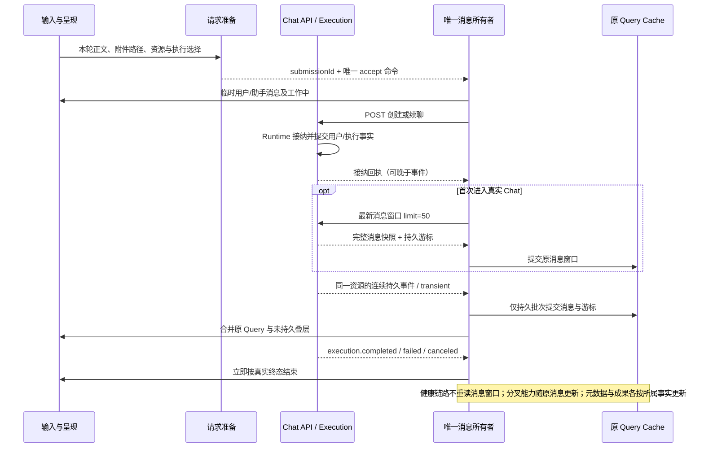

# 普通聊天事件与查询刷新职责

## 范围

修复普通伙伴聊天的一次发送触发多份相同资源读取的问题。审批、取消、断线恢复、消息持久化与成果阅读继续使用现有领域接口；本轮不调整通知功能、插件实现或 CLI 行为。

## 所有权

| 边界                     | 职责                                                       |
| ------------------------ | ---------------------------------------------------------- |
| 后端领域写入             | 提交后发布真实变化及作用域，区分插件配置变化与执行使用变化 |
| 全局事件通道             | 传递变化与恢复要求，不推导无关领域变化                     |
| QueryClient 内的事件刷新 | 合并同查询的刷新，唯一管理取消、失效与重新读取             |
| Scene                    | 声明当前消费是否活跃，隐藏时保留陈旧资格，恢复后对账       |
| 聊天入口                 | 接纳输入、消费流与终态历史对账，不刷新插件目录或团队目录   |
| 成果阅读                 | 前台实际呈现准确版本后提交阅读，提交后事件负责查询对账     |

## 五项修复

1. 插件会话使用变化与资源配置变化使用不同事件语义。候选插件只响应所选伙伴安装、版本、启停和已引用插件展示资料变化；共享配置与授权变化不重取候选；管理界面的使用情况仍可更新。不新增远端授权或健康预检。
2. 同一 QueryClient 下相同查询只有一个事件刷新调度者，多消费者共享。保留首次读取期间的变化与断线恢复；隐藏消费者不能取消可见消费者的请求。不延长缓存有效期。
3. 分叉能力属于消息操作元数据，随原消息窗口与持久事件增量投影，不再独立读取全回合候选。忙碌状态由现有会话事实决定；仅末轮能力使用最新窗口提供的真实目标身份，旧页不提供全会话末轮身份。实际分叉 POST 继续核验权威位置与当前状态。
4. 伙伴聊天活动不能被扩散为无关团队目录变化。伙伴活动摘要仍及时更新，团队与自动任务只响应其真实事实变化。
5. 阅读成功后的回执与 WebSocket 事件共用一个对账来源，保留真实版本、跨窗口更新和断线恢复，迟到阅读不能清除较新成果。

接纳回执能够提供相同服务器事实时直接更新原 Query Cache，必须避免旧接纳快照覆盖已经到达的终态。

## 连续消息与首发交接

正常连续的持久事件已经携带完整安全消息快照，前端把它们按原消息身份和持久游标合并到原 Query Cache；临时流不推进持久游标。终态不再固定重读最近五十条，也不能用只取最后一条代替完整对账。首次进入、刷新、重连、缺口和无法证明连续性时，才通过既有快照或历史增量端口恢复。旧响应不能覆盖较新事件；审批、工具、用户消息与助手消息都要完整保留。

消息数据所有者统一负责快照、连续事件、持久游标、分页和临时展示接管，页面不通过终态回调决定是否再读历史。消息窗口没有独立的 `historySync` 与被动复制的权威正文；Query Cache 仍是唯一持久消息事实来源。流式 UI 可以合并同一消息的渲染，但游标只能在原始有序持久事件成功投影后推进，不能从已合并的渲染批次猜测连续性。

客户端输入关联复用请求已有幂等身份，统一投影为 `submissionId`。首发使用原 `clientRequestId`，续聊使用原执行输入 `submissionId`；同一输入的用户与助手消息、Execution 接纳回执使用相同来源。因此持久消息先于 HTTP 回执到达时也能精确接管对应临时输入，不按正文、时间或下一个消息猜配，不额外生成身份或维护匹配锁。程序性输入没有客户端临时输入时不强加这一关联。

输入端口同步准备完整真实请求与其已有幂等身份，再将 `submissionId` 和唯一接纳命令交给消息所有者。消息所有者先取得该身份，再建立临时呈现并执行接纳；不在两个层次分别生成身份或用不完整正文重算请求指纹。该端口替换原发送端口，不叠加两级装配回调，也不执行远端预检。

输入身份属于一次用户意图，而不是相同正文的永久标识。权威消息确认接纳后，本轮未知结果重试记录即可退役，不等待较晚的 HTTP 回执；下一次相同正文必须取得新的输入身份。仍未得到接纳证据的同一输入重试保留原身份。迟到的旧 HTTP 结算只能操作自己对应的输入，不能清理下一轮的请求记录或呈现状态。

初始消息窗口与游标构成一个权威快照；迟到快照与连续事件由同一消息所有者合并，不能覆盖已经确认的新事实。断线恢复不能把增量端点单批上限当作已读完；无法证明恢复完整时显式退回有界快照及原分页边界。普通聊天元数据可独立读取，不能为了更新标题或执行摘要重新下载消息窗口。

工作中状态服从执行终态，不能等待后台目录或历史查询才清除。正文完成与 CLI 本轮完成是两个事实，原生尚未返回时不伪造终态。CLI 自己的标题生成或工具收尾不由前端猜测结束。

首发接纳只交接草稿与真实 Chat 身份，不切换整个聊天组件或用骨架屏替换已有的交接内容。真正没有内容的初次加载仍显示骨架；重读与交接期间保留消息和头像的呈现身份，不新增业务状态副本。

呈现会话与服务器 Chat 身份分别表达：同一首发交接保留呈现生命周期；用户切换到另一 Chat 时，旧会话的消息不能在任何一次提交中出现在新会话下。由消息所有者和呈现边界实现该约束，不依靠多级加载标志或被动 Effect 逐轮修正。

呈现边界复用 Scene 的 `mountKey` 或嵌入工作区已有身份；真正换会话时重置消息所有者与 assistant-ui view，草稿接纳沿用原边界。缺少宿主 Scene 的调用方显式提供自己的呈现身份，不新增一个平行的迁移状态机。

## 普通伙伴：沿一次发送核对

以下只以普通伙伴链路作为验收主线，不把团队领域的消息源差异混入请求预算。

### 请求：哪些值实际发送

完整声明以 [CreateChatRequest](../../server/apis/chats/create_chat.go)、[SendMessageRequest](../../server/apis/chats/send_message.go) 和 [MessageRequest](../../server/apis/chats/message_input.go) 为准。

| 字段组                                                                               | 普通首发                 | 普通续聊                  | 职责                                                  |
| ------------------------------------------------------------------------------------ | ------------------------ | ------------------------- | ----------------------------------------------------- |
| `clientRequestId` / `submissionId`                                                   | 仅发送前者               | 仅发送后者                | 复用本次输入已有幂等身份，公开消息统一为 submissionId |
| `wakerId`、`projectId`、`workingDirectory`                                           | 首发选择；项目与目录互斥 | 不发送                    | 范围与伙伴已由 Chat 固定，不能每轮改写                |
| `text`                                                                               | 本轮正文                 | 本轮新增正文              | 不重复发送整份历史、档案或工具定义                    |
| `runtimeId`、`accountId`、`model`、`reasoning`、`permissionLevel`                    | 本轮冻结选择             | 本轮冻结选择              | 账号身份可发送，密钥与启动环境不发送                  |
| `attachments[].sourcePath`                                                           | 已准备附件路径           | 已准备附件路径            | 附件添加阶段已完成上传，不在发送中重复上传字节        |
| `skillIds`、`pluginIds`、`connectorIds`                                              | 本轮明确选择             | 本轮明确选择              | 三种独立资源，不夹带健康、授权或完整配置快照          |
| `codeReferences`                                                                     | 路径及明确选区           | 路径及明确选区            | 整文件与选区引用分别表达                              |
| `startNewSession`、`historyTurns`、`historyMode`、`summaryModel`、`summaryReasoning` | 不发送无意义的切换参数   | 仅真实新会话/总结操作发送 | 字段仍有功能，删除的是普通续聊每次填默认值的组装      |
| `workflowIds`                                                                        | 普通页面没有选择来源     | 普通页面没有选择来源      | 删除普通页不可达分支；公共 API 的能力绑定用途保留     |

### 响应与推送：谁消费什么

| 返回事实                                                          | 消费者与规则                                                             |
| ----------------------------------------------------------------- | ------------------------------------------------------------------------ |
| `chat.id / wakerId / latestSequence` 及完整 Chat 元数据           | 绑定真实资源、路由与详情 Query；迟到旧版本不能覆盖较新终态               |
| `execution.id / userMessageId / submissionId / status`            | 精确关联执行与用户输入；接纳状态不代表模型完成                           |
| `replayed`                                                        | 服务器幂等回执语义；普通 UI 不分支展示不等于字段废弃                     |
| 消息 `id / submissionId / executionId / role / revision / status` | 分别表达消息、输入、执行、角色、消息修订及状态，不能互相替代             |
| 历史 `resources / latestSequence / nextBeforeSequence / hasMore`  | 消息窗口、已覆盖持久游标与旧页边界；不是 token 数或传输序号              |
| 最新窗口 `forkLatestExecutionId` 与消息 `fork`                    | 原生句柄不公开；忙碌由会话事实派生，末轮身份只从 head 及连续创建事实推进 |
| 事件 `sequence / transient / message`                             | 连续持久事实才推进游标；transient 仅展示；message 是完整安全快照         |

普通消息请求预算：首次进入或新 Chat 首次读一个最新窗口；健康发送、流式与终态新增历史、分叉和插件引用 GET 均为零。分叉初始能力来自原消息窗口，后续由现有持久消息事件更新；不再提供独立全历史分叉查询。断线、缺口与未知状态由原来源一次权威恢复，不再先读一批事件历史后又读消息窗口。实际成果阅读继续提交准确版本。

该预算约束前端普通消息的自动读取，不表示所有入口和后端准备流程已无重复工作。[四类入口请求与读取审计](agent-entry-query-audit-cn.md) 记录了公共执行上下文、热插件声明、团队与工作流观察、知识进度刷新的问题与整改结果；HTTP 查询预算和后端实际读取范围共同约束当前实现。

上述零额外读取预算约束普通发送到结束的自动链路。用户主动打开分叉菜单或创建侧聊时，可以在父会话空闲后惰性读取同一个消息来源的最新窗口；菜单每次打开及保持打开期间由忙转闲时核对权威 head，不把缓存有效期内的 running 快照当成已结束证明，不逐 Chat 后台预取。普通页面直接消费已有消息所有者，不因终态新增读取。侧聊创建前复用父会话现有执行、待审批和待提问事实，父会话忙时不读取候选或发起分叉；已有 chatId 的子会话继续独立运行。

所选伙伴的插件候选按需读取轻量引用，只返回资源身份、名称、简介和固定版本身份。一次非空 API 读取包含伙伴存在性查询及三次安装、资源、版本窄列查询；不读取配置、包、账号、使用状态，不触发授权、CLI 或健康预检。`plugins.references.changed` 按所选伙伴或已知引用资源精确失效；首份读取尚未确认时保留展示变化，避免旧响应固化。管理详情及使用状态继续走原完整接口和事件。

### 已删除的补偿与死分支

| 旧逻辑或字段                                                             | 删除原因 / 当前归属                                                  |
| ------------------------------------------------------------------------ | -------------------------------------------------------------------- |
| 每轮终态固定 GET50、onGap/onReconnect 重复历史刷新                       | 消息所有者直接提交连续事件；普通恢复只有原来源的权威读取             |
| `historySync`、`boundChatId`、`hasCreateHandoff`、`awaitingFirstHistory` | 删除被动镜像和等待历史才结束的条件；呈现生命周期与服务器身份分别拥有 |
| 重复 `localExecution`、`terminalExecution` 与只写不读的 refs             | 执行状态由实际消息事实与当前提交派生                                 |
| `workspaceWarningCode` 的回执、内部调用记录、路由状态及提示壳            | 已无服务端产出，整链删除，不保留空提示入口                           |
| 首发请求 hash 的两个历史空槽                                             | 不再维持已删除结构的布局；同版本输入重放与冲突检查保留               |
| 普通页不可达 `workflowIds` 组装及默认新会话参数                          | 删除多余请求内容，不误删其他入口的有效能力                           |
| 独立分叉全历史查询、插件配置/usage 刷候选、阅读成功重复失效              | 分别归原消息投影、精确引用事件与单查询刷新所有者                     |

真实审批、提问、取消、准确版本阅读、原生会话切换和必要的输入/消息身份均保留。`useSyncExternalStore` 直接读取同一 assistant-ui runtime 属于呈现订阅，不是另一份权威历史。

## 大阶段诊断

聊天准备层记录 `input_preparation` 与 `resource_preparation`。资源阶段包含冷路径的租约取得、文件物化和绑定；热路径明确标记复用。技术内核通过宿主注入的标准 Logger 记录 `cli_initialization` 与 `input_acceptance`，不依赖产品日志包，不增加业务事件或回调链。

`cli_initialization` 包含原生进程与协议会话初始化；热会话记录复用，不能把整轮模型耗时归入初始化。`input_acceptance` 从提交本轮 Prompt 到驱动报告输入接纳。日志包含已有聊天、执行或技术调用身份、耗时及成功/失败状态，不记录输入正文、凭据或环境。

## 验证

- 事件回归：usage 不触发配置订阅；普通聊天不刷新团队目录；真实配置与团队变化仍刷新。
- 前端行为回归：同查询多消费者只重读一次；首次请求期间事件不丢失；隐藏恢复、断线恢复、分叉完成刷新和准确版本阅读保持有效。
- 技术回归：连续两轮只初始化一次 CLI，第二轮诊断明确复用，日志不包含输入正文。
- 仅运行受影响文件、包及文档检查；用户已反馈完成本次实际使用测试。

普通伙伴单链已完成实现与前后端独立审查。定向自动化覆盖了接纳回执与推送交错、相同正文的新输入与未知结果重试、迟到请求和分页、首发呈现、准确版本阅读及缺口恢复；类型、契约再生成一致性、Core 构建和文档检查通过。这里的请求预算来自源码与受控测试；用户已反馈完成本次实际使用测试，具体 CLI、模型与耗时未另行记录。
