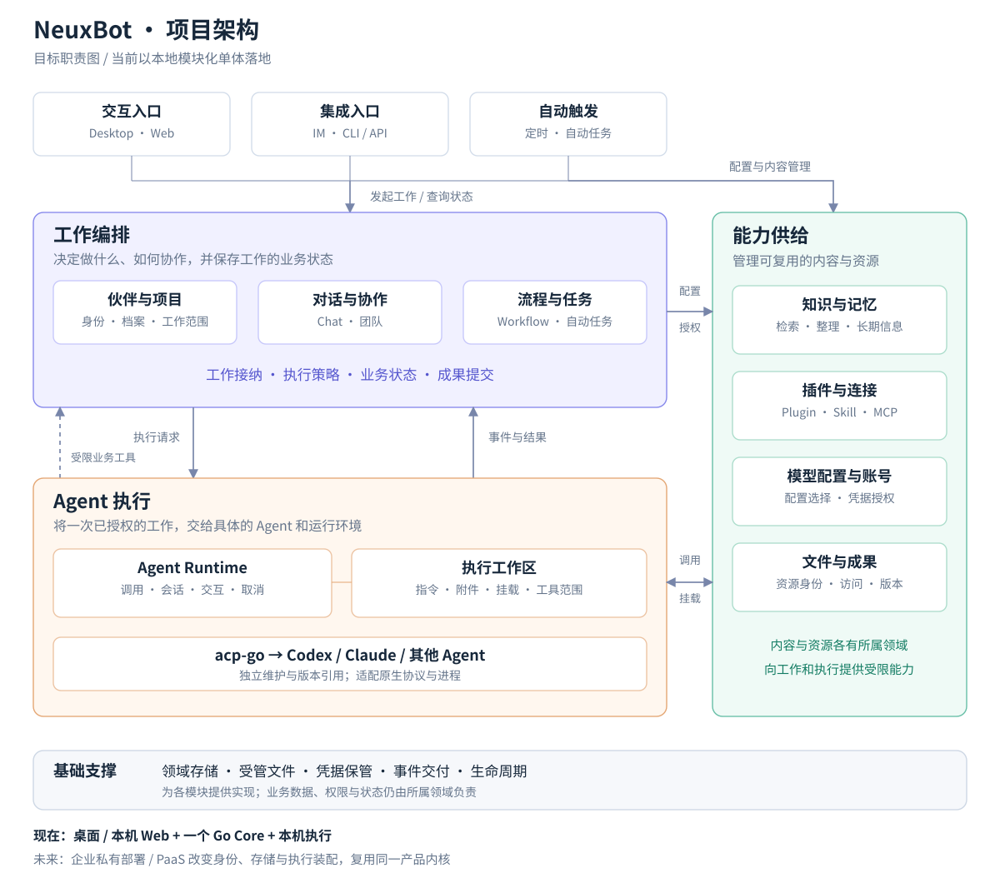
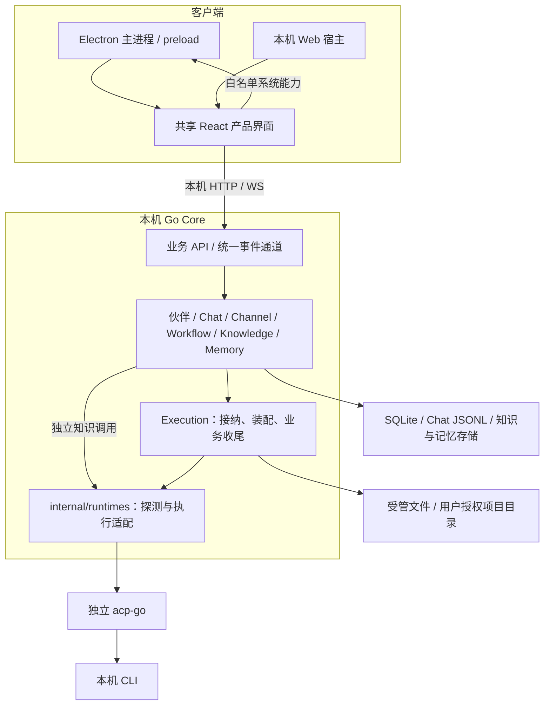
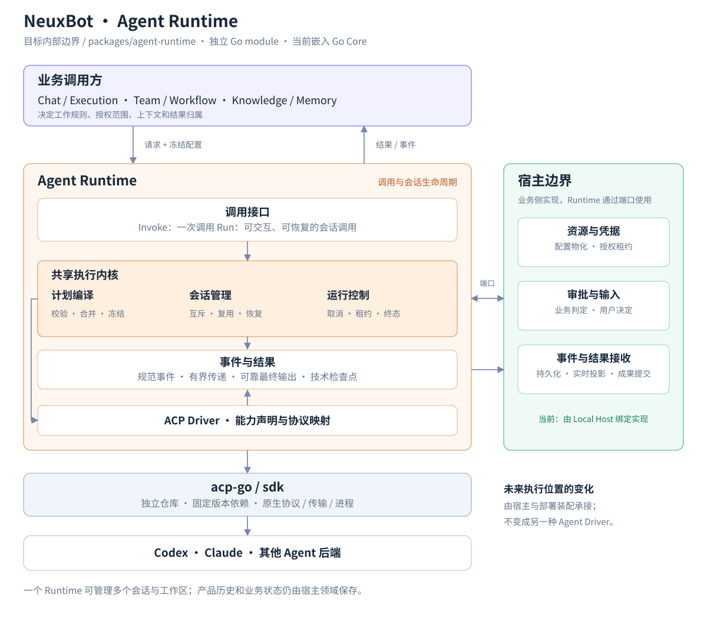
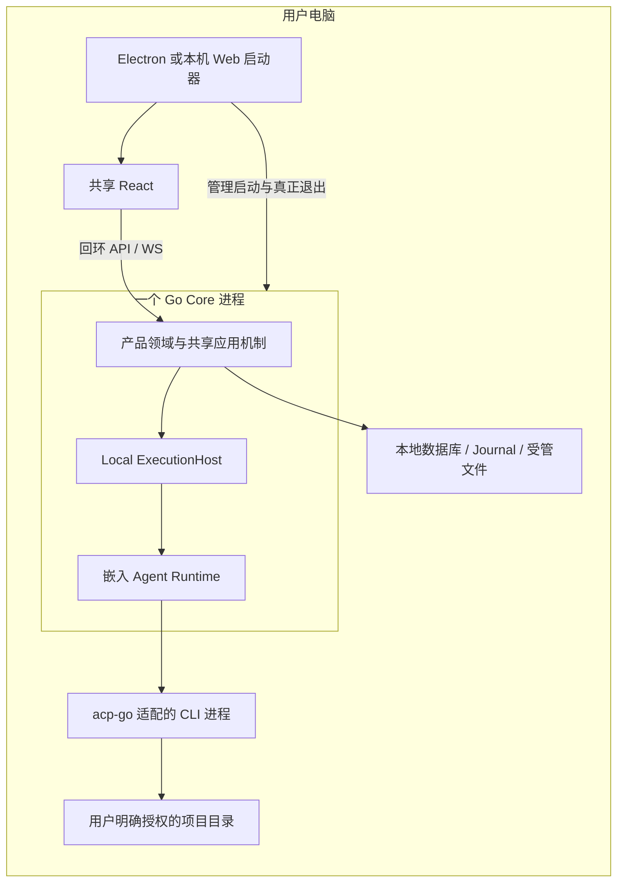
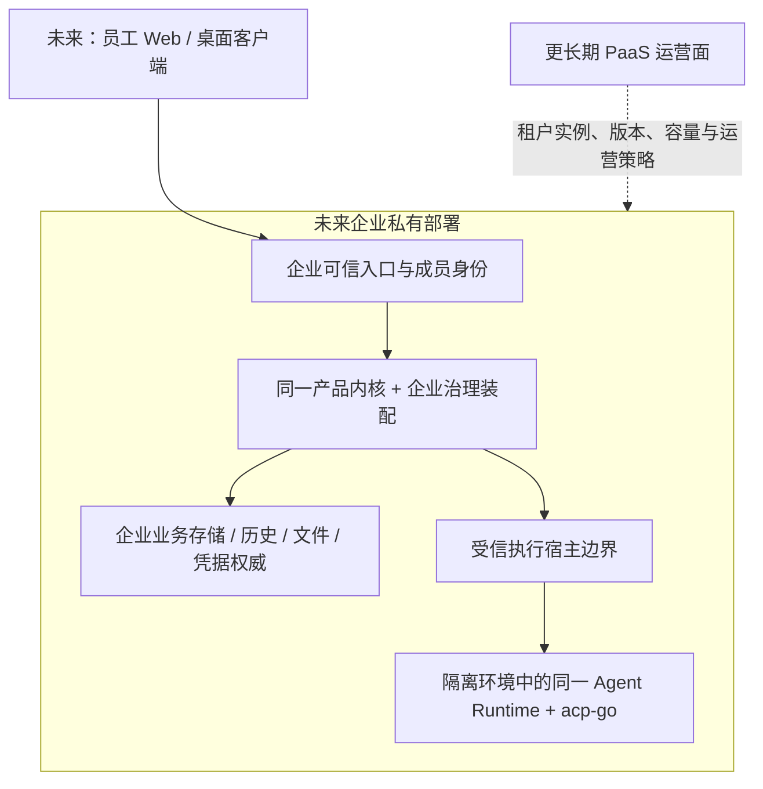

# NeuxBot 项目架构与产品形态 Spec

> 状态：目标架构；独立 Agent Runtime 首批实现已建立，产品整体分层和入口迁移仍按实施计划推进。现阶段面向桌面个人版；企业私有部署与 PaaS 用于检查扩展边界，不是本轮建设任务。
>
> 本地依据：2026-10-27 的 `103ff8f` 与读取时工作区。参考：Neutree Agent Platform `5f5d4a0d155eb081702d6bd17623ce8ea0e78b12`。源码核对属于静态分析，不表示多用户、远程执行或性能验收已经通过。

## 1. 架构结论

NeuxBot 的目标是：**同一套产品领域内核，按个人或企业的需求装配；业务、执行环境、Agent 引擎分别变化。**当前保持模块化单体和本地执行，先解决功能扩展时的依赖、所有权和生命周期问题。

项目围绕三个核心职责组织：**工作编排决定做什么，能力供给提供可用资源，Agent 执行完成具体调用。**入口负责交互与触发，基础支撑承接存储、文件、凭据保管和事件交付。

图中大框是逻辑职责，内框是已有产品概念及目标边界，不表示独立服务。当前工作编排、能力供给和 Runtime 仍装配在本机 Go Core；acp-go 适配的原生 CLI 是独立进程。图只画主要协作，基础支撑服务于所有模块，未逐条画出依赖。

| 主要职责 | 核心问题 | 包含什么 | 拥有什么 |
| --- | --- | --- | --- |
| 工作编排 | 为谁做什么，怎样组织工作？ | 伙伴与项目、Chat、团队、Workflow、自动任务 | 工作定义、业务规则、工作状态与成果归属 |
| 能力供给 | 做这项工作可以使用什么？ | 知识、记忆、插件、技能、连接器、模型配置与账号、文件资源 | 各自内容、版本、配置与使用授权 |
| Agent 执行 | 在什么环境里，如何完成一次 Agent 调用？ | Agent Runtime、执行工作区、Agent 适配 | 技术会话、调用生命周期、交互等待、资源租约 |
| 产品入口 | 从哪里发起、观察和处理工作？ | Desktop/Web、IM、CLI/API、定时触发 | 交互与接入状态，调用已有领域用例 |
| 基础支撑 | 状态与资源如何保存和交付？ | 领域存储、文件存储、秘密保管、事件通道、生命周期 | 技术实现及其生命周期，不另建业务事实 |

**三个核心职责是协作关系，不是所有请求必须依次穿过的流水线。**用户可以直接管理知识、账号和插件；检索和普通配置操作不经过 Agent。知识整理等能力内部如果确实需要生成，也可直接调用 Runtime，其内容状态仍由 Knowledge 拥有。团队与工作流的确定性步骤同样不需要 Agent。

例如“让一个团队结合项目和知识库完成分析”：入口把请求交给团队领域；团队决定分工与工作范围；资源领域解析本次可用的知识、插件和账号；执行侧准备工作区并调用 Agent；工具操作回到所属领域逐次检查权限；结果返回后由团队与 Chat 提交业务状态，界面通过事件和查询呈现结果。Runtime 不决定团队任务是否验收完成。

产品事实始终归所属领域：Chat 保存消息，Workflow 保存流程状态，Knowledge 保存知识内容；文件资源保存成果文件及其访问身份，成果的业务含义仍归原工作领域。右侧“能力供给”不意味着把所有模块合并成一个通用服务，底部“基础支撑”也不意味着共享数据表。

个人版、企业版和 PaaS 复用这些产品职责，差异体现在身份与共享策略、应用装配、存储和执行位置。未来企业治理覆盖入口、领域读写、能力使用、执行与事件访问；它不是今天要新增的独立业务层。

本轮不做 Runtime HTTP，不引入远程 worker、Kubernetes、组织表、租户字段或计费系统；不考虑旧数据和旧会话兼容。`packages/agent-runtime` 是独立 Go module；acp-go 保持独立仓库维护。详细执行契约见 [Agent Runtime Spec](agent-runtime-refactor-spec-cn.md)，目录、依赖和逐批功能影响见[实施计划](agent-runtime-implementation-plan-cn.md)。

## 2. 借鉴 agent-platform 的什么

NAP 的参考价值在于把产品配置、运行环境和可替换 Agent Core 分开，并明确平台提供哪些公共能力。它的部署选择服务于托管场景，不是 NeuxBot 桌面版必须复刻的前提。[参考 README](https://github.com/neutree-ai/agent-platform/blob/5f5d4a0d155eb081702d6bd17623ce8ea0e78b12/README.md)、[架构图](https://github.com/neutree-ai/agent-platform/blob/5f5d4a0d155eb081702d6bd17623ce8ea0e78b12/docs/architecture.svg)。

| 参考设计 | 对 NeuxBot 的启发 | 本项目的选择 |
| --- | --- | --- |
| 入口、Control Plane、Environment、Agent Core 分层 | 入口不直接决定进程和部署细节 | 现在在同进程划清职责，未来再决定是否分进程 |
| 配置和资源属于 Workspace，而非某个 Core | 换 Agent 引擎不应丢掉产品配置 | 伙伴/项目/插件属于产品域，Runtime 只消费冻结快照 |
| Agent Core 可替换，运行环境也可扩展 | “用什么 Agent”与“在哪里执行”是两个轴 | Runtime Driver 与 ExecutionHost 分开；不能把 Remote 当一种 Agent Driver |
| 公共工具和挂载由平台供给 | 每个 Agent 不应重复实现知识、资源和认证 | 复用 ally、能力 Registry、资源与账号服务，Runtime 不拥有业务内容 |
| Workspace、运行实例、Session 分开 | 配置寿命、进程寿命和对话上下文寿命不同 | 继续区分 Waker、执行工作区、Chat、技术 Session 和 Invocation |

NAP 的 “一个 Workspace 对应一个 Agent，多个 Session 共享文件系统”是其产品模型。NeuxBot 已有伙伴、项目、Chat、团队共享项目和工作流工作区，不照搬该对象关系，更不能把共享目录当成写入隔离。[Workspace/Agent/Session 定义](https://github.com/neutree-ai/agent-platform/blob/5f5d4a0d155eb081702d6bd17623ce8ea0e78b12/docs-site/src/content/docs/concepts/agent-and-workspace.md)。

代码层面也有可借鉴的依据：`EnvironmentProvider` 用基础设施无关的参数表达环境生命周期，并把凭据交付与可比较的配置分开；会话回合由协调层统一互斥，不依靠某个客户端禁用发送按钮。NeuxBot 当前采用本地互斥与资源端口，未来跨节点才需要分布式租约。[环境契约](https://github.com/neutree-ai/agent-platform/blob/5f5d4a0d155eb081702d6bd17623ce8ea0e78b12/internal/types/environments.ts)、[会话回合协调](https://github.com/neutree-ai/agent-platform/blob/5f5d4a0d155eb081702d6bd17623ce8ea0e78b12/control-plane/src/services/chat/session-turn.ts)。

不直接采用其多服务拓扑、PostgreSQL、Kubernetes、常驻 Workspace 容器或远程浏览器服务。它们以后是否必要，由真实部署、负载、隔离和产品需求决定；本轮不为了图形相似增加服务。

## 3. 从项目骨架落到现有代码

### 3.1 当前运行形态（代码视图）

当前已实现共享 React、Desktop/Web 宿主、Go Core、CLI 适配和各业务模块。下图表示当前关系，不表示已经支持企业远程接入。

目前的扩展压力主要集中在 Execution 装配、global 闭包、资源授权和路径/进程生命周期。业务功能已较完整，重构应围绕这些实际边界展开，而不是按数据表重新拆分服务。

### 3.2 目标职责如何落到源码

项目总图见第 1 节。源码层面保持以下映射，不把架构图直接翻译为一排新目录或进程：

| 目标职责 | 当前主要位置 | 重构重点 |
| --- | --- | --- |
| 产品入口 | `packages/frontend`、`desktop`、`web`、`server/apis`、IM/自动任务模块 | 呈现、宿主和触发适配调用相同领域用例 |
| 工作编排 | Chat、Channel、Workflow、伙伴/项目与 Execution 的所属模块 | 业务状态归本域，Execution 收敛共享的工作接纳与执行接入 |
| 能力供给 | Knowledge、Memory、插件/技能/连接器、AI Account、文件资源模块 | 资源定义与授权归本域，通过明确端口供工作与 Agent 使用 |
| Agent 执行 | 新 `packages/agent-runtime`、`server/internal/runtimehost`，外部 acp-go | 抽离执行内核，环境装配留宿主，原生协议与进程留 acp-go |
| 基础支撑 | 各领域存储实现、受管文件、事件交付与组合根 | 技术实现可独立演进，领域事实保持单一所有者 |

依赖通过消费者定义的窄端口连接：Runtime 不导入 Chat、Workflow、Knowledge、产品数据库或 Execution；宿主绑定资源、交互与结果接收实现。业务工具仍由现有 agentcapability/ally 连接所属领域，不能转移到 Runtime 内执行业务 CRUD。

内容领域的独立 Invoke 结果返回原 Knowledge 调用方，不为统一入口而强制创建 Chat 或工作流。主图表达模块协作，具体调用合同由 Runtime Spec 定义。

### 3.3 模块与权威事实

| 模块 | 拥有的事实与规则 | 不应承担 |
| --- | --- | --- |
| 客户端宿主 | 窗口、系统对话框、本机交互、Core 启停归属 | 产品权限、持久任务状态、模型会话权威 |
| 伙伴与项目 | 工作身份、档案、项目关系与可用范围 | 员工登录、租户隔离、CLI 进程 |
| Chat | 产品消息、历史、会话关联及查询投影 | 私有协议解析、重复执行状态机 |
| Channel | 伙伴协作、成员任务、报告、验收和共享工作范围 | 员工组织或共享资源 ACL |
| Workflow | 定义、不可变版本、Run、节点状态、效果回执 | 所有后台工作的通用调度或 Runtime 会话管理 |
| Knowledge / Memory | 各自内容、版本、整理/索引/遗忘及成果 | 聊天权威正文、进程缓存 |
| Plugin / Skill / Connector | 安装、版本、连接配置和授权来源 | 在 Execution 中散落供应商装配规则 |
| AI Account | 出站模型身份、凭据刷新与租约 | 应用用户、组织身份和业务访问权 |
| Execution | 产品工作接纳、幂等、范围冻结、取消与业务终态 | 原生 CLI 参数、所有领域的特判 |
| Agent Runtime | 调用、Session、技术终态、规范事件、交互路由 | Chat/Waker/租户数据和业务调度 |
| 通知/看板/搜索投影 | 查询、阅读/提示状态、已提交变化的消费 | 另一份工作执行事实 |

## 4. Agent Runtime 架构

### 4.1 Runtime 内部及外部边界

Runtime 内部收敛为四个部分：**调用接口、共享执行内核、事件与结果、Agent Driver**。右侧宿主边界提供资源、凭据、业务审批和结果接收；下方 acp-go 独立维护原生适配。图中“共享执行内核”包含计划编译、Session 管理和调用状态机，具体接口不进入项目总图。

调用侧经接口进入执行内核，内核驱动 Driver 并管理会话；Driver 的规范事件与内核终态交给结果处理；实时事件、最终结果和检查点按各自合同返回宿主。内部控制与输出是不同路径，不能把“事件与结果”理解为启动 Driver 的前置步骤。

Invoke 与 Run 共享内核。Invoke 使用临时会话、显式工具策略和最终结果消费者；Run 支持恢复、交互和 Observer。知识生成只消费最终结果，中间可正常调用工具，也可加载原生或全局 MCP；工具权限、原生配置继承与输出消费独立决定，不能以“是否显示过程”推断工具权限。

### 4.2 Execution、Host、Runtime、acp-go 分工

| 边界 | 回答的问题 | 当前实现方向 |
| --- | --- | --- |
| Execution | 这项产品工作是否接纳、允许做什么、结果属于谁？ | 保留原业务接纳与 Journal 协议 |
| ExecutionHost | 在哪个受信环境运行，由谁提供资源与凭据？ | 一个 Local 实现，主要由 `server/internal/runtimehost` 承担装配 |
| Agent Runtime | 如何执行一次调用、维护会话、交互、取消并收敛？ | 独立 Go module，嵌入 Core |
| Runtime Driver | 某种 Agent 后端具有什么技术能力，如何映射协议？ | ACP Driver 与已有薄 binding |
| acp-go | 原生 CLI/协议、传输、适配与进程如何正确运行？ | 独立仓库发布；按固定版本引用 |

**Host 和 Driver 是正交关系。**以后换远程执行位置，不意味着新增“Remote Agent”；换 Codex/Claude 等后端，也不意味着替换领域或存储。

当前仅明确 Host 的职责，不为一个 Local 实现预建 Host Provider 注册中心、远程 RPC DTO 或多种未实现的 Host。后续确有第二个执行环境时，再把实际公共行为提升为独立合同；现在先让业务不直接引用 CLI、宿主绝对路径和凭据物化细节。

资源所有权分为“提供”和“持有”：宿主实现资源/凭据 Provider，Runtime 按计划取得租约，并由对应调用或 Session 唯一持有及释放。Host 不再为同一资源创建第二套租约；账号服务继续拥有刷新、撤销和配置权威。原生进程由 acp-go 管理，Runtime 通过 Driver 请求关闭，不另写进程启动器。

业务审批决定由宿主作出，Runtime 只路由有身份和有效期的请求。技术调用结束不等于业务交付完成：Chat 还要完成消息持久化，知识要校验结果并提交成果，Workflow 要按自己的状态机提交节点效果。

### 4.3 扩展点应按变化原因分开

- **新增 Agent 后端**：在 acp-go 中处理原生差异，在 Runtime Driver 中做能力映射，领域逻辑不辨别 CLI 名称。
- **新增插件/技能/MCP 资源**：资源领域解释安装和授权，Runtime capability 只编译中立贡献。
- **新增业务工具**：实现所属领域命令，通过现有 agentcapability/ally 暴露；不用 Runtime 模块实现业务 CRUD。
- **新增执行环境**：未来实现受信 Host 的资源物化与生命周期，不更改 Invoke/Run 的领域使用方式。
- **新增界面入口或触发器**：调用同一领域命令，不再实现一次接纳与权限逻辑。

Runtime 的 CapabilityModule 是运行配置贡献；产品的 Capability Binding 是受授权的业务调用。二者职责不同，不能因为都叫“能力”就合成一个可以任意执行 Hook 的插件接口。

首期用显式构造和固定贡献类型完成组合，资源与凭据通过窄端口注入；只有实际需要按标识选择的 Driver/能力才维护只读映射。不为预想扩展建立多套通用注册系统，运行时热装卸不在范围内。

## 5. 个人版、企业版与 PaaS 的形态

### 5.1 产品形态比较

| 维度 | 个人版：当前落地目标 | 企业版：未来私有部署 | PaaS：更长期可能方向 |
| --- | --- | --- | --- |
| 使用者 | 本机所有者 | 企业成员及管理员 | 多个独立客户组织及平台运营者 |
| 产品界面 | Desktop，或本机 Web | Web 与桌面客户端访问企业实例 | 租户入口和平台运营入口 |
| 产品事实 | 本地 Core 与本地存储 | 企业部署拥有共享业务事实 | 租户隔离的业务事实；运营面不直接编辑其正文 |
| 执行位置 | 本机 CLI 与授权目录 | 企业管理的执行环境 | 平台或客户提供的隔离执行环境 |
| 伙伴/工作流/知识 | 当前产品能力 | 同一能力加资源共享与治理 | 同一能力加租户交付和运营 |
| 用户与凭据 | 本机用户及其模型/工具账号 | 员工身份与个人/服务账号分开 | 租户成员、平台身份及出站账号分开 |
| 执行寿命 | 电脑和 Core 存活期间 | 独立于员工客户端 | 独立于客户端，由服务与执行节点治理 |
| 现阶段工作 | 整理模块边界与 Runtime | 仅记录边界要求 | 仅检验是否存在架构死角 |

个人/企业版本不应各维护一套业务源码，也不通过业务方法中散落 `if enterprise` 拼出两种实现。未来差异优先体现在应用装配、身份/策略实现、存储和执行环境。商业授权、收费档位和功能销售清单尚未决定，不由架构图代定。

### 5.2 个人版部署：保持简单

模块抽取不增加本机监听器、后台控制服务或强制容器。关闭窗口继续沿用隐藏语义；真正退出由现有生命周期根有序关闭。电脑离线或 Core 退出后，本地任务不能被描述为仍在云端运行。

### 5.3 企业与 PaaS：只定义演进边界

企业第一步仍可把管理与领域逻辑装配为单个服务，按实际隔离需要配置执行环境。图中 Host 与 Runtime 不预设网络协议，也不要求每个业务域独立服务。只有跨进程执行成为需求时，才设计执行协议、节点身份、断联恢复与持久所有权。

企业桌面默认是企业实例的客户端，避免每台电脑各保存一份权威 Chat、Workflow 和组织凭据再自动同步。若以后需要员工本地执行，作为显式注册并授权的独立执行端设计；不因为用户登录桌面就允许服务器操作其目录。这不是首个企业版本的默认前提。

PaaS 初期可优先评估按客户组织隔离的部署单元，以复用单所有者的日志、目录和会话模型。它有空闲资源与升级管理成本，属于候选部署策略，尚未决定。共享多租户数据平面和跨实例调度必须有规模证据，不能靠给表补 tenant_id 就宣称具备隔离。

## 6. 为未来保留的边界，而非现在建设的平台

### 6.1 身份与归属不能混用

| 概念 | 当前含义 | 未来扩展时不能混同 |
| --- | --- | --- |
| 调用者 | 本机可信入口或集成身份 | 不等同于 Waker、模型账号或浏览器会话 ID |
| Waker / Channel | 数字工作身份及伙伴协作 | 不等同于员工或组织团队 |
| Project | 业务项目及本机目录关系 | 不自动成为租户或组织权限边界 |
| 执行工作区 | 实际文件空间与冻结访问范围 | 不等同于企业的协作空间 |
| AI Account / Connector 凭据 | 向模型或外部系统发起请求的身份 | 不证明调用者有权访问产品资源 |

当前只在接口语义与依赖中保持区分，不创建空的租户/组织模型。以后引入员工身份时，领域命令得到的是经验证的调用上下文，不能相信前端自填的 owner、组织或权限范围。

企业场景对边界的检验包括：共享伙伴定义不等于共享其所有 Chat；共享插件包不等于共享供应商账号；能查看结果不等于能批准工具、接管会话或使用发起者凭据。未来授权应作用于领域读写、历史、文件、事件订阅及重放，而不只放在登录页面。

### 6.2 文件与执行位置

现在继续使用本地路径，但路径解析、授权、上传和挂载集中在文件/执行宿主边界。领域持有资源身份与冻结版本，需要真实路径时由当前 Local 实现解析；不让 UI 发来的任意绝对路径变成可信工作范围。

未来跨主机时，客户端路径与服务端路径不等价；需要明确上传对象、挂载来源和执行端本地资源身份。届时再引入传输与对象存储实现，不把每个本机文件操作现在就包装成远程 RPC。

共享项目目录不自动解决多个 Agent 的写冲突；业务要选择串行操作、隔离工作副本或明确的冲突处理。CLI 的 OS 用户、容器/进程权限和秘密隔离属于企业执行环境上线门槛，单纯目录前缀不能代替这些边界。

### 6.3 数据、历史与会话

- 产品正文、流程事实与成果始终由所属领域保存。Runtime 只维护运行态和技术检查点，不新增第二套聊天历史或任务数据库。
- Chat Journal、查询投影、模型上下文分别管理：历史展示不等于模型输入；每轮 Resume 只发送增量，New 的播种有轮数和字节预算。
- 历史性能在拥有历史的 Chat 模块改进，不能把完整 Journal 搬进 Runtime。准备阶段先判定 Resume，再决定是否读取历史窗口；常规热路径避免全量重放和复制。
- 个人版继续使用当前 SQLite、Journal、受管文件与独立知识/记忆存储。企业存储实现未来按领域确定，不能现在假设全部数据能无差别换成一个 SQL 数据库。
- 未来分离执行节点后，产品历史仍只有一个权威拥有者；执行节点的传输缓冲不是可独立编辑的业务副本。接纳回执、事件游标、取消、未知结果和迟到结果的 fence 必须在拆分前设计清楚。

不考虑旧格式兼容，不等于取消新架构自己的重启恢复、一致性和幂等。新任务依然需要可核对的结果与恢复边界，外部副作用结果未知时不自动重跑。

### 6.4 装配与关闭

同一产品可以由桌面启动器或未来服务启动器构造。构造函数不启动后台任务，组合根显式绑定端口并控制 Start/Close。各域不通过可变全局变量寻找另一个域，运行时也不从一个通用服务容器随意获取权限或数据库。

停止接纳、取消/等待工作、持久化收尾、关闭 Runtime、释放凭据与存储按实际依赖顺序执行。未来换部署形态应替换组合根和基础设施，不让领域方法知道自己在 Electron 中还是容器里运行。

## 7. 当前应该做什么

| 现在整理的边界 | 直接收益 | 未来收益 |
| --- | --- | --- |
| 产品域拥有完整业务规则与事实 | 新功能不再依赖跨层的隐含调用顺序 | 新入口与组织策略可复用领域命令 |
| 资源、凭据与原生环境从 Execution 分离 | 改某种插件或 CLI 不影响全部聊天准备 | 可在不同执行位置物化同一资源描述 |
| 独立 Agent Runtime + 固定 acp-go 依赖 | 独立测试、明确性能与资源回收 | 企业执行端使用同一执行内核 |
| 入口认证与领域授权分工明确 | CLI、IM、定时任务与 UI 遵守同一规则 | 可接入员工身份而不复制业务权限 |
| UI 与客户端宿主分开 | Desktop/Web 复用当前功能 | 企业桌面可成为客户端，而非另一份服务器 |
| 历史、事件与结果单一权威 | 避免重复状态、内存膨胀和丢失恢复 | 以后分进程时有明确持久化边界 |
| 显式装配与关闭 | 可构造隔离应用实例，清理可测试 | 可改用服务启动器 |

**现在不做：**企业成员与共享 UI、SSO/RBAC 产品、远程执行协议、集群租约、多租户表改造、对象存储迁移、统一账单/配额服务、通用插件市场、通用 CommandBus，以及为所有存储写可替换数据库框架。

需要变更当前后端约定时，单独明确范围：复杂状态机、授权和幂等命令应按领域不变量归属组织，不能仅按入口数量拆散。简单 CRUD 保持当前轻量实现。此处提出后续工程约定的调整方向，本次不直接修改约定或产品代码。

## 8. 功能与代码影响

| 范围 | 架构整理方向 | 不改变的产品目标 |
| --- | --- | --- |
| `packages/frontend`、`desktop`、`web` | 共享界面与宿主边界清楚，应用协议不携带 CLI 私有载荷 | 桌面使用体验、本机 Web、窗口与后台工作语义 |
| `server/global` / `cmd` | 收敛为显式组合根，领域绑定回归所属模块 | 仍按当前本机生命周期启动 |
| Chat / Execution | 分开领域接纳、资源准备、Runtime 调用与产品交付 | 首发/续聊、审批、分叉、取消和结果 |
| Channel / Workflow | 保留独立状态机，Agent 步骤消费执行端口 | 伙伴协作、流程编排和人工处理 |
| Knowledge / Memory | 结果生成、工具维护、Chat 修订分别使用正确入口 | 检索、整理、维护与记忆规则 |
| Plugin / Skill / Connector / AI Account | 资源内容、使用权、出站身份和物化分别拥有 | 现有安装与账号能力 |
| Runtime / acp-go | 宿主侧执行策略迁入独立 module；协议与原生适配留 acp-go | 逐 CLI 能力验收，保持真实支持范围 |
| Journal / 查询索引 / 事件 | 一套完整消息事实与恢复路径，热准备读取有界 | 历史、通知、看板和结果消费 |

不要求把 `server/apis/services/repositories/internal` 一次性重命名为新目录树。模块所有权跨现有技术目录先对齐；只有边界和独立测试稳定后再决定物理归并。Agent Runtime 因确有独立使用需求，例外先形成独立 module；不据此把每个业务域都拆成 Go module。

## 9. 演进顺序与完成判断

| 阶段 | 目的 | 可验证结果 |
| --- | --- | --- |
| 当前：确认项目架构 | 固定产品域、执行宿主、Runtime 和基础设施的职责 | 能解释一个新功能应该改哪个所有者 |
| 当前：模块化整理与 Runtime 抽取 | 按已有 Runtime Spec 分批替换；保留未切换功能 | 独立模块可运行，生产一次任务只走一条链路 |
| 当前：历史与性能收敛 | 移除重复准备、全量历史热读取和重复事件编码 | 连续回合、长历史、并发资源与退出的定向证据 |
| 未来企业立项时 | 设计员工身份、共享授权、企业存储和受信执行环境 | 多用户读取/写入/订阅隔离与后台独立运行 |
| 未来确需跨节点时 | 分离执行部署和治理，选择持久所有权及协议 | 断联、重复提交、撤权和迟到结果可安全收敛 |
| 未来 PaaS 立项时 | 决定租户隔离单元、容量、升级和运营机制 | 不同租户的资源、凭据、数据和故障互不越界 |

当前架构整理完成，不以“企业模块已经建好”衡量，而以以下变化范围衡量：

1. 新增 CLI 主要修改 acp-go 与必要 Driver binding，不修改 Chat/Workflow/Knowledge 规则。
2. 新增业务能力主要修改所属域及能力绑定，不向 Runtime Engine 加业务分支。
3. 新增产品入口调用既有领域命令，不重写接纳、授权和幂等。
4. 桌面本机路径和系统调用不扩散到领域，未来替换 Host 不要求重写业务状态机。
5. 新会话与恢复会话的历史策略明确；长时间运行不会积累无界事件、进程或资源。
6. 不同部署可复用产品内核，未声明或未经验证的能力明确不可用，不靠大量版本分支隐藏差异。

## 10. 文档关系与依据

本文件负责项目总架构、产品形态和演进边界；[Agent Runtime Spec](agent-runtime-refactor-spec-cn.md) 负责执行内核的具体契约、性能及逐批迁移；[后端模块化讨论](backend-modularity-and-paas-cn.md) 保留代码问题与领域拆分的分析依据。已有 architecture 目录仍说明当前实现，不把本提案写成已交付能力。

当前代码入口：

- [领域词汇](../../CONTEXT.md)、[当前架构](../architecture/overview-cn.md)、[当前桌面边界](../architecture/desktop-lifecycle-cn.md)。
- [Core 装配](../../server/global/config.go)、[业务执行](../../server/services/execution/work.go)、[Chat 执行准备](../../server/services/chat/journal.go)、[Chat 历史读取](../../server/services/chat/chat.go)。
- [Runtime SDK](../../server/internal/runtimes/sdk.go)、[ACP 后端](../../server/internal/runtimes/acp_backend.go)、[软件能力 Registry](../../server/internal/agentcapability/registry.go)、[账号服务](../../server/services/aiaccount/service.go)。
- [桌面 Core 地址和生命周期](../../desktop/electron/main/core-supervisor.ts)、[本机认证](../../server/apis/middleware/local_token_auth.go)、[事件订阅](../../server/apis/events/sources.go)。这些实现面向单人本机可信边界，不能直接当作企业多用户安全边界。
- [伙伴协作模型](../../server/repositories/models/channel.go)、[项目模型](../../server/repositories/models/project.go)、[项目路径来源](../../server/repositories/models/project_source.go)、[插件配置](../../server/repositories/models/plugin.go)。
- [聊天与执行](../architecture/chat-and-execution-cn.md)、[Runtime 与账号](../architecture/runtimes-and-accounts-cn.md)、[工作区与存储](../architecture/workspace-and-storage-cn.md)、[软件能力](../architecture/agent-capabilities-cn.md)。

参考项目链接固定到本文读取版本；参考项目的部署与实现不构成 NeuxBot 已具备相同能力的证据。
