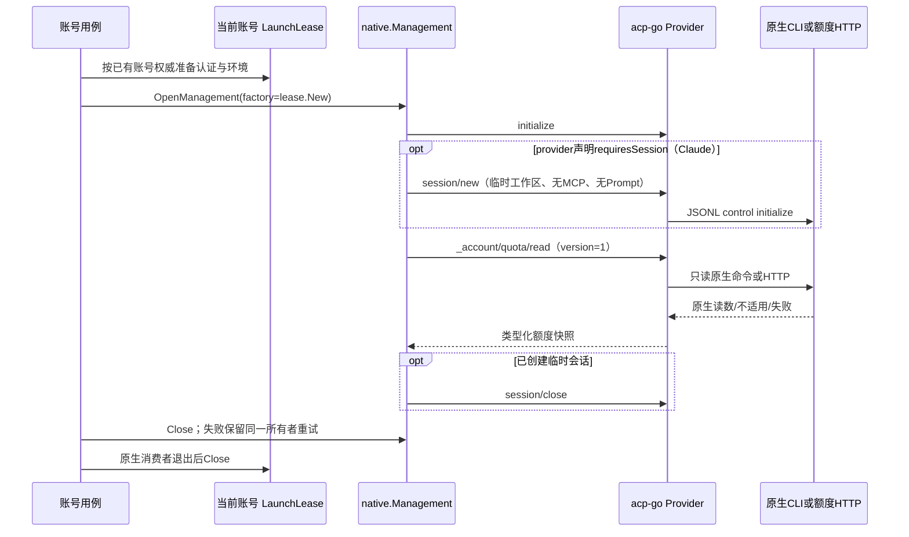

# 账号 Quota 原生 Go 协议核验

本文为账号额度实现的协议证据与接口建议，不代表账号额度能力已实现；未启动 CLI、未访问真实账号或读取凭据。基础证据为[用量审计](usage-audit-cn.md)，并重新核对当前源码和官方发布物。

源码标识：Neux `aea9265a0233fafc77e18510fa8a1ff33bb4d696`；acp-go `a58342da0ddd1e3ec5d022a0f911b82eba02107d`（其他 agent 正在修改 usage，本调研未改任何产品文件）。

## 1. 能否原生实现

| Provider | 结论                                                        | 已证明的原生入口                                                                                                               | 仍未证明的范围                                                                                |
| -------- | ----------------------------------------------------------- | ------------------------------------------------------------------------------------------------------------------------------ | --------------------------------------------------------------------------------------------- |
| Codex    | 可以；协议最明确，优先实施                                  | app-server `account/rateLimits/read`，无 Prompt、无 thread 参数                                                                | 本机每个 CLI 版本和实际账号的服务响应；API key 不应当作订阅 quota                             |
| Claude   | 可以实现 Go control 调用；以明确版本和运行时失败降级交付    | 官方 SDK **0.3.309**，对应 `claudeCodeVersion: 2.1.309`；实际 control subtype **`get_usage`**，参数 **`skip_behaviors: true`** | 最早支持版本，以及更旧 CLI 是否支持；不能写成任意 Claude CLI 均可用                           |
| Grok     | 可以；复用官方 ACP 扩展，不复制登录或刷新实现               | wire method **`_x.ai/billing`**；官方 Rust dispatcher 内部匹配去下划线后的 `x.ai/billing`                                      | 实际安装版本、服务认证模式与当前套餐；XAI API key 不当然拥有 grok.com 订阅额度                |
| Cursor   | 可写受控 Go HTTP reader，但应标记为私有协议、条件支持       | DashboardService 候选包含两个只读 POST；本次没有查到官方公开 schema/服务端源码                                                 | 官方稳定性、当前字段完整语义和原生认证源版本；缺少脱敏原生 fixture 前不宣称完整支持           |
| OpenCode | 可以实现 **OpenCode Go** 额度读取；不代表所有 OpenCode 后端 | 官方历史路由 `GET /zen/go/v1/usage`，Bearer key，三个窗口；后续迁移为 inference proxy                                          | 新后端当前完整响应、Console 新认证形态和旧 key 等价性；非 Go provider 的 quota 仍 unsupported |

## 2. 现有边界与建议接入位置

`Neux:server/internal/agent/native/management.go` 的 `OpenManagement` 只初始化协议；`Probe` 创建临时会话，`Fork` 负责原生分叉，所有路径仍由同一个 `Management.Close` 释放。`LaunchLease` 在 `native/launch.go` 冻结当前账号环境并拥有认证刷新入口与释放责任。账号选择和凭据权威仍在产品资源准备边界，不能交由 adapter 搜索另一个账号。

acp-go SDK 已提供 `ClientSideConnection.CallExtension` / `ExtensionMethodHandler`（`sdk/extensions.go`）。Codex、Claude 当前只接受 `_session/steering`；Grok/OpenCode 经 `pkg/nativeacp/agent.go:HandleExtensionMethod` 显式转发未知扩展。因此**不能直接将新的统一方法透传给原生 CLI**：各 provider wrapper 必须先截获统一方法，完成类型化调用和归一，再对其他现有方法保留原行为。

建议新增 `acp-go/pkg/quota`，只放独立 extension 合同、校验和共享值类型；provider 原生请求与 decoder 留在各自 `pkg/{codex,claude,grok,cursor,opencode}`。不改 ACP 标准 `PromptResponse.Usage`，不与 turn Token/cost 混用。建议扩展名 **`_account/quota/read`**，协议版本 1，名称是本方案建议，现有代码尚未声明。

Neux 增加 `(*native.Management).ReadQuota(ctx, QuotaRequest) (quota.ReadResponse, error)`；通过当前账号的 **同一个 launch lease** 创建 factory，返回结果由账号用例附加本地 AccountID。请求不允许传 AccountID、token、HTTP URL 或原生 method，自然不能借 quota 查询切换身份。不要再建全局 CLI 池或定时常驻进程。



当前 OpenCode `NewAgent` 会立即经 `nativeacp.NewAgent` 启动 CLI。即使扩展内部只做 HTTP，沿现有构造路径也**不等于无进程读取**；第一版可使用同一个有界 Management 短连接，不能宣称优化已存在。若以后要求 Cursor/OpenCode 完全不启动 CLI，应增加明确的管理专用 reader 构造能力并仍由当前 lease/Management 拥有，不能通过后台第二套账号发现与进程池实现。

## 3. 建议的 typed extension 合同

以下是拟新增的 Go 合同，均非当前已有接口。每个字段保留缺失语义。`SessionID` 仅是 adapter 声明 `requiresSession=true` 时由 Management 创建的临时原生会话身份，不是业务聊天 ID。

```go
// ReadMethod 是只读账号额度扩展名。
const ReadMethod = "_account/quota/read"

// ReadRequest 不接收任何凭据或账号切换参数。
type ReadRequest struct {
    Version int `json:"version"` // Version 固定为1，未知版本拒绝。
    SessionID *string `json:"sessionId,omitempty"` // SessionID 仅绑定受管临时会话。
}

// ReadResponse 将是否可读与真实窗口分开。
type ReadResponse struct {
    Version int `json:"version"` // Version 是响应合同版本。
    Status Status `json:"status"` // Status 表达可用、不适用、不支持、未认证或暂不可用。
    Reason Reason `json:"reason,omitempty"` // Reason 是固定枚举，不携带上游原文或凭据。
    Snapshot *Snapshot `json:"snapshot,omitempty"` // Snapshot 只在已读到额度事实时存在。
}

// Snapshot 只属于当前launch lease的账号，不自行选择身份。
type Snapshot struct {
    Provider string `json:"provider"` // Provider 是真实适配器标识。
    Source string `json:"source"` // Source 固定标识原生方法或受控HTTP路径。
    RuntimeVersion *string `json:"runtimeVersion,omitempty"` // RuntimeVersion 是实际确认的CLI版本。
    ObservedAt time.Time `json:"observedAt"` // ObservedAt 是本次成功读取的UTC时间。
    ProviderAccountID *string `json:"providerAccountId,omitempty"` // ProviderAccountID 仅保留上游明确给出的非秘密身份。
    PlanType *string `json:"planType,omitempty"` // PlanType 是来源明确给出的套餐名。
    Windows []Window `json:"windows"` // Windows 保留同时约束的全部有效窗口。
    OrdinaryUsageAllowed *bool `json:"ordinaryUsageAllowed,omitempty"` // OrdinaryUsageAllowed 仅接上游明确许可。
    Complete bool `json:"complete"` // Complete 表示当前来源的已识别窗口是否完整，不代表所有设备账单完整。
}

// Window 保留窗口身份，不强迫映射成primary或secondary。
type Window struct {
    LimitID string `json:"limitId"` // LimitID 是来源内稳定的额度桶标识。
    WindowID string `json:"windowId"` // WindowID 是five_hour、weekly或billing_cycle等来源内窗口身份。
    ModelGroup *string `json:"modelGroup,omitempty"` // ModelGroup 只接明确模型组，不从名称猜共享额度。
    UsedPercent *float64 `json:"usedPercent,omitempty"` // UsedPercent 保留已知零与未知的区别。
    DurationSeconds *int64 `json:"durationSeconds,omitempty"` // DurationSeconds 只填原生报告或有版本依据的窗口长度。
    ResetsAt *time.Time `json:"resetsAt,omitempty"` // ResetsAt 是归一后的绝对UTC时间。
    Exhausted *bool `json:"exhausted,omitempty"` // Exhausted 优先接上游明确耗尽状态。
}
```

合同选择：

- `Status`：`available`、`not_applicable`、`unsupported`、`unauthenticated`、`unavailable`。`Reason` 使用有限枚举，如 `auth_mode`、`cli_version`、`method_missing`、`no_entitlement`、`missing_scope`、`source_unavailable`、`invalid_payload`、`identity_mismatch`。不要用 `null` 或零窗口同时承载这些状态。
- 真正 JSON-RPC method-not-found/未实现 extension 在 Neux 映射为 `unsupported/method_missing`；调用 context 取消仍返回取消 error；超时/429/5xx 为 `unavailable`，不改聊天诊断，不触发登录、重发 Prompt 或自动 reset。
- `available` 至少一个窗口有有效百分比或上游明确状态；部分窗口坏数据可保留其他读数并 `Complete=false`，全坏则 `unavailable/invalid_payload`。百分比必须有限且按来源语义验证，非法值不静默归零。未知 schema 字段可忽略，但必需字段缺失不能当成零。
- 增加 initialize `_meta.accountQuota={version:1,read:true,requiresSession:false}`；Claude 为 `true`。旧 adapter 没有此项可直接 unsupported，不通过猜测或 Prompt 探测。metadata 只表示 adapter 已实现，不保证当前账号有订阅权益。
- Neux 的 `QuotaRequest` 只需受管 `WorkspaceScope`；current AccountID 在调用者的资源作用域中，不进入通用原生扩展。先验证 management 未关闭，独立于现有 `ready(ctx,workspace)` 提取无会话读数的状态检查，避免 Codex/Grok 被迫创建会话。
- 读数缓存若后续需要，由账号领域按 AccountID+认证代次+runtime+来源存储，不放进执行 Session；旧值标记 stale。reset 时刻到达仅让旧值失效，不能本地补成0%或推导 `OrdinaryUsageAllowed=true`。额度读取不包含任何 reset credit 消费、套餐变更或自动充值接口。

## 4. Codex：schema已存在，生成类型尚缺

`acp-go:pkg/codex/protocol/schema/codex_app_server_protocol.schemas.json` 已有 `v2/GetAccountRateLimitsResponse`、`RateLimitSnapshot`、`RateLimitWindow`、`AccountRateLimitsUpdatedNotification`。但 `protocol.root.json` 未纳入这些 roots，`generated_protocol.go` 当前没有这些 Go 类型；`envelope.go` 也没有 `account/rateLimits/read` 构造器。旧审计中“有 schema”不能读作“已有可调用 typed 方法”。

建议：

1. 在 roots 添加响应与可选通知，通过现有 `go generate ./pkg/codex/protocol` 更新生成文件；不手写 generated DTO。`GetAccountRateLimitsResponse` 包含 `rateLimits`、`rateLimitsByLimitId`、`rateLimitResetCredits`，后者只读保留或暂不投影。
2. 在 `envelope.go` 增加封闭的 `AccountRateLimitsReadRequest` 与 `NewAccountRateLimitsReadRequest(id)`，原生方法固定，无参数请求；更新 decoder。`appServerClient.AccountRateLimitsRead(ctx)` 复用 `rpc.Call`，与现有 `AccountRead` 同样类型化，不能增加任意 string method 通道。
3. `Agent.HandleExtensionMethod` 截获统一方法；认证判定沿当前 `authenticator`/`account/read`。API key /非 ChatGPT 认证是 `not_applicable/auth_mode`；未登录是 `unauthenticated`。
4. 所有 `rateLimitsByLimitId` 桶都保留；兼容单桶与多桶同现时按 limitId 合并，不能当成两次 quota。primary/secondary 为来源窗口身份，duration分钟乘60，reset为Unix秒。`credits.balance` 不混进百分比或当现金账单。
5. 第一版只读请求，**不需要订阅** `account/rateLimits/updated`。该通知在 schema 中明确是稀疏更新，若将来接入，缺失 metadata 不能清空之前读数；重新读整份 snapshot 更简单。

官方当前源码已发生 drift：`openai/codex@f9e7b19df8aa75490fc1d90f98d3d95ad716d08e` 的响应另有 `ordinaryUsageAllowed`、`accountId` 等字段，本地 schema 还没有。第一版不应为 quota 无条件整体升级 schema，旧 schema无法确认的字段保持未知；若单独引入新字段，需同步固定来源、生成及兼容fixture，明确普通使用许可不能从百分比恢复推断。来源：[官方 account.rs](https://github.com/openai/codex/blob/f9e7b19df8aa75490fc1d90f98d3d95ad716d08e/codex-rs/app-server-protocol/src/protocol/v2/account.rs)。

可测 fixture：直接从本地固定 schema 构造无账号 JSON；复用 `appserver_client_test.go` fake RPC 记录唯一 request method、`protocol_test.go` 校验封闭 envelope。用多桶、nullable window、已知0、100、reset秒、未知字段、method-not-found、取消以及账号代次变化覆盖。它们是协议 fixture，不能冒充真实账号录包或平台验收。

## 5. Claude：真正的 control subtype 与明确版本

核验的是官方 npm 发布物 [claude-agent-sdk 0.3.309](https://registry.npmjs.org/@anthropic-ai/claude-agent-sdk/0.3.309)，其 tarball `package/package.json` 的 **`claudeCodeVersion` 为 `2.1.309`**；完整 npm integrity 为：

`sha512-Tou0fXBkxKJDcgT09v3Iv/Jd7bNgapgfAiHxGPctAADPFQhidfhZbcv7at1cVL0Lon5sbs+OzP/pEOigw2TI0A==`

发布包 `sdk.mjs`、`core.mjs` 与 `browser-sdk.js` 一致：实验方法通过现有 request transport 发送 subtype `get_usage`；只有 `skipBehaviors=true` 才加入 `skip_behaviors:true`。因此 Go 不需要 Node sidecar，也不调用 JS 函数本身。原生 wire 应为：

```json
{
  "type": "control_request",
  "request_id": "fixture-quota-1",
  "request": { "subtype": "get_usage", "skip_behaviors": true }
}
```

响应沿既有 `control_response.response.response` payload，`request_id` 必须精确匹配。`pkg/claude/transport.go:Call` 已负责 pending 请求、取消、`control_cancel_request`、迟到响应忽略，应该直接复用。

建议 `pkg/claude/protocol` 增加 `ControlGetUsage`、`GetUsageControlRequest` 和窄 typed `GetUsageControlResponse`：仅解析 `subscription_type`、`rate_limits_available`、`rate_limits`。上游 `session` 是该临时 CLI 会话累计成本，`behaviors` 是本机 transcript 扫描，**都不用于账号 quota 或产品消费统计**。始终 skip behaviors，不扫描过去七天所有 transcript。

官方 `sdk.d.ts` 明确：

- `rate_limits_available=false` 可因 API key、Bedrock、Vertex 或 profile scope 缺失，`rate_limits=null`；若不能区分具体原因，使用 `not_applicable/auth_mode` 仅限认证模式已经明确，否则 `unavailable/missing_scope`，不能误报无订阅。
- 窗口有 `five_hour`、`seven_day`、`seven_day_oauth_apps`、`seven_day_opus`、`seven_day_sonnet`；每项为可空 `{utilization:number|null,resets_at:string|null}`。归一化所有已知窗口，不按当前模型删除其他约束。
- `model_scoped` 是可选数组，带来源 display_name、utilization和reset；absence 与已知空数组不同。display_name不当作可自动路由的model ID。
- `extra_usage` 是可空的额外用量配置，不能直接解释为订阅剩余额度；第一版可不投影金额，但保留不会被误当普通窗口的扩展空间。

Claude 现有 `Initialize` 不启动 CLI，`NewSession/openSession` 才建 transport，所以 Management 必须创建并最终关闭专用临时 session，不借用忙碌聊天 session、不发送空 user message。extension只接受该session ID且不落入 turn FIFO。临时目录与无 MCP 沿现有 Probe 同一资源规则。

版本策略：已证实的发布物组合是 SDK0.3.309 / CLI2.1.309；**没有证明2.1.309是最早支持版本**。第一版可从已核验版本开始声明支持，其他版本保留 unsupported；即使版本匹配，也以 control 响应为准。未知 subtype的control error应降为 `unsupported/cli_version`，但现有 transport 把所有 control error折成字符串，需要加可识别的typed错误或先严格限制已验证版本，不能任意匹配错误文本后把认证/服务故障说成不支持。官方声明该API实验性，升级时必须重新验证。

可测 fixture：SDK0.3.309发布物中的请求映射和d.ts作为版本固定来源，构造脱敏JSONL；复用 `transport_test.go` 与现有假的CLI control机制验证初始化后无Prompt、请求ID、skip字段、nullable/empty窗口、模型组、API key不可用、unknown subtype、取消和重复/迟到响应。**本次没有执行CLI2.1.309的真实或伪账号运行验收**；只有发布物协议证据。

## 6. Grok：官方billing类型可用，零值必须分来源

官方源码 `xai-org/grok-build@2bdd1d6a6369de0e8c68132ea4539e9abd9e14a8` 的 [extensions/billing.rs](https://github.com/xai-org/grok-build/blob/2bdd1d6a6369de0e8c68132ea4539e9abd9e14a8/crates/codegen/xai-grok-shell/src/extensions/billing.rs) 定义了 `BillingConfigResponse`、`BillingConfig`、`UsagePeriod`、`Cent`，并由当前 agent auth manager执行只读读取和认证 gate。`_x.ai/billing` wire经ACP扩展转发，对应内部 `x.ai/billing`。无需Neux自行请求grok.com或实现refresh。

typed decoder建议只接：`config.creditUsagePercent`、`config.currentPeriod.{type,start,end}`、旧版 `monthlyLimit.val`、`used.val`、`billingPeriodStart/End`；可接 `subscription_tier`，顶层Rust DTO未camelCase，所以注意它与config内camelCase的差异。`isUnifiedBillingUser`可保留为来源事实，但不能仅因它为true就跨Cursor/Grok账号合并统计。

`Cent.val` 在官方源码明确 `serde(default)`，所以**已确认存在的Cent对象 `{}` 是0**。但 `creditUsagePercent` 是 `Option<f64>`，缺失不天然等于0%；不能将缺百分比且无正 monthlyLimit 推断为零。Go第一版宜更保守：有有效百分比优先；否则仅有明确正monthlyLimit并已确认used/Cent时计算；缺少这两条来源就unknown。保留新旧字段优先级，window结束时间优先currentPeriod.end，旧字段只在新字段缺失时fallback。只读接口不接auto-topup、cap变更等兄弟扩展。

可测fixture：官方Rust类型与同仓billing测试字段生成synthetic JSON，再通过 `pkg/nativeacp` fake connection证明下游唯一 `_x.ai/billing`、上游统一方法不会循环转发；覆盖config=null、Cent={}、缺百分比、非法时间、weekly/monthly、RPC auth error和method-not-found。不使用 Math.clamp 静默修正错误百分比。

## 7. Cursor：HTTP可接，账号来源是主要实施前置

本次仅从 核验到私有协议记录，没有官方schema证据，不能用该项目实现作为官方兼容承诺。它记录的请求是POST JSON `{}`、Bearer token，路径：

- `/aiserver.v1.DashboardService/GetCurrentPeriodUsage`：`billingCycleStart/End`为Unix毫秒，可是JSON数字或int64字符串；`planUsage.autoPercentUsed/apiPercentUsed/totalPercentUsed`可缺失。
- `/aiserver.v1.DashboardService/GetPlanInfo`：`isMerged`。两个请求仍是只读，GetPlanInfo失败时总百分比与split的关系未确认，应保留raw分类并降低complete，不制造merged=false的事实。

Go DTO可以为时间使用受限number-or-string解码、百分比`*float64`、`IsMerged *bool`，然后按周期建立`auto/api/total`来源窗口。不要在未知套餐结构时自动把总值与子值相加，或未经原生fixture把merged套餐标成与Grok共享。

当前Neux Credential只交付Environment，acp Cursor Config未提供额外认证reader。因此接入前要明确当前账号lease的凭据端口：已有账号保存的token优先；系统原生账号模式才允许从该lease指定的CLI配置目录/受控平台credential provider读。macOS 读取固定 Keychain 项再 fallback auth.json 的逻辑**不可直接移植为多账号发现逻辑**；它无法单凭固定item证明读取的是产品选择的账号。显式自定义API key也不等价于Dashboard的accessToken。无法证明身份时返回 `unsupported` 或 `unauthenticated`，不能偷换系统默认账号。

HTTP timeout、endpoint override均只能来自冻结的可信启动配置；不接收扩展调用者URL。复用`ctx`，独立10秒上界、限制响应体、非HTTPS拒绝（显式测试loopback除外）、禁止携带Authorization跨origin重定向；401未认证，403需区分授权/套餐而不是一律已知0。错误/日志不回显response body或Authorization。

可测fixture：先写synthetic请求/decoder测试和httptest mock；它们只验证Go边界。要声称原生兼容仍需后续在用户明确授权下获取脱敏CLI2个接口响应（含认证来源版本与计划类型），本阶段不读取凭据、不对账号服务发送请求。

## 8. OpenCode：Go服务可读，当前源码已经迁移

官方历史 [usage.ts@5caf1f9](https://github.com/anomalyco/opencode/blob/5caf1f9f6f5f30e13fc50a788ad953d97ae3748f/packages/console/app/src/routes/zen/go/v1/usage.ts) 明确：Bearer key缺失/错误为401、无Go权益为403；成功返回 `usage.{rolling,weekly,monthly}`，每窗`status/percent/resetsAt`。此接口没有返回账号身份，不能靠它跨key自动归并账户。

后续 [83f2b6f](https://github.com/anomalyco/opencode/commit/83f2b6f67a5245214f4bb365ff55f7dcba9ce7fa) 将路由变成 inference proxy；[772e2ae](https://github.com/anomalyco/opencode/commit/772e2aed12bcf3770801ba217dab1d807f86ac80) 移除旧Console路径。当前dev tree `3ba597f7769e19cc3b5f67e3d6667e7b6318f6a3`已没有该handler。历史源码足以确定协议来历，**不足以证明目前生产响应永远保持相同**。[官方Go说明](https://opencode.ai/v2/docs/console/go/)支持Go产品和独立key连接，不是该usage API的完整稳定性承诺。

typed DTO：`Usage *struct{Rolling,Weekly,Monthly *GoWindow}`，`GoWindow{Status *string,Percent *float64,ResetsAt *string}`，三窗全部保留；不要只选binding window丢掉第三个约束。历史返回不包含窗口时长，第一版可只填WindowID与reset；不要硬编码月=30天后当作原生报告。

认证按当前lease：显式账号key优先；只有选择原生认证模式时才读lease有效 `OPENCODE_AUTH_CONTENT`、指定data home的auth.json/指定console credential。inline auth存在时禁止读磁盘fallback；选择的credential是OAuth或self-hosted时不能扫描下一个账号。Console DB 查询是版本特定的凭据来源，首版建议**不做全用户DB发现**；若必须支持，增加只读窄凭据provider、schema版本判断、100ms busy timeout和“选中credential先定位、再验证”的规则，且不把user-controlledserver的key送至官方域名。

可测fixture：固定官方历史handler产生synthetic JSON，验证401、403(no_entitlement)、三个窗口、过期reset、字符串/空日期、malformed response；httptest验证只发GET和指定Bearer。CLI auth fixtures只用临时目录，不读实际HOME。其他OpenCode自选provider与Zen现金余额都保持unsupported，不能用Go quota代表所有模型余额。

## 9. 下一阶段实施顺序与验收边界

1. 先交付共享quota合同、Management/lease生命周期与两账号隔离fake，再逐provider接入；metadata不支持不影响聊天和Probe/Fork。
2. 首批Codex与Claude：前者typed schema/envelope完整，后者固定SDK/CLI版本与JSONL control映射；不引入SDK桥接进程。
3. Grok用官方扩展和保守零值规则；Cursor保持私有接口条件支持，先解决同账号token来源；OpenCode明确只支持Go。
4. 对每类验证无Prompt、无真实模型、取消、close失败可重试、leaseA/B环境不串、拒绝caller token/URL、未认证不fallback另一个账号、零与未知分离、reset后旧值stale、无自动reset/充值。

本报告的验证范围是静态源码、官方registry发布物与公开官方仓库版本核验。没有真实平台、账号、CLI运行或在线quota验收；没有把synthetic fixture当真实返回，也没有修改当前usage实现。
