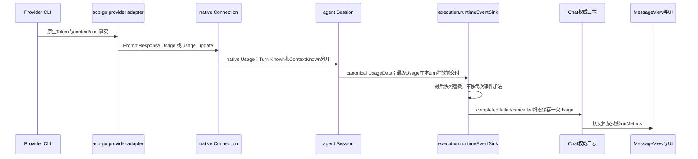

# Provider Runtime 用量正确性审计

本文是研究与待实施建议，不声明已经修复或通过真实模型验收。基线为 NeuxBot `e18a0d6e377eda9cdc96954321fb1f0788691a5f`、acp-go `a58342da0ddd1e3ec5d022a0f911b82eba02107d`。`NeuxBot:`、`acp-go:` 表示对应仓库内的源码位置；行号固定于上述提交。

费用、额度接口和具体 CLI 行为会变化；本次未访问账户、凭据、在线计费接口或真实模型，也没有验证源码中的价格今天仍有效。

## 1. 优先结论

当前“用量不准”至少包含三个可独立构造并验证的问题：

1. **Codex 同一 turn 的多次模型调用只留下最后一次请求。** acp-go 每次 token 通知覆盖 `h.usage`，最终从 `last` 构造整轮 Usage；工具循环之前请求的 Token 被漏计。
2. **Codex 缓存写入可重复计入普通输入。** input 包含 read/write 时只减 read，宿主再单列 write，互斥分类之和超过原始 input。
3. **Claude 缺失 usage 被制造为已知零。** result 的 usage 是非指针结构体，缺失字段与显式零不可区分；成功回执始终构造 Usage。

此外，取消/失败后的已耗用量缺乏完整端到端交付：多个 adapter 在错误路径丢终态 Usage；Neux native 的 early cancellation/failure 在解析 PromptResponse Usage 之前返回。已经交付的 context live event 仍可能被 execution 终态保存，不能将该问题扩大为“取消后所有统计都丢”。

最小正确顺序应是：先修 **来源归一化与缺失语义**，再补 **取消/失败最终归档**，再做 **耐久统计与聚合**，最后分别接入 **费用估算** 和 **账号额度**。不要先把错误值写入更完整的报表。

## 2. 必须分开的五类事实

| 事实          | 正确含义                                           | 不可替代的其他事实                            |
| ------------- | -------------------------------------------------- | --------------------------------------------- |
| request Token | 一次模型调用处理的输入和生成的输出                 | 不等于一个用户 turn；工具循环可有多次 request |
| turn Token    | 本次执行内所有已发生 request 的消耗合计            | 不等于最后请求，也不等于 session 累计         |
| context 快照  | 最近一次原生请求或原生命令报告的上下文占用及窗口   | 不能累加，也不能当累计消费或余额              |
| monetary cost | provider 报价金额，或有来源与时间的 API 等价估算   | 不等于订阅实际扣费，也不等于 plan quota       |
| account quota | 某账号、套餐、模型组、窗口的占比、余额、reset 时刻 | 不能从聊天 Token 或估算美元反推               |

输入应明确互斥分类：`uncached input + cache read + cache write`。输出需要保留 provider 语义：有的 `output` 已含 reasoning，有的把 thought 作为额外分量；展示推理明细不意味着再次加进 total 或费用。未知字段用 absence 表达，不得按所有 provider 一律补零。

ACP SDK 本身存在需要宿主明确约束的文档歧义：`Usage` 类型总述是 prompt turn，但字段注释又有“across all turns / across session”，见 `acp-go:sdk/types_gen.go:9181-9198`；`UsageUpdate.Cost` 明确是 cumulative session cost，见 `:9205-9218` 和 `:1634-1639`。不能因同叫 ACP Usage 就假设所有实现的 scope、cache 和 reasoning 都一样。

## 3. 已验证问题及构造复现

本次使用临时 Go `-overlay` 测试注入同包 fixture，没有修改产品源码；测试只执行本地函数和既有 fake connection，不启动真实 CLI 或模型。以下 FAIL 是审计复现成功，不是新增修复已经通过。

### U1：Codex 最后请求覆盖整轮统计

证据：`acp-go:pkg/codex/event_handler.go:417-434` 把每个通知转换后覆盖 `h.usage`；`:438-475` 从 `tokenUsage.Last` 取各字段；`:43-51` 直接作为 PromptResponse Usage。`TotalTokens` 虽保存为 thread 累计，但没有用于本轮差分。`pkg/codex/agent.go:861-880` 仅取最后 handler Usage。

同一 turn 连续输入两次通知：

| 通知                 | last input/output/total | total input/output/total |
| -------------------- | ----------------------- | ------------------------ |
| 第一次模型调用结束   | 100 / 10 / 110          | 100 / 10 / 110           |
| 工具后第二次调用结束 | 150 / 20 / 170          | 250 / 30 / 280           |

当前结果 `input=150 output=20 total=170`，正确本轮结果应为 `250 / 30 / 280`；第二次 Context 仍应保持最后请求对应的占用，而不是使用 280。

最小复现：创建空 `eventHandler`，依次调用 `handleTokenUsage`，不提供 context window 以避免外部 notify，调用 `Usage().PromptUsage()`。实际测试输出：`last request replaced turn: got input=150 output=20 total=170; want 250/30/280`。

不能直接对每个 `last` 做无条件加法：重复通知会重复计数；流式修正和同一 request 多个 snapshot 也需处理。应在 acp-go Codex provider 边界使用同 thread/counter epoch 的各分量 cumulative checkpoint，结合 turn-start baseline 和当前 turn identity 计算差分；恢复 session、计数器回退、模型切换及 compaction reset 必须有明确 epoch，缺 baseline 不假装覆盖完整 turn。

### U2：Codex cache write 与普通输入重复

证据：`acp-go:pkg/codex/event_handler.go:459-475` 仅校验 `input >= cachedRead`，输出普通输入为 `input-cachedRead`，同时独立提供 cachedWrite。Neux 合同声明普通输入与缓存分量分开，见 `NeuxBot:server/internal/agent/contract.go:449-460`。

fixture：原始 input=100，read=20，write=30，output=10。当前回执普通 input=80、read=20、write=30，输入分类合计130；若来源 input 包含两种缓存，则正确应为50+20+30=100。实际输出：`cache write counted twice: got input=80 read=20 write=30, sum input classes=130; want 50/20/30=100`。

适用条件要写清：当前 Codex schema 的 cacheWriteInputTokens 是可选字段；必须确认实际 CLI 版本的 input 包含关系，再启用这种归一化。包含关系以实际版本的上游协议验收为准。缺 write 与明确 write=0 应保留差异；还应拒绝 read+write>input，而不是静默夹成零。

### U3：Claude 未提供 usage 却返回已知零

证据：`acp-go:pkg/claude/protocol/protocol.go:255-276` 的 result Usage 为值类型；`pkg/claude/events.go:634-641` 对所有非错误结果构造 `Usage`。Neux `native/connection.go:476-490` 只要该指针存在即设 Known=true。

fixture：解码 `{"type":"result","subtype":"success","session_id":"fixture","result":"done"}`，调用 `promptResponseFromResult`。实际返回 `Usage != nil` 且全零；测试输出：`missing source usage fabricated as known: {CachedReadTokens:<nil> CachedWriteTokens:<nil> InputTokens:0 OutputTokens:0 ThoughtTokens:<nil> TotalTokens:0}`。

应由来源类型保留 usage presence；显式全零仍是合法已知零。不要让 UI 隐藏零行掩盖协议已把未知改成零。

### U4：取消/错误终态不能保证保留已耗 Token

证据分层：

- Neux native 在 cancellation/delivery/driver error 分支先返回，`:449-460`；只在成功路径 `:462-490` 解析 response Usage。`UsageUpdate` 当前只保存 context，忽略 Cost，也没有 turn Token checkpoint，见 `:1167-1180`。
- Codex 明确失败分支直接空响应，见 `acp-go:pkg/codex/agent.go:820-831`；取消成功回执走 codexPromptResponse，可带最后 Usage，但请求 context 已取消时 SDK/宿主仍可能先返回错误。
- Claude `is_error` 在构造 usage 前返回 error，`pkg/claude/events.go:613-615`；cancelTurns 直接 settle cancelled 无 Usage，`pkg/claude/session.go:498-514`。
- Pi 存了已完成 request 用量，但 ctx cancel/early error 返回空响应，见 `pkg/pi/prompt.go:77-93`。Cursor 多处返回 `PromptResponse{Usage:p.usage}, err`，见 `pkg/cursor/events.go:141-178,258-260`；JSON-RPC error 不能保证同时传回成功 result 中的 Usage。
- Kimi 会在取消后用 WithoutCancel 的有界 context 发已观察到的 context，并填 `result.Usage`，见 `pkg/kimi/usage.go:74-95`；但如果同时返回 err，回合 Token 依然缺少可靠的独立交付契约。

本地 fixture 已验证：native fake 先发 context 17/100，再取消父 context 并返回 cancelled+Usage；最终 native `TurnResult` 中 `ContextKnown=false`、Turn Known=false。实际输出：`confirmed context dropped on cancellation: status=cancelled usage={Known:false ... ContextKnown:false ...}`。

**限定结论：** runtime sink 若已收到那条 context live event，会将最后 usage 保存进执行终态，所以该 fixture 不证明 UI 一定丢 context。证明的是 native result 丢已确认事实，以及没有端到端可靠路径归档已耗的 turn Token。Neux 现有最终写入入口已经支持失败/取消保存 Usage，不需要再造一套 execution 生命周期。

验收必须覆盖“模型已完成一次付费 request，第二次 request 取消/失败”：终态仍保存第一次消耗，并标记 final/partial/unknown completeness；不得通过重发 Prompt 或补造零统计恢复。

## 4. 逐 provider 现状

| Provider         | acp-go 来源及 scope                                                                                  | cache / reasoning / context                                                          | 正确性与缺口                                                                                                                          |
| ---------------- | ---------------------------------------------------------------------------------------------------- | ------------------------------------------------------------------------------------ | ------------------------------------------------------------------------------------------------------------------------------------- |
| Codex            | app-server thread/tokenUsage/updated 的 last+total；当前只保留 last                                  | read 从 input 扣除；write 可重复；reasoning 是 output 子集；last.total 发 context    | U1/U2；已有 generation/thread/turn fence，但缺正确 turn 聚合与可靠失败快照                                                            |
| Claude           | result.usage 作为 turn 汇总；assistant/message_delta 用于 context                                    | input/read/write 分开；未单列 reasoning；context 四类和；window 来自 modelUsage/缓存 | U3；error/cancel 漏本轮统计；result.modelUsage 是按模型 cumulative，不可简单再加到 result.usage；原生费用未暴露                       |
| Gemini           | 原生 ACP response.usage 优先；否则 response._meta.quota.token_count                                  | fallback 只有 input/output，不伪造 context；cached/thought 无独立fallback            | `pkg/gemini/agent.go:386-410`；err时不投影；quota字段名字此处是本轮token，不是账户套餐余额                                            |
| Grok             | nativeacp 原样转发官方 ACP PromptResponse                                                            | 没有专门 scope/cache/reasoning 正规化                                                | 不能把标准 schema 注释当实际版本证明；若实际 cumulative，Neux逐turn保存会高计；需两轮fixture确定                                      |
| OpenCode         | nativeacp 原样转发官方 ACP；需按实际版本核验 tokens 的 per-prompt 与 cost 的 session cumulative 范围 | input为noncached，缺cache/thought在已确认版本代表0；reasoning可需加入output          | acp-go未固化该语义；必须用版本fixture验证，费用不能每轮累加session amount                                                             |
| Kimi             | 开始记录 wire.jsonl byte offset，只扫描本次新增记录；usage.record 与旧StatusUpdate逐模型调用累加     | input/read/write互斥；context另读measured及配置window；thought不单列                 | 有 session active guard；新旧双格式同现时可能重复，需fixture确认是否互斥；文件解析失败/截断返回unknown；取消交付见U4                  |
| Pi               | message_end assistant.usage逐完成模型调用相加，prompt开始清零                                        | input/read/write互斥；output含未独立提供的reasoning；context插件调getContextUsage    | `pkg/pi/usage.go:8-33`、`events.go:144-153`；累加点未见messageId去重，重复message_end可重复；非完整usage空对象也可变known零；取消见U4 |
| Cursor           | stop hook 的generation_id去重，逐generation累加                                                      | input扣read/write；preCompact及/context命令提供context/window                        | `pkg/cursor/hooks.go:37-66`、`events.go:150-173`；需确认generation是request还是用户turn；hook读不到时不制造token；取消见U4            |
| WorkBuddy        | CodeBuddy Code --acp 的原生Prompt Usage及usage_update透传                                            | 上游给什么保留什么，没有usage正规化                                                  | `pkg/workbuddy/README.md:38`；需真实双轮验证cumulative、cache及partial，不能推测私有sidecar字段                                       |
| Qoder / Qoder CN | Neux registry 通过 nativeacp/Qoder SessionAdapter 接标准ACP                                          | 未见用量专用正规化                                                                   | `NeuxBot:server/internal/agent/native/registry.go:73,415-443`；应保持unknown，先录脱敏fixture再承诺支持                               |

Codex 已有严格 scope 检查，错误不在“没有turn/session隔离”：`acp-go:pkg/codex/event_router.go:72-102,167-189` 会拒绝别的thread/turn和旧generation。Pi、Cursor、Kimi各自有prompt清零/generation去重/offset隔离，需复用已有边界，不应统一删掉再用无身份的全局计数器。

## 5. Neux 当前数据链与持久化入口



关键入口：

- `server/internal/agent/native/contract.go:164-175` 已区分 Known / ContextKnown，但分量是非空int，缺失cache/thought会失去presence。
- `server/internal/agent/session.go:410-425` defer最终usage交付，使用WithoutCancel和5s预算，保持当前turn所有权；`:1136-1143` 归一映射为 `UsageData.Turn/Context`。
- `server/services/execution/runtime_events.go:182-185` 保存最后usage snapshot，不把中间覆盖事件都写JSONL。
- `server/services/execution/lifecycle.go:483-495,644-679` 把同一个 sink Usage 放入 completed/failed/cancelled 的 `ExecutionFinishedData`，通过既有 Journal.CommitTerminal提交。
- `server/internal/chat/messageview/message_view.go:489-503,705-724` 以执行终态Usage投影公开metrics，赋值替换而非重复相加。

因此新增可靠用量应沿该单一权威链补齐，不额外在API/WS解析私有provider payload，也不把每条partial usage重复归档。若要跨聊天/伙伴/账号统计，应从完整执行事实或专门唯一用量事实构建索引，以 execution+invocation+native session+counter/request identity去重，并明确重试新attempt是真实新增消费；原消息历史回放、WS重连、fork历史导入不是新消费。

### 缺失数据与展示

`MessageRunMetrics` 所有token都是 `int64 omitempty`（`server/internal/chat/messageview/types.go:75-94`），会合并“未知”和“已知零”；前端 `chat-thread.tsx:968-996` 用truthiness决定是否显示。现有UI未见把reasoning加到output的计算，因此不应将底层错数归因于前端二次加法。

`latestContextMetrics` 从历史倒序找任何有window的metrics（`packages/frontend/src/modules/chat/runtime/chat-projection.ts:90-99`），不检查native session/provider；新会话没有context时会继续展示旧会话快照。应带对应session/turn及观测时间，在当前session未知时表达未知或明确旧快照，不把旧值默认为当前占用。

## 6. 费用：原生金额、估算、价格时效

Neux 当前 native Usage/UsageData/MessageRunMetrics没有currency、cost amount、basis、price version，也没有完整usage analytics账本。SessionUsageUpdate里Cost在native被忽略，见 `native/connection.go:1167-1180`。Claude protocol ResultMessage没有total_cost_usd字段，见 `acp-go:pkg/claude/protocol/protocol.go:255-278`。这是缺能力，不应从已有token UI宣称支持实际账单金额。

费用设计约束：

- 累计计数通过稳定 counter 身份与 checkpoint 计算差分，基线不计作新增消费，负差不能转成消费。
- 原生金额与 API 等价估算分别保存来源、币种、范围与核对日期，价格或分量缺失时不出金额。
- 区分请求、回合和会话范围，不把最后请求上下文或累计会话金额当作每轮增量。

## 7. 账号额度：来源、凭据复用与Go端口

额度读取以官方原生接口和版本化样本为依据，使用选中账号的凭据租约。私有接口保持条件支持，不扫描无关账号，不使用模型 Prompt 询问权威余额。

查询端口复用原管理所有者，独立于用户执行会话；连接和临时资源由原所有者释放。额度未知、读取失败、未支持、已知零分别表达。

### quota、限流、reset必须分开

- 额度包含账号、智能体、模型组、窗口、used／remaining 方向、重置时间、观测时间与来源。
- rate limited 与 quota exhausted 分别表示频率／并发限制和预算／套餐耗尽。
- 时间单位在适配器归一；到达 reset 时刻只表示旧读数过期，应重新读取。
- 多窗口同时保留约束；有副作用的 reset credit 消耗属于独立用户操作，不能并入后台刷新。

## 8. 最小正确实施批次

| 批次            | 所有者与修改边界                                                                                             | 独立完成标准                                                                                                                                   |
| --------------- | ------------------------------------------------------------------------------------------------------------ | ---------------------------------------------------------------------------------------------------------------------------------------------- |
| A：准确Token    | acp-go provider归一化；Neux native/Usage合同只接已归一事实                                                   | 修U1/U2/U3；每provider两连续turn+多request fixture；cache互斥与reasoning包含关系明确；未知与0不合并                                            |
| B：取消失败归档 | acp-go增加有序可交付的已耗Token最终/partial快照；Neux native保留已观察事实；Session最终交付复用原sink        | completed/refused/truncated/cancelled/failed/transport退出均保存可得消耗；状态失败不变成功；不重放Prompt；Context不覆盖Turn、Turn不覆盖Context |
| C：耐久统计     | 现有ExecutionFinishedData为入口，基于真实execution/invocation/session/request或counter epoch建唯一事实及索引 | 重连/日志重放/重复终态不加倍；新attempt真实新消费仍计入；fork旧history不计新消费；删除聊天的统计保留策略须明确                                 |
| D：费用         | 用量事实旁增加有来源/时效的native cost或estimate；价表独立版本                                               | 不支持模型/缺分量/长短混合不出金额；所有scope差分与currency正确；API等价与实际账单区分；价表使用官方版本化来源                                 |
| E：额度         | 每个Account的只读管理查询/受控HTTP来源，复用Catalog/Management生命周期                                       | 账号A/B隔离；限流与耗尽分开；过期刷新与未知展示；读请求不消耗模型turn；provider逐个交付，unsupported不影响聊天                                 |

阶段A/B优先于新dashboard。用户要完整对等能力时，C/D/E可随后独立验收，但不得以“Token UI能显示”冒充费用或套餐quota已完成。

## 9. 验收矩阵

| 场景             | 构造数据/操作                                  | 必须断言                                                           |
| ---------------- | ---------------------------------------------- | ------------------------------------------------------------------ |
| 单request        | input100/read20/write30/output10/reasoning4    | 分类合计100；reasoning若是output子集不再加总；context独立          |
| 一turn工具循环   | 两次模型request 100/10、150/20                 | turn250/30；context只保留第二次；不将thread旧消费带入              |
| 两连续turn       | 第一250/30，第二40/5，原生cumulative290/35     | 第二仅40/5；session聚合290/35；恢复不重算第一轮                    |
| 重复snapshot     | 同counter相同累计值重复到达                    | 不重复；同request修正值只替换或差分一次                            |
| 迟到身份         | turnA通知在turnB/generationB后到达             | 不污染B；可归档A需有效身份，不能猜当前turn                         |
| counter reset    | 旧累计1000，新epoch10                          | 仅新epoch10；不能夹负差后永远漏计，也不能把旧1000再记一次          |
| resume/fork      | 恢复带旧session total；fork回放父历史          | 建baseline；旧历史不计新消费；新执行只记新request                  |
| 取消             | 第一次request已收费，第二次取消                | turn取消但已耗Token存在、partial completeness；已收到context也保留 |
| 失败/429         | 已完成request后服务错误，重试新attempt         | 旧attempt已耗不丢；新attempt新增真实消费；不重复提交Prompt补统计   |
| delivery failure | Token已产生，usage sink拒绝一次                | 执行事实与交付失败分别表达；重交最终统计不重执行模型               |
| 未知与零         | 缺usage、usage显式全零、缺cache、显式cache0    | presence不同；未知不计作0，也不伪造免费                            |
| UI上下文         | sessionA有window，sessionB尚无usage            | 不把A当B当前占用；保留来源及观测时间                               |
| 原生cost         | 同session cumulative USD 1→1.5                 | 本次0.5；重复1.5为0；改currency不得差分                            |
| estimate         | 已知价表/未知model/缺cache write rate/长短混合 | 有依据才出金额；保存price version与source；无依据unknown           |
| quota账号隔离    | accountA90%，B10%，切换模型组                  | 不串账号；组与窗口不混合；不反推自聊天token                        |
| reset时间        | 秒/毫秒/ISO、DST、到期、未知                   | adapter统一；到期读数stale并刷新，不凭空置0                        |
| 无支持/凭据拒绝  | quota接口unsupported/401/403/超时              | 聊天仍可工作；清楚unknown/stale；不泄露credential                  |

## 10. 验证边界

已完成源码链路审计及四个针对性本地反例测试：Codex两项、Claude缺失Usage一项、Neux取消result事实丢失一项。测试均故意以正确期望断言当前错误行为并失败，证明问题存在。未修改或提交产品代码，未运行全量测试、真实CLI、模型、浏览器或桌面应用；未验证价格/额度接口在线可用，也未读取任何真实凭据。上述问题修复后仍需对应provider真实两轮、工具循环、取消/失败及账号隔离验收，不能用本地fixture代替。

### 本次 overlay 复现命令与原始结果

临时目录 `/private/tmp/provider-usage-audit` 保存 `codex_usage_test.go`、`claude_usage_test.go`、`native_usage_test.go`；`acp-overlay.json` 将前两者映射到 acp-go 相应包下的新测试文件，`neux-overlay.json` 将后者映射到 Neux native 包下的新测试文件。overlay只改变本次编译输入，不把测试写入产品仓库。临时产物可能由系统清理；核心fixture的输入、调用入口和正确期望已在U1–U4写明。

在 acp-go 根目录依次运行：

```sh
GOCACHE=/private/tmp/provider-usage-audit/go-cache go test -overlay /private/tmp/provider-usage-audit/acp-overlay.json ./pkg/codex -run '^TestAuditCodex' -count=1
GOCACHE=/private/tmp/provider-usage-audit/go-cache go test -overlay /private/tmp/provider-usage-audit/acp-overlay.json ./pkg/claude -run '^TestAuditClaude' -count=1
```

实际输出：

```text
--- FAIL: TestAuditCodexKeepsAllRequests (0.00s)
    usage_audit_overlay_test.go:10: last request replaced turn: got input=150 output=20 total=170; want 250/30/280
--- FAIL: TestAuditCodexCacheWriteExclusive (0.00s)
    usage_audit_overlay_test.go:15: cache write counted twice: got input=80 read=20 write=30, sum input classes=130; want 50/20/30=100
FAIL
FAIL github.com/JieWaZi/acp-go/pkg/codex

--- FAIL: TestAuditClaudeMissingUsageUnknown (0.00s)
    usage_audit_overlay_test.go:7: missing source usage fabricated as known: {CachedReadTokens:<nil> CachedWriteTokens:<nil> InputTokens:0 OutputTokens:0 ThoughtTokens:<nil> TotalTokens:0}
FAIL
FAIL github.com/JieWaZi/acp-go/pkg/claude
```

在 NeuxBot 的 `server` 目录运行：

```sh
GOCACHE=/private/tmp/provider-usage-audit/go-cache go test -overlay /private/tmp/provider-usage-audit/neux-overlay.json ./internal/agent/native -run '^TestAuditCancelled' -count=1
```

实际关键输出：

```text
--- FAIL: TestAuditCancelledResponseKeepsContext (0.00s)
    usage_audit_overlay_test.go:13: confirmed context dropped on cancellation: status=cancelled usage={Known:false InputTokens:0 OutputTokens:0 ThoughtTokens:0 CachedReadTokens:0 CachedWriteTokens:0 ContextKnown:false ContextTokens:0 ContextWindowTokens:0}
FAIL
FAIL github.com/JieWaZi/NeuxBot/server/internal/agent/native
```

第一次使用默认Go build cache曾因sandbox拒绝访问而未运行测试；改用上述独立临时GOCACHE后，三条命令均完成测试并得到所列断言失败。没有申请提权或扩大检查范围。
