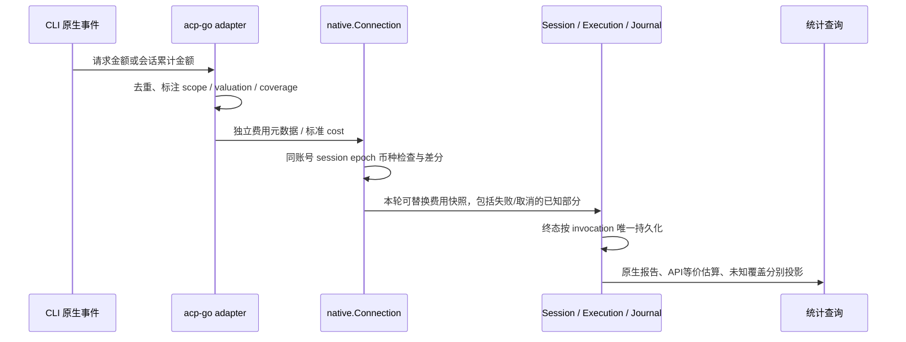

# 原生费用与定价来源调研

状态：只读源码与官方公开资料调研，核对日期 **2026-11-03**。本文是实施建议，不代表费用能力已经实现或真实模型验收通过。未启动 CLI、访问真实账号、打开或控制浏览器；未复制 OpenBot 价表。acp-go 工作区同时有其他任务修改，以下源码观察不当作固定提交验收。

依据：[统一设计](../../superpowers/specs/2026-11-03-provider-runtime-parity-design.md)、[既有审计](usage-audit-cn.md)。源码路径的 `acp-go:` 前缀表示独立仓库，`NeuxBot:` 表示本仓库。

实施合同以统一设计为准：Token 的 Complete 表示整轮覆盖，main_loop 一律为部分数据；费用另有独立 scope、coverage 和完整性，不能复用 Token 的 Complete。

## 1. 可以取得什么

### Claude：原生报告的本地估算，作用域与 Token 不同

官方明确 `total_cost_usd` / `costUSD` 来自 CLI 自带或 `modelPricing` 价表，**不是权威账单**。streaming-input 中 `usage` 只含本轮主循环；`modelUsage` 和 `total_cost_usd` 为累计且包含子智能体。Claude Code **v2.1.277 起**，正常退出保存的历史金额会在 resume/fork 时恢复；此前 resume 从本 call 的零起算。`/clear`、`/reset`、`/new` 重置累计。`error_max_budget_usd` 的 `usage` 可能漏最后请求，金额和 `modelUsage` 仍包含；崩溃结果可能归零，不能抹去已观测事实。模型项的 `costBasis=list/managed/unknown` 从 v2.1.246 起提供，描述最近请求价表。[官方 cost tracking](https://code.claude.com/docs/en/agent-sdk/cost-tracking)

当前 acp-go 用 `--input-format stream-json` 保持进程接多轮（`pkg/claude/launch.go:235`）。`protocol.ResultMessage` 未声明 `total_cost_usd`，`ModelUsage` 未声明 `costUSD` / `costBasis`；`events.go` 在错误分支早返回。因此原始 JSON 即使含金额，现有强类型路径仍丢失。

精确补充建议：

- `ResultMessage.TotalCostUSD *json.Number`，JSON 名 `total_cost_usd`；只在存在且合法时读取。使用能保留十进制文本的解码方式，拒绝负数、非有限数和无效数字。不能使用 `float64` 零值表达缺失。
- `ModelUsage.CostUSD *json.Number`，JSON 名 `costUSD`；`CostBasis *string`，JSON 名 `costBasis`。每个模型保留实际 ID，不能把 `modelUsage` 各项加到 `usage` 上。
- 在 `is_error` 判断前捕获费用快照，经独立费用元数据交付，再返回原有错误；断线/取消保留已观测部分。
- 以账号、原生 session、counter epoch、CLI 计费语义版本保存 checkpoint；同一进程下一轮取累计差值。fresh session 能证明初值为零才用零；恢复后的首次样本没有前值时只保存累计观察，当前轮金额未知。
- fork 继承的历史金额不是新消费。session ID 改变或累计回退，必须明确 reset/restore 证据；不能把负差 clamp 到零后宣称完整。
- `usage.Complete` 最多表示“主循环本轮覆盖”，不能写成“含全部子智能体的全部消费”。若要 whole-tree Token，需按模型累计字段可靠差分并另存 coverage。

### Pi：逐消息金额，默认目录估算，有明确标志才是服务商报告

官方 `AssistantMessage.usage.cost` 包含 `input/output/cacheRead/cacheWrite/total`，新版本的 `totalFromProvider=true` 表示 `total` 来自服务商报告；false 或缺失表示目录估算。分项仍可为目录估算，**不能要求它们必然等于 provider total**。官方遥测将金额单位定义为 USD。源码 `calculateCost` 以模型目录和输入阈值算价，同时把 `totalFromProvider` 置 false。[官方类型](https://raw.githubusercontent.com/badlogic/pi-mono/main/packages/ai/src/types.ts)、[官方说明](https://raw.githubusercontent.com/badlogic/pi-mono/main/packages/ai/README.md)、[官方计算实现](https://raw.githubusercontent.com/badlogic/pi-mono/main/packages/ai/src/models.ts)

当前 `acp-go:pkg/pi/events.go` 在 assistant `message_end` 调 `accumulateUsage`；`pkg/pi/usage.go` 只解析四种 Token，丢 `usage.cost`。

精确补充建议：为 `piUsage` 增加可空 `Cost *piCost`，`piCost.Total *json.Number`、`TotalFromProvider *bool`；可选保留分项用于解释，但只累计 `total`。按原生消息/response 身份去重后累计本轮金额快照；若消息无可证明去重身份，记录覆盖限制。默认 `native_report + cli_estimate`，明确 true 才用 `native_report + provider_reported`。缺 `cost` 与显式 total=0 分开。混合两种估值基础时保留两条明细，不能合成一个假装全部实扣的值。实际安装版本必须以 fixture 证明字段，不将上游 main 的新字段当所有已装 Pi 已支持。

### ACP：协议只有会话累计金额，不保证账单性质

`acp-go:sdk/types_gen.go` 的 `Cost{Amount float64,Currency string}` 与 `UsageUpdate.Cost *Cost`、`SessionUsageUpdate.Cost *Cost` 明确是 **cumulative session cost**；币种为 ISO 4217。此字段属于 unstable 协议；没有说明它一定是服务商实扣或本地估算。`UsageUpdate.Used/Size` 是 context，与金额 scope 分开。

当前 `NeuxBot:server/internal/agent/native/connection.go` 的 `UsageUpdate` 分支只映射 context，忽略 cost。补充方案：先验证金额非负有限、币种合法，转为内部十进制金额；保留 `native_report + unknown_valuation + session_cumulative`。以同账号/session/epoch/币种的可靠前值差分，不按通知相加。第一次恢复样本只建立基线；若标准 ACP 的具体 provider 没有零起点保证，首次样本也不能全归当前轮。若 context 无效但费用有效，两个事实应独立判断，不让无用的 context 占位值毁掉费用。不能手改 `sdk/types_gen.go`；扩展应写独立 `acpmeta` 类型或修改 schema 后走生成器。

## 2. 最小费用合同与交付链

建议新增独立 `acpmeta.CostObservation`，使用新的 `acp-go/cost-observation` 元数据 key，**不要藏进 Token 的 TurnUsage 作用域**。标准 ACP 的 cost 保持原语义；Claude/Pi 的归一化费用经新 key 发送。以下是字段合同建议，不是已提交接口：

| 字段 | 语义 |
| --- | --- |
| `amount` | 非负规范十进制字符串；缺观察与字符串 `"0"` 分开 |
| `currency` | ISO 4217，例如 USD；不同币种独立聚合 |
| `source` | 精确来源，例如 `claude.result.total_cost_usd`、`pi.message.usage.cost.total`、`acp.usage_update.cost` |
| `origin` | `native_report` 或 `local_estimate`，描述金额由谁交付 |
| `valuation` | `provider_reported` / `cli_estimate` / `api_equivalent` / `unknown`，描述金额是什么 |
| `scope` | `request` / `turn` / `session_cumulative`，绝不从 Token scope 推断 |
| `counter_id` | adapter 定义的 session/epoch，配合冻结 account/runtime，不含凭据 |
| `observation_id` | 原生事件/消息身份；无身份则用已定义的累计 snapshot 替换，禁止逐通知相加 |
| `coverage` | `main_loop` / `whole_tree` / `unknown`，与完整性正交 |
| `complete` | 仅声明已覆盖其明确范围；不能表示其他范围或所有字段已知 |
| `model` | 只在原生确认时填写；多模型不能用用户选择的一个模型代替 |
| `price_version` | 仅本地估算填写；CLI未报告价表版本时留空，另外保留CLI版本 |

本轮费用用独立可空 `CostData` 保存差分后的金额，另存来源 scope 和计数依据；Token完整与费用完整必须分别标记。金额可独立存在，不需要先有 Token。API 等价估算与原生报告可同时保存用于核对，最终已知小计只能对同一消费选一个口径，不能把两个金额相加。

交付沿已有唯一权威链：



具体改动点是 `native.Usage` / `agent.UsageData` 增加独立可空费用分支，`Connection` 中保存 live checkpoint、在 error/cancel 返回前读取；`session.go:chatUsage` 原样映射；既有 `execution.runtimeEventSink` 替换最后快照，终态归档一份，`messageview` 与统计索引读取这一权威事实。不要让 UI 从裸 CLI JSON 或 Token 再推一套金额。

## 3. 可版本化的小定价目录

建议目录版本 `2026-11-03.1`。每条包含真实计费发行方、精确 model IDs、currency、service tier、逐请求长度条件、cache TTL 条件、source URLs、checked_at、已明确的 effective_from/effective_to 与价格。**核对日不是生效日**：当前价不回填旧轮次；没有官方历史区间则历史金额未知。以下只支持官方直连；订阅只称 API 等价估算。

### OpenAI

USD / 1M tokens。下表顺序为 `普通输入 / 输出 / cache read / cache write 30m / cache write 12h`。原始 HTML 折叠表易漏长上下文；本次另实际获取同页 `.md` 的完整 `Standard pricing data` 和 `Fast pricing data` 交叉核对。

| 精确模型 | 档位与逐请求输入长度 | 价格 |
| --- | --- | --- |
| `gpt-5.2` | standard | 1.75 / 14 / 0.175 / 不适用 / 不适用 |
| `gpt-5.2` | fast | 3.50 / 28 / 0.35 / 不适用 / 不适用 |
| `gpt-5.3-codex` | standard | 1.75 / 14 / 0.175 / 不适用 / 不适用 |
| `gpt-5.3-codex` | fast | 3.50 / 28 / 0.35 / 不适用 / 不适用 |
| `gpt-6.1-sol` | standard，≤272K | 2 / 10 / 0.10 / 2.50 / 5 |
| `gpt-6.1-sol` | standard，>272K | 4 / 15 / 0.20 / 5 / 10 |
| `gpt-6.1-sol` | fast，≤272K | 4 / 20 / 0.20 / 5 / 10 |
| `gpt-6.1-sol` | fast，>272K | 8 / 30 / 0.40 / 10 / 20 |

来源：[官方 Pricing](https://developers.openai.com/api/docs/pricing)、[同页 Markdown](https://developers.openai.com/api/docs/pricing.md)，核对 2026-11-03。官方当前确有 GPT‑6 型号定价；只接入上表精确 ID，**不存在一个可推到任意 `gpt-6*` 的通用价格**。地区/FedRAMP/Bulk等条件未冻结时不要默认为上表。

GPT‑5.6+ 的输入包含 cache read/write；写入按30m或12h互斥分量计价，不能把 write 总数再加一次。若只有 cacheWrite 总数而不知道 TTL 分布，不估价。[官方 Prompt caching](https://developers.openai.com/api/docs/guides/prompt-caching)

`priority` 与 `fast` 为支持模型的同一服务档位；不能从 UI 上“已选快速”推定请求实际档位，必须保存真实执行档位。其他模型 Fast 价格不可用统一倍率推算。[官方 Fast mode](https://developers.openai.com/api/docs/guides/fast-mode)

### Anthropic

USD / 1M tokens，顺序为 `普通输入 / 输出 / cache read / cache write 5m / cache write 1h`。

| 精确 Claude API ID | 条件 | 价格 |
| --- | --- | --- |
| `claude-opus-5-5` | standard | 4 / 20 / 0.20 / 5 / 8 |
| `claude-opus-5-5` | fast | 8 / 40 / 0.40 / 10 / 16 |
| `claude-sonnet-5-5` | standard | 2 / 10 / 0.10 / 2.50 / 4 |
| `claude-opus-4-6` | standard | 5 / 25 / 0.50 / 6.25 / 10 |
| `claude-sonnet-4-6` | standard | 3 / 15 / 0.30 / 3.75 / 6 |

4.6+（Haiku 5.5 例外）长上下文不加价；不要沿用旧 Sonnet >200K 规则。不要把 fast 套在全部 Claude 型号上。混合 cache TTL 缺分项时不估价；地区或平台不同需独立目录。[官方 Pricing](https://platform.claude.com/docs/en/about-claude/pricing)、[官方模型 ID](https://platform.claude.com/docs/en/models/overview)，核对 2026-11-03。

### DeepSeek

USD / 1M tokens，顺序为 `cache miss / cache hit / output`。直接官方 OpenAI/Anthropic 兼容端点使用同一发行方身份。

| 精确模型 | 时段 | 价格 |
| --- | --- | --- |
| `deepseek-flash` | peak / off-peak | 0.30 / 0.006 / 1.20；0.15 / 0.003 / 0.60 |
| `deepseek-v4-pro` | peak / off-peak | 1.32 / 0.044 / 3.96；0.66 / 0.022 / 1.98 |

当前映射分别为 V4.1-Flash-1017 / V4-Pro-0813。peak 为非中国法定节假日的周一至周五 UTC 01:00–04:00、06:00–10:00，其余 off-peak；缺可靠请求时间或节假日判定不估价。没有独立 cache-write 报价，不凭空套 Anthropic multiplier。工具按请求另计，Token金额不宣称覆盖工具账单。[官方 Models & Pricing](https://api-docs.deepseek.com/quick_start/pricing/)，核对 2026-11-03。

## 4. 公式与不估价条件

适配器先归一为互斥的 `I`（普通输入）、`R`（缓存读）、`W_t`（各 TTL 写）、`O`（含 reasoning 的输出）。对**每个实际请求**确定价格项 `p`：

```text
request_api_equivalent = (I*pI + R*pR + Σ(W_t*pW_t) + O*pO) / 1_000_000
turn_api_equivalent    = Σ(有唯一 request 身份且可完整定价的 request_api_equivalent)
```

Reasoning 是 `O` 子集，不再加一笔。上述是独立设计的通用量纲公式。只有单一价格项可证明适用于本轮全部请求时，才能用本轮合计 Token 直接算；跨模型、跨长短阈值、跨 Fast 档位或跨 DeepSeek 时段时必须逐请求拆分。**整轮输入总和超过阈值，不能证明其中任一请求超过阈值。**

返回金额的必要前提：发行方、实际模型、实际服务档位、需要的 TTL / 长上下文 / 时间维度、消费期间适用价版本都已知；所需 Token 分项已报告或有版本化协议证明为零。仅有缺失字段时，不用 `0` 补齐；0 Token 对不支持价项不收费，但前提是零确有证据。

遇到下列情况返回空金额与具体原因，不返回假零：

- 未知模型、用户自定义别名、只知道展示名称、只知道 runtime 品牌。
- Claude CLI 接受 DeepSeek/OpenRouter/任意自定义 API URL：不能套 Anthropic 价；同理 OpenAI 兼容协议不证明 OpenAI 发行方。发行方来自冻结账号的真实 endpoint/官方认证来源，只存规范身份，不存密钥。
- 第三方代理端点、企业私价、云平台地区/部署不同；只有该发行方自己的可靠价格配置才能估算。原生已经报告金额时可保留其原口径，但不能“校正”为原厂价。
- Token 部分缺失、cache TTL未知、请求长度/实际档位不明、只有混合请求的合计或选定模型但无实际模型证据。
- 累计金额缺 baseline、币种变化、counter重置未经确认、来源把崩溃零值当最终结果。
- 当前价无法证明适用于历史消费；第三方目录、截图或搜索摘要不能补这个缺口。

统计返回按币种和估值口径分开的已知小计、已覆盖 invocation 数、费用未知 invocation 数、估算版本；有部分可定价请求时，只称已知小计和 partial coverage。不能把“本地估算金额”重命名为账户余额、套餐剩余或实际扣款。

## 5. 后续定向验收建议

无需真实消费即可用 fixture 覆盖：Claude 双轮 0.10→0.25 得第二轮0.15、resume首样本未知、fork继承不重记、reset新epoch、错误有费用而Token缺失、崩溃零不覆盖；Pi重复message不重计、provider total与目录分项不等仍保留total、缺cost与显式0分开；ACP累计重复通知幂等、币种切换不相减；GPT‑6同轮一长一短不能按累计阈值算、混合TTL未知不估；DeepSeek缺时段不估；自定义endpoint精确同名模型仍拒绝原厂价。请求级金额与终态快照需断言同一 invocation 只归档一次。

本次只产出调研文件，未修改产品代码、未提交，未运行模型或 UI 验收。官方页面证明的是核对时公开协议/价格；实际安装版本仍需要对应 fixture 或获授权的真实 CLI 验收。
