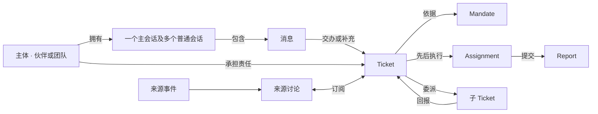
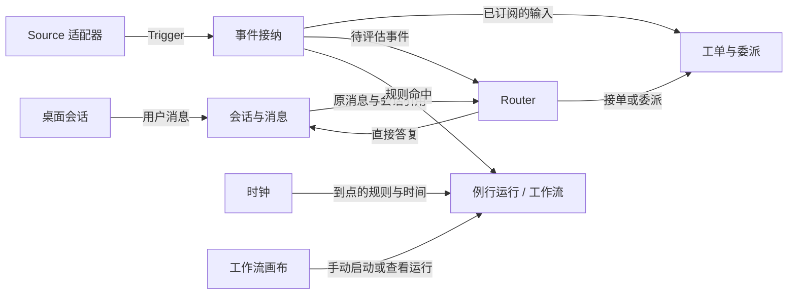
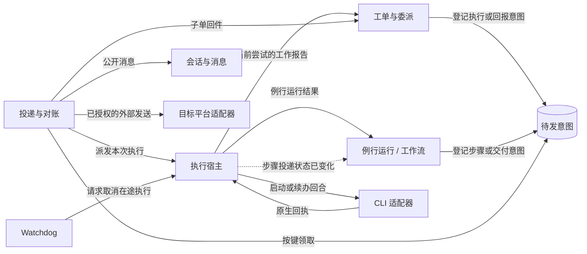
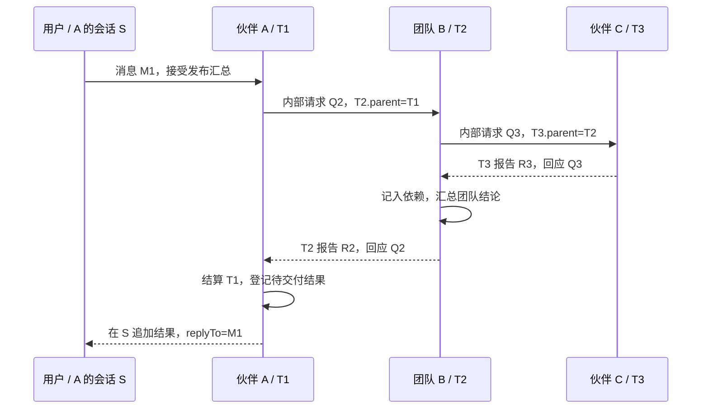

# Superagent 会话与工作架构（Go 目标设计）

用户打开伙伴或团队，默认进入可一直续聊的主会话，在这里交办工作、接收监控发现和处理待决问题。在另开的普通会话里交办的工作按原会话回报，主体的工作记录可按工单查询。**会话保存人与主体的关系，Ticket 保存主体对一件事的责任，Assignment 保存一次执行的经过。** 这三个对象有各自的身份和寿命。用户换页面、Worker 退出、团队换负责人时，前两者仍然可寻址。

本文是待实现的开发契约。DeepSeek Harness 原型提供工作领域模型，open-super-agent 提供 Router、Worker、Watchdog 和事件来源实现，OpenBot 提供公开线程、伙伴回件、工作流以及多 CLI 宿主的实现。下文称「Go 约定」的部分是三者接合时需要补齐的行为。固定源码版本、插件实例与展示差异见[上游调研](partner-main-conversation-research-cn.md)。

原型要求代理依据人的请求或既定规则行动，在人能使用结果或需要作决定时开口。NeuxBot 据此在主会话呈现已接受的委托、可用结果、需要用户处理的问题和影响交付的失败。每次工具调用与例行检查的细节留在关联的工作记录中。[DeepSeek 原型理念][dsh-philosophy]

### 两个上游怎么选

先比较同一个用户动作，核对谁负责、结果回哪里、进程重启后还要兑现什么。两份实现都满足时，采用调用链较短、持久状态较少的一条。同一项事实只选一个写入方。

| 用户动作 | 采用哪条实现，理由是什么 |
| --- | --- |
| 在当前对话提问或派后台工作 | 用 open-super-agent 的 Router、Worker、Watchdog 分工。直接回答走当前回合，手动派工和已有规则共用后台执行入口。OSA 甚至把派工消息的 ID 直接用作 Task ID。遇到需要长期负责、跨尝试续办的工作，再采用 DeepSeek 的 Ticket 与 Assignment。[OSA 派工][osa-dispatch] · [规则直接派工][osa-routine] · [原型工单][dsh-domain] |
| 回到同一伙伴、另开普通会话、重启 CLI 后继续 | 用 OpenBot 的稳定公开会话和原生绑定。它有手动侧线程、原生会话恢复与替换，直接覆盖 NeuxBot 面向 CLI 的使用方式。OSA 用于参考 Router 怎样对当前会话工作。[OpenBot 会话][ob-tabs] · [CLI 绑定][ob-binding] |
| A 请 B 帮忙，B 再请 C | 用 OpenBot 的原请求回址、父子依赖及明确移交。OSA 的私信能把答复带回原处，足以解释一次对话接力。这里还要保留父单责任，并阻止上一个负责人迟到的结果结算当前任务，所以工单照 OpenBot 的频道实现，推广到伙伴与团队两种主体。[OSA 私信][osa-dm-py] · [OpenBot 委派与移交][ob-delegate] · [完成回调][ob-complete-callback] |
| 插件发现变化、定时做事、流程等某个步骤 | 来源字段、轮询和规则触发照 OSA。定时补跑照 OpenBot，以触发器和应执行时间定位同一轮；工作流等待照 OpenBot，以步骤关联实际投递。分界在规则已命中之后，来源只描述发生了什么，运行或步骤负责执行和结算。[OSA 来源][osa-source] · [OpenBot 定时建档][ob-run-slot] · [步骤派发][ob-step] |

**保留的一处交付差异。** 用户要求已做完的工作能回到原会话。OSA 的完成通知是进程内回调，OpenBot 的频道回报器启动时把已有终态记为已处理。两者都留有“工作已完成，回件尚未入队”这一崩溃窗口。Go 采用 DeepSeek 的做法，把业务结论与待发消息一起持久提交，重启只补尚未确认的消息。第 7 节说明其边界。[OSA 完成通知][osa-done] · [OpenBot 启动处理][ob-restore] · [DeepSeek Outbox][dsh-outbox]

## 1. 顶层概念与寿命

### 谁交代，谁负责，谁看得到

| 概念 | 含义与关系 | 何时建立，何时失效 |
| --- | --- | --- |
| 主体 Subject | 可被寻址、接单、委派和报告的业务对象。伙伴与团队是两种 type。团队成员和负责人是主体的组织关系。 | 创建主体即有唯一主会话地址。团队换人继续使用团队地址。 |
| 公开会话 Conversation | 用户能打开并续聊的历史。每个主体恰有一个主会话，可有多个用户新建的普通会话。两类会话都只归一个主体。 | 主会话与主体同寿命，首次打开可幂等建档。普通会话可单独归档。关闭客户端页签只改变该设备的显示。新建普通会话不会创建团队、群组或工作。 |
| 公开消息 ConversationMessage、发起位置 Origin | 公开消息属于一个会话。会话交办分别记录发话的人、接单主体、会话和原消息。内部委派另有请求信件，可引用原公开消息。系统触发则记录来源事件、规则或运行，并在有收件要求时保存交付目的地。 | 接纳时记录。后续查看哪个页面、换了哪台执行器，都不改写最初请求。 |
| 逐级回址 | 工作既有原始交办人，也可能有直接请求者。子工作向父工作回件，工作流步骤向所属运行回件，根工作按交办时的用户地址交付。明确移交时，新负责人继承这份交付责任。 | 分派时冻结直接请求与收件主体。交付时只检查所引用的会话还能否接收，按第 5 节处理。 |

### 一件工作从哪里来

| 原型术语 | 领域含义 | 寿命与边界 |
| --- | --- | --- |
| Source、Trigger | Source 是带账户和作用域的一处输入来源。Trigger 是它观察到的一次事实，记录来源能提供的事件身份、该源内发出事件的人或系统身份、涉及的来源讨论和可选的回复地址。 | 一个来源持续产生多个不可变事件。同一个 PR 可以先后产生多条合法事件。 |
| Thread、Channel、Subscription | 原型的 Thread 标识来源自己的讨论或对象，例如某仓库的 PR #42。Channel 是向某次来源输入回复的地址。Ticket 通过 Subscription 订阅一个或多个 Thread，一条 Thread 也可关联多张 Ticket。 | 创建或跟进工作时登记。所属讨论的人工补充能续办原工作，关联讨论的活动可作上下文。仅有相关性不足以授予行动权限。 |
| Policy、Eval、Decision | Policy 记录主体可接哪些工作。Eval 对一批 Trigger、当时的讨论和工单快照、特定版本的 Policy 作一次判断。接纳模块保存评估依据。Decision 记录处理结论，例如接单、忽略、停止或暂不能判定。 | 每次评估都有依据。先给订阅者分发输入，再检查有无对该输入负责的工作。只作上下文的接收不排除另行评估。原型对推断出的新工作仍要评估，在自动接单模式下匹配启用规则才可接受。open-super-agent 的例行运行则可直接执行预设指令。 |
| Mandate（授权）、Input（工作输入） | Mandate 记录 explicit 或 inferred、策略版本、命中规则、来源侧触发者和行动范围。来源侧触发者可能是机器人。规则由谁配置应在规则记录中查。Input 是某张 Ticket 收到的一项补充，可来自用户、来源讨论或恢复说明。 | 接单时冻结 Mandate。后续输入可以补证据，扩大范围须取得新授权并建立相应工作。重开时重验依据，执行前仍检查生效权限。 |

[DeepSeek 领域关系][dsh-domain] · [事件扇出与评估条件][dsh-intake] · [Trigger 字段][dsh-trigger] · [Mandate 字段][dsh-mandate] · [推断接单门禁][dsh-gate] · [Ticket 字段][dsh-ticket] · [OpenBot 的页签与归档][ob-tabs]

### 接了什么工作，交付到哪里

| 概念 | 由谁负责 | 身份与寿命 |
| --- | --- | --- |
| Ticket（工单） | 一个主体对一项已获授权、有明确结果的工作负责。保存授权、来源、输入、所订阅讨论、当前责任主体、逐级回址和结论。 | 接单生成一个 ID，直到业务结束，历史仍可查。一次普通对话可直接回答，一个空轮询可安静结束。两者都不要求开单。 |
| 委派、移交 | 委派把一部分交给另一个主体，保留父单及其负责人，创建子单并登记依赖。移交把整张单的责任交给新主体，保留同一 Ticket ID、原请求和上级回址。 | 委派关系跨多次执行有效。移交推进责任版本，旧执行的回调不能结算新责任。上级可有多张并行子单。 |
| Assignment（执行尝试） | 当前责任主体为一张 Ticket 安排的一次执行。一张单可有先后多次尝试，同一时刻至多一个当前尝试。 | 接单建立首代，重试或确需恢复才换代。一次尝试可跨多个 CLI 回合，等待用户或外部结果期间仍可保留。 |
| Report（工作报告）、Attention（待人处理） | Report 给出进展、等待、就绪、受阻、失败或无需处理，以及证据或结果。Attention 关联一个具体问题与原请求，由能回答的人处置。 | 一次尝试可报告多次。问题答复、撤回或替换后关闭对应待办。每份报告按内容决定是否需要交给上级或用户。 |
| Routine、RoutineRun | 例行规则描述主体、触发条件、执行指令、授权和汇报方式。一次到点或一次匹配事件产生该规则的一次运行。 | 规则可长期有效，运行逐次结算。运行有身份，安静结束也可核查。接受需持续负责的发现时才建立或续办 Ticket。 |
| Workflow、WorkflowRun、Step | 工作流定义编排图。启动时固定定义快照。每次运行持有步骤实例、依赖、人工决定和输出目标。 | 图可多次运行。纯计算步骤在运行内结算，Agent 步骤给指定主体投递工作并等待其结果。一张流程可有零个、一个或多个 Agent 步骤。 |

[DeepSeek 工单与执行][dsh-exec] · [OpenBot 频道内的委派与移交][ob-delegate] · [OpenBot 工作流运行][ob-flow]

下图只画业务归属。有人追问“这次工作谁负责”时，沿 Ticket 查主体。追问“这次回复对应哪句话”时，沿回址查原请求。

**一张外部 Issue 和一张内部 Ticket 可以分别存在。** 用户只订日报时，一百条 Issue 可以成为同一份报告的输入。决定持续跟进其中一条时，工单保存这次承诺并订阅对应的来源讨论。用户从主会话的报告可追到原工作、当前负责人和外部对象。

**上游同名词的落点。** DeepSeek 的 Thread 是来源讨论，OpenBot 的公开线程是用户会话，provider 的原生 session 只承载模型上下文。DeepSeek 的 Channel 是发送地址，OpenBot 的 channel 可以承载团队协作。open-super-agent 的 Task 跟踪一次 Worker 运行，最接近这里的 Assignment。OpenBot 的 channel task 和 revision 提供父子责任、依赖、移交的实现依据。将 OpenBot 频道内的委派、责任版本与移交推广到跨伙伴、跨团队的 Ticket，是 NeuxBot 的产品映射。[原型术语][dsh-domain] · [Worker Task][osa-task] · [频道工作版本][ob-revision]

## 2. 工单的状态机

| 动作 | 必须满足的条件 | 提交后的事实 |
| --- | --- | --- |
| 接单 | 可用来源或用户请求，有有效授权。本次接受决定尚未关联工单 | 同一事务记录 Decision、Mandate、Ticket、首个 pending Assignment、启动意图。重复接纳返回原结果。 |
| 补充输入 | 原消息显式引用该单，或事件匹配已登记的来源订阅 | 每个匹配的 Ticket 各追加一次 Input。区分已入账、已投给尝试、已被 Worker 读入一个回合。 |
| 启动或回合结束 | 启动回执指向当前尝试 | Assignment 从 pending 到 running。一次 provider 回合结束只记录该回合，即使模型进程已退出，Ticket 仍按自己的条件结算。 |
| 报告 | 当前责任版本、尝试、授权匹配 | 保存报告。progress 记进展。waiting 可由宿主按一次空闲回合记录，等待后续输入。blocked 或 failed 记原因，可请求处理。ready 在无未完依赖时可结单，仍跟踪开放 PR 时可以继续等评审。dropped 可按无需处理结单。 |
| 结束 | 开放工单满足完成条件，或人明确停止 | 记录 ended 和原因，如 completed、merged、closed、dropped、stopped。人为停止撤回本次授权，也使在途执行失去推进资格。 |
| 重开 | 已结束，原因允许续办，有人在所属讨论补充请求，且原授权重验通过 | 恢复同一 Ticket 并分配下一代。人为停止的单保持终态，再委托须重新接单。仅关注该讨论的上下文订阅不能据此重开。 |
| 重试、转交 | Ticket 仍可执行且具备当前权限。需处理的上次执行已确认结束或已隔离 | 封存旧尝试，保留同一 Ticket，创建新的 pending Assignment。明确移交同时更新 owner 及版本。旧结果可查，不参与新结算。 |

用户看到的「排队中」「等我回答」「等评审」「结果待送达」由执行、待办、依赖和投递事实推导。举例说，Worker 已交出报告，Ticket 可以已经 completed，主会话消息还在待投。恢复时只须补交这份结果。执行层可单独记录 interrupted、cancelled 或进程退出码。[派生展示状态][dsh-stage] · [报告与结束条件][dsh-report] · [投递和已读][dsh-input] · [重开资格][dsh-stop]

## 3. 分层与模块所有权

### Go 的依赖方向

| 层 | 模块职责 | 可以调用或提交什么 |
| --- | --- | --- |
| 接入与展示 | 桌面对话、工作看板、插件 webhook 入口、时钟和 CLI 回调适配器。校验调用方并将外部格式翻译成应用输入。 | 通过应用服务查询或提交事实。桌面订阅更新后可按游标补读权威消息。 |
| 应用编排 | 会话服务、接纳与 Router、工单服务、例行与工作流、投递调度、执行调度。决定调用顺序、事务范围和下一位接收者。 | 调领域规则，由仓储提交事实与意图。涉及网络、CLI、外部插件的副作用在提交后运行。 |
| 领域 | 上一节的授权、工单状态机、父子依赖、交付资格、规则和运行结算条件。 | 给出接单、续办、拒绝、结束、上报等确定性结果。模型提供候选判断，宿主在此校验权限和状态。 |
| 基础设施 | SQLite 仓储与事务、持久信箱和待发队列、Source 适配器、CLI 驱动、进程和实时通知。 | 实现应用所需端口，将实际回执交回应用。数据库连接、WebSocket、goroutine 和 provider 会话均属这一层。 |

图中的模块划分决定**谁有权修改哪项事实**。在 Go 中，单入口用例由入口直接编排，多个入口共用的用例放入 services。领域判断独立于 GORM 和 CLI SDK，SQLite 访问集中在 repositories。伙伴与团队走相同命令，仅在确定成员、负责人和受托执行者时读取 type 对应配置。[后端约定](../development/backend-cn.md)

**数据转换只发生在表示确实变化的边界。** 同一进程内，字段含义、可见范围和生命周期相同，就直接传所有者定义的 Go 类型或所需参数。专用 DTO 适用于外部协议字段不同、对外需要裁剪字段或存储格式需要独立演进等情况，转换归相应适配器。每经过一个包都重建同形的 Request、DTO 和 Model，会让一个字段的修改蔓延到整条链。第 4 节的命令签名描述调用能力，可以直接实现为 Go 方法。

**跨异步边界时保留重放所需的信息。** 接收方使用本次动作已有的业务引用。需防止旧派发改变当前工单时，由工单服务校验派发版本。大段原文或产物可以引用已保存的不可变版本。举例说，来源适配器把 PR webhook 归一为一条 Trigger。两张订阅该 PR 的 Ticket 各保存一条引用同一 triggerID 的 Input，因为两张单的投递和已读进度独立。报告发出时保存当时的收件人和内容或版本引用，重试仍能交付原报告。

### 一次请求穿过哪些模块

先看入口和接手的模块。边上的文字是接收方需要的输入。简单对话由 Router 调用执行宿主完成当前回合，会话服务追加一次答复。定时规则与已订阅工单都有各自的直接入口。

再看需要后台执行或交付的工作。业务所有者在提交状态的事务里登记待发意图，投递服务主动领取。实线标出命令或需确认的回执，虚线表示可由对账恢复的唤醒。每次回调都沿派发时记录的归属返回。

### 哪个模块有权写哪条事实

| 模块 | 接收的输入 | 唯一负责的事实 | 交给谁 |
| --- | --- | --- | --- |
| 会话与消息 | 打开主体、创建普通会话、接收/追加消息 | 主体的主会话身份、公开消息顺序和回复引用 | 用户输入给接纳服务。持久消息变化通知桌面 |
| 来源与接纳 | webhook、轮询批次、需要接单判断的输入 | 来源模块保存游标与事件身份。接纳模块保存评估快照、决定和命中关系 | 命中订阅给工单追加 Input。确定指令给规则运行。新承诺交工单服务 |
| 工单与委派 | 接单、补充、分派、移交、报告、答复与停止 | 工单、授权、父子关系、责任版本、Assignment 业务状态、Report 和 Attention | 产生启动、输入投递或逐级回报意图 |
| 例行任务与工作流 | 到点、匹配、步骤回执、人工决定 | 例行模块写规则与运行。工作流模块写运行快照、步骤、依赖和输出决定 | Agent 步骤交投递服务，步骤产物按输出节点发送，有交办回址的整图终态另行结算 |
| 执行宿主、Worker、Watchdog | 启动/续办意图、CLI 事件、在途执行观测 | 宿主写执行绑定、原生回合和中断证据。Worker 提交工作报告。Watchdog 根据时长、停滞、重复调用和预算请求取消在途执行，等待审批时跳过 | 回调按派发时登记的所有者回到会话、工单、例行运行或工作流步骤。provider 提问答回复用原请求绑定 |
| 投递与对账 | 单条发送或多收件人请求、业务回报、步骤输出 | 每位收件人的 Delivery、待发意图、尝试与收据 | 对内调用目标服务，对外调用来源或平台。可见消息由会话模块追加 |

**执行的所属对象。** 调度时登记本次执行是会话直接回合、Ticket 的 Assignment、RoutineRun，还是 WorkflowRun 的某个 Step，保存该执行与所属对象的关联。所有者由宿主从派发记录读取。只有 Ticket 使用 Assignment 状态机。如果例行或流程步骤另行委托一张需要持续负责的工单，执行归该单，运行或步骤保存其请求与等待关系。Worker 发回一次结果，按这个归属进入唯一的业务结算入口。

**Router 的边界。** 用户消息和需要反馈的工作报告都可以唤起 Router。主会话长期存在，Router 只在有输入时运行一轮，读取相应会话历史、当前请求与关联工作。它可直接答复，也可提出接单和委派。Worker 使用任务自己的执行上下文，拿到授权范围、目标、输入与回址。对已配置的例行指令，宿主可以直接派工。Worker 可以提交报告、问题和子工作请求，工单服务负责验权与落账。Watchdog 观测的对象是正在跑的执行。发现新 Issue 属于 Source，判定工单结束属于领域，补交结果属于投递服务。[原型唯一写方][dsh-owners] · [Router 派工][osa-dispatch] · [定时派工][osa-routine] · [Watchdog][osa-watch]

### 按能力找文件

一个文件围绕一项能说清的能力组织。上游的 `dm.py` 把发私信、接回信、唤醒原对话放在一起，因为这三步共同兑现“受托方能把结果回给请求者”。Go 版沿用这个尺度。同一能力的入口、判断和辅助函数就近阅读，只有出现独立变化的职责才拆文件。首条链路的实际代码位置见[主会话文件导航](../architecture/chat-and-execution-cn.md#按能力找文件)。下面列出完整架构的模块规划。[open-super-agent 代码目录][osa-file-map] · [私信与回件][osa-dm-py]

| 要改的行为 | Go 侧从哪里读起 | 上游实现 |
| --- | --- | --- |
| 点击主体回到主会话，或手动另开普通会话 | [subject.go](../../server/services/mainconversation/subject.go) 解析主体的公开会话身份。启动或恢复原生 CLI 会话在对应驱动中处理 | [OpenBot 主会话身份][ob-main-id] · [用户侧线程][ob-tabs] · [原生会话绑定][ob-binding] |
| 用户当前这一轮直接回答还是派工 | `router.go` 决定并发起派工，`worker.go` 从已接受的目标开始执行并报告。只调整停滞判断时读 `watchdog.go` | [open-super-agent 派工][osa-dispatch] · [Worker 入口][osa-worker-py] · [巡检][osa-watch] |
| 修改工单完成条件，或改变委派和回件 | 完成条件归 `ticket.go`。父单交给谁、子单回给谁归 `delegation.go`。伙伴和团队共用这两处 | [DeepSeek 工单结算][dsh-report] · [OpenBot 分派与移交][ob-delegate] · [返回请求者][ob-team-return] |
| 增加一种插件事件来源 | 例如 `sources/github_repo.go` 保存该源的字段说明、参数校验和读取方法。`events.go` 负责按已登记的来源接纳事件 | [open-super-agent GitHub 来源][osa-github-fields] · [来源参数校验][osa-event-clean] |
| 改一条规则何时执行，或一个流程步骤如何完成 | `routines.go` 保存并调度例行规则。`workflow.go` 按步骤推进所属运行。两者各自持有运行结果 | [open-super-agent 例行规则保存][osa-rule-save] · [OpenBot 例行运行][ob-run] · [流程步骤结算][ob-step-result] |
| 结果已经完成，需要补发到原会话 | `delivery.go` 按原回件键领取、发送和确认。工单结论仍由工单模块持有 | [DeepSeek Outbox][dsh-outbox] · [OpenBot 回件][ob-return] |

实现时先找上游中能跑通同一用户场景的入口，沿调用链移植。需要针对 Go、CLI 或已确认产品语义作调整时，在相应能力里交代具体差异，例如把 OSA 的模型调用换成 OpenBot 的 CLI 绑定与恢复。本次范围以已确认的用户行为为界。两个上游都未覆盖、又会改变产品行为的场景，留到有真实需求时再讨论。

### 用户在聊天里管理定时和事件

本节以 open-super-agent 的[事件说明][osa-event-guide]和同版本的 Router 工具为实现蓝本。用户可以在一次交办里要求“每周一发项目周报；仓库有新 PR 时提醒我”。伙伴分别建立一条时间规则和一条事件规则，拿到各自的保存回执后告诉用户执行时间和监听范围。规则有各自的编号，收件人随后可以单独暂停 PR 提醒而保留周报。

| 用户在聊天里说 | Router 调用的上游能力 | 宿主负责的动作 |
| --- | --- | --- |
| “每周一九点发周报” | `create_routine` | 校验时间与执行指令，按负责主体保存规则并调度。 |
| “这个仓库有新 PR 就告诉我” | `create_event` | 从已登记来源中选仓库动态，校验仓库、动态类型和可选过滤条件。插件可轮询、接收外部推送，或声明内部事件；每个来源按自己支持的方式接入。 |
| “你在盯哪些事？这条上次跑得怎么样？” | `list_routines`，可给规则编号 | 列出所属主体的定时和事件规则。指明规则时返回完整要求、启停状态与最近运行；上游聊天详情默认取最近五次。 |
| “先暂停 PR 提醒”“恢复”“改到十点”“删掉这条” | `update_routine`、`delete_routine` | 针对原规则修改，同一份变更在自动任务页可见。暂停保留配置，明确要求删除才调用删除。 |

聊天 Router 和管理页共用规则保存与查询入口。运行中的 Worker 只处理本次命中；执行其输入不会自行重写以后如何触发。OSA 还有可跨 Bot 管理的全局主 Bot。NeuxBot 现有目标只要求每个伙伴或团队管理自己负责的规则，拥有主会话本身不授予跨主体管理权限。[Router 工具注册][osa-rule-tools] · [工具参数与查看范围][osa-rule-contract] · [Agent 保存事件][osa-agent-rule-save] · [管理页保存规则][osa-page-rule-save]

监控 PR 时，来源首次读取仓库建立基线，之后只提交新动态。规则先检查关键词，有语义过滤要求才调用模型。命中后派工，同一规则忙时收集后续事件，完成后接续处理。一次空轮询更新来源的最近检查时间和游标，读取失败更新检查错误。已观察到事件但被过滤，以及已派工后判定无需汇报，是可在规则运行记录里查看的两种结果。有值得汇报的变化时，报告按约定投递到负责主体的会话。新来源声明配置字段和实际支持的读取、解析或内部匹配方法，通用过滤、排队、派工和投递由宿主实现。只提供查询工具的插件可以由定时规则调用。[事件配置与过滤][osa-event-spec] · [来源检查的返回条件][osa-poll-outcome]

上游管理页的“现在看一次”会读取轮询来源，有真实变化才派工。“测试”会实际运行：轮询源先检查真实变化，未触发时取最近样本或内置示例派工，结果按测试语义展示。界面应让用户知道按钮会执行配置的工作。[运行与来源扩展][osa-event-run-spec] · [测试实现][osa-event-test]

当前 NeuxBot 的自动任务管理页已有创建、列表、启停及运行历史；已实现的触发类型是定时和本机 API。上述 Router 管理工具和通用插件事件来源是 Go 重构的开发内容。[现有管理路由](../../server/apis/automatic_tasks/router.go) · [触发类型](../../server/constants/automatic_task_trigger.go) · [当前模型工具边界](../../server/cmd/botcli/README.md)

### 前端配置跟随能力

**插件监控。** open-super-agent 的 GitHub 来源声明仓库、关注的动态类型等字段。事件编辑器读取来源目录，按字段绘制控件，连同执行指令提交给例行规则入口。Go 端校验并保存。NeuxBot 的自动任务表单沿用这个分工。以后加一种使用相同控件的来源，改它的来源文件并注册，界面就能显示它声明的字段。仅提供查询工具的插件仍可由例行任务定时调用。[来源字段][osa-github-fields] · [编辑器读取目录][osa-event-catalog-ui] · [按字段渲染][osa-event-fields-ui] · [提交规则][osa-event-submit-ui]

**例行任务回到哪里。** OpenBot 的伙伴例行任务默认在主聊天运行。具备该能力时，界面提供一个“在单独的话题中运行”开关，开启后使用这条规则自己的线程。用户在会话里交代同一件事，也由调度器保存同一份规则。NeuxBot 沿用这个默认值和两种位置，主会话入口、普通会话及画布手动运行的交付按第 5 节处理。Router、Worker 与 Watchdog 的分工由宿主承担，用户配置的是跟踪什么、何时执行、如何汇报。[OpenBot 表单保存][ob-routine-ui-save] · [运行位置控件][ob-routine-ui-place] · [会话创建规则][ob-routine-tool]

### 前端改动范围与开工边界

| 用户动作 | 前端需要接入的行为 | 可以沿用的部分 |
| --- | --- | --- |
| 点击伙伴或团队，另开普通会话 | 侧栏点主体直接解析唯一主会话。主会话随主体存在，历史菜单和自动清理都须识别其身份。手动新建仍归一个主体。 | 现有伙伴和团队的导航、普通会话历史、页签与新建入口。[当前选择逻辑](../../packages/frontend/src/app/layout/app-shell.tsx) |
| 在 Bot 聊天回复发现，点头像追查 | 按后端发布的消息逐条渲染、引用。有来源的消息头像打开真实来源工作会话，返回原聊天时恢复阅读位置和输入草稿。来源不再可读时原公开消息仍可阅读。 | 现有回复控件、耗时和步骤折叠。伙伴资料里的「工作记录」展示统计，消息头像需要多回合时间线。[消息与步骤](../../packages/frontend/src/modules/chat/components/chat-thread.tsx) · [现有统计](../../packages/frontend/src/modules/waker/components/waker-work-record-section.tsx) |
| 建立、编辑、检查事件规则 | 自动任务的筛选和表单接入事件类型与来源字段，详情分别显示来源检查状态、运行历史和已送达的报告。 | 现有规则列表、启停和分页历史。[自动任务列表](../../packages/frontend/src/modules/automatic-task/pages/automatic-task-list-page.tsx) · [规则详情](../../packages/frontend/src/modules/automatic-task/pages/automatic-task-detail-page.tsx) |
| 在主会话答复委派问题、从看板或通知打开结果 | 待决卡按原请求身份提交；未读按实际投递到公开会话的消息计算，后台步骤和空轮询不增加聊天未读。会话交办的工作流在原处交付，画布手动运行由画布展示。 | 原审批和提问控件、工作流运行详情、工作看板和共享实时订阅。[通知与阅读归属](../architecture/notifications-and-work-board-cn.md) |

已确认的产品口径如下。首条实现链路覆盖新数据上的主会话、分段发言、引用和来源工作记录。事件配置与工作流投递开关在后续接入。

| 场景 | 用户看到的行为 | 后端依据 |
| --- | --- | --- |
| 在聊天中创建事件规则，之后收到新发现 | 规则保存后发一条伙伴消息，带可打开的规则链接。命中时，每个需要单独讨论的发现可独立发言，附对应对象或运行链接。只有需要选择、批准时显示交互卡。 | 聊天和管理页读写同一规则。来源检查、无变化轮询和 CLI 步骤留在运行记录。 |
| 第一次打开伙伴或团队 | 每个主体从一条空的主会话开始，重复打开得到同一地址。仍可手动新建普通会话。 | 开发阶段直接使用新结构，不迁移历史聊天，不从最近聊天推断主会话，也不要求删除已有数据。 |
| 先交办项目 A，再交办项目 B | 两项工作的公开消息都在同一主会话。引用 A 的任意一条发现，仍在 A 的授权范围内续办。点头像按消息打开对应的多回合记录，返回恢复原阅读位置和草稿。 | 桌面主会话没有全局目录。规划中的 Router 在派工时根据用户意图，从伙伴已添加的项目或用户明确授权的路径中选择范围。指代含糊时先追问。宿主核验项目归属，将目录及指令策略固定到该次工作，引用按原消息恢复范围。当前首条链路已支持接纳结构化范围与按来源续办，项目意图识别随委派接入。[OpenBot 子任务资源](https://github.com/nightly-labs/openbot/blob/100c60e893eda3ce4761b4d10001a8e490c43536/src/backend/channel-service.ts#L3474-L3519) · [目录授权](../architecture/workspace-and-storage-cn.md) |
| 给全局独立工作流设定时 | 表单提供「回报到主会话」开关。实现默认值取关闭；打开后选择一个伙伴或团队。关闭时仍可在运行详情查看结果。 | 每次运行接纳时固定本次交付约定。改开关只影响后续运行。原审批、步骤输出和详情按工作流配置执行。画布手动启动直接看画布。[全局创建入口](../../server/apis/automatic_tasks/global_tasks.go) |

## 4. 传递与回调协议

以下签名表示 Go 应用边界，便于实现者确定调用方和参数。传输可以是本地函数、持久投递或 CLI 适配器事件。只有接收方提交了对应事实，这一步才算完成。

| 从谁到谁 | 命令或回调的关键参数 | 接收方如何确认与推进 |
| --- | --- | --- |
| 桌面 → 会话服务 | `AcceptMessage(subjectID, conversationID, clientMessageID, text)` | 校验会话归属，按发送者与客户端消息键返回同一 Message 和收据。Router 可以在另一回合处理，CLI 忙时仍能接纳。 |
| Source → 接纳服务 | `AcceptTrigger(sourceInstanceID, event)`。event 保存来源能提供的事件键、主体、发生时间、来源讨论、回复地址和原文引用。轮询另附游标 | 有稳定事件键的来源可识别重投。同一个 PR 后续的新事件仍要处理。规则命中后由实际产生的运行或订阅 Input 记录此次消费。 |
| Router → 工单服务 | `AcceptWork(decisionID, owner, mandate, origin, returnTo)`。来源补充使用 `AddInput(ticketID, triggerID)` | 只有接受持续负责的工作才建 Ticket，按接受决定取得同一张单。给原单补充输入时直接使用它与来源事件的关联。已有明确指令的例行运行可直接派工。 |
| 当前负责人 → 工单服务 | `AssignChild(parentID, expectedRevision, requestMessageID, recipient, scope)`。移交同样引用发起这项操作的消息或工具调用 | 同一项委派重放时沿用其请求引用。新的委派有自己的请求，即便收件人相同也可成立。服务核验责任版本，原子登记父子依赖或移交同一张单。 |
| 工单服务 ↔ 执行宿主 | `StartAssignment(assignmentID)`，回 `AssignmentStarted(assignmentID)`。按需调用 `DeliverInputs(assignmentID, inputIDs)` | 宿主从已保存的派发记录取得 Ticket、责任版本及执行参数，按原尝试核对启动回执。只确认已投、已读或失败的输入。 |
| Worker → 工单服务 | `ReportWork(assignmentID, report)`。CLI 回合结束按绑定和原生 turn 回调 | 服务从派发记录找到 Ticket，检查它仍开放且尝试有效，移交或重试后旧尝试不能改结论。普通进展更新当前尝试的摘要。可重放的报告命令沿用原工具调用或消息身份。对外有意义的结果与待发回件一起提交。 |
| 投递服务 → 父工作／公开会话 | 内部回件引用原委派信件，公开回复引用本会话原消息，回件沿用已登记的发送标识 | 单收件人补投和确认共用这次发送的键。多人请求为每位收件人保留各自的 Delivery。父单据回件检查依赖，最终公开结果以普通消息交付。结果回件设 `expectsReply=false`。 |
| 用户／事件 → 原等待方 | 业务问题 `AnswerAttention(attentionID, answerMessageID)`，CLI 交互 `AnswerPrompt(bindingID, providerRequestID, answers)`，流程审批 `DecideStep(runID, stepID, decision)`，事件续办 `SignalWait(waitID, eventID)` | 分别校验未关闭问题、待答 provider 请求、待审批步骤、有效事件等待。事件等待绑定原请求的 deliveryID，另行投递唤醒消息时才保存这次投递的身份。内部回复引用原信件，公开回复引用原会话消息。 |
| 执行宿主 → 工作流 | 队列或回合变化唤起步骤对账。按 stepID 查询已绑定的 deliveryID | Agent 步骤按固定步骤键投递，保存 deliveryID，再据 delivery→turn 读取终态和产物。工作流模块校验结果格式并推进依赖。输出节点按自身目的地发送步骤产物。运行进入终态后保存整图结论。若启动时登记了会话或规则的交付回址，再写入对应的待发回执。 |

**竞争时谁先处理。** 同一来源主 Thread 同一时刻只有一个进行中的 Eval。给模型的评估快照固定了输入批次、当前工单和策略版本。评估期间的新输入留到下一次处理，提交时核对评估身份及策略版本，已过期的候选结论重新评估。工单服务只接纳当前尝试能够推进的状态。驱动提供的原生回合、消息或调用标识在宿主内解析。[原型评估快照][dsh-eval-model] · [原型领域规则][dsh-domain]

OpenBot 的频道完成回调收到 channel、turn 和状态后，自己查出派发记录、核对任务版本。Go 将同一原则落在工单服务。调用方只需提供自己手里的执行身份。[执行端口][dsh-ports] · [原型报告入口][dsh-report] · [OpenBot 投递拆分][ob-mail] · [版本校验][ob-revision] · [步骤结算][ob-step-result] · [重启重扫][ob-step-sweep] · [等待登记][ob-wait] · [CLI 提问][ob-prompt]

### 哪些地方需要防重

conversationID 定位会话，ticketID 定位承诺，assignmentID 定位一次尝试。这些身份各有独立寿命。幂等键只在一次操作可能重放、重放又会产生第二份可见结果或副作用的边界使用。优先复用现有消息、调用、步骤或平台事件的身份，由拥有该写入的模块检查。若调用方确实会重试，且手里没有能识别这次操作的键，就在首次提交前生成一个并在重试时复用。

| 边界 | 最小做法 |
| --- | --- |
| 用户发送 | 同一次发送在网络超时后重试，客户端沿用原提交键。用户主动再发一次相同文字则产生新消息。OpenBot 对提供了 clientMessageId 的发送按发送者和伙伴找原收据，窗口内复用结果。[用户发送][ob-user] |
| 来源与规则 | 平台有稳定事件键时按来源实例与该键接纳。只做轮询的来源可用原生已见项或游标；通用 webhook 缺少稳定身份时保留这个限制。命中规则的运行记录以规则和事件为依据，已有的运行即是该规则已接纳的证明。每张订阅单的 Input 以工单和事件定位。[OSA 轮询][osa-poll-seen] · [通用 webhook][osa-webhook-shape] · [原型订阅扇出][dsh-intake] |
| 定时与步骤 | 同一触发器同一应执行时间对应一次定时运行。两次手动「立即运行」各有自己的 runID。同一工作流步骤派工重试沿用 stepID，独立的步骤实例和新一轮运行仍各自执行。[定时与手动建档][ob-run-slot] · [运行投递][ob-run] · [步骤派发][ob-step] |
| 运行与回件 | 重试执行产生下一次 Assignment，补发已完成的结果沿用原消息。普通回信使用原请求引用和已有的结果身份。OpenBot 的伙伴自动回件用原生 turnID 和原请求消息 ID 派生发送键，频道结果按派发及任务版本定位。Go 给单一收件人首次登记结果时确定发送键，补投、消息接纳与收据都沿用它。重开工单再次结案或一项请求问了多人时，新的结论或不同的收件人仍能分别交付。[伙伴回件][ob-return] · [频道结果][ob-result-id] · [单条出站消息][dsh-outbox] |

以一次定时检查为例，09:00 的时钟响两次，调度器找到同一条 run。Worker 已经完成而界面回执丢了，投递服务把同一份结果按原键确认或补发。用户随后主动点一次「立即运行」，这是一笔新的工作。普通函数调用、直接答复中的流式进度、可由重扫恢复的界面通知均无需另造全链路请求号。

## 5. 回哪一个会话

### Bot 聊天与伙伴工作记录

打开伙伴先看到 **Bot 聊天**。伙伴可以在同一轮里先发一个值得跟进的发现，稍后再发结果。每次面向用户的发言都是一条可引用的公开消息。一次执行可以没有公开发言，也可以有多条，普通进展仍记在执行里。[Nuphos 发言约定][nu-post] · [公开发言记录][nu-write]

**点消息旁的伙伴头像，打开这位伙伴发出消息的工作会话。** 工作记录按回合保留触发原因、已记录的运行事件、当时的处理结果，以及有权限查看的过程。已完成回合可以收成一行“处理了多久”，点击再看步骤。可以在同一工作会话继续提问，工作期间 Bot 聊天显示等待。NeuxBot 将该提问也写入主会话，伙伴可在工作中逐条发布结果。顶栏后退恢复进来时的 Bot 聊天，前进可重访同一工作。[来源会话输入与发送][nu-source-composer]

头像导航只读取已有记录，发送方、原工单和回报地址都保持原有归属。Nuphos 桌面用发言的来源 session 打开这条记录，消息区头像和顶部资料入口各有各的作用。[消息头像的目标][nu-avatar] · [头像与名字的点击行为][nu-avatar-action] · [按回合展开过程][nu-worked]

例如，创建伙伴时，Bot 聊天里出现伙伴给用户的自我介绍。工作记录里则保留“用户已创建 Bot”的触发，以及该轮的回执“已在私聊发布了介绍”。后来用户关闭提问，又触发了一个回合。两个回合都能在工作记录里读到。伙伴只把准备告诉用户的话发回 Bot 聊天。

**对 NeuxBot 的影响。** 当前宿主以一个 `AssistantMessageID` 承载整个回合，前端用同一回复的 `displayParts` 展示过程，成功后最后一段连续正文留在外面。目标设计保留这套过程展示用于工作记录。会话服务另行接纳明确面向用户的发言，每次发布沿用已有消息身份及其来源会话引用，同一次发布重投只出现一次。前端按公开消息渲染 Bot 聊天，头像打开可访问的来源工作会话。这两条路径都可以复用原消息与执行记录，无需为切换视图创建新 Chat、Ticket 或执行。[当前回合身份](../../server/internal/agent/turn_lifecycle.go) · [当前回复的分组](../../packages/frontend/src/modules/chat/components/chat-message-nodes.ts)

### CLI 中谁决定发言，何时分段

**建议采用 Nuphos 的显式发言。** 在有用户收件人的对话回合，Go 宿主给伙伴一项“向本次交办会话发言”的能力。伙伴在需要用户看到一段话时调用它，宿主从当前执行取得发送方、来源工作会话和已授权的回址。一次调用接纳一条完整消息，读者当即可以回复；接纳时无需等待整个 CLI 回合结束。当前可用的 `botcli` 和内部 MCP 都能承载宿主能力，具体连接方式由运行环境决定。首条主会话链路用该能力交付公开正文。[Nuphos 发言与来源][nu-write] · [NeuxBot 宿主能力与授权](../architecture/agent-capabilities-cn.md)

给伙伴的发言指引可以用以下场景检验。[Nuphos 工具说明][nu-post] · [OpenBot 的发言指引][ob-speech]

| 伙伴在做什么 | 用户会话收到什么 |
| --- | --- |
| 用户问一个可以马上回答的问题 | 直接发答案。一条答案可以有几个自然段。 |
| 用户交办一项耗时的工作 | 接手时可说清先查什么。随后在用户能用上一项发现、原判断需要改变，或阻塞已影响交付时发一条。密切相关的证据和结论合在同一条。 |
| 用户需要选方案、补资料或批准操作 | 登记对应的待决问题，在有权回答的用户会话呈现一次可操作的提问。用户的回答续办原工作。 |
| 读取文件、调用插件、切换模型、重试后能继续，或 CLI 写下“已向用户发出介绍” | 触发、可展示的步骤及回合小结留在来源工作记录，点发言旁的头像可查看。 |
| 插件轮询或定时作业完成 | 只订变化且没有变化时静默收尾。约定每天交日报时，零变化也是当天的报告。子 Worker 给直接请求者交报告，根工作按原约定交付，画布启动的运行在画布查看。 |

例如用户问“PR #87 今天能合吗”。伙伴读 diff、查 CI 的几次输出都在工作记录。看到兼容性检查失败时可先发“先别合并 #87，兼容性检查失败，我在核对受影响的版本”。查明原因后再发“只有 v1 配置受影响。给超时字段补上默认值后，重跑兼容性检查即可”。用户可以第一时间暂停合并，两次结论也可分别引用。

**CLI 输出与交付各有完成条件。** 两个输入入口都可以用显式发言交付答复，已公开的分段答复沿用原发言回执。原生结果、旁白和工具输出留在来源工作记录。满足当前交付条件时，Core 可以补发已确认的原生 `final`，包括 CLI 使用原生工具后明确给出的最终正文。只有流式正文的回合遵循更严格的归属规则。原生流的换行、停顿和工具边界均不决定公开时机。[当前补发与失败结算](../architecture/chat-and-execution-cn.md#主会话和来源工作记录) · [Nuphos 无显式发言的用例][nu-silent-test] · [OpenBot 的 ACP 事件][ob-acp-text]

**已经接单的工作由结果回件兑现。** Worker 提交 Report，拥有该工作的工单、例行运行或工作流按回址和规则登记交付。已交付的结果卡就是该次结论，Router 仅在有新的用户沟通内容时再发言。较早发过一条进展也不会抵消最后的报告。这样一份报告只走一次结项投递，避免靠比较相似文案、额外模型筛选或为每个流式片段分配 ID 来防重。[OSA 结果与静默回件][osa-quiet] · [OSA 的 Router 分工][osa-result-owner]

### 各入口的交付地址

| 发起情况 | 直接接收者 | 用户最终看到的位置 |
| --- | --- | --- |
| 主会话或用户另开的普通会话里一次性交办 | 本主体工单。直接回答则归原消息 | 回复发起会话，公开消息引用原交办。普通会话始终保持普通会话身份。 |
| A → 团队 B → C | C 的回件归 B 的子请求，B 的回件归 A 的原请求 | A 汇总后在用户交办处交付。B、C 可查各自受托记录。一次性自动回件若原侧线程已归档或已删除，落到**同一请求主体**的主会话。 |
| 明确把整单从 A 移交给 B | B 接替同一 Ticket 的责任，保留已有回址 | B 对原交办交付，原会话可见责任变更和结果。单纯点名发言沿用群内轮次语义。 |
| 在普通会话里订“每天九点报告” | 创建记录写在该普通会话。以后每到一次时间建立一个 run | 默认 runIn=chat 发到规则主体主会话。显式 runIn=thread 则入规则专属线程。每天约定交付的报告在零变化日也送。只订变化的空运行可静默结算。 |
| 为当前请求登记“等 CI 通过再继续” | 事件唤醒 waitID，尝试续办原请求 | 在原线程续办。若普通线程仅归档且有容量，OpenBot 会重新打开。已删除、无资格、容量不足或额外投递失败时，唤醒留在本次例行运行。 |
| 有主会话授权的插件发现一条新 Issue | 规则命中后给负责主体。若已在跟踪则追加原单输入 | 达到用户约定的汇报条件，就在主体主会话交付并允许继续交代。外部 PR/Issue 的评论地址单独校验授权。 |
| 会话交办工作流 | 步骤结果归所属 WorkflowRun，启动时记录发起会话和交办消息 | 整图完成、失败或停止后，向原会话交付一次结论。 |
| 从全局自动任务页给独立工作流设定时 | 规则保存可选的主会话收件人，运行开始时固定该选择 | 开关关闭时只在运行详情查看。开启后，整图终态向所选伙伴或团队的主会话交付一次结论。 |
| 用户从画布手动启动工作流 | WorkflowRun 持有步骤记录和整图结论。此次启动没有会话回址 | 用户在画布的运行详情查看进度、产物和失败或停止原因。有无 Agent 步骤都适用，无需指定汇报伙伴或团队。 |

DeepSeek 的答案可回到提出具体问题的来源 Channel，最终结果可回 Ticket 的源 Channel。这里将用户在桌面交办和插件在外部发现明确区分。例如 GitHub 提供 PR 评论地址，同时桌面用户订了日报，日报的接收者仍然是桌面用户。发送外部评论要有相应 Mandate。[原型答复资格与地址][dsh-reply] · [OpenBot 委派回件][ob-return] · [显式等待重开原线程][ob-reopen-wait] · [事件续办][ob-wake] · [工作流输出][ob-output]

## 6. 三条完整链路

### 普通会话交办，伙伴委派团队，团队再委派伙伴

用户在 A 的普通会话 S 提出“汇总本次发布的阻塞项”。A 接 T1，委派团队 B 核对依赖得到 T2，B 再委派 C 查发布记录得到 T3。各节点有独立 Ticket 和当前 Assignment。子级收到完成自己的部分所需的上下文及授权。

如果 C 受阻，B 收到结构化原因，普通执行依赖仍未满足。B 可以补输入、重新安排并在需要用户决定时逐级提问。用户答复关联同一个 Attention 与 Ticket。对并行普通子任务，成功依赖全部满足才恢复父工作，避免一份早到的结果提前触发最终报告。OpenBot 对问答型子任务的失败有专门归并规则。实现时要保留工作类型的差异。[父工作与迟到结果][ob-revision] · [依赖结算条件][ob-deps] · [团队返回请求者][ob-team-return]

### 插件发现 PR，随后收到同一个 PR 的更新

1. 用户让 A “跟踪仓库中新开、等待我评审的 PR，有变化告诉我”。A 保存监控范围、读取和汇报授权、变化通知方式及主会话收件人。
2. Source 从签名 webhook 或带游标的轮询接到事件 E1，映射到来源讨论 P42。接纳服务按事件身份去重，根据规则决定是否处理。需要跟踪的工作接为 T42，登记 P42 订阅，Worker 读取 PR 并给出需关注的原因。
3. 工单服务接纳报告，投递模块向 A 的主会话追加消息 M42，带原对象和 T42 的引用。E1 重送只命中原收据。P42 新增评审意见是另一个事件 E2，进入 T42 的 Input。用户回复 M42 时也能定位 T42。授权仍只覆盖读取和汇报。
4. 对没有推送、只暴露查询工具的插件，RoutineRun 定时调用工具，按适配器能提供的身份和窗口识别变化。空轮询落本次运行记录。若用户要“每天一份”，那天就算没有变化也产生一份可见报告。源码能证明注册事件源、webhook 和定时查询三条路径。插件清单中的查询工具本身不构成事件订阅。

[open-super-agent Source 接口][osa-source] · [OpenBot webhook 分派][ob-webhook] · [静默发布][osa-quiet] · [插件能力实例对照](partner-main-conversation-research-cn.md)

### 定时工作流有 Agent 步骤及人工决定

09:00 的触发键建立一次例行运行，配置的流程启动 F1 并固定图快照。计算步骤先产出差异列表。Agent 步骤 X 委托团队解释异常，以 X 的实例键取得 D1。宿主把 D1 绑定到原生回合，完成时只唤醒对账。流程按 D1 读结果并校验格式，成功后进入审批步骤 Y。用户的同意归 Y。输出节点按配置投递步骤产物，例如向项目频道发一张差异表。若本次运行另有主会话交付约定，整图 done、failed 或 stopped 后，再由运行服务向负责主体投一份结论。用户拒绝审批导致流程停止时，即使输出节点从未执行，仍可交代停止原因。用户可以从结论展开 F1 的步骤。OpenBot 的步骤输出和整图终态是两个时机。这次定时运行已有主会话交付约定，Go 在整图终态登记回执。步骤产物使用 stepID 与目的地，整图结论使用 runID、用途与收件人。若配置的某个输出本来就是给同一收件人的整图结论，它只提供结论内容，实际发送统一推迟到运行终态。[OpenBot 运行终态][ob-flow-end] · [OpenBot 步骤执行][ob-step] · [步骤收敛][ob-step-result] · [人工审批][ob-approval] · [输出目的地][ob-output]

## 7. 持久化、恢复与 CLI 边界

下表是 Go 版需要持久保存的最小事实及事务边界。事务由应用用例持有，各模块只写自己的仓储。可以在同一 SQLite 事务中跨模块提交受理事实和发送意图。跨存储或跨进程时，源端只承诺意图已落盘，目标端用相同业务键追加并确认。本节规定的是逻辑记录，表结构和 API 命名可在实现时遵循仓库规范。

| 提交点 | 需要原子成立的事实 | 超时、重试或崩溃后的处理 |
| --- | --- | --- |
| 建立主会话、接收消息 | 主体的主会话唯一。客户端请求的唯一键和接纳记录一起保存 | 两个窗口首次打开返回同一地址。消息入库后即使桌面断线，按会话顺序重新读取。 |
| webhook／轮询 | webhook 先验证来源再登记事件与待处理意图。轮询写入一批观察结果和待处理意图后，比较旧游标再推进新游标 | 验证通过并持久接纳后才确认 webhook。旧 poller 提交旧批次时按事件键合并，游标保持已提交的进度。只有有限窗口或无稳定事件身份的源，记录其可追溯范围。 |
| 接单、委派与移交 | 接单决定及与之关联的首代启动意图。父单依赖、子单及其收件意图。移交的版本变化及原尝试失效 | 任一事务中断都可用原请求键重试。拒绝形成祖先依赖环。团队调整成员不改变团队 ID 或已分配尝试，需交接时走显式移交或重新分配。 |
| 领取执行、接收报告 | 执行前持久登记派发身份，通过状态条件更新原子领取待发项。只有取得资格的派发器可启动。报告按已登记的尝试归属核验，需汇报时同事务写待发项 | 领取者退出或启动响应丢失时，先按同一身份与驱动能力核实是否已启动。领取超时只触发对账。已接纳的不能再启动，无法确认且涉及外部副作用的进入待核实。新尝试不会接收旧回调的结算结果。 |
| 对内投递 | 投递服务保存发送意图和目的地址。目标工作、步骤或会话按原发送键只接纳一次 | 首次接纳时将原发送键与实际会话一起保存。ACK 丢失时先查同键收据，即使原会话此后归档也不另发。首次落到同一主体的主会话时用 originConversationID、originMessageID 及 Ticket 标示工作来源。原消息已删除则展示工单引用。公开 replyToMessageID 仅在原消息存在且同属该会话时填写。报告已完成则只补未确认回件。WebSocket 只提示有新记录，恢复读取权威记录。 |
| 对外发送 | 保存目的地、动作、授权、发送状态、平台支持的幂等键与外部凭证 | 请求已发而确认未知时，优先查平台回执或按同键重试。无核实或幂等能力时记为结果未知，交负责人处理。回件显示已发送只证明约定端点已接纳。 |

**哪些恢复行为可以照搬。** DeepSeek 的 Effects 把待执行动作排入事务，Outbox 把回复凭证与待发动作一起记录。open-super-agent 的 `on_done` 是进程内一次性回调，重启会把过去的活跃记录标为 interrupted。OpenBot 工作流会重扫尚未结算的步骤，但它的频道回报器启动时会把既有终态记为已处理。Go 组合采用 DeepSeek 的持久待发意图弥合最后这个窗口。这份持久记录可以直接使用投递模块已有的待发消息与其稳定身份。本地收件按键唯一、未确认可补投。对缺乏回执的外部系统保留结果未知。[DeepSeek Effects][dsh-effects] · [Outbox][dsh-outbox] · [open-super-agent 完成回调][osa-done] · [重启处理][osa-interrupt] · [OpenBot 频道恢复][ob-restore] · [外部输出恢复][ob-uncertain]

**后台各对象能活多久。** Source 在配置启用时监听或被轮询，停用后保留已接纳事件和读取位置。Router 一轮结束后即可释放。Worker 的进程可在一次尝试中因等待或中断退出，尝试和报告仍存。Watchdog 与投递调度随宿主启停。待发意图从 pending 经独占领取，到已确认、可重试、放弃或结果未知。只有收到目标确认才能标已送达，等待时间本身不构成完成凭据。

**什么情况重新执行。** 重启先读 Ticket、最新报告、报告之后是否又投过输入，以及未确认的意图。原型在 waiting、ready、blocked、failed 且此后没有已投新输入时保留尝试，若有待送 Input 则补送。确实打断仍需继续的工作才创建下一代 Assignment，并附恢复说明。OpenBot 对普通委派中断可退回带原请求引用的受阻结果，部分可重试的例行运行和结果回件另行再排队。Watchdog 请求停止后由宿主记录执行结果，并交业务所有者决定如何续办。[原型中断判断][dsh-recover] · [普通请求失败回件][ob-fail] · [分类重排][ob-requeue]

**长主会话如何面向 CLI。** 公开 conversationID 和消息历史由宿主持有。原生绑定保存 provider、native session 和最近确认的 turn。调度时按输入绑定的主体、执行伙伴以及项目或目录找到对应的工作会话，再按 CLI 能力领取。不同项目各自保有工作记录，公开会话保持同一地址。支持 resume 时恢复绑定。确认原生会话缺失或配置要求替换时，用近期正文、较早消息的摘录、已捕获的工作步骤和消息引用组装有界交接，保留原公开会话。其他暂时性恢复错误进入原绑定重试或故障处理。单回合 CLI 正忙时，主会话和后台工作仍可排队，释放后继续。压缩服从驱动能力，历史仍可按公开引用查询。Go 执行热路径直接使用已选配置，账号、额度、模型目录诊断不作为每次操作的前置步骤。[OpenBot 线程绑定][ob-binding] · [调度限制][ob-lanes] · [上下文交接][ob-context] · [压缩能力][ob-compact] · [后端约定](../development/backend-cn.md)

## 8. 实现顺序与可验证结果

各项的开发入口、依赖、自动化用例和桌面验收步骤见[主会话分项规格](superagent-slices/README.md)。每次开发会话交付一项，由用户在桌面验收后启动下一项。

### 首条链路的实现对照

| 决策 | 可核实的上游行为 | 本次实现与本地适配 |
| --- | --- | --- |
| 主会话身份 | OpenBot 的 `ensureThreadIdNow` 将主线程身份存到 agent，再次打开直接返回原值。原生线程另行绑定。[公开身份](https://github.com/nightly-labs/openbot/blob/100c60e893eda3ce4761b4d10001a8e490c43536/src/backend/agent-store.ts#L1388-L1394) · [原生绑定][ob-binding] | 一个伙伴或团队各有一条主会话，前端按主体寻址。公共入口下，伙伴用自己的执行配置，团队的新交办用当前负责人的成员配置，引用旧交办沿用仍在队的原执行伙伴。[主会话存储](../../server/repositories/controllers/main_conversation.go) · [输入入口](../../server/apis/main_conversations/send.go) |
| 伙伴聊天顶栏 | OpenBot 把伙伴头像和名称放在标题栏首位，旁边显示普通会话；加号立即打开草稿，首次发送时取得持久会话身份。[头像与名称](https://github.com/nightly-labs/openbot/blob/100c60e893eda3ce4761b4d10001a8e490c43536/packages/ui/src/features/conversation/ConversationHeader.tsx#L127-L151) · [加号](https://github.com/nightly-labs/openbot/blob/100c60e893eda3ce4761b4d10001a8e490c43536/packages/ui/src/features/conversation/threads/ThreadHeader.tsx#L118-L136) · [草稿首发](https://github.com/nightly-labs/openbot/blob/100c60e893eda3ce4761b4d10001a8e490c43536/src/renderer/src/features/agent-threads/agent-thread-tabs.ts#L335-L351) | 伙伴头像与名称是固定的主会话页签，从任意普通对话点它即可回主会话。「＋」直接打开该伙伴的普通对话草稿，首次发送才建立 Chat。从顶栏和侧栏进入同一份主会话。普通页签沿用 96–140px 的宽度区间，固定伙伴入口与首个普通页签留 8px，适配桌面壳的固定定位和横向滚动。[OpenBot 页签布局](https://github.com/nightly-labs/openbot/blob/100c60e893eda3ce4761b4d10001a8e490c43536/packages/ui/src/features/conversation/styles/agent-threads.css#L117-L169) |
| 派工与回报地址 | open-super-agent 派工时保存发起 chat 和执行 bot，Worker 的工作带着回址。[派工][osa-dispatch] | 创建工作时冻结可发言的会话和原交办消息。Go 的本地项目有目录授权。新交办按实际目录及其读取策略选择工作 Chat，回复从原消息找到来源。这里落地的是回址，完整 Ticket 和 Worker 编排属于后续阶段。[来源建立](../../server/services/execution/main_conversation_source.go) |
| 多段公开发言 | Nuphos 的 `channel_post` 一次发布一条，每条记录带发送者及来源 session。其测试覆盖回合有文本却发送零条公开帖。工具还可以按需读取所在频道的发言。[发言约定][nu-post] · [持久化][nu-write] · [零发言测试][nu-silent-test] · [读取频道](https://github.com/nuphos/nuphos/blob/83dce8394b14fc348c4e91ed664b96ed04ee75b1/apps/backend/src/lib/claude-code-preview/preview-tools/channels.ts#L218-L229) | CLI 用发布能力逐条发言，用只读能力按需翻阅同一主会话此前的公开消息。跨项目读取公开历史时只返回公开字段。旁白与原生输出保留在来源。针对人发起的回合，宿主可补送本轮遗漏的独立最终答复。为处理本地工具超时，公开消息标识直接从原调用身份派生，同一调用重试返回原消息。[执行授权与回执](../../server/services/execution/main_conversation_tools.go) |
| 主会话处理待答和审批 | Nuphos 将 Bot 及其 Agent 的未决问题放入 Bot 的消息时间线，回答交回提问的 session，处理后移除卡片。OpenBot 的审批组件根据请求列出可选决定。[Nuphos 待答时间线](https://github.com/nuphos/nuphos/blob/83dce8394b14fc348c4e91ed664b96ed04ee75b1/apps/desktop/src/components/channels/useBotChatQuestions.tsx) · [OpenBot 审批组件](https://github.com/nightly-labs/openbot/blob/100c60e893eda3ce4761b4d10001a8e490c43536/packages/ui/src/features/conversation/ConversationPrompts.tsx) | 主会话按对应交办放置卡片，与工作记录共用普通聊天已有的提问、审批与提交组件。答复交给实际发起请求的 CLI。处理过的问答保存在工作记录。[时间线卡片](../../packages/frontend/src/modules/chat/components/chat-timeline-interactions.tsx) |
| 头像打开工作记录 | Nuphos 将伙伴头像绑定到发言的来源 session，工作时长和步骤可展开。[头像][nu-avatar-action] · [步骤][nu-worked] | 按所点消息的真实来源加载多回合记录，并沿同一来源继续提问。来源输入沿用普通 Chat 编辑器，主会话和伙伴状态反映该次工作。返回时保留阅读位置和草稿。Nuphos 在组首放头像，伙伴气泡右侧可回复。NeuxBot 在首条公开答复出现时收起等待行，直接在连续发言的组首显示头像和名称。工作动效集中在组首头像，回合结束后头像原位转为静态。同组后续发言沿用正文列。[Nuphos 消息行](https://github.com/nuphos/nuphos/blob/83dce8394b14fc348c4e91ed664b96ed04ee75b1/apps/desktop/src/components/channels/ChannelPost.tsx#L107-L208) · [OpenBot 气泡侧边操作](https://github.com/nightly-labs/openbot/blob/100c60e893eda3ce4761b4d10001a8e490c43536/packages/ui/src/features/conversation/ChatMessageRow.tsx#L251-L321)。[主会话页](../../packages/frontend/src/modules/chat/pages/main-conversation-page.tsx) · [工作记录](../../packages/frontend/src/modules/chat/components/main-conversation-source.tsx) |
| 事件、委派与调度 | open-super-agent 在聊天和管理页使用相同的事件规则；OpenBot 调度器有主线程及后台队列。[事件规则](https://github.com/kadaliao/open-super-agent/blob/c217b8e0dcaaa40bb865febad2deeba483d0e1cd/docs/events.md) · [调度器][ob-lanes] | 属于后续接入。当前工作来源同一时刻可运行一个原生回合。该回合仍在执行时可阅读、准备引用；新回合的排队和重启恢复在调度阶段实现。独立工作流的定时回报开关也在后续表单和运行接纳阶段实现。 |

### 后续架构验收

每一项都可以从实际入口验收，留下会话、Ticket、运行、投递或外部凭证。下表列出整套架构的开发验收条件。首条链路及其边界见上表。

| 先落地的能力 | 输入或故障点 | 应可观察的结果 |
| --- | --- | --- |
| 主体、会话、接纳与直接回复 | 两个客户端同时打开团队，另开普通会话后切换页签，向普通会话重复发送同一客户端消息 | 同一团队主会话、一个独立普通会话、一个请求收据。直接答复留在原会话，未新增 Ticket。 |
| 工单与长上下文 | 一项任务跨两个 CLI 回合，中途确认原生 session 已丢失 | 可由原 Ticket 与公开会话续办，历史与授权仍可查。provider 新绑定可追溯。 |
| 逐级委派与移交 | A→团队 B→C，C 重投同一次工具调用产生的回件，再发旧尝试回调。另测明确移交 | 重复报告只接纳一次，每级依赖独立结算，原用户会话只收一份最终报告。移交沿用 Ticket ID，旧负责人不能改结论。 |
| Source、规则与例行运行 | 同一带稳定事件号的 webhook 重投，随后同 PR 的新事件。两个 poller 同时提交同一批次 | 旧事件只有一份，规则运行与后续 Input 各按键唯一，游标不倒退。变化订阅可以静默，约定日报每天有可见结论。 |
| 聊天管理定时与事件 | 一句话建立周报和新 PR 提醒，在管理页核对两条规则。首次轮询有历史 PR，随后出现一个新 PR。再从聊天查询最近运行、暂停 PR 提醒 | 首次轮询建立基线，新 PR 按约定交付一次。聊天和管理页显示同一份规则及运行事实；暂停仅影响指定规则，周报仍按时执行。 |
| 工作流与等待 | 步骤 D 已完成、处理通知前退出。再测步骤失败、拒绝审批和单独续办投递失败 | 重启按保存的 delivery 核对步骤，只推进一次。普通子单失败不会解除成功依赖。审批按原 step 结算，事件唤醒保留正确的等待关联。 |
| 工作流启动来源 | 从画布手动运行纯脚本流程和含 Agent 步骤的流程，覆盖成功、失败和停止。再从普通会话交办同一流程 | 画布运行在详情中显示结论，自动会话回执数为零。会话交办的运行向原会话交付一次结论。 |
| 全局定时工作流的回报开关 | 关闭后触发一次，开启并选择团队后再触发一次；第二次运行中关闭开关 | 第一次只在运行详情可见。第二次仍向选定团队交付一次整图结论。之后接纳的运行按关闭处理。 |
| 引用恢复项目 | 依次向同一伙伴交办项目 A 和 B，留在 B 的选择上回复 A 的其中一段消息 | 公开地址相同。原 A 的 CLI 工作记录出现后续回合，B 的工作记录没有该回合。 |
| 执行领取 | 常规派发与恢复扫描同时争用同一条 pending 启动意图，CLI 回执可能迟到 | 只有一个领取者启动。回执不明先对账，旧尝试的回执不能确认新尝试。 |
| 交付与对账 | 业务完成后崩溃。收件后 ACK 前崩溃且随即归档原会话。外部请求发出后失联 | 前两种按原键核实并补投，用户只见一份报告。第三种按平台能力查证或出现待核实记录。 |
| Bot 聊天与头像返回 | 同一工作回合发布两条不同的发现，其中一次发布重投。随后另一个事件唤醒该伙伴，再从消息头像进入工作记录并返回 | 两条发现各出现一次，可分别引用。工作记录能按先后查看两个回合的触发、过程与结果。返回后仍是原 Bot 聊天，工单与执行数不因导航增加。 |
| CLI 发言与最终回执 | 对同一交办分别用有原生旁白和只有普通文本的 CLI。具备发言能力时先发发现，结项后 CLI 写“已报告”。再测一次漏发的直接问答，以及工具不可用时的普通问答 | 前两种 CLI 的用户都只收到该发现和约定的最终报告，来源记录可见两者各自的步骤与小结。成功的直接问答若遗漏显式发言，只交付一条可确认的最终答复。发布被拒绝时不会从执行日志再发布。 |
| Watchdog 与单回合 CLI | 一次工作卡住，另一次正等审批。期间用户向主会话提问 | 只有符合巡检条件的在途执行被取消，等待审批的保持待决。用户消息已接纳，可在 CLI 可用后继续处理。 |

[osa-file-map]: https://github.com/kadaliao/open-super-agent/blob/e9722c7462cbf220ece4e03f74257cfc7d19962a/docs/architecture.md#L37-L57
[osa-dm-py]: https://github.com/kadaliao/open-super-agent/blob/e9722c7462cbf220ece4e03f74257cfc7d19962a/osa/dm.py#L40-L89
[osa-worker-py]: https://github.com/kadaliao/open-super-agent/blob/e9722c7462cbf220ece4e03f74257cfc7d19962a/osa/worker.py#L69-L80
[osa-github-fields]: https://github.com/kadaliao/open-super-agent/blob/e9722c7462cbf220ece4e03f74257cfc7d19962a/osa/sources/github_repo.py#L224-L239
[osa-event-clean]: https://github.com/kadaliao/open-super-agent/blob/e9722c7462cbf220ece4e03f74257cfc7d19962a/server/crates/osa/src/events.rs#L252-L273
[osa-rule-save]: https://github.com/kadaliao/open-super-agent/blob/e9722c7462cbf220ece4e03f74257cfc7d19962a/server/crates/osa/src/routines.rs#L339-L360
[osa-event-catalog-ui]: https://github.com/kadaliao/open-super-agent/blob/e9722c7462cbf220ece4e03f74257cfc7d19962a/web/src/components/Events.tsx#L9-L18
[osa-event-fields-ui]: https://github.com/kadaliao/open-super-agent/blob/e9722c7462cbf220ece4e03f74257cfc7d19962a/web/src/components/Events.tsx#L243-L249
[osa-event-submit-ui]: https://github.com/kadaliao/open-super-agent/blob/e9722c7462cbf220ece4e03f74257cfc7d19962a/web/src/components/Events.tsx#L205-L216
[osa-event-guide]: https://github.com/kadaliao/open-super-agent/blob/c217b8e0dcaaa40bb865febad2deeba483d0e1cd/docs/events.md#L3-L19
[osa-event-spec]: https://github.com/kadaliao/open-super-agent/blob/c217b8e0dcaaa40bb865febad2deeba483d0e1cd/docs/events.md#L21-L36
[osa-event-run-spec]: https://github.com/kadaliao/open-super-agent/blob/c217b8e0dcaaa40bb865febad2deeba483d0e1cd/docs/events.md#L67-L96
[osa-poll-outcome]: https://github.com/kadaliao/open-super-agent/blob/c217b8e0dcaaa40bb865febad2deeba483d0e1cd/osa/events.py#L449-L470
[osa-event-test]: https://github.com/kadaliao/open-super-agent/blob/c217b8e0dcaaa40bb865febad2deeba483d0e1cd/osa/events.py#L506-L519
[osa-rule-tools]: https://github.com/kadaliao/open-super-agent/blob/c217b8e0dcaaa40bb865febad2deeba483d0e1cd/osa/builtin.py#L113-L119
[osa-rule-contract]: https://github.com/kadaliao/open-super-agent/blob/c217b8e0dcaaa40bb865febad2deeba483d0e1cd/osa/routines.py#L491-L527
[osa-agent-rule-save]: https://github.com/kadaliao/open-super-agent/blob/c217b8e0dcaaa40bb865febad2deeba483d0e1cd/osa/routines.py#L687-L711
[osa-page-rule-save]: https://github.com/kadaliao/open-super-agent/blob/c217b8e0dcaaa40bb865febad2deeba483d0e1cd/osa/server.py#L1286-L1301
[ob-main-id]: https://github.com/nightly-labs/openbot/blob/100c60e893eda3ce4761b4d10001a8e490c43536/src/backend/agent-store.ts#L1377-L1394
[ob-routine-ui-save]: https://github.com/nightly-labs/openbot/blob/100c60e893eda3ce4761b4d10001a8e490c43536/src/renderer/src/features/conversation/AgentRoutinesSettings.tsx#L534-L547
[ob-routine-ui-place]: https://github.com/nightly-labs/openbot/blob/100c60e893eda3ce4761b4d10001a8e490c43536/src/renderer/src/features/conversation/AgentRoutinesSettings.tsx#L1162-L1178
[ob-routine-tool]: https://github.com/nightly-labs/openbot/blob/100c60e893eda3ce4761b4d10001a8e490c43536/src/backend/agent/routine-scheduler.ts#L685-L730
[ob-complete-callback]: https://github.com/nightly-labs/openbot/blob/100c60e893eda3ce4761b4d10001a8e490c43536/src/backend/channel-service.ts#L2818-L2851
[ob-run-slot]: https://github.com/nightly-labs/openbot/blob/100c60e893eda3ce4761b4d10001a8e490c43536/src/backend/routine-store.ts#L1038-L1063
[ob-result-id]: https://github.com/nightly-labs/openbot/blob/100c60e893eda3ce4761b4d10001a8e490c43536/src/backend/channel-service.ts#L4034-L4036
[osa-poll-seen]: https://github.com/kadaliao/open-super-agent/blob/e9722c7462cbf220ece4e03f74257cfc7d19962a/server/crates/osa/src/sources/github_repo.rs#L239-L267
[osa-webhook-shape]: https://github.com/kadaliao/open-super-agent/blob/e9722c7462cbf220ece4e03f74257cfc7d19962a/server/crates/osa/src/sources/webhook.rs#L31-L36
[nu-post]: https://github.com/nuphos/nuphos/blob/83dce8394b14fc348c4e91ed664b96ed04ee75b1/apps/backend/src/lib/claude-code-preview/preview-tools/channels.ts#L231-L245
[nu-write]: https://github.com/nuphos/nuphos/blob/83dce8394b14fc348c4e91ed664b96ed04ee75b1/apps/backend/src/lib/agent/channel-chat.ts#L123-L169
[nu-silent-test]: https://github.com/nuphos/nuphos/blob/83dce8394b14fc348c4e91ed664b96ed04ee75b1/apps/backend/src/lib/agent/channel-chat.test.ts#L1262-L1306
[ob-speech]: https://github.com/nightly-labs/openbot/blob/100c60e893eda3ce4761b4d10001a8e490c43536/src/backend/agent/developer-instructions.ts#L382-L386
[ob-acp-text]: https://github.com/nightly-labs/openbot/blob/100c60e893eda3ce4761b4d10001a8e490c43536/src/backend/acp-client.ts#L3692-L3721
[osa-result-owner]: https://github.com/kadaliao/open-super-agent/blob/e9722c7462cbf220ece4e03f74257cfc7d19962a/docs/architecture.md#L157-L163
[nu-avatar]: https://github.com/nuphos/nuphos/blob/83dce8394b14fc348c4e91ed664b96ed04ee75b1/apps/desktop/src/components/channels/ChannelPost.tsx#L74-L81
[nu-avatar-action]: https://github.com/nuphos/nuphos/blob/83dce8394b14fc348c4e91ed664b96ed04ee75b1/apps/desktop/src/components/channels/ChannelPost.tsx#L152-L185
[nu-source-composer]: https://github.com/nuphos/nuphos/blob/83dce8394b14fc348c4e91ed664b96ed04ee75b1/apps/desktop/src/components/agent/panel/Composer.tsx#L145-L156
[nu-worked]: https://github.com/nuphos/nuphos/blob/83dce8394b14fc348c4e91ed664b96ed04ee75b1/apps/desktop/src/components/agent/panel/partChrome.tsx#L55-L114
[dsh-domain]: https://github.com/deepseek-ai/dsh-superagent-prototype/blob/8c32a9dc5d72c033816c6a8110b37f40cf94fba4/docs/001-domain.md#L23-L43
[dsh-philosophy]: https://github.com/deepseek-ai/dsh-superagent-prototype/blob/8c32a9dc5d72c033816c6a8110b37f40cf94fba4/docs/000-philosophy.md#L5-L21
[dsh-trigger]: https://github.com/deepseek-ai/dsh-superagent-prototype/blob/8c32a9dc5d72c033816c6a8110b37f40cf94fba4/src/core/model.ts#L23-L39
[dsh-eval-model]: https://github.com/deepseek-ai/dsh-superagent-prototype/blob/8c32a9dc5d72c033816c6a8110b37f40cf94fba4/src/core/model.ts#L135-L155
[dsh-mandate]: https://github.com/deepseek-ai/dsh-superagent-prototype/blob/8c32a9dc5d72c033816c6a8110b37f40cf94fba4/src/core/model.ts#L126-L136
[dsh-ticket]: https://github.com/deepseek-ai/dsh-superagent-prototype/blob/8c32a9dc5d72c033816c6a8110b37f40cf94fba4/src/core/model.ts#L277-L307
[dsh-exec]: https://github.com/deepseek-ai/dsh-superagent-prototype/blob/8c32a9dc5d72c033816c6a8110b37f40cf94fba4/docs/003-execution.md#L5-L40
[dsh-stage]: https://github.com/deepseek-ai/dsh-superagent-prototype/blob/8c32a9dc5d72c033816c6a8110b37f40cf94fba4/src/core/stage.ts#L4-L25
[dsh-report]: https://github.com/deepseek-ai/dsh-superagent-prototype/blob/8c32a9dc5d72c033816c6a8110b37f40cf94fba4/src/core/assignments.ts#L94-L138
[dsh-input]: https://github.com/deepseek-ai/dsh-superagent-prototype/blob/8c32a9dc5d72c033816c6a8110b37f40cf94fba4/src/core/assignments.ts#L33-L64
[dsh-ports]: https://github.com/deepseek-ai/dsh-superagent-prototype/blob/8c32a9dc5d72c033816c6a8110b37f40cf94fba4/src/core/ports.ts#L48-L81
[dsh-reply]: https://github.com/deepseek-ai/dsh-superagent-prototype/blob/8c32a9dc5d72c033816c6a8110b37f40cf94fba4/src/core/replies.ts#L63-L95
[dsh-effects]: https://github.com/deepseek-ai/dsh-superagent-prototype/blob/8c32a9dc5d72c033816c6a8110b37f40cf94fba4/src/app/effects.ts#L48-L85
[dsh-outbox]: https://github.com/deepseek-ai/dsh-superagent-prototype/blob/8c32a9dc5d72c033816c6a8110b37f40cf94fba4/src/app/outbox.ts#L17-L50
[dsh-recover]: https://github.com/deepseek-ai/dsh-superagent-prototype/blob/8c32a9dc5d72c033816c6a8110b37f40cf94fba4/src/core/assignments.ts#L75-L92
[dsh-owners]: https://github.com/deepseek-ai/dsh-superagent-prototype/blob/8c32a9dc5d72c033816c6a8110b37f40cf94fba4/docs/007-architecture.md#L259-L271
[dsh-intake]: https://github.com/deepseek-ai/dsh-superagent-prototype/blob/8c32a9dc5d72c033816c6a8110b37f40cf94fba4/src/core/intake.ts#L30-L59
[dsh-stop]: https://github.com/deepseek-ai/dsh-superagent-prototype/blob/8c32a9dc5d72c033816c6a8110b37f40cf94fba4/src/core/tickets.ts#L247-L269
[dsh-gate]: https://github.com/deepseek-ai/dsh-superagent-prototype/blob/8c32a9dc5d72c033816c6a8110b37f40cf94fba4/src/core/evals.ts#L145-L155
[osa-task]: https://github.com/kadaliao/open-super-agent/blob/e9722c7462cbf220ece4e03f74257cfc7d19962a/server/crates/osa/src/task.rs#L85-L118
[osa-dispatch]: https://github.com/kadaliao/open-super-agent/blob/e9722c7462cbf220ece4e03f74257cfc7d19962a/server/crates/osa/src/router.rs#L860-L899
[osa-routine]: https://github.com/kadaliao/open-super-agent/blob/e9722c7462cbf220ece4e03f74257cfc7d19962a/server/crates/osa/src/routines.rs#L527-L575
[osa-watch]: https://github.com/kadaliao/open-super-agent/blob/e9722c7462cbf220ece4e03f74257cfc7d19962a/server/crates/osa/src/watchdog.rs#L45-L85
[osa-source]: https://github.com/kadaliao/open-super-agent/blob/e9722c7462cbf220ece4e03f74257cfc7d19962a/server/crates/osa/src/registry.rs#L224-L266
[osa-quiet]: https://github.com/kadaliao/open-super-agent/blob/e9722c7462cbf220ece4e03f74257cfc7d19962a/server/crates/osa/src/router.rs#L1009-L1033
[osa-done]: https://github.com/kadaliao/open-super-agent/blob/e9722c7462cbf220ece4e03f74257cfc7d19962a/server/crates/osa/src/router.rs#L1039-L1049
[osa-interrupt]: https://github.com/kadaliao/open-super-agent/blob/e9722c7462cbf220ece4e03f74257cfc7d19962a/server/crates/osa/src/tasklog.rs#L278-L295
[ob-delegate]: https://github.com/nightly-labs/openbot/blob/100c60e893eda3ce4761b4d10001a8e490c43536/src/backend/channel-service.ts#L3492-L3529
[ob-revision]: https://github.com/nightly-labs/openbot/blob/100c60e893eda3ce4761b4d10001a8e490c43536/src/backend/channel-service.ts#L2830-L2884
[ob-flow]: https://github.com/nightly-labs/openbot/blob/100c60e893eda3ce4761b4d10001a8e490c43536/docs/architecture/agents.md#L336-L364
[ob-mail]: https://github.com/nightly-labs/openbot/blob/100c60e893eda3ce4761b4d10001a8e490c43536/src/backend/mailbox-store.ts#L690-L739
[ob-step-result]: https://github.com/nightly-labs/openbot/blob/100c60e893eda3ce4761b4d10001a8e490c43536/src/backend/workflows/workflows.ts#L577-L615
[ob-wait]: https://github.com/nightly-labs/openbot/blob/100c60e893eda3ce4761b4d10001a8e490c43536/src/backend/agent-waits/agent-wait-store.ts#L60-L83
[ob-prompt]: https://github.com/nightly-labs/openbot/blob/100c60e893eda3ce4761b4d10001a8e490c43536/src/backend/agent/attention-registry.ts#L900-L951
[ob-user]: https://github.com/nightly-labs/openbot/blob/100c60e893eda3ce4761b4d10001a8e490c43536/src/backend/agent-service.ts#L6998-L7013
[ob-run]: https://github.com/nightly-labs/openbot/blob/100c60e893eda3ce4761b4d10001a8e490c43536/src/backend/agent/routine-scheduler.ts#L1087-L1112
[ob-step]: https://github.com/nightly-labs/openbot/blob/100c60e893eda3ce4761b4d10001a8e490c43536/src/backend/workflows/workflows.ts#L508-L547
[ob-return]: https://github.com/nightly-labs/openbot/blob/100c60e893eda3ce4761b4d10001a8e490c43536/src/backend/agent/turn-lifecycle.ts#L3315-L3344
[ob-wake]: https://github.com/nightly-labs/openbot/blob/100c60e893eda3ce4761b4d10001a8e490c43536/src/backend/agent/routine-scheduler.ts#L1175-L1219
[ob-reopen-wait]: https://github.com/nightly-labs/openbot/blob/100c60e893eda3ce4761b4d10001a8e490c43536/src/backend/agent-tasks/agent-tasks.ts#L249-L267
[ob-output]: https://github.com/nightly-labs/openbot/blob/100c60e893eda3ce4761b4d10001a8e490c43536/src/backend/workflows/workflows.ts#L1251-L1283
[ob-flow-end]: https://github.com/nightly-labs/openbot/blob/100c60e893eda3ce4761b4d10001a8e490c43536/src/backend/workflows/workflows.ts#L1453-L1482
[ob-deps]: https://github.com/nightly-labs/openbot/blob/100c60e893eda3ce4761b4d10001a8e490c43536/src/backend/channel-service.ts#L4038-L4052
[ob-team-return]: https://github.com/nightly-labs/openbot/blob/100c60e893eda3ce4761b4d10001a8e490c43536/src/backend/channel-request-returns.ts#L103-L129
[ob-webhook]: https://github.com/nightly-labs/openbot/blob/100c60e893eda3ce4761b4d10001a8e490c43536/src/main/host-events-service.ts#L595-L634
[ob-approval]: https://github.com/nightly-labs/openbot/blob/100c60e893eda3ce4761b4d10001a8e490c43536/src/backend/workflows/workflows.ts#L2271-L2283
[ob-restore]: https://github.com/nightly-labs/openbot/blob/100c60e893eda3ce4761b4d10001a8e490c43536/src/backend/channel-request-returns.ts#L46-L60
[ob-uncertain]: https://github.com/nightly-labs/openbot/blob/100c60e893eda3ce4761b4d10001a8e490c43536/src/backend/workflows/workflows.ts#L922-L944
[ob-fail]: https://github.com/nightly-labs/openbot/blob/100c60e893eda3ce4761b4d10001a8e490c43536/src/backend/mailbox-store.ts#L2579-L2634
[ob-requeue]: https://github.com/nightly-labs/openbot/blob/100c60e893eda3ce4761b4d10001a8e490c43536/src/backend/mailbox-store.ts#L3319-L3345
[ob-binding]: https://github.com/nightly-labs/openbot/blob/100c60e893eda3ce4761b4d10001a8e490c43536/src/backend/agent/thread-lifecycle.ts#L414-L471
[ob-lanes]: https://github.com/nightly-labs/openbot/blob/100c60e893eda3ce4761b4d10001a8e490c43536/src/backend/agent/drain-scheduler.ts#L379-L409
[ob-context]: https://github.com/nightly-labs/openbot/blob/100c60e893eda3ce4761b4d10001a8e490c43536/docs/architecture/providers.md#L136-L157
[ob-compact]: https://github.com/nightly-labs/openbot/blob/100c60e893eda3ce4761b4d10001a8e490c43536/docs/architecture/providers.md#L379-L398
[ob-tabs]: https://github.com/nightly-labs/openbot/blob/100c60e893eda3ce4761b4d10001a8e490c43536/docs/architecture/agents.md#L757-L766
[ob-step-sweep]: https://github.com/nightly-labs/openbot/blob/100c60e893eda3ce4761b4d10001a8e490c43536/src/backend/workflows/workflows.ts#L1485-L1534
