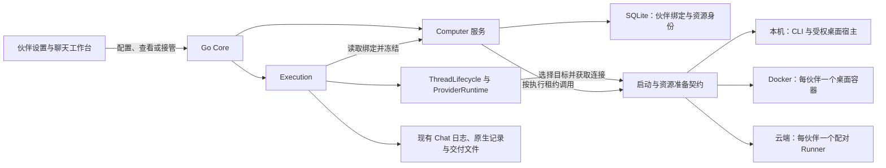
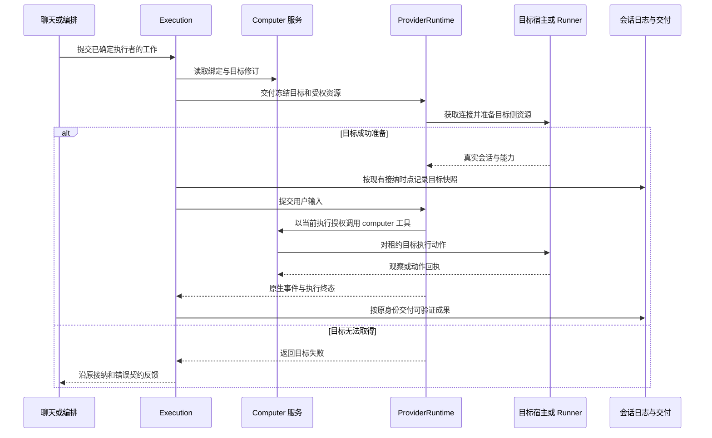

# 每个伙伴一台电脑：源码调研与实现设计

2026-11-20 · 讨论稿。依据上游源码、项目文档及当前 NeuxBot 工作树。实现顺序、首批平台和生命周期策略为本文建议，需通过真实平台验收。

## 结论

- **nightly-labs/OpenBot 已有原生桌面 Computer Use。** 一套 OpenBot 实例启动一个 `cua-driver`，同实例的伙伴按各自权限使用同一个桌面。Docker、自托管服务器和托管服务器都可以提供图形桌面。按伙伴切换其他独立电脑仍是上游功能请求。 [驱动架构][nightly-cua] · [实例装配][nightly-main] · [远程电脑请求][nightly-remote]
- **Open Super Agent 有本机、Docker、Instabox 三种运行位置。** 默认电脑由实例全局设置选择，同一实例的 Bot 共用。接入另一台 Mac 后可在单个任务上授权路由。 [电脑后端][osa-computer] · [任务路由][osa-routing]
- **CopilotKit/OpenBot 的 Isolated Bot 有专用容器。** 这是同名项目，默认隔离粒度随部署模式变化。独立容器及持久身份可作为 NeuxBot Docker 和云端的参考。 [容器调度][copilot-supervisor] · [部署架构][copilot-architecture]
- **NeuxBot 建议把电脑绑定到伙伴。** 本机模式提供独立工作区和浏览器配置，显式授权后可操作当前系统桌面。Docker 和云端为绑定伙伴提供独立执行环境，CLI、桌面、浏览器和工作文件都在同一环境。要求独占原生桌面的本机伙伴可配对独立登录会话或本机 VM，具体平台支持待验证。

## 1. 上游实现

| 项目 | 实际能力与边界 | 可复用设计 |
| --- | --- | --- |
| **nightly-labs/OpenBot** | 打包原生驱动，主进程持有一个 daemon，CLI 通过 MCP 代理调用截图、可访问性、鼠标和键盘。伙伴可以单独开关工具，代理仍指向同一个实例级驱动。Linux 容器用两个 Xvfb 隔开 OpenBot 窗口和大家共用的 Agent 桌面，Agent 进程与驱动取同一个 `OPENBOT_AGENT_DISPLAY`。可在一台 Linux 主机运行多个完整 OpenBot 容器实例。 | 原生宿主负责权限与驱动进程。工具名及 Schema 稳定。图形会话、驱动、预览对准同一个目标。 [驱动][nightly-cua] · [按伙伴授予 MCP][nightly-enable] · [显示服务][nightly-display] · [Docker 多实例][nightly-docker] |
| **Open Super Agent** | 默认 Compose 运行 Python，macOS 桌面包运行 Rust。两套后端都按固定共享键解析电脑，`host`、`local`、`instabox` 为实例级设置。Compose 的桌面容器经 Unix socket 与服务通信，持久卷保留文件和浏览器状态。Instabox 可选择已有电脑或按需开机、创建、休眠。任务获批可以使用已关联 Mac，`run_code` 仍由服务器选定的执行器处理。 | 复用后端提供者、持久盘、任务目标和接管语义。模型的浏览器截图与点击经 CDP，原生桌面工具限本机或已关联 Mac。Docker 和 Instabox 的 noVNC 提供人类查看与接手。 [Python 共享键][osa-python] · [Rust 共享键][osa-computer] · [Compose][osa-compose] · [Instabox][osa-cloud] · [任务路由][osa-routing] · [工具实现][osa-tools] · [noVNC][osa-viewer] · [代码运行分流][osa-code] |
| **CopilotKit/OpenBot** | Supervisor 按人员或 Isolated Bot 维护容器。共享环境中同一人员的 Bot 仍各有目录和浏览器配置。Kubernetes 可用 Sandbox 对象运行有持久身份的 Pod。已核对的 Agent Computer 主要覆盖 Chromium、文件和相关工具。 | 按所有者定位资源，窄接口管理容器，私有网关按身份授权、记录工具操作。 [Supervisor][copilot-supervisor] · [架构][copilot-architecture] · [Kubernetes 模式][copilot-helm] |

调研到的两个相关代码基线为 nightly-labs/OpenBot `c22549534075806abc2231c54c710474bb870afd` 和 Open Super Agent `c217b8e0dcaaa40bb865febad2deeba483d0e1cd`。CopilotKit/OpenBot 引用查阅时的主分支。上游部署、驱动和产品能力来自静态核对。

## 2. NeuxBot 现状与落点

NeuxBot 已有 Waker、受管工作区、Execution、原生会话、工具授权、审批与文件交付。现有 CLI 启动方案使用本机程序、进程环境和真实绝对路径。Docker 或云端如果只换截图和鼠标工具，CLI 内置读写文件、Shell 和原生历史仍在本机，相同操作就会作用于不同电脑。 [伙伴模型](../../server/repositories/models/waker.go#L14) · [统一执行入口](../../server/services/execution/intent.go#L194) · [原生启动参数](../../server/services/execution/native_turn.go#L52) · [目录规范化](../../server/internal/agent/thread_lifecycle.go#L727) · [工作区现状](../architecture/workspace-and-storage-cn.md)

| 现有模块 | 拟增加的职责 |
| --- | --- |
| Waker 设置与仓储 | 以 `wakerId` 读写该伙伴的电脑配置。配置变更使用修订号校验，并与伙伴删除及工作接纳互斥。 |
| Execution | 在 `Start` 解析真实执行者后冻结电脑，早于目标相关的账号解析和文件准备。与原 Runtime 选择写入同一接纳事实。已提交请求重放读取原回执，再执行的入口使用同一冻结值。 [接纳入口](../../server/services/execution/intent.go#L194) · [执行事实](../../server/internal/chat/eventlog/types.go#L211) |
| ThreadLifecycle 与 ProviderRuntime | 前者把电脑、环境与目标工作区纳入原生历史兼容，后者继续持有连接的关闭与回收。将目标的准备、程序运行、账号租约和资源物化从本机实现中提成同一套启动契约。 [兼容与进程配置](../../server/internal/agent/thread_lifecycle.go#L649) · [连接获取](../../server/internal/agent/provider_runtime.go#L456) · [连接释放](../../server/internal/agent/provider_runtime.go#L699) |
| Computer 服务与目标侧 Runner | Computer 服务管理绑定、配置修订、能力、实况和授权。目标侧 Runner 持有实际 CLI 子进程、驱动、卷及桌面租约。通过 `ProviderClient` 复用现有会话、原生事件、工具交互和取消语义。目标端复用选定 CLI 的现有适配代码。 [ProviderClient](../../server/internal/agent/provider_runtime.go#L206) · [现有适配入口](../../server/internal/agent/agent_client.go#L614) |
| 工具与桌面宿主 | 以现有受管 MCP 和执行授权发布 `computer` 工具，按执行租约调用。Native 主进程负责本机驱动与系统许可，Web 通过 Core 查看自己获准的目标。 [工具授权](../../server/services/execution/agent.go#L151) · [桌面边界](../architecture/desktop-lifecycle-cn.md) |

## 3. 架构与运行位置

| 模式 | 运行位置与持久状态 | 实现取舍 |
| --- | --- | --- |
| **本机** | 现有 CLI 与工作区位于 Core 主机，伙伴使用独立浏览器配置。获用户授权时，桌面工具绑定当前 OS 登录会话。 | 物理桌面同一时刻只有一个控制者。不同伙伴可分别使用自己的浏览器配置，已打开的原生窗口和全局输入仍共享。要有本机独占 OS 桌面时，用独立会话或本机 VM 接 Runtime 契约，先核验目标 OS。 |
| **Docker** | 每个伙伴一份 Linux GUI 容器与持久卷，容器内运行 CLI、图形应用、浏览器、驱动与 Runner。 | 候选为 X11 虚拟显示、窗口管理器、D-Bus/AT-SPI 和 Chromium。用固定版本镜像、非 root 用户和可核对的资源标签。安装镜像、启停容器由受管宿主负责，容器内的 Agent 与 MCP 参数接触不到 Docker socket。停止保留工作盘、浏览器配置与目标侧 CLI 历史。 |
| **云端** | 首个交付目标为配对的专用 Linux VM 或隔离桌面节点。它持有与 Docker 相同的 Runner 协议和持久磁盘。 | 首期由部署方运行字节中继。Core 和 Runner 各自主动连到中继，中继按配对身份转发端到端加密流量。Core 与 Runner 互相校验持久身份，配对前由用户核对一次性配对码。云端工作需要 Core 在线接纳与交付。后续可为云供应商加开机、休眠和回收适配。 |

本机原生驱动可评估 `trycua/cua-driver`，先固定版本并实测签名、系统权限归属、后台操作和可访问性。Windows、Linux 本机会话及 macOS VM 各自以真实平台验收。Docker 和云端的预览与接管使用短期授权媒体通道，操作结果仍回到既有执行事件。视频流单独限流，页面状态复用 Core 资源查询和事件失效。 [驱动接口与平台要求][cua-upstream] · [NeuxBot 事件规则](../architecture/notifications-and-work-board-cn.md#新能力接入)

启动契约分为目标准备、原生连接和受管桌面操作。目标准备使用稳定资源身份幂等获取实例、计算工作区映射。原生连接以连接 ID 和代次关联现有 ProviderClient 请求、流事件及关闭回执。桌面动作走同一个目标连接的独立授权范围。Docker 宿主只暴露管理所需的固定生命周期操作。Runner 只启动受支持的 CLI 和受管桌面应用，按环境代次拒绝旧连接。

## 4. 执行、文件与权限

上图以普通聊天的原生接纳为例。已提交请求在查询同一请求回执后直接返回，目标更新不改变用户原请求的幂等身份。新接纳在取得伙伴身份后冻结目标，再按目标解析工作区。使用先提交、后调度的入口时，先把目标快照写进已接纳事实，准备失败再结算该执行。工具发现可以在原生初始化期间发生。动作需要已提交、仍有效的执行授权。

- **会话与恢复。** 第一次配置变更后，新独立输入使用新绑定。已接纳工作、steering 与重试按原 `computerId` 和环境代次执行，旧目标停用或失联时明确反馈，保留原工作身份。分叉使用选中原生历史所在目标，历史不可取得时走现有分叉不可用路径。跨电脑切换时新建原生会话并使用现有近期文本接力，复核旧项目范围与引用再打开新目标。普通角色、团队成员和委派各用实际执行者的绑定。未指定伙伴的系统执行和工作流脚本沿用各自现有 Runtime。
- **原生进程与租约。** 本机继续使用现有账号和本机路径校验。Docker、云端在 Runner 校验自己的真实 cwd、目标账号和本地安装，控制面用不含秘密的目标账号及历史根身份做兼容判断。远端分支必须在本机物化之前分流，处理 `freezeThreadSettings` 的路径解析与 `ProviderRuntime.initialize` 的账号、技能物化。用固定逻辑身份、权限、目录和 MCP Schema 做兼容判断。临时凭据、地址与连接代次进入进程连接配置。账号状态、额度和模型目录继续由管理入口提供，发送只执行必要的原生初始化、授权及真实业务调用。
- **文件与资料。** 内部文件用 `computerId + 逻辑工作区 ID + 相对路径` 定位，Runner 在目标机做真实路径与归属复核。新远端会话只复制用户明确引用的附件和文件，以及原权限允许物化的技能、插件与无秘密配置。团队成员的工作位置保持团队归属，跨电脑通过已有交付身份传文件快照，消费方获得自己的路径。需要现有本机项目实时共享、挂载和工作流读写的入口，在相应语义实现前返回明确的不兼容错误。最终文件按摘要导入现有会话成果存储，用户在目标离线时仍可查看已交付成果。原件、会话日志和成果仍由 Core 按既有归属管理。
- **目标账号。** Docker 与云端首期固定一个 Codex 版本和目标侧专用本机账号。用户在目标上完成登录，Core 保存伙伴选择到目标账号标识的明确映射。绑定未就绪时报告对应配置问题。退出登录、目标解绑或更换账号时撤销旧账号租约，CLI 凭据由目标系统账号保管。首批交付内置工具和明确选中的无秘密资源，带凭据的通用 MCP 连接器等其目标交付与撤销链路单独实现。
- **Computer Use。** 首批工具覆盖窗口枚举、截图与可访问性观察、受控启动应用、点击、滚动、输入文字和键盘操作。逐目标与 Runtime 公布经实测的能力，屏幕图像走 MCP 图片通道。浏览器 DOM 操作可单独增加。用户从伙伴设置启用本机桌面，由原生宿主管理 OS 授权。只读执行或入口禁止桌面写入时，受管工具仅提供观察。首期只有用户发起的普通本机聊天可取得共享桌面写授权。审批复用现有 Chat 请求。对 Docker 和云端分别使用 CLI 用户与桌面用户，CLI 无图形会话授权、桌面总线、驱动 socket 或浏览器控制端口。通过受管工具及明确授权的工作区访问。共享本机模式的只读和接管保证适用于 NeuxBot 代理的动作。原生 CLI 的任意系统操作仍取决于其权限。每个首发 CLI 均需核验自带桌面工具的开关及实际审批行为。
- **并发和人类接管。** 以真实桌面会话为竞争键，首个交互请求取得短期租约。受管桌面同一时刻由一个执行或人类操作，其他执行可继续普通文件与模型工作。输入携带执行 ID、桌面租约代次、观察帧身份和动作 ID。等待审批期间和重新拿回控制后复核当前窗口。实时授权与冻结权限取交集，撤销优先于快照。关闭电脑权限、显式停用目标或取消配对时撤销对应执行工具及媒体票据。切换默认电脑本身让已有工作按原授权结算。换桌面、接管或断开时失效旧帧与输入代次。
- **停机、断线与回收。** ProviderRuntime 关闭或取消时撤销执行授权，再关闭实际 CLI 及其资源。Runner 断线停止接收新动作，租约上限约束旧进程退出。首期在断线导致连接失效或 Core 重启时按既有执行机制结算中断。Runner 对写动作保存有界的动作 ID 与结果回执，重连可查询已确认结果，记录仍在进行时显示未知并重新观察。避免自动重放点击和键盘操作。Core 对账确认旧进程已退出后，新的尝试才能占用同一会话和工作范围。持久盘和原生历史保留。只在确认没有占用时自动休眠。审计保留动作类型、目标、审批和结果，截图按需受控交付，输入文本和凭据不写诊断日志。

## 5. 数据与管理接口

| 归属 | 最小持久信息 |
| --- | --- |
| Core 的伙伴绑定 | `wakerId` 唯一。无记录表示沿用本机执行且桌面工具关闭。保存当前 `computerId`、`revision` 和用户设置的桌面授权。首期本机按 OS 会话开启，再按原有工具审批模式授权动作。应用级细粒度策略留到驱动支持与验收之后。 |
| Core 的电脑资源 | 稳定 `computerId`、所有者 `wakerId`、`kind`、`environmentGeneration`、提供者资源引用、配对凭据引用与授权代次。以所有者与资源 ID 为索引。单个 Docker 卷或云 Runner 身份绑定一个伙伴，避免不同注册记录指向同一资源。已切换目标留到旧工作结算或用户明确停用。Docker 根据资源标记和稳定 ID 对账。目标遥测形成有时效的状态快照。 |
| 现有 Execution 与 NativeBinding | 原执行保存 `computerId`、连接目标修订及能力范围快照。原生历史兼容摘要包含环境代次、账号侧主体、目标工作区身份以及稳定工具事实。旧记录缺省映射到同一个本机逻辑目标。 |
| 目标侧 | 机内保存工作文件、浏览器配置、目标原生会话及授权的凭据配置。业务数据库、Chat 历史和 Core 凭据留在控制面。目标侧保留有界动作回执，短期租约和最新帧属于运行状态。 |

建议扩展现有伙伴 API，路径沿用仓库实际路由前缀，下表使用简写。客户端只能从 Core 的受管目标选择，用户填写的通用地址、容器参数和宿主挂载路径不进入模型工具。

| 操作 | 入口 | 权限、输入和结果 |
| --- | --- | --- |
| 读取设置 | `GET /wakers/{id}/computer` | 现有已认证伙伴访问。读取绑定、最近状态和已有能力快照。 |
| 修改绑定 | `PUT /wakers/{id}/computer` | 已认证的用户管理入口。提交 `kind`、可选的已登记目标、桌面授权和 `expectedRevision`。并发变更返回冲突。保存成功表示配置已生效，新环境是否就绪由独立状态报告。 |
| 配对、启动、停止 | 伙伴电脑的显式命令 | 配对由用户发起并用短期单用凭据确认，操作绑定实际拥有者和幂等键。目标创建异步返回操作身份。使用中的实例拒绝普通停机或重置。 |
| 清除绑定、清除数据 | 伙伴电脑的独立管理操作 | 清除配置恢复本机缺省。回收实例与清空持久盘由用户分别选择，保留其他 Chat 原件与已交付成果。 |
| 查看与接管 | 当前伙伴或执行上下文 | 查看获得有期限的媒体访问票据。接管还要持有授权并成功切换桌面租约。Core 和目标核验所有者、票据作用域及有效代次。 |

例如更新为 Docker 时提交 `{"kind":"docker","desktopAccess":"enabled","expectedRevision":2}`。响应可以是 `{"computerId":"cmp_example","kind":"docker","revision":3,"state":"pending"}`。地址和凭据由 Core 及目标完成配对或配置，管理响应只表达身份、配置修订和观察状态。

## 6. 开发顺序与验收

1. **本机证明工具链。** 为旧伙伴保留现有执行行为。优先使用 Native macOS 与一个已支持内部 MCP 的 Codex build，验证随包驱动、权限撤回、窗口观察、工具图片、测试应用输入与操作回执。用两个伙伴验证独立浏览器配置和同一物理桌面控制权互斥。界面先在伙伴设置提供电脑选择，在聊天工作台显示当前执行绑定的电脑及明确的查看或接管操作。
2. **Docker 证明每个伙伴的环境归属。** 先用已部署 Docker 的 Linux 宿主跑通固定镜像、专用卷、Runner 连接、文件物化、会话恢复、图形桌面和成果回传。把 macOS Docker Desktop 作为同一阶段的单独验收目标，检查镜像架构、宿主权限、卷持久性与连接路径。用两个并行伙伴验证文件、窗口和浏览器登录的隔离。容器重建后再次读取本伙伴文件与浏览器状态，并核对能否继续目标侧原生会话。覆盖团队委派及跨目标交付，功能未覆盖的入口展示明确能力边界。
3. **云端复用同一 Runner。** 在真实 VM 验证部署方中继、配对、期限与撤销、离线重连、回执不明、旧租约拒绝和持久盘恢复。模型和文件操作使用实际目标账号与路径。用户可通过连接同一 Core 的 Native 或本机 Web 访问已授权目标。Core 掉线期间的独立调度、托管中继和云供应商开关机作为后续范围。

首期测试覆盖目标修订并发、同请求重放、冷启动与热续聊、旧数据、原目标不可用时的分叉失败、重复创建、残留容器清点、软链接与目录越权、审批后接管并发以及云端网络中断。文件交付核对数据摘要和原始 Chat 身份。真实平台矩阵按驱动、目标 OS、所选 CLI 版本、截图可消费与真实桌面动作分别验收。先量测每个运行中目标的冷启动、内存、磁盘和预览带宽，再确定并行上限、空闲时间和资源配额。预览未打开时停止媒体发送，待机由管理面观测。

升级时保留本机旧会话与历史摘要兼容，新增字段允许缺省。启用远端模式的安装优先使用同版本关闭远端接纳，收敛旧租约并暂停会继续自动触发的入口。直接降级要求旧版能可靠保留远端伙伴停用和队列隔离，且能读取扩展过的记录。该门槛没有通过时，用启用远端前的备份恢复旧版。远端卷和已保存绑定留待恢复、显式导出或清理。降级不得让已接纳的远端工作落到宿主执行。

待确认的产品要求是本机是否从第一版就必须独占原生图形会话。本文以显式共享物理桌面作为首期选择。独占时增加本机 VM 或独立系统会话的专项验收，Docker 与云端仍沿同一目标契约。

[nightly-main]: https://github.com/nightly-labs/openbot/blob/c22549534075806abc2231c54c710474bb870afd/src/main/application-services.ts#L1805
[nightly-cua]: https://github.com/nightly-labs/openbot/blob/c22549534075806abc2231c54c710474bb870afd/docs/architecture/computer-use.md#L3-L54
[nightly-enable]: https://github.com/nightly-labs/openbot/blob/c22549534075806abc2231c54c710474bb870afd/src/backend/agent/thread-lifecycle.ts#L1003-L1018
[nightly-display]: https://github.com/nightly-labs/openbot/blob/c22549534075806abc2231c54c710474bb870afd/scripts/hosting/openbot-container#L29-L43
[nightly-docker]: https://github.com/nightly-labs/openbot/blob/c22549534075806abc2231c54c710474bb870afd/docs/docker.md#L148-L173
[nightly-remote]: https://github.com/nightly-labs/openbot/issues/2569
[osa-python]: https://github.com/kadaliao/open-super-agent/blob/c217b8e0dcaaa40bb865febad2deeba483d0e1cd/osa/computer/__init__.py#L87-L121
[osa-computer]: https://github.com/kadaliao/open-super-agent/blob/c217b8e0dcaaa40bb865febad2deeba483d0e1cd/server/crates/osa/src/computer/mod.rs#L31-L119
[osa-compose]: https://github.com/kadaliao/open-super-agent/blob/c217b8e0dcaaa40bb865febad2deeba483d0e1cd/compose.yaml#L19-L56
[osa-cloud]: https://github.com/kadaliao/open-super-agent/blob/c217b8e0dcaaa40bb865febad2deeba483d0e1cd/server/crates/osa/src/computer/instabox.rs#L190-L268
[osa-routing]: https://github.com/kadaliao/open-super-agent/blob/c217b8e0dcaaa40bb865febad2deeba483d0e1cd/server/crates/osa/src/router.rs#L865-L895
[osa-tools]: https://github.com/kadaliao/open-super-agent/blob/c217b8e0dcaaa40bb865febad2deeba483d0e1cd/server/crates/osa/src/computer/tools.rs#L90-L156
[osa-viewer]: https://github.com/kadaliao/open-super-agent/blob/c217b8e0dcaaa40bb865febad2deeba483d0e1cd/web/src/components/Computer.tsx#L325-L384
[osa-code]: https://github.com/kadaliao/open-super-agent/blob/c217b8e0dcaaa40bb865febad2deeba483d0e1cd/server/crates/osa/src/sandbox.rs#L234-L293
[copilot-supervisor]: https://github.com/CopilotKit/OpenBot/blob/main/supervisor/src/index.ts#L21-L45
[copilot-architecture]: https://github.com/CopilotKit/OpenBot/blob/main/docs/architecture.md
[copilot-helm]: https://github.com/CopilotKit/OpenBot/blob/main/charts/openbot/README.md
[cua-upstream]: https://github.com/trycua/cua/blob/main/libs/cua-driver/README.md
