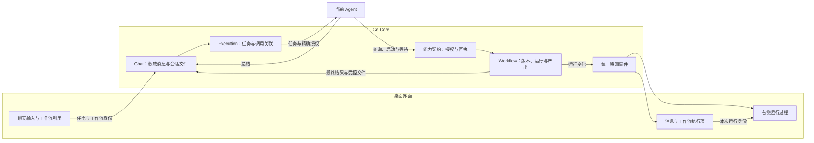
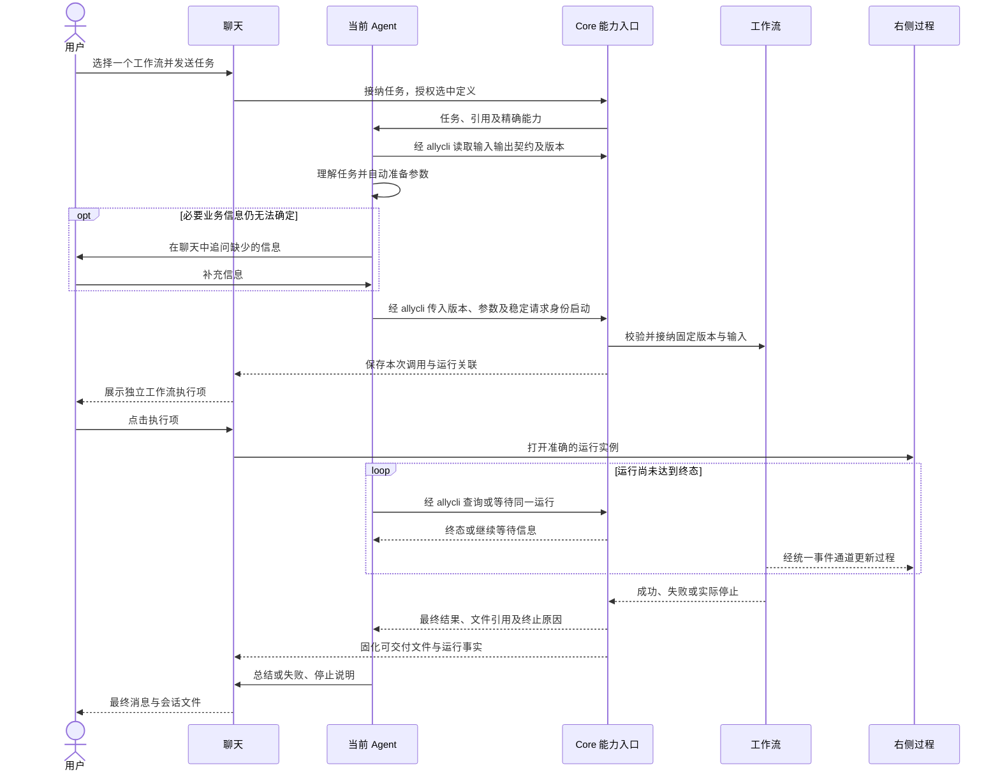

# 聊天调用工作流：设计讨论稿

本文记录已确认的产品行为及建议的技术方案。完整聊天接入尚未实现，本文不作为当前能力说明，也不构成开始开发的授权。

## 1. 已确认范围

| 项目     | 已确认行为                                                                                                    |
| -------- | ------------------------------------------------------------------------------------------------------------- |
| 选择     | 首版一条消息只选择一个工作流；工作流内部可以编排多个 Agent                                                    |
| 发起     | 用户选择工作流并发送任务，由当前 Agent 理解任务、准备输入并调用                                               |
| 调用编排 | Agent 通过现有 `allycli` 查询契约、准备参数、启动并持续查询／等待；应用侧不另建任务理解、自动启动或等待调度器 |
| 参数     | 能从任务意图、对话上下文、工作区查询及默认值确定的参数全部自动填写；仅对无法确定且影响执行的必要信息追问      |
| 追问     | 在聊天中补充必要信息，不要求用户重复填写已经表达的任务，也不默认弹参数表单                                    |
| 等待     | 当前任务持续等待工作流成功、失败或实际停止，再完成本次交付                                                    |
| 内容     | Agent 收集工作流声明的最终内容，结合用户任务总结后输出到原聊天                                                |
| 文件     | 工作流声明的最终文件作为正式会话文件进入消息，可直接打开、预览或下载                                          |
| 中间产物 | 留在右侧执行过程；需要时由 Agent 读取，不逐个自动发送到聊天                                                   |
| 失败     | 在聊天中说明失败原因和已完成部分；可靠、可用的部分产出可以交付，并标明未完整完成                              |
| 过程展示 | 聊天中有独立的工作流执行项，点击后在右侧打开本次运行实例                                                      |
| 双向停止 | 聊天停止会请求停止本次关联运行；右侧停止会让等待中的 Agent 感知用户主动停止，并说明结果                       |

示例：用户选择“五方代码评审”，发送“用这个工作流 review 代码”。已有当前项目和待审查代码范围时，Agent 自动组织评审任务及代码上下文，由工作流内的五个 Agent 各自评审。当前 Agent 等待完成，汇总工作流最终输出，并附上声明交付的报告文件。工作流需要的任务描述不能成为要求用户重新输入“评审要求”的理由。

## 2. 当前实现与缺口

以下依据当前源码核对；已有接口和局部测试不等于完整模型调用及桌面交互已经验收。

| 边界       | 当前实现                                                                                                                                     | 需要补齐                                                                    |
| ---------- | -------------------------------------------------------------------------------------------------------------------------------------------- | --------------------------------------------------------------------------- |
| 聊天发送   | [消息请求](../../server/apis/chats/message_input.go)已有 `workflowIds`；新建和续发入口会调用 `BindConsumer`                                  | 首版聊天入口限制最多一个，补齐选择、发送快照和消息历史引用                  |
| 编辑器     | [输入框](../../packages/frontend/src/modules/chat/components/chat-composer-input.tsx)支持文件、技能、连接器等引用                                      | 增加工作流引用类型；不能仅发送名称或依赖正文模糊匹配                        |
| Agent 能力 | [工作流绑定](../../server/services/workflow/agent.go)已有定义查询、参数说明、启动、查询、等待和取消                                          | 串联等待、终态结果、文件交付和执行过程关联                                  |
| 调用授权   | [使用者能力](../../server/services/workflow/capabilities.go)按选中定义和当前聊天回合校验；运行保存使用者关联                                 | 为展示、取消传播及交付保存准确关联；版本由 Agent 读取契约后传入已有启动操作 |
| 等待       | [有界观察](../../server/internal/agentcapability/observe.go)单次默认等待 30 秒，最长 60 秒                                                   | 有界观察结束后继续跟随原运行，不能将其当作业务终态                          |
| 取消       | [取消运行](../../server/services/workflow/runs.go)先写入 `cancelling`，实际停止后形成终态                                                    | 持久化用户停止来源，建立聊天与运行之间的取消传播                            |
| 文件       | [运行查询](../../server/apis/workflows/get_run.go)提供声明产出文件；[聊天日志](../../server/internal/chat/eventlog/types.go)已有受管附件引用 | 完成 Run 最终文件到助手消息的受控交付与持久登记                             |

## 3. 建议的模块协作

继续复用系统 `ally` Skill、`allycli` 和 Core 能力契约。工作流身份、运行和产出仍由 Workflow 管理；Chat 保存消息和展示事实，Execution 管理当前任务生命周期。选择工作流不需要为每个工作流生成一份独立 Skill 或连接器。

任务理解、参数组织、选择启动时机、启动后重复等待以及结果总结由 Agent 完成。Skill 说明这些操作的顺序和完成条件，CLI 返回真实契约、运行身份及状态，既有 Workflow 服务负责校验和执行。应用侧新增代码集中在引用传递、授权、运行关联、过程展示、停止传播与会话文件交付，不另写一套替 Agent 启动和等待工作流的业务调度。



消息执行项与右侧面板读取同一个 Run。关闭面板、切换页面或释放订阅不取消工作流。

## 4. 调用主流程



首版由 Agent 使用现有启动、查询和有界等待命令完成上述流程。需要用真实模型验证持续等待行为，不预设新增 CLI 自动续等模式或应用侧等待调度器。

## 5. 输入、版本和授权

- 选择只形成草稿引用，发送后才绑定本次任务；选择本身不启动运行。建议复用现有引用补全菜单，按工作流类型展示名称和简短用途；触发字符尚待确认。
- 名称用于展示，稳定定义 ID 用于调用。Agent 通过 `workflow definitions describe` 读取实际输入输出契约和不可变 Revision，再将该版本显式传给 `workflow runs start`；参数说明、自动填写和实际运行使用同一版本。版本缺失或删除时明确报错，不改选其他工作流。
- 参数自动准备可以包含生成任务说明、读取获准代码及整理已有上下文。是否追问取决于业务信息能否确定，不能取决于表单字段是否为空。文件输入必须引用真实、获准的文件。
- 补参期间保留工作流选择和版本，复用现有聊天问答机制；已有信息不重复询问。工作流中途产生的人工请求仍使用原请求身份及原处理接口，不由 Agent 代替用户授权。
- 当前 Agent 的聊天配置作为运行默认值，流程内节点配置沿用既有解析规则；不能为了统一入口而把五个评审节点全部替换成调用者自身配置。
- 运行不得扩大调用者冻结的工作范围和权限。直接调用能力只授予本次选择，工作流内部的节点及子流程依赖继续按既有编排规则校验。

## 6. 持续等待和停止

“Agent 等到完成”由 Agent 通过现有 CLI 持续观察实现：启动取得 `runId` 后，调用 `workflow runs wait` 或 `workflow runs get`，未达到终态就继续等待，取得终态后再总结。Skill 明确这一规则；Core 沿用既有运行校验、状态查询和有界观察能力。模型是否遵循等待规则需要实际验证，不能把文档约定视为已通过验收。

- 优先使用 `workflow runs wait` 等待状态变化，避免高频查询。单次等待超时只结束一次观察；Agent 继续观察相同 `runId`，不重新启动，也不逐次向用户重复解释进度。
- 成功、失败及实际取消均需返回给等待者。工作流总期限耗尽是业务失败，连接断开或观察超时不是工作流失败。
- 当前任务在运行尚未收敛时不能以“已启动”作为最终交付。若 Runtime 异常退出，必须如实显示调用中断和已知运行状态，不能伪装 Agent 仍在线等待。
- 等待者异常不提供重新执行的授权。恢复时先读取原运行和原回执；各 Runtime 是否能恢复原任务的等待及总结，需逐项验证。

| 停止入口             | 工作流处理                                         | 当前聊天处理                                                            |
| -------------------- | -------------------------------------------------- | ----------------------------------------------------------------------- |
| 聊天停止             | Core 根据关联向本次运行传播取消                    | 停止 Agent；消息执行项保留停止来源和实际运行状态，不重新唤醒 Agent 回复 |
| 右侧停止             | 记录用户取消请求，进入正在停止，实际收敛后更新终态 | 唤醒等待者并明确传递“用户停止”；Agent 简短说明，结束本次任务            |
| 工作流自身失败或超时 | 保留原失败与证据                                   | Agent 说明失败；不归因为用户停止                                        |

取消传播由 Core 完成，不能依赖已停止或已撤销授权的 Agent 再调用取消命令。终止原因应包含主体、入口和请求身份，字段归属在详细设计中明确。重复停止保持幂等；已完成运行不被迟到的停止请求改写为取消。取消后不自动重试或换方式继续同一任务。

## 7. 终态交付

| 产出情况            | 建议处理                                                                            |
| ------------------- | ----------------------------------------------------------------------------------- |
| 最终内容            | 从通过最终输出契约的 Run 结果收集，Agent 结合任务总结；大内容采用有界读取或文件承载 |
| 最终文件            | Core 验证声明身份、真实文件和归属，建议固化到 Chat 受管附件区，并登记到本次助手消息 |
| 内容与文件混合      | 消息正文提供总结，同一答复关联正式会话文件                                          |
| 失败或用户停止      | 交付明确的失败／停止说明；仅保留已确认、可读且适合交付的部分结果，并标记未完整完成  |
| 文件缺失或不可访问  | 显示文件交付失败；保留工作流自身终态，不把“运行成功”改写成“文件已交付”              |
| 总结阶段 Agent 失败 | 保留已接纳的产出及原运行事实，聊天明确显示总结失败；不得为重做总结再次执行工作流    |

最终文件由输出 Schema 与真实产出身份确定，不由扩展名或模型编写的任意路径推断。Core 的文件登记需要持久幂等身份，重复查询、重连或总结重试不会重复附加文件。保留来源 `runId` 和文件身份，防止不同运行中的同名文件互相覆盖。

五方评审的五份中间报告在右侧可查；工作流声明的最终结论交给当前 Agent 汇总。只有被声明为最终交付文件的报告自动进入聊天。

## 8. 执行过程展示

- 一个已接纳运行对应一个独立工作流执行项，展示名称、状态、当前步骤摘要和查看入口。发现契约、启动和等待等内部操作聚合到该次工作流调用，不形成一串重复执行项。
- 点击后右侧打开确切的定义、版本和运行；执行完成后仍打开原运行，不跳到最新版或新一次运行。面板复用工作流画布、节点详情、日志、人工请求和文件能力。
- 运行状态来自 Workflow；总结和文件交付进度来自对应消息／交付事实。例如工作流已经成功但 Agent 正在总结时，应分别展示这两个事实。
- 通过已有统一事件通道更新 Query Cache；断线后读取权威快照，保留未知／陈旧语义。右侧面板不建立独立连接或永久轮询。

## 9. 契约和数据归属建议

| 数据             | 归属与变更方向                                                                                              |
| ---------------- | ----------------------------------------------------------------------------------------------------------- |
| 发送的工作流引用 | Chat 消息日志增加类型化引用，保存稳定定义身份与发送时名称；实际运行版本通过调用关联记录，消息投影从日志重建 |
| 当前调用授权     | 复用 `workflow_consumer_leases` 的选中定义白名单和当前回合校验；不为 Agent 已能读取并传入的版本另增授权存储 |
| 运行与调用关联   | 复用 `workflow_runs.flow_context.consumerLeaseId` 等已有关联，补齐可恢复的消息定位；不用第二张运行状态表    |
| 调用回执         | Agent 启动时使用稳定请求身份，复用已有命令回执；结果不确定时查询原回执，不通过更换请求 ID 再次启动          |
| 用户停止事实     | Workflow／Execution 按职责保存来源和原因，事件仅传递变化，不单独拥有终态                                    |
| 会话文件         | Chat 保存经验证的交付引用及来源，文件固化与消息登记需要有明确提交顺序和失败恢复                             |

聊天请求继续复用已有 `workflowIds`，首版在聊天边界约束最多一个，不为此改动工作流内部编排规模。示例为已有续发请求的局部字段，省略无关既有配置；实际请求与响应以生成契约为准：

```json
{
  "text": "用这个工作流 review 当前项目的本次改动",
  "workflowIds": ["00000000000000000000000000000001"]
}
```

启动、观察、读取和取消优先复用现有工作流操作。消息引用、运行过程定位、终止原因以及助手消息文件交付需要扩展现有契约；本讨论稿不预设新的公开命令名。未选择工作流的普通聊天保持原行为；既有消息缺失新增引用时按无引用读取，不反推历史选择。

## 10. 评审结论与待细化项

方案可以沿现有能力落地，核心工作是形成完整的调用闭环。以下问题需要在详细设计中解决，不能把局部能力已存在视为整体完成：

1. 验证 Agent 在单次有界观察结束后继续等待同一运行，以及真实 Runtime 工具期限对该流程的影响；遇到具体缺口再评审最小调整，不预建新的启动或等待调度机制。
2. 聊天停止与运行接纳并发、取消后授权撤销，以及运行结束与停止同时发生时，如何保证关联和终止原因准确。
3. 文件固化、消息登记及 Agent 总结之间的失败窗口，如何恢复且不重复交付、不重复运行。
4. Agent 读取的契约版本在补参和启动时保持一致，工作范围在调用时得到校验；不得把任务自动填写当作扩大权限的依据。
5. 引用触发字符、右侧过程组件的具体装配及协议字段命名尚未确认，不影响以上已确认行为。

后续验证应覆盖自动组织评审输入、必要追问、持续等待、双向停止及竞态、混合输出、交付失败和重连恢复。自动化通过后，仍需真实模型长任务和桌面交互验收；本轮仅讨论设计。

相关约束：[系统能力](../architecture/agent-capabilities-cn.md)、[聊天与执行](../architecture/chat-and-execution-cn.md)、[工作流](../architecture/workflows-cn.md)、[工作区与存储](../architecture/workspace-and-storage-cn.md)、[通知与工作看板](../architecture/notifications-and-work-board-cn.md)。
