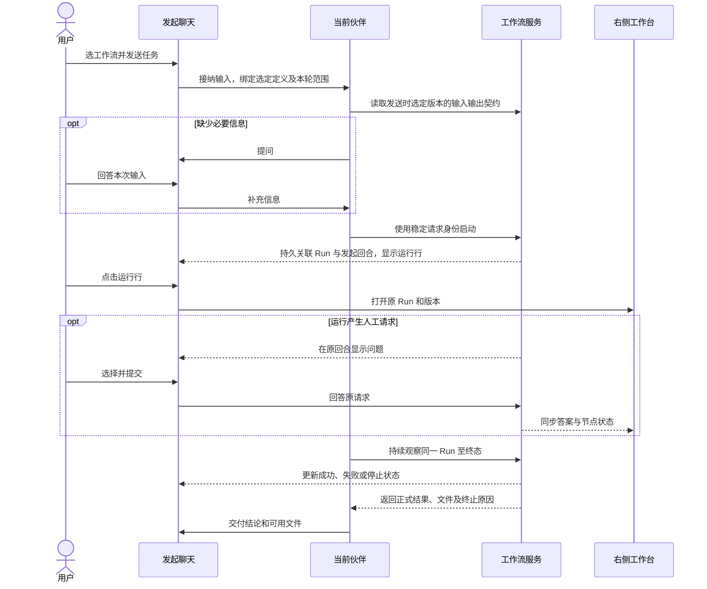

# 在伙伴和团队聊天中使用工作流

本文是面向伙伴聊天和团队聊天的首版功能规格，供产品、开发和验收使用。

## 用户问题

用户正在和伙伴讨论一个项目，想把已有工作流用在眼前的任务上。在此前的使用流程中需要离开聊天，到工作流详情页发起执行，工作流中的问题和最后的文件也在另一处。连续执行同一个工作流时，仅凭名称很难从聊天里查到“上一次究竟在哪一步失败”。

## 使用方案

在原对话选中工作流并发送任务。伙伴负责准备输入，工作流每接纳一次运行，就在**这次用户消息之后、对应伙伴回复上方**显示一条可点击的运行记录。点击这行，聊天现有的右侧栏直接展示工作流详情中同一套执行记录画布。流程遇到人工决定时，在原聊天用现有的「回答问题」卡片作答。

以“五方代码评审”为例。用户在团队主聊选中工作流，发送“评审当前分支，重点看数据迁移”。负责人利用当前项目、分支和工作流输入准备任务。已有足够信息时直接启动；如果缺少影响结果的比较基线，只追问“和哪个分支比较？”。补充回答沿用这次选择。

下表是一段聊天的四个时刻。中间那条运行记录始终留在同一位置。

| 时刻 | 用户在聊天里看到的内容 | 可以做什么 |
| --- | --- | --- |
| 写消息 | 输入框内的引用「五方代码评审」和自己的任务正文 | 修改任务或移除引用后发送 |
| 已启动 | 居中的一行「使用工作流　〔五方代码评审 · 运行中〕」 | 点击胶囊，在右侧查看并行评审节点 |
| 需要选择 | 胶囊变为「待你选择」，聊天里出现现有样式的提问卡“报告需要包含哪些问题？”，卡内给出选项 | 在卡内勾选“仅阻断项”并提交。确认后原位置呈现已答结果，流程继续 |
| 已结束 | 胶囊变为「已成功」。负责人回复“发现 2 个阻断项，都在数据迁移步骤”，并附上正式报告 | 直接读结论、打开报告，或再次点击原胶囊复查运行 |

如果“生成报告”失败，原位置显示「五方代码评审 · 失败」。负责人说明“5 项评审已完成，汇总报告写入失败”，并列出已核实、可读取的部分成果。点击胶囊直接定位失败节点。

### 同一个工作流运行两次

| 用户消息 | 对应伙伴回复上方的运行记录 | 点击后在右栏看到什么 |
| --- | --- | --- |
| “评审本次改动”，这是该工作流第 10 次运行 | 五方代码评审 · 失败 | 第 10 次运行的画布，定位“生成报告”失败节点及当时已完成的评审 |
| “再执行一次”，第 11 次运行已接纳 | 五方代码评审 · 运行中，结束后原位显示其终态 | 第 11 次运行的画布、当前节点及本次产出 |
| “第 10 次为什么失败？” | 普通伙伴答复，可引用第 10 次记录 | 被引用的第 10 次运行。运行总数仍为 11 |

**“再执行一次”沿用原版本和原输入。** 如果第 10 次已经成功，第 11 次从流程起点执行，沿本次实际分支重新取得结果。如果第 10 次失败或已停止，则按原运行的重试计划处理可复用的步骤。来源明确且允许执行时，发送消息即启动。即使期间发布了新版，两条消息仍各自打开对应运行的历史画布。

## 用户故事

1. 作为伙伴聊天用户，我希望在新聊和续聊里按名称选择已保存的工作流，以便直接使用当前项目和对话里的信息。
2. 作为团队用户，我希望从主聊发送时由负责人发起，从成员对话发送时由该成员发起，以便知道去哪里看进度、处理问题和收结果。
3. 作为发起人，我希望伙伴只向我补问缺少的必要输入，以便回答后继续原任务。
4. 作为正在等结果的人，我希望每次执行都在对应回复上方留下自己的状态，以便区分同名工作流的多次运行。
5. 作为需要作决定的人，我希望在熟悉的聊天提问卡里直接作答，也能在已打开的画布处理同一道题，以便知道自己的选择推进了哪一个节点。
6. 作为授权人，我希望在允许或拒绝前看清具体操作和对象，以便控制这次运行会产生的实际影响。
7. 作为查看过程的人，我希望点击运行行就能看到该版本实际走过的节点、分支和错误，以便解释一次具体的结果。
8. 作为收取成果的人，我希望在原聊天拿到结论和正式文件，失败时仍能取得可用的部分成果，以便继续工作。
9. 作为刚遇到失败的人，我希望仅发“再执行一次”就能按原版本和输入重试，以便少一步操作，同时保留失败现场。
10. 作为复查历史的人，我希望可以追问某次失败的原因或指定哪次要重试，以便避免选错运行。
11. 作为同时查看多个运行的人，我希望右栏可以单独停止某次运行，以便其他对话的工作继续。
12. 作为重新打开聊天的人，我希望断线、重启或切换团队后仍能找到原记录、有效问题和已交付的文件，以便接着处理。

## 实现决策

### 发起位置与工作流选择

**团队归属已确认。** 工作流由当前对话的伙伴发起。发起人负责理解任务、持续观察并向原聊天交付。节点内的执行伙伴和运行默认配置仍按工作流原有配置解析。

| 发送位置 | 谁来发起 | 运行行、决策与结果出现在哪里 |
| --- | --- | --- |
| 伙伴聊天 | 当前伙伴 | 同一段伙伴聊天 |
| 团队主聊 | 负责人 | 当前团队主时间线 |
| 团队成员对话 | 当前成员 | 该成员在此团队对话中的原 Chat。与某项委派有关的成果可沿既有成员报告规则交给负责人 |

在输入框键入 `#`，可直接浏览或按名称搜索已有可运行版本的工作流。`/` 用于技能和插件。选择后，编辑器插入带工作流图标的名称标签。首版每条消息引用一个工作流，再选时替换草稿中的引用。切换对话保留各自草稿；发送接纳后清除草稿选择。工作流选择不随之后的普通消息自动继承。仅发送工作流引用也能表达“运行它”，必需参数按同一补参规则处理。

`@成员` 在团队主聊已有定向发送语义。建议在结构化成员提及与工作流引用同时存在时就近提示“交给该成员运行，请到成员对话发送”，提供携带草稿打开成员对话的动作。用户也可移除定向提及后由负责人运行。两种选择都等用户发送后才启动。普通正文提到人名不触发路由。已经委派给成员的其他回合不自动继承这次选择。[团队协作](../architecture/teams-cn.md)

### 聊天里的运行行

借用委派行的位置、间距和点击习惯。前缀用“使用工作流”，胶囊内放工作流图标、名称、状态。整颗胶囊可点击，有键盘焦点和可读名称。状态同时用图标和文字表达；运行结束后停止动画。常态保持一行，具体步骤、耗时和日志放在右侧。

- **出现时机。** 用户消息中的引用表示这次选了哪个工作流。取得启动接纳回执后，才在该次输入与对应伙伴答复之间插入运行行。补参、启动被拒绝时在原输入旁说明所需处理。回执暂时未知时显示“正在确认是否启动”，核对原请求后再呈现运行。
- **更新方式。** 同一运行原位更新。节点完成、自动分支和反复等待均只刷新过程。并行中有真实待用户处理的请求时优先显示“待你选择”或“待你授权”，即使其他节点仍在运行。多道工作流问题沿用聊天提问卡的顺序提示，在聊天处理当前题，已打开的画布也可定位指定问题。已在另一处处理的题退出待答队列。
- **结束以后。** 重开聊天、团队切换、同名工作流再次执行都能找到发起回合和原运行。消息发起的重试把新运行行挂在新消息对应的回复上方，同时保留其来源运行。画布内手动重试走既有计划确认入口，从聊天工作台发起时也为这次用户操作追加独立记录。原行继续打开原运行及对应版本。

| 运行事实 | 胶囊状态 | 画布中可查看的内容 |
| --- | --- | --- |
| 已接纳排队／节点正在执行 | 排队中／运行中 | 正在执行的节点和并行分支 |
| 等待外部结果／检查点恢复 | 等待中／恢复中 | 等待或恢复的节点与已知进度 |
| 有有效人工请求 | 待你选择／待你填写／待你授权 | 对应请求及节点 |
| 已提交通过校验的最终结果 | 已成功 | 已执行路径和最终产出入口 |
| 流程已失败 | 失败 | 失败节点、业务原因、可用的部分成果 |
| 已请求取消／已实际终止 | 正在停止／已停止 | 停止位置及已经发生的工作 |

首次点击运行行直接打开完整画布。点节点查看详情，运行结束后可打开运行详情查看最终结果。用户已在查看其他节点时，后台事件只更新状态，保留其选区、缩放与滚动。工作流改名、编辑或显式重试后，老链接始终指向原运行。若原记录已按历史保留规则移除，从聊天显示“执行记录已移除”，保留原摘要及已交付的会话文件。

### 人工决定

| 场景 | 聊天中的交互 | 谁接收结果 |
| --- | --- | --- |
| 启动前缺必要输入 | 伙伴问具体业务问题，如“和哪个分支比较？”。保留已选工作流、版本和已知参数 | 发起伙伴补全本次输入，然后启动 |
| 流程自动判断 | 条件与所选路径在画布中可查。影响最终结论的选择由伙伴写入总结 | 工作流按已保存规则继续 |
| 运行中的业务决定 | 在发起聊天的提问区使用现有「回答问题」卡片。确认、单选、多选及文本在卡内作答，长列表和结构化表单在同一卡内使用工作流已有的选择器或表单 | 原工作流人工请求。可跳过、截止时间和超时行为取自题目 |
| 确定性操作许可 | 显示具体动作、对象与影响，例如“将报告发到项目群？”并提供“允许／拒绝”。动作详情可展开 | 原工作流操作许可 |
| 节点智能体的工具审批或提问 | 显示具体节点伙伴、工具或问题，沿用原审批选项和可见范围 | 原节点 Chat 的审批或提问入口 |

聊天提问卡已有选项、可选的“其他”、提交中和回答回显。复用其卡片和交互，将显示内容与提交回调接到工作流的原题。布尔确认提交真实的是或否，选择题传稳定选项值，多选保留上下限。“其他”和“跳过”仅在题目允许时出现。大候选集保留搜索、翻页与跨页选择，结构化题沿用工作流字段类型及校验。渲染默认值只作填写提示，须由用户主动提交。节点若请求工具权限，继续使用现有审批卡。[聊天提问卡](../../packages/frontend/src/modules/chat/components/chat-elicitation-card.tsx)、[工作流人工题](../../packages/frontend/src/modules/workflow/components/human-request.tsx)

同一窗口的聊天卡和执行画布共享这道题的未提交答案。任一处选择后，另一处显示相同选择，提交后两处读取原题的结果。

例如第 11 次运行问“哪些问题要进报告？”，用户在聊天卡选“仅阻断项”，点“下一步”。提交携带第 11 次运行、原问题、冻结候选摘要和本次提交身份。工作流服务确认后，卡片显示已答，画布同步节点状态。第 10 次运行的旧卡始终展示其历史答案。超时或另一处抢先提交时，刷新原题后呈现实际状态。[回答接口](../../server/apis/workflows/answer_human.go)

聊天、右栏和工作看板处理同一请求。启动前的追问绑定来源输入，用户在题目内回复或点“取消本次调用”。取消前尚无 Run，问题结束后该次引用解除。写进普通输入框的新任务仍作为独立消息处理。

启动后的回答绑定运行、节点实例、原请求身份及题目快照；操作许可绑定原动作描述。输入框里的普通“好”、其他成员的回复和伙伴总结均不提交授权。允许、拒绝或回答后，原处留下一行实际选择，工作流按自己的分支规则判断下一步。拒绝业务选项可以进入另一条正常分支。

问题并行时，每项保持独立。用户切走后可从已有待办回到正确位置。另一窗口已回答时这里立即收起，重复点击只显示原结果。已过期、已取消或已由超时策略处理的题目显示实际结果并关闭操作。发送答案失败时，保留输入并在题目旁重试。运行行和看板引用同一请求身份，避免重复计数和提醒。

### 直接在现有右侧栏展示执行画布

右侧栏使用聊天已有工作台。点击运行行，以该次运行的身份在工作台中打开工作流运行页现用的执行记录视图。第一屏直接就是画布。它与工作流详情共用画布、节点浮层、问题、结果、日志及已有操作。重复点击同一记录聚焦原内容，点击另一条记录按另一运行的身份展示。切换记录、关闭和窄窗显示沿用工作台行为，普通进度和新问题都不会抢走当前视图。[聊天工作台](../../packages/frontend/src/modules/chat/workbench/workbench-model.ts)、[执行记录视图](../../packages/frontend/src/modules/workflow/components/run-view.tsx)

接入只需将定位和导航交给当前宿主。独立运行页用页面路由，嵌入聊天时用既有工作台的内容标签保存当前节点、请求和结果位置。用户在画布中查看节点或重试后继续留在当前聊天。验收以同一次运行分别从工作流详情和聊天打开为准，两处使用相同的节点布局、详情与操作。

### 成功、失败与恢复

- **成功。** 运行状态以最终输出契约通过为准。发起伙伴用原任务的语言给结论，将确认可用的正式结果文件作为会话附件。中间报告和日志留在画布。团队成员的已有交付机制可转述正式结果；同一会话只交付一份。
- **部分完成。** 聊天说明哪一步失败、为什么、哪些内容仍可用。只有实际已确认且允许交付的部分成果进入消息，明确标注“部分结果”。聊天里明确要求重试时，按所指运行的重试计划处理。
- **总结或附件失败。** 工作流可以已经成功而聊天交付尚未完整。胶囊保留“已成功”，在对应总结或附件旁显示错误并允许只重做该项。重复交付按来源运行、文件身份和目标消息去重。
- **用户停止。** 伙伴和成员对话的“停止”覆盖当前执行及其已关联的运行。团队主聊的“停止团队工作”沿用现有线程范围，覆盖被停止的负责人／成员执行及其关联运行，同时撤回原范围内尚未派发的任务。其他线程继续执行。右栏“停止此次运行”始终只停止当前打开的 Run。运行行收到请求时显示“正在停止”，实际收敛后显示终态。若只从右栏停止，等待中的伙伴可以说明停止位置。
- **长任务与中断。** 正常等待占用发起伙伴的当前回合，可继续在聊天提问卡回答问题、在审批卡处理授权。其他任务可按该聊天的既有规则排队，其他对话可继续使用。关闭右栏、切换页面或单次等待超时后继续观察原 Run。若发起回合在 Run 终态前退出，聊天保留“伙伴回复中断”和可核实的运行状态。重连或 Core 重启先恢复原事实；原回合可恢复时由原伙伴继续，无法恢复时由 Core 随终态交付已确认的正式产出，用户可点“补写总结”让伙伴仅依据这次结果回复。两种恢复共用同一交付身份。

### 识别“再执行一次”

| 用户的意图 | 伙伴如何处理 | 聊天记录如何变化 |
| --- | --- | --- |
| 明确要求重跑，来源是一次已成功的运行 | 以来源运行冻结的版本和输入直接创建新运行，从起点执行。每个实际到达的人工决策和操作许可按新运行重新处理 | 新回复上方出现本次运行记录，原回复继续打开上次成功的画布和成果 |
| 明确要求重试，且能唯一确定原失败或已停止的运行 | 读取同一运行的重试计划并校验可重试性。沿用冻结的版本与输入，按计划复用符合条件的结果，直接启动 | 新消息获得新运行行，原行保留原终态。节点实际需要的授权和人工决定照常出现 |
| 对话里有两次可能匹配的运行 | 在当前回复中给出候选的工作流名称、时间和结果。用户选中后，按该次运行的终态处理 | 选择前不创建运行，新行归最初这条“再执行一次”的消息 |
| 只问失败原因、查看文件或补写总结 | 按所指运行读取既有事实。范围含糊时询问要看哪一次 | 普通答复可以引用原运行或文件，旧行仍可点击 |
| 指定了新输入，或明确要求使用新版 | 按新的执行请求确认版本及输入。原运行只作为上下文 | 运行接纳后归新消息，旧版执行和结果仍可复查 |
| 原运行还在执行、已移除，或某个外部动作结果未知，当前无法重试 | 说明当前状态和原因。仍在执行时可查看该次进度，效果未知时提示先核对具体动作 | 当前只呈现真实情况，原记录不会被另一条同名运行替代 |

来源从当前对话可见记录中解析，优先采用用户明确指向的运行。Core 核实来源运行及其终态。成功后重跑走新运行的启动入口，失败或停止后重试走原有重试计划。对同一条消息重复投递或启动回执丢失时，使用原提交身份查回同一新运行。

现有聊天使用者能力提供启动、读取、等待和取消。聊天重试需要复用工作流已有的重试用例，在新回合只为已核实的来源运行绑定重试能力。指定原运行时校验它归属当前可见对话，再按当前权限核对原输入和工作范围。文件输入使用原运行冻结的内容；原件无法取得时说明缺少哪个输入。同名路径上的替换文件需要用户作为新输入发起。

### 调用、授权与持久化

1. 首次运行或显式使用新版时，Chat 在接纳发送时固定所选定义的当前可运行 Revision，记录定义身份、版本和发送时名称。团队主聊在队列接纳时固定。仅有草稿时允许使用后来保存的版本，接纳后排队与补参都沿用同一版本。基于历史运行重跑或重试时，都固定来源运行的 Revision 和原输入。伙伴首发、续发和团队队列复用同一输入事实。已有历史消息缺少引用时按普通消息读取。排队与派发跨回合时，将授权绑定到最终执行者和确切回合。
2. 沿用使用者能力和系统 bot 指南。支持该传输的 Runtime 由宿主提供内部 MCP，其余沿用宿主选定的 CLI。使用者当前的 describe 查定义最新版本，需支持读取本次已绑定的精确版本。版本失效时就近提示重新选择并重新发起。伙伴读取该版本契约，自动填写能从正文、对话、默认值和获准文件确定的参数。只授权用户选中的定义，启动时显式提交同一个 Revision 和稳定请求身份。无需对账号状态、额度或模型目录新增前置探测。[执行指南](../../skills/bot/references/workflow-execution.md)
3. 工作范围沿用源对话的冻结范围。当前使用者启动路径读取首个附加工作目录；接入时须覆盖无附加目录的伙伴空间、团队工作区、只读目录和无文件输入的情况。使用实际已授权的空间与文件，缺少确实必需的目录时在启动前说明，禁止自行扩大范围。
4. Workflow 拥有运行、实例、请求和产出。保留现有 consumer lease 关联，补齐稳定的来源 Chat、输入／回复回合、Execution 及可选的团队线程、成员和任务尝试定位。运行接纳与来源关联应能原子提交或从同一回执恢复。前端从原运行和有效请求投影状态。看板计数及提醒沿用原请求的可见范围。
5. 一次明确启动对应一个 Run。启动回执丢失时依据原请求核对；有界等待结束后继续观察原 Run。涉及停止竞态时，先请求停止已接纳的原运行，若终态已提交则保留原终态。在启动前收到停止时撤销未完成的调用意图；若启动同期已接纳，按原回执补做取消关联。用户补参、回答运行中的请求、重连或总结重试都不会重复启动。
6. 客户端复用统一事件通道和原查询缓存，运行摘要随可见聊天历史批量加载。节点详情与日志随右栏按需读取。历史回放按稳定回合定位，晚到事件更新已有行。隐藏标签暂停读取，恢复可见后对账。[通知与工作看板](../architecture/notifications-and-work-board-cn.md)

## 验证决策

从**发起聊天的公开入口**验收。用同一条“发送 → 处理决定 → 收结果 → 查看历史”场景分别覆盖伙伴聊天、团队主聊和成员对话，检查可见的发起人、消息顺序、运行状态、实际打开的画布和文件。以聊天页面和工作流运行页已有的集成测试为基础。每次执行让产出或失败节点容易辨认，避免两个链接打开同一个画布但标题相同，导致测试误过。

首要场景从一次已失败的第 10 次运行开始。期间发布新版并改变默认输入，在聊天发送“再执行一次”。验收者应能直接看到第 11 次执行原版本和原输入，分别点开两条记录并辨认各自的节点和产出。随后追问第 10 次失败原因，确认没有新增运行。另用两个均有可能的来源验证伙伴会先询问。

对于界面难以稳定重现的交错事件，复用 Core 既有的使用者授权、重试计划、复用及终态回执测试，在接纳和查询入口验证运行数、原版本和可读取的结果。真实智能体持续等待、原生文件预览及窄窗交互单独验收。

| 操作 | 应看到的结果 |
| --- | --- |
| 同一工作流分别在伙伴新聊、伙伴续聊、团队主聊、成员对话运行 | 每次运行有独立身份、正确发起人和唯一来源回合，后续普通消息仍可直接发送 |
| 第 10 次成功后发布新版、修改默认输入，再发“再执行一次” | 第 11 次直接用第 10 次的版本和输入从起点执行。能看到新的步骤执行和人工题，两条消息分别打开各自的画布和产出 |
| 草稿选中后移除、发送被拒或团队消息排队 | 移除后普通发送；拒绝时保留可修正草稿；队列实际派发前没有虚构运行 |
| 排队或追问基线时发布新版本；用户取消追问后另发普通任务 | 原调用固定发送版本。新消息有独立身份，取消的调用不会被意外启动 |
| 启动前缺参、运行中自动分支、人工选择、操作许可 | 补参可继续原任务；自动分支可查；人工作答及授权准确命中原请求 |
| 分别从工作流详情和聊天点击同一次运行，在聊天卡完成多选或提交表单 | 两处显示相同的执行画布和节点详情，填写在原聊天完成，原运行仅接纳一次回答 |
| 两节点并行等待，用户从右栏先答第二题，再回到聊天 | 仅第一题仍可操作。原请求只计一次，重复提交或过期不会推进另一个节点 |
| 同名工作流运行两次，期间更新版本，关闭右栏并重开聊天 | 两行各自恢复准确的历史画布；重复点击复用对应标签 |
| 流程失败、文件交付失败、总结失败、人工停止 | 状态及原因与原事实一致。有用部分可取回，单独补交不创建新运行 |
| 聊天停止与启动回执交错；右栏停止与成功终态交错 | 仅关联运行收到停止；原终态及已完成效果保留 |
| 团队负责人和成员各有一次活跃运行 | 右栏停止只影响所选运行；团队主聊停止覆盖该线程被停止执行的关联运行 |
| 父运行正在等子流程，子流程出现人工问题 | 在发起聊天的同一组提问卡中显示子流程的题目。回答命中真实的子运行和节点，父流程收到子结果后继续。独立后台子流程仍沿用自身待办归属 |
| 打开两个同名运行，一个已结束、一个在等用户。同一问题分别从聊天和画布提交 | 旧卡只能查看历史。当前卡接纳首次有效提交，两处都能读到同一结果，后续操作不会改变另一运行 |
| 发起伙伴同时也是流程节点的执行伙伴 | 验证父聊天等待时节点仍可开始和交付，尤其覆盖单节点并发配置与真实智能体 |
| 重启、等待超时、团队切换、长任务和窄窗键盘操作 | 原运行可查，决定可继续处理，真实模型等待与总结行为及桌面交互分别验收 |

### 还需区分的聊天操作

- **运行中补一句话。** 普通排队、回答提问卡和主动插队是三种不同操作。前两项分别产生后续消息和当前节点的答案。普通聊天现有插队会先停止正在执行的聊天回合。接入时需明确并覆盖“运行 A 期间插队要求 B”，特别是 A 是否继续及其最终结果落在哪条消息。已接纳的 A 始终保留原输入和历史记录。
- **从历史消息分叉。** 普通伙伴聊天分叉会建立新的 Chat。建议继承范围内的消息能查看原运行的历史，决定和停止操作仍归原运行的发起上下文。用户在分叉聊天明确发起新运行时，按新对话的权限和消息记录交付。验收时分别核对来源聊天、分叉点之前和之后的消息。

## 范围边界

首版覆盖本地伙伴聊天、团队主聊和成员对话，每条消息直接选择一个工作流。普通伙伴聊天可按用户要求修复工作流，并显式运行本轮保存回执中的版本。工作流内部已有的多节点、并行和子流程规则沿用原定义。定时触发和外部 IM 沿用各自入口。

## 补充说明

已确认的产品行为包括团队内的发起人归属、每条执行消息独立的历史链接、直接在聊天现有右侧栏呈现原执行画布、在聊天提问卡中回答工作流人工决定，以及来源明确且允许时发消息直接触发成功后的完整重跑或失败后的重试。输入框用 `#` 引用工作流。运行标记首次打开完整画布，点节点查看该步详情。以上场景作为实现后的验收依据。

### 设计前的基础与接入位置

| 边界 | 设计前的实现 | 接入位置 |
| --- | --- | --- |
| 聊天输入 | 伙伴消息、团队消息及共享输入框支持多种资源引用，均缺少工作流引用。[伙伴请求](../../server/apis/chats/message_input.go)、[团队请求](../../server/apis/channels/work_input.go)、[共享输入框](../../packages/frontend/src/modules/chat/components/chat-composer-input.tsx) | 草稿、首发、续发、排队和历史消息贯通同一份类型化选择 |
| 使用工作流 | 服务端保留按选定定义和真实执行回合授权的 BindConsumer，以及读取契约、启动、观察和取消能力。伙伴和团队聊天的发送入口尚未接入。[使用者授权](../../server/services/workflow/capabilities.go)、[Agent 操作](../../server/services/workflow/agent.go) | 在实际执行上下文绑定所选定义，保存运行与发起消息的稳定关联 |
| 展示过程 | 团队已有绑定回合的居中委派行。聊天工作台支持按内容身份打开标签。运行视图已有实例画布、节点详情、待处理请求和重试入口。[委派行](../../packages/frontend/src/modules/chat/components/team-delegation-marker.tsx)、[工作台](../../packages/frontend/src/modules/chat/workbench/workbench-model.ts)、[运行视图](../../packages/frontend/src/modules/workflow/components/run-view.tsx) | 增加工作流运行行，并将运行视图装入聊天工作台 |
| 决策与产出 | 业务问答、确定性操作许可和节点智能体的工具审批各有处理入口。运行查询能读取正式结果及声明的文件。[问答](../../server/apis/workflows/answer_human.go)、[操作许可](../../server/apis/workflows/answer_operation.go)、[节点详情](../../packages/frontend/src/modules/workflow/components/instance-details.tsx)、[运行结果](../../server/apis/workflows/get_run.go) | 在发起聊天呈现原请求，收敛后交付总结和受管文件 |

目前可在工作流详情直接运行并查看记录。工作流里的创作聊天用于生成和修改定义，伙伴或团队聊天里的引用用于执行已保存版本。[工作流架构](../architecture/workflows-cn.md)
