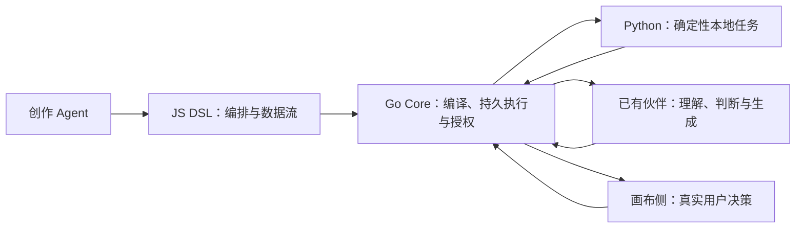

# Workflow V2 契约详细设计

本文是 [V2 架构与设计](workflow-v2-design-cn.md)的实现契约，尚未落地。明确编排语言、Python 执行、MCP/CLI、Skill、画布投影及运行叠加；以下 V2 字段、接口和示例是设计规范，不是当前生成 SDK 已支持的能力。

## 1. 引言

### 1.1 设计结论

| 问题                        | 采用方案                                                                          |
| --------------------------- | --------------------------------------------------------------------------------- |
| 工作流源码用 Python 还是 JS | **JS 形式的封闭 DSL** 描述编排，Go Core 编译和调度；不依赖 Node 执行整个工作流    |
| 本地任务用什么              | **Python 优先**承担查询、文件、下载、转换与校验；纯小计算可用 DSL/JS functionTask |
| 画布 Schema 谁生成          | **Core 编译器**由源码生成；Agent 不同时维护可写图 JSON                            |
| 复杂结果页面谁生成          | Agent 可生成封闭组件 Spec；它只描述阅读布局，与编排图分离                         |
| 对 Agent 用 CLI 还是 MCP    | **MCP 优先，CLI 兼容兜底**；共用 Operation、授权和回执，不实现两套业务            |
| Skill 是否每个流程生成一份  | 沿用系统 `ally`，按创作/执行/结果模式提供指南；不为每个工作流新增 Skill           |
| 还需要用户选架构细节吗      | 本文给出默认落地方案；剩余为真实 Runtime 支持和性能验收，不留作用户猜测           |

### 1.2 参考与边界

参考流程的权威源码是 JS，其中内嵌 Python 并通过 action 调用；另有 worker、askUser、phase 和 return。因此，看到大量 Python 执行不能推导出工作流语言就是 Python。

实际工具历史可确认读取、完整源码保存、补丁保存和运行诊断的载荷。尚未取得参考产品完整 MCP tools/list 或内部编译器；原生 Workflow Skill 的 agent()、缓存和限制不自动适用于 WakerFlow。本文据可观测行为与 NeuxBot 代码独立确定 V2 契约。

代码依据包括 [Operation 目录](../../server/internal/agentcapability/contract/catalog.go)、[授权与回执](../../server/internal/agentcapability/registry.go)、[CLI](../../server/internal/agentcli/command.go)、[Runtime MCP](../../server/internal/agent/core/driver/acp/mcp.go)、[会话挂载与恢复](../../server/internal/agent/core/driver/acp/driver.go)、[系统能力注入](../../server/services/execution/agent.go)、[DSL 契约](../../server/internal/workflow/dsl/sdk.go)和 [Manifest](../../server/internal/workflow/dsl/program.go)。

## 2. 需求与架构决策

### 2.1 三种语言的职责



- JS DSL 负责什么时候调用谁、参数如何传递、如何分支、等待和收敛。它不直接访问磁盘或网络。
- Python 程序是明确的节点代码，负责真实 IO 或计算；默认使用宿主配置的解释器，不假设用户已经安装任意依赖。
- Go 负责状态、进程、版本和副作用。暂停问答或重启后恢复不依赖 JS/Python 调用栈。
- 时间与随机数保持耐久语义：flowContext.runStartedAt 固定为本次运行开始时间，DSL Date 以该时间求值，Math.random 禁用；真实当前时间或随机种子显式作为数据输入。长 Python 程序只在节点边界可恢复，需要细粒度恢复就拆成多个显式动作，不能宣称可恢复 Python 栈。
- V2 首版不引入第二套 Python 编排 DSL。Python 中不得隐藏调用伙伴、偷偷弹用户问题或自行驱动另一套 Run；这些行为须进入可见宿主原语。

### 2.2 为什么选择 MCP 优先

MCP 使模型直接看到工具名、参数 Schema 和结构化响应，适合连续读取、保存、诊断以及回传节点结果；减少 shell 拼接、命令参数转义和读取输出文件带来的摩擦。它不会天然解决 ID、授权和错误判定，这些仍由 Core 实施。

CLI 保留用于兼容 Runtime、调试、自动化和可重复操作。MCP 不可用时走相同 Operation 的 CLI，不让 Agent 临时改用任意 HTTP 或安装另一份程序。

现有代码支持 MCP 连接器注入，并在挂载范围变化时 CloseSession/ResumeSession。**声明支持传输不等于已验证每轮授权换绑**：真实验收必须覆盖新建、续聊、Core 重启、取消和迟到调用。没有通过这些场景的 Runtime 使用 CLI；不能为了保留旧会话偷偷复用旧 Grant。

## 3. 模块与协议来源

### 3.1 三个有明确边界的契约来源

| 权威来源                | 生成/服务对象                                                |
| ----------------------- | ------------------------------------------------------------ |
| Agent Operation Catalog | CLI 子命令、MCP tool 输入输出、错误/完成语义、可发现操作说明 |
| Workflow DSL Registry   | SDK 声明、原语及选项校验、编译器宿主调用映射、语言指南和示例 |
| Presentation Catalog    | 结果组件及属性 Schema、封闭页面 Spec 校验、前端组件绑定      |

Canvas Manifest 类型归 Workflow Compiler；通过正常生成链路提供前端类型和 Schema，不手写一套前端定义副本。这三个来源各管自己的领域，不合并成无边界的总注册表。

现有 `workflow:sdk:generate/check`、`workflow:presentation:generate/check`、`api:generate/check` 继续承担对应生成职责；MCP 描述由已有 Operation 目录派生。新增生成目标只能通过命令更新。

### 3.2 MCP 生命周期

首版内部 MCP 采用应用自有的 stdio 薄桥：拟新增 `allycli mcp serve --context <execution-file>`。它只做 MCP 编解码并转发现有 Core 能力入口，不执行领域逻辑、不绑定新监听端口，不依赖用户开启对外集成 API/MCP 开关。

1. Core 先为当前 Execution 签发 Grant 和**不可变的执行级连接文件**。
2. Runtime 本轮挂载内部 MCP，stdio 桥启动时读取一次连接描述并固定该 Grant；不在每次 tools/call 重新读一个会被下一轮覆盖的共享文件。
3. tools/list 仅返回该 Grant 的操作；tools/call 继续经过 Core 当前执行、对象和作用域校验。
4. 新 Execution 生成新桥接配置；原生会话可可靠重开/恢复并刷新 MCP 时继续该会话，否则选择 CLI 路径。
5. 结束或被替代时撤销 Grant、取消在途调用并收敛桥进程；旧连接不得自动换绑新权限。

CLI 命令同样在启动时固定本次连接。V2 增加全局 `--context <execution-file>`，由当轮 bootstrap 给出准确路径；持续原生进程不能更新环境时，使用这个显式参数，不能沿用旧环境或读取下一轮共享文件。当前实现使用原生会话槽位内的连接文件；V2 的 stdio 长连接不得直接套用该可覆盖文件行为。执行级文件、桥实例与旧调用围栏必须一起实现。

令牌只在受管文件和请求头，命令行仅传文件路径，工具 Schema 不暴露 Token。Core 校验回环地址和原固定能力路径；Core epoch 变化使旧连接失效。

## 4. DSL 和工具契约

### 4.1 DSL 文件结构

V2 源码允许两种静态导出：`meta` 与可选 `scripts`。meta 是不含计算的静态 JS 对象字面量：允许 JS 的引号和属性书写形式，但值只能为 JSON 值，禁止引用变量、函数调用、展开、getter 和模板插值；scripts 是命名脚本定义，code 允许普通字符串或无插值的 `String.raw` 模板。后者由编译器提取原文字节，不执行 String.raw 或用户 JS。除此以外不开放任意模块导出、import、require 或 Node 全局。

每个 scriptId 在当前版本唯一，language 首期为 python，protocol 为 json 或 text。解释器引用来自当前获准资源。项目脚本导入后完整字节进入版本源码；以后项目文件变化不改变原 Revision。

```javascript
export const meta = {
  sdk: "ally.workflow/2",
  title: "选择候选并分析",
  description: "脚本提供选项，用户决定，伙伴分析并校验",
  inputSchema: {
    type: "object",
    properties: { project: { type: "string", title: "项目名称" } },
  },
  outputSchema: {
    type: "object",
    properties: {
      analysisText: { type: "string" },
      valid: { type: "boolean" },
    },
    required: ["analysisText", "valid"],
    additionalProperties: false,
  },
  phases: [{ id: "work", title: "分析候选", detail: "查询、选择、分析与校验" }],
  actions: [
    {
      id: "list",
      type: "script",
      scriptId: "candidates",
      label: "获取候选",
      risk: "read",
      inputSchema: {
        type: "object",
        properties: { project: { type: "string" } },
        required: ["project"],
      },
      outputSchema: {
        type: "object",
        properties: {
          items: {
            type: "array",
            items: {
              type: "object",
              properties: {
                value: { type: "string" },
                label: { type: "string" },
              },
              required: ["value", "label"],
              additionalProperties: false,
            },
          },
        },
        required: ["items"],
      },
    },
    {
      id: "verify",
      type: "script",
      scriptId: "verify",
      label: "校验分析",
      risk: "read",
      inputSchema: {
        type: "object",
        properties: { text: { type: "string" }, selected: { type: "string" } },
        required: ["text", "selected"],
      },
      outputSchema: {
        type: "object",
        properties: { valid: { type: "boolean" } },
        required: ["valid"],
      },
    },
  ],
};

export const scripts = {
  candidates: {
    language: "python",
    protocol: "json",
    code: String.raw`import json, sys
x = json.load(sys.stdin)
json.dump({"items":[{"value":"a","label":x["project"]+"候选甲"},
                    {"value":"b","label":x["project"]+"候选乙"}]}, sys.stdout)
`,
  },
  verify: {
    language: "python",
    protocol: "json",
    code: String.raw`import json, sys
x = json.load(sys.stdin)
json.dump({"valid":bool(x["text"].strip()) and x["selected"] in x["text"]}, sys.stdout)
`,
  },
};

phase("work");
let project = args.project;
if (!project) {
  const answer = await askUser("请输入项目名称", {
    id: "project",
    label: "补充项目",
    phase: "work",
    kind: "text",
  });
  if (answer.status !== "answered") throw new Error("缺少项目名称");
  project = answer.value;
}
const listed = await action("list", {
  id: "list-options",
  label: "获取候选",
  phase: "work",
  input: { project },
});
const selected = await askUser("请选择候选", {
  id: "choose",
  label: "选择候选",
  phase: "work",
  kind: "select",
  choices: listed.data.items,
  allowCustom: false,
  allowSkip: false,
});
if (selected.status !== "answered") throw new Error("未选择候选");
const analysis = await worker(
  "分析项目 " + project + " 的候选 " + selected.value,
  {
    id: "analyze",
    label: "分析候选",
    phase: "work",
    resolve: { kind: "waker", wakerId: "waker-example" },
    schema: {
      type: "object",
      properties: { analysisText: { type: "string" } },
      required: ["analysisText"],
      additionalProperties: false,
    },
  },
);
const verified = await action("verify", {
  id: "verify-analysis",
  label: "校验分析",
  phase: "work",
  input: { text: analysis.analysisText, selected: selected.value },
  successCondition: { path: "/valid", equals: true },
});
return { analysisText: analysis.analysisText, valid: verified.data.valid };
```

该示例是 V2 规范样本，`waker-example` 必须由真实资源发现结果替换；不能直接用 V1 编译器验收。它描述的是文本契约检查，不证明分析内容在语义上正确。

### 4.2 原语返回值必须固定

| 调用                  | 返回形状                         | 失败行为                                                    |
| --------------------- | -------------------------------- | ----------------------------------------------------------- |
| worker，无 Schema     | 最终文本 string                  | 真实执行失败抛错；不能随 Runtime 改成 content/analysis 外壳 |
| worker，有 Schema     | 直接返回匹配 Schema 的 JSON 数据 | 提交只为候选；实际 Execution 成功后确认；格式纠正有界       |
| action                | `{data, durationMs, process?}`   | 非零退出、协议或 Schema 错误抛错                            |
| functionTask          | 直接 JSON 值                     | 期限、程序异常或输出错误抛错                                |
| askUser               | HumanAnswer                      | 真实停止运行抛取消错误；skip/timeout 按已声明策略返回或抛错 |
| workflow/joinWorkflow | `{runId, revisionId, output}`    | 子流程失败按普通异常处理                                    |
| startWorkflow         | 不可伪造的 ChildHandle           | 不能把内部 handle 作为最终业务 JSON                         |

common NodeOptions 包含 `id/label/phase` 和可选 `successCondition`。successCondition 针对**业务数据**：action.data、worker 的直接结果、functionTask 返回值；不针对进程外壳。首版只支持 JSON Pointer path 和 JSON 字面值 equals，条件失败产生 BUSINESS_CHECK_FAILED。

并行、管道按输入顺序返回，显式 failureMode 为 fail-fast 或 collect-null；V2 默认 fail-fast，collect-null 失败项为 null 且保留实际错误实例。普通 JSON null 不自动等于失败。逐项错误仍归原 NodeInstance/Effect；GroupRun 只保存 itemIndex、failedInstanceId、skippedStageIds 等引用，查询从这些身份补齐诊断，公开返回数组仍为结果或 null，不塞入另一种错误对象。并行 callback 捕获按值传递，不用外部共享可变变量传结果。

### 4.3 Python 执行协议

- json 模式把一个完整 action.input JSON 值写入 stdin；缺省为 null，不能把 false/0/空字符串当成缺失。stdout 必须恰好是一个符合输出契约的 JSON 值，拒绝尾随第二个值和普通日志。
- text 模式也可接收 JSON stdin，但 stdout 是文本；确需原样字节输入由显式文件引用承载，不复用含糊字符串参数。
- argv 是独立数组，参数不经过 shell；env 与 secretEnv 分开。stderr 是日志，进程状态、日志引用和业务 data 分开保存。
- 主程序可自行读取 stdin，不强制 Python 必须实现 def main；现有 functionTask 的函数协议仍独立。程序需要的依赖来自所选解释器环境，不运行中自动 pip install。
- json 输出较大时通过声明文件传递并返回受管引用；截断 stdout 不能作为成功 JSON。输出预算沿用并通过生成契约发布，超限为显式失败。
- 子进程只能由 Run 的 Effect 驱动。脚本中自己控制伙伴和用户交互的隐藏编排不属于 V2 支持范围。

### 4.4 人工决策协议

HumanOptions 的 V2 字段为：`kind`、`choices`、`allowCustom`、`schema`、`minSelections`、`maxSelections`、`defaultValue`、`allowSkip`、`timeoutMs`、`onTimeout`。kind 为 text/select/multiselect/form/confirm；select/multiselect 的 choices 可以是 `{value,label}` 数组或请求归属的候选文件引用。kind=form 使用 schema，不能再同时声明 choices。

HumanAnswer 包含 `questionId/status/source/value?`。status 为 answered/skipped/timed_out；source 为 user/user_skip/timeout/cache_replay，缓存回放保留原答案来源引用。运行取消使请求 cancelled，并以取消异常中断 DSL，不伪装成普通答案继续执行。

- answered 必须有 Schema 合法的 value；select 默认受限选择，多选去重并校验数量。multiselect 的 minSelections 缺省 1，maxSelections 缺省为候选数且受宿主预算限制；显式 minSelections=0 才允许空选择。allowSkip 缺省 false，onTimeout 缺省 fail。
- skipped 仅当 allowSkip 为真发生，不自动套用 defaultValue。
- timed_out 必须有实际期限。onTimeout=fail 时请求记 timed_out、无 value，并抛 HUMAN_REQUEST_TIMED_OUT；onTimeout=skip 时返回 status:timed_out/source:timeout 且无 value；onTimeout=default 时返回 status:timed_out/source:timeout/value:defaultValue。defaultValue 必须合法且不能用于自动批准 confirm。只有主动跳过返回 skipped，超时不改记成用户跳过。
- defaultValue 是预填值；只有明确的 timeout/default 策略可在期限后采用它，主动跳过与超时不是同一动作。
- 缓存回放保留原 status/value，source 为 cache_replay，并必须引用原 Run、questionId 和原回答命令；不伪造新的用户点击。
- 动态数据在宿主求值后冻结快照、来源 Effect 和摘要；浏览器不执行 choices 表达式。
- 候选文件由宿主检验范围、格式、稳定键、总量和摘要后纳入请求；页面搜索/分页只读该不可变快照，不重新运行任意 Python。

### 4.5 MCP tool 与 CLI 映射

MCP 工具名采用稳定下划线名，业务身份仍为 Operation ID；这里只列工作流范围，不把全部平台工具都挂载到每个节点。

| Operation                           | MCP tool                            | CLI                                 | 范围                       |
| ----------------------------------- | ----------------------------------- | ----------------------------------- | -------------------------- |
| workflow.authoring.prepare          | workflow_authoring_prepare          | workflow authoring prepare          | 创作                       |
| workflow.source.get                 | workflow_source_get                 | workflow source get                 | 创作                       |
| workflow.source.validate            | workflow_source_validate            | workflow source validate            | 创作                       |
| workflow.source.save                | workflow_source_save                | workflow source save                | 创作                       |
| workflow.resources.list             | workflow_resources_list             | workflow resources list             | 创作                       |
| workflow.evidence.list              | workflow_evidence_list              | workflow evidence list              | 已授权原运行               |
| workflow.runs.start/get/wait/cancel | workflow_runs_start/get/wait/cancel | workflow runs start/get/wait/cancel | 使用者或明确测试授权       |
| workflow.results.schema/submit      | workflow_results_schema/submit      | workflow results schema/submit      | 当前 worker Effect/Attempt |
| receipts.get                        | receipts_get                        | receipts get                        | 当前获准操作回执           |

工具名为本产品设计，不复制参考产品工具 namespace。工具正文直接给业务参数，不要求模型再包装 operation/params；适配器内部统一转换。

拟议的一个 MCP tools/list 项：

```json
{
  "name": "workflow_source_get",
  "description": "Read the source of the workflow bound to this authoring execution. Omit workflowId to use the binding; never guess an ID.",
  "inputSchema": {
    "type": "object",
    "properties": {
      "workflowId": { "type": "string" },
      "revisionId": { "type": "string" }
    },
    "additionalProperties": false
  },
  "annotations": { "readOnlyHint": true, "openWorldHint": false }
}
```

拟议的保存业务参数 Schema：

```json
{
  "type": "object",
  "properties": {
    "workflowId": { "type": "string" },
    "requestId": { "type": "string", "minLength": 1, "maxLength": 128 },
    "expectedRevisionId": { "type": "string" },
    "baseSourceDigest": { "type": "string", "pattern": "^[0-9a-f]{64}$" },
    "source": { "type": "string" },
    "patches": {
      "type": "array",
      "minItems": 1,
      "items": {
        "type": "object",
        "properties": {
          "search": { "type": "string", "minLength": 1 },
          "replace": { "type": "string" },
          "expectedMatches": { "const": 1 }
        },
        "required": ["search", "replace"],
        "additionalProperties": false
      }
    }
  },
  "required": ["requestId", "expectedRevisionId"],
  "oneOf": [
    { "required": ["source"], "not": { "required": ["patches"] } },
    {
      "required": ["patches", "baseSourceDigest"],
      "not": { "required": ["source"] }
    }
  ],
  "additionalProperties": false
}
```

首次保存 expectedRevisionId 明确传空字符串；patch 必须有基准摘要。完整源码允许基准摘要缺省，但 expectedRevisionId 始终 CAS。显式 workflowId 只作绑定一致性断言，不授予其他对象访问权。

回执查询在 V2 Operation Catalog 中作为读取元操作统一描述，调用已有回执查询机制，不新增另一套领域回执。MCP 保存参数中的 requestId 与 CLI 的 `--request-id` 都映射为统一请求身份；内容变化换新身份，响应丢失只查询旧回执。CLI 的 `--source` 从本机获准文件读取完整 UTF-8 内容，Core 接到的是 source 文本；MCP 不新增任意本机 sourcePath 读取能力。

业务响应沿用独立于 DSL SDK 的协议版本，不能把 ally.workflow/2 误当 Agent CLI protocolVersion：

```typescript
type CommandResponse<T> =
  | {
      protocolVersion: 1;
      ok: true;
      operation: string;
      completion: "immediate" | "accepted";
      commandId?: string;
      replayed: boolean;
      data: T;
    }
  | {
      protocolVersion: 1;
      ok: false;
      operation: string;
      error: {
        code: string;
        message: string;
        stage: string;
        effectState: "not_accepted" | "accepted" | "unknown";
        retryAdvice: string;
        diagnostics?: Diagnostic[];
      };
    };
```

成功响应的 data 按 Operation 输出 Schema 进一步收窄；完整生成 Schema 覆盖成功与失败分支，不能只为成功 data 建 Schema。source.validate 读取成功但 valid:false，是正常预检结果；source.save 拒绝提交是工具失败，两者区分。

MCP structuredContent 与 CLI JSON 使用同一业务响应，MCP text 只提供相同结果的有界兼容表示。领域失败设置 MCP isError，携带相同的 code/stage/diagnostics/retryAdvice，不因 JSON-RPC 运输成功就显示保存成功。annotations 是工具提示，授权仍由 Core 执行。

## 5. 画布与数据 Schema

### 5.1 定义图、运行叠加与阅读页面

| 契约                    | 权威生成者                           | 谁可以改变                           |
| ----------------------- | ------------------------------------ | ------------------------------------ |
| Workflow Source         | 创作 Agent 或用户源码编辑，Core 保存 | 通过版本提交                         |
| CanvasManifest/2        | Core 编译器                          | 修改源码后重新编译；不接受独立图写入 |
| WorkflowRunProjection/2 | Run、Instance、Effect、HumanRequest  | 对应业务事务和事件                   |
| ResultViewSpec          | 可选的 Agent 静态声明加封闭 Catalog  | 随 Revision 保存；只绑定已验证结果   |
| 视口、折叠与选择        | 前端局部状态                         | 用户本机交互，不参与调度             |

定义和运行不是两份可写图。ResultViewSpec 也不是画布 Schema；它负责报告布局，不负责节点顺序和执行。

### 5.2 CanvasManifest/2 类型

```typescript
interface CanvasDocument {
  definitionId: string;
  revisionId: string;
  sourceDigest: string;
  manifestDigest: string;
  manifest: CanvasManifest;
}
interface CanvasManifest {
  formatVersion: 2;
  sdkVersion: "ally.workflow/2";
  phases: Array<{ id: string; title: string; detail: string }>;
  nodes: CanvasNode[];
  edges: Array<{
    id: string;
    from: string;
    to: string;
    kind: "control" | "data";
    condition?: string;
    bindingPath?: string;
  }>;
  controls: ControlNode[];
  scripts: Array<{
    id: string;
    language: "python";
    protocol: "json" | "text";
    digest: string;
  }>;
  inputSchema?: JsonSchema;
  outputSchema?: JsonSchema;
}
interface CanvasNodeBase {
  successCondition?: { path: string; equals: Json };
  id: string;
  label: string;
  phaseId?: string;
  sourceRange?: SourceRange;
  inputs: Array<{ target: string; expression: string; dependsOn: string[] }>;
  outputSchema?: JsonSchema;
}
type CanvasNode = CanvasNodeBase &
  (
    | { kind: "input"; execution: { target: "args" } }
    | { kind: "result"; execution: { target: "result" } }
    | {
        kind: "worker";
        execution: {
          resolve: {
            kind: "waker";
            wakerId: string;
            runtimeId?: string;
            accountId?: string;
            model?: string;
            reasoning?: string;
          };
          promptTemplate?: string;
          toolPolicy?: ToolPolicy;
        };
      }
    | {
        kind: "askUser";
        execution: {
          kind: "text" | "select" | "multiselect" | "form" | "confirm";
          promptTemplate?: string;
          allowCustom?: boolean;
          allowSkip?: boolean;
        };
      }
    | {
        kind: "action";
        execution: {
          actionId: string;
          actionType: "script" | "http" | "builtin";
          scriptId?: string;
          executable?: string;
          handler?: string;
          allowedOrigins?: string[];
          methods?: string[];
        };
      }
    | {
        kind: "functionTask";
        execution: {
          language: "javascript" | "python";
          executionMode: "pure" | "trusted_local";
          codeDigest: string;
        };
      }
    | {
        kind: "workflow" | "startWorkflow";
        execution: {
          definitionId: string;
          revisionId: string;
          mode: "joined" | "detached";
        };
      }
    | { kind: "joinWorkflow"; execution: { handleExpression: string } }
  );

interface ControlNode {
  id: string;
  kind:
    "call" | "sequence" | "decision" | "parallel" | "pipeline" | "loop" | "try";
  nodeId?: string;
  conditionExpression?: string;
  branches: Array<{ label: string; children: ControlNode[] }>;
}
```

Json、JsonSchema、ToolPolicy 与 SourceRange 使用同源生成类型，不在前端手写。SourceRange 保留原 UTF-8 字节范围与编辑器 UTF-16 行列。execution 按 kind 生成封闭联合及 additionalProperties:false；script 动作的 scriptId/executable 二选一，HTTP/builtin 禁用脚本字段，公共 successCondition 统一放在 CanvasNodeBase，按节点业务结果解释，不在 execution 内复制。禁止把视图 execution 参数直接提交给执行器。

- worker.execution 包含 resolve、静态 Prompt 模板、工具策略及结果 Schema；账号秘密值不进入图。
- askUser.execution 包含静态问题模板和模式；动态 choices 在 inputs 记录表达式与依赖，不在编译期伪造真实候选。
- action.execution 包含 actionId、actionType、scriptId 或受限 HTTP 声明；脚本正文通过同版本源码详情读取，不在每个画布节点复制。
- controls 是唯一的嵌套控制拓扑，edges 为派生的阅读连线和数据依赖提示；调度读取 Bundle，不以 edges 推断控制流。
- 系统输入/结果节点使用保留 ID `__workflow_input__`、`__workflow_result__`，Agent 不可占用；分支 return 汇入同一结果投影，不以源码行号生成可编辑业务 ID。
- kind 未知、重复 ID、悬空依赖、非法 phase、循环组件树及版本不兼容均明确失败，不以标题猜测或静默忽略。

### 5.3 具体画布文档示例

下例对应“脚本候选→画布选择→伙伴分析→脚本检查”，省略复杂 Schema 正文但保留完整节点连接。它是编译输出示例，Agent 不应调用保存工具提交这份 JSON。

```json
{
  "definitionId": "workflow-example",
  "revisionId": "revision-example",
  "sourceDigest": "aaaaaaaaaaaaaaaaaaaaaaaaaaaaaaaaaaaaaaaaaaaaaaaaaaaaaaaaaaaaaaaa",
  "manifestDigest": "bbbbbbbbbbbbbbbbbbbbbbbbbbbbbbbbbbbbbbbbbbbbbbbbbbbbbbbbbbbbbbbb",
  "manifest": {
    "formatVersion": 2,
    "sdkVersion": "ally.workflow/2",
    "phases": [
      {
        "id": "work",
        "title": "分析候选",
        "detail": "查询、选择、分析与校验"
      }
    ],
    "scripts": [
      {
        "id": "candidates",
        "language": "python",
        "protocol": "json",
        "digest": "cccccccccccccccccccccccccccccccccccccccccccccccccccccccccccccccc"
      },
      {
        "id": "verify",
        "language": "python",
        "protocol": "json",
        "digest": "dddddddddddddddddddddddddddddddddddddddddddddddddddddddddddddddd"
      }
    ],
    "nodes": [
      {
        "id": "__workflow_input__",
        "kind": "input",
        "label": "运行输入",
        "execution": {
          "target": "args"
        },
        "inputs": []
      },
      {
        "id": "project",
        "kind": "askUser",
        "label": "补充项目",
        "phaseId": "work",
        "execution": {
          "kind": "text",
          "promptTemplate": "请输入项目名称"
        },
        "inputs": []
      },
      {
        "id": "list-options",
        "kind": "action",
        "label": "获取候选",
        "phaseId": "work",
        "execution": {
          "actionId": "list",
          "actionType": "script",
          "scriptId": "candidates"
        },
        "inputs": [
          {
            "target": "input.project",
            "expression": "project",
            "dependsOn": ["__workflow_input__", "project"]
          }
        ]
      },
      {
        "id": "choose",
        "kind": "askUser",
        "label": "选择候选",
        "phaseId": "work",
        "execution": {
          "kind": "select",
          "allowCustom": false
        },
        "inputs": [
          {
            "target": "choices",
            "expression": "listed.data.items",
            "dependsOn": ["list-options"]
          }
        ]
      },
      {
        "id": "analyze",
        "kind": "worker",
        "label": "分析候选",
        "phaseId": "work",
        "execution": {
          "resolve": {
            "kind": "waker",
            "wakerId": "waker-example"
          }
        },
        "inputs": [
          {
            "target": "prompt",
            "expression": "'分析项目 ' + project + ' 的候选 ' + selected.value",
            "dependsOn": ["__workflow_input__", "project", "choose"]
          }
        ]
      },
      {
        "id": "verify-analysis",
        "kind": "action",
        "label": "校验分析",
        "phaseId": "work",
        "execution": {
          "actionId": "verify",
          "actionType": "script",
          "scriptId": "verify"
        },
        "inputs": [
          {
            "target": "input.text",
            "expression": "analysis.analysisText",
            "dependsOn": ["analyze"]
          },
          {
            "target": "input.selected",
            "expression": "selected.value",
            "dependsOn": ["choose"]
          }
        ],
        "successCondition": {
          "path": "/valid",
          "equals": true
        }
      },
      {
        "id": "__workflow_result__",
        "kind": "result",
        "label": "运行结果",
        "execution": {
          "target": "result"
        },
        "inputs": [
          {
            "target": "output",
            "expression": "{ analysisText: analysis.analysisText, valid: verified.data.valid }",
            "dependsOn": ["analyze", "verify-analysis"]
          }
        ]
      }
    ],
    "edges": [
      {
        "id": "e0a",
        "from": "__workflow_input__",
        "to": "project",
        "kind": "control",
        "condition": "!args.project"
      },
      {
        "id": "e0b",
        "from": "project",
        "to": "list-options",
        "kind": "control"
      },
      {
        "id": "e1",
        "from": "__workflow_input__",
        "to": "list-options",
        "kind": "control",
        "condition": "args.project exists"
      },
      {
        "id": "e2",
        "from": "list-options",
        "to": "choose",
        "kind": "control"
      },
      {
        "id": "e3",
        "from": "choose",
        "to": "analyze",
        "kind": "control"
      },
      {
        "id": "e4",
        "from": "analyze",
        "to": "verify-analysis",
        "kind": "control"
      },
      {
        "id": "e5",
        "from": "verify-analysis",
        "to": "__workflow_result__",
        "kind": "control"
      },
      {
        "id": "d1",
        "from": "__workflow_input__",
        "to": "list-options",
        "kind": "data",
        "bindingPath": "input.project"
      },
      {
        "id": "d2",
        "from": "project",
        "to": "list-options",
        "kind": "data",
        "bindingPath": "input.project"
      },
      {
        "id": "d3",
        "from": "list-options",
        "to": "choose",
        "kind": "data",
        "bindingPath": "choices"
      },
      {
        "id": "d4",
        "from": "__workflow_input__",
        "to": "analyze",
        "kind": "data",
        "bindingPath": "prompt"
      },
      {
        "id": "d5",
        "from": "project",
        "to": "analyze",
        "kind": "data",
        "bindingPath": "prompt"
      },
      {
        "id": "d6",
        "from": "choose",
        "to": "analyze",
        "kind": "data",
        "bindingPath": "prompt"
      },
      {
        "id": "d7",
        "from": "analyze",
        "to": "verify-analysis",
        "kind": "data",
        "bindingPath": "input.text"
      },
      {
        "id": "d8",
        "from": "choose",
        "to": "verify-analysis",
        "kind": "data",
        "bindingPath": "input.selected"
      },
      {
        "id": "d9",
        "from": "analyze",
        "to": "__workflow_result__",
        "kind": "data",
        "bindingPath": "output"
      },
      {
        "id": "d10",
        "from": "verify-analysis",
        "to": "__workflow_result__",
        "kind": "data",
        "bindingPath": "output"
      }
    ],
    "controls": [
      {
        "id": "main",
        "kind": "sequence",
        "branches": [
          {
            "label": "body",
            "children": [
              {
                "id": "project-decision",
                "kind": "decision",
                "conditionExpression": "!args.project",
                "branches": [
                  {
                    "label": "true",
                    "children": [
                      {
                        "id": "c-project",
                        "kind": "call",
                        "nodeId": "project",
                        "branches": []
                      }
                    ]
                  },
                  {
                    "label": "false",
                    "children": []
                  }
                ]
              },
              {
                "id": "c1",
                "kind": "call",
                "nodeId": "list-options",
                "branches": []
              },
              {
                "id": "c2",
                "kind": "call",
                "nodeId": "choose",
                "branches": []
              },
              {
                "id": "c3",
                "kind": "call",
                "nodeId": "analyze",
                "branches": []
              },
              {
                "id": "c4",
                "kind": "call",
                "nodeId": "verify-analysis",
                "branches": []
              },
              {
                "id": "c-result",
                "kind": "call",
                "nodeId": "__workflow_result__",
                "branches": []
              }
            ]
          }
        ]
      }
    ]
  }
}
```

### 5.4 运行叠加和问题数据

WorkflowRunProjection 至少包含 `formatVersion:2/runId/revisionId/version/cursor/status/instances/pendingQuestions/outputs`。instances 用 `instanceId/nodeId/iterationPath/attemptId/status/inputRef/outputRef/failure/reusedFrom` 定位，不把同一循环模板的多个实例合并成一个可编辑节点。

pendingQuestions 的完整运行快照包含 questionId、owner、nodeId、instanceId、questionVersion、prompt、kind、choices 或 snapshotRef、snapshotDigest、schema、allowCustom、minSelections、maxSelections、status、defaultValue、allowSkip、timeoutMs、onTimeout、expiresAt；答复和前端草稿分别处理。owner 是 authoring Execution 或 Run Instance 的封闭联合，不由前端随意改绑。

事件仅携带变更身份、领域版本与有界摘要。不同 runId/revisionId 不能互相套用，低版本快照不能覆盖新终态。连接游标缺口或 Core epoch 变化后重新读取快照。

### 5.5 结果页面的可选 Schema

默认结果阅读由节点输出 Schema 和真实返回值派生。复杂报告可声明 ResultViewSpec，沿用现有封闭组件 Catalog 和 root/elements 结构；禁止 DOM、JS、CSS、外部代码、可写 actions 和动态权限。

结果页面首版复用现有 `formatVersion:1` 和 `catalogVersion:workflow-result-v1`，画布 V2 不意味着强制改版组件 Catalog；只有组件能力变化才发布新 Catalog。页面绑定只读 `/result/...`。节点页声明在 meta.nodeResultPages[nodeId]，其 `/result` 绑定当前节点的真实业务 data，并按该节点 outputSchema 校验；最终页声明在 meta.resultPage，`/result` 绑定 Run 最终输出，并按 meta.outputSchema 校验。两者不共享隐式跨节点命名空间；真实文件使用 format:file，由宿主验证并生成文件元数据。布局不会改变输出契约，修改交付内容时同步更新 Schema、Prompt、页面和下游读取。

## 6. Skill 与创作流程

### 6.1 持续注入和 Skill 分工

系统上下文每轮直接注入 purpose、绑定定义、基准版本、SDK/工具契约版本、选择的 transport 和引用 Run。它建立“当前就是工作流创作”的事实，不能只等待模型凭关键词选择 Skill。

创作原生 AskUserQuestion/Form Elicitation 经现有交互适配登记为 owner.kind:authoring、executionId/definitionId 绑定；运行 askUser 为 owner.kind:run、runId/instanceId 绑定。前端按 owner 统一呈现在画布侧，不能让原生问题回落左侧聊天。

系统 `ally` 的创作模式指南负责方法；实际签名和允许工具仍来自生成契约。沿用 `workflow-authoring.md`、`workflow-execution.md`、`workflow-results.md` 等模式资源，补充产品 V2 内容；不把不同版本指南混装，也不让每个定义产生自己的 Skill 副本。

### 6.2 创作模式指南草案

以下是拟替换的模式资源核心内容，不是要求本次助手调用这些工具：

> 当前任务处于 NeuxBot 工作流创作。始终使用宿主绑定的工作流，不把它降级为普通文件写作。
>
> 先读取当前源码、基准版本和需要的真实资源；宿主已提供的内容直接复用。使用产品 V2 的 worker/action/askUser，不套用原生 CLI Workflow 的 agent()。
>
> 已知参数自动组织；脚本能查询的先查；仍需用户决定的必要信息通过创作问题协议请求，用户在画布侧回答。创作问答不写成每次运行的节点。
>
> 用 JS DSL 描述编排；Python 承担确定性 IO；已有伙伴承担推理和生成。绑定实际 wakerId，命名稳定节点和阶段，声明下游需要的输出 Schema。
>
> 写完整源码或基于准确摘要生成精确补丁。调用保存工具；错误时按诊断修复，最多三次。CAS 冲突先读当前版本再合并。成功保存回执已经证明新版本，不重复读取验证保存。
>
> 需要交付文件时要求实际创建、检查并提交真实文件引用。普通结构化数据使用默认阅读；复杂页面按封闭 Catalog 声明，不生成任意前端代码。
>
> 保存不等于运行成功；测试需有用户授权。运行必须跟随同一 runId 到终态；等待超时不重启。失败优化先读原证据和原版本，再修改当前 Head。未知副作用不能靠换请求 ID 重做。
>
> 最终说明实际保存的版本、改动、已运行范围和剩余问题。工具回执、真实运行和文件事实优先于模型自报“完成”。

MCP 模式指南给直接工具示例；CLI 模式由同一规则生成对应命令示例。模型不需要同时试两种 transport；只有宿主准备阶段决定兼容降级，未知写回执不能因换 transport 重新执行。

## 7. 资源、错误与性能

- 工具数量按角色裁剪：创作不默认拥有运行权，worker 不默认拥有源码写入权；确切工具列表与 bootstrap 一致。
- SDK、Manifest、脚本代码、候选和运行日志均可有界读取，prepare 不无条件返回所有平台资源与整套指南。
- 版本冲突、输入错误、无绑定、无权限、连接失效、脚本错误、输出错误和未知效果使用不同稳定错误，不能全部包装成 AgentInputInvalid。
- Python 程序、结果 Spec 和动态候选都按不可信内容校验；本地执行能力按真实许可说明，不声称文件系统隔离。
- 日志记录采用最小、脱敏的契约/对象/版本/回执/输入摘要和诊断；不默认把原生模型思考、全量业务数据或秘密内容持久化作为产品功能。

## 8. 兼容与落地顺序

先发布 V2 Registry/Schema 和样本，再实现统一工具适配、语言与脚本协议、画布/问答投影、结果和恢复。修改各模块必须通过同一批契约样本，不让前端、Skill、CLI 和 MCP 分别猜测字段。

MCP 不改变全局产品的授权边界，也不替换现有对外集成服务。当前后端约定的软件能力仍由系统 ally 和自有 allycli 交付，内部 MCP 是这套能力的受管适配，不另装任意第三方桥。

旧 V1 定义和运行保持原契约；V2 才启用这里的新返回值、scripts 导出、HumanOptions、Manifest 和工具参数。旧数据不能在展示时静默解释成 V2。

## 9. 不确定性与验证

设计层的默认选择已明确，剩余事项分两类：

| 事项                                          | 性质与完成证据                                                      |
| --------------------------------------------- | ------------------------------------------------------------------- |
| 参考产品完整 MCP Schema、编译器及画布内部结构 | 仍未知；保留可观测行为依据，不影响我们定义准确的自有契约            |
| 各 Runtime 的 stdio MCP 换绑和原生会话恢复    | 实现/验收项；真实新建、续聊、取消、重启、迟到调用测试，未通过用 CLI |
| Python 解释器和依赖环境                       | 环境项；创建/运行入口显示真实可用性；Windows/macOS/Linux 分别验收   |
| Schema 输出纠正的 Runtime 能力                | 验收项；结果提交专用纠正阶段不能再执行业务工具，不能支持则明确失败  |
| 大集合、长画布和日志的实际预算                | 性能项；沿用已有限制并用同等任务测量，发布确定常量和超限行为        |

本轮应验证文档链接/格式、JSON 示例、DSL 样本的 JS 包装语法和 Python 静态语法、画布例子的 ID/连线/引用一致性。它们只证明设计工件内部一致，不代表 V2 编译器、MCP 适配或真实模型已通过。
