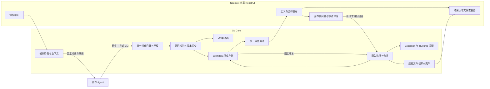
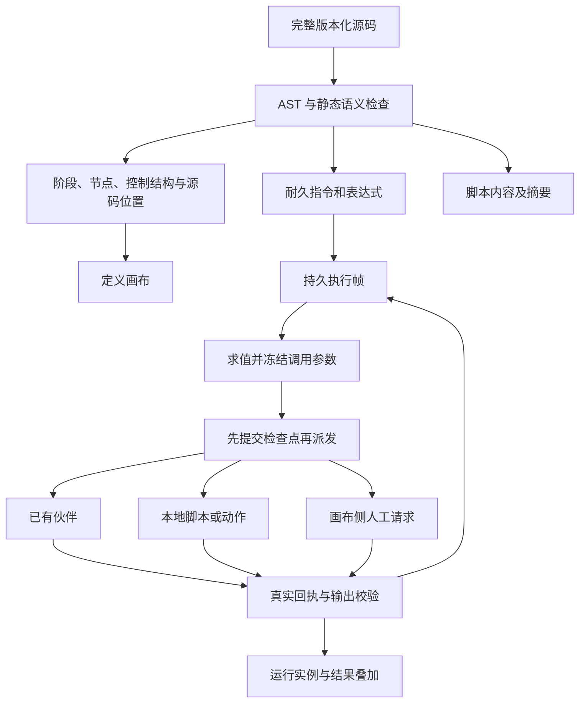
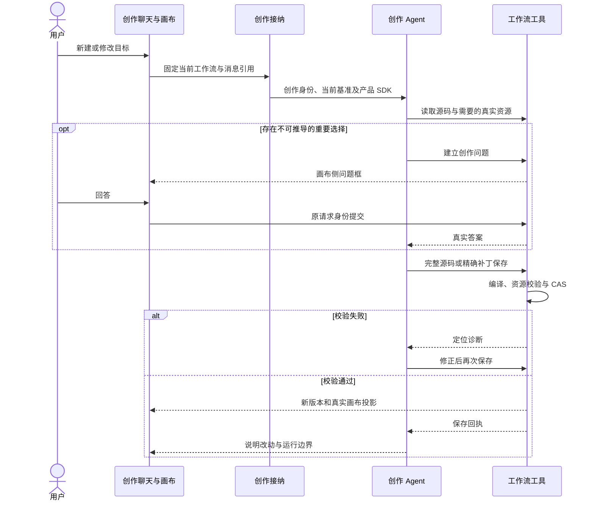
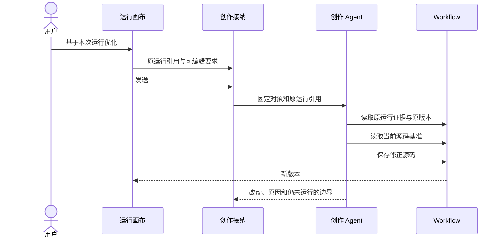

# Workflow V2 架构与设计

本文是待实施的完整 V2 方案。目标是在保留 NeuxBot UI 风格的前提下，使工作流创作、动态交互、执行、修正与恢复的实际体验达到参考产品的 90% 以上。该目标需要通过真实任务验收，本稿不表示功能已经实现或验收通过。

## 1. 引言

### 1.1 目标与已确认决策

V2 应当是可以持续使用的工作流系统：用户描述目标后，Agent 通过真实工具创建流程；保存成功立即形成新版本和画布；运行时脚本获取数据，用户在画布侧决策，已有伙伴完成任务；失败可以定位到具体调用，再选择重试或优化。

用户已确认：

- **有效保存直接形成新版本。**不增加“候选准备完成后再确认提交”的必经流程。
- **问题在画布侧的交互框回答。**左侧创作聊天不承载运行中的业务问答，不重复呈现第二份可提交表单。
- **Agent 节点全部使用已有伙伴。**不引入流程内临时 Agent 身份或独立角色配置层。
- **UI 保持 NeuxBot 风格。**对齐参考产品的展示类型、动态问答、执行和恢复能力，不复制其视觉样式。
- **按完整产品能力设计 V2。**允许重做 V1 中不适合的协议、创作链路和交互，不把现状当成不可改变的限制。

失败处理采用本稿第 6.7 节的默认方案：自动修复明确的创作错误；运行失败保留证据；原版本重试、最新版本运行、基于运行优化分别操作；副作用未知时先对账。依据与参考行为的差别必须可查。

### 1.2 资料和证据边界

- [参考产品调查](workflow-v2-reference-analysis-cn.md)：目标流程历史、实际 MCP 参数响应、源码、画布、JSONL Skill 和独立实验。
- [V2 能力与验收](workflow-v2-acceptance-cn.md)：90% 的计算口径、必须通过的关键场景和真实环境验收要求。
- [V2 契约详细设计](workflow-v2-contracts-cn.md)：JS/Python 边界、DSL 样本、MCP/CLI、Skill、画布及运行 Schema。
- [V1 工作流](../architecture/workflows-cn.md)、[V1 语言与执行](../architecture/workflow-language-cn.md)、[现有聊天调用讨论](workflow-agent-chat-cn.md)。
- [创作接纳](../../server/apis/workflows/send_creation_message.go)、[能力绑定](../../server/services/workflow/agent.go)、[保存](../../server/services/workflow/source.go)、[运行与效果](../../server/services/workflow/effects.go)。
- [DSL 编译器](../../server/internal/workflow/dsl/compiler.go)、[持久机器](../../server/internal/workflow/dsl/machine.go)、[画布布局](../../packages/frontend/src/modules/workflow/model/canvas-layout.ts)、[人工请求](../../packages/frontend/src/modules/workflow/components/human-request.tsx)。

调查已覆盖指定真实流程和独立实验；并未取得参考产品全部服务端源码、完整产品 SDK 或全部恢复策略。CLI 原生 `Workflow` 的 `agent()` Skill 与产品 WakerFlow 的 `worker/action/askUser` 契约分别对待。未验证行为不能写成参考产品保证。

本轮只交付设计和研究证据，不实施产品代码。架构选择、能力目标和实施建议不等于实际通过率。

## 2. 需求与总体决策

### 2.1 需要解决的完整问题

| 领域       | V2 必须提供的行为                                                          |
| ---------- | -------------------------------------------------------------------------- |
| 创作上下文 | 每轮知道当前工作流、版本、执行身份和可用能力；不让模型猜 ID 或误当普通会话 |
| 工具闭环   | 读取、发现资源、保存、诊断和运行证据契约一致；错误可定位、可修复           |
| 源码与版本 | 完整源码和精确补丁都能提交；校验通过即新版本；旧运行不受后续修改影响       |
| 语言与节点 | 脚本、已有伙伴、用户决策、条件、并行、管道、循环、子流程协同               |
| 画布       | 展示真正的阶段、调用和控制关系；定义、运行、实例、错误和结果可以联动       |
| 动态问答   | 缺参、脚本获取候选、单选、多选、结构化表单、等待、跳过和取消闭环           |
| 本地脚本   | 代码随版本、真实输入输出、解释器、目录、日志、期限和副作用明确             |
| 结果       | 每类节点都能查看输出；文件真实可读；执行结束和业务校验结论分别表达         |
| 修复与恢复 | 看原运行证据修改新版本；重试、重新运行、复用结果和未知效果有准确语义       |
| 稳定性     | 重连、并发保存、迟到回答、Core 重启和模型异常不会改错对象或制造重复效果    |

### 2.2 V1 的真实底座与断点

V1 已有静态编译、Manifest、耐久 Runner、Revision、Effect、人工请求和文件能力，不能把这些说成完全缺失。问题是存在这些模块并不等于完整使用链路可靠。

| 当前依据                               | 主要断点                                                            | V2 处理                                                        |
| -------------------------------------- | ------------------------------------------------------------------- | -------------------------------------------------------------- |
| 创作入口会创建 session 并注入工具      | 仅经过正确入口时成立；跨回合、普通发送和恢复未形成可验证的一致保障  | 重做创作接纳和恢复，持续保存对象绑定，执行逐次签发能力         |
| `source.get` 服务端绑定对象            | `AgentInputInvalid` 被模型解释为缺 ID，诊断缺少准确失败层           | 参数、绑定、授权、版本、连接分别报错；bootstrap 直接给对象身份 |
| `source.save` 编译并 CAS 保存          | 完整源码写入可用；缺精确补丁契约；相同内容会返回 unchanged          | V2 单次保存管线，支持补丁，显式保存创建版本；幂等重放除外      |
| DSL 能生成 Bundle 和 controlHints      | 封闭语言不保证承载真实目标脚本；模型可能混用原生 Workflow Skill     | 发布独立 V2 SDK 与样本兼容集，按真实程序验证表达能力           |
| 画布侧已有 HumanRequestCard            | 单选默认接受自由文本；选项全量渲染；来源、快照和大集合处理不足      | 显式选择模式、来源追踪和有界动态候选；问题统一在画布侧         |
| script action 有 argv/env 和 JSON 输出 | `action.input` 通过校验但当前进程未接收 stdin；代码未随版本统一管理 | 脚本资产和输入输出协议重做，输入契约落实到实际进程             |
| 有重试、跳过和证据入口                 | 技术状态尚未成为完整用户恢复过程；不能从 succeeded 推断业务质量     | 以运行及调用证据贯通失败定位、复用、重试、优化和交付           |

截图中读取失败仍需原执行证据定位；设计不把尚未复现的问题归因为单一代码点。

### 2.3 架构选择

**重建工作流领域的契约与端到端流程，复用经验证适用的基础设施。**不把 V1 全盘保留作为前提，也不为“全新”另造 Chat、Runtime、通知、文件查看器或第二套任务调度。

- 源码继续是唯一流程定义；图是投影，不增加独立可写 JSON DAG。
- 语言、编译产物和调用契约升级为 V2；不支持的语法明确报错，禁止静默降级。
- Go Core 继续拥有接纳、版本、执行及持久状态；Runtime 只负责实际伙伴执行。
- 创作只需要读取与保存闭环；移除上一稿的独立候选提交流程、临时角色层和必需 finish 工具。
- Schema、检查节点、真实文件和权威回执承担可验证约束；不建设一个依靠模型自报通过的通用质量审批层。

## 3. 模块设计

### 3.1 总体架构



### 3.2 职责与唯一事实

| 模块               | 拥有的事实                                                | 不拥有的事实                       |
| ------------------ | --------------------------------------------------------- | ---------------------------------- |
| Chat               | 用户消息、助手内容、工具活动与类型化资源引用              | 工作流版本和运行状态               |
| Execution          | 本次接纳、原生执行、权限与取消、当前场景                  | 第二套 Run 生命周期                |
| Workflow Authoring | Definition 与编辑 Chat 的持续绑定、当轮修改范围           | 模型自行声明的对象身份             |
| Workflow Version   | Source、脚本字节、Manifest、Bundle、版本指针与保存回执    | 运行中最新结果                     |
| Workflow Run       | 输入、固定 Revision、实例、尝试、效果、待答请求及恢复关系 | 未来版本的行为                     |
| Runtime Adapter    | 实际原生会话、工具适配和执行事件                          | 工作流业务调度                     |
| Presentation       | 从定义和运行事实生成画布、表单、结果                      | 可独立编辑的执行图或复制的业务状态 |

主要用例仍位于现有 `apis/workflows`、`services/workflow` 与 `internal/workflow` 边界内。编译、Patch、输入校验和视图投影放 internal；API 负责单入口用例；确有多个入口复用的机制才进入 Service。生成契约只通过已有生成命令更新。

### 3.3 DSL、图和执行的关系



保留适用的 AST→IR→持久机器思路，但 V2 的语言语义和错误边界重新定义并以样本测试。禁止退回到不可恢复的进程内 `eval`：遇到 worker/action/askUser 前保存参数、程序计数器和作用域；收到真实结果再推进。画布不得以画线或阶段展示顺序调度任务。

## 4. 接口与权限设计

### 4.1 持续上下文与工具路由

编辑 Chat 必须有唯一的 `definitionId + creationSessionId` 绑定。新建、续聊、新原生会话、重新打开、基于运行优化，都走同一创作接纳机制。通用聊天发送入口发现该 Chat 属于工作流时，转交创作用例或明确拒绝错误入口，不能丢失上下文后继续普通聊天。

每次 Execution 的非秘密上下文包含：

```json
{
  "purpose": "workflow_authoring",
  "definitionId": "workflow-example",
  "creationSessionId": "session-example",
  "executionId": "execution-example",
  "currentRevisionId": "revision-example",
  "sourceDigest": "source-digest-example",
  "sdkVersion": "ally.workflow/2",
  "referencedRunIds": ["run-example"]
}
```

- 内容由宿主生成，模型不能用 JSON 覆盖 Grant、Token 或当前对象。工具可接受可选 workflowId 作为对象断言；省略则使用绑定，提供错误 ID 则拒绝。
- 当前可调用工具列表按 Grant 发布；静态 describe 仅解释契约，不授予调用权限。
- MCP 优先，`allycli` 兼容兜底，两者共用 Operation 目录、Schema、授权和领域用例。内部 MCP 使用自有 stdio 薄桥转发现有 Core 能力入口；只有经真实换绑与恢复验收的 Runtime 启用，其他 Runtime 使用当轮明确 context 的 CLI。不能让两条通路各维护一份业务规则。
- 创作 Agent 取得的是产品 V2 SDK，不加载原生 CLI Workflow 的 agent() 指南代替。指南明确 worker/action/askUser 的准确签名和输出语义。
- 等待问题期间当轮权限有效；结束或被接替后，旧执行不得保存或提交迟到结果。
- 普通聊天中的工作流调用继续显式绑定所选定义；自然语言中的名称不能代替授权身份。
- 创作本身不挂载无限制运行权。用户明确要求测试时，只增加当前定义的测试能力，版本绑定本轮保存回执或用户明确选中的版本；不能顺手运行其他定义。外部效果继续经过原许可边界。

### 4.2 创作与运行操作

下表为 V2 拟议契约。保留既有 Operation ID，扩展其业务字段；HTTP、CLI 和可用的原生工具适配从同源发布。

| 操作                                  | 变更与完成语义                                                                                  |
| ------------------------------------- | ----------------------------------------------------------------------------------------------- |
| `workflow.authoring.prepare`          | 一次返回当前对象、源码基准、精简 SDK、可用伙伴/脚本环境与运行引用；是读取，不创建第二个候选事务 |
| `workflow.source.get`                 | 默认读取绑定定义；可选 revisionId；首次无版本时返回空源码和首次保存基准                         |
| `workflow.source.validate`            | 可选、无副作用预检；返回精确诊断和有效 Manifest；不证明已经保存或运行                           |
| `workflow.source.save`                | source 或 patches 二选一；校验、CAS、版本、回执、事件单一提交；成功立即成为新版本               |
| `workflow.resources.list`             | 当前获准资源；保留 cursor/nextCursor，明确是否还有下一页                                        |
| `workflow.evidence.list`              | 固定 Run 的终态、失败链、实例、原调用、人工请求和真实输出；有界分页，不把摘要当全量             |
| `workflow.definitions.describe`       | 固定所选版本的输入输出契约，供普通 Chat 调用                                                    |
| `workflow.runs.start/get/wait/cancel` | 固定版本和输入、真实终态、有界等待、取消传播；等待超时不重新启动                                |
| 原运行 retry                          | 创建新 Run，默认固定原 Revision，生成复用与重跑计划                                             |
| 基于运行 optimize                     | 只形成类型化原运行引用和修改要求；Agent 读取证据后修改当前版本                                  |

代表性的补丁保存请求与响应：

```json
{
  "operation": "workflow.source.save",
  "requestId": "edit-01",
  "params": {
    "expectedRevisionId": "revision-example",
    "baseSourceDigest": "source-digest-example",
    "patches": [
      { "search": "旧节点标题", "replace": "新节点标题", "expectedMatches": 1 }
    ]
  }
}
```

```json
{
  "ok": true,
  "completion": "immediate",
  "data": {
    "saved": true,
    "definitionId": "workflow-example",
    "revisionId": "revision-next",
    "ordinal": 8,
    "sourceDigest": "next-source-digest",
    "manifestDigest": "next-manifest-digest"
  }
}
```

每个补丁精确匹配一次，全部成功才进入保存管线；零匹配、多匹配或旧摘要均拒绝，不模糊替换。完整源码与补丁共用相同校验和提交，不存在绕过入口。

同 requestId、同内容重放返回原回执；同 requestId、异内容冲突。一次新的显式保存通过即创建新版本，即使源码字节相同；后台查询或工具回执重放不产生版本。重复保存策略与 V1 的 unchanged 优化在 V2 中明确区分。

### 4.3 人工请求与分页契约

回答定位使用 `questionId + owner`，owner 是封闭联合：创作请求绑定 `kind:authoring/executionId/definitionId`，运行请求绑定 `kind:run/runId/instanceId`，按原请求校验归属，不由前端改绑。提交另含命令 `requestId`、请求版本或 snapshotDigest、value 和明确的 answer/skip 动作。questionId 指向已有人工请求身份；业务请求身份和命令幂等身份不得混用。

候选分页读取参数为 `questionId/query/pageNum/pageSize`，默认第 1 页、每页 20，最大 50；响应为 `items/total/pageNum/pageSize/snapshotDigest`。资源和运行证据保留已有 cursor 模式，不在前端擅自互换两种分页协议。

单选受限、单选可自填、多选、表单是不同模式。只有明确 `allowCustom:true` 才能提交选项外文本。许可确认必须有明确的肯定值，缺省值、跳过和超时都不是批准。

### 4.4 错误与完成依据

| 失败层                | 必须给出的恢复信息                                              |
| --------------------- | --------------------------------------------------------------- |
| CLI 参数解析或 Schema | 具体字段、JSON Pointer、预期类型及契约入口；说明是否尚未到 Core |
| 缺对象绑定            | 当前场景及原消息恢复入口；不能说“ID 不存在”                     |
| 无能力或授权撤销      | 当前允许操作与撤销原因；不能靠换参数继续                        |
| 版本冲突              | 当前 Revision/摘要、原基准；重新读取后合并                      |
| 编译或资源校验        | 节点、源码位置、字段及诊断；不产生新版本                        |
| 运行调用失败          | 原调用身份、实际输入摘要、错误、日志和是否存在未知效果          |
| 写回执不明            | 查询原 requestId；不换 ID 重做                                  |

不再要求 Agent 为每轮创作调用独立 finish 工具。保存状态由真实回执与消息引用派生；运行完成由原 Run 终态和真实产出派生。模型只输出说明时仍保留其消息，但界面显示未产生新版本/未完成运行，不能显示已创建或已修改。讨论和澄清允许发生，不强迫每句解释都保存源码。

## 5. 数据设计

### 5.1 定义、运行与证据归属

继续使用现有 Core SQLite 和受管文件，按仓库 AutoMigrate 机制升级，不新增独立工作流数据库。

| 现有对象                      | V2 需要的字段或语义                                                           |
| ----------------------------- | ----------------------------------------------------------------------------- |
| `workflow_definitions`        | 稳定 ID、当前 Revision、创作关系；不存另一份图                                |
| `workflow_revisions`          | 不可变 Source、V2 SDK/IR 版本、Manifest、Bundle、脚本摘要；保存完整可恢复版本 |
| `workflow_creation_sessions`  | Definition/Chat 绑定、当前 Execution 指针与凭据；不复制本轮任务状态           |
| Execution 持久接纳载荷        | purpose、绑定身份、引用运行和授权快照；重启后可恢复入口语义                   |
| `workflow_runs`               | 固定 Revision、输入、配置快照、sourceRunId、retryMode 和结果/校验/交付摘要    |
| `workflow_node_instances`     | 模板 nodeId、分支/轮次路径、当前 Attempt；稳定节点改名不改 ID                 |
| `workflow_effects`            | 已求值参数、输入及脚本摘要、派发代际、真实回执、未知效果、复用来源            |
| `workflow_human_requests`     | question 类型、快照、来源 Effect、选择模式、answerSource、请求版本和 CAS 状态 |
| `workflow_operation_requests` | 固定动作和脚本摘要、目标目录、秘密引用、许可；保持与业务选择分离              |
| `workflow_action_calls`       | handler 内调用和回执，保留原作用域与幂等身份                                  |
| `workflow_events`             | 有界持久事件、领域游标、提交顺序；大日志与文件只传引用                        |

脚本字节可作为源码中的静态命名脚本声明进入 Revision，独立文件只作为该版本的内容寻址物化副本。它不是用户可单独覆盖后影响旧版本的第二份权威源码。

### 5.2 新增记录的最小范围

- 不新增候选提交表、独立角色表或通用质量审批表。
- 为跨运行复用增加不可变的复用记录，保存 `targetEffectId/sourceRunId/sourceEffectId/fingerprint/validatedAt`；它引用真实结果，不复制结果内容和状态。
- 为本地共享目录增加资源占用记录，保存真实目录、所属 Run/Effect、Core epoch 和取得时间。它仅表达占用，不是第二套调度状态。
- 候选快照小集合归原 HumanRequest.Options；超过初始有界上限的集合使用请求归属的受管数据文件及索引，不能把任意大数组塞进消息、事件和 SQLite 行。
- 输出文件复用现有运行文件能力；正式交付增加来源和摘要登记，固化受管副本后引用其身份，不按文件名重复登记。

新增记录主键采用仓库的 32 位 ID，摘要为 64 字符，时间为 Unix 毫秒。复用记录以 targetEffectId 唯一；占用以真实目录资源身份约束，并在同一接纳事务检查父子目录相交。查询单表过滤、有界批读组装，不引入展示 JOIN。

### 5.3 事务和围栏

保存事务原子更新 Revision、Head、回执和事件；编译不持有事务。运行接纳、人工回答、结果提交及恢复分别使用原业务事务和版本 CAS。任何晚到回执都要匹配当前 Effect/Attempt 代际。

多个批准目录整体取得或整体拒绝占用；软链接和父子路径按真实目录判断。未知脚本效果或未确认退出的进程仍持有占用；Core 重启不能只凭时间或旧 epoch 释放。该机制不限制其他应用和任意脚本的文件访问，不宣称为操作系统沙箱。

## 6. 功能流程

### 6.1 从目标到保存版本



已明确的小修改直接执行；实质重构存在未定业务选择时提出简短方案，已有委托不重复确认。保存成功后不强制再 get/validate 一遍。保存不等于授权实际运行；用户已明确要求测试时，在该范围内直接测试。

创作问题和运行问题共用画布侧交互框，但分别绑定 Creation Execution 与 Run Instance；绝不把“这次选哪个方案”的创作问答写成每次运行都重复出现的节点。

### 6.2 V2 DSL 与支持的节点

V2 仍采用可读 JavaScript 形式的封闭 DSL，发布准确声明、错误码、有效示例和兼容范围。需要支持真实样本中的 JSON、数组/对象处理、字符串、纯辅助函数、条件、循环、异常、异步宿主调用及作用域；TypeScript、Node API 和任意模块 import 不属于编排语言。

编排由 JS DSL 表达、Go Core 调度，本地 IO 任务默认 Python；不增加 Python 编排语言。V2 静态脚本采用可选 scripts 导出，准确语法和原语返回值见[契约详细设计](workflow-v2-contracts-cn.md)。

| 原语/结构           | 执行职责                                  | 画布展示                                 |
| ------------------- | ----------------------------------------- | ---------------------------------------- |
| phase               | 业务分组与阶段说明                        | 阶段容器，不能改变实际依赖               |
| worker              | 调用已有伙伴；支持模型/账号继承和明确覆盖 | 伙伴、任务、状态、实际输入输出及会话入口 |
| askUser             | 业务选择、输入、确认、表单                | 用户决策节点及画布侧回答框               |
| action/http         | 已声明的外部请求                          | 操作类型、目标、许可、请求及结果         |
| action/script       | 本地 Python/命令执行与真实进程回执        | 本地脚本、解释器、参数、代码/日志和结果  |
| functionTask        | 明确的纯计算或受信本地函数                | 数据处理节点及结构化结果                 |
| parallel/pipeline   | 独立并发或逐项跨阶段推进                  | 分组、并发关系和每项实例                 |
| if/loop/try         | 分支、循环及错误控制                      | 条件、未选路径、轮次、失败或回退         |
| workflow/start/join | 固定子流程版本和等待关系                  | 可展开的子流程及结果引用                 |
| return              | 业务结果及正式交付契约                    | 最终结果入口，不增加虚假 Agent 节点      |

节点必须有稳定 ID；阶段、标题和源码行号只用于展示。worker 的 resolve 必须引用已有 wakerId，不新增 meta.roles 或临时伙伴机制。系统内仅限直接聊天的身份在保存时拒绝用于节点。

worker 无 Schema 时，V2 的公开返回值固定为最终文本字符串；需要下游字段、路由或文件时必须声明 Schema，返回经过验证的数据。禁止不同 Runtime 随意返回 `{content}`、`{analysis}` 等不稳定外壳；原生适配层负责规范化。模型输出不符合 Schema 时，在同一 Attempt 内最多做 2 次仅修正输出格式的请求，保留每次诊断；仍失败则结束。纠正阶段仅开放结果提交能力，不能再调用业务工具；无法限制该阶段工具或不支持格式修正的 Runtime 明确返回契约失败。

并行和管道继续明确 `failureMode:fail-fast|collect-null`，V2 默认 fail-fast；只有源码显式选择 collect-null 才收集失败项后继续，错误实例与未覆盖范围仍保留。返回顺序按输入顺序，pipeline 每个条目完成自己的上一阶段就进入下一阶段；普通 null 值不自动表示失败。工作区、角色配置和能力在接纳时冻结，权限撤销或资源删除明确失败，不在运行中静默换伙伴。

输出传递从 `args`、上游实际返回值和显式 flowContext 取值；不得通过节点标题找数据。编译能确定的缺字段、对象转字符串和错误调用形状在保存时报诊断；动态情况在运行输入输出边界验证。

### 6.3 画布的生成与展示

画布包括输入、阶段、伙伴、用户决策、本地脚本、HTTP/确定性动作、控制结构、子流程与最终结果。所有类型均有默认的可读详情，不要求 Agent 为每个节点另造一份页面。

- 生成时保留上一有效版本；首次没有版本时显示真实生成步骤，不以循环动画假装节点已经生成。
- 无副作用的可选预检可给出未保存预览；它不需要新的持久候选事务，也不新增确认按钮。
- 保存回执和版本事件绑定 source/manifest 摘要，画布切到同一新版本，保留稳定节点的选择和视口。
- 定义画布展示全部静态可能路径；运行画布固定原 Revision，叠加实际节点实例、等待和失败。未走分支不标成功。
- 并行、管道、循环和子流程保留结构；循环默认模板加计数，展开后查看具体项和尝试。
- 卡片用标题、执行者/类型、状态和必要产出建立层级；Prompt、Schema、argv、原始 JSON、日志和源码定位放节点详情。
- 现有 NeuxBot 排版、语义 Token、共享控件、平移缩放、文件与结果工作台继续使用，不做参考产品皮肤复刻。
- 选中错误可以定位源码、原调用和原版本；选中历史运行不跳到最新版。

### 6.4 动态问答与输入

输入分为运行前必要参数、运行中动态决策、创作澄清三类。均由相应请求拥有者管理，显示在画布侧适当的交互区。左侧只保留创作对话和必要的待答摘要，不提供另一份回答控件。

显示位置由请求归属决定：创作 Execution 的原生 AskUserQuestion/Form Elicitation 经过现有交互适配后携带 workflow_authoring 归属，渲染到画布侧；运行中的 askUser 归 Run/Instance。不能只改 DSL 问题组件，却让创作 Agent 的原生问题继续落在左侧聊天。工具权限审批仍按原许可类型校验，不能被业务问答替代。


- 可从用户描述、上下文、默认配置及获准查询确定的值先自动填写；不能要求用户重复输入同一任务。
- 若脚本可检查缓存、查询空间或目录，先取得事实，再问不能推导的选择。inputSchema 的 required 只代表运行前确实必须提供的值；允许后续脚本/askUser 获得的字段不能错误标成必填启动字段。
- 问题有 `kind:text/select/multiselect/form/confirm`、提示、约束、来源 Effect、候选快照和回答策略。密钥使用宿主秘密输入及引用，不进入普通问题日志。
- 候选使用 `{value,label}`；value 是稳定业务键。支持受限选择和明确可自填两种模式，不用 label 反查对象。
- 重新查询不能改写正在等待的问题。关键操作前校验被选对象是否仍有效；失效则建立新问题并解释原因。
- 初始建议小集合上限 500 项、256 KiB；超限必须进入完整候选数据的受管分页，或明确要求缩小查询范围，不静默只取前若干项。
- 回答在事务中校验原请求仍待答、快照匹配、值合法、去重和数量限制；请求重放只返回原答案。
- 问题框切换节点、刷新或重连后恢复同一问题和本地草稿；多条待答按实例显示，不把一个节点答案提交给另一个节点。
- answer、skip、timeout、cancel 是不同事实；仅有明确配置的超时才产生 timeout。主动跳过保留 user_skip，取消运行保留 user_cancel。
- 默认值只预填，不提交、不批准。缺省、不回答和超时不允许自动同意有外部效果的操作。
- 同版本重试可复用仍有效的业务答案，但新的操作许可不能仅因旧答案曾为“是”而复用。

### 6.5 本地脚本与数据契约

本地脚本是正式节点，脚本字节随 Revision 保存。Agent 不需要每次生成“检查版本—安装脚本—运行脚本”的技术节点才能使用本地能力；流程确实需要管理外部工具时仍可显式编排这些步骤。

| 方面     | V2 契约                                                                                                      |
| -------- | ------------------------------------------------------------------------------------------------------------ |
| 代码来源 | 版本内静态命名脚本；项目脚本须先从获准创作范围导入完整代码并保存为版本源码，记录摘要；接纳不重新读取项目脚本 |
| 初始语言 | 本地 Python 与现有命令执行；纯 JS 复用 functionTask；通用 Node/shell 作为显式受信命令，不能假装纯计算        |
| 解释器   | 来自已配置的真实环境并冻结选择；不存在或缺依赖准确报错，不临时自动安装                                       |
| 输入     | action.input 真正写入 stdin；argv 模式显式传数组，不能只校验 input 却不传给程序                              |
| 输出     | json 模式解析一个符合 outputSchema 的 JSON 值；text 模式返回字符串；stdout 与日志分开                        |
| 进程结果 | exitCode、stderr、期限、实际工作目录、输出摘要和截断标志；非零退出为执行失败                                 |
| 业务检查 | JSON 中普通 false 只是数据；作为检查节点时必须有显式成功谓词或抛错，不能自动认为程序成功即检查通过           |
| 文件     | 运行专属产出目录，实际文件身份与摘要；共享缓存目录另行声明和协调                                             |
| 生命周期 | 派发前持久化、取消进程组、确认退出后提交回执；结果未知先对账                                                 |

脚本物化采用临时文件和原子替换并校验摘要，旧运行读取自己的版本副本。项目原文件后续变化不影响该 Revision；采用变化须重新导入并保存新版本。解释器和外部依赖属于显式环境配置，不能宣称工作流版本冻结了整个本机环境。目录和 `~` 在宿主边界规范化，argv 不自动交给 shell。日志超限保存完整受管引用，截断内容不能拿来解析完整 JSON。

JSON 协议默认直接返回业务数据，以匹配现有 Schema 和参考脚本；可以声明显式 envelope 协议，但不能强迫所有已有脚本使用 `{ok,data,error}`。每个节点在 SDK 中说明返回 data 与 process 的位置，Agent 不需猜外壳。

脚本以当前用户权限执行，批准目录、环境过滤及超时不是操作系统沙箱。真实写入、网络和外部发送走已有操作许可；凭据按引用注入并脱敏。用户授权一次执行不自动扩大到未知效果重放。

### 6.6 结果展示与业务完成

V2 提供默认结果展示，并允许 Agent 为复杂内容设计结果页面：

| 结果类型      | 默认展示                                   |
| ------------- | ------------------------------------------ |
| 文本/Markdown | 可读正文，长内容在详情中展开               |
| 结构化对象    | 重点字段与可展开原数据；数组提供表格或列表 |
| 真实文件/图片 | 复用现有文件查看器、预览和下载             |
| 用户答案      | 问题、所选业务对象、回答来源及时间         |
| 脚本/动作     | 实际业务返回、exitCode、耗时和日志入口     |
| 业务检查      | 通过/失败、检查范围、实际证据和未覆盖部分  |

V2 取消“每个 worker 必须先手工声明完整结果页或省略理由才能保存”的要求。默认阅读来自结果 Schema；复杂页面仍使用封闭 Catalog，可配置但不成为普通工作流的创作门槛。正式文件继续显式声明 `format:file` 并验证真实存在，不把任意字符串当文件。

定义画布、结果页和文件是三种用途：页面布局不能成为执行逻辑；Agent 不生成任意 DOM、CSS、JS 或可写动作。生成富展示不增加额外模型节点。

执行状态来自 Run；业务检查来自显式检查节点和结果契约；正式交付来自真实产出。三者分别显示。必需检查失败须使依赖路径失败，保留已完成部分；允许部分结果的业务分支必须显式表达。历史没有检查的运行显示未评估，不能补写通过。

检查节点复用 action/functionTask，在 V2 公共选项中增加静态 `successCondition:{path,equals}`，针对经过 Schema 验证后的业务结果求值，例如 `{"path":"/valid","equals":true}`。条件不成立产生 `BUSINESS_CHECK_FAILED`，遵循正常错误控制流；没有该声明的普通 false 仍只是数据。首版只支持明确的路径取值与字面值相等，不执行任意政策脚本，也不要求另建通用审批/质量状态机。

正式交付固定 Run/Effect、文件身份、摘要和受管副本；总结失败只重做总结，不能重跑业务步骤。普通 Chat 调用时，Agent 等待原运行终态、收集正式输出后再交付，不能以“已启动”结束为成功。

普通 Chat 首版一轮选择一个工作流，首次有效启动回执固定该调用的 runId；同请求重放返回原运行，等待超时或总结失败不得通过换 requestId 再启动。用户明确重试或发起新任务时建立新的调用关联；旧成功 Run 不得拿来完成本轮要求。

### 6.7 失败、修复与恢复交互

#### 参考产品已实测的行为

- 保存引用了不允许用于工作流的 Waker 时直接拒绝；编辑 Agent 调整伙伴后保存成功。
- 运行历史“重试”创建新 Run，绑定失败时的原版本；本例回放用户答案和 worker 结果，重新执行脚本动作。
- “基于此次运行优化”带入原运行引用和修改要求，预填编辑输入，未自动发送；真正证据读取看后续工具调用。
- 检查返回 false 不自动使运行失败；脚本显式抛错后才失败；明确 worker Schema 后实际通过。
- 主动跳过在所测事件中被记成 timeout，另有 UI 状态与运行终态短时不一致。这些是观察到的不一致，不能据此设计成通用语义。

#### V2 的操作语义

| 操作             | 版本与运行                         | 默认执行行为                                                                       |
| ---------------- | ---------------------------------- | ---------------------------------------------------------------------------------- |
| 自动修正创作错误 | 尚未保存或保存被拒绝               | Agent 根据诊断修复语法、Schema、资源引用；最多 3 次，不调用真实业务运行证明保存    |
| 原版本重试       | 新 Run，固定源 Run 的 Revision     | 形成复用计划；安全复用已确认结果，执行需要重做的步骤                               |
| 运行最新版本     | 新 Run，固定当前 Head              | 重新接纳输入、配置、资源；不冒用旧运行证明新版本通过                               |
| 基于运行优化     | 编辑当前 Head，引用原 Run/Revision | 读取相关完整证据，保存修正新版本，说明差异；不会静默运行                           |
| 节点内部受控尝试 | 原 Run 内新 Attempt 或输出纠正     | 仅按已声明的执行策略进行；保留原尝试。首版不增加未经参考验证的通用节点手动重试按钮 |
| 取消运行         | 原 Run                             | 立即记录用户意图，取消待答和在途执行，确认收敛后终态                               |
| 未知效果对账     | 原 Effect                          | 保留输入、日志和可能已发生效果；未经确认不自动重跑                                 |

“重试”先显示准确的复用/重跑计划：哪些答案继续使用、哪些伙伴结果复用、哪些脚本重新执行。纯读且已获准的操作直接推进；会重做写入或发送时通过原操作许可说明实际范围。避免用户以为只修正最后一步，实际又重复同步或发送。

复用指纹至少包含节点稳定 ID、原版本兼容性、求值输入、Prompt、Schema、伙伴及非秘密配置、工具范围、脚本/文件摘要和上游依赖。文件失效、候选过期、权限撤销或任一相关输入变化使复用无效。V2 首版只在同 Revision 重试使用复用，跨版本缓存默认关闭。

任意本地脚本、已派发网络写入、许可请求和未知结果不自动从旧成功/失败状态推断安全重做。没有可靠回执的动作保留 unknown，并要求从现有恢复入口处置。用户主动点击重试仍不等于批准所有未知效果。

错误详情默认展示业务步骤、原因、已完成部分和合适的下一步；技术调用、源码位置及完整日志可展开。用户不需要理解 Effect ID 才能恢复。

### 6.8 优化引用与一致性

优化输入保存类型化 `RunReference`，包括 runId、revisionId、实例/调用定位和显示摘要。可见输入必须能看到并移除该引用；隐藏 token 不得在用户删掉可见引用后继续附带旧的修改指令。



实时状态经已有统一 Core 通道更新 Query Cache，运行行、画布、详情和问题框读取相同身份与版本；有终态事件立即精确更新，缺口则补权威快照。关闭面板、切换页面不取消后台运行，不新增页面永久轮询或独立状态 Store。

## 7. 性能与资源

- 大脚本、SDK、候选、实例和日志按实际需要读取；工具响应保留有界摘要及引用，不把全量内容反复注入每轮模型。
- 保存一次编译，同一结果生成 Manifest 与 Bundle；不强制连续 prepare→validate→save→get 重复工作。
- 画布默认加载定义模板与实例计数，长循环、结果集合和候选使用按需展开/分页。
- 沿用并核对现有源码、进程期限、内存、结果和页面上限；V2 新边界从同源契约生成，不在 Prompt 和前端分别写常量。
- 初始目标记录生成至首个真实画布时间、保存失败率、无效工具调用、重复问答、错误终态和恢复耗时。数值目标在相同任务、同等 Runtime 环境下对照测量，不先承诺未经实测的性能。
- 版本、原始效果及正式交付证据按运行保留要求清理；活跃请求、复用依赖和未知效果不得因历史列表清理而失去依据。

## 8. 升级、兼容与实施边界

V2 是工作流领域契约重建，不等于整个平台替换。以下基础可复用：Chat/Execution、真实 Runtime 适配、统一授权和事件、受管文件、经样本证明适用的持久执行机制。创作入口、V2 SDK、保存与 Patch、交互请求、脚本协议、结果展示和恢复体验需要按本稿整体实现。

- V1 Revision 和活跃 Run 保持原 SDK/IR 路径，不在升级时就地改写；V2 创建使用独立版本标识。
- 新编译器明确支持的旧版本可继续运行；不认识的版本拒绝，不忽略未知字段。
- 旧定义迁移产生新 Revision，保留原源码与运行关系；迁移工具处理稳定 ID、返回值、脚本及结果展示声明，并给出差异和诊断。
- V2 保存“显式保存即新版本”与 V1 unchanged 规则分开；幂等重放始终不增加版本。
- 多入口协议按同一 Operation 目录生成，工具和 CLI 的行为兼容测试必须相同；不保留两套相互矛盾的业务实现。
- 数据迁移以新增可缺省字段和新关系为主。降级前列出活跃 V2、待答请求、在途/未知效果和资源占用；不能让旧二进制静默接管不支持的运行。

实施按完整纵向链路推进：先做“创作→保存→画布”，再做“脚本→动态问答→伙伴→结果”，随后完成“失败→原版本重试/优化新版本”和兼容恢复。每条链路都需要真实模型与 UI 验收；不能把这些拆成互不连通的模块后宣称整体完成。

## 9. 验证与剩余不确定性

### 9.1 90% 的交付门槛

以 [能力与验收表](workflow-v2-acceptance-cn.md)为评审基线。先确认参考场景清单，使用相同任务输入对照产品行为。关键链路必须全部通过，整体通过率达到 90% 以上；未知、仅静态实现、mock 通过和未经真实 Runtime 跑通都不算通过。

界面视觉相似度、代码复用比例、节点名称相同或“能保存一份流程”不作为达标依据。90% 是目标，不是本轮设计结果或未来的无条件保证。

### 9.2 本轮事实

已完成 V1 定向源码审计、原流程历史和本地日志读取、独立流程生成与三轮输出契约实验，并补查原版本重试、缓存回放、主动跳过、优化入口。进一步取消与脚本失败实验的事实写在参考调查中。

先前定向测试只说明当前 V1 的对应代码通过，不能作为 V2 验收。新文档需要通过链接、格式和图语法检查；产品代码尚未修改。

### 9.3 仍需实测而非交给用户猜的事项

| 未知                                               | 如何处理                                                        |
| -------------------------------------------------- | --------------------------------------------------------------- |
| 参考产品 worker Schema 失败时内部修正/重试次数     | 查真实节点日志；没有证据就保持未知，V2 按本稿公开的有界规则验收 |
| 参考产品完整节点库、全部版本缓存策略和内部恢复算法 | 扩充行为样本；不把 CLI 原生 Skill 或单次实验推广成全产品保证    |
| 原截图中 ID 读取失败的准确断点                     | 对原 Execution 的入口、CLI/Core 版本、argv 和 Grant 做定向复现  |
| 各 Runtime 对原生工具和结构化输出的实际支持        | 建立支持矩阵，用真实模型验收薄适配和 CLI 两条路径               |
| 封闭 V2 DSL 对真实同步流程的表达覆盖               | 从已观察样本构造去业务凭据的兼容集，编译和真实流程分别验证      |

前三项产品选择已经确定，失败处理的默认交互也已在本文明确。后续发现影响产品范围的实质差异再带证据讨论，常规实现与参数不反复要求用户拍板。
