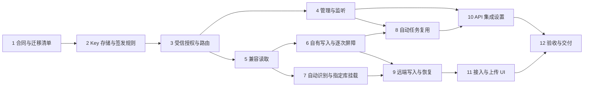

# API 集成、远端知识库与自动任务实施计划

> **For agentic workers:** REQUIRED SUB-SKILL: Use superpowers:executing-plans to implement this plan task-by-task. Steps use checkbox (`- [ ]`) syntax for tracking.

**Goal:** 以 WeKnora 现有实现为基础，交付应用级 API Key、三字段远端知识库接入和自动任务复用，保留两种服务器真实的上传与整理行为。

**2026-10-22 范围更新：** 用户确认按全新功能实现，不考虑历史代码或数据库结构兼容、数据迁移、旧 Token 转换及旧监听保留。下文“迁入／迁移 W1–W7”仅指复用 WeKnora 源码，不指用户历史数据。

**Architecture:** 在宿主集中保存 Key 和授权，独立 API 服务只装配明确发布的知识与任务路由。知识操作继续调用已发布的独立知识核心，自动任务继续调用原调度与执行；远端接入通过统一知识 Adapter 屏蔽合同转换。迁移上游实现和测试，仅在存储、权限差异、原子写入及宿主生命周期处适配。

**Tech Stack:** Go、Gin/ginx、GORM/SQLite、`neux-knowledge` Go module、React/TypeScript、TanStack Query、现有 OpenAPI/toolx 生成链、Go test、Vitest/Testing Library/MSW。

**Spec:** [API 集成、远端知识库与自动任务规格](../specs/2026-10-21-api-integration-design.md)。行为冲突以该规格为准；本文只规定实施落点、依赖和验证。

## Global Constraints

- 当前只授权编写计划。以下复选框均是未来实施步骤，本轮不创建产品代码、测试、迁移脚本或生成文件，也不提交、推送或发布。
- 实施前阅读根目录 AGENTS、CONTEXT，以及[架构总览](../../architecture/overview-cn.md)、[后端约定](../../development/backend-cn.md)、[前端约定](../../development/frontend-cn.md)、[UI 标准](../../development/ui-cn.md)、[桌面边界](../../architecture/desktop-lifecycle-cn.md)、[通知契约](../../architecture/notifications-and-work-board-cn.md)和[文档约定](../../development/documentation-cn.md)。保留无关工作区修改。
- WeKnora 固定基线为 [`8776a2d92d11ad3e76865d51cf3192e37e2a9976`](https://github.com/Tencent/WeKnora/tree/8776a2d92d11ad3e76865d51cf3192e37e2a9976)；当前知识核心依赖为 `github.com/JieWaZi/neux-knowledge v0.1.0`。模块源码在源仓库修改、发布版本后更新宿主依赖；不恢复源码快照、同步生成器或提交本机 `go.work`。
- 新接入只填 URL、API Key、知识库 ID，使用 `X-API-Key`。服务类型由后端识别；自有端 `upload_mode=separate`，WeKnora 为 `automatic`，无法确认则为 `unknown`。
- 自有上传真正保存原件且不启动整理；WeKnora 确认上传即发送并自动处理。上传前固定提示；不增加等待点击整理的持久文件暂存层。
- 授权沿用“同类型能力集合 × 明确资源 ID 集合”。空集合拒绝；保留 `retrieve`、`ingest`，扩展 `organize`、`automatic_task.invoke`、`automatic_task.results`。独立整理同时要求 `retrieve` 和 `organize`，不要求 `ingest`。
- 对外只发布本机权威知识库和可用的 API 类型任务；不发布远端挂载、桌面管理路由、任意本机文件、完整聊天或账号信息。
- Key 只存摘要，轮换保留 Key ID；远端调用凭据复用现有加密存储。请求身份、目标和恢复入口跨断线、重启及移除挂载保持可追溯。
- 授权变更与实际内容提交共用协调边界；逐次提交检查，已提交成果保留。后台知识整理使用独立模型作业，不恢复 Chat／Execution／Skill 整理循环。
- API 单入口编排留在 Operator；只提取具有两个真实调用入口的共享机制。Repository 服从现有事务、busy 重试、单表查询和中文字段注释规则，生成内容只通过现有命令更新。
- 每个任务按测试失败、最小实现、测试通过推进；检查点只表示可审阅交付，不自动执行 Git 提交。真实服务、模型、部署与视觉验收分别记录证据。

## Review Focus

1. 带反向代理前缀的 URL、重定向、TLS 错误和识别信息冲突：保留原目标、不转发秘密到其他地址、不猜测写模式。由任务 7 的 `TestRemoteDetectionPreservesTarget`、任务 11 的模式变化测试覆盖。
2. Key 签发响应丢失、并发授权编辑及授权扩容：不再生成第二个秘密、不覆盖新授权、不扩大已接纳知识任务。由任务 2、4、6 的签发回执、CAS 与增量提交测试覆盖。
3. 多文件只有部分接纳，随后断线、重启或移除挂载：成功项不重传，未知项保留独立恢复入口，新挂载不接管旧操作。由任务 9 和 11 覆盖。
4. 相同知识库 ID 出现在本地及多个远端，页面／原件／运行 ID 被交叉使用：每个操作按完整目标和真实归属鉴权。由任务 3、7、8 的归属和交叉主体测试覆盖。
5. 自动任务已经启动后撤销 Key 或缩减任务知识授权，模型响应迟到：普通执行维持原生命周期，后续知识提交被拦截；定时触发不依赖 API Key。由任务 6 和 8 的跨执行恢复测试覆盖。

## 1. 迁移清单与职责地图

### 1.1 WeKnora 哪些代码直接迁移、哪些适配

“直接迁移”指保留现成算法、数据约束或路由登记实现，允许改包名、类型名和中文注释；不表示整包及其空间、PostgreSQL、Redis、Vue 依赖一起引入。“迁移并适配”必须保留来源与对应测试，差异集中在表中落点。

下表上游路径均相对固定提交。源文件入口：[Key 类型](https://github.com/Tencent/WeKnora/blob/8776a2d92d11ad3e76865d51cf3192e37e2a9976/internal/types/tenant_api_key.go)、[Key Service](https://github.com/Tencent/WeKnora/blob/8776a2d92d11ad3e76865d51cf3192e37e2a9976/internal/application/service/tenant_api_key.go)、[路由授权](https://github.com/Tencent/WeKnora/blob/8776a2d92d11ad3e76865d51cf3192e37e2a9976/internal/middleware/api_key_gate.go)、[知识路由](https://github.com/Tencent/WeKnora/blob/8776a2d92d11ad3e76865d51cf3192e37e2a9976/internal/router/routes_knowledge.go)、[API 集成界面](https://github.com/Tencent/WeKnora/blob/8776a2d92d11ad3e76865d51cf3192e37e2a9976/frontend/src/views/integrations/ApiIntegrationSettings.vue)。

| 编号／方式 | 上游具体代码与测试 | 迁入位置 | 必要差异／禁止重复实现 |
| --- | --- | --- | --- |
| W1 直接迁移 | `internal/application/service/tenant_api_key.go` 的 `generateTenantAPIKeyToken`、`hashTenantAPIKey`、`normalizeAPIKeyIDs`；`tenant_api_key_test.go` 的 `TestTenantAPIKeyServiceCreateAPIKeyUsesSKPrefix` | 宿主 `server/internal/integration/key.go`、`key_test.go` | 沿用 32 字节随机值、`sk-` 加 RawURLEncoding、SHA-256 完整凭据摘要和 ID 去重规则；新增摘要／去重的定向断言，不冒称已有独立上游测试；仅在首次签发资格确认后生成秘密 |
| W2 直接迁移后收紧授权 | `internal/middleware/api_key_gate.go` 的 `APIKeyRouteAuthorizer` 登记／查找、`normalizeRoutePath` 和默认拒绝；`api_key_gate_test.go` | 宿主 `server/apis/middleware/integration_api_key.go`、同名测试 | 保留方法加真实路径模板匹配；外层强制认证；整理的两个能力做合取校验，不能套入上游任一能力命中的分支 |
| W3 迁移并适配 | `internal/types/tenant_api_key.go` 的 `TenantAPIKey`、`TenantAPIKeyScope`、能力与范围投影；`tenant_api_key_scope_test.go`、`tenant_api_key_test.go` | 宿主 `server/repositories/models/integration_key.go`、`server/internal/integration/authorization.go` 及测试 | 32 位本机 ID、毫秒时间、SQLite JSON；摘要唯一索引；空范围拒绝；未知能力报错；移除平台、空间成员、`full_access` 及可解密回显秘密的字段／Hook |
| W4 迁移并适配 | Key Service 的创建、更新、撤销校验、`AuthenticateAPIKey`、最近使用节流；Service 测试 `UpdateNormalizesConfiguration`、`RevokeAPIKey`、`AuthenticateThrottlesLastUsedUpdates`、`AuthenticateRejectsExpiredKey`（均带 `TestTenantAPIKeyService` 前缀），以及 `internal/handler/tenant_api_key_validation_test.go` | 宿主 `server/apis/integrations/*_api_key.go`、`server/services/integration/authorization.go`、Repository 测试 | 单入口管理流程落在 Operator；摘要查询和受信身份供知识／任务复用；增加轮换代次、授权版本、稳定签发回执；最近使用保留一分钟节流并使用宿主有界生命周期，不复制游离 goroutine |
| W5 迁移并适配 | `routes_knowledge.go`、`internal/handler/{knowledgebase,knowledge,wiki_page}.go`、相应请求响应类型、分页与已存在的针对性测试 | 宿主 `server/apis/integration_knowledge/` | 保留真实路径、包装和分页；Service 调用替换为现有 `core.Engine`／知识 Service；文件／页面反查所属库；上传只保存原件；原始服务端版本保护不足处接入原子 CAS |
| W6 保持第三方原生行为 | `internal/application/service/knowledge_create.go` 上传后入队、`knowledge_process.go` 状态、`handler/knowledge.go` 的 reparse、`types/knowledge_process.go` 及测试 | 独立模块 `remote/weknora.go`、`weknora_test.go`；宿主远端操作与 UI | 复用真实请求／状态合同；不迁移 Asynq／Redis 队列到宿主，不用上传后取消或重传模拟独立整理，不把解析完成当全部 Wiki 完成 |
| W7 交互与局部纯函数适配 | `frontend/src/views/integrations/{ApiIntegrationSettings.vue,apiKeyScope.ts,apiKeyScope.test.ts}` | 宿主 Settings 中的 `api-key-form.ts`、Key 对话框及行为测试 | 复用字段关系、资源选择及空值数组复制代码；将空值含义改为无授权并修改注释／测试；用 React 和现有共享组件重表达，不迁 Vue/TDesign、Playground 或平台管理功能 |

W5 不承诺存在完整上游合同测试套件：任务 1 逐项登记已有测试，缺少的用固定源码导出的最小 fixtures 补齐，明确“新增合同测试”，不冒称迁入。每条迁入记录含源提交、原路径／函数、目标路径、保留测试、差异和许可，集中更新两仓库已有 `THIRD_PARTY_NOTICES.md`。

### 1.2 继续使用的现有实现

| 现有落点 | 保留职责 | 本次增量 |
| --- | --- | --- |
| 独立模块 `core/`、`internal/store/`、`internal/pipeline/` | 来源、raw、页面、版本、检索、索引、独立整理 | 只补公开授权端口与实际提交保护缺口；已迁算法不再复制进宿主 |
| 宿主 `server/services/knowledge/{service,remote,maintenance}.go` | 模型配置冻结、Generator、知识作业与提交后事件 | 连接统一授权、按来源区分恢复身份，传递每次提交屏障；默认模型由目标库解析 |
| `server/repositories/controllers/knowledge_connection.go` 与对应模型 | AES-GCM 凭据存储、连接版本 CAS、原子快照、稳定请求回执 | 原子保存指定库挂载、识别证据和连接修订；不建立第二套秘密库 |
| `server/apis/knowledge_connections/remote_operations.go`、`KnowledgeOperationLink` | 写请求登记、原回执对账、完整目标 | 覆盖原生上传的逐项状态、连接快照与删除挂载后的恢复；不增加待整理文件存储 |
| `server/services/schedule/{runs,configuration,service}.go`、`server/apis/automatic_tasks/{management,local_api}.go` | 任务接纳、并发／限流、旧 Token 合同、状态与结果 | 新 Key 的主体／任务归属、幂等命名空间及统一监听，不另写调度器 |
| `server/services/workflow/runs.go`、`server/internal/workflow/files/` | 受管上传、输入引用、输出下载 | 在原存储元数据和校验中补 Key 所有者，不建立新的文件系统 |
| `desktop/src/shared/api/knowledge/knowledge-*-adapter*.ts` | 本地／远端统一操作及完整资源引用 | 接入新挂载／能力／上传模式，页面不直接请求远端 |
| Settings Scene、共享控件、Query／事件端口 | 单一设置外壳、异步状态、资源变化 | 增加 API 集成分区与局部刷新；不新增第二个 Settings Scene 或页面自建长连接 |

### 1.3 文件与公共边界约定

以下路径省略 `NeuxBot/` 前缀；明确写 `neux-knowledge/` 的属于独立模块源仓库。不存在的文件均为未来新增，不在本轮创建。

| 责任边界 | 主要文件 | 依赖方向 |
| --- | --- | --- |
| 权限值与签发规则 | `server/constants/integration_{resource_kind,capability}.go`、`server/internal/integration/{key,authorization}.go` | 纯规则，不访问 DB／网络 |
| Key 持久化 | `server/repositories/{models,controllers}/integration_key.go` | Repository 接口与 SQLite 实现；不依赖 API DTO |
| 共享认证和写屏障 | `server/services/integration/authorization.go` | 知识 HTTP、任务 HTTP、恢复作业调用；不承载仅管理页使用的完整用例 |
| 管理与公开入口 | `server/apis/integrations/`、`server/apis/integration_knowledge/`、现有 `automatic_tasks/` | 各 Operator 拥有单入口用例；管理路由与发布路由分别注册 |
| 监听所有权 | `server/internal/integration/listener.go`、`server/global/integration_api.go` | Listener 只管理绑定／切换／关闭；global 只装配领域依赖 |
| 识别与挂载 | `neux-knowledge/remote/discovery.go`、`server/apis/knowledge_connections/`、现有连接 Repository | HTTP 只读识别与本机原子保存分开 |
| 远端写入与恢复 | 独立模块 `remote/weknora.go`、新增 `remote/integration.go`；宿主现有远端操作与回执文件 | 新统一合同与旧 `custom` 合同并存于底层；业务页面只用统一 Adapter |
| 管理及知识 UI | `desktop/src/modules/settings/`、`modules/knowledge/`、`shared/api/knowledge/` | 依赖生成客户端及共享控件，不引入第二套状态源 |

实施时共享类型按以下最小合同定义，后文使用同名类型：

- `models.IntegrationGrant`：`ResourceKind`、明确的 `ResourceIDs []string`、`Capabilities []constants.IntegrationCapability`。每种资源最多一组，嵌入 Key 的 JSON 授权集合；不建立逐库权限矩阵。
- `models.IntegrationKey`：稳定 `ID`、名称、摘要、展示前缀、`CredentialGeneration`、`GrantVersion`、编辑 `Revision`、授权组、启停／撤销／到期及创建／最近使用时间。摘要字段永不进入 JSON。
- `models.IntegrationIdentity`：`KeyID`、`CredentialGeneration`、`GrantVersion`；代表已经验证的身份，不接受客户端自行提交。
- `models.IntegrationAuthorization`：上述身份、资源类型／ID、所需能力集合、原实际对端和转发链。只保存重检所需事实；库策略和来源版本仍归现有知识配置／核心，不复制为另一份授权权威。
- `models.IntegrationInvocation`：上述身份、`TaskID`、`TaskConfigurationVersion`、原实际对端和转发链。存入 `AutomaticRun.IntegrationInvocation`；冻结的任务知识范围继续使用该 Run 已有 `Configuration.Knowledge`。
- `integration.Service.Authenticate(ctx context.Context, token string) (models.IntegrationIdentity, error)`；`Authorize(ctx context.Context, identity models.IntegrationIdentity, kind constants.IntegrationResourceKind, resourceID string, required []constants.IntegrationCapability) (models.IntegrationAuthorization, error)`；`AcquireGuard(ctx context.Context, auth models.IntegrationAuthorization) (release func(), err error)`；`WithAuthorizationWrite(ctx context.Context, change func(context.Context) error) error`。客户端 IP 由受信 HTTP 边界填入授权，不由正文提供。

## 2. 阶段、依赖与交付门

任务 1 先锁定迁移与合同证据；任务 2–4 完成统一授权、密钥管理和监听；任务 5–7、9 完成知识发布、识别、挂载及远端写恢复；任务 8 完成自动任务；任务 10–11 完成 UI；任务 12 完成整体验证。任务号是审阅单元，不代表可跳过依赖。



不得把“授权后台已完成”“只读接入可用”或“上传已接纳”分别当作整个 spec 交付。尚无生产入口的能力不在设置中显示为可用。独立模块变更可先联合开发；宿主交付必须锁定已发布正式版本，`GOWORK=off` 验证。

## 3. 实施任务

下文测试断言块为行为伪代码，用于固定测试名、输入和预期；实施时使用对应包现有临时数据库、HTTP fixture 和 UI 夹具落地，不要求建立一套新的通用测试框架。每项先运行标出的定向命令观察预期失败，再实现并用同一命令确认通过；首次失败应指向缺失行为，不能以环境故障充当红灯。

### 任务 1：锁定上游迁移单元与可验证合同

**Files:** 新增 `server/apis/integration_knowledge/knowledge_contract_test.go`、`testdata/weknora_contracts.json`；修改根目录 `THIRD_PARTY_NOTICES.md`。迁移清单作为该测试数据的来源索引维护，不另写完整 API 表。

**Interfaces:** 输入为固定上游源码与目标实例只读响应；产出为按操作记录的路径、请求／响应包装、授权、分页、版本、状态与来源证据，供任务 3、5、7、9 使用。

- [ ] 写 `TestWeKnoraContractFixtures`，覆盖库详情、资料详情／上传响应、Wiki 读取／更新、目录、图谱、搜索及 reparse；断言 fixtures 不带秘密、未知结构拒绝，`knowledgebase` 与 `knowledge-bases` 不混写。缺少上游测试的操作标记为新增测试。
- [ ] 运行 `cd server && go test ./apis/integration_knowledge -run TestWeKnoraContractFixtures -count=1`，确认未建立合同样本时失败。
- [ ] 从 W1–W7 原文件切出真实复用单元，记录依赖和许可；核对 `/system/info` 的实际路由、Key 可读性、版本字段与知识合同，核对原件下载实际授权、上传幂等／状态及 Wiki 条件写链。无法证明的能力明确受限，不以试写探测授权。
- [ ] 重跑定向测试，检查样本能区分“资料已保存”“解析中／失败”与完整处理终态；没有终态证据则保持未知。按操作列出准入结果，非规格允许的缺口须在依赖任务实施前解决。

### 任务 2：迁移 Key 规则与摘要持久化

**Files:** 新增 `server/constants/integration_resource_kind.go`、`integration_capability.go`；`server/internal/integration/{key,authorization}.go` 及对应测试；`server/repositories/{models,controllers}/integration_key.go`、`controllers/integration_key_test.go`；修改 `server/constants/status_error/error.go`。枚举和错误生成文件只通过生成命令产生。

**Interfaces:** 产出 1.3 节的 Key／Grant／Identity 类型；Repository 提供 `Get(ctx,id)`、`FindByDigest(ctx,digest)`、分页 `List`、带预期 `Revision` 的授权修改／轮换／撤销，以及签发请求 `ClaimMutation`／`CompleteMutation`／`GetMutation`。方法返回 Model 和稳定业务结果，不返回 GORM。签发回执单独登记在 `models.IntegrationKeyMutation`，只存请求摘要、Key ID、动作与处理状态。

- [ ] 迁入 W1、W3 的纯规则测试及 SQLite 契约测试，增加以下断言：
  ```text
  TestIntegrationGrantEmptyAndUnknown: resources=[] => deny; capability="future_admin" => reject
  TestIntegrationKeyDigestStorage: stored(token)==false; FindByDigest(hash(token)).ID==key.ID
  TestIntegrationIssuanceReplay: sameRequest => sameKeyID; generateSecret.calls==1; replay.secretUnavailable==true
  TestIntegrationKeyRevision: staleRevision => conflict; storedGrants==newerGrants
  TestIntegrationKeyVersions: rename => sameGrantVersion; widenGrant => changedGrantVersion
  ```
- [ ] 运行 `cd server && go test ./internal/integration ./repositories/controllers -run TestIntegration -count=1`，确认上述能力尚未满足。
- [ ] 迁入 W1 的生成、摘要、ID 归一化和 W3 的能力／范围投影，再实现本机模型与 Repository；创建／轮换先原子抢占稳定请求，再生成一次秘密并完成持久化。遗留签发中或秘密响应丢失只返回可识别的不可回显状态，不自动再签发。事务重试不能重复随机副作用；敏感字段 `json:"-"`。
- [ ] 通过同一测试命令；查询使用摘要唯一索引，轮换递增凭据代次但保留 Key ID；授权变化递增 GrantVersion，名称／LastUsedAt 不变更它。真实临时 SQLite 测试证明回滚和条件更新，不只使用 mock。

### 任务 3：迁移路由授权，建立唯一认证及撤权机制

**Files:** 新增 `server/services/integration/authorization.go`、`authorization_test.go`，`server/apis/middleware/integration_api_key.go`、`integration_api_key_test.go`；修改宿主 `server/global/config.go` 的依赖装配。独立模块只扩展新功能实际需要的核心提交端口，不实现旧认证迁移。

**Interfaces:** 宿主产出 1.3 节的四个 Service 方法，公开知识与任务入口统一使用这份摘要授权。独立核心不依赖宿主 Model；受信恢复信封由宿主生成，逐次提交恢复原 Key 及授权代次。无需适配旧知识 HTTP 的 Token 权威。

独立模块保持不依赖宿主 Model；宿主在 `services/knowledge/remote.go` 转换该端口和恢复信封。W2 原测试 `TestGateDefaultDeny`、`TestNormalizeRoutePath` 保留；`TestGateJWTPassesThrough` 和 `TestGateAnyOfCapabilities` 的上游行为作为显式差异测试，不能直接沿用为公开入口的允许条件。

- [ ] 迁入 W2 的默认拒绝／模板匹配测试，新增：
  ```text
  TestIntegrationRouteDefaultDeny: missingPrincipal || undeclaredRoute => deny
  TestIntegrationRouteAllRequired: retrieveOnly || organizeOnly => denyOrganize; both => allow
  TestIntegrationTargetOwnership: grantedLibraryA + sourceOfB => deny; count==authorizedCount
  TestIntegrationGuardSerializesRevocation: revokeReturned => noNewCommitWithOldIdentity
  TestIntegrationGuardRestore: revokedOrRotatedOrGrantChanged + restart => deny
  ```
- [ ] 宿主运行 `cd server && go test ./services/integration ./apis/middleware -run TestIntegration -count=1`；独立模块运行 `go test ./httpapi -run TestAuthorizer -count=1`，分别确认失败。
- [ ] 迁移 W2／W4 共享鉴权，强制 `X-API-Key`、摘要索引查询与固定时间校验；归属校验覆盖文件、页面、资料、运行等间接 ID。管理授权写与每次实际提交采用同一协调机制，固定锁顺序，不持锁等待网络／模型。统一 API 不装配旧策略或 Token 入口。最近使用写入一分钟节流、有界、受 Start／Close 管理，审计只记录安全字段。
- [ ] 两仓库定向测试通过，并对撤权并发测试运行 `go test -race`。验证修改名称不拦截旧任务，扩大／缩小权限均使旧知识授权快照失效；IP 仅按实际对端和明确受信代理链重检，任意转发头不能放行。

### 任务 4：管理 API 与统一监听

**Files:** 新增 `server/apis/integrations/{router,published_router,resource,list_api_keys,create_api_key,update_api_key,set_api_key_enabled,rotate_api_key,revoke_api_key,get_api_service,update_api_service,list_publishable_resources}.go`、`integration_management_test.go`；新增 `server/internal/integration/listener.go`、`listener_test.go`，`server/global/integration_api.go`、`integration_api_test.go`；修改 `server/apis/root.go`、`server/global/config.go`、`server/services/schedule/service.go`、`server/apis/automatic_tasks/global_tasks.go` 和 `server/cmd/ally-core/main.go`。

**Interfaces:** 管理路由仅在本机 `/api/v1/integrations` 注册。Key 创建／轮换返回 `{key, secret, issuanceState}`，重放不含秘密；更新携带 `expectedRevision`。`integrations.NewPublishedHandler(knowledge http.Handler, tasks http.Handler) http.Handler` 在 `published_router.go` 装配，绝不接收 desktopRouter。Listener 的 `Start(ctx)`、`Reconfigure(ctx, config)`、`Close(ctx)` 和状态快照归同一所有者；任务页读取该快照。延续当前 `schedule.LocalHandlerFactory` 注入方向，在 `cmd/ally-core` 注入发布 Handler 工厂，global 只传已装配依赖，不能反向导入 apis 形成循环；任务 5、8 完成前测试工厂可返回明确受限入口。

- [ ] 写 `TestIntegrationManagementLocalOnly`、`TestIntegrationPublishableResourcesLocalOnly`、`TestIntegrationListenerLifecycle`：断言集成 Key 不能管理 Key；远端挂载不入授权目录；端口冲突不报告可用；切换失败保留原监听；停用 API 不停定时调度；退出可重复关闭。
- [ ] 运行 `cd server && go test ./apis/integrations ./internal/integration ./global ./apis/automatic_tasks -run 'TestIntegration' -count=1`，确认新管理行为失败。
- [ ] 管理用例直接编排现有事务和任务／库目录，使用任务 2–3 的共享规则；不增加迁移预览、导入、备份或历史权限转换接口。
- [ ] 统一服务独立持有 `integration-api.json`，默认回环 `127.0.0.1:8431`；不读旧配置、不保留旧端口或旧 Token 路由。默认不开放 CORS，区分监听和访问 URL，`0.0.0.0` 不作为复制地址；设置页和任务页读取同一所有者，通过端口切换、调度独立性和退出回归。


### 任务 5：迁移 WeKnora 兼容的知识读取入口

**Files:** 新增 `server/apis/integration_knowledge/{router,types,get_library,list_libraries,list_sources,get_source,get_raw,list_pages,get_page,list_revisions,get_revision,list_themes,get_graph,search,get_capabilities}.go`；扩展任务 1 的 `knowledge_contract_test.go`；修改 `server/global/integration_api.go`。路径注册以 spec 第 10 节及核对后的上游合同为准，不另造 Wiki 复数路径。

**Interfaces:** `integration_knowledge.NewHandler(engine *core.Engine, knowledge *knowledgeservice.Service, auth *integration.Service) http.Handler`，供任务 4 发布装配；各操作直接复用 Engine 公共读取 API。能力响应产生 `service_kind=neuxally`、协议版本、`upload_mode=separate`、操作 `supported/permission/condition`、原子条件写和回执恢复能力，缺失配置明确受限。

- [ ] 用 W5 的类型、路由和分页测试加固定 fixtures 写 `TestPublishedKnowledgeReadContract`，断言授权过滤后的列表／总数、Unicode 分层 slug、资料实际所属库、原件下载和无权对象不泄漏；`TestPublishedCapabilities` 断言协议支持不等于主体授权或执行配置可用。
- [ ] 运行 `cd server && go test ./apis/integration_knowledge -run 'TestPublishedKnowledgeReadContract|TestPublishedCapabilities' -count=1`，确认缺失兼容入口时失败。
- [ ] 迁入已核对的请求绑定、响应类型与分页处理，将租户 Service／Repository 访问替换为现有 Engine 公共边界；不得复制知识核心进宿主。库列表只在允许的本机 ID 集合中过滤和计数；间接对象 ID 先验证归属。读取和模式发现不调用模型、不扫描全库正文。
- [ ] 定向测试通过，并将发布 Handler 装配到测试 Listener 验证：读取成功，桌面管理、账号、完整聊天等路由不可达；Key 缺失与未登记路由默认拒绝，不能因兼容路径同名接入本机管理认证。

### 任务 6：自有上传、原子编辑及独立整理的逐次授权

**Files:** 新增 `server/apis/integration_knowledge/{import_source,write_page,write_theme,organize,reparse_source,get_job,get_receipt}.go`、`knowledge_write_test.go`；修改 `server/services/knowledge/{remote,service,maintenance}.go` 及测试、`server/repositories/models/knowledge_task_configuration.go`；独立模块检查并按缺口修改 `core/{source,page,organize}.go`、`internal/pipeline/lite.go` 及其真实提交点，扩展 `core/policy_write_test.go`、`internal/pipeline/lite_contract_test.go`。

**Interfaces:** 上传调用现有 `Engine.ImportSource` 并返回已保存资料身份；Wiki 编辑将用户已读 `version` 原样传入 `Engine.WritePage` 的条件写。整理沿现有 `Service.Organize(ctx, OrganizeCommand)`，请求区分省略来源与显式空集合，冻结库默认模型、来源和版本。`KnowledgeTaskConfiguration.RemoteAuthorization` 复用为带来源标签的宿主恢复信封：`direct_api` 存任务 3 授权，`automatic_task` 存原 AutomaticRun ID，`legacy` 按原冻结身份；不可从外部 JSON 绑定该信封。

- [ ] 写以下定向行为测试，按真实提交点设置可控屏障而非只 mock 最后一次发布：
  ```text
  TestPublishedUploadOnlySavesRaw: raw.exists==true; generator.calls==0; organizeJobs.delta==0
  TestPublishedOrganizeAuthorization: retrieve+organize => accepted; arbitraryEditWithOrganize => deny
  TestPublishedExplicitEmptySources: [] => noWork; omitted => freezeCurrentPendingOnly
  TestPublishedWikiCAS: sameReadVersion + concurrentWrites => oneSuccessAndOne409
  TestPublishedIncrementalRevocation: firstPage.committed; revokeReturned; laterPageOrIndex.commit==false
  TestPublishedLateResponseAndRestart: originalIdentityChanged => noNewSourceChunkVectorWikiOrCatalogCommit
  ```
- [ ] 宿主运行 `cd server && go test ./apis/integration_knowledge ./services/knowledge -run TestPublished -count=1`；独立模块运行 `go test ./core ./internal/pipeline -run 'Test.*Guard|Test.*Revocation|Test.*CAS' -count=1`。新建测试使用匹配前缀，确认失败点。
- [ ] 迁入 W5 的上传／编辑绑定与响应处理；接入已有 raw、页面、目录和作业用例。普通整理按当前规则跳过已完成来源，明确重建才进入已验证 reparse 映射。服务端解析目标库默认 Runtime／账号／模型，不增加接入字段或静默换模型；返回缺配置原因。
- [ ] 每次来源状态、分块、向量、页面、摘要、目录、索引及链接收尾写入都使用任务 3 的 guard 和原版本保护，锁内只含检查与实际提交；不回滚已提交的独立成果。通过上述测试和并发测试，证明 `accepted`、处理终态和真实发布分别来自权威事实，提交后复用 `knowledge.changed`，无重复事件或后台 Chat。

### 任务 7：自动识别服务并原子挂载指定知识库

**Files:** 独立模块新增 `remote/discovery.go`、`discovery_test.go`，修改 `remote/weknora.go`；宿主新增 `server/constants/remote_service_kind.go`、`remote_upload_mode.go`，`server/apis/knowledge_connections/{add_remote_library,remove_remote_mount,redetect_connection}.go`、`remote_mount_test.go`；修改该包 `client.go`、`resource.go`、`update_connection.go`、`check_connection.go`、`list_available_libraries.go`、`router.go` 及对应测试，现有连接 Model／Controller／测试。

**Interfaces:** 模块公开 `remote.Detect(ctx context.Context, options remote.Options, libraryID string) (remote.Detection, error)`；Detection 含标准化 API 基地址、真实库身份／名称、服务类型／版本、upload_mode、操作能力和只读识别依据。新增 `models.KnowledgeRemoteMount{ID, ConnectionID, KnowledgeBaseID, Revision}`；连接保存识别证据与其 Revision。`AddRemoteLibrary` 的业务输入只有 URL、Key、知识库 ID，另带系统生成 `requestId`；返回挂载和识别结果，不返回秘密。

- [ ] 写 `TestRemoteDetectionPreservesTarget`、`TestRemoteMountExactLibrary`、`TestRemoteMountAtomicReplay`：
  ```text
  URL="https://example.test/proxy/api/v1/" => base=="https://example.test/proxy/api/v1"
  userinfo || query || fragment || redirect || TLSFailure => noCredentialForwarding
  explicitOwnIdentity => separate; verifiedWeKnoraVersionAndContract => automatic
  ownEndpoint404 || ownEndpoint403 || conflictingEvidence => neverInferWeKnoraFromThatAlone
  detailAAllowedButListForbidden => mountA; visibleOtherLibraries==[]
  saveFailed || returnedIDMismatch => noUsableMount; sameRequest => sameMount
  ```
- [ ] 模块运行 `go test ./remote -run TestRemoteDetection -count=1`；宿主运行 `cd server && go test ./apis/knowledge_connections ./repositories/controllers -run 'TestRemoteMount|TestKnowledgeConnection' -count=1`，确认失败。
- [ ] 有界只读识别：先读取目标库和自有显式能力；没有自有声明时按任务 1 核对的系统版本加知识合同判断 WeKnora，所有失败保持真实原因。读取成功但类型／模式未知可保存受限挂载；只开放已验证读取和原操作只读对账。网络在事务外，成功后用现有连接加密／CAS／回执机制原子保存连接、秘密、挂载和识别证据。
- [ ] 列表仅按挂载精确读取，不再枚举新连接全部可见库；完整目标始终是连接加实际库 ID。改 URL 必须重输 Key；改凭据／库 ID 重新验证并使检测缓存失效；同连接同库不重复挂载，不同凭据不自动合并。移除只删本机入口；通过同 ID 本地／多远端和缓存陈旧回归，不回退本地。

### 任务 8：自动任务复用 Key、输入输出隔离及知识授权链

**Files:** 新增 `server/apis/automatic_tasks/integration_api.go`、`integration_api_test.go`；修改同包 `management.go`、`local_api.go`，`server/services/schedule/{runs,configuration,service}.go` 及测试，`server/repositories/models/automatic_task.go`、对应 Controller；修改 `server/internal/workflow/files/{store,store_test}.go`、`server/services/workflow/runs.go`；修改 `server/services/integration/authorization.go`、`server/services/knowledge/{maintenance,service}.go` 及测试、`server/global/config.go`。沿现有持久授权链补充 `server/services/execution/intent.go`、`server/repositories/models/execution.go` 及实际团队／工作流派发处的受信运行引用，不能把来源放进模型可编辑参数。

**Interfaces:** `automatic_tasks.NewIntegrationHandler(service *schedule.Service, config schedule.Config, auth *integration.Service) http.Handler` 装配到同一公开 `/api/v1`。`schedule.AdmissionCommand.IntegrationInvocation *models.IntegrationInvocation` 进入原 Run；幂等机会使用 Key ID、任务 ID 和原 requestId 的有界摘要，不沿用会跨 Key 碰撞的裸请求身份。上传元数据增加稳定 `OwnerKeyID`，新 Key 的成果归属不得使用空值。

`integration.Service.AcquireInvocationGuard(ctx context.Context, automaticRunID string) (func(), error)` 从原 Run 和当前任务读取权威授权；由 global 注入 `knowledge.Config.InvocationGuard func(context.Context, string) (func(), error)`，知识 Service 不导入 schedule。任务授权缩减／启停／删除与知识提交共用任务 3 的协调边界，锁顺序固定为集成授权协调锁、知识策略锁、实际提交；任务配置修改先持原任务接纳协调锁，再取集成授权写锁，知识提交不得反向获取任务接纳锁。任务版本只作追溯，不按任何版本变化一律撤权。

- [ ] 写 `TestIntegrationAutomaticTaskIsolation`、`TestIntegrationAutomaticTaskKnowledgeProvenance`：
  ```text
  sameTask + keyA/keyB + sameRequest => separateAdmission; retryOfA => sameRun
  keyB + uploadOrRunOrOutputOfA => deny; invokeOnly => cannotReadResult
  keyARotated + oldRunOfA + currentResultsGrant => allow; oldCredential => deny
  taskKnowledgeGranted + noDirectKnowledgeGrant => controlledKnowledgeAdmissionAllowed
  revokeKey || disableTask || shrinkTaskKnowledge => laterKnowledgeCommitDenied
  renameTask || changeFutureModelDefaults => existingFrozenWorkUnchanged
  addTaskKnowledgeRange => existingRunRangeUnchanged; scheduledRun => noSyntheticKeyDependency
  ```
- [ ] 运行 `cd server && go test ./apis/automatic_tasks ./services/schedule ./services/knowledge ./internal/workflow/files -run 'TestIntegrationAutomaticTask|Test.*APIFile' -count=1`，确认新主体隔离与授权链尚不满足。
- [ ] 将现有任务 API 的有界读取、Schema、限流、幂等、文件和结果用例接到新授权；保持任务真实 API 类型、可用性及目标检查。新入口不伪造旧 Token，不让旧 `AuthenticateTask` 无认证放行。输入引用绑定 Key 加任务，结果／下载同时检查当前任务范围、原 Run 主体及文件归属，拒绝任意路径。
- [ ] 从 AutomaticRun 沿 Chat／团队／Workflow 派发与恢复传递受信原运行引用，到 `knowledge.jobs.start` 冻结其原授权。逐次提交检查原凭据代次／授权版本、任务调用权、任务有效性以及冻结知识范围仍被当前任务覆盖；不额外要求直接知识整理权。普通执行不因断线／撤 Key 自动取消；通过重启及迟到响应测试，知识后台仍用独立模型作业。

### 任务 9：远端原生写入、操作登记和未知结果恢复

**Files:** 独立模块新增 `remote/integration.go`、`integration_test.go`，扩展 `remote/{weknora,weknora_test}.go`、`remote/README.md`；宿主修改 `server/apis/knowledge_connections/{import_remote_source,organize_remote,maintain_remote,write_remote_page,remote_operations,get_remote_operation,get_remote_receipt,list_remote_operations,get_remote_capabilities}.go`、现有远端合同／对账测试；修改 `server/repositories/models/knowledge.go`、知识与连接 Controller 及测试。

**Interfaces:** `remote.NewIntegration(options remote.Options, ref remote.ResourceRef)` 使用新统一合同，旧 `NewCustom` 原协议保留。上传结果独立表达远端资料身份、接纳事实和处理状态，不假造 `core.Receipt` 的发布完成。扩展现有 `KnowledgeOperationLink` 保存逐项 `not_sent/sending/accepted/failed/unknown`、连接修订／处理模式和原目标快照；凭据只通过受保护的原连接快照引用，不进操作 JSON。

- [ ] 写 `TestRemoteNativeUploadMode`、`TestRemoteWriteUnknownRecovery`、`TestRemoteRecoveryAfterUnmount`：
  ```text
  separate + upload => remoteRawSaved; organizeRequest.count==0
  automatic + upload => oneNativeUpload; organizeRequest.count==0
  unknownMode || modeChangedBeforeSubmit => businessWrite.count==0
  fileA.accepted + fileB.timeout => retryA.count==0; retryB.count==0; B.state==unknown
  restartWithSending => unknown; receiptSupported => queryOriginalRequestOnly
  unmount + newMountWithSameRemoteID => originalOperationStillDiscoverable; noNewOwnerAdoption
  noAtomicCAS => wikiEditUnsupported; selfHostedStaleVersion => 409AndDraftRetained
  ```
- [ ] 模块运行 `go test ./remote -run 'TestRemoteNative|TestRemoteWrite|TestRemoteRecovery' -count=1`；宿主运行 `cd server && go test ./apis/knowledge_connections ./repositories/controllers -run 'TestRemoteNative|TestRemoteWrite|TestRemoteRecovery' -count=1`，确认失败。
- [ ] 迁用 W6 真实上传／reparse／状态合同，任务 6 的自有扩展通过 `NewIntegration` 访问；新客户端不填 profile，远端按库解析配置。静态协议支持、实际权限和执行条件分别反馈；未知授权不试写。WeKnora 没有独立整理则说明上传自动处理；自定义整理要求不可表达时明确受限，不能静默忽略或重传已有文档。
- [ ] 首次远端请求前持久登记逐项身份、摘要、完整目标、版本及发送状态；已发出的操作保留原连接快照和独立恢复索引。多文件部分成功不重传，无可靠幂等／回执则保持未知并停自动重试；拒绝同名认领和删后重传。重启将遗留发送中转未知，仅按原合同读状态／回执；通过上述测试以及连接修改、秘密脱敏和本地零调用回归。

### 任务 10：设置中的 API 集成与 Key 管理

**Files:** 新增 `desktop/src/modules/settings/{api/integration-queries.ts,components/api-integration-section.tsx,components/api-key-dialog.tsx,lib/api-key-form.ts}` 及对应测试，新增 `desktop/src/shared/api/integration-service.ts` 及测试；修改 `settings-navigation.ts`、`pages/settings-scene.tsx`、`pages/settings-scene.test.tsx`、`desktop/src/modules/automatic-task/components/api-settings-dialog.tsx` 及测试、`desktop/src/shared/i18n/index.ts`，新增 `shared/i18n/integration.ts`。API 生成更新随本任务执行，不手改 `shared/api/generated`。

**Interfaces:** SettingsSection 增加 `integration-api`，分组显示“发布集成”，二级项“API 集成”。Query 调用任务 4 管理端及其唯一监听状态，Key 表单按 `IntegrationGrant` 转换；页面区分服务、文档、Keys，资源只来自服务端发布目录。`shared/api/integration-service.ts` 统一导出服务状态的 Query／Mutation options，Settings 与原任务 API 设置弹窗共同使用；Key 列表与表单 Query 仍留在 Settings，不跨模块导入内部代码。

- [ ] 按 W7 迁入／适配字段规则和选择测试，写 `API integration settings` 行为测试：导航唯一、无提供者或完全访问字段；空组／未知能力拒绝；选择写入或整理时明确要求读取；签发秘密仅本次显示；轮换保留主体；授权冲突保留草稿；列表查询与日志不含秘密。
- [ ] 运行 `pnpm --dir desktop exec vitest run src/modules/settings/pages/settings-scene.test.tsx src/modules/settings/components/api-integration-section.test.tsx src/modules/settings/components/api-key-dialog.test.tsx src/modules/settings/lib/api-key-form.test.ts src/modules/automatic-task/components/api-settings-dialog.test.tsx src/shared/api/integration-service.test.ts`，确认新交互失败。
- [ ] 使用现有 SettingsSectionLayout、SettingsFieldGroup、Dialog、共享多选及表单控件实现；迁用 W7 的字段关系和数组安全归一化，空范围文案改为无授权。生成客户端由 `pnpm api:generate` 更新，Query 负责服务器事实；监听切换失败就近展示，保留有效地址，签发丢失显示不可回显状态。
- [ ] 同一命令通过；在测试中延迟管理请求，确认 Scene／导航立即挂载，错误只影响数据区域；停用 API 不展示调度停止。任务页服务状态改读相同来源，未接入的能力不出现在可授权选项中。

### 任务 11：三字段添加、原生上传提示与恢复入口

**Files:** 新增 `desktop/src/modules/knowledge/knowledge-remote-add-dialog.tsx`、`knowledge-remote-add-dialog.test.tsx`；修改 `knowledge-page.tsx`、`knowledge-dialogs.tsx`、`knowledge-library-dialogs.tsx`、`knowledge-upload-dialog.tsx`、`knowledge-upload-queue.ts`、`knowledge-upload-source.ts`、`knowledge-remote-organize.tsx`、`knowledge-write-outcome.ts` 及相关测试；修改 `desktop/src/shared/api/knowledge/knowledge-adapter-types.ts`、`knowledge-remote-adapter.ts`、`knowledge-remote-operations.ts`、`knowledge-adapter-metadata.ts` 和现有 Adapter 测试，更新知识 i18n。

**Interfaces:** `AddRemoteKnowledgeInput` 的可见字段只有 `url/apiKey/knowledgeBaseId`，隐藏稳定 requestId 由本次意图生成并复用。统一 Adapter 元数据提供 `serviceKind/uploadMode/connectionRevision` 和逐操作能力；UI 从元数据显示提示，不从 backend 字符串自行推导。原操作恢复列表从现有远端操作接口读取，独立于已移除的库卡片。

- [ ] 写并扩展行为测试：
  ```text
  AddRemoteKnowledge: onlyThreeRequiredFields; returnedNameUsed; failedValidation => noCard
  OwnRemoteUpload: visible("上传仅保存资料，整理需单独启动"); clickUpload => uploadNow
  WeKnoraUpload: visible("上传后将由远端自动处理"); chooseFile => noRequest; clickUpload => oneImmediateUpload
  ModeChanged: priorConfirmationInvalid; request.count==0; updatedNoticeVisible
  UnknownMode: readsAvailable; uploadAndOrganizeAndWikiEditDisabled; redetectAvailable
  PartialUploadRecovery: acceptedNotResent; unknownNotRetried; unmountedOperationStillListed
  ```
- [ ] 运行 `pnpm --dir desktop exec vitest run src/modules/knowledge/knowledge-remote-add-dialog.test.tsx src/modules/knowledge/knowledge-upload-review.test.tsx src/modules/knowledge/knowledge-remote-organize.test.tsx src/modules/knowledge/knowledge-adapter.test.ts`，确认失败；若既有 Adapter 测试文件位置有变化，沿真实文件迁移测试，不另建重复 suite。
- [ ] 接入任务 7、9 的生成 API 和统一 Adapter。WeKnora 上传按钮附近固定提示，点击即确认，无第二次重复确认；自有端保留独立整理；识别未知提供重新检测，只读缓存可用。模式／连接版本变更停止原提交并重显提示，不能确认后静默换流程。
- [ ] 用同一测试命令验证，继续复用现有内存上传队列；只持久保存已发送操作恢复元数据，不增加待整理文件队列。成功项、未知项和未提交项分别处理；普通取消／关闭弹窗不伪造远端取消。恢复入口可在知识页发现，原目标不可被新挂载替换，错误与草稿留在对应区域。

### 任务 12：模块发布接入、生成合同与整体验收

**Files:** 修改 `server/go.mod`、`server/go.sum`、`server/openapi.json` 和 `desktop/src/shared/api/generated/`（后两者仅生成）；修改 `scripts/generate-api.sh`、`scripts/check-generated-api.sh`，新增 `scripts/public-openapi.mjs`、`scripts/public-openapi.test.mjs`，由生成链产出 `server/integration-openapi.json`；两仓库 `THIRD_PARTY_NOTICES.md` 及宿主 `desktop/resources/licenses/neux-knowledge/` 现有许可副本；更新 `docs/architecture/knowledge-cn.md`、`automation-and-im-cn.md`、`desktop-lifecycle-cn.md` 和对应使用指南，新增 `server/apis/integrations/integration_acceptance_test.go`。本计划保留为执行检查表，不替代当前能力文档。

**Interfaces:** 产出正式模块版本锁定、可重复生成的管理／公开合同、下面 API-01–17 对应证据，以及真实两类远端和任务验收记录。公开路由与 OpenAPI 来自相同注册／生成来源：同一发布路由登记产出允许的 method、path、operationId，生成脚本据此选取 paths 及递归引用的 components，并声明 `X-API-Key` 安全方案；不得手抄第二套路由清单。独立 Handler 的文档入口只提供 `integration-openapi.json`，不能发布完整桌面管理 Schema。任务 1 同时核对 toolx 对独立路由的扫描入口，确保公开操作进入生成源且不装到桌面 Router。

- [ ] 写 `TestIntegrationAcceptance` 的跨入口场景：本机管理创建 Key → 自有远端三字段挂载 → 上传零模型调用 → 显式整理 → 撤权阻断后续提交；另一场景验证新任务 Key、上传归属、原运行结果。WeKnora fixtures 覆盖原生自动处理请求与状态限制。`public-openapi.test.mjs` 断言公开路由恰好匹配登记、所有 schema 引用可解析、管理路径／组件不泄漏。
- [ ] 运行 `cd server && go test ./apis/integrations -run TestIntegrationAcceptance -count=1`，确认尚未完整装配时失败，按缺失环节回到责任任务修正。核对 W1–W7 来源／许可与修改原因，检查未复制第二套知识算法、队列、调度或秘密库。
- [ ] 独立模块执行 `gofmt`、`go vet ./...`、`go test ./...` 及授权相关 `go test -race`；形成可发布版本。版本发布及推送须另行获得明确授权；发布完成后宿主锁定该正式 tag，禁止使用未提交源码替代。修改源类型后执行 `pnpm api:generate`、`node --test scripts/public-openapi.test.mjs`，将公开合同可重复生成检查接入 `pnpm api:check`，检查生成差异和公开文档过滤结果。
- [ ] 宿主执行修改 Go 文件的 `gofmt -w`，依次运行 `cd server && GOWORK=off go vet ./...`、`cd server && GOWORK=off go test ./...`、`pnpm --dir desktop check`、`pnpm api:check`、`GOWORK=off pnpm check`。若 Node 环境触发项目已知 experimental webstorage 问题，使用 `NODE_OPTIONS=--no-experimental-webstorage GOWORK=off pnpm check` 并记录环境。最后对照下表逐项验收，自动检查、真实服务、模型质量、TLS／代理和视觉证据分别标注，未做的不写成通过。

## 4. Spec 验收覆盖与实际检查边界

| Spec 编号 | 责任任务 | 必需证据 |
| --- | --- | --- |
| API-01 | 2、4、10 | 唯一设置导航、Key 签发／轮换／回显行为、受限管理入口 |
| API-02 | 2、3、5 | 空集、未知能力、缺主体、漏登记路由和总数过滤 |
| API-03 | 7、11 | 只读精确库验证、原子保存、请求重放及失败无挂载 |
| API-04 | 3、7、9 | 同 ID 多来源、对象真实归属、远端失败本地零调用 |
| API-05 | 6、9、11 | 自有远端 raw 实际存在、上传模型调用为零、整理另行接纳 |
| API-06 | 1、9、11 | WeKnora 识别证据、固定提示、确认后立即上传及真实远端处理 |
| API-07 | 7、9、11 | 不支持独立整理时不重传、unknown 禁写与重新检测 |
| API-08 | 9、11 | 逐文件事实、发送中重启、原请求对账、移除挂载后可恢复 |
| API-09 | 2、3、6 | retrieve／ingest／organize 组合矩阵，直接编辑不借整理权放行 |
| API-10 | 1、5、7、9 | 支持／授权／配置／版本各自受限，无假终态或试写探测 |
| API-11 | 6、9、11 | 自有端并发 CAS／409／草稿；未改第三方无原子证据则编辑受限 |
| API-12 | 3、6、8 | 增量提交、撤权、迟到响应和重启全过程，知识后台无 Chat／Skill 驱动 |
| API-13 | 8 | Key、任务、运行、输入引用和输出文件交叉访问拒绝，幂等不重执行 |
| API-14 | 6、8 | 无直接知识权的任务调用、原主体传递、任务授权缩减及定时入口 |
| API-15 | 2、4、8、10 | 轮换主体连续、授权 CAS、签发丢失、差异旧权限显式拆分 |
| API-16 | 4、12 | 端口／切换失败、窗口关闭与应用退出、调度独立 |
| API-17 | 3、4、5 | 只发布本机权威资源，不转授远端 Key 或泄漏任意文件 |

实施完成的证据至少包含：迁移单元清单与保留测试、两仓库定向／完整检查、生成合同差异、真实自有远端读写整理、真实 WeKnora 上传自动处理，以及任务结果隔离。真实联调需要可达的实例与获准资源；没有这些证据时明确写“尚未验收”，不把 fixtures 或本地测试视为线上行为证明。

## 5. 实施准入与计划自检

没有新增需要用户决定的产品分歧。进入代码阶段前要完成的技术准入均已有责任任务：WeKnora 系统身份与 Key 可读性、上传／reparse 状态、Wiki 原子条件写证据归任务 1；统一授权与监听归任务 2–4；逐次写入屏障归任务 6；受信任务来源链归任务 8；断线／移除挂载恢复归任务 9。识别未知、第三方无 CAS、无可靠回执分别采用 spec 已批准的受限行为；不以这些限制删掉自有端必需能力。

编写计划时已逐节核对 spec，API-01–17 均有任务和证据落点；共享类型及调用方向统一，五类 Review Focus 均落到责任测试。执行时先完成可独立审阅的阶段，不因 UI 可见或某项测试通过提前宣布整个 spec 完成。本轮验收仅为文档格式、链接与计划覆盖检查。
