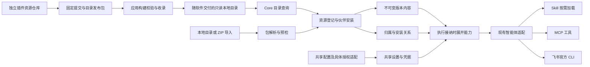
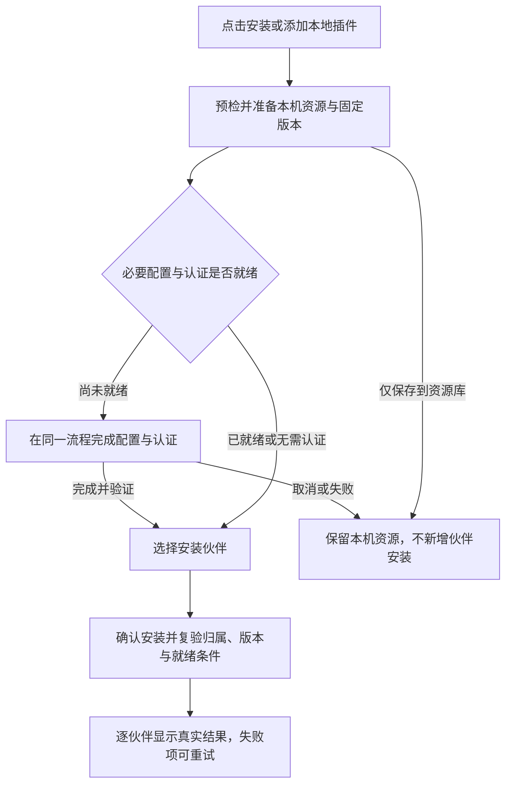
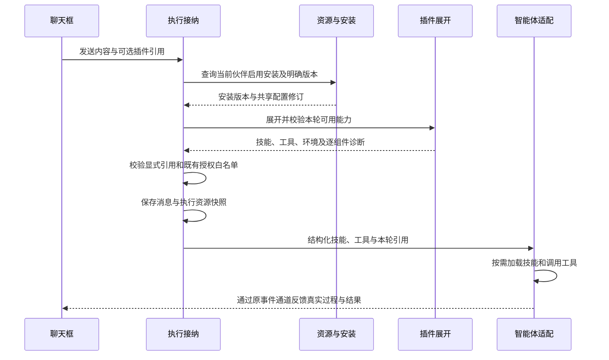
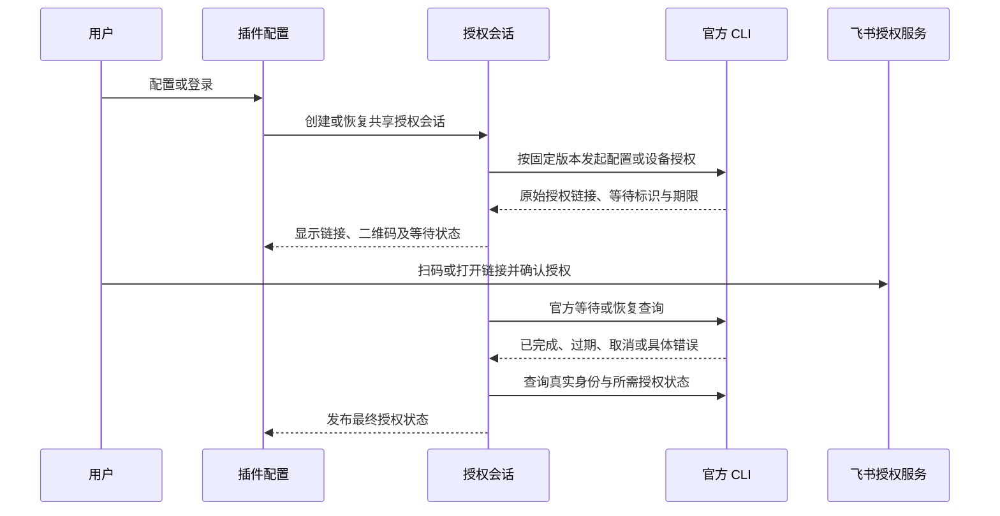

# 插件资源与飞书插件设计 Spec

> 独立设计讨论，供评审与后续实施使用；本文描述目标行为，不代表当前软件已经提供插件功能。
> 设计基线：NeuxBot `4fb33f868430bc14f5d775d36e3c83f5c6d5e4b0`。
> 本文依据已确认需求、现有代码及官方协议编写，采用 Superpowers brainstorming 的书面设计与独立审阅流程。

## 1. 意图与交付结果

用户围绕“能做什么”发现和使用能力。插件是一组可以整体安装、配置、启用、更新和卸载的能力与服务；Skill、MCP、命令行程序是其实现组成。

首版交付插件系统及真实飞书插件：用户在资源库找到飞书插件，点击安装，完成必要配置与共享授权，再选择安装给哪些伙伴，然后在聊天中按需调用。用户也能在现有能力选择位置显式引用插件，独立技能和连接器继续有添加、管理及引用入口。

成功必须同时满足三件事：插件包可以完整追溯来源；伙伴实际获得其安装版本的能力；真实智能体能通过固定版本的飞书官方 CLI 完成已授权的业务操作。页面上出现“已安装”、格式检查通过、连接测试成功分别只是其中的证据，不能互相替代。

## 2. 已确认范围

| 主题     | 已确认行为                                                                     |
| -------- | ------------------------------------------------------------------------------ |
| 产品入口 | 统一资源页包含插件、技能和连接器三个分类，默认插件；独立资源入口清晰可达       |
| 安装流程 | 点击安装，先完成必要配置与认证，再选择伙伴并确认安装；无认证要求时跳过认证     |
| 使用方式 | 安装且启用后按需使用；聊天框同时支持显式选择插件、技能和连接器                 |
| 能力接入 | 展开插件组件，复用现有 Skill、MCP 与智能体执行机制                             |
| 归属     | 全局添加进入全局库，可选安装给哪些伙伴；伙伴页面添加归该伙伴，并安装给自身     |
| 配置     | 同一个全局插件的配置和账号由安装它的伙伴共享，不提供伙伴独立覆盖配置           |
| 版本     | 伙伴固定使用一个版本；用户选择更新哪些伙伴；保留可切回的旧版本                 |
| 内容管理 | 插件组成整体更新、启停和卸载；内部组件没有第二套独立安装开关                   |
| 名称     | 业务展示名称允许重复，资源身份及实际技能声明名称分别处理                       |
| 首版来源 | 独立 Git 仓库维护官方收录内容，软件构建消费固定快照，运行时从本地资源库安装    |
| 包格式   | 优先采用通用 Agent Plugins 格式；兼容导入 Claude Code 的 Skill 与 MCP 内容     |
| 授权     | 先复用具体插件现有授权流程，飞书支持授权链接与二维码；其他形式按实际插件处理   |
| 依赖     | 尽量交付准备好的运行内容；检查并说明用户环境缺项，首版不开发通用依赖自动安装器 |
| 来源记录 | 逐组件保存上游、固定版本、作者、许可证和修改记录                               |

不包含在线市场后台、评分、付费、运行时自动同步 Git 仓库、多账户切换、伙伴独立凭据、通用 OAuth 平台、任意安装脚本执行器、完整 Claude 插件运行环境。

不把现有系统技能、工作流、团队协作或 IM 通道重新包装为本轮插件。尤其是飞书工具插件与现有飞书 IM 接入：前者提供业务操作能力，后者拥有消息接收、聊天绑定及投递规则，两者继续拥有各自事实。

## 3. 术语与现有实现差异

本节是本次设计的目标术语，实施后再同步到 [CONTEXT.md](../../../CONTEXT.md) 与现有架构文档，避免把未实现内容写成当前能力。

| 术语     | 定义                                                     |
| -------- | -------------------------------------------------------- |
| 插件     | 面向用户的一组能力与服务，也是内容分发和整体管理的单位   |
| 目录条目 | 官方收录快照中可供发现和安装的固定版本描述               |
| 资源归属 | 内容属于全局资源库还是某个伙伴，由添加入口确定           |
| 伙伴安装 | 伙伴使用一个资源及其版本的关系；与是否启用分别表达       |
| 插件组件 | 某个插件版本内的技能、MCP 定义及相关程序或文件           |
| 共享配置 | 同一插件资源的安装伙伴共同使用的设置与凭据，不属于发布包 |
| 插件引用 | 用户在本轮消息中明确选择使用的插件，不是另一种执行器     |

以下差异已经由当前源码核对，实施必须覆盖，不能只新增一个插件列表：

| 当前代码                                                                  | 目标变化                                                           |
| ------------------------------------------------------------------------- | ------------------------------------------------------------------ |
| `SkillPackage`、`SkillVersion`、`WakerSkill` 管理技能，展示名仍有唯一约束 | 移除业务展示名唯一约束；保留内容与实际技能声明名校验               |
| 伙伴技能查询包含全部公开技能                                              | 默认只展示本伙伴拥有或已安装的技能；资源库承担发现未安装资源的职责 |
| 从伙伴页面创建 MCP 实际创建全局共享连接器                                 | 由入口确定归属，伙伴添加形成伙伴自有资源                           |
| 从伙伴删除公开 MCP 会删除共享连接器                                       | 卸载伙伴关系与全局删除资源分别提供操作                             |
| 聊天执行读取启用技能、连接器，支持本轮显式引用                            | 增加插件安装展开与插件引用，保留原权限与白名单检查                 |
| 系统技能由 `skills/` 及生成脚本交付                                       | 继续保留系统交付链；官方可选插件单独形成目录快照                   |

代码依据：[技能模型](../../../server/repositories/models/skill.go)、[技能查询](../../../server/repositories/controllers/skill_controller.go)、[伙伴连接器创建](../../../server/apis/mcp/create_waker_connector.go)、[连接器删除](../../../server/apis/mcp/delete_waker_connector.go)、[执行接纳](../../../server/services/execution/work.go)、[技能打包](../../../scripts/builtin-skills.mjs)。

## 4. 总体结构与职责

以下为目标结构示意图。



职责按现有架构分配：

- Go Core 管理目录、包预检、资源归属、安装、版本、共享配置、授权会话和执行展开。
- React 负责发现、管理、配置、显示二维码与链接、引用选择及缺失说明；服务器事实由 TanStack Query 持有。
- Electron 继续提供文件选择、受限外链和既有事件 Bridge，不承接插件业务 CRUD。
- Runtime 接收本次执行已经解析的技能、工具与受控环境，不查询插件数据库，不拥有安装规则。
- 安装不会运行插件代码、启动业务 MCP 或触发外部写操作。授权和连接测试有明确操作入口。

纯解析、归档、摘要和协议适配归 `server/internal/plugins/`；插件 Operator 归 `server/apis/plugins/`；持久化归现有 Repository 目录。单入口安装用例由 Operator 编排 Controller 与事务，只有出现两个真实生产入口复用时才提取对应 Service。

### 4.1 我确定的实施取舍

以下是为了使方案可以实施而作出的工程选择，不标记为用户逐项指定的需求：

1. 首版统一资源页和生命周期契约，保留技能、连接器现有专业存储与适配；不为统一列表新建一份重复的全类型资源事实。
2. 插件新增稳定资源、不可变版本、伙伴安装与共享配置四类事实；组件只属于版本，不额外生成可独立编辑的技能包或连接器资源。
3. 通用清单与 Claude 清单同时存在时默认选择通用清单，预检明确显示选择结果，不叠加加载两套组件。
4. 同名实际技能内容相同时去重装载；同名但内容不同时明确报告冲突，不改写上游声明或静默覆盖。
5. 首批交付一个“飞书办公”真实插件，保留官方 Skills 及其依赖目录，覆盖文档、多维表格、日程和任务。这样首批无需复制公共基础技能或增加插件间依赖管理器；将用途拆成多个独立插件不是首版验收前置条件。
6. 官方 CLI 使用固定发布版本的原生程序；Node、Python 等环境缺项按具体依赖检查，不能因为用户机器能执行 `npx` 就把插件显示为全部就绪。
7. 统一入口命名为“资源库”，插件分类使用“插件库 / 我的插件”两种视图；本地导入称“添加插件”。安装过程在同一弹层内分步推进，伙伴安装管理使用表格，不叠加多层业务弹窗。
8. 安装准备后可以保留尚未分配伙伴的本机资源；认证取消或安装中断不删除已准备内容与已完成的共享授权。首次伙伴安装只有在必要准备与认证通过后才提交，已有安装后来失效则保留关系并显示待修复。

## 5. 本地目录与可重复分发

插件资源仓库独立于应用源码维护。建议仓库名为 `neux-plugins`，实际远程地址在创建时确定；本 spec 不创建远程仓库或发布资源。

```text
插件资源仓库/
  catalog.json
  plugins/
    feishu-office/
      plugin.json
      README.md
      skills/
      provenance.json
      licenses/
  providers/
    larksuite-cli/
      release.json
      licenses/
```

`catalog.json` 是收录信息，描述条目标识、插件版本、相对路径、能力介绍、组件摘要和依赖。它不替代插件的通用清单。`providers/` 描述经过收录的固定程序依赖，不是允许任意插件安装代码的通道。

应用仓库保存资源来源锁定信息，包含仓库地址、完整提交、收录目录摘要，以及程序发布资产的版本、平台、地址和 SHA-256。构建在联网准备阶段获取锁定内容并验证；正式打包和本地目录查询只消费已经准备好的内容。构建不得依赖浮动分支、`latest` 或运行时加载在线 Schema。

小型元数据和文本可以复用已有生成、嵌入能力；大型二进制按桌面资源交付，只携带目标平台和架构所需资产。索引记录相对路径及摘要，不把大型程序编码进 Core JSON。

安装包内目录只读。用户安装时先准备应用数据目录中的不可变版本内容，再登记本机资源及伙伴关系。仅随包提供不表示已经安装给所有伙伴；新增第三方插件不默认启用。

软件升级更新可供安装的目录快照，保留用户安装版本、启停和共享配置。旧目录不再收录的插件仍保留已有安装；只有目录显示状态变化，不能隐式卸载。首版不实现在线资源目录刷新。

## 6. 包解析、导入与来源

### 6.1 格式与兼容边界

新插件以 [Agent Plugins 1.0.0](https://agent-plugins.org/specification) 为基础：根 `plugin.json`、直接子目录中的 `skills/*/SKILL.md`、根 `mcp.json`。标准核心字段与发现规则以官方规范为准，客户端特有信息放在 `extensions.com.ally`，扩展缺失不影响标准组件发现。

加载时使用本地支持的规范版本及验证规则；禁止联网读取清单所引用的 Schema。解析结果区分整个包无效、组件类型无效和单组件无效，并保留逐项诊断；不把一个组件错误无条件扩散为其他组件失败。

Claude 导入读取 `.claude-plugin/plugin.json`、其默认或声明的技能位置，以及 `.mcp.json` 和清单内联、引用的 MCP 配置。首版只适配可交付的 Skill 与 MCP 内容；Hooks、Agents、Commands、LSP、Channels、动态凭据程序和 MCPB 特殊包保留原文件与未支持说明，不装载或执行。具体路径及格式依据 [Claude 官方清单](https://code.claude.com/docs/en/plugins-reference)。

MCP 沿用当前智能体的真实传输能力。包中的连接定义与本机共享凭据分别保存；本地程序目录可以叫 `mcp/` 或其他名字，发现依据是配置，不依据目录名称。

### 6.2 本地导入与不可变内容

首版插件导入支持用户选择的本地目录或 ZIP；独立技能现有 Git 导入入口保留，不由此扩展出插件运行时 Git 同步。

预检先形成受管内容快照，再解析、列出组件、运行条件、格式和来源缺项。用户确认安装引用服务端暂存令牌；提交前复验内容摘要，不能再次读取已经变化的原目录作为权威内容。

复用现有导入的有界复制、ZIP 处理和摘要能力；抽取真实共用机制时保持原技能行为。必须覆盖路径越界、大小写碰撞、特殊文件、失效链接、解压总量、单文件和数量限制。包内合法相对引用必须完整保留；越出包根的链接或配置路径拒绝交付。具体限额由现有基线和首批内容测量确定，不盲目照搬单技能限额。

原始清单、`SKILL.md`、引用文件与许可文件保存在版本内容中；解析模型是派生结果。安装、配置与用户展示名的改变不写回这些文件。

### 6.3 来源记录

`provenance.json` 对包装层、官方 Skills、CLI 程序及实际分发依赖分别记录：上游 URL、固定 revision 或发布版本、原作者、许可标识及原文位置、实际包含路径、摘要，以及是否修改和修改说明。

官方收录条目必须有完整来源证据；个人导入缺少记录时保留“来源未核验”事实，不冒充官方收录或审核结果。相同展示名不构成相同来源，只有来源身份、版本和内容摘要一致才能按同一内容处理。

实际收录时更新根 [THIRD_PARTY_NOTICES.md](../../../THIRD_PARTY_NOTICES.md)，并随软件分发所需许可证、版权及 NOTICE。Spec 中引用候选不表示其二进制依赖已经完成分发审核。

## 7. 数据、归属与生命周期

### 7.1 权威事实

| 对象           | 事实与约束                                                                  |
| -------------- | --------------------------------------------------------------------------- |
| 插件资源       | 本机稳定 ID、展示资料、来源身份、所属伙伴；所属伙伴为空表示全局             |
| 插件版本       | 所属资源、包版本、内容路径与摘要、原格式及来源快照；内容不可变              |
| 伙伴插件安装   | 伙伴、插件、明确版本、启停；同一伙伴同一插件只有一个安装关系                |
| 插件共享配置   | 按插件资源保存的非敏感设置与加密凭据、配置修订；没有伙伴覆盖字段            |
| 插件组件       | 由指定版本内容解析的技能与 MCP 定义，保留组件身份和来源；不保存独立安装状态 |
| 飞书程序与授权 | 官方 CLI 的受管程序、共享配置目录及官方凭据存储；NeuxBot 不复制其 token    |

同一全局插件的所有安装伙伴共享配置，但各自的版本与启停仍独立。伙伴自有资源只供该伙伴安装；归属决定可见范围，不通过改名或猜 ID 绕过。

通用 MCP 的 `PLUGIN_DATA` 对应本机插件资源实例的持久可写目录，伙伴安装关系共同使用，不按伙伴或版本复制。`PLUGIN_ROOT` 则固定指向本次选定版本的只读内容目录；更新和版本切换保留共享数据目录。

数据库读取默认单表查询，按需要分批补齐关联。列表使用服务端分页与准确总量，默认每页 50 条；查询、过滤和分页进入 Query Key。全局“已安装伙伴数”来自真实安装关系，不使用全部伙伴数量代替。

### 7.2 操作范围

| 操作             | 结果                                                                         |
| ---------------- | ---------------------------------------------------------------------------- |
| 全局添加         | 进入全局库，可以不选伙伴；选定伙伴分别建立安装关系                           |
| 伙伴添加         | 归当前伙伴，准备与必要认证通过后安装给自身；不提供公开、私有选择字段         |
| 从资源库安装     | 内容归属不变，准备与必要认证通过后绑定所选伙伴和明确版本                     |
| 伙伴启停         | 只改变当前伙伴的后续可用能力；关闭保留关系、版本和共享设置                   |
| 伙伴卸载全局资源 | 只移除当前伙伴安装；共享内容、账号与其他伙伴保留                             |
| 删除伙伴自有资源 | 删除该伙伴拥有的资源及关联关系，不波及全局资源                               |
| 全局删除         | 先展示实际影响伙伴并确认，再移除资源和安装关系；受管内容在执行占用释放后回收 |
| 更新             | 登记新不可变版本，明确选择切换哪些伙伴；切换失败不覆盖原版本                 |
| 切回旧版         | 校验内容、依赖与共享配置后切换指定伙伴；不承诺撤销外部业务操作               |

全局入库和多伙伴安装分别报告真实结果。某个伙伴安装失败不撤销已经完成的入库或其他伙伴的成功，失败项可以重试。相同来源版本重复安装幂等；同一标识或版本号携带不同内容必须明确冲突。

用户点击安装后先预检并准备本机资源，必要认证通过后才提交伙伴安装。未完成前不预建占位安装关系；取消、认证失败或未选择伙伴时，本机资源可保留为“尚未安装到伙伴”。伙伴自有资源同样可以处于准备中，但只在所属伙伴入口可见。后续安装失效的状态及前端流程见第 8 节。

文件准备与数据库提交分开：先完整准备内容，再事务提交元数据和关系。外部命令、网络和扫码等待不进入数据库事务。失败清理只能删除本次尚未被引用的暂存内容。

### 7.3 共享配置与版本并存

插件配置修改明确告知会影响使用它的伙伴。凭据保存复用当前 Controller 加密与脱敏机制，查询只返回配置状态；飞书登录 token 继续由官方 CLI 管理。

配置修订不修改不可变包。配置键及组件身份跨版本保持稳定；普通配置编辑验证全部仍有安装关系的版本，不能兼容时返回受影响伙伴和版本，保留原配置。

需要同步切换配置与版本时，更新面板提交一次完整变更：新配置、用户选定的伙伴及目标版本、预期配置修订和各安装关系原版本。预检按变更后的完整安装集合验证：未选伙伴继续使用原版本，该原版本也必须与新配置兼容；关闭但尚未卸载的安装同样参与。所有版本内容先准备完成，再在同一事务内条件更新共享配置与所选安装；任何校验、并发冲突或写入失败都保留原配置和原安装，不产生一半升级状态。

因此新版要求新配置而旧版不接受时，用户必须在这次变更中明确选择全部受影响安装的兼容目标版本，或先卸载不再保留的安装。界面展示真实影响范围，不能自动替用户选择其他伙伴；切回旧版使用相同的兼容校验与原子变更规则。该操作只提交本地设置，不在事务里执行账号登录、外部数据迁移或任意插件迁移脚本。

飞书账号为应用级共享授权：所有启用飞书插件的伙伴使用同一个受管 CLI profile。首版不提供多账号或按伙伴切换身份。同一机器上用户已有的外部 CLI 配置不自动导入或覆盖，用户通过本应用的插件配置入口完成共享授权。

### 7.4 新数据基线

当前尚无用户使用本模块，直接建立目标资源、归属与安装结构；不实现历史数据兼容、转换、迁移、双读双写或旧 API 回退。必要时直接调整技能与连接器结构及接口，不以保留历史实现限制目标架构。

新数据库从真实安装关系查询伙伴能力，不把全部全局资源视为已经安装。系统内置技能与连接器保留其产品保护规则。此约定允许调整实现结构，不表示开发或验证时可以删除本机其他运行实例的数据。

## 8. 资源页与聊天交互

### 8.1 参考页面与统一入口

已查看用户指定的 QoderWake 本地“能力与资源”页面：同一页面承载插件、Skills、连接器等分类；插件下分发现目录与“我的插件”；详情展示用途、版本、作者及 Skill、连接器组成；已添加卡片展示授权状态和真实安装数量；安装管理逐伙伴展示安装、启停和移除；授权面板说明账号共享范围。

参考页中存在“伙伴已安装但待授权”的状态。本方案的首次安装顺序以用户要求为准：必要认证完成后再安装给伙伴。只借鉴信息架构与流程，页面视觉遵循本项目 [UI 标准](../../development/ui-cn.md)；本次未执行参考产品的安装、授权或设置变更，不能据此推断其后台实现。

全局只有一个“资源库”导航入口，页内固定提供“插件 / 技能 / 连接器”分类，默认选中插件。技能可标注 Skill，连接器说明 MCP；用户无需理解协议才能浏览插件。三个分类始终可发现，不把独立技能和连接器仅藏在“更多”菜单中。本轮不扩展知识库等其他资源的生命周期。

以下为信息层级示意，不规定像素尺寸或视觉样式。

```text
资源库
  插件（默认） | 技能 | 连接器
  插件库       | 我的插件
  数量、搜索、筛选                          添加插件
  插件卡片：名称、用途、作者、版本、状态、主操作
  分页
```

“插件库”消费随软件交付的本地目录快照，“我的插件”读取本机已添加资源。首版不使用暗示在线服务的评分、热度、下载量或市场刷新操作。目录不存在已收录条目时显示准确空状态；本地导入不依赖在线市场。

技能和连接器分类复用原有列表、添加、编辑及测试能力，说明它们可独立使用。插件内组件只在插件详情及相关能力选择处显示“来自某插件”，不重复生成独立资源卡片、安装关系、编辑入口或开关。

分类、当前视图、搜索、筛选与分页进入 URL，返回列表保留上下文；切换分类先显示该分类的 Shell 和加载区域，不短暂展示上一分类的数据。业务列表、查询键和准确计数遵循第 7、11 节。

### 8.2 卡片与插件详情

插件库卡片先表达名称、用途、提供者和固定版本，主操作为“安装”；卡片其他区域可打开详情。已添加同一资源时主操作按实际状态显示“继续安装”或“管理安装”，避免重复创建。目录新版本以“有可用更新”提示，不自动切换伙伴版本。

“我的插件”卡片展示来源、已准备版本、共享配置或认证状态、真实已安装伙伴数及“管理安装”。伙伴可能使用不同版本时显示“多个版本”，详情列出实际分布，不用一个卡片版本冒充所有伙伴版本。零位伙伴时显示“尚未安装到伙伴”；“重新认证”和“继续安装”是可见的就近操作，不仅靠颜色或悬停表达状态。

详情使用共享 Dialog 的可滚动内容区，头部保留名称、用途、版本、提供者和主操作；正文按“可用能力、配置与认证、使用伙伴、组成与来源”组织。组成展示技能与连接器数量、名称、摘要和逐项诊断，长列表可展开；来源展开显示固定上游、作者、许可及包装者。CLI 依赖以可理解的运行条件说明，不把命令参数展开成默认安装表单。

配置与认证属于插件整体。存在多个连接器或登录步骤时，在插件内逐项展示状态与所需操作，并汇总仍未满足的条件；不要求用户离开插件、另建独立连接器。说明当前共享账号及实际权限摘要，明确“安装此插件的伙伴共用该账号”，不暗示未安装伙伴自动获得能力。

### 8.3 点击安装、认证与选择伙伴

安装弹层使用“准备插件 → 配置与认证 → 选择伙伴”的单一流程；没有配置或认证要求、或已有共享状态有效时直接跳过相应步骤。阶段成功来自 Core 回执，界面跳转、扫码和关闭授权页都不能当作成功。界面持续显示当前插件、来源及版本，避免认证后安装了不同内容。

以下为首次安装的目标流程示意。



1. **准备插件**：本地导入先展示第 6 节的预检结果；目录安装固定显示所选发布版本。格式、来源风险与运行条件在提交伙伴安装前可见。准备中的资源不能显示为“已安装到伙伴”；下载、解包或程序缺失按真实阶段说明，不承诺自动安装任意外部依赖。
2. **配置与认证**：普通字段按实际插件要求展示，敏感值只提交保存，不回显。飞书以二维码和官方授权链接为主要操作，过期、刷新、取消和错误见第 10 节。必要条件不满足时不能继续伙伴安装；用户可明确选择“仅保存到资源库”，该操作不等于安装成功。共享认证已有效时展示账号摘要并复用，不要求每个伙伴重复扫码。
3. **选择伙伴**：全局入口提供可搜索、多选的伙伴列表，展示每位伙伴的未安装、已安装版本及兼容情况；默认不勾选未安装伙伴。已有安装作为只读事实展示，不因本次未勾选而卸载、停用或更新。新增安装统一绑定本次明确版本；已有安装的版本调整进入独立更新流程。未选任何新伙伴时主操作为“仅保存到资源库”，不会虚构安装数量。
4. **确认与结果**：按钮写明“安装到所选伙伴”及准确数量。Core 提交前重新检查归属、内容、必要依赖、共享配置修订和所需认证状态；等待扫码时发生的配置或版本变化必须重新核对。已失效时回到相应步骤，不先建立安装关系再报认证失败。外部授权仍可能随后被撤销，不能承诺一次检查保证未来所有调用成功。结果留在当前流程，分别显示已保存资源、成功安装和失败伙伴；重试只针对失败项。

“仅保存到资源库”在全局入口表示全局保存，在伙伴自有资源入口表示只保存给当前伙伴；按钮邻近文字说明实际范围。取消或关闭弹层不新增伙伴安装，不删除已准备的本机资源，也不撤销已完成共享登录。再次点击“继续安装”读取已有资源、版本和实际认证状态，不能从本地步骤序号猜测成功。授权会话的恢复、取消与退出规则见第 10 节。

从伙伴入口添加自有插件或从全局库安装时，目标固定为当前伙伴，认证通过后显示目标确认，不要求再次在全部伙伴中搜索。全局资源保持全局归属，伙伴添加的资源归当前伙伴；入口不能改变既有资源归属。无可选伙伴时可保存资源，并引导至现有创建伙伴入口，不在此实现另一套创建流程。

### 8.4 管理安装与状态恢复

“管理安装”在单一面板内展示“伙伴、安装版本、当前可用状态、启用、操作”表格。顶部独立显示共享账号与配置状态。未安装行的启用开关禁用，提供“安装”；已有行提供启停、卸载和版本管理。点击未安装行仍经过第 8.3 节的必要检查，不能绕过认证直接创建关系。列表分页、搜索、数量来自真实服务端事实。

| 当前事实                                   | 前端显示与操作                                             |
| ------------------------------------------ | ---------------------------------------------------------- |
| 本机资源已准备，必要认证未完成且无伙伴安装 | “待认证 · 尚未安装到伙伴”，提供继续安装                    |
| 必要认证就绪且无伙伴安装                   | “尚未安装到伙伴”，提供安装                                 |
| 已有安装且当前可用                         | 展示已安装数量，各伙伴行显示真实版本与启用状态             |
| 已有安装后认证过期、权限撤销或程序缺失     | 保留安装关系，显示需重新认证或准备；修复后恢复派生可用状态 |
| 部分伙伴安装失败                           | 分别列出成功与失败；只重试失败项，不重复提交成功项         |
| 一个伙伴停用或卸载                         | 只更新该伙伴关系与数量，不改变共享账号和其他伙伴           |

共享配置修改、退出与更换账号先说明实际影响的安装伙伴；活跃执行互斥与跨版本兼容规则以第 7、10 节为准。更新面板展示各伙伴当前版本、目标版本和配置变化，不用“全部更新”隐式扩大选择。破坏性操作沿用项目已有确认流程。

伙伴自己的资源页使用同样三个分类，插件默认只列本伙伴自有或已安装的资源；自有待配置项准确显示准备状态。提供“从资源库安装”和“添加插件”，不混入全部未安装全局目录条目。全局安装管理与伙伴页读取同一安装关系，不各自维护第二套启用状态。

### 8.5 组件复用与页面反馈

资源页复用现有 `ResourcePageSurface`、`ResourcePageHeader`、`ResourcePageToolbar`、`ResourcePageSearchField`、`ResourceCardGrid` 及共享页签、Dialog、表格和搜索多选组件。跨插件、技能、连接器的页面装配放在 `app`，各模块通过公开入口提供专业列表与操作，不互相导入内部页面。

普通卡片使用语义表面和留白，无常驻外框或阴影；网格根据 Scene 实际内容宽度切为三列、两列、单列。页签、工具栏和安装步骤在窄容器中换行，二维码、操作与错误仍可读。所有主操作键盘可达，弹层退出恢复焦点；认证弹层不在安装弹层上再叠加多层业务 Dialog。

加载、失败、空列表、搜索无结果、Core 离线与后台刷新在所属内容区表达，Shell 与可用操作先挂载。外网不可用但 Core 正常时，本地目录浏览及无外部认证要求的本地安装继续可用；需要飞书在线认证时准确说明阻塞条件。Core 不可用时不能提交安装或认证。安装或认证错误就近显示，不自动增加铃铛待办；页面状态通过第 11 节的统一事件与权威查询更新。

### 8.6 显式引用

复用聊天框现有能力选择、引用标签和历史呈现机制，增加插件候选；候选来自当前伙伴已安装且启用的插件。技能、连接器保留现有选择入口。

消息提交携带稳定 `pluginIds`，执行接纳时解析为资源 ID、版本 ID、配置修订和组件集合的快照，写入本轮消息的插件引用。服务端重新校验伙伴身份、启用关系、版本和本次权限，不能相信前端候选状态。

显式选插件表示本轮要求使用其相关能力。模型获得明确的插件引用和可用组件说明，按任务决定实际使用哪些；不得把选择一个插件机械转换为逐个强制执行全部 Skill。实际工具活动仍来自真实调用事件。

历史消息显示当时记录的名称和版本，删除或更新插件不改写历史；不可用引用有明确状态。重复提交、对话分叉、团队消息和工作流复用聊天提交契约时，都必须保留插件引用身份和版本快照。

## 9. 执行、兼容与故障边界

以下为一次消息接纳的目标时序示意。



1. 接纳时固定安装版本、配置修订及交付内容，插件启停或更新不改写已经接纳的工作；MCP 环境值和连接设置使用接纳时的配置快照。共享 CLI 指向固定 provider profile，凭据正常刷新仍由官方 CLI 负责；外部撤销和 token 过期属于运行故障，不能承诺本地快照维持外部授权。
2. 按已安装插件展开组件，与独立技能、连接器共同装配。目录排序、模型可见名称和配置指纹确定且稳定，不包含随机端口、临时 token 或每轮生成的身份。
3. 实际技能名来自 `SKILL.md`。同名且完整交付内容摘要相同的组件只装载一次，保留多个来源关联；同名不同内容返回具体冲突与受影响插件。不同业务展示名或显示名相同均不改变此规则。
4. MCP 服务使用基于插件稳定身份及组件键形成的注入名称，更新版本或改展示名不随机改名。组件另有稳定授权标识，由插件资源 ID 与组件键确定，资源发现与执行展开使用同一映射；工作流选择派生连接器时冻结该标识，不要求创建另一份独立连接器记录。配置进入既有 MCP 信任、连接测试与传输兼容机制。
5. 插件展开不能扩大入口已经冻结的工具白名单、文件范围和执行授权。MCP 组件按稳定授权标识进入既有白名单过滤；受限入口没有授予外部 CLI 能力时，不额外注入相应插件 Skill 和程序环境。通过 Shell 调用的 CLI 仍受该智能体的命令权限约束，不能把 MCP 白名单描述成对任意 Shell 命令的沙箱。
6. 复用当前 Runtime 会话指纹与重新挂载机制：配置变化对下一次接纳生效，需要时重建或重新配置原生会话；续聊仍只发送本轮新增消息，不重复注入历史全文。
7. 不可变内容在仍有安装或活跃执行引用时保留；删除、卸载和更新不立即移除正在运行的软链接目标。临时进程、内容占用与授权等待必须有明确生命周期和有界退出。

### 9.1 可用状态

安装关系、启用、依赖就绪、登录、授权范围和智能体兼容分别表达，不能只用一个成功布尔值替代。

| 情况                         | 用户可见结果与执行行为                                   |
| ---------------------------- | -------------------------------------------------------- |
| 包格式无效                   | 预检失败，说明问题位置，不产生安装关系                   |
| 缺少本地程序                 | 首次安装停留准备；已有安装显示待准备，提供实际修复方式   |
| 飞书未授权或过期             | 首次安装停留认证；已有关系保留并显示需重新认证           |
| MCP 传输不支持               | 标明具体连接器、当前智能体限制及受影响能力               |
| 可选组件不可用               | 保留其他可用能力，明确受限范围                           |
| 必需组件不可用               | 对应能力不可用；不能显示插件全部就绪                     |
| 显式引用不可用插件或必需能力 | 本次提交明确失败或要求修复，保留输入，不悄悄忽略引用     |
| 普通对话未显式引用受限插件   | 继续装配可用组件，附带准确缺失说明，不无条件阻止其他对话 |

能力与组件依赖可由客户端扩展声明。没有该扩展的导入包只展示已知组件与诊断，不虚构必需、可选关系；显式引用时如实说明其不完整状态。

## 10. 飞书官方 CLI 插件

### 10.1 固定候选与内容

来源为飞书团队维护的 [larksuite/cli](https://github.com/larksuite/cli)。本次核对的候选为发布 `v1.0.98`，对应源码提交 `ac81f5056ab88f37d581d25916f3dab85abfca76`。实施时必须将实际使用的 Skills、原生发布资产、摘要与许可写入锁定和来源记录；不能混用最新主分支的 Skills 与旧 CLI。

首批“飞书办公”插件提供文档、多维表格、日程和任务能力，直接收录官方 Skill 及其完整引用依赖。`lark-shared` 等共同规则保留，官方 `references/`、脚本与相对关系不能只复制 `SKILL.md` 后丢失。普通 CLI 调用由 Skill 指导智能体完成，不新增 MCP 转接服务器。

官方上游采用 MIT；实际分发时仍需核对固定发布资产及所带依赖的版权与许可，并把原作者与 NeuxBot 包装维护者分别展示。飞书产品、服务与第三方包装者的身份不能混淆。

### 10.2 程序、配置与工作区

按目标平台交付固定版本 `lark-cli`，在受管 Runtime 子进程环境的 PATH 中提供实际程序目录。不得把程序安装到用户全局目录、修改 shell 配置或在首次业务调用时执行浮动 `npx ...@latest`。

飞书共享配置使用应用数据目录内固定、私有的 provider 目录，通过上游支持的 `LARKSUITE_CLI_CONFIG_DIR` 指向该目录；配置与官方凭据存储由 CLI 拥有。插件更新不重建该目录，伙伴安装不复制登录态；单个伙伴卸载不退出共享账号。

账号隔离、不同聊天工作区和工作流节点启动 CLI 时使用同一明确 provider 配置位置，不能因 cwd、HOME 或 AI 账号不同而错误要求重复登录。工作文件仍使用本次已授权工作区；共享登录不扩大本地文件范围。

共享 profile 的首次配置、退出和更换身份与使用它的活跃执行互斥：发现占用时展示对应工作，待占用释放后再操作；正常 token 刷新不改变共享账号身份。外部撤销可能立即令进行中的调用失败，按真实授权错误反馈，不复制 token 制造另一套冻结登录态。

CLI 程序版本由本次执行固定；官方上游的 profile、平台凭据存储和并发调用行为必须实际验证。更新程序需要验证共享配置仍能被保留版本读取；不兼容时保留原程序与设置，返回可理解的受影响信息。

### 10.3 授权与二维码

沿用官方配置及设备授权机制，具体命令、参数和 JSON 字段以固定版本帮助与实现为准，不从终端彩色文本猜状态。



应用配置和用户登录分别表示。输出原始授权 URL 作为不透明字符串处理，链接与二维码来自同一份 URL；用户扫码动作本身不构成登录成功。完成后以官方 CLI 返回及身份、授权状态确认结果。

授权会话由 Core 管理，最多一个共享飞书登录流程处于进行中，重复点击恢复已有会话。设备协议要求的等待或轮询在 Core 中按期限运行，成功、失败、取消、过期或 Core 退出后结束；页面不建立永久轮询。

浏览器页面和外部确认仍由用户操作。UI 支持到期、取消、重试、链接复制以及必要的应用配置说明；二维码不进入持久聊天日志，device code 和 token 不进入普通查询、事件或诊断。Core 重启后先检查 CLI 权威登录状态，失效的等待会话不伪装为继续授权。

已有登录但缺少任务所需权限时进入官方补充授权流程，不自动更换操作者身份或要求重复创建飞书应用。服务端审批、租户策略和外部资源权限导致的失败必须保留原始业务含义。

## 11. 协议、事件与现有模块接入

对外契约按操作而不是页面组件组织。实施时通过 ginx 与原有命令生成 OpenAPI、HTTP Client 和 Query 定义，本文不维护第二份完整 Schema。

| 操作族               | 契约要点                                                             |
| -------------------- | -------------------------------------------------------------------- |
| 本地目录查询与详情   | 返回可添加条目、固定版本、能力、运行条件和来源；不包含伙伴配置或凭据 |
| 导入预检与提交       | 预检令牌绑定受管快照；提交决定归属，不接受越权 owner                 |
| 全局插件 CRUD 与版本 | 明确稳定资源、不可变内容和共享配置的作用范围                         |
| 伙伴插件安装管理     | 先校验必要认证再提交关系；安装、启停、卸载、选择版本及逐伙伴结果     |
| 共享配置与授权会话   | 保存设置、发起、取消与读取实际授权状态；区分普通配置与敏感值         |
| 聊天消息接纳与历史   | 增加插件引用并保存明确版本；稳定请求标识覆盖完整消息意图             |
| 独立技能与连接器     | 调整归属、伙伴列表和卸载语义，保留原专业编辑与测试能力               |

业务列表采用服务端分页，查询键包含范围、搜索与分页；写操作默认返回成功回执，只有后续安装或授权流程需要新 ID 时返回必要标识。错误使用 `status_error` 并由前端本地化。

安装、启停、版本、共享配置和授权状态变化通过现有统一资源事件通道发布，数据库变更在提交后发布。共享配置变化精确失效对应插件及安装伙伴的状态查询；资源变化不自动转成铃铛提醒。断线或重启后通过权威查询恢复，不另建 WS、服务器状态 Store 或永久页面扫描。

## 12. 验证与完成条件

自动化测试覆盖实际规则和故障窗口，不使用与实现重复的浅层断言代替业务验收。

| 范围       | 必须证明的行为                                                                                     |
| ---------- | -------------------------------------------------------------------------------------------------- |
| 包与导入   | 通用、Claude、双格式选择、非法清单、坏组件、相对引用、ZIP 越界、摘要变化及缺失来源                 |
| 安装与归属 | 全局不选伙伴也入库、伙伴添加归自己、跨伙伴越权失败、关闭与卸载分离、部分失败可重试                 |
| 名称       | 展示名重复可共存；相同实际技能同内容去重、不同内容准确冲突                                         |
| 版本       | 两伙伴可使用不同版本；更新只改所选伙伴；失败保留原版；活跃执行不受后续变更影响                     |
| 共享配置   | 两伙伴读取同一配置；不兼容配置与所选版本原子切换，未选旧版不兼容时保留原状态；单伙伴卸载不退出账号 |
| 执行       | 未选插件也可按需用，显式引用被校验与记录；MCP 白名单和当前权限继续约束派生组件                     |
| 连续对话   | 无配置变化时前缀稳定，第二轮只发送新增消息；变更时按原生会话契约重新挂载                           |
| 授权       | 配置与登录分离，重复发起恢复会话，扫码、完成、过期、取消、权限不足和 Core 重启分别验证             |
| 界面       | 一个资源入口包含三个分类；先认证后选伙伴安装；免认证跳过、取消恢复、逐伙伴结果及共享状态准确       |
| 页面适配   | 引用、来源、真实影响数准确；浅暗主题、窄容器、长中文、键盘与焦点符合 UI 标准                       |
| 新库基线   | 新数据库直接建立目标结构；全局发现与伙伴安装分离，不包含历史兼容或数据迁移                         |
| 分发       | 离线可浏览、安装随包插件；固定平台资产与摘要一致；来源和许可证随安装包可读取                       |

真实飞书插件至少完成以下验收，使用用户明确授权的测试资源：读取文档并创建测试文档、读取多维表格并新增测试记录、读取日程并创建测试日程、创建与查询测试任务。保存真实资源标识、命令结果、权限状态及可访问链接，清理测试资源仍遵循用户授权。

至少验证两位伙伴共用登录、一个显式插件引用、一次自然语言按需调用，以及一次插件版本切换。macOS、Windows、Linux 分别记录已测与未测平台；单个平台运行成功不能替代跨平台结论。

代码实施后运行仓库要求的前端、API、Go 与 `pnpm check`。Spec 本身检查 Markdown、相对链接、图表及与已确认需求的一致性。真实页面、桌面应用操作与截图遵守仓库授权边界，未获明确授权时不打开运行页面。

## 13. 实施顺序与待验证技术事实

这是一个跨资源、聊天、执行与分发的功能。实现计划按可验证的依赖顺序展开：

1. 包解析、来源快照、不可变内容与本地目录生成。
2. 插件持久化、共享配置、伙伴安装及独立资源归属调整。
3. 执行展开、权限校验、插件引用与连续对话快照。
4. 资源页、伙伴入口、配置和聊天选择交互。
5. 固定飞书 CLI 与官方 Skills 收录、共享授权及桌面打包。
6. 新库初始化、端到端故障验证与真实平台验收。

后续实现计划需要给出具体文件、测试和生成命令；不在本文预建只有转发职责的服务或接口。下列项目属于需通过实验或平台验证回答的事实，不转嫁为用户产品决策：

- 固定飞书发布资产的 SHA-256、解包路径、执行位与 Windows 启动行为。
- 官方 Skills 的完整引用依赖与实际包体积，以及与既有系统技能的名称检查。
- 固定 CLI 的非交互配置输出、设备等待字段、共享 profile 与系统凭据存储在各平台的行为。
- 当前智能体适配对插件 MCP 的 `cwd`、环境及缺失组件反馈是否完整；缺失时补适配并测试，不宣称现已兼容。
- 本机测试账号的实际权限和租户审批条件；没有真实授权时只能完成自动化验证，不能宣称飞书业务验收通过。

## 14. 外部依据

- [Claude Code 插件模型](https://code.claude.com/docs/en/plugins)与[插件组件](https://code.claude.com/docs/en/plugins/components)：组件加载、按需 Skill 与 MCP 接入的参考，不代表 NeuxBot 已实现同等组件集。
- [Agent Plugins 1.0.0](https://agent-plugins.org/specification)、[清单 Schema](https://agent-plugins.org/schemas/1.0.0/plugin.schema.json)、[MCP Schema](https://agent-plugins.org/schemas/1.0.0/mcp.schema.json)：新包的可移植核心契约。
- [飞书固定发布](https://github.com/larksuite/cli/releases/tag/v1.0.98)、[对应源码](https://github.com/larksuite/cli/tree/ac81f5056ab88f37d581d25916f3dab85abfca76)、[配置目录实现](https://github.com/larksuite/cli/blob/ac81f5056ab88f37d581d25916f3dab85abfca76/internal/core/config.go)、[官方共享 Skill](https://github.com/larksuite/cli/blob/ac81f5056ab88f37d581d25916f3dab85abfca76/skills/lark-shared/SKILL.md)：首批真实插件的来源与接入依据。
