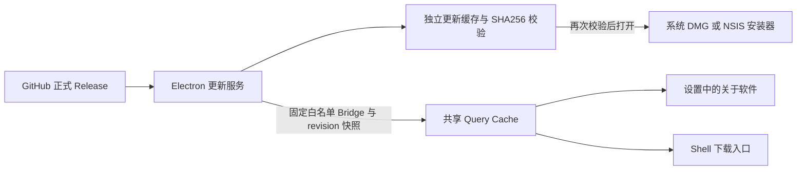

# 桌面软件升级首轮 SPEC

## 状态与交付目标

用户已授权按本轮范围核对实现、独立审查、修复问题并提交到 main 的 PR。升级实现与独立审查发现的三项重要问题均已完成修复，最终全量自动化检查通过。本文记录已确认的目标与保留的工程选择；自动化验证、独立审查、交付状态与尚未执行的真实平台验收分别记录在[实施计划](../plans/2026-10-16-software-update.md)。

目标是在已安装的 NeuxBot 中发现新版本、下载正确安装包并完成手动覆盖升级；用户能从设置了解当前版本、更新状态及安装步骤。

## 用户确认的范围

- 设置增加“关于软件”，展示当前版本、检查更新、发行说明、下载进度与打开安装包入口。
- 有新版本时，原通知铃铛位置显示下载操作；下载中表达进度，下载完成后打开已校验安装包。
- 首轮采用“检查与下载 → 打开安装包 → 用户完成工作、保存并真正退出 → 覆盖安装 → 手动重新启动”。下载完成不等于安装完成，关闭窗口只会隐藏应用。
- 不做正式发行代码签名。macOS 保留现有临时签名，不接入 Developer ID 或 Apple 公证；Windows 不接入 Authenticode。后续用户规模增长后再评估正式签名。
- 中英文 README 说明未签名状态、系统安装提示及 HTTPS 连接错误；保留 HTTPS 证书验证及安装包完整性校验。
- 以个人身份发行，账号、证书、签名资助及付费服务不作为本轮前提。开发与修复均在独立 worktree 完成。

## 工程选择与首轮边界

以下按当前代码保留，是开发方的实现选择，不描述为用户逐项指定：

| 项目       | 首轮选择                                                                                                       |
| ---------- | -------------------------------------------------------------------------------------------------------------- |
| 更新源     | 固定公开仓库 JieWaZi/NeuxBot 的 GitHub 最新正式 Release；不增加镜像、自建服务或客户端令牌。                    |
| 平台       | macOS arm64、macOS x64、Windows x64；开发模式和未支持架构不发起请求。                                          |
| 版本       | 数字比较 X.Y.Z；草稿、预发行、非法版本均不进入升级，不主动降级。                                               |
| 检查与下载 | 启动约 15 秒检查，运行期间每 6 小时检查，设置允许手动检查；下载由用户点击开始。                                |
| 传输       | 首轮下载完整 DMG 或 EXE；不增加差分、暂停、断点续传、忽略版本或强制更新功能。失败可重试。                      |
| 安装       | 只打开已校验安装包，不主动退出、不自动修改应用、不主动停止工作；提示用户完成工作并真正退出后再安装。           |
| 通知       | 更新不生成业务待办，不确认阅读或处理审批；下载操作位于原入口位置，旁侧保留原通知按钮、准确计数与工作看板入口。 |
| 发布       | 构建和检查成功后准备完整资产，再公开 Release 并标记最新；本任务只提交 PR，不发布新版本。                       |
| 数据与恢复 | 保持原应用标识和独立用户数据目录，不新增数据库迁移；不增加自动回滚、自动备份或数据降级承诺。                   |

## 架构与协议

`ApplicationUpdate` 属于 Electron 主进程，不把升级状态放入 Go Core 的业务通知。快照包含当前版本、平台、架构、状态、候选发行、进度、最近成功检查时间及稳定错误身份；每次发布递增 revision。

Bridge 只提供 `application_update_state`、`check_application_update`、`download_application_update`、`open_application_installer` 和 `application-update` 事件。Renderer 不传入下载地址、缓存路径或执行参数。命令与事件沿用既有来源验证及 Schema 白名单。

设置与 Shell 通过同一 Query Cache 及引用计数的原生订阅消费状态；首次及重新订阅读取快照，迟到的旧 revision 不覆盖较新事件。窗口卸载释放监听，Renderer 重载不取消主进程下载。

## 下载、缓存与失败行为

- 元数据来自固定 GitHub API，安装包匹配当前平台与架构的既有文件名；只接受固定仓库的 HTTPS 发行路径及允许的 GitHub 资产重定向。
- 元数据与 SHA256SUMS 上限 1 MiB，安装包声明大小上限 512 MiB；请求有超时并受应用退出取消信号管理。
- 优先使用 GitHub 资产提供的 SHA256，缺失时读取同一发行的 SHA256SUMS；没有唯一匹配摘要时禁止下载。
- 流式写入 `.part`，校验完整大小及 SHA256 后才成为可打开文件；打开前再次校验。缓存命中仍需重新校验，成功取得当前包后只清理更新缓存内的旧版本目录。
- 重复操作复用进行中的请求；失败不打开未校验文件，可重新下载或重试打开。应用退出取消请求、释放定时器与订阅并清理未完成文件。
- 下载完成后仍可手动或定时检查新发行。候选 tag、文件名、大小及明确摘要不变时保留已下载状态；发现新版、发行撤回或当前版本已不低于发行时废止旧安装入口。摘要需要重新读取时，后续下载操作先重新核对摘要再复用磁盘缓存。
- 已下载包的重新检查失败时，展示具体错误并保留此前已校验安装包的可用状态；用户仍可重试检查。非成功 HTTP 响应及时取消响应体，安装包临时文件创建失败仍释放已取得的流与读取器。
- 无公开发行、已是最新版、请求限流、网络失败、非法发行、缺少架构包、校验失败和打开失败分别表达。错误不伪装成“已是最新版本”。
- SHA256 核对下载完整性，不证明发行者身份。外部下载临时令牌不进入日志，未签名包不宣称通过系统信誉或恶意软件检测。

## UI 与文档

复用既有设置 Scene、SettingsRow、Button、Tooltip、语义 Token 与中文 i18n。下载进度和错误具有可访问名称及状态提示；图标动画遵守减少动态效果偏好。升级包校验失败、网络失败及发行页打开失败在当前操作位置提示。

关于软件使用“打开安装包”，不使用会误导为自动安装的“安装并重启”。说明先保存工作、从菜单或托盘真正退出、覆盖原安装位置、重新启动后核对版本。打开安装包不等于停止 Core。

用户操作见[中文 README](../../../README.zh-CN.md)及[入门指南](../../guide/getting-started-cn.md)。运行边界见[桌面生命周期](../../architecture/desktop-lifecycle-cn.md#软件更新)，探测例外见[通知与工作看板](../../architecture/notifications-and-work-board-cn.md)，发行资产与未签名状态见[构建与发布](../../development/build-and-release-cn.md)。[需求核对](../../discussions/software-update-requirements-cn.md)记录范围归属，[发行安全调查](../../discussions/software-release-security-cn.md)仅保留后续签名参考。

## 验收与未验证边界

自动化覆盖版本与平台筛选、异常元数据、重定向限制、摘要和大小错误、缓存及再次校验、并发去重、退出取消、订阅释放、旧快照竞态、设置与 Shell 操作和 Bridge 白名单；最终执行 `NODE_OPTIONS=--no-experimental-webstorage pnpm check`。

未获用户授权打开运行中的应用，因此本任务不做真实页面或桌面视觉验收。macOS 两种架构、Windows 真机的默认防护安装提示、旧版覆盖、新版启动、Core 退出及用户数据保留需要后续平台验收，不能由自动化检查代替。PR 中明确说明这些限制。
