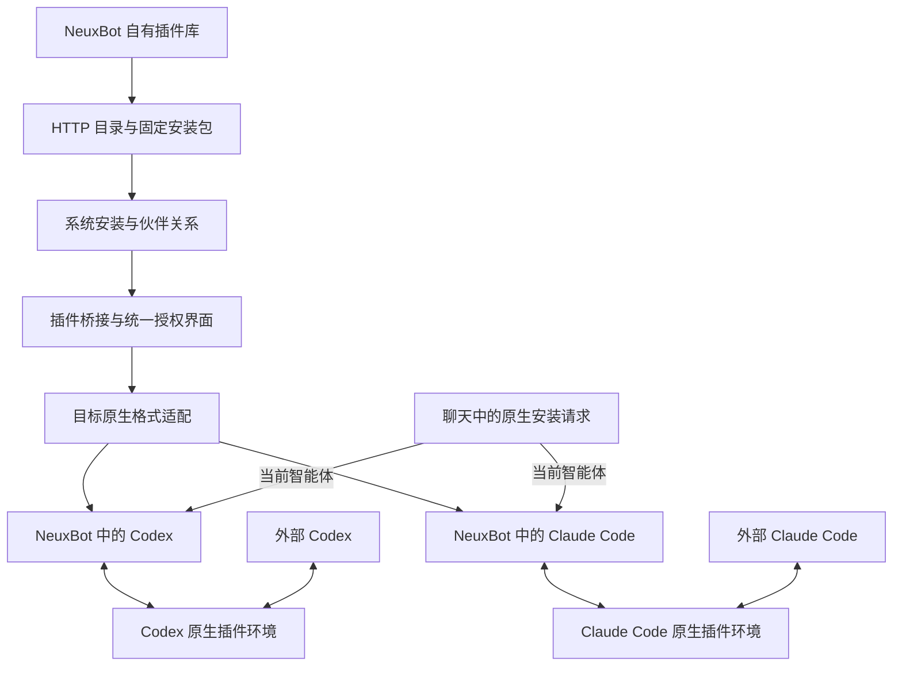
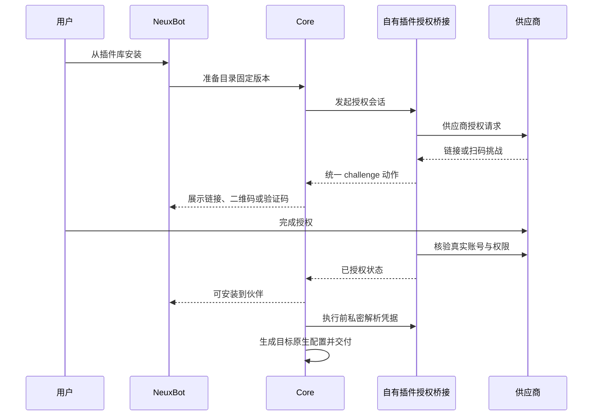

# 插件设计

## 产品边界

NeuxBot 只安装和管理独立插件仓库发布的自有插件。插件库、伙伴安装、共享配置与授权只记录这些受维护的资源。用户在聊天中要求安装第三方插件时，由当前 Codex 或 Claude Code 使用自己的原生安装能力处理，与外部相同 CLI 共用原生插件环境；不登记、展示、转换或卸载这些外部插件。

用户不再上传插件，也不通过本地目录、ZIP、任意地址导入插件。内部解析器仍服务受维护插件的构建、完整性核验和目标派生，不作为对外导入入口。独立技能和连接器维持各自现有管理范围。

## 所有权

| 对象 | 权威所有者 | NeuxBot 职责 |
| --- | --- | --- |
| 自有插件目录与发布包 | neux-plugins | HTTP 查询、校验、系统保存及伙伴安装 |
| 自有插件授权 | 包内供应商桥接与 Core 通用会话 | 统一二维码、链接、验证码、取消、到期、凭据绑定 |
| 自有插件目标产物 | Core 与 CLI adapter | 按受支持 CLI 生成原生格式，其他目标只交付已验证的 Skill/MCP |
| 外部原生插件及认证 | 对应 Codex / Claude Code | 沿 CLI 原生环境使用，不建立资源记录或统一认证状态 |
| AI 模型账号 | 既有账号模块 | 保持用户所选账号及秘密隔离，不与插件环境共用混为同一事实 |

## 安装和执行

系统安装只接受配置的自有目录中经核验的条目，安装包固定来源和摘要。关闭上传、扫描、外部准备接口，同时去除前端入口和生成契约。已有资源不做破坏性清空，原生插件也不反向同步入库。新增安装及显式版本切换必须能与当前自有目录的真实归档内容对应；目录已移除的历史版本不凭包内 provenance 重新安装，既有伙伴关系继续固定其快照。

聊天不再暴露系统插件搜索、准备、安装、安装状态操作，也不再注入要求通过 allycli 安装插件的指令。聊天中原生安装的结果由 CLI 决定，不能伪称 NeuxBot 已安装。系统内安装统一通过插件库界面。

共享原生插件环境必须覆盖读取与写入：外部已安装插件可在后续普通执行中加载，聊天中的原生安装在外部同一 CLI 可见。不能只复制一次原生插件目录或把新安装留在一次性的受管账号目录。自有插件仍作为本轮附加能力交付，不能写入外部全局安装关系。受限执行继续核验其能力范围，不能借外部原生插件获得未授权的工具或账号。

原生模型账号与 API 模型账号直接使用共享的原生配置根；模型参数只在本轮进程覆盖。Codex 订阅账号继续隔离模型目录，复用共享插件与可共享的 MCP OAuth 存储。绑定 home 的 Secrets 存储不能安全复用于隔离订阅目录，接纳时准确拒绝，包括首次授权；该组合需改用原生 CLI 账号或 API 模型账号。存储与会话细节见[当前插件架构](../../architecture/plugin-resources-cn.md)。

## 发布版与安装版

插件库以当前发布目录为准，我的插件以伙伴真实安装为准。目录版本高于安装版本时，卡片右上角与详情提供“可更新”；准备新版不会提前替换旧安装内容。用户可显式检查目录，失败保留陈旧和未知语义，不能把旧缓存称为最新。

更新统一覆盖全部已安装伙伴，不提供选择，保留每个伙伴的启停状态。先准备确认的固定归档并完成必要配置与授权，再用现有事务完整核对安装集合和原版本、统一切到同一目标。并发变化时整次拒绝；已接纳执行仍使用旧快照。边界与验证以[当前插件架构](../../architecture/plugin-resources-cn.md#发现新版与统一更新)和[Spec](2026-10-19-plugin-spec.md)为准。

## 自有插件规范与授权

插件使用标准清单、skills 与 MCP 配置。NeuxBot 附加声明只约束本软件支持的授权流程、目标绑定及展示语言，不定义替代原生插件的第二套清单。供应商流程由包维护；Core 管理通用会话和秘密；前端只渲染结构化动作；adapter 生成目标支持的配置。

不承诺任意上游插件能直接采用此流程；只有完成封装、授权和目标验证的插件进入自有库。第三方代码和品牌按真实来源保留许可声明。

## 验收边界

验证前端与 HTTP 均无插件导入入口；系统安装来源只能是自有目录；聊天能力清单和系统 Skill 不再诱导系统安装；Codex、Claude 共用原生插件的发现、持久安装和启停，同时不修改外部账号配置；自有插件仍能按原生格式交付并使用统一授权。使用临时原生 home 验证，不修改用户真实 CLI 环境。真实账号及桌面视觉验收单独说明。
