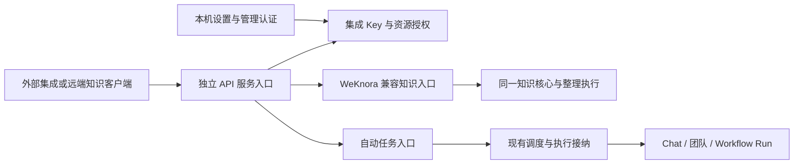
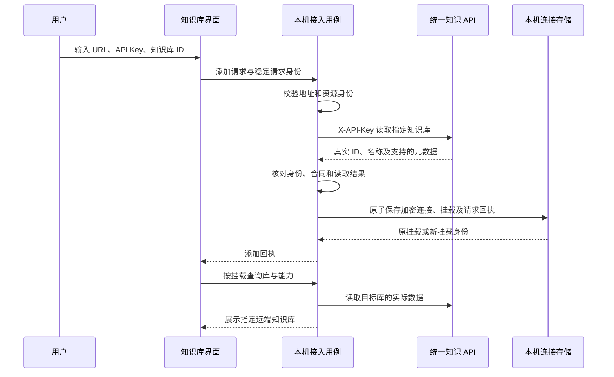

# API 集成、远端知识库与自动任务规格

> 状态：待实施规格，仅授权文档工作。本文维护已确认行为、必要适配和验收条件，不表示产品功能已交付；当前能力以[知识核心与宿主接入](../../architecture/knowledge-cn.md)和[自动任务与 IM](../../architecture/automation-and-im-cn.md)为准。实现前须完成第 10 节的合同与复用核对。

## 1. 已确认范围与设计目标

用户已确认：

- 设置新增“发布集成”分组，二级入口为“API 集成”。API 集成为应用级能力，同时服务知识库与自动任务。
- 添加远端知识库只需要远程 URL、API Key 和知识库 ID；验证成功后挂载指定知识库。
- 首版知识 API 包含读取、检索、内容写入和整理，写入与整理分别授权。
- NeuxBot 与 WeKnora 共用 URL、API Key、知识库 ID 的接入方式，后端自动识别服务类型，用户无需手动选择；识别结果与真实处理行为可以在界面提示。
- 优先直接迁移和复用 WeKnora 已有代码与测试，不为 API Key、权限或知识接口重新编写一套相似实现。
- 自动任务复用统一的 Key、权限及对外入口，同时继续使用现有调度、执行与结果能力。
- 我们自己的远端服务器保持“上传只保存原件，整理单独触发”，不因协议对齐改成上传自动整理。
- 识别为 WeKnora 时保持其原生行为：确认上传后即发送资料，由远端自动处理；上传前明确提示，不通过客户端延迟上传模拟独立整理。

设计目标是让一个外部集成持有独立 API Key，按授予的操作与资源范围调用服务。例如，同一个 Key 可以读取和整理选定的资料库甲、乙，并触发自动任务丙，不能因此访问其他知识库、伙伴、账号或任务。

本设计选择：采用服务间 API Key 身份；首版不增加完整多租户体系、终端用户 JWT、WeKnora 聊天产品、公开浏览器直连或动态通配资源授权。本文描述目标设计，实际能力以实现与验收为准。

**2026-10-22 范围确认：按全新功能设计，不考虑历史代码、旧 Token、旧数据库结构的兼容与迁移；不提供历史迁移页面、接口、旧端口或数据回填。WeKnora 源码迁用与第三方协议适配仍按本设计执行。**

## 2. 统一接入与真实管线差异

### 2.1 统一到协议层

统一接入覆盖表单、认证、资源身份和共享操作入口。新接入不出现“NeuxBot／WeKnora”、`custom`、`bearer` 等必选项；后端返回已识别服务类型、协议版本和操作能力，UI 据此提示及装配交互，不自行猜测服务器产品。

NeuxBot 对外知识 API 优先复用已核对的 WeKnora 认证、路径、字段、响应和分页合同；统一客户端屏蔽必要转换。上传是否启动处理是明确保留的行为差异，不能为宣称完全兼容而修改任一端的处理时机。外部调用者根据公布的操作能力和处理模式调用，不需要按提供者分别配置。

| 合同部分 | 对外约定 |
| --- | --- |
| 地址 | 设置页提供完整 API 基地址，包含 `/api/v1`；接入端也接受部署根地址 |
| 凭据 | `X-API-Key`；新知识接入使用资源范围已确定的 Key，无需再填空间 ID、登录 JWT 或平台管理 Key |
| 资源身份 | 使用远端实际知识库 ID；名称和本机连接 ID 不能替代它 |
| 基础读取 | 按已核对的 `/api/v1/knowledge-bases/{id}` 等 WeKnora 合同访问 |
| Wiki | 保留上游 `/api/v1/knowledgebase/{kb_id}/wiki/...` 的实际命名及响应差异，不自行改成另一套路由 |
| 操作结果 | 按对应上游接口区分响应包装、接纳、执行中和完成，不能把所有响应强行包装成一种成功实体 |
| 能力差异 | 按协议版本、操作支持、实际授权和配置条件表达；不按产品名称判断 |
| 上传与整理 | 服务端分别声明独立整理或上传自动处理；客户端遵守第 5.4 节流程 |

WeKnora 固定参考提交为 [`8776a2d92d11ad3e76865d51cf3192e37e2a9976`](https://github.com/Tencent/WeKnora/tree/8776a2d92d11ad3e76865d51cf3192e37e2a9976)。宿主当前引用 `neux-knowledge v0.1.0`，以 `server/go.mod` 锁定的发布模块为基线，已有边界见 [WeKnora HTTP 适配说明](https://github.com/JieWaZi/neux-knowledge/blob/v0.1.0/remote/README.md)。实施前逐操作核对上游与目标实例差异，不能把同名接口当作语义已经兼容。

### 2.2 兼容范围与现有差距

目标兼容范围包括库详情、资料与原件、Wiki、目录、图谱、检索、内容写入，以及整理的提交和状态读取。完整路径及 Schema 以最终核对后的生成合同维护，本文不复制另一份全量接口表。

首版必须核对并打通读取、检索、资料提交和处理状态读取。自有发布端还必须支持带原子版本保护的普通 Wiki 编辑与独立整理；WeKnora 保持上传自动处理，不伪造独立整理接口或增加延迟上传队列。固定第三方版本缺少已验证原子 CAS 时，允许编辑明确受限，升级或补齐合同后再开放，不要求客户端绕过保护实现可写。已有远端资料的重新解析属于独立重建动作，不能重新上传同一原件冒充普通整理。其他必需操作存在合同缺口时须先补齐适配或明确报告阻塞，不能把只有读取能力的整体实现当成规格完成。

当前 WeKnora 客户端主要验证了读取；自有远端的 `/api/knowledge/v1`、Bearer、服务器模型 profile 和回执是另一套存量合同。新设计需要补充服务识别、兼容入口、指定库挂载及客户端写入合同，不能只给连接表单增加知识库 ID 就宣称完成统一。后台知识整理已采用独立模型作业，不再创建 Chat／Execution 或通过 Skill 连续驱动。

WeKnora 尚无对应合同、当前版本未验证或不能保持必要安全语义的操作，返回明确的能力限制。公共功能不新增提供者专属必填字段；必要扩展按操作能力协商。自有远端在服务端解析模型配置，新接入不必填写 `profileId`。不把 WeKnora 的 `reparse` 等同为我们“跳过已完成资料”的普通整理，也不把 `ingest` 等同为独立整理授权。

现有[统一操作适配设计](2026-10-21-knowledge-adapters-design.md)继续约束 UI 与领域操作隔离、完整资源引用和禁止本地回退；其中 `custom`／官方协议分支只描述存量适配。新接入共用领域操作，底层保留必要的合同和管线映射。

自动任务是 NeuxBot 在同一 API 服务上的资源扩展，不表示 WeKnora 自动具备自动任务接口，也不影响知识客户端对两种知识服务使用同一合同。

### 2.3 直接迁移与复用边界

WeKnora 同版本源码是实现基础，兼容适配不是重新实现上游业务的理由。实施者先形成可复用代码及测试清单，核对依赖后迁移；只有上游没有对应能力，或与本机架构存在具体冲突时才新增适配，并说明必要性。不得先写一套通用 Key 管理器、权限框架或知识服务，再仅在外部包装成相似接口。

| 部分 | 优先复用的现成实现 | 必要适配 |
| --- | --- | --- |
| API Key 生命周期 | 上游 Key 模型、创建与更新校验、权限配置、到期／撤销规则及测试 | 本机管理认证、SQLite、凭据摘要与既有事务规范；不引入完整空间成员体系 |
| 权限与资源范围 | 上游能力定义、授权校验、中间件、库范围过滤及越权测试 | 宿主逐库策略与撤权屏障，增加自动任务资源映射；不并行维护两份权限判断 |
| 知识 HTTP | 已核对的 handler、请求响应类型、路由、分页及合同测试 | 连接现有知识核心与宿主用例，适配数据库和稳定错误，不改变公共合同 |
| 知识业务 | 已迁入独立核心的算法、内容写入、来源、目录、版本与整理能力 | 继续复用现有实现；发现缺口先核对上游，避免重复迁入或另写近似逻辑 |
| 整理执行 | 上游请求、配置、状态与测试，现有独立知识任务和纯文本 Generator | 服务端冻结模型选择，逐次写入校验授权，保留真实终态；不恢复后台 Chat／Execution／Skill 驱动 |
| 设置与接入交互 | 上游 API Key 表单的字段关系、校验和授权交互 | 在 React 中复用当前共享控件表达，不为了复制 Vue 组件引入第二套前端体系 |
| 自动任务 | NeuxBot 已有上传、幂等接纳、调度、执行、结果及文件用例 | 接入同一 Key 和资源授权，补充主体隔离；不迁入第二套调度器 |

优先保留上游已有能力标识和校验机制，本文业务权限表用于描述用户可授予的操作；差异集中于明确适配处。资源范围空值、整理与直接编辑的权限分离、摘要存储及发布撤权等安全差异必须有显式转换和回归测试，不能因直接复用而静默放宽，也不能在每个入口重新判断。

每项迁入记录固定上游提交、原文件路径、许可、迁入位置、必要修改及保留测试。已经位于独立核心的实现只使用现有公开边界；核心变更在源仓库发布版本，再更新宿主模块引用，不能恢复源码快照或同步生成器。第三方来源统一维护到现有第三方说明。

已核对的上游复用入口：[`tenant_api_key.go`](https://github.com/Tencent/WeKnora/blob/8776a2d92d11ad3e76865d51cf3192e37e2a9976/internal/types/tenant_api_key.go) 的模型和范围投影、[`api_key_gate.go`](https://github.com/Tencent/WeKnora/blob/8776a2d92d11ad3e76865d51cf3192e37e2a9976/internal/middleware/api_key_gate.go) 的逐路由默认拒绝、[`tenant_api_key.go` Service](https://github.com/Tencent/WeKnora/blob/8776a2d92d11ad3e76865d51cf3192e37e2a9976/internal/application/service/tenant_api_key.go) 的摘要查询和最近使用节流，以及 [`routes_knowledge.go`](https://github.com/Tencent/WeKnora/blob/8776a2d92d11ad3e76865d51cf3192e37e2a9976/internal/router/routes_knowledge.go) 的知识路由。它们属于可迁移基线，不表示能连同空间、角色和 PostgreSQL 依赖原样导入宿主。

## 3. 设置入口与职责归属

设置保留唯一 Settings Scene，在“发布集成 → API 集成”提供两组内容：

1. API 服务：启用状态、监听地址和端口、实际可用状态、可复制的 API 基地址。区分监听地址与供客户端使用的访问地址，`0.0.0.0` 不直接作为可复制 URL。
2. API Keys：名称、操作能力、资源范围、有效期、状态、创建时间和最近使用时间；支持创建、修改和删除，不提供独立的 API 文档展示区。

创建 Key 时分别选择知识库范围及能力、自动任务范围及能力。界面只展示中文业务名称，不要求用户理解内部权限码。同一类型下，Key 的能力集合应用于所有选定资源，沿用上游“能力集合 × 库范围”的模型；需要不同库具有不同权限时创建独立 Key，不额外实现逐库权限矩阵。知识库与自动任务两类授权分别保存。

管理 API Key、修改监听和发布配置仅允许本机管理身份操作，不向普通集成 Key 开放。添加远端知识库仍位于知识库入口，它保存的是本机调用外部服务所需的连接，不与本机颁发 Key 的列表混用。

首版可发布的知识库仅包括本机知识核心拥有的库，授权选择器排除远端挂载；不把当前跨来源目录直接作为可发布资源表。这样不会把保存在本机的远端 Key 转授给第三方，也不混淆不同服务器上的同 ID 库。自动任务选择器只列出实际可用的 API 类型任务。

示意图只表示职责。Gateway 是路由与共享认证边界，不额外创建转发用的 Service、第二套知识库、执行状态或调度器。

## 4. API Key 权限模型

### 4.1 身份、资源与授权

| 概念 | 职责与不变量 |
| --- | --- |
| Key ID | 稳定调用主体；修改授权不改变主体，删除后保留历史运行归属 |
| Key 凭据 | 高熵秘密，只用于认证；与 Key ID、资源 ID 分开 |
| 凭据代次 | 固定签发代次；删除后不能通过恢复旧请求继续授权 |
| 授权版本 | 能力、资源范围、有效期或状态变化时更新，供接纳与发布重新检查 |
| 资源授权组 | 每种资源类型一组，保存明确 ID 集合及统一操作集合；不包含客户端提交的任意目录或账号 |
| 本机远端连接 | 目标服务地址与加密凭据，不是该服务的授权权威 |
| 本机远端挂载 | 连接 ID 与实际知识库 ID 的绑定，只表示用户已添加哪个库 |

授权结果为：凭据有效，并且该资源类型、实际资源 ID、请求操作全部命中有效授权；写入还需满足来源限制、库当前策略、对象版本和执行条件。身份或任何必要条件缺失时拒绝。

资源范围为空表示无授权。提供“选择全部当前资源”时，保存当时展开的明确 ID；后续新建资源不会自动加入。服务端过滤列表、计数及分页，不能先返回全部资源再交给前端隐藏。借助文件、页面、任务或运行 ID 访问时，也必须验证它确实属于获准资源。

对外入口先完成集成认证，再进入资源授权。缺失受信主体时拒绝，不能直接复用上游“上下文没有 API Key 就交给 JWT 流程”的放行分支。路由按 HTTP 方法和真实路径模板声明授权，未声明默认拒绝；只读 POST 不因方法名被误判成写入，写入也不能只凭 `ingest` 绕过资源归属核对。

### 4.2 首版操作划分

下表中的操作名是本机统一授权语义，不自行冒充 WeKnora 的实际权限字段。兼容边界按上游字段和各路由的真实鉴权规则映射。

| 操作 | 知识库或任务范围内的能力 | 边界 |
| --- | --- | --- |
| 知识库读取与检索 | 库详情、资料、原件下载、Wiki、目录、图谱和检索 | 不包含内容修改或执行整理 |
| 知识库内容写入 | 上传资料、编辑受支持的 Wiki 与目录等内容 | 不包含整个库的创建、删除、永久清理或执行整理 |
| 知识库整理与维护 | 针对选定来源提交服务端整理、维护和有明确合同的重建 | 不授予任意执行配置、库管理或永久清理 |
| 自动任务调用 | 触发获准的 API 类型任务，上传该任务允许的输入文件 | 不创建或修改任务，不改变执行目标与权限 |
| 自动任务结果读取 | 读取获准运行的状态、最终结果及受管产出文件 | 不读取任意聊天历史、原生日志或本机文件 |

知识库读取是新挂载的基础权限；创建包含内容写入或整理的授权组时，表单明确展示并要求同时授予读取，不能暗中补权限。内容写入与整理互相独立：整理只允许通过受控流程发布候选，不因此放开任意编辑接口。

库生命周期管理、永久清理和自动任务配置管理作为独立能力边界，首版不向集成 Key 开放。只读连接不能因某次操作失败而申请或自动获得更高权限。

必要的上游映射与差异如下，必须集中适配并保留回归测试：

| 核对项 | WeKnora 基线 | NeuxBot 规则 |
| --- | --- | --- |
| 读取、写入能力 | `retrieve`、`ingest` | 沿用这两个标识和已核对路由 |
| 独立整理 | 无单独的整理 capability，重新解析也归 `ingest` | 在原权限校验中扩展 `organize`，自有上传仅需 `ingest`，显式整理仅需读取加 `organize`；不能把它重新归入 `ingest` |
| 自动任务 | 无对应能力 | 增加任务调用和任务结果两类有界能力，不改写知识能力的含义 |
| 空知识库范围 | `AllowsKnowledgeBase` 将空列表视为全库 | 宿主空集合始终拒绝，不能把空列表直接交给上游 helper |
| 完全访问与空间管理 | 支持 `full_access` 和平台／空间管理 Key | 本机集成 Key 不提供这些权限；不通过强制 `full_access` 解决适配问题 |
| 密钥持久化 | 同时保存认证摘要及可回显的加密 Key | 我们颁发的 Key 只保存认证摘要；远端连接秘密另行加密保存 |

WeKnora 自己颁发的 Key 仍由其服务器按 `ingest` 等实际规则裁决；上传前的自动处理提示不替 WeKnora 新增服务端权限隔离。拥有其 `ingest` 的调用方可以上传并启动处理，不能宣称我们本机的 `organize` 已限制了它。自有服务仍分别校验上传和独立整理权限。

### 4.3 运行结果与终端身份

本设计选择：新集成 Key 默认只能读取由相同 Key ID 发起的自动任务运行；同时校验任务仍在其当前结果读取范围。不同 Key 即使都获准调用同一任务，也不能互读本次输入、结果及文件。删除后不能再使用该 Key 查询运行；重新创建另一个 Key 不自动继承。

知识库读取授权覆盖库内已发布内容；整理过程只提供该 Key 发起任务的必要状态和安全摘要，不开放完整 Chat、提示词或账号信息。本机管理界面继续按原业务规则管理全部相关运行。

首版 Key 本身就是调用主体。未来面向终端用户的系统可增加用户身份隔离，但用户 ID、请求正文或任意请求头不能扩大 Key 的资源权限；本轮不照搬 WeKnora 的空间、终端用户 JWT 与会话产品。

### 4.4 密钥生命周期与撤权

我们颁发的 Key 只在创建时展示完整值，持久化保存安全校验摘要和非敏感展示信息。优先复用上游完整凭据摘要的唯一索引查询，不另造必须嵌入 Key ID 的令牌格式；校验过程保持固定时间比较，不全表扫描明文凭据。

创建使用稳定请求身份。回执丢失后不能为同一次请求再生成另一个秘密；完整秘密未被客户端取得且不能安全恢复时，显示明确状态，由本机用户删除后重新创建，不伪装仍可复制原值。

调用远端所需的 Key 复用现有加密凭据存储，因为后端请求时需要取出使用。它不返回普通连接读取接口，不进入 URL、日志、模型上下文或 Runtime 环境。两类凭据复用安全基础设施，但不共用同一条密钥记录。

删除、到期和授权版本变化均影响后续鉴权。知识任务在接纳时冻结凭据代次和授权版本；其中任一变化，尚未发布的候选就不能继续发布，即使变更只是扩大范围，也不能追溯扩大原任务授权。Key ID 不变只保证审计和结果归属连续，不保证原整理任务仍可提交。授权写入与最终发布使用同一协调边界，变更成功返回后，后续提交不能继续使用旧授权快照。重启恢复也读取同一持久授权，不从旧 JSON 或缓存恢复已失效权限。

仅修改 Key 名称和最近使用时间不改变授权版本，也不打断整理。修改能力、资源、有效期或启停状态须携带打开表单时的版本并做条件更新；冲突保留草稿，不用旧页面覆盖新授权。创建时名称、至少一组非空能力与非空资源范围必须有效；到期时间若填写则必须在未来，未知能力拒绝保存，不能归一成空集合后意外放行。

## 5. 添加远端知识库流程

### 5.1 输入与地址规则

表单只要求远程 URL、API Key、知识库 ID。名称从指定库的详情获取，可选别名不是接入前提。凭据必须是能直接定位资源范围的集成 Key；不能把需要额外空间参数的平台管理 Key 误报为已支持的三字段接入。

URL 接受部署根地址或以 `/api/v1` 结尾的完整 API 基地址。只规范化这个明确后缀和末尾斜杠，保留反向代理前缀；不猜测路径、丢弃前缀或反复尝试提供者入口。不接受内嵌用户名密码、查询参数和片段。请求有超时与大小上限，禁止携带 Key 自动跟随重定向，不跳过 TLS 校验。

### 5.2 验证、保存与展示

网络验证在数据库事务外执行。只有目标库读取成功、返回 ID 与输入一致且合同可解码后，才原子提交本机连接、凭据与挂载；失败不产生可用挂载。后续操作仍重新鉴权，验证与保存之间发生的远端撤权不会被本机成功回执覆盖。

验证直接访问指定库，不先要求列出整个空间。保存后也只展示已挂载 ID，Key 可见的其他库不会自动出现。相同连接与库 ID 不重复挂载；稳定请求重放返回原回执。不同凭据的连接不自动合并权限。

完整资源目标固定为本机挂载所指向的连接和远端库；任何读取、编辑、文件或整理请求都校验这个目标，不能仅凭库 ID 命中同 ID 本地库。普通元数据读取不下载全库、不运行模型。已有数据刷新失败保留可用缓存并标记陈旧。

### 5.3 错误、能力与连接变更

| 结果 | 接入或操作反馈 |
| --- | --- |
| 地址无效、不可达或 TLS 失败 | 就近说明连接问题，不保存可用挂载 |
| `401` | 凭据无效、到期或已失效，不改用其他认证方式 |
| `403` | 当前操作或资源无权访问，不尝试其他提供者协议 |
| `404` | 知识库不存在或对当前身份不可见，不扫描其他库 |
| 协议或版本不兼容 | 保留明确合同错误，不按空数据成功处理 |
| 操作不支持、执行配置不可用 | 区分能力缺失与权限拒绝，保留已有读取能力 |
| 写入结果未知 | 保留原请求身份与草稿，按可用回执恢复，不能直接重做 |

协议支持、主体授权和资源配置分别判断。`capabilities` 中的 RAG／Wiki 开关、`my_permission` 等单个提示不当然代表 Key 拥有所有写权限。远端没有可靠的权限发现接口时保留未知状态，不通过试写或试整理来探测，也不以能力查询失败推断允许；实际操作由服务端裁决。界面按统一操作适配约定反馈受限原因，不展示提供者专属操作分组。

修改凭据或库 ID 必须重新验证；改变 URL 时要求重新输入 Key，避免把已存凭据自动发送到另一个服务。执行已接纳的操作保留原目标和请求身份，不随设置变化切换。未知写入须先对账，或保留恢复所需的原连接快照，不能因编辑连接丢失恢复入口。移除挂载只移除本机入口，不删除远端知识内容。

### 5.4 自动识别与原生处理行为

后端持久保存 `service_kind`（`neuxbot`／`weknora`／`unknown`）、协议版本、连接版本和识别依据，再按真实能力决定处理模式，用户不填写服务类型：

| 行为 | 独立上传与整理：我们自己的远端 | 上传自动处理：WeKnora |
| --- | --- | --- |
| 选择资料并提交上传 | 真正上传并持久保存到远端，返回原件身份；不启动整理 | 上传前显示“上传后将由远端自动处理”；用户确认上传后立即发送，不等点击整理 |
| 点击整理 | 对显式选定的已上传来源调用独立整理，冻结当前版本 | 没有独立整理合同时说明“该服务在上传后自动处理”，不通过重传启动一次伪整理 |
| 已有远端文档 | 普通整理按服务端规则跳过已完成来源 | 读取已有处理状态，不再次上传；用户明确重建时才调用已验证的 `reparse` |
| 模型与参数 | 服务端解析库模型默认值，接受本次整理要求 | 仅发送已验证的上传处理参数；无法表达的自定义要求不静默丢弃 |
| 成功含义 | 上传保存与整理接纳、实际完成分开 | 上传被接纳与解析、Wiki／索引处理完成分开 |

识别只使用有界只读请求。优先读取自有能力扩展中的明确服务标识与协议版本，确认自有端 `upload_mode=separate`；没有自有声明时，核对 WeKnora 的已知系统版本和知识合同后确认 `automatic`。[固定上游系统信息](https://github.com/Tencent/WeKnora/blob/8776a2d92d11ad3e76865d51cf3192e37e2a9976/internal/handler/system.go) 暴露 `/api/v1/system/info` 的版本、edition 和构建字段，实施时须同时核对实际路由及当前 Key 可读性；字段形似或单个端点返回成功不单独作为识别依据。识别请求不改变用户输入的目标，也不把凭据发送到其他服务。

自有端明确标识优先于共享的兼容路径；两种标识冲突、版本不支持、必要信息无权限或请求失败时保留 `unknown`，显示“暂时无法识别服务类型”并提供重新检测。不能将自有能力端点的 `404`、`401`、`403` 或超时直接解释为 WeKnora，也不按 URL、图标、HTML 标题或 Key 前缀猜测。读取指定库成功时可保存受限挂载；服务类型或处理模式未知时仅开放已验证读取和原操作只读对账，不发送上传、Wiki 编辑、整理或重建等业务写请求。

连接信息可显示识别结果和说明；WeKnora 上传弹窗在提交按钮附近固定提示“上传后将由远端自动处理”，用户点击上传即确认这一行为，无须额外重复确认弹窗。选文件和填写表单本身不上传；确认后立即按远端原生合同发送。我们的服务提示“上传仅保存资料，整理需单独启动”。不增加等待整理的持久文件队列，不以取消解析、延迟上传或本机模型模拟另一种服务行为。

识别与能力结果按连接及配置版本缓存，修改 URL、凭据或发现服务版本变化后失效并重检；一次操作固定目标、连接版本及处理模式。提交前发现类型或行为变化时停止并重新展示提示，不在用户确认后自动改成另一种处理流程。识别服务类型不授予任何业务权限，每次请求仍由远端鉴权。

复用既有上传队列和操作回执，逐文件记录未发送、发送中、远端接纳、明确失败或结果未知。首个远端写请求发送前，先持久登记请求身份、摘要、目标、连接版本和发送状态；这只保存操作恢复元数据，不增加待整理文件暂存。远端接纳必须核对资料身份；部分成功不重传成功项，断线或重启发现遗留发送中转为未知并恢复原操作。无可靠幂等或回执时停止自动重传，不能凭同名文件认领结果，也不删除远端后重传。状态只取远端权威，缺完整终态时保留未知，不把上传成功或解析完成冒充 Wiki／索引全部完成。

移除挂载不删除远端内容。已发出和未知操作保留原目标快照，由各操作流程核对，不提供全局恢复列表；同 ID 新连接不自动接管。这里保存的是操作恢复信息，普通未提交的文件选择仍沿既有上传交互生命周期，不承诺跨重启的待整理文件暂存。

## 6. 知识写入与远端整理

### 6.1 服务端执行配置

允许对外整理的知识库在权威服务器上绑定实际 Runtime、账号和模型默认值。后台整理不需要伙伴、Chat 或项目目录。外部请求提交来源范围、整理要求和合同允许的选项，不携带调用端账号、目录、管理令牌或聊天权限档。

NeuxBot 使用现有独立知识任务配置和 `Generator`，通过 `Runtime.GenerateText` 调用纯文本模型。已有 profile 由服务端解析，不作为新接入的额外必填项。配置缺失或不可用时返回真实原因，不能静默使用调用端模型或其他库配置。

### 6.2 接纳、运行与发布

接纳时校验 Key、库范围、操作、来源和基础版本，冻结请求内容、服务端模型配置、授权主体及代次和来源版本，再进入现有知识整理流程。来源集合必须明确区分“省略并采用服务端待处理集合”和“显式选择”；显式空集合不扩大成全部来源。接纳回执表示任务已建立，完成与已发布内容分别依据真实状态确认。

整理、维护和重建复用已有知识作业、Reader、Generator、索引与版本保护，不新增第二套任务或恢复 Chat／Execution／Skill 整理驱动。每次来源状态、分块、向量、摘要、Wiki 页面、目录或索引实际提交前，均检查 Key、授权版本、来源限制、库策略和目标版本；包括迟到模型响应和重启恢复，不能只在整批结束时检查一次。

当前管线允许成功页面及时提交。撤权成功返回后阻止后续写入，已提交成果保留，不宣称全批回滚；后续任务失败或链接收尾失败也不回滚无关成果。每次提交在同一授权协调边界内完成，不持锁等待模型或网络。原件已经保存的事实同样保留，不能以撤销 Key 冒充内容回滚。

远端整理始终由目标服务器执行。调用端的权限、模型或运行环境不能用来补齐远端能力，也不能回退到本机同 ID 知识库。运行中新增库关联或扩大 Key 范围，不扩展已接纳执行的授权。

我们发布的 API 及其恢复流程必须满足上述屏障；接入未经修改的 WeKnora 时，只能依赖其服务器实际支持的撤权和管线行为，不能承诺我们的客户端能中止远端已经接纳的自动处理。

### 6.3 幂等与兼容限制

支持幂等的写入按调用主体、资源和请求身份划定命名空间；同身份同内容返回原事实，同身份异内容拒绝。正文较大时沿用已有文件上传与受管引用，不把原件放进日志、错误或执行参数。

客户端为一次用户动作保存稳定请求身份，已知成功后才清理。远端合同支持回执查询时，网络中断、取消或响应丢失均查询原操作，不更换身份重复上传、整理或重建。

WeKnora 某版本的写接口若没有可验证的幂等或回执合同，不能承诺与现有自有协议相同的自动恢复能力；请求发出后的不确定结果明确保留为未知，停止自动重试并提供核对提示。涉及条件写、人工内容保护及撤权屏障的差异逐项验收，不能为了兼容静默取消这些保护。

固定参考版本的 Wiki handler 先比较请求 `version`，随后 Service 又读取当前页再保存，这不足以证明从用户读取版本到最终提交的原子条件更新。自有新入口必须将同一预期版本带入持久写入并保留 `409` 冲突。对不能证明原子条件写的第三方实例，编辑操作保留能力限制，不能因传了 `version` 就宣称并发安全；升级或补齐远端合同后再开放。

## 7. 自动任务如何复用

### 7.1 统一入口与独立业务规则

自动任务接入同一 API 服务和 Key 授权源，使用 API Key 认证后得到受信主体与指定任务授权，再调用原接纳、上传、状态和结果用例。新的鉴权适配不能伪造旧任务 Token，也不能让 `AuthenticateTask` 在没有任何授权的情况下放行。

公共任务资源置于同一 API 基地址下，继续使用任务 ID 和运行 ID，仅使用统一 API Key。具体公开路由及 Schema 在实施时由现有生成工具维护，不复制知识库 DTO 或建立新的任务记录。

每次调用仍检查任务存在、是 API 触发类型、可用且未删除，执行目标及配置有效，并遵守原并发、限流、Schema 和接纳规则。定时任务不能仅因出现在 Key 的资源范围就被 API 触发。

### 7.2 请求到结果

1. 校验 Key 和任务调用权限，再读取有上限的输入；需要文件时，先通过所属任务的受管上传入口取得引用。
2. 只接收任务允许的附加文本或工作流参数，不允许覆盖伙伴、团队、工作流、账号、项目目录和权限配置。
3. 把稳定请求身份按 Key ID 与任务 ID 隔离后进入既有幂等接纳；不因网络重试生成第二次 Chat、团队任务或 Workflow Run。
4. 返回真实运行身份与接纳状态，调用方通过结果读取权限查询自己的运行。
5. 状态、结果与文件读取同时校验 Key、当前任务范围、运行发起主体及文件所属运行，复用已确认的最终产出，不接受任意本机路径。

输入文件的受管引用也绑定 Key ID 与任务 ID；同一任务的其他 Key 不能借用该引用作为输入。修改授权后继续沿原 Key ID 校验归属。复用现有文件存储和引用校验，只补足调用主体归属，不另建上传文件系统。

只有任务调用权限的 Key 可以触发，但没有结果读取权限时不能读取输出。授权该任务也不直接授予任务所用知识库的独立 API 读取或写入权限；自动任务执行使用其既有冻结授权，两种入口不能互相扩权。

若任务本身配置了知识整理，接纳时还记录原调用主体、凭据代次、授权版本、任务 ID、任务配置版本及任务冻结的知识权限。每次知识发布校验“原凭据仍有效且代次、授权版本一致 + 仍有该任务调用权 + 任务仍有效 + 任务冻结的知识范围与库策略仍有效”；不额外要求 Key 具有直接知识 API 的整理权限。这样任务调用可以承载已配置的知识工作，同时撤销其调用凭据会阻止尚未发布的知识候选。定时触发的知识工作不凭空依赖一个 API Key，继续使用原任务和知识权限屏障。

上述受信身份须从 AutomaticRun 沿原 Chat／Execution 的能力授权传到后续知识任务接纳，再由该知识任务的每次增量提交使用；不能只在 HTTP handler 里短暂检查后丢弃，也不能让 Agent 通过请求正文自行补出主体。自动任务目标仍可使用 Chat／团队／Workflow Run，知识后台整理仍为独立模型作业，两者分别保持原生命周期。

任务配置版本用于追溯，逐次提交还核对原冻结的知识资源和操作仍被当前任务授权覆盖；移除、缩减知识授权或停用／删除任务均阻止后续知识写入。仅修改任务名称或后续任务的模型默认值，不改变已冻结运行的配置，也不单凭版本号变化阻断其工作；新增授权不会扩大原运行范围。

### 7.3 撤权

Key 删除后禁止新调用和结果读取。已经接纳的自动任务仍按原冻结配置运行，取消属于独立业务操作；API 断连或结果读取失败不等于任务取消。知识整理额外受第 6 节逐次发布屏障约束，不能把普通自动任务的继续运行解释为允许撤权后发布知识候选。

自动任务复用 Key 的创建、校验、有效期、删除、审计与监听。知识库和任务继续各自拥有配置、接纳、执行、恢复、取消和结果，API 集成层只提供共同边界。

## 8. 服务生命周期与持久化

本机管理接口保持回环与原管理认证。对外 API 使用独立监听，仅挂载明确发布的知识和任务入口，不能把整个桌面 `/api/v1` 路由挂到对外端口。即使两者都出现 `/api/v1` 路径，认证和路由注册仍分别隔离。

新安装默认仅监听回环地址；局域网访问显式配置，公网部署使用 HTTPS 或受信 TLS 终止代理。来源限制使用实际对端，只信任明确配置的代理转发链；不因反向代理而默认相信任意转发头。首版不开放浏览器跨域调用。

集成服务独立拥有唯一监听配置 `integration-api.json`，默认回环 `127.0.0.1:8431`。设置页和任务页读取同一状态。端口失败显示真实不可用状态；修改失败恢复原有效监听。停用 API 或监听失败不停止定时调度和已接纳执行；应用真正退出时按 Core 生命周期关闭服务。不读取旧任务或知识监听配置，不创建兼容监听。

持久化职责：

- API Key、凭据校验摘要、凭据代次、授权组与版本由宿主统一保存；领域只读取受信授权，不再维护一份可独立编辑的 Key 名单。
- 远端连接及其加密秘密、指定库挂载、请求回执由宿主保存；远端知识内容的权威仍在远端。
- 服务识别结果、协议版本及已发送写入的逐项恢复信息由客户端宿主保存；未提交文件不登记为远端知识内容，不新增等待整理的持久暂存层。
- 库内容、版本、来源、整理检查点继续归知识核心；自动任务与运行继续归原任务领域。
- 授权按明确资源身份做单表过滤或有界批量读取，不为展示和计数引入跨领域 JOIN；无须复制资源名称作为授权权威。

API Key 直接使用统一摘要认证与显式资源授权；不转换旧 Token、项目策略、连接类型或历史运行，不为数据库旧结构增加兼容字段、回填或升级逻辑。新建远端连接统一保存探测结果与指定库挂载。

独立核心在源仓库发布新版本后更新 `server/go.mod`／`go.sum`；本地联合开发使用未提交的 `go.work`，交付检查使用 `GOWORK=off`，不恢复 `third_party` 快照。

审计只记录 Key ID、资源、操作、请求或运行身份、时间和安全结果，不记录凭据、原件正文、提示词或完整候选。最近使用时间采用有界更新，不因每个请求制造额外高频写入；审计不能成为另一份业务运行状态。

## 9. 验收规格

建议后续实施顺序为：统一授权和 API 生命周期；完成 WeKnora 兼容发布、三字段挂载及知识读写整理；再迁入自动任务入口。共享授权从开始就包含知识库与任务两类资源，未交付的操作不能在设置里显示为可用。本文不授权开始实施或生成代码。

| 编号 | 场景 | 可观察结果 |
| --- | --- | --- |
| API-01 | 访问设置和创建 Key | 发布集成下只有一个 API 集成入口；无提供者、平台 Key 或完全访问开关；秘密只在签发时展示 |
| API-02 | 空范围、漏配路由、未知能力或无认证上下文 | 拒绝访问；不沿上游空列表或 JWT 旁路放行，不泄漏列表、总数或对象存在性 |
| API-03 | Key 获准多个库但只添加一个 ID | 只出现目标挂载；无效凭据、无权 ID、合同错误或中断不留下可用挂载 |
| API-04 | 相同库 ID 出现在本地和多个远端 | 读取、编辑、原件及任务均命中完整目标；远端失败不请求本地数据 |
| API-05 | 对我们自己的远端上传资料 | 原件真实保存，模型调用和整理任务数不增加；点击整理后才接纳独立知识作业 |
| API-06 | 自动识别 WeKnora 后选择资料并上传 | 提交前固定显示自动处理提示；确认上传即发送并由远端自动处理，不等待整理；选文件本身不发送 |
| API-07 | WeKnora 没有独立整理合同或服务识别失败 | 前者说明上传自动处理，不重传已有资料伪造整理；后者保留未知和重新检测入口，不猜测并发出写请求 |
| API-08 | 多文件部分成功、断线、重启或撤销挂载 | 保留逐文件目标、请求与回执；成功项不重传，未知项停止自动重试，未提交项可移除；删除挂载保留原操作身份，同 ID 新挂载不自动接管 |
| API-09 | 只有 `ingest` 或只有 `organize` 的自有 Key | 上传与独立整理分别判定；整理不获得任意编辑权；WeKnora 权限仍由其真实 `ingest` 合同裁决 |
| API-10 | 能力缺失、权限未知、配置不可用、版本不支持 | 分别反馈；不以试写探测、不把上传成功或解析完成冒充整次知识处理完成 |
| API-11 | 页面并发编辑与未知写入 | 自有端同一已读版本贯穿原子更新，冲突返回 `409` 并保留草稿；固定第三方缺少已验证 CAS 时编辑明确受限，不要求不安全放行 |
| API-12 | 整理逐步提交期间删除 Key 或缩减授权并重启 | 已提交成果保留，变更成功后不再提交旧授权的页面或索引；后台不恢复为 Chat／Skill 驱动 |
| API-13 | 不同 Key 触发同一自动任务并交叉使用文件或运行 ID | 输入引用、状态、结果和下载均按主体与任务隔离；幂等重试不重复执行 |
| API-14 | 自动任务持有知识维护授权，但 Key 没有直接知识整理权 | 可以按任务冻结授权接纳；撤销调用 Key、缩减任务知识授权或停用任务后拦截后续知识提交；只改名称不拦截，新增范围不扩展旧运行；定时触发不依赖该 Key |
| API-15 | 删除与授权并发编辑 | 旧版本不能删除已修改记录；删除后原凭据失效且历史归属保留 |
| API-16 | 端口冲突、监听切换、关闭窗口、停用 API 和退出 | 保持原所有权和恢复语义；定时调度独立运行，无第二份授权或执行状态源 |
| API-17 | 尝试对外授权已挂载的远端库 | 授权目录不包含它，不把外部凭据转发布或把本机文件选择当知识内容暴露 |

合同测试、真实两端读写和自动处理、真实模型质量、TLS／代理部署及视觉效果分别提供证据，自动化检查不能代替真实平台验收。本轮只检查文档链接、格式和规格一致性。

## 10. 合同落点与实现前核对

### 10.1 公共知识操作矩阵

以下是需要落实的关键路径，不替代生成的 OpenAPI 全表。标注扩展的路径是本规格提出的合同，不能写成 WeKnora 已提供的接口。

| 操作 | 已核对路径或拟定合同 | 规则 |
| --- | --- | --- |
| 指定库读取 | `GET /api/v1/knowledge-bases/{id}` | `retrieve` 与精确库范围；添加连接不依赖全库列表 |
| 资料上传 | `POST /api/v1/knowledge-bases/{id}/knowledge/file` | multipart；自有端仅保存原件，WeKnora 自动处理；上传前提示真实行为，确认后立即发送 |
| 资料和处理状态 | `GET /api/v1/knowledge/{id}` 及已核对的列表合同 | 从返回事实区分已保存、处理中和失败；解析状态不推导完整 Wiki 终态 |
| Wiki 读取及编辑 | `GET/PUT /api/v1/knowledgebase/{kb_id}/wiki/pages/{slug}` | 包装和 slug 保持上游合同；编辑须具备原子条件写能力 |
| 自有独立整理，扩展 | `POST /api/v1/knowledge-bases/{id}/organize` | 读取加 `organize`；显式来源／已读版本、要求和稳定请求身份；不需要客户端 profile 或账号 |
| 自有能力发现，扩展 | `GET /api/v1/knowledge-bases/{id}/integration-capabilities` | `retrieve`；返回模式、操作支持、授权和必要条件；不泄漏账号与配置秘密 |
| 已有资料重建 | `POST /api/v1/knowledge/{id}/reparse` | 只在该合同已验证时开放明确重建；不能当作所有普通整理的替代品 |
| 自动任务扩展 | 同一 `/api/v1` 下的 `/automatic-tasks/{id}/runs`、结果和受管文件入口 | 复用既有请求与结果语义，增加主体校验 |

能力扩展至少表达明确的服务标识、协议版本、`upload_mode`（`separate`／`automatic`／`unknown`）、操作明细中的 `supported`、`permission`（`allowed`／`denied`／`unknown`）、`condition`、条件写是否原子，以及原请求回执恢复是否支持。宿主识别结果另带连接版本和识别依据；静态协议支持与实际授权分别返回，缺字段不按允许处理。自动处理服务没有可靠终态时，状态能力明确受限。

新增扩展集中在既有远端适配边界，UI 仍调用统一知识 Adapter。基础读取、上传及编辑尽量直接迁用上游合同；只有独立整理、模式声明和宿主安全要求有真实差异时增加扩展，不把旧 custom 全量协议搬入新公共 API。

### 10.2 已发现的问题与处理结论

| 问题 | 规格结论 | 开发前证据 |
| --- | --- | --- |
| 两种服务的上传与整理行为不同 | 自动识别并保留原生行为，上传前提示；自有 API 保留独立整理 | 服务识别只读证据、提示及确认后即上传测试；无等待整理的暂存层 |
| 上游无独立整理权限、空范围表示全库 | 按第 4 节扩展及显式转换，不重写权限体系 | 迁入的路由授权与范围测试，新增整理及空集拒绝回归 |
| 固定 Wiki 更新只有 handler 版本预检 | 自有端保持端到端原子 CAS；第三方不足时限制编辑 | 远端 handler、Service、Repository 的完整条件链和并发请求证据 |
| 自动处理上传缺已验证幂等／完成回执 | 保留逐项未知，不通过重传恢复；不谎报整理完成 | 目标版本的上传响应、资料状态、处理终态及可查询身份样本 |
| 原设计引用 Chat 整理和源码快照 | 使用当前独立知识作业与已发布 Go 模块 | 以当前 `services/knowledge`、`server/go.mod` 和核心公开接口为依据 |
| 当前跨来源目录会列出连接的全部可见库 | 新挂载仅保存指定库；列表按挂载取数，发布选择器只列本机权威库 | 指定库无列表权限仍可挂载、跨库总数与同 ID 隔离测试 |
| 任务当前缺少集成调用主体链 | 增补既有运行的主体引用并贯穿知识接纳和逐次提交 | 自动任务调用、后续知识命令和发布撤权的端到端合同 |

本规格没有剩余必须由用户决定的产品分歧。上述证据属于实施准入与验收要求，尚未核实的增强能力不能因这份 spec 存在就视为已支持；特别是未经修改的 WeKnora 实例不自动获得自有端的独立整理、原子 CAS 或发布撤权保证。
