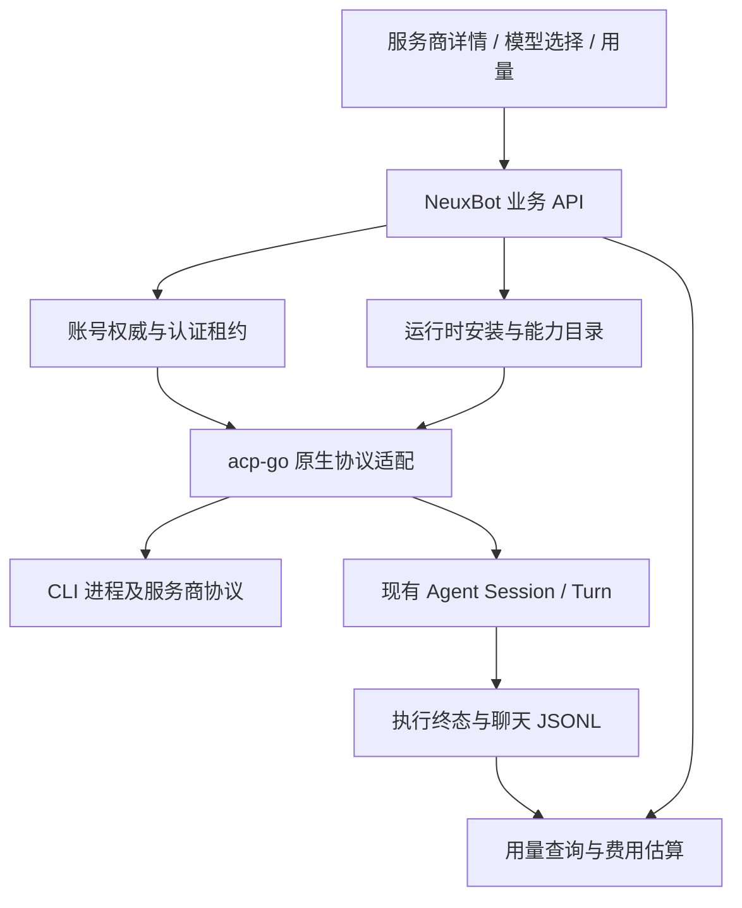

# 服务商、原生 CLI 能力与用量统一设计

状态：调研后的设计草案；不代表已实现或已完成真实平台验收。

## 目标与依据

用户要求以 OpenBot 的服务商、账号、运行时、模型选择、错误和用量体验为目标，在独立工作区完成调研、规格、实现和验收；允许替换存在问题的旧设计。特别要求核实 Token、费用与账号额度的准确性。子任务统一使用 GPT‑6.1 high。

参考版本：OpenBot `21369e1eec420772a7db9f6bbfeae2ef9b3ab83a`；NeuxBot 基线 `e18a0d6e377eda9cdc96954321fb1f0788691a5f`；acp-go 基线 `a58342da0ddd1e3ec5d022a0f911b82eba02107d`。OpenBot 使用 PolyForm Noncommercial 许可。本项目参考其公开行为和原生协议，独立实现 Go 逻辑，不翻译复制其 TypeScript 源码。

采用现有 Go 后端、acp-go 原生适配器和 React 共享组件。保留现有账号加密存储、认证刷新、执行租约、Session 生命周期与聊天 JSONL 权威；更换有缺陷的映射和产品组织方式。这是根据代码审计做出的实现选择，不将其记作用户对具体接口的确认。

## 产品范围

1. 服务商列表：按可用与其他服务商展示，支持搜索、默认项、连接状态、版本更新提示。
2. 服务商详情：在同一页面管理账号、API Key、启用、默认、运行时探测、安装、更新和重启；复用现有账号事实，不再要求用户往返两个平行设置页。
3. 对话模型选择：服务商、账号、模型、推理强度和快速模式形成同一选择链。只显示当前账号与模型实际声明的选项，未知能力不冒充支持。
4. 错误处理：区分未安装、启动失败、登录失效、模型不可用、周期额度耗尽、余额不足、限流、网络/超时、协议不兼容；错误显示可执行的恢复入口，额度耗尽仅在服务端有证据时显示重置时间。
5. 用量页面：日期范围、伙伴筛选、按模型/伙伴/日期明细、每日费用、Token 明细、数据完整性；账号配额单独展示窗口与重置时间。

不修改工作流编排、伙伴通信、项目目录授权和原生对话历史归属；不以服务商迁移为由重写 Agent Manager。原工作区修改不带入本分支。不自动切换账号规避额度限制。

## 职责边界

acp-go 负责原生协议、模型能力、配置透传、Token 归一化、结构化错误与原生账号额度读取；不导入 NeuxBot 数据库、HTTP API 或页面概念。NeuxBot 负责安装资产、产品默认值、账号授权、持久化与聚合。原生协议生成文件只通过生成器更新。

运行时配置和账号各有唯一权威。服务商页面是两者的聚合视图，不新建一套重复账号/运行时状态。实时变化复用现有全局连接与查询失效机制，不新增常驻页面轮询。

## 用量正确性合同

### 三种数值分开

- **本轮消耗**：所有模型请求的累计实际消耗，归属一次真实 invocation；不能用最后一次模型请求的 `last` 值替代。
- **当前上下文**：最近一次有效上下文占用和窗口大小，允许压缩后下降；不能累加为消耗。
- **账号额度**：服务商报告的限额窗口/百分比/重置时间，按账号和额度组隔离；不能从本地 Token 或估算费用推导。

归一化 Token 分量为未缓存输入、缓存读取、缓存写入、输出，推理 Token 作为输出的子集单独记录，绝不再次加到输出上。不同服务商的输入是否已含缓存必须由各自适配器明确转换。字段未知与真实零不同，保留缺失状态。显示两个总量：不含缓存读取、含缓存读取；两者都不重复累计推理。

Codex 以原生会话累计计数的可靠基线和终值计算本轮；同轮重复通知幂等。首次通知前已有会话历史、恢复、压缩导致累计回退、缺少基线时，不把整段历史记作当前轮；必须保留可证明的已知量与不完整标记。Claude/Pi 等按其原生事件语义区分请求增量与累计快照，不能统一盲目相加。

成功、失败、取消均可有消耗。错误不能抹去已观测的 Token；断线前只收到部分数据时保存部分数据。恢复重放、重复终态提交、聊天分叉、重试不得重复计费。统计以实际新执行为准，分叉复制的历史不会再次产生用量。无法从旧数据恢复的漏计保留未知，不填造历史。

### 持久化与查询

执行终态持久化一份最终用量与来源/完整性，归属冻结的 runtime、account、model、伙伴和 invocation。过程快照不写满聊天 JSONL。需要查询索引时索引可由权威记录重建，不能成为第二份会变化的用量事实。

全局查询必须明确覆盖范围与缺失轮次；不能只扫描当前页面已加载消息。返回 Token 不完整条数、没有用量的轮次、没有价格的条数。取消/失败已有消耗进入统计，未接纳且没有消耗证据的调用不伪造一轮零消费。

### 费用

原生明确报告的金额和按模型价格估算的金额分别标注来源、币种、价格版本。订阅 Token 的 API 等价估算不是实际账单。未知模型或缺失必要计价字段不返回假零；已知费用小计和部分覆盖同时展示。缓存读写、长上下文、fast/service tier 的不同价格必须有明确价格依据，否则费用不可用。不同币种不直接相加。

## 模型与配置合同

目录身份至少包含运行时安装/配置修订、账号身份和相关认证配置修订，账号切换不复用其他账号的模型能力。短期 token 轮换不制造无意义的模型目录和会话重建。

模型能力区分已知选项、明确不支持、未知。模型 B 的空强度列表不得回退为模型 A 或全局强度。强度、fast/service tier 由原生声明映射，不能改写模型 ID 模拟。acp-go 暴露已有 Claude fast；补齐 Codex service tier 读取与交付，Neux 的目录、DTO、默认配置、执行冻结、兼容摘要与界面全链传递。

原生初始化仍是最终能力校验。失败显示不支持/失效并允许刷新或更换，不静默降档。执行中不修改当前已冻结配置；下一轮选择变更依现有 Session 兼容性策略处理。

## 多账号与配额

保留 Neux 受管账号的加密凭据、共享执行租约、独占登录修改、每消费者原生配置投射和凭据对账，系统账号继续使用用户原生认证。服务商默认账号和每次执行选定账号明确区分。

配额查询使用所选账号的真实启动/认证资源，无模型 Prompt。结果包括服务商、账号、额度组、已用百分比或原生剩余量、窗口时长、重置时间、采集时间和状态；状态至少区分可用、未知、不支持、登录失效、暂时失败。显示旧快照必须标记时效，刷新失败不清为 0%。

优先通过 CLI 原生协议读取；确有现成服务端能力的适配器采用账号提供的认证资源与固定官方端点。不能读取其他账号缓存来补当前账号。每个 provider 的支持程度在审计及验收表中明示，不能承诺所有 CLI 均提供额度 API。

## 运行时安装和发现

发现顺序尊重显式路径，其次可用受管版本和系统安装；保留来源、版本与实际启动路径。探测、安装完成、登录成功是三个独立事实。

受管安装仅写应用私有目录，按 runtime/平台/版本隔离。下载使用经过验证的官方发布来源，固定版本与校验信息；受限下载、校验、解包路径检查、可执行位、版本探测全部成功后才原子激活。失败保留旧版本，不修改全局 PATH 和用户既有 CLI。禁止 archive 路径穿越和符号链接逃逸。取消和进程崩溃遗留的 staging 可清理；活动会话仍使用冻结的旧安装，更新不杀活跃任务。

无可靠受管安装定义的平台/CLI 显示外部安装入口和可复制命令，不展示不能兑现的一键安装。已存在显式路径覆盖时不可悄悄切到新下载版本。重复安装请求复用同一任务，状态可刷新并可恢复查询。

## 界面与错误

采用截图的信息结构而不是逐像素复刻：列表行、详情分组、轻量模型弹层、费用与完整性、配额弹层。沿用语义 Token、共享控件、焦点与键盘规则，普通分组无常驻边框/阴影；窄容器可滚动，不创建第二套设置导航。

错误结构保留稳定类别、来源、是否重试、账号作用域以及可证实的 reset/retryAfter；客户端负责本地化和恢复动作。原始 CLI stderr 不作为用户默认错误文案，也不允许泄露凭据。余额不足和周期额度耗尽分开。保留现有安全重试门槛，超时/未知接纳状态不自动重发有副作用的请求。

## 验收

- 原生 fixture：多模型请求一轮、重复通知、恢复历史、累计回退、部分字段、取消/失败、缓存及推理包含关系。
- 账号隔离：两个账号同名模型不同能力/配额、登录变更与并发执行、失效缓存、刷新失败仍保留旧快照。
- 安装：成功、校验失败、下载取消、恶意路径、重复请求、旧版本运行中更新、显式路径覆盖。
- 产品链路：目录到执行的模型/强度/fast 一致，模型无强度不继承；错误与恢复入口匹配。
- 统计：多轮/重试/分叉/重放不重计、已知零与未知、部分价格、币种、日期边界。
- 自动化仅运行本次相关包和文件；生成契约使用项目命令。不跑全量检查。
- 真实 CLI 与界面验收单独记载实际执行证据。未运行的服务商、账号和平台不能标记通过；未获用户明确同意不打开或控制运行中页面、浏览器和桌面应用。

## 当前基线验证

acp-go：`go test ./pkg/codex ./pkg/claude ./pkg/acpmeta` 通过。

NeuxBot：`go test ./internal/agent/... ./services/runtimeenvironment ./services/aiaccount ./apis/runtime_options ./apis/ai_accounts` 通过。这仅证明原基线相关测试通过，不证明上述缺陷不存在或新能力已实现。
