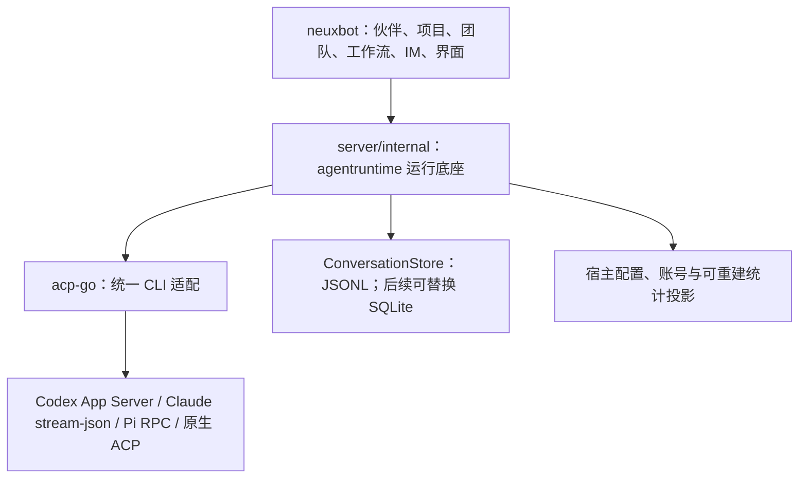

# 以 OpenBot 为参照重建 Agent 底座

本文是重构方案、开发计划与源码参考清单，不以计划条目代替实现与验收记录。`acp-go` 继续独立维护；`agentruntime` 是 neuxbot 的内部运行底座，放在 `server/internal`，沿用 `server/go.mod`。消息权威存储首先采用 JSONL，通过存储接口支持以后替换为 SQLite。首批完整闭环范围是 Codex、Claude Code、Cursor。现行架构文档在实际切换对应能力时更新，旧讨论中的完成标记不能作为本方案的验收证据。

## 1. 目标与取舍

本次重构同时解决职责、命名、实现方式和功能完整性四个问题：

1. 以 OpenBot 的指令准备、技能安装、MCP 交付、模型目录、会话管理、用量与错误处理为主要实现参照，用 Go 重新实现。
2. `acp-go` 负责原生协议和各 CLI 适配，保持独立仓库与模块；`agentruntime` 作为 `server/internal` 的内聚模块负责完整会话、运行准备、保存、恢复、账号和统计，不创建独立仓库或 go.mod。neuxbot 的产品领域与界面通过明确入口使用底座。
3. 已有代码只提供行为样本、数据样本与回归用例，不要求保留其类型、调用层数、文件划分或资源物化方式。禁止把旧 Manager、Session 和 Catalog 包装进新库，再将包装层当作重构成果。
4. 保留 `GenerateText` 当前调用语义与资源限制；它仍经过聊天会话机制，复用账号、原生会话、完成判断、错误和用量链路，不另建直连模型接口。
5. 不为旧软链接目录、新旧执行器并行、自动失败回退建设长期兼容体系。数据转换由独立、可验证的导入步骤完成；每个已切换入口只有一个执行所有者。
6. 可读性、内聚、解耦和可维护性与功能完整性同为交付标准。以 OpenBot 的实际职责对象和文件组织为起点重新设计，不保留旧文件、class/struct 或接口定义的惯性；代码注释使用英文，方案说明继续使用中文。
7. 首批对 Codex、Claude Code、Cursor 做完整能力闭环，覆盖 CLI/版本/模型探测、账号管理、设置、注入、运行、存储、错误、Usage、统计与恢复；其余 CLI 在公共能力和这三家验收后扩展。

### 1.1 明确舍弃的机制

| 旧机制 | 新设计 |
| --- | --- |
| 根据 CLI 生成 AGENTS.md / CLAUDE.md，作为 bot 指令的主要传递方式 | 在统一入口组合应用指令，经后端原生参数或明确的兼容策略注入 |
| 通过软链接安装技能 | 将固定版本技能复制到受管的原生技能目录，记录哈希，按 Agent 原子更新 |
| 通过项目或工作区软链接构造执行范围 | 创建真实工作目录，原生 cwd 与额外目录分别交付，直接引用项目真实绝对路径 |
| 厂商规则分散在 neuxbot 的 Catalog、Session、资源代码中 | 每家 CLI 的协议差异集中到 acp-go；运行策略归 agentruntime |
| 只要有模型、usage 或错误字段就视为完成 | 从原生事实到设置、执行、保存、查询和产品展示逐段验收 |

OpenBot 本身仍支持用户工作区指令文件，Claude 的用户级技能插件也存在链接实现。本方案参考其所有权和加载机制，不把“完全没有 AGENTS.md 或符号链接”误写成 OpenBot 的既有事实。新库不自动生成 bot 指令文件；用户和项目已有指令文件按后端真实发现规则处理，不能宣称统一禁用了 CLI 的原生读取。

### 1.2 参考基线

- [OpenBot 源码基线](https://github.com/nightly-labs/openbot/tree/f44dbe116c89a944f8d7d085e092c967b3fce0df)：`f44dbe116c89a944f8d7d085e092c967b3fce0df`。
- [neuxbot 对照基线](https://github.com/JieWaZi/NeuxBot/tree/e18a0d6e377eda9cdc96954321fb1f0788691a5f)：`e18a0d6e377eda9cdc96954321fb1f0788691a5f`。
- [acp-go 对照基线](https://github.com/JieWaZi/acp-go/tree/a58342da0ddd1e3ec5d022a0f911b82eba02107d)：`a58342da0ddd1e3ec5d022a0f911b82eba02107d`。

逐 CLI 判断以其实际版本、官方协议和可重现记录为准。OpenBot 的兼容规则是待验证证据，不能作为对所有版本永久生效的判断。参考基线采用 PolyForm Noncommercial 1.0.0；本项目采用 MIT。方案采用架构与行为研究后独立实现；直接移植代码、测试或夹具需先核对许可与来源，不能将复制内容直接声明为 MIT 自主实现。

## 2. acp-go、内部运行底座与产品的职责



| 能力 | acp-go | agentruntime | neuxbot |
| --- | --- | --- | --- |
| 协议 | ACP SDK、原生报文、事件身份、排序、背压、取消、进程退出 | 消费统一事实，编排运行 | 消费产品事件 |
| 后端能力 | 原生方式、版本边界、真实支持与限制 | 组合能力、准入校验、有效配置 | 展示可用性和限制 |
| 模型 | 原生目录、模型级菜单、配置设置与回执 | 发现、缓存、来源、刷新、保存选择 | 模型选择界面 |
| Fast | 原生 Fast 模式和 service tier 的转换 | 保存选择、兼容校验、有效值和使用记录 | 展示真实选项 |
| 指令与技能 | 原生指令入口、目录与刷新支持 | 组合、复制安装、版本、加载策略和指纹 | 提供档案、技能安装选择 |
| MCP | 原生交付格式、transport 与目录限制、加载诊断 | 配置、工具桥接、认证代理与启动报告 | 插件选择与用户授权 |
| 工作区 | 正确传递 cwd 和附加目录 | 真实布局、授权根、生命周期 | 决定业务项目范围 |
| 会话 | new/load/resume/close/fork 与原生历史读取 | 公开会话、原生会话绑定、排队、替换、交接和恢复 | 聊天及业务归属 |
| 错误 | 原生原因、类别和版本特有纠正 | 稳定故障、脱敏诊断、恢复动作与状态 | 本地化文案和操作入口 |
| 用量 | 累计/本轮计数、缓存包含关系、真实模型归属 | 基线、去重、计费、统计、查询 | 图表和业务维度映射 |
| 账号 | 认证机制、配置根、原生登录/登出和配额读取 | 账户状态、秘密存储端口、隔离、租约、刷新协调和读取节流 | 设置与账号选择 |
| 应用能力 | 不认识伙伴、团队、工作流 | 注册工具及交互端口，不编排产品业务 | 实现业务工具与事务 |

`agentruntime` 留在 neuxbot 主模块的 `server/internal`，正式归属仍为 `server/internal/agent`。实施时按第 9.1 节在临时 `server/internal/agent_next` 完整重建，通过审查和实际消费者验证后一次替换旧目录；临时目录不成为长期并行执行器。包内核心流程不直接依赖 API、Service 或业务 Repository；产品配置、账号持久化与业务交互通过实际需要的窄端口装配。产品错误在接入边界转换一次。ACP 原始类型收敛在驱动接入层；标准协议不覆盖的宿主能力通过明确命名空间和能力协商表达，不手改生成类型。

内部底座必须在 neuxbot 中提供实际可运行的实现，不能只交付空接口。消息首先提供 JSONL 实现；账号和其他业务配置复用宿主的权威存储；统计可以使用由消息与最终用量重建的查询投影。消息存储抽象与账号/配置存储边界分别表达，不因后续可换数据库而将全部持久化合成一个巨型接口。

## 3. 名称与模块组织

### 3.1 设计方法：先确认职责所有者，再确定文件与接口

Agent、Conversation、ProviderSession、Turn 和 Message 首先是数据概念，不要求每个概念都创建一个可变 struct、manager、service 和 interface。Invocation 只有在生产调用确实需要区分多次原生提交时才独立建模。

每个有状态对象先回答：它唯一拥有哪份事实，哪些操作必须一起串行化，资源何时创建和释放，失败后谁继续持有资源。生命周期相同、始终共同变化的规则放在同一对象和同一文件中。只有状态所有者、协议边界、外部依赖或变化原因实际独立时才拆分。

OpenBot 的 AcpAgentClient 将 ACP 会话和流式行为集中在一起，AcpConnection 则因进程/传输与会话所有权不同而独立。ModelCatalog 的刷新、分页、校验、保留旧目录和查询也放在同一文件。这些是内聚边界的参照，不以文件行数或“一个文件一个类型”为组织规则。

不预设沿用旧 `Manager → Session → PreparedTurn → Turn → Connection` 对象链。需要保留的接纳、资源、取消和关闭语义必须在新所有者中明确落实，但旧类型及调用层数不构成约束。`GenerateText` 是同一执行路径的调用入口，不因此建立另一套运行对象。

### 3.2 acp-go 的文件定位

各厂商 Adapter 是自然模块边界，通用 ACP 连接只维护标准协议。OpenBot 的版本特有规则迁回 owning Adapter，CLI 技术声明只有一处权威。一个 Adapter 的主对象、私有会话记录、Options、状态转换和相关辅助函数可以在同一文件。

| OpenBot 参照 | 新库中的完整职责 | 拆分依据 |
| --- | --- | --- |
| acp-connection.ts / AcpConnection | 子进程、stdio、握手连接、待响应请求、退出与诊断 | 传输和进程拥有独立生命周期；不决定公开会话替换 |
| acp-client.ts / AcpAgentClient | 原生 Session、Prompt、消息/工具身份、原生事件、取消和恢复 | 同一个协议会话状态机就近维护，不按请求、响应、通知各造服务 |
| acp-configuration.ts / AcpConfiguration | 原生模型配置目录、设置、回执与配置通知 | 原生配置协议独立；模型与有效值转换集中，不拆为多个单方法策略 |
| claude-client.ts / ClaudeAgentClient | Claude 原生输入、控制通道、事件和完成语义 | Claude 协议边界，不强行复用其他厂商含义不同的状态 |
| app-server-client.ts、pi-client.ts | Codex App Server、Pi RPC 对应原生接入 | 由真实传输协议决定边界，Go 公共 ACP 适配复用同一原生实现 |
| acp-flavor*.ts | 对应厂商、版本与确切证据限定的差异处理 | 规则归对应 Adapter；只有跨厂商相同语义才进入通用层 |

生成协议与平台构建文件继续按工具和平台边界独立。其余规则优先放回 owning Adapter 的已有职责文件，不新增只有一个 helper、一个选项或一次错误修正的小文件。

### 3.3 agentruntime 的职责对象与文件定位

下表是参考 OpenBot 的职责地图，不是必须创建的类或文件数量。Go 文件采用 snake_case；struct 只有在需要维护状态、不变量或资源时创建，纯计算直接用函数。最终落点在 P0 中结合实际调用链确定。

| OpenBot 参照 | Go 文件定位 | 对象与完整职责 | 交互边界 |
| --- | --- | --- | --- |
| agent-client.ts / AgentClient | agent_client.go | 多后端共同使用的真实执行端口及共享数据 | 具体协议交给 acp-go；保持类型明确，不向业务暴露通用字符串 RPC |
| provider-drivers.ts、agent/provider-runtime.ts | provider_runtime.go；静态注册确需独立时使用 provider_drivers.go | ProviderRuntime 管理后端连接生命周期、可用状态和连接复用；注册表集中静态技术事实 | 不承担消息历史、Agent 档案与模型目录规则 |
| agent/thread-lifecycle.ts / ThreadLifecycle | thread_lifecycle.go | 公开聊天到原生会话的绑定、配置准备、新建、恢复、替换、交接与释放 | 调用统一指令、技能、MCP 准备；不再解析厂商原生报文 |
| agent/turn-lifecycle.ts / TurnLifecycle | turn_lifecycle.go | 本轮状态、事件处理、交互等待、完成、取消与收尾 | 当前执行事实只有一个所有者；待办产品逻辑经宿主端口接入 |
| agent/drain-scheduler.ts / DrainScheduler | drain_scheduler.go | 待处理投递、接纳时序、队列暂停/恢复和下轮唤醒 | 不复制 TurnLifecycle 的执行状态；不混入团队或工作流编排 |
| agent/developer-instructions.ts | developer_instructions.go | 组合顺序、上下文边界、转义、稳定指令与必要更新均用同一组函数处理 | 输入为固定配置；不为每类指令创建 Builder/Strategy 类 |
| managed-skill-service.ts、home-skills.ts | skills.go；只有独立的包编解码边界才再分文件 | 安装、哈希、更新、禁用、发现与加载计划作为一条完整能力 | 共享技能包存储与受管安装范围明确；原生刷新由 acp-go 执行 |
| mcp-provider-shapes.ts、local-mcp-bridge.ts | mcp_configuration.go、local_mcp_bridge.go | 配置准备/校验与真实监听服务分别维护；相关 Options 和私有类型就在对应文件 | 两者因转换与监听的资源生命周期不同而拆分，非按 transport 机械拆包 |
| agent/model-catalog.ts / ModelCatalog | model_catalog.go | 发现、分页、结果校验、刷新、缓存新鲜度与查询 | 同一模型目录规则放一起；不负责程序定位、分叉和 MCP |
| agent/session-settings.ts / SessionSettings | session_settings.go | 设置描述、保存覆盖、应用、生效结果、reset 与通知 | 后端 Client 拥有实际有效值；不另建 model/effort/fast 三套控制器 |
| agent/conversation-runtime.ts、conversation-reader.ts | conversation_runtime.go；历史查询有独立存储边界时使用 conversation_reader.go | 实时消息状态与有限缓存；历史分页/搜索通过存储读取 | 状态缓存不成为第二份权威历史，也不决定原生运行终态 |
| agent/delta-buffer.ts / DeltaBuffer | delta_buffer.go | 每消息缓冲、计时、大小阈值、flush 和销毁放同一文件 | 定时器归本对象；提交和事件交付通过明确端口，不再制造三层 Pipeline |
| agent/provider-accounts.ts | provider_accounts.go | 账号状态、租约、登录/刷新编排与释放 | 秘密存储和原生认证机制有外部端口；账号设置 UI 留产品 |
| agent/usage-collection.ts、usage-pricing.ts、usage-read-gate.ts | usage_collection.go、usage_pricing.go、usage_read_gate.go | 采集与归账、纯计价、账号读取节流分别因职责和状态独立而组织 | 纯计算用函数；UsageReadGate 完整拥有等待、缓存时机和退避状态 |
| database/agent-usage.ts、database/conversation-writer.ts | ConversationStore 与 JSONL 实现；实际需要时独立 usage_store.go | 用量归账和会话提交按真实聚合组织；首先实现 JSONL，数据库实现后续接入同一合同 | 唯一耐久来源；不为每个日志记录、DTO 或查询各建文件和接口 |

### 3.4 struct 与 interface 定义规则

1. 默认使用具体 struct 和函数。接口用于实际的多后端替换、存储、秘密存储或宿主交互边界，由消费者需要的行为决定；每个接口都要标出生产消费者和实现者。
2. 类型、Options、私有状态、主要方法和专属辅助函数就近放在同一职责文件。多个真实模块共享的合同才集中维护，不建立收集所有类型的宽泛 contract.go/types.go。
3. 不为每个 struct 创建同名 interface，不为测试单独增加生产包装层；可直接注入窄函数或真实外部边界。
4. 不建立仅做转发的 Manager/Service/Controller/Repository 链。同一个模型设置不应为获取、校验、应用和回执各建一个对象。
5. 文件、struct 和方法使用具体职责名称。避免用 common、utils、processor、handler 等宽泛名字承载多种状态和规则；采用已有协议术语，不另造难以对应原生事实的名称。
6. 依赖显式传入且数量可解释；避免在 Options 中传整个 Runtime、Service Locator 或任意上下文对象，使所有模块可以相互访问。
7. 接口、函数和事件的错误、取消、阻塞、回调顺序与资源转交语义要明确；这些语义不能只隐藏在调用者的 defer 或测试约定中。

### 3.5 代码编辑与阅读验收

每次开始一个工作包，先列出主流程、将编辑的 owning 文件、对象拥有的状态、对外接口和具体参考的 OpenBot 实现。关联规则优先在同一文件完成；只有真实边界变化才创建文件或子包。长文件本身不构成拆分理由，小文件也必须拥有完整职责。

评审按真实场景从入口读到终态：创建并续聊、切换模型、取消、MCP 失败、恢复和 Usage 对账。读者应能在少数明确的 owning 文件中看完主要规则；不能为了理解一次状态变化跨越一串仅转发调用的文件。改动没有改善这种可读性，即使测试通过也不能视为重构完成。

对象/文件评审表至少包括：职责、唯一状态、输入和输出、外部依赖、失败与释放、OpenBot 对应实现、保留为同文件或拆分的理由。此表随实际设计收敛，不把尚无生产消费者的对象提前做进库。

### 3.6 英文代码注释

acp-go 与内部运行底座本次重写、迁移的代码使用英文注释，范围包括公开类型、接口、方法、Options 字段、重要私有状态、测试替身和关键控制流。注释解释职责、语义、不变量、并发、失败与设计理由，不逐行复述语法。文档正文和产品文案保持各自语言；协议生成注释和第三方声明保留真实来源。

注释风格直接参考 OpenBot，例如以下 Go 示例仅说明目标风格，不代表已实现 API：

```go
// DeltaBuffer owns pending text and flush timers for each assistant message.
// Flush persists the message before publishing its durable revision.
type DeltaBuffer struct {
    // pending contains only text not yet committed to the conversation store.
    pending map[MessageID]*pendingDelta
}

// Close releases the provider process before its account lease.
// A failed release retains ownership so the same operation can be retried.
func (c *ProviderClient) Close(ctx context.Context) error
```

公开 Go 注释以对应标识符开头。省略/空值、增量/累计、requested/effective、执行成功/释放成功等容易误解的区别在归属处解释一次。厂商兼容规则注明适用版本、确切证据与触发条件，避免逐轮状态处理依赖模糊猜测。范围外的旧中文注释不为统一语言而批量翻译。

## 4. 工作目录和加载方式

### 4.1 默认布局

```text
<root>/
  Agents/<agent-id>/            # 长期 Agent 的真实默认 cwd
    .agents/skills/<slug>/      # 固定版本技能副本
    .claude/skills/<slug>/      # Claude 需要的技能副本
  Shared/                      # 显式共享目录
  Workspaces/<scope-id>/       # 团队/任务等要求隔离时的真实工作区
  Conversations/<id>/
    messages.jsonl             # 消息与会话事实的权威日志
    index/                     # 可由 JSONL 重建的查询索引
  State/
    Accounts/<account-id>/     # 受管认证与 CLI 状态
    Providers/                 # 后端运行辅助文件
    Skills/                    # 技能安装清单与内容哈希
    Logs/                      # 脱敏诊断
```

安装元数据使用新库自身命名，不依赖 OpenBot 私有目录。以上大小写属于目标默认布局，不承诺隐式兼容旧目录。宿主可显式提供真实 Workspace，库不硬编码用户主目录。

普通 Agent 默认使用固定真实 cwd；需要并发文件隔离的团队和工作流显式提供独立 scope。共享 cwd 不等于隔离。已有项目通过原生附加目录直接交付，不创建项目软链接，不复制整个项目，不将 cwd、可写根和文件展示授权混为一个字段。后端无法实现授权要求时明确拒绝，不用提示词冒充文件系统约束。

### 4.2 指令

采用 OpenBot 的统一指令生成方式，稳定规则、Agent 档案、项目上下文和记忆有确定顺序。有效指令生成一次后交给后端：Codex 用原生 developer 指令；Claude 用原生 system append 的等价机制；ACP 在没有原生入口时使用明确的上下文块策略。

原生入口、一次性前置、必要补发与不支持必须分别表达。ACP 文本块不是 system role；补发时机依据新会话、指令变化、压缩和后端行为，不能每轮无条件重复整个配置。用户工作区指令文件属于项目上下文，应用不再靠重写文件实现 bot 指令。

### 4.3 Skills

技能采用固定版本、文件复制、哈希清单和暂存后切换；安装、更新、禁用与卸载按 Agent 串行化。只管理自身安装的文件，不删除 CLI 或用户管理的技能。Claude 需要插件加载时使用受管复制副本，不把软链接作为运行前提。

原生目录发现优先；缺少目录加载能力时提供技能名称、描述与路径索引，按需读取。对每个后端确认技能目录、名称冲突、刷新和禁用的真实行为，不能统一假设 `.agents/skills` 已覆盖所有 CLI。

### 4.4 MCP

运行时配置为权威，在会话创建或配置更新时传递，不统一写入各 CLI 全局配置。工具桥接、外部 MCP、认证代理分别拥有生命周期。工具身份、Schema 和顺序保持稳定；随机令牌和端口只出现在传输配置。

Go 内置 MCP 服务可通过 Go SDK 和本地 bridge 实现。OpenBot 的 Claude SDK 内嵌 server 不能照搬为 Go 依赖，必须用对应 CLI 支持的原生接入验证同等语义。

必须报告 transport 不支持、启动目录不支持、命令缺失、重名、认证失败和加载失败。关键内置工具未加载时阻止执行；可选外部服务可带明确诊断继续。不能只把配置发出就认为工具已经可用。

## 5. 模型、设置、错误与用量

### 5.1 模型目录与设置

模型发现结果记录后端、实际 CLI 版本、账号、时间、来源和新鲜度。模型自身保存原生 ID、名称、上下文窗口、支持的输入、推理菜单、默认值、Fast/服务档位与当前有效配置。未知与不支持、空目录与探测失败分别表达。

配置保留 requested 与 effective；set 请求、异步配置通知和恢复回执共同决定有效值。配置描述、已保存覆盖与实际值分别存储。切换模型或账号后重新校验，不静默沿用另一模型的推理强度。不把所有后端压成固定 low/medium/high。

Fast 模型、Claude Fast 模式与 Codex Fast service tier 分开。Codex 从 serviceTiers 读取，旧版本 additionalSpeedTiers 只作版本受控兼容；不能写死 fast 等于 priority。失效的覆盖保留可解释状态，reset 后重启不能恢复旧值。

### 5.2 错误

区分启动、认证、模型发现、配置、会话恢复、MCP、Prompt、输出交付、持久化与清理阶段。分类至少覆盖认证、余额/计费、额度耗尽、请求限流、网络、超时、服务不可用、模型不可用、上下文超限、能力不支持、协议损坏、会话缺失和未知。

保留脱敏原生 code、类别、必要诊断、所属会话/回合、是否可能已有副作用、可用恢复动作和重试时间。未知原因不能猜成认证错误；配置错误不能被当成会话缺失；用户取消不能被显示为服务故障。清理失败不能覆盖真实输出或执行错误。

版本特有的错误正文识别只放在 owning Adapter，有明确样本和反例。UI 将结构化原因映射到本地化文案及登录、修改配置、等待等动作。自动重试或备用模型只能作用于可证明没有副作用的提交；未知接纳和工具执行后不得自动重放。

### 5.3 用量、计费和配额

分别定义 Invocation/Turn 消耗、Session 上下文占用、Account 配额三个对象。acp-go 解释原始计数的 scope、累计或增量语义、缓存包含关系和真实模型；agentruntime 执行基线、幂等归账、统计和计价。

统计覆盖：时间范围及日粒度、账号、后端、模型、Agent、Conversation、调用来源；调用来源至少能区分 Chat、GenerateText、团队、工作流和后台生成。业务归属通过稳定引用进入，不导入产品对象。

费用区分 reported、estimated 与 unknown，保存币种、价格来源、有效期与计算依据。缓存读写和 reasoning/output 的包含关系不能重复累计；请求级长上下文阈值缺少证据时保留未知费用，不能用整个 Turn 的 Token 总和推断单请求档位。

账号配额读取按账号共享在途请求、缓存与退避；保存重置时间和来源。缓存存在不证明当前认证成功；没有额度接口表示未知。多个账号不能共享同一个全局限流状态。归账身份在恢复、重复终态和切换进程后仍稳定。

## 6. 会话、流式、历史与存储

公开 Conversation 与 ProviderSession 分开。后端切换、配置不兼容、压缩交接或原生会话丢失可以替换 ProviderSession，公开聊天身份和历史保持不变。新会话采用有界交接；正常恢复只提交新增输入。分叉依赖真实原生能力与耐久操作身份，不能复制消息后伪称原生分叉。

参考 OpenBot，将流式片段按消息归并，遇时间/大小上限、消息完成、取消或回合结束刷新。100ms 与 8KiB 作为首轮对照参数，不把它们当固定协议；显示与存储可分别设窗口，关键状态立即交付。

### 6.1 JSONL 为首个消息存储实现

neuxbot 消息继续采用 JSONL 作为唯一权威源。参考 OpenBot 的消息身份、有限内存、聚合提交与恢复语义，按追加日志实现这些语义，不直接复制 SQLite 的反复覆盖写法。流式片段先在内存按消息归并，到语义边界或有界提交预算时追加规范消息记录；避免把原始 Token 逐条落盘，也避免每 100ms 向 JSONL 追加同一消息越来越长的完整副本。

完成事件可以校准最终正文。普通增量、完整替换、工具输入快照和终态必须有明确语义；JSONL 重放与实时投影产生相同消息。Usage 中间覆盖保留在内存，最终用量以稳定调用身份幂等归账。索引、历史窗口与统计查询投影均可重建，不成为第二份可写消息权威。

同一会话串行提交，日志明确批次身份、版本与提交完成边界；重试不重复接纳消息或用量。进程在批次中途退出时，只恢复已完成提交的有效前缀，识别并处理不完整尾部，再重建索引。持久版本在确认提交后发布，不能拿临时帧号或文件偏移冒充公共版本。

### 6.2 通过消息存储接口预留数据库实现

`ConversationStore` 只表达真实的消息/会话持久化边界：提交消息变化及相关会话事实、原生会话绑定、回合终态与最终用量、读取分页历史、按持久游标续读、恢复。方法按同一聚合的实际读写需求收敛，接口放在消费者归属处，避免为每个日志操作单独建接口。

接口使用稳定身份、期望版本、幂等键及可续读的持久游标。JSONL 的路径、字节偏移、追加编码和索引格式封装在实现内，不能流入 Turn、CLI Adapter 或界面合同。账号和产品配置依然使用各自权威存储，不为了统一接口搬进消息日志。

后续增加 `SQLiteConversationStore`，与 JSONL 实现通过同一套存储合同测试。切换实现只影响装配与必要的数据迁移，不要求修改会话、流式、Usage 或前端逻辑；一次会话只选一个权威实现，SQLite 不属于首批交付的前置条件。

已有 JSONL 的读取与版本兼容作为本次重构的一部分核对；只有格式确有变化时才提供显式转换。转换不能声称还原旧数据缺少的用量、模型回执或原生完成证据，不安排强制搬迁到数据库。

实时帧和持久版本分开；订阅中断、乱序、缺帧和缓冲超限从权威消息恢复。初次读取和上翻使用分页，内存保留有限近期视图。原生历史是补齐来源，不是每次打开聊天都依赖的唯一数据源。原生历史能力缺失时返回明确恢复边界，不承诺补回崩溃前所有内存片段。

`GenerateText` 使用同一会话与 Turn 路径，可以选择不保存公开聊天，但仍归账 Usage、保留可用诊断，并维持已有工具与交互限制。

## 7. OpenBot 具体参考清单

以下文件均相对上述固定 OpenBot 基线；参考的是处理流程、状态边界与已观察行为，不要求照搬类层级、默认权限或 Electron 依赖。

| 编号 | 参考文件 | 具体参考内容 | 落点 |
| --- | --- | --- | --- |
| OB-01 | `src/backend/agent-client.ts`、`provider-drivers.ts` | 统一边界、后端注册、模型/登录/账号差异 | acp-go 技术声明与 runtime 注册 |
| OB-02 | `src/backend/cli.ts` | 程序定位、登录 shell PATH、显式覆盖与版本 | acp-go 启动事实；runtime 配置 |
| OB-03 | `src/backend/acp-connection.ts`、`acp-configuration.ts` | 传输、握手、配置与模型发现 | acp-go |
| OB-04 | `src/backend/acp-client.ts`、`acp-flavor*.ts` | 会话恢复、流、取消、后台任务、版本差异 | 原生纠正归 acp-go；调度归 runtime |
| OB-05 | `src/backend/app-server-client.ts`、`grok-client.ts`、`pi-client.ts`、`muse-client.ts` | 原生后端、RPC/MSP、认证及完成事实 | acp-go |
| OB-06 | `src/backend/claude-client.ts`、`claude-workspace-sandbox.ts` | system append、设置、技能、MCP、原生压缩 | acp-go 接入与 runtime 策略 |
| OB-07 | `src/backend/agent/developer-instructions.ts`、`workspace-instructions.ts` | 统一指令顺序、项目文件识别、技能索引 | runtime |
| OB-08 | `src/main/managed-skill-service.ts`、`skill-package.ts`、`skill-folder-discovery.ts`、`src/backend/home-skills.ts` | 复制安装、校验、版本哈希、原生发现与用户技能 | runtime |
| OB-09 | `src/backend/mcp-provider-shapes.ts`、`local-mcp-bridge.ts` | 后端配置形状、工具桥接、令牌、加载和不支持诊断 | 双层明确分工 |
| OB-10 | `src/main/mcp-oauth-store.ts`、`mcp-oauth-redirect-server.ts`、`mcp-oauth-proxy-store.ts` | MCP OAuth 状态、认证代理和秘密边界 | runtime 的 MCP 认证 |
| OB-11 | `src/backend/agent/thread-lifecycle.ts`、`turn-lifecycle.ts`、`drain-scheduler.ts` | 准备、恢复、替换、排队、接纳不确定与收尾 | runtime |
| OB-12 | `src/backend/agent/model-catalog.ts`、`provider-models.ts`、`session-settings.ts` | 逐模型能力、Fast 档位、刷新和覆盖设置 | runtime；原生字段归 acp-go |
| OB-13 | `src/backend/agent/provider-diagnostics.ts`、`provider-status.ts`、`src/backend/acp-flavor*.ts` | 故障分类、来源、会话缺失与厂商诊断 | 双层错误合同 |
| OB-14 | `src/backend/agent/usage-collection.ts`、`src/backend/database/agent-usage.ts` | 累计基线、模型归属、幂等归账和聚合 | acp-go 语义 + runtime 账本 |
| OB-15 | `src/backend/agent/usage-pricing.ts` | 费用来源、缓存、长上下文、未知价格 | runtime |
| OB-16 | `src/backend/agent/account-usage.ts`、`usage-read-gate.ts`、`usage-limit-gate.ts` | 配额窗口、读取节流、退避和暂停/恢复 | runtime |
| OB-17 | `src/backend/cursor-usage.ts`、`opencode-usage.ts`、`antigravity-usage.ts` | 无标准接口时的独立配额读取与能力限制 | acp-go 后端读取；runtime 缓存 |
| OB-18 | `src/backend/agent/provider-accounts.ts`、`provider-account-store.ts`、`src/main/provider-accounts-host.ts`、`provider-credential-store.ts` | 原生与受管账号、登录、配置根和秘密存储 | runtime；厂商机制归 acp-go |
| OB-19 | `src/backend/agent/delta-buffer.ts`、`src/backend/database/conversation-writer.ts` | 按消息缓冲、单消息持久化、版本与覆盖事件 | runtime |
| OB-20 | `src/backend/agent/conversation-runtime.ts`、`conversation-reader.ts` | 有界缓存、快照合并、分页和阅读状态 | runtime；产品阅读策略留宿主 |
| OB-21 | `src/backend/provider-history.ts`、`provider-history-import.ts`、`agent/boot-recovery.ts` | 原生历史导入、去重与启动恢复 | runtime；读取能力归 acp-go |
| OB-22 | `src/backend/agent/context-compaction.ts`、`handoff-history.ts`、`history-tools.ts` | 压缩归属、有界交接与按需历史 | runtime |
| OB-23 | `src/backend/process-confinement.ts`、`agent/workspace-sandbox.ts` | 原生权限与工作目录、额外根的真实关系 | runtime 策略 + acp-go 交付 |
| OB-24 | `scripts/provider-conformance-e2e.ts`、`provider-cli-canary.ts`、`agent-context-budget.ts` | 适配一致性、上游变更与上下文预算 | acp-go 与内部底座回归 |
| OB-25 | `scripts/codex-usage-metering-e2e.ts`、`claude-usage-resume-e2e.ts`、`opencode-usage-metering-e2e.ts`、`usage-read-pacing-e2e.ts` | 用量恢复、累计计费和配额节流证据 | acp-go 与内部底座回归 |
| OB-26 | `scripts/acp-mcp-shared-token-e2e.ts`、`acp-mcp-server-names-e2e.ts`、`codex-mcp-name-clash-e2e.ts`、`antigravity-mcp-load-failure-e2e.ts` | 目录共享、名称碰撞与 MCP 加载失败 | acp-go 与内部底座回归 |

先阅读 [Providers](https://github.com/nightly-labs/openbot/blob/f44dbe116c89a944f8d7d085e092c967b3fce0df/docs/architecture/providers.md) 与 [Skills and plugins](https://github.com/nightly-labs/openbot/blob/f44dbe116c89a944f8d7d085e092c967b3fce0df/docs/architecture/skills-and-plugins.md)，再按上表定位实现和测试。源码与文档不一致时，以固定版本源码、测试和真实协议证据记录差异。

## 8. 逐 CLI 对照与处理清单

下表是必须核对的行为，不表示每一项在 acp-go 当前都缺失。每项最终登记为“已有且通过、需重写、需补齐、原生不支持、版本不适用”，附测试或协议证据。禁止用 README 的能力描述替代验证。

| 后端 | OpenBot 已考虑、必须逐项核对的内容 | 来源 |
| --- | --- | --- |
| Codex | App Server 分页模型目录；逐模型 effort 和 serviceTiers；指令与工具配置在 resume 上的实际更新边界；MCP 名称/transport 冲突；累计用量基线与缓存读写；账号限额与恢复；流断线、终态与原生压缩 | OB-05、09、11、12、14～16、22 |
| Claude Code | 原生 system append；恢复时避免旧 prompt snapshot 固化指令；技能与严格 MCP 配置；逐模型 effort/Fast 和原生设置回执；模型级用量、恢复后累计基线与费用；原生压缩；取消与进程清理。Go 通过当前 CLI 支持的接口实现，不能假装使用 TS SDK | OB-06～09、12、14、21、22 |
| Grok | 实际 CLI 命令和版本；OAuth/API Key；逐模型推理菜单；ACP 累计计数与恢复；原生历史、取消和空闲释放；不能用握手成功证明配额或模型可用 | OB-01、03～05、14、16、18、21 |
| OpenCode | 精确的 session-not-found 形状；启动中的 resume 失败有限重试；按目录共享 MCP 的名称/令牌作用域；后台子任务后续回合补齐；错误包装、认证与内容类型；thinking 与 output 包含关系、本轮 Token 与累计费用分开 | OB-04、09、13～17、21、26 |
| Cursor | 使用 cursor-agent 而非编辑器 cursor；进程级模型设置；MCP 被禁用或静默漏载；精确会话缺失；已知噪声与失效登录文本；重启读取认证；无 ACP 配额时的独立读取。现有 PTY/检查点方案需对当前版本重新验证，不因已有而保留 | OB-02～04、09、13、17、18、26 |
| Kimi | authenticate 与真实登录的区别；旧模型接口和 configOptions 支持；精确缺失会话错误；模型已切换但写默认配置失败；自动更新环境与账号状态；Usage 的实际 scope 与空字段 | OB-01、03、04、12、14、18 |
| Pi | RPC 的 prompt 接纳不等于 agent_settled；取消前清空待执行输入；原生 session 路径与分支；模型和思考菜单；MCP extension 注册与秘密传递；错误和本轮用量 | OB-05、09、12、14、24 |
| Gemini CLI | neuxbot 当前 gemini --acp 与 OpenBot Antigravity 不是同一个运行时；对当前 CLI 单独验证模型/thinking、恢复、工具、取消与持久化。只迁移有共同证据的规则 | OB-03、04、12、21；补官方 Gemini CLI 版本证据 |
| Antigravity | 作为独立候选后端登记；错误可能出现在答复正文且 prompt 成功；MCP 启动失败；后台任务期间 prompt 长开；取消后恢复；关闭不释放子进程；无 compact 时的 handoff。不得把其 clientInfo 识别规则套到 Gemini CLI | OB-04、13、17、21、22、26 |
| WorkBuddy | OpenBot 无对应直接适配；按官方协议与当前样本补齐模型、effort、权限、表单、错误、usage、恢复和取消，用同一公共一致性套件验收 | acp-go 官方基线 + OB-24 通用规则 |
| Qoder / Qoder CN | 同上；保持两种身份、配置根与模型目录独立，不从产品名推测相同能力 | acp-go 官方基线 + OB-24 通用规则 |
| 自定义 ACP | 协议能力协商、精确命令身份、分组配置、额外设置、长模型发现、历史能力与不支持报告；默认标准行为，不能对未知实现套厂商补丁 | OB-01、03、04、12、24 |
| Cline | 纳入 OpenBot 覆盖差距；local session backend 避免脱离宿主的共享 hub，关闭自动更新，登录、MCP、模型与标准会话缺失 | OB-01～04、18、24 |
| Hermes | 纳入覆盖差距；缺失会话的 resume 不能冒充恢复成功，load 回执校验；原生记忆、SOUL、技能信任和账号目录边界 | OB-01、04、07、08、18、24 |
| Muse | 纳入覆盖差距；MSP 原生会话、MCP、历史和漏事件恢复；模型列表不等于认证；保留 OpenBot 记录的“禁用工具后仍启动继承 MCP”等限制，不把不可满足的 GenerateText 策略报告为支持 | OB-01、05、09、21、24 |

OpenBot 的 Inception、DeepSeek、OpenRouter 是基于 Pi 的模型提供商配置，按 provider profile 处理，不额外复制三套 CLI 生命周期。新增后端覆盖在公共合同验证后实施；尚未接通的后端明确未交付，不与既有十一类混合宣称全量支持。

### 8.1 每个后端统一核对的维度

程序与版本、认证与账号根、initialize 能力、cwd/额外目录、指令、Skills、MCP、模型发现、逐模型设置、requested/effective、消息/工具身份、接纳与完成、错误、Usage/Context/配额、恢复/分叉/压缩、取消/退出、并发/背压、原生历史。每个维度记录证据来源和未覆盖平台。

### 8.2 首批完整闭环：Codex、Claude Code、Cursor

这三家是首批完整交付范围，不以“公共框架完成”或“能够回答”作为通过标准。针对固定 OpenBot 基线逐项建立能力清单，现有能力核对后复用相应行为证据，缺失或错误能力补齐；本节给出完整验收口径，完成状态另由实际记录确认。

| 维度 | 三家均须形成的闭环 |
| --- | --- |
| CLI 与版本探测 | 发现真实可执行程序、用户指定路径、版本与安装来源；区分未安装、路径无效、启动失败和探测超时，界面可查询并手动刷新 |
| 模型探测 | 在所选账号与真实 CLI 上读取目录、分页、默认模型、上下文和逐模型设置；保留来源、新鲜度和错误；不以缓存成功冒充本次探测通过 |
| 账号管理 | 系统原生账号与受管账号、可用的登录/登出流程、认证状态、隔离目录、刷新、切换与撤销；不支持的账号操作给出精确原因 |
| 模型设置 | 模型、推理强度、Fast 或服务档位从发现、选择、保存到原生生效回执贯通；Cursor 等进程级设置的作用域明确 |
| 指令与资源 | 应用指令原生注入或明确兼容、技能复制安装、MCP 启动/认证/加载结果、真实工作目录及额外项目根贯通 |
| 正常运行 | 创建、连续聊天、流式文本、工具、审批、结构化问答、完成、取消与资源清理；GenerateText 同路径运行 |
| 会话保存与恢复 | JSONL 提交、历史分页、重放、原生绑定、重启、恢复失败与替代会话交接；后端支持的分叉和压缩按真实能力交付 |
| 错误 | 启动、认证、余额、限流、配额、模型、网络、上下文、MCP、恢复和清理故障分类准确，向用户提供可执行的恢复入口 |
| 用量与统计 | Turn 消耗、Context 占用、Account 配额分别处理；累计基线、缓存计费、费用来源、重复报告去重、重置窗口与统计查询完整 |
| 界面与接入 | 所有上述配置与事实经 neuxbot 实际入口展示和使用，不停留在 Adapter 字段或日志；业务接纳与消息权威保持唯一 |

OpenBot 在这三家已实现的能力逐项登记参照项，代码接入、查询和展示都计入闭环；OpenBot 本身不支持或无法观测的部分保留不支持/未知，不能虚构对齐。对应版本或平台差异给出证据，尚未做的真实账号/模型验收与 fake CLI 回归分开标注。

## 9. 开发计划与完成门槛

不以整体大文件搬移为阶段成果。先建立内部边界和可运行消费者，再完成 Codex、Claude Code、Cursor 的垂直链路与产品接入。可以保留未切入口的旧实现用于开发期间运行，但同一入口不能同时运行两套，也不能在新实现失败后偷偷调用旧执行器。

| 阶段 | 工作包与产物 | 完成门槛 |
| --- | --- | --- |
| P0 基线与合同 | 对 Codex、Claude、Cursor 建立首批能力矩阵；对照 OpenBot 重审流程、文件、对象和接口；确定 internal 归属与 JSONL 合同；核对既有证据 | 交付文件/对象职责表和调用图；每个接口有真实消费者；区分已验证、待补齐和未验收 |
| P1 acp-go 与三家原生适配 | 重做通用 ACP 连接、事件与配置解析；补齐三家技术声明、有效值、错误与计数语义 | fake CLI 覆盖握手、能力、交互、顺序、背压、断线、取消、进程退出；生成协议可复现 |
| P2 内部运行底座 | 在现有 server/internal 归属下重建 agentruntime；三家从准备到对话；直接指令、技能复制、真实项目根、MCP；GenerateText 同路径 | 使用 server/go.mod，应用装配可运行；两轮输入无重复注入；无受管技能/项目软链接；无并行第二套所有者 |
| P3 JSONL 与恢复 | 消息存储接口、JSONL 实现、流式缓冲、批次提交、历史分页、原生绑定、重放、恢复与交接 | 长对话不全量重写；取消提交余量；截断尾部可恢复；幂等重试不重复记录；合同不泄漏文件格式 |
| P4 探测、账号与统计 | 三家的 CLI、版本、模型探测；逐模型设置/Fast；账号登录、隔离、切换、刷新；Usage、计价、配额及查询 | 原生有效值可核验；探测与账号操作可查询；重复报告/恢复不重计；未知不当零 |
| P5 neuxbot 三家闭环 | Chat、GenerateText、团队、工作流、IM 与后台任务按三家接入；界面贯通全部设置、错误和统计；清理已切入口 | 第 8.2 节全部能力从 Adapter 到产品入口闭环；每个入口只有一份会话/消息/Usage 权威 |
| P6 首批验收与交付 | 三家逐项对照 OpenBot；JSONL 读取/版本兼容；实际需要的显式转换；资源复制；固定依赖、当前文档与旧代码清理 | 三家各有完整能力与验证记录；不依赖其余 CLI 或 SQLite 上线；代码职责、英文注释和回归均通过 |
| P7 后续扩展 | 按同一合同扩展其余 CLI、自定义 ACP 及 OpenBot 新后端差距；以后提供 SQLite 消息存储实现 | 各后端分别验收；SQLite 通过与 JSONL 相同的合同测试，替换不修改运行逻辑 |

首批依赖顺序：P0 → P1 → P2 → P3；P4 在 P2 合同稳定后可实施；P5 在三家各自必需能力具备后完成产品闭环；P6 汇总验收交付。P7 是首批之后的扩展，不作为 Codex、Claude、Cursor 的交付前提。开发中不把现有账户或用户项目用于破坏性试验。

每阶段交付可运行代码、定向测试、差异矩阵更新、文件/对象职责评审与接口说明。可维护性、内聚、阅读路径和英文注释与功能同阶段验收，不推迟到最后做代码整理。先验证修改包及直接消费者，不例行跑全仓检查；原生报文夹具、真实 CLI + 本机假 Provider、真实账号/模型、平台验证分开标注，不能相互替代。真实模型调用或登录操作不因写入计划而自动执行。

### 9.1 隔离重建与一次替换

旧 Agent 目录冻结为行为对照，不继续承担本次重构的增量修改。独立 worktree 中使用以下临时归属；目录内按第 3 节实际状态所有权组织，不能将旧包整体复制后继续打补丁。

| 仓库 | 临时重建目录 | 验收后替换目标 |
| --- | --- | --- |
| neuxbot | `server/internal/agent_next` | `server/internal/agent` 的运行底座；能力目录和 CLI 等范围外职责按原归属保留 |
| acp-go | `pkg/agent_next/codex`、`pkg/agent_next/claude`、`pkg/agent_next/cursor` | 对应 `pkg/codex`、`pkg/claude`、`pkg/cursor` 原生执行实现 |
| acp-go 公共边界 | `pkg/agent_next` 内确有三家消费者的技术合同、进程和协议连接职责 | 由实际消费者确定正式归属；不得把旧 nativeacp.Agent 迁名为公共新执行器 |

开发期间产品继续使用冻结的旧入口，新实现通过明确的测试装配或隔离集成入口运行，不能对同一会话、账号或目录双写。新目录禁止调用或嵌入旧 Manager、Session、PreparedTurn、native.Connection 和厂商 Agent；禁止失败时自动回退旧实现。标准 SDK、生成协议、经核对的纯解析/计价函数和独立资源边界可以复用，但逐项说明复用的职责和证据，不能通过共享包间接复用旧生命周期。

先将完整执行规则落实为每个 owning 模块的设计和测试，再实施该模块。必须区分本地预留、准备完成、尝试写入、已知送达、原生接纳、原生完成与资源清理；这些是事实边界，不要求三种原生协议机械使用相同枚举。Prompt、Cancel、Steering、Recall、Compact、恢复、关闭和 provider 自发执行都服从同一所有者规则，不得把“有 active 对象”作为原生可提交的充分条件。控制命令捕获具体目标，在真实写入边界检查归属；原生协议无法原子定位目标时明确能力边界。

新的宿主接入需要验证完整调用路径。不能仅替换 SDK pin 或厂商构造器：旧包装层的接纳确认、准备和交互不能被新分发入口绕过。最终结果、Usage 与观察/传输故障分别交付；若 ACP 错误响应不能携带已知终态，则采用明确的原生结果恢复合同或直接 Go 调用边界，不依赖会丢弃结果的二次协议转发。

每个完整候选模块提交后按五项标准审查。测试既覆盖原有正常能力，也覆盖执行阶段与各入口的交叉组合；历史失败复现是最低验收集，不能只以这些用例通过作为完成依据。对照旧实现时，使用相同协议夹具和等价公开操作，期望结果以原生事实和已确认需求为准，不照抄旧实现错误。

切换前列出所有实际消费者、配置入口、存储写入者和退出路径，验证新入口的接纳、连续对话、取消、恢复、终态、用量及清理。切换提交同时更改正式装配、迁移必要测试和文档、删除被替代的旧实现及临时兼容代码。未迁移的其他 CLI 可保留原适配器，但不得令已切换的三家通过旧通用执行器运行。正式分支不保留本次重写范围内的两套 Agent；删除临时路径后再次验证实际消费者和依赖方向。

## 10. 验收清单

- [ ] agentruntime 留在 server/internal，沿用 server/go.mod；acp-go 及其 SDK 子模块继续按实际外部模块边界版本化。
- [ ] 隔离候选通过审查和实际消费者验证后完成一次替换；临时目录、被替代的旧实现及兼容转发已删除。
- [ ] 文件、类型和模块名称直接对应职责；没有旧 Manager/Session 的包装转发层和第二份运行状态。
- [ ] 文件定位和对象定义已逐项对照 OpenBot；相关 Options、状态、规则和辅助函数就近内聚，未按类型、方法数量或文件长度机械拆分。
- [ ] 每个 interface 都有明确生产消费者与替换边界；每个有状态 struct 都有独立且唯一的状态所有权，没有空转发层。
- [ ] 底座重写范围内的代码和测试注释使用清晰英文，明确并发、取消、有效值、失败和资源释放语义。
- [ ] bot 指令不再通过自动写 AGENTS.md/CLAUDE.md 交付；原生入口与文本降级有明确区别。
- [ ] 技能复制安装、禁用、更新和删除只作用于受管内容；项目和默认工作区不依赖软链接。
- [ ] 配置不变时静态前缀和工具身份稳定；正常恢复只发送本轮新增输入。
- [ ] 模型、推理、Fast 与额外设置从发现到有效回执、持久化和展示全部贯通。
- [ ] 不支持、未知、失效覆盖和探测失败分别可见；没有伪造模型能力。
- [ ] 每条错误带准确阶段与可用原生证据；未知接纳或工具后失败不自动重放。
- [ ] Usage 各 scope、缓存和推理包含关系正确；恢复、重复终态与模型切换不重复计账。
- [ ] 费用有来源，配额有新鲜度与重置窗口；GenerateText 等后台调用全部可统计。
- [ ] 流式按消息有界聚合；持久化不全量重写历史；最终消息可校准，订阅可恢复。
- [ ] 消息权威为 JSONL，批次提交、幂等、尾部恢复和索引重建通过验证；存储合同可由后续 SQLite 实现替换，运行逻辑不依赖文件格式。
- [ ] 原生历史、公开历史、上下文和诊断明确分离；进程退出后不遗留资源所有者。
- [ ] 首批 Codex、Claude Code、Cursor 完成第 8.2 节全部闭环并逐项对齐 OpenBot；第 8 节其他 CLI 的后续范围与未做的真实验证明确列出。
- [ ] neuxbot 的设置、历史、错误和统计使用同一底座事实；旧执行和旧资源机制在切换后删除。

本文提交只完成方案与参考清单，不代表以上实现或验收已经完成。
