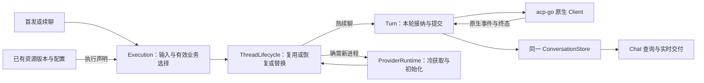

# 聊天主链与资源生命周期重构收口方案

> 状态：主链与 API 清理及复查发现的默认选择接纳遗漏已补齐；定向自动化与独立审查通过，尚未完成真实整体验收。未提交或发布，真实 CLI、模型和桌面验收待执行。已删除源码按审查基线的路径标注，可用本地 git show 查看；实际完成证据见[实施清单](../plans/2026-11-06-chat-runtime-closure.md)。
>
> 基线：主仓库 `3a10bc53a8f2fa06b3fb5213e163d3acdb70c002`。主链与 API 均直接核对本地源码。本次依据静态源码审查，未运行真实 CLI、账号、模型或界面验收。

## 1. 目标、范围与约束

本次完成[原重建方案](2026-11-04-agentruntime-rebuild-design.md)尚未收口的部分：删除旧运行合同、旧续接索引、不可达交付分支和过宽失效规则，让首发、热续聊、冷恢复及资源变更沿一条能直接阅读的主链完成。旧实现仅作为行为样本，不通过改名、嵌入、转发接口或新的准备对象继续保留。

范围覆盖普通聊天，以及团队、工作流、自动任务、IM 对同一执行入口的直接消费；包括 Skill、MCP、插件、伙伴指令、项目目录、模型选择和账号变化。相关公开 API 的废弃入口、无用历史字段和内部存储透传同阶段清理，不能以“涉及协议”为由推迟到后续阶段。既有十一类 CLI 均需核对：Codex、Claude、Cursor、Kimi、Gemini、Grok、OpenCode、Pi、WorkBuddy、Qoder、Qoder CN。自定义 ACP 继续使用公共协议合同。

以下约束沿用已有决定：

- `acp-go` 拥有原生协议与厂商差异；主仓库拥有产品选择、账号配置、资源版本及公开聊天，不重写第二套协议执行器。
- 复用现有 Execution、ThreadLifecycle、Turn、ProviderRuntime、ConversationStore 和资源管理模块；不新增通用 Plan、FrozenContext、ResourceManager、RefreshCoordinator 或兼容适配层。
- 消息、原生绑定、输入接纳和原生结果继续使用同一 ConversationStore；SQLite 保留实际需要的可重建查询投影。
- 不实现旧应用数据迁移、旧布局认领、新旧执行器双跑、双写或旧接口回退。新数据的重启恢复、原生 resume、fork 和索引重建继续保留。
- 用户已授权按本方案实施代码和 API 清理；保留无关修改，不清理用户数据，不提交或发布。外部项目和原生 CLI 的用户全局目录不属于应用数据清理范围。

本方案提出的具体选择是：资源普通修改在下一轮接纳生效；已发布资源版本作为热续聊的事实依据；同主体认证变化与原生历史兼容分开判断。没有成功实现的普通执行重试公开入口整体删除；当前 native-only 插件组合继续在实际资源入口明确拒绝，不借清理扩大功能范围。

## 2. 运行时职责与当前偏差

| 对照点     | 审查基线偏差                                                             | 本次落点                                                       |
| ---------- | ------------------------------------------------------------------------ | -------------------------------------------------------------- |
| 聊天调度   | 新底座前仍通过旧 SessionPlan、TurnInput 再转一遍请求                     | Execution 直接构造现有 ThreadRequest、TurnRequest 与 TurnPorts |
| 同次准备   | 同一选择多次转换、复制；预检与实际发送分别解释默认值                     | 一次接纳只解析一份有效选择，内部消费同一结果                   |
| 技能安装   | 热续聊前仍重新物化系统 Skill、校验插件整包、计算技能整树摘要             | 发布与冷获取完成内容工作，热续聊只读取已发布声明               |
| MCP 变化   | 每轮调用管理列表，先解密所有可见 MCP，再筛启用项                         | 先查询执行声明，冷获取只解密实际交付项                         |
| 进程与会话 | 一个大 hash 同时决定进程与 session，普通资源变化也 NewSession            | Thread 分别判断进程复用、原生历史恢复与会话替换                |
| 会话指纹   | 整个 DetectionResult 进入插件键，零插件也包含模型目录、Auth、Diagnostics | 只比较实际启动、授权与交付事实                                 |
| 账号       | 改名、默认选择也取得进程独占；Revision、认证代次和 home 一起影响历史恢复 | 区分元数据、默认选择、进程配置、认证和主体变化                 |

本方案围绕 starting、提交确认、配置指纹、历史接力和并发检查定义状态边界；受管版本、共享物理技能目标、精确能力授权和 JSONL 提交保持本项目所有权。

实施核对当前合同、注册入口、消费者及锁定依赖，不从字段同名推导行为保证。REST、OpenAPI 与 CLI 以本项目实际用例为边界。

## 3. 必须废弃的旧设计

删除以生产消费者为依据；旧测试不能成为维持废弃结构的理由。仍有业务用途的字段先接到当前唯一所有者，同一个实施工作包删除旧入口及其专属实现，禁止留下长期转发层。

| 编号 | 废弃项与代码定位                                                                                                                     | 必须完成的替代或删除                                                                                                     | 完成判据                                                                     |
| ---- | ------------------------------------------------------------------------------------------------------------------------------------ | ------------------------------------------------------------------------------------------------------------------------ | ---------------------------------------------------------------------------- |
| D01  | `SessionPlan/SessionTarget/TurnInput`（基线 `server/internal/agent/execution_plan.go`）                                              | Execution 直接准备现有 ThreadRequest、TurnRequest、ResourceSelection 和 TurnPorts；指令组合使用实际输入，不再接受旧 Plan | 生产与测试不再构造这三个旧合同；没有同义重命名类型                           |
| D02  | 上述合同中无消费者的 ResourceKey、ReadOnlyHandoff、旧 native 插件字段、History、UserInputState、ApprovalHandler 等                   | 删除死字段；真实历史由 Thread/Store 提供，审批与问答由 TurnPorts 提供；其余仍有消费者的基础类型留在 owning 文件          | 不存在只为旧合同服务的字段、空赋值或转发方法                                 |
| D03  | [Journal](../../../server/services/chat/journal.go) 的 CommitStartedTurn、MarkExecutionStarted、ReadExecutionConfiguration           | 删除生产不可达入口和专属实现；保留新 BeforeSubmit 原子接纳及可靠来源的 CommitAcceptedTurn                                | 所有首发/续发只接当前原子接纳口，不存在另一种启动提交时机                    |
| D04  | RuntimeSession 旧表、RuntimeSessions map 和恢复维护链                                                                                | fork 需要的 SessionID、LastExecutionID 从新 Binding 或继承边界事实读取；删除每轮旧表查询、重放、恢复、写入及装配         | 普通续聊、fork、重启与删除不读写旧续接表；不建立旧数据 importer              |
| D05  | [插件准备](../../../server/services/execution/plugins.go)中的 retry/pluginSnapshots 历史执行重试分支，以及始终失败的普通执行重试 API | 删除筛选、比对、WorkIntent.RetryExecutionID、公开路由、retryable 旧事实和专用前端链；见 API-01                           | 无不可成功的公开入口或兼容拒绝空壳；实际交付快照、提交重发和工作流重试仍保留 |
| D06  | 插件 nativeDeliverySupported 永为 false 后仍保留的 native 成功构造、preparedPlugins.native、nativePluginScope                        | 删除无人消费的执行侧原生包成功路径和专属参数；保留实际 Skill/MCP 投射，以及 native-only 当前明确拒绝策略                 | 不存在“构造成功但实际无人交付”的包；管理端仍用的解析不误删                   |
| D07  | [系统 Skill](../../../server/internal/skills/builtin/system.go)每轮读取二进制、staging 物化和整树校验                                | 移至 Core 启动或程序资产版本变化，回合引用既有目录与摘要                                                                 | 同一进程、同一程序资产的普通热续聊不重建系统技能                             |
| D08  | selectNativePluginSkills 复用完整 preparePluginResources 的预选流程                                                                  | 读取版本中已有的技能目标与摘要；实际解密、内容复核和物化只在冷获取执行                                                   | 热路径不再遍历全部插件内容或构造后丢弃 MCP/环境                              |
| D09  | [MCP ListEnabled](../../../server/repositories/controllers/mcp_connector_controller.go)复用管理列表并提前解密                        | 使用单表执行声明查询与既有启用关系；冷获取解密启用项并核对声明                                                           | 禁用 MCP 的秘密读取或解密故障不阻止普通聊天                                  |
| D10  | 整个 DetectionResult、账号 Revision 和连接配置合成的统一 session 失效规则                                                            | 按第 5 节分别比较有效进程配置与原生会话兼容                                                                              | 模型目录、诊断、账号改名不改变原生 SessionID                                 |
| D11  | [Runtime 设置保存](../../../server/apis/runtime_options/update_runtime_environment.go)一律 Exclusive，以及账号元数据更新一律回收进程 | 普通保存只更新配置；认证或实际共享启动材料变更才进入对应资源边界                                                         | 改默认模型、强度、Fast、名称不会因活动账号 Busy 或清空闲置消费者             |
| D12  | 无消费者的 SessionConfigurationKey、Codex-only 失效兼容包装、旧输入等待通知通道及过时说明                                            | 在所有调用已迁到当前账号失效与 TurnPorts 后删除；注释描述当前复制/发布机制                                               | 不留兼容别名，不以旧测试维持失效机制                                         |
| D13  | 同一已隔离请求再次复制、两层连续 SameSkills 比较                                                                                     | 保留真实调用方/异步所有权边界的复制；资源一致性在实际消费边界检查一次                                                    | 不新增 IsFrozen 标记，不把不同时间的资源复核当重复删除                       |

以下不是旧设计删除对象：Execution 准备占位与原生 Turn 占位的起止点不同；conversationJournal 当前嵌入同一 Store，并未另存一套日志。可以减少其无用合同，不能为减少层数丢掉工作区准备互斥或建立第二份消息权威。

## 4. 最终职责与数据归属

| 所有者                    | 唯一职责                                                                        | 不再承担的工作                                      |
| ------------------------- | ------------------------------------------------------------------------------- | --------------------------------------------------- |
| API / 前端发送            | 确定本次用户输入、选择、引用及提交身份；呈现接纳与执行结果                      | 判定原生 session 是否过期；安装资源                 |
| Execution                 | 解析有效业务选择、准备目录/附件、签发本轮能力、提交业务事实并形成业务终态       | 重复资源安装、遍历整包、持有另一套原生 session 索引 |
| Skill / Plugin / MCP 管理 | 发布版本、保存配置、维护启用和授权关系；提供执行声明及冷获取材料                | 编排模型回合；为每个聊天复制业务配置源              |
| 账号服务                  | 账号主体、凭据、有效配置、认证代次、登录状态与租约                              | 通过普通设置保存清空消费者；自己决定历史接力        |
| ThreadLifecycle           | 公开 Chat 与原生绑定；复用、恢复、替换和历史接力；按真实能力解释变化            | 处理伙伴/团队/工作流业务规则；把观测目录整体当身份  |
| Turn                      | 一次输入的原生准备、耐久接纳、提交、控制、观察与结算                            | 维护另一份业务任务调度或账号配置                    |
| ProviderRuntime           | 真实原生进程；冷账号及资源获取、初始化、关闭和租约释放                          | 业务默认选择；公开聊天历史策略                      |
| ConversationStore / Chat  | Store 保存消息、绑定、输入和原生终态；Chat 提供必要查询投影、实时交付和成果关联 | 用旧 RuntimeSession 表反向决定原生恢复              |
| acp-go                    | 原生 new/load/resume/fork、setter、事件、取消和能力限制                         | 了解 Waker、Team、Workflow 或应用数据库             |

系统 Skill 的目录与摘要由现有系统资产初始化持有。SkillVersion / PluginVersion 与配置记录继续是资源声明的权威；不新增第二份持久“冻结清单数据库”。运行中的 ResourceLease 表达实际消费，不替代资源配置。

## 5. 选择解析与两种兼容判断

### 5.1 一次接纳只解析一次默认选择

收敛现有 ResolveConfiguration 与 Start 中分散的默认分支，复用同一解析规则；扩展实际需要的现有配置输入，不再创造 Plan/SelectionRequest 等中间 DTO。

| 输入场景                        | 账号、模型和选项的含义                                                                                |
| ------------------------------- | ----------------------------------------------------------------------------------------------------- |
| 首发未指定                      | 采用该 Runtime 当前默认值；显式 system 表示原生登录                                                   |
| 普通续聊未指定                  | 在 Runtime 未切换时沿用该 Chat 最近有效选择；尚无选择才采用当前默认；已失效账号明确报错，不静默换账号 |
| 用户显式选择                    | 本轮以显式值为准；原生 setter 回执确认实际采用值                                                      |
| 团队成员配置创建或修改          | 未指定项在该配置保存边界按当前 Runtime 默认解析，保存明确选择；派发使用已解析配置                     |
| 自动任务、工作流、IM 已接纳工作 | 使用其接纳记录中的有效配置；合法空值表示原生默认，不在派发时重新继承当前默认                          |

自动任务的新运行和工作流创作的新输入在接纳时保存当时有效的 Fast 选择；同次工作重试沿用该值，不读取后来修改的默认设置。自动任务配置保存不提前固定未来每次运行的默认值。

预检与真实执行调用同一个解析规则，但预检不持有未来的凭据租约。执行必须在自己的接纳边界取得当前允许使用的身份和资源。Fast、强度、上下文档位使用现有原生设置路径，区分请求值与原生有效值；禁止再从不同默认源分别补齐。

### 5.2 进程兼容与原生会话兼容

两种判断放在现有 ThreadLifecycle / ProviderRuntime 职责内，用已有连接与 Binding 保存必需事实，不引入兼容管理服务。

| 判断                     | 参与事实                                                                                               | 不参与事实                                                                 | 不兼容时的动作                                             |
| ------------------------ | ------------------------------------------------------------------------------------------------------ | -------------------------------------------------------------------------- | ---------------------------------------------------------- |
| 能否复用现有进程         | 程序和必要版本差异、启动参数、进程级权限、真实 cwd/资源目标、实际启动环境、资源交付配置、账号认证代次  | 账号展示名、目录排序、诊断文本、未采用的默认模型和未交付资源               | 确认关闭旧进程后重新取得资源；随后独立判断能否恢复 session |
| 能否恢复已有原生 session | Provider、账号稳定主体、原生历史存储身份、授权范围，以及该 CLI 创建会话时固化且不能重载的指令/工具配置 | 纯进程重启、已证明同主体的凭据刷新、可热 setter 的模型选项、模型目录与诊断 | 确实无法恢复时 NewSession，并沿现有历史接力规则提交一次    |

Binding.Configuration 只表达原生会话兼容所需事实。进程实际配置由当前连接持有；不再把整份 ProviderConnectionRequest 和 ResourceGeneration 无差别序列化成持久 session 身份。集合按稳定资源 ID 排序，摘要来自同一次准备读取，不能用探测结果、管理 DTO 或整个数据库修订号替代实际字段。

账号 Revision 保留数据库乐观锁用途；AuthGeneration 保留旧凭据与迟到进程失效用途。二者都不直接等同于用户主体。凭据变更仍先关闭消费旧凭据的进程，禁止旧代次重新启动。

同主体重新登录若支持独立认证目录与原生历史目录，则只轮换认证材料；若 CLI 只能使用单一 home，则必须在旧消费者退出后验证稳定账号 home 的安全更新和 resume。无法证明原历史在新材料下可恢复的 CLI，明确替换 session，不能伪造旧句柄可用，也不能为了避免替换而复制未经确认的原生历史目录。切账号、换主体和实际历史存储根变化继续隔离。

各 CLI 的重载能力需分别核验，不能从 Claude 泛化到其他 CLI。每个 CLI 的资源重载、模型 setter、权限作用域、认证与历史根关系由 owning adapter 的实际版本验证；使用现有能力声明，不增加第二份静态支持表。

## 6. 精简后的聊天主链



### 6.1 首次发送

1. 前端沿本次提交身份展示准备状态。API 校验输入形状、领取上传引用；不提前制造服务端已接纳消息。
2. Execution 完成幂等核对和准备占位，读取 Waker、有效选择、真实授权目录及资源声明。准备本轮附件、引用、任务目录和精确能力；直接组装现有原生请求。
3. Thread 无可恢复 Binding 时，由 ProviderRuntime 取得账号和资源租约；校验实际版本/配置，发布工作区技能，交付 MCP，初始化原生 Client 并建立 session。
4. 原生输入提交前，在同一批提交 Chat/Execution 业务事实、Binding 和准确输入身份；成功后启用本轮能力并提交输入。可靠来源可以先提交 pending 工作，不能因此绕开原生提交门禁。
5. 原生流、用量与终态进入同一 Store；Chat 推送实时变化并形成查询投影。文件成果有独立收尾状态，模型终态不等待差异计算。

本轮资源记录来自实际交付给该连接的版本与组件，不能直接把当前管理列表当成本轮已用资源。显式选中 Skill/MCP 的引用与提示不自动缩小已授权的启用集合；受限入口的真实 allowlist 继续通过原授权边界执行。

### 6.2 热续聊

热续聊读取当前业务选择及廉价资源声明，比较实际变化，复用原连接与原 session；应用本轮原生设置，提交新增输入。需要的每轮工作包括新附件、精确引用、本轮能力与业务待处理状态，不包括重新安装资源。

必须从普通热路径移除：系统 Skill staging、整包插件 VerifyContent、所有技能目录整树 hash、管理型 MCP 全列表解密、为探测目录另开的原生会话、旧 RuntimeSession 查询，以及读取历史后重新播种。账号身份识别按第 8 节由账号服务统一提供；提交边界仅保留该 driver 确有必要且未被租约覆盖的身份复核，不以文件出现变化就执行模型 Prompt。

### 6.3 冷恢复与真正替换

| 情况                                                     | 行为                                                                           |
| -------------------------------------------------------- | ------------------------------------------------------------------------------ |
| 进程不存在，但 Binding 和原生历史兼容                    | 冷获取资源，恢复原 SessionID，只提交本次输入                                   |
| 进程配置变化，原生历史仍兼容                             | 关闭旧进程、使用新配置恢复原 session；不执行历史 handoff                       |
| CLI 明确报告 session 不存在或不能恢复                    | 在可证明没有未确认旧提交的条件下替换，播种现有最近五个完整轮次或用户选择的总结 |
| 用户明确新建原生会话、切 Provider/账号、不可重载配置变化 | 使用既有替换和历史接力；公开 Chat 身份和已保存消息保留                         |
| 旧提交是否执行尚不确定                                   | 核对既有原生结果和持久输入关系；不因重新发送而再次执行旧输入                   |
| 关闭旧进程失败                                           | 原所有者继续持有租约供清理重试，禁止新准备绕过它                               |

恢复和替换只有 Thread 一个决策入口。热续聊、冷恢复和 fork 不自行重跑旧业务接纳；切换后的历史接力仍保留一次消费与耐久确认。

## 7. Skill、MCP、插件与指令的准备边界

| 阶段                             | 应完成的工作                                                                        | 执行侧使用的已有事实                                        |
| -------------------------------- | ----------------------------------------------------------------------------------- | ----------------------------------------------------------- |
| Core 初始化或程序资产版本变化    | 准备并校验系统 ally 技能、CLI 及摘要                                                | 系统技能实际目录和摘要                                      |
| Skill 导入、编辑、恢复或拉取更新 | staging 校验、创建不可变版本、条件推进当前版本                                      | SkillVersion ID、ContentDigest、真实内容目录                |
| 插件安装、版本准备与配置保存     | 校验包和目标声明，保存固定版本、配置修订及授权关系                                  | PluginVersion ID/Digest、目标组件声明、配置 Revision        |
| MCP 创建、编辑和启停             | 保存实际执行配置和秘密；维护启用关系                                                | 启用资源 ID、协议、runtimeKey、命令/URL、配置身份或密文摘要 |
| 新进程冷获取                     | 重核声明仍有效，取得内容/身份租约；解密实际交付项；校验源内容并复制、发布技能与 MCP | 实际 ResourceLease，不回写另一份业务配置                    |
| 热续聊                           | 读取已发布版本、有效启用集合及必要配置身份；验证显式引用可交付                      | 与该连接实际资源比较，不遍历包正文                          |

在现有 SkillSelection / ResourceSelection 中消费数据库已有摘要和已发布目标事实；不先建立“预选准备对象”，再调用完整准备函数验证同一对象。实际冷获取对版本、配置和租约的确认必须保留，避免声明读取与取得资源之间发生变化。

插件的逻辑包与 CLI 目标在版本发布时一并解析。现有 PluginVersion.Package 中的目标展示摘要若缺少执行所需的 Skill 路径/摘要或 MCP 模板，在同一不可变版本元数据中补齐这些实际字段；执行查询只投影必要字段，不再调用 SelectTarget 从磁盘 Load 目标包。目标摘要不替代真实冷获取校验，也不另建派生版本表或内容缓存管理器。

采用以下明确的内容契约：受管源版本在应用语义上不可变，编辑创建新版本；已发布消费者继续自己的副本。外部进程篡改源目录，在显式资源刷新或新的冷获取时检测，热续聊不保证每轮发现未通过应用发布的源文件改动。冷复制后的 staging 摘要、目标 manifest 和用户自有目录保护继续验证。此选择调整外部源篡改的检测时点，不宣称文件系统本身不可写。

稳定伙伴身份与指令进入原生指令入口；任务目录、附件、团队当前模式和工作流本轮上下文随本次输入发送，不进入稳定资源身份。伙伴档案、项目根指令确有变化时，按对应 CLI 的指令重载能力判断；不重新生成工作区 AGENTS.md/CLAUDE.md。原生已读取的用户指令不重复注入。

## 8. 管理变更与后续续聊行为

普通资源变更采用下一轮读取已发布声明的方式。原生进程没有新回合时无需后台唤醒模型；闲置连接可以延迟到下一次准备关闭。资源查询事件继续更新界面，不再新建通用刷新队列、持久刷新表或定时扫描器。

本项目已有 Execution 入口直接读取持久版本，优先使用该事实完成惰性刷新。共享身份变更需要立即取得独占时，继续由原管理边界关闭闲置消费者，而不是另造调度器。

| 变更                                                 | 正在执行                                                                          | 闲置连接与下一轮                                                                                         | 原生 session                                                 |
| ---------------------------------------------------- | --------------------------------------------------------------------------------- | -------------------------------------------------------------------------------------------------------- | ------------------------------------------------------------ |
| Skill 新版本、启停、安装关系                         | 已接纳工作使用原发布内容                                                          | 下一轮读取新集合，按需更新实际目标和进程                                                                 | 能重载则恢复；创建时固化且不能重载则替换                     |
| MCP 命令、URL、env/header、启停、删除                | 普通修改不改写当前原生进程；新一轮不再获得被删除项                                | 下一轮只装配有效启用项，旧 MCP 进程随原连接关闭                                                          | 按该 CLI 工具配置重载能力处理                                |
| 插件普通配置或启停                                   | 旧执行保留原版本与配置租约                                                        | 下一轮取得新声明和必要资源                                                                               | 使用相同重载判断，不用整个管理对象决定                       |
| 纯 Skill/MCP 插件版本切换                            | 旧执行保留不可变旧内容，新版本可发布                                              | 新工作使用新版本；物理目标仍被活动旧消费者占用时，新准备等待或按现有冲突错误拒绝                         | 不为发布版本而取消旧执行                                     |
| 插件共享认证驱动变化、登录、退出                     | 保留现有 active/preparing 独占检查，返回明确 Busy；用户沿既有取消入口停止后再操作 | 先关闭相关闲置消费者，成功释放租约后修改身份                                                             | 主体和可恢复历史范围不变时不无条件 NewSession                |
| 插件卸载但其他安装仍引用                             | 旧执行持租约继续，目标安装不接纳新使用                                            | 下一轮移除该插件，保留共享身份与其他安装                                                                 | 按资源变化处理                                               |
| 插件最后引用删除                                     | 活动消费者阻止回收                                                                | 关闭相关闲置消费者，再清共享身份与无引用内容                                                             | 不留仍运行但资源已删的进程                                   |
| 伙伴名称、角色、档案或项目指令                       | 当前轮保持其实际接纳内容                                                          | 下一轮采用当前指令；历史消息展示保留原快照                                                               | 指令确实固化时才替换，不能只因为数据库更新就替换             |
| Runtime 默认账号、模型、强度、Fast、权限，账号展示名 | 保存可成功，不取得账号进程独占；当前轮不变                                        | 新接纳按第 5.1 节使用；既有聊天选择不被设置页暗改                                                        | 展示与默认选择本身不替换 session                             |
| 本轮模型、强度、Fast、上下文选择                     | 作为本轮明确输入；运行中 steer 保持原轮身份与权限                                 | 由真实 setter 或相应进程设置生效                                                                         | 支持热设置则保留；进程设置变化不自动等于历史不兼容           |
| API key、端点变化或受管重新登录                      | 保留认证材料修改的独占与 Busy 规则                                                | 停止旧凭据消费者，更新代次并失效相关目录；新进程取得新材料                                               | 同主体且历史可恢复时 resume；无法证明主体/历史一致则隔离替换 |
| 显式切账号、切 Provider 或换登录主体                 | 不改写当前输入归属                                                                | 下一轮用新身份取得新资源                                                                                 | 不跨身份恢复旧原生 session；沿已有历史接力                   |
| 系统账号在外部 CLI 登录、退出或换主体                | 账号模块观察实际可观察变化和原生认证结果，不假设当前进程自动换身份                | 统一失效账号目录及后续连接；外部变化的发现时点按 driver 记录，不能只让发送侧重新识别而目录长期命中旧缓存 | 新输入与 steer 在必要身份边界复核；旧主体结果仍归原执行      |
| 仅模型目录、诊断、登录展示状态刷新                   | 更新查询事实，当前轮不变                                                          | 下一轮选择只校验实际可用配置                                                                             | 不改变资源身份或原 SessionID                                 |

普通配置保存与立即撤销不是同一操作。现有 logout、共享身份回收继续要求无活动消费者；不在本次新增“强制撤销后自动重放”。未来若需要立即撤销，必须通过真实取消、关闭和授权失效流程实现，不能把配置表更新当成已经终止原生工具。

系统账号的最小实现沿用账号模块已有身份识别能力：没有可靠外部变化通知的 driver，在新输入或 steer 的身份边界执行一次有界主体识别；正常解析与目录查询消费同一识别结果。模型目录查询必须先确认当前系统主体，再命中该主体的缓存，不能直接返回前一主体的持久目录。冷获取跨过实际启动边界时保留必要复核；不默认增加文件监控服务、全局登录轮询或另一套账号状态缓存。驱动只能通过独立命令识别登录时，该查询属于必要身份检查，不得假装没有原生 I/O；应消除同一边界重复探测，而不是删除当前可证明的身份隔离。

共享技能物理目标仍按真实 cwd 与发现目录协调：同内容可共享，异内容不能覆盖活动消费者。沿现有 Thread/Provider 所有权处理，不因移出热路径再加一个全局执行锁。

## 9. 工作范围、业务入口与历史

### 9.1 工作目录与附件

聊天保存的规范授权根是上限，每轮采用其中真实可用且身份未被替换的子集。附加项目离线不阻止纯文本追问或使用其他可用项目；明确引用离线文件时返回具体不可用错误。原生 roots、项目入口和指令读取共用本轮有效集合，不能只删除入口校验后仍在后续全量失败。

受管 cwd 必须存在且归属正确。符号链接重新指向其他目录不构成重新授权；不得静默扩展到新路径、父仓库或后来加入的项目。用户项目保持原地，Chat 日志/附件原件与伙伴工作目录分别归属。

### 9.2 团队、工作流、自动任务、IM 与独立调用

- 团队成员与负责人身份、成员 Chat 映射、授权范围保留；后续分派读取这些成员当前档案，缺失时仅回退历史展示资料，不扩大成员资格。成员执行配置修改只影响后续接纳。
- 工作流版本、实际参数、已求值效果和节点有效配置继续持久保存；自动任务机会与工作流运行各自拥有其真实生命周期，不强行合成同一执行记录。
- IM 对话只保存目标、目录及有效执行选择；停止把整个 IMBinding 当配置快照。每次入口重新核对当前授权，投递的目的地、正文、文件和未知结果继续固定于原投递。
- 团队、工作流、自动任务、IM 使用同一有效选择解析与 Execution；可靠来源保留 pending 接纳。GenerateText、Wiki 维护等独立调用继续复用 Thread/Turn/Provider，不绕开资源和原生终态链。
- 恒定 QuestionVersion 等无实际作用的 API 字段按第 10 节纳入本阶段；工作流候选正文重复持久化等独立存储优化不借 API 清理扩大为另一轮编排重写。

### 9.3 消息、绑定、fork 与成果

BeforeSubmit 继续在一批耐久事实中提交业务接纳、Binding 与准确输入身份；原生提交不确定、业务提交成功、原生完成、界面交付失败分别处理。应用未知结果沿原提交身份核对，不能换 ID 再执行。

删除 RuntimeSession 旧投影前，fork 的有效原生句柄、继承边界和最近执行游标必须全部改读新 Binding/继承事实。fork 不再生成旧 session 索引，不复制无关执行；来源 Chat 删除后，子 Chat 自有附件与历史成果仍可读取。公开聊天的最近模型/账号摘要继续作为界面和默认选择事实，不能误删为旧原生会话状态。

原生消息和用量仍使用现有唯一记录与去重身份。文件结束侧在允许下一轮写盘前保存，差异计算及成果发布可以随后完成；该技术屏障不能替换成第二个全局生命周期。conversationJournal 与查询投影沿同一个 Store 收敛，禁止为减少转换改成双写或把原生日志当第二份公开消息。

## 10. API 与历史字段同步收口

### 10.1 契约审查与删除原则

API 合同按“生产者 → 路由/响应 → 前端、CLI、集成调用 → 实际行为”逐项核对。生成 SDK 的引用、测试 fixture 填值、历史字段转抄本身不算业务消费者。把字段命名为历史、optional 或 compatibility 也不能作为删除依据；仍有实际行为的消息历史、原生恢复和并发字段保留。

本阶段允许直接删除废弃路由和字段、收窄请求/响应并同步仓库存储表达，不保留别名路由、deprecated 长期字段、双读双写或旧请求适配。第一方前端、CLI 和集成合同同一工作包切换；外部旧调用方不在本次兼容范围。原本无成功实现的端点删除注册，不再保留一个永远 Unsupported 的实现。

公开投影只用于真实的 HTTP/CLI 数据边界：优先收敛已有响应类型；必须新增公开 DTO 时只列真实业务字段，不嵌入完整存储模型，不新增转换 Service、通用序列化框架或与现有业务平行的状态。内部 Package、FlowContext 等使用 JSON 持久化的结构不能通过全局删除 JSON 字段来缩小 API，否则会丢失执行事实。

合同按真实职责收敛，保留客户端输入身份、实际模型选项、技能安装资料、审批步骤与决策，不按字段数量裁剪仍有消费者的能力。

### 10.2 已确认的入口与字段清单

路径以下省略统一 `/api/v1` 前缀。条目同时规定公开契约与内部数据的不同处理，不能将“移出响应”实施成“删除服务端事实”。

| 编号   | API / 字段与依据                                                                                                                                                                        | 本阶段最终处理                                                                                                                                                | 必须同步的消费者与保留事实                                                                                                                     |
| ------ | --------------------------------------------------------------------------------------------------------------------------------------------------------------------------------------- | ------------------------------------------------------------------------------------------------------------------------------------------------------------- | ---------------------------------------------------------------------------------------------------------------------------------------------- |
| API-01 | `POST /chats/{chatId}/executions/{executionId}/retry`；基线 `server/apis/chats/retry_chat_execution.go`存在，但 Start 对 RetryExecutionID 无条件拒绝；消息 retryable 没有生产 true 写入 | 删除路由、操作类型、RetryExecutionID、插件历史重试分支及仅服务该能力的 retryable 终态事实/回放/响应；删除生成 retryChatExecution 与专用 UI callback/按钮      | 同步普通/团队聊天、错误卡和知识入口防御；保留使用同一提交身份的网络重发、原生恢复、fork、steer，以及真实 workflow.retry                        |
| API-02 | `GET /ai-accounts/{accountId}/models/native`；基线 `server/apis/ai_accounts/native_models.go`裁剪统一目录，前端调用仅在不使用 native catalog 时启用，与当前后端成功支持域不相交         | 删除路由、响应、account-native-models QueryKey 与旧 fallback；统一使用 `GET /runtimes/{runtimeId}/models?accountId=...`                                       | 保留真实账号模型、默认模型和 fresh/stale/error 语义，不删除原生模型发现                                                                        |
| API-03 | `GET /ai-accounts/{accountId}/thinking`；基线 `server/apis/ai_accounts/thinking.go`重复裁剪同一目录，存在与 API-02 相同的消费者断路                                                     | 删除路由、AccountThinkingOption/响应、account-thinking QueryKey 与旧 fallback；使用统一目录的模型级推理选项                                                   | 保留 reasoning 请求值、模型级未知状态处理及原生 setter，不能把未知档位变成支持                                                                 |
| API-04 | 创建、更新、列表账号的 `endpoints[]`；[模型](../../../server/repositories/models/ai_account.go)明确为旧存储兼容数组，而创建/更新均强制 len=1                                            | 统一为单个 `endpoint {protocol, baseUrl}`，同步存储字段、服务与前端；删除空/多端点历史分支和 `[0]` 投影                                                       | 账号预览已经是单 endpoint；同步所有原生账号准备、模型目录、协议适配及设置表单，不增加旧数组 importer                                           |
| API-05 | 各公开 Execution 响应的 `submissionHash`；[内部 Execution](../../../server/repositories/models/execution.go)当前直接 JSON 输出，消费者是服务端同键异内容校验                            | 从 HTTP、公开事件或工具响应中移除该摘要；不修改服务端 JSONL 接纳事实与幂等算法                                                                                | 保留 submissionId、userMessageId、executionId 等实际提交关联；检查工作流实例等直接嵌入 Execution 的出口，不只改首发接口                        |
| API-06 | RuntimeModelOption 的 `configurationKnown/inputModalities/serviceTiers/defaultServiceTier`；统一模型目录外层 `source/version/detectedAt`，仓库实际消费侧没有读取这些响应字段            | 删除无用公开透传及专属响应构造；保留内部原生目录数据，Fast 仍从原生 service tier 转换                                                                         | Runtime 列表自己的 version/detectedAt 有启动页、设置页消费者，保留；模型 ID、推理、权限、Fast、上下文档位、目录状态和 authGeneration 保留      |
| API-07 | PluginDetailResponse 的 `componentIds`；[详情组装](../../../server/apis/plugins/resources.go)每次构造 map，前端无读取                                                                   | 删除详情/全局和伙伴列表共用响应字段与构造循环                                                                                                                 | 保留实际交付 plugins.Snapshot.ComponentIDs，不删除执行和历史回执中的组件身份                                                                   |
| API-08 | Skill 版本列表、详情、创建/恢复/pull 响应的 `contentPath`；[版本模型](../../../server/repositories/models/skill.go)直接暴露仓库存储位置                                                 | 所有公开 SkillVersion 出口不再输出物理 contentPath；文件访问继续使用 skillId/versionId/技能内相对 path                                                        | 内部 ContentPath、版本 ID、ContentDigest、正文历史和资源 digest 保留；不影响真实编辑器和文件接口                                               |
| API-09 | 插件列表/详情/准备结果直接返回完整 PluginVersion.Package，带 `sourcePath/readmePath/nativeComponents`、原生目标位置、执行配置与授权命令等内部描述                                       | 使用统一公开 Package 字段集；复用[目录公开边界](../../../server/internal/plugins/catalog/details.go)，删除无消费者存储/执行透传，禁止只在某个详情入口过滤     | 保留展示元数据、配置表单、版本摘要/信任、授权交互提示、nativeImplementations 的目标与 Skill/MCP 摘要；内部完整 Package 和认证/目标选择描述保留 |
| API-10 | `POST /workflows/{id}/runs/{runId}/humans/{humanId}/answer` 的 `questionVersion`，以及 Human 响应/模型同名字段；每个新 ID 都固定赋 1，无递增入口                                        | 删除请求、响应、模型赋值、前端回传和恒定版本检查，不新增替代版本字段                                                                                          | 保留 HumanID、snapshotDigest、waiting 状态、期限、答案 Schema、request receipt，防止重复作答                                                   |
| API-11 | 工作流 Run 列表/详情及 CLI/模型入口透传 `rootFiberId` 与完整 `flowContext`；前端仅消费其中 triggerSource                                                                                | 公开运行结果直接提供 triggerSource；workspace 如有真实模型消费按既有业务用途单独投影；移除帧 ID、consumerLeaseId、pythonExecutable 等内部实现内容             | 内部 Run.Context、root fiber 与 DSL flowContext.workspace 保留；REST/CLI/工具、子运行/自动任务关联统一公开字段，不能只修改一个 REST 响应       |
| API-12 | 实例详情 `attempts` 直接返回 `[]models.WorkflowEffect`，而当前 effect 已使用业务响应；[实例 API](../../../server/apis/workflows/get_instance.go)混用了两种边界                          | 尝试历史改为明确字段：id、attemptGeneration、status、chatId、failure，以及实际需要的执行关联/时间；不再公开 fiberId、outputRepairs、finalMessageId 等实现字段 | 内部修复次数、结果位置和执行状态继续用于恢复；当前 effect 的 candidateSubmitted、skipRequested 及真实重试能力保留                              |

API-06 的 model 配置字段与真实 Fast/上下文支持不是同一件事；API-09 的原生目标展示与不可达原生交付成功分支也不是同一件事。资源管理的 compatibility、README 下载、Skill 版本文件和插件组件详情均有消费者，继续保留。

### 10.3 消费与生成一次切换

每个条目沿以下顺序在同一分包完成：

1. 在源码合同中删除路由/字段或收窄响应，清除专属校验、默认值、服务入口及无消费者持久字段；内部仍有作用的事实保留。
2. 同步所有生产消费者：共享执行选择 hook、设置账号表单、聊天和团队错误操作、工作流人机问答、实例详情，以及实际 CLI/Skill/自动任务/IM 出口。删除旧 QueryKey、fallback 和把旧 DTO 转成新 DTO 的过渡代码。
3. 运行 `pnpm api:generate`，由已有生成器更新 `server/openapi.json`、`server/integration-openapi.json`、前端 generated SDK/types/query options 及生成脚本实际覆盖的错误目录；不手工维护生成声明。集成 OpenAPI 只改变其实际导出的入口，不能扩大公开面。
4. 定向检查源路由、生成 operation、请求构造和响应读取；旧名字只有在删除清单/讨论中允许出现，生产合同与测试 fixture 不再伪造旧字段。保留内部同名事实的条目按具体序列化边界检查。
5. 更新直接合同测试和原文档；运行 `pnpm api:check`、共享前端类型检查及受影响测试。涉及 workflow SDK 或内置 Skill 来源时再运行对应生成与检查，不为只删 REST 字段重生成无关产物。

测试必须证明能力还在新入口工作。例如旧 thinking 口删除后，模型专属推理设置仍通过统一目录正确展示和提交；重试 API 删除后，网络中断沿原 submissionId 核对仍有效。不能仅以“生成文件里找不到旧字段”代替实际消费验证。

### 10.4 明确保留的字段

首发 clientRequestId 与续发 submissionId 有真实幂等作用，公开日志游标、消息 revision/liveRevision、requestId、pending 交互内容与答案关联也有消费者，本次不因名称带历史就删除。startNewSession、historyTurns、historyMode、summaryModel、summaryReasoning 仍由会话切换对话框、历史接力和工作流创作消费，保留当前真实功能；若另行改变产品交互，再统一改变相应合同，不能在此次清理中悄悄移除。

账号 revision/authGeneration、模型与资源版本摘要、信任和配置修订仍承担并发、认证或交付身份职责。API 的目标是只表达真实业务能力，并把内部算法事实留在正确边界，不是把所有非展示字段一概删掉。

## 11. 校验保留与删除规则

| 边界             | 保留的校验                                                     | 可以移除或合并的部分                                         |
| ---------------- | -------------------------------------------------------------- | ------------------------------------------------------------ |
| 外部请求进入应用 | 输入形状、提交身份、当前授权、明确文件引用                     | 同一可信内部值反复 trim/validate，以及预检与执行各自解析默认 |
| 资源版本发布     | 包/Skill 完整性、配置 Schema、信任与摘要、不可变发布           | 每个热回合重新执行同一发布算法                               |
| 冷取得账号和资源 | 声明与实际版本/配置一致、主体与认证代次、租约、目标所有权      | 同一回调返回前后对两个不变快照重复 SameSkills                |
| 文件复制和发布   | staging 摘要、规范路径、manifest、用户文件保护                 | 无变化时反复创建 staging；旧路径认领与旧布局兼容             |
| 原生提交与回调   | 耐久接纳、实际支持/有效设置、准确 Invocation、旧连接回调隔离   | 用陈旧探测目录替代原生回执；把诊断字段投入会话身份           |
| 关闭和终态       | 真正退出后释放资源、原生结果与本地交付错误区分、未知输入不重放 | 清理失败时创建另一所有者绕过；对无消费者旧入口继续加防御     |

一个检查只有在不同时间、不同权威输入或不同副作用边界上保护真实不变量时才保留。审查记录必须指出它保护什么、失败影响什么、由谁处理；不以“保险”或“未来可能使用”作为理由。

## 12. 实施分包与顺序

本节定义设计收口的工作包；实施步骤见[实施清单](../plans/2026-11-06-chat-runtime-closure.md)，完成状态以实际删除与验证证据为准。实现直接修改现有 owning 模块，同一分包完成接线和旧逻辑删除；不重新创建长期候选包或把旧实现包进新门面。

| 顺序 | 工作包与 owning 文件                                                                                                                  | 交付物及关联删除                                                                                       | 定向验证                                                                                  |
| ---- | ------------------------------------------------------------------------------------------------------------------------------------- | ------------------------------------------------------------------------------------------------------ | ----------------------------------------------------------------------------------------- |
| P1   | 输入与合同：execution/intent.go、work.go、config_validation.go、native_turn.go、agent.go，agent/execution_plan.go，chats API/前端消费 | 单一有效选择解析，直接准备现有请求；D01–D03、D12；API-01/05 同步删除；不改变原生接纳顺序               | 首发/续发、团队空默认、显式 system、已解析空值、审批与问答、提交重发                      |
| P2   | 资源：skills/builtin/system.go、技能版本仓储、MCP controller、execution/plugins.go、session_resources.go、资源公开响应                | 系统资产一次发布、热声明查询、冷实际获取；D05–D09、D13；API-07–09；保留应用当前拒绝的 native-only 组合 | 第二轮无物化、禁用 MCP 故障不影响发送、公开资源详情仍完整、共享目标冲突与关闭失败         |
| P3   | 兼容：agent/thread_lifecycle.go、provider_runtime.go、session_settings.go 与 owning acp-go adapter                                    | 拆开进程/历史兼容；D10；先完成 Codex/Claude 两条完整资源刷新链，再按全部 CLI 验证；不增加并行策略表    | 模型/目录/资源变化时 SessionID、进程身份和 Prompt 次数；恢复/替换只交接一次               |
| P4   | 账号：runtime_options/ai_accounts API、aiaccount、runtimeenvironment/model_catalog.go、原装配与共享选择 hook                          | 普通保存退出 Exclusive；实际认证失效和目录状态一致；D11–D12；API-02–04/06；同主体恢复按可证实能力生效  | 活动账号改默认值/改名、单 endpoint、统一模型/推理目录、同主体重登、旧代次迟到             |
| P5   | 旧续接链与业务接入：chat/journal.go、fork.go、fork_targets.go、recovery.go、live_projection.go，原装配与 workflow API/消费            | D04 全链删除；离线目录有效子集；各入口消费新选择；IM 快照缩小；API-10–12                               | 新数据 fork/重启/删除、可靠 pending、人工回答、尝试历史、CLI/工具与 REST 运行信息一致     |
| P6   | 全链复审与当前文档：Agent README、chat/runtimes/plugin/workspace 架构及直接受影响生成契约                                             | 逐项关闭 D01–D13 与 API-01–12；当前文档只写实际行为；确认没有新包装和孤立旧测试                        | 端到端合成链、必要跨 CLI 实测、源合同/生成契约/消费者一致、docs:check；列出未完成真实验收 |

P2 在旧兼容规则下也必须正确工作；P3 不以 P4 未来的账号行为作为已存在保证。每包提交应同时包含直接消费者和相应删除，不保留临时双路径。受管 home 变化与原生历史恢复必须成组验证，不能先删除身份隔离后等待下包补齐。

API 清理分配到拥有该行为的工作包，不能等 P6 才批量删除已切换代码仍宣称支持的接口。P6 只复核全链生成结果与遗漏项。

## 13. 验收标准与完成定义

### 13.1 必须证明的场景

| 编号 | 场景                                         | 通过条件                                                                                                                                          |
| ---- | -------------------------------------------- | ------------------------------------------------------------------------------------------------------------------------------------------------- |
| A01  | 普通首发、同配置第二轮                       | 一个原生 session；第二轮只新增输入；无历史重播、系统 Skill staging、插件整包遍历或管理型 MCP 解密                                                 |
| A02  | 禁用 MCP 有不可解密秘密                      | 普通聊天可发送；该 MCP 不出现在实际原生配置；显式选择无效项准确拒绝                                                                               |
| A03  | 仅模型目录、名称、诊断或排序变化             | 资源和 session 兼容结果不变；界面可更新目录                                                                                                       |
| A04  | 模型、强度、Fast、上下文设置                 | 实际 setter 或受支持的启动设置生效；保留请求值/有效值区分；无不必要历史接力                                                                       |
| A05  | Claude Skill/MCP 修改，Codex 工具配置修改    | Claude 经验证可重载时关闭进程后恢复原 session；Codex 按原生限制替换；两者公开历史完整且不重复提交                                                 |
| A06  | 运行中更新普通资源、随后续聊                 | 已接纳工作使用原资源；下一轮采用已发布版本；当前物理目标不能被覆盖                                                                                |
| A07  | 声明后、冷获取前配置或版本变化               | 准确重读或拒绝此次准备；不启动混合配置进程，不泄漏租约                                                                                            |
| A08  | 活动账号改名或保存默认值                     | 保存成功，不关闭当前或无关闲置连接；下一次选择按明确语义生效                                                                                      |
| A09  | 同主体重新登录、换主体、旧凭据代次回调       | 支持恢复的同主体保持历史；换主体隔离；旧代次不能恢复旧材料或污染目录                                                                              |
| A10  | 系统账号外部变化与模型目录缓存               | 在 driver 已声明的发现时点统一改变身份/目录状态；未知不显示成已验证的新账号目录                                                                   |
| A11  | 冷恢复、未确认提交、取消与关闭失败           | 不重复旧输入；原生终态、交付与存储错误准确；同一所有者完成清理                                                                                    |
| A12  | fork 首次续聊、再次 fork、宿主重启、来源删除 | 全程不依赖旧 RuntimeSession；原生句柄来自正确边界；附件/成果归属保留                                                                              |
| A13  | 附加项目离线或链接改指向                     | 无关追问可继续；明确文件引用失败可读；不扩大授权或读取新指向目录                                                                                  |
| A14  | 团队、自动任务、工作流、IM 及独立任务        | 同一解析与原生执行链；可靠 pending 与撤权检查保留；无新业务专属执行器                                                                             |
| A15  | 废弃公开入口与历史字段删除                   | API-01–12 的源路由/字段、生成 operation/types、第一方调用同步切换；无恒失败路由、旧 fallback、旧 JSONL 兼容分支或只为类型检查保留的 fixture       |
| A16  | 新公开合同保留原能力                         | 单 endpoint 账号创建/编辑/目录查询正确；统一目录仍支持推理/Fast/上下文；Skill 编辑/插件详情/授权正常；人工回答和工作流真实重试保留                |
| A17  | 内部事实与公开响应分离                       | 公开 Execution 无 submissionHash，公开 Run/Attempts/Package 无被移除实现字段；服务端幂等、DSL workspace、冷资源选择、认证与崩溃恢复仍使用完整事实 |

合成测试使用隔离目录、假原生进程和计数证据，观察实际进程启动、SessionID、输入接纳、文件发布与资源释放。性能验收先证明热路径不再发生被移除的 I/O，不承诺未测量的加速数值。旧的纯私有函数测试改成真实行为断言，删除只服务不可达分支的测试；并发用例验证实际竞态边界。

### 13.2 检查范围

按修改文件选定已有测试及新增场景，不例行运行全仓检查。例如从仓库根运行：

```bash
cd server
go test ./services/execution -run '^TestNativeProduct(CodexCompletesStreamsCancelsAndRestarts|ClaudeAndCursorContinueAndRecover)$' -count=1
go test ./internal/agent -run '^TestThreadTurn(ResumesAfterUnconfirmedNativeSubmission|PreparationAndRunningCancellation|PartialAcquisitionClosesSameOwnerBeforeRetry|ReplacementSeedsFiveCompleteTurns)' -count=1
go test ./services/chat -run '^TestFork' -count=1
go test ./apis/runtime_options -run '^Test' -count=1
```

这些是现有起点，不代表覆盖新规则；每包必须增加上表归属场景，竞态仅对直接涉及共享状态的用例运行。Go 修改先 gofmt；公开契约变化通过现有生成命令更新，前端只运行直接消费者的类型和定向测试。文档运行 `pnpm docs:check`，不运行 `pnpm check`、全量前端或 `go test ./...`。

真实 CLI/模型验证分别记录程序版本、资源变化、进程与 SessionID、首发/续聊结果及仍不支持项；静态和合成通过不能写成真实平台或视觉通过。十一类 CLI 的实际限制记录回原有验收文档，不新建第二份永久能力表。

### 13.3 收口检查

- [x] D01–D13 每项都有删除证据或精确保留职责，不能以“已经包装接通”关闭条目。
- [x] API-01–12 已在各 owning 工作包完成；源合同、OpenAPI、生成客户端、第一方消费和测试一致，无别名接口或内部模型整对象透传补丁。
- [x] 从 API 首发/续发到终态只存在一条生产执行链；旧合同、旧续接表和不可达交付代码消失。
- [x] 热路径只做本轮业务准备、声明比较与必要原生设置，不承担资源安装与完整内容验证。
- [x] 进程刷新、原生恢复、真正替换三种行为有独立可观测证据；观测目录变化不再触发替换。
- [x] 账号默认选择、展示配置、凭据、主体和历史存储各有明确变化语义；普通保存不干预执行进程。
- [x] 新数据的 pending、未确认输入、fork、重启和索引重建完整；不增加旧数据兼容路径。
- [x] 每包完成独立审查；默认选择接纳遗漏已补齐，现行架构、注释和直接消费者与实际切换一致。生成契约和真实验收边界见实施清单。
- [ ] 完成第 14 节真实 CLI、账号、模型和桌面验收；自动化与协议替身不代替实际平台结果。

## 14. 真实原生验收边界

实现按锁定 adapter 已声明的能力分支；业务目标和变更时机已由本方案确定。以下边界仍需结合实际安装版本、账号和模型核实，协议测试替身不代替真实验收：

1. 各 CLI 的 Skill/MCP/指令变化能否在保留原 SessionID 的情况下重载；各 CLI 分别核验原生能力。
2. 受管账号同主体重新登录后，原生历史能否在新的认证材料下访问；单 home CLI 采用安全更新还是明确 session 替换，必须有相应版本证据。
3. 系统账号外部变化的实际可观察来源和检测时点；无法确认主体变化时不得继续复用旧认证事实。

用户已选择本轮只修复 Kimi 登录成功后的凭据代次提交与并发保存。登录失败、取消沿用现有处理，不在启动重新登录时预先推进代次；该原生 CLI 可能在失败前已写入稳定 home，因此本轮不承诺失败后原生认证材料保持不变。

不能验证时保持明确限制和既有隔离，记录具体 CLI/版本及原因；禁止为通过用例伪造能力，或保留旧路径充当未经声明的回退。

实施遇到上述能力缺口或影响真实产品行为的矛盾时，先核对对应原生 driver 和当前生产消费者，给出具体证据、影响与可行取舍，再与用户讨论；其余不依赖该结论的工作可以继续。已确认无用途的旧 API/字段删除属于本阶段范围，不逐项重新请求批准；不能为避免讨论真实行为问题而保留旧逻辑或扩大功能。
