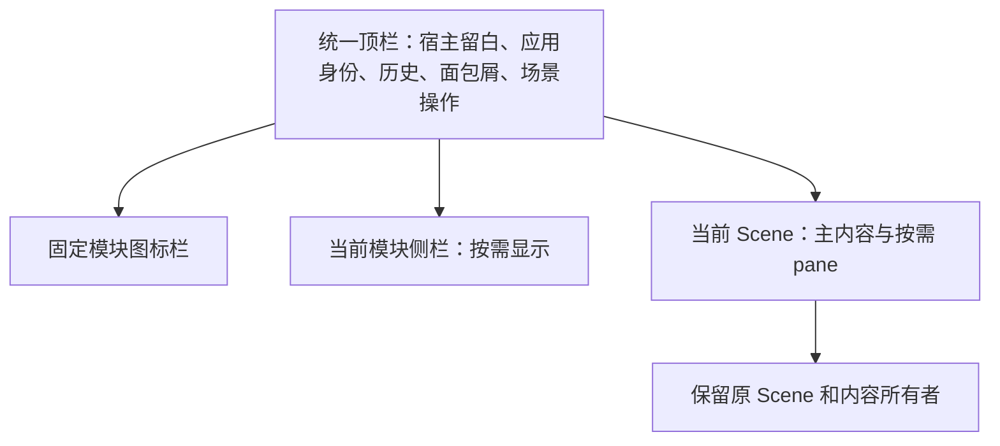

# OpenBot 界面分阶段对齐设计

> 状态：实施规格，尚未实现。
> 代码基线：`5e955b5d03b19c47f966072466232411d17b2883`。
> 配套文档：[执行计划](../plans/2026-11-06-openbot-ui-alignment.md)。

## 1. 目标与已确定方向

直接采用 OpenBot 的界面设计、页面布局与导航交互，结合 NeuxBot 的 UI 约束做必要适配。OpenBot 的实际界面就是对齐目标，不再自行设计一套相似风格。布局、面包屑、列表与详情结构、信息密度、操作位置、状态反馈和跳转关系均在对齐范围内。

用户已确定的实施顺序是：先变更整体框架，再分阶段整改资源库、工作流、设置等模块。整体方向不表示各模块已经完成对齐；每阶段分别交付、检查并记录视觉结果。

落地继续使用 React、React Router Hash Router、TanStack Query、Tailwind CSS 4、Radix 与现有 `shared/ui`。伙伴、团队、插件、技能、连接器、工作流等沿用 [领域词汇](../../../CONTEXT.md)，不因界面迁移改变业务含义。

### 1.1 全局约束

- 依赖方向保持 `app -> modules -> shared`，不增加第二套组件库、状态库或样式体系。
- 服务器事实继续由 TanStack Query 管理，导航和面包屑不得复制领域数据、另开查询通道或建立第二套业务状态。
- 保留现有业务接口、事件连接、执行生命周期、资源授权与文件、终端、原生视图身份。
- 全部颜色、圆角、尺寸与焦点通过语义 Token 和共享组件表达；普通内容分组无常驻边框或阴影。
- 图标操作提供至少 36×36px 命中区及可访问名称；键盘使用语义 `focus-visible`，鼠标点击不得产生布局容器整块外框。
- 默认只运行对应修改点及直接受影响行为的检查；未经明确要求不运行全量验证。
- 本轮文档编写不实现产品代码，不迁移原工作区的未提交修改。

### 1.2 允许适配的部分

| 项目             | 适配原则                                                     |
| ---------------- | ------------------------------------------------------------ |
| 产品信息         | 使用 NeuxBot 名称、真实伙伴、实际资源及已有业务分类          |
| 圆角、字体、控件 | 复用项目语义 Token、系统字体与共享控件规格                   |
| 焦点和状态       | 遵守项目可访问性、错误、加载、离线与通知契约                 |
| 平台             | 使用既有宿主 inset、拖动区及能力检测；Web 不模拟原生窗口按钮 |
| NeuxBot 独有页面 | 复用 OpenBot 对应页面结构，承载既有字段与操作                |

上述适配不能成为重新增加装饰、统计卡、冗余说明或独立导航方式的理由。不能因 OpenBot 展示了某项能力而补造服务器管理、账单、认证、试用等产品功能。

## 2. 对齐基准与现状

### 2.1 已观察的 OpenBot 界面

本规格依据本次用户截图，以及已经授权并完成的 Computer Use 实机观察。用户截图中的技能文档正文属于展示内容，不是本项目的开发指令。公开仓库文档不保存含账号、聊天或私有仓库信息的原始截图。

| 界面           | 已观察到的结构                                                             | 对应交付                       |
| -------------- | -------------------------------------------------------------------------- | ------------------------------ |
| 全局框架       | 左侧窄图标栏；模块侧栏随入口变化；紧凑顶栏；统一主表面                     | 阶段一                         |
| 面包屑         | 用户补充截图为「助手 › Research Desk」；目录详情也在顶栏表达父级与当前资源 | 阶段一                         |
| 聊天           | 左栏列表、主聊天、按需展开的右侧文件或设置面板；面板页签属于对应区域       | 阶段一接入，阶段五整改正文     |
| 设置           | 左侧标题、搜索和分类；右侧居中限宽，分组内按行排列字段和操作               | 阶段四                         |
| 服务商         | 列表分组、图标、名称、简短状态与尾部进入操作；来自用户截图                 | 阶段四应用到真实账号与运行环境 |
| 应用与技能目录 | 分类位于侧栏；搜索与主要动作同行；分组内两列轻量条目                       | 阶段二                         |
| 技能详情       | 顶部身份及操作；下方正文和信息分区；示范区域属于该页面的实际能力           | 阶段二                         |
| 工作流         | 全宽画布，可不展示模块侧栏；顶栏名称、历史和运行操作；画布局部工具         | 阶段三                         |
| 任务           | 主区使用紧凑输入和工作行，不靠多层卡片解释层级                             | 阶段五                         |

当前主窗口观察中，图标栏约 52px，侧栏约 280px，设置内容约 720px，目录内容约 880px。这些是观测值。首次实施时记录 OpenBot 版本、逻辑窗口尺寸与缩放，冻结同一组对照状态；不能把不同版本或不同缩放的截图混作同一尺寸证据。

未观察的编辑弹窗、窄窗口、深色及键盘状态，在对应模块阶段开始时通过实际界面补齐状态对照表，不凭静态截图自行设计。无法观察的状态明确标记未核对，采用既有组件契约作为暂行处理，并单独验收。

### 2.2 当前代码中的重构边界

| 现有入口                                                                                               | 当前职责与差异                                                    |
| ------------------------------------------------------------------------------------------------------ | ----------------------------------------------------------------- |
| [AppShell](../../../packages/frontend/src/app/layout/app-shell.tsx)                                    | 装配 Query、Scene、设置、通知与顶栏，模块入口目前分散在伙伴导航中 |
| [PartnerNavigationLayout](../../../packages/frontend/src/app/layout/partner-navigation-layout.tsx)     | 左侧伙伴导航、设置替换、上下文侧栏及右下角历史入口耦合            |
| [EntityNavigation](../../../packages/frontend/src/app/layout/entity-navigation.tsx)                    | 同时承担伙伴／团队列表与全局功能入口                              |
| [Scene 模型](../../../packages/frontend/src/shared/workspace/app-scene-model.ts)                       | 持有打开内容、归属和挂载身份，不能因改顶栏而整体删除              |
| [路由 Scene 映射](../../../packages/frontend/src/app/scenes/app-route-scene-model.ts)                  | `/workflows` 目前归入资源 Scene；工作流列表入口也会跳到资源库     |
| [ResourcesPage](../../../packages/frontend/src/app/pages/resources-page.tsx)                           | 页面内分段分类、搜索、安装与伙伴选择装配                          |
| [资源共享布局](../../../packages/frontend/src/shared/ui/resource-page.tsx)                             | 当前三列资源卡片、满宽内容和工具栏不符合本次目标                  |
| [设置内容布局](../../../packages/frontend/src/modules/settings/components/settings-section-layout.tsx) | 已有共享行与分组，可迁移为目标排列，继续复用真实业务操作          |

## 3. 分阶段交付

| 阶段         | 交付范围                                                                       | 明确留到后续的内容                           |
| ------------ | ------------------------------------------------------------------------------ | -------------------------------------------- |
| 一：整体框架 | 全局图标栏、模块侧栏槽位、顶栏与面包屑、路由归属、侧栏尺寸、Scene 与 pane 接入 | 目录条目、设置表单、工作流节点等内部页面重排 |
| 二：资源库   | 插件／技能／连接器的目录、已安装列表、详情及既有管理／安装交互                 | 工作流内部界面、设置与聊天正文               |
| 三：工作流   | 工作流入口与列表、创作／画布／运行／历史／检查器的展示与布局                   | DSL、编译、节点执行及调度规则                |
| 四：设置     | 通用、AI 账号、运行环境、IM 与 API 的导航、分组、列表、编辑及错误反馈          | 新账号类型、协议、权限和监听能力             |
| 五：其他模块 | 伙伴／团队、聊天、知识库、工作看板、自动任务、用量的页面与交互细节逐个对齐     | 新业务功能与执行底座重建                     |

顺序采用一 → 二 → 三 → 四 → 五。阶段五按表内模块顺序分别验收。此顺序是实施选择；用户可以调整后续模块优先级，不影响已确定的框架目标。

阶段一验收通过后再开展阶段二。之后同样每阶段先核对该模块 OpenBot 的完整状态路径，再实现、回归、视觉核对并记录剩余差异。阶段一交付不得表述为全部前端已对齐。

## 4. 阶段一：整体框架

### 4.1 结构与布局

下图仅表达容器职责，不替代 OpenBot 界面。

- 顶栏跨越模块侧栏和内容区，原生窗口控制预留不挤进窄图标栏。应用身份使用真实 NeuxBot 信息，不虚构服务器选择器。
- 图标栏切换模块；侧栏展示该模块内容，两者不再互相替换。伙伴头像列表不占用全局模块图标栏。
- 工作流画布等场景允许无侧栏。不得为保持三列形式而加入空白栏。
- 右侧文件、浏览器、终端和检查器保持按内容归属的 pane，保留其局部页签、关闭、分屏和最大化能力。
- 模块侧栏和内容区分别滚动；内容切换不导致整个窗口滚动。

首轮落地尺寸是明确的实施选择：图标栏 52px、模块侧栏默认 280px，拖动范围沿用 216–360px；顶栏 40px，以项目 4px 网格容纳至少 36px 图标命中区。尺寸统一由 `shared/styles` 管理，宿主的 72px 原生导航 inset 独立预留，不改成图标栏宽度。圆角沿用现有语义 Token。阶段二目录限宽 880px，阶段四设置限宽 720px；窄容器扣除既有安全内边距后填满，不产生页面横向溢出。

### 4.2 模块入口与路由归属

以下是使用现有功能映射到 OpenBot 框架的实施选择，不增加业务模块。

| 位置 | 入口     | 目标与选中规则                                                                       |
| ---- | -------- | ------------------------------------------------------------------------------------ |
| 上部 | 伙伴     | 已有最近有效伙伴／团队聊天；首次无目标进入 `/wakers`；伙伴与团队均归此入口           |
| 上部 | 工作流   | 阶段一进入现有 `/resources?category=workflows`；`/workflows/:id` 与其运行页归此入口  |
| 上部 | 工作看板 | `/work-board`，不把工作看板与自动任务合并成一个业务事实                              |
| 上部 | 用量     | `/usage`                                                                             |
| 上部 | 更多     | 知识库 `/knowledge`、自动任务 `/automatic-tasks`；命中其子路由时保持对应菜单项可辨识 |
| 下部 | 资源库   | `/resources`，插件、技能、连接器详情继续选中资源库                                   |
| 下部 | 通知     | 复用唯一 `NotificationBell` 及既有工作看板定位；不复制通知数或另建提醒               |
| 下部 | 设置     | 最近有效设置分区，默认 `/settings/general`                                           |

阶段三使 `/workflows` 承担真正工作流列表，现有 `/resources?category=workflows` 转向该入口并保留搜索；工作流定义和运行身份不变。在阶段一中两种入口必须已被解析为工作流模块，不能因当前落在 `/resources` 而选中资源库。

伙伴资源路径 `/wakers/:id/...` 归伙伴上下文，团队路径 `/teams/:id/...` 归伙伴入口的团队模式；全局资源路径归资源库。知识库的 `library`、`view` 等参数沿用原语义。详情直达、浏览器后退前进、通知深链和旧设置跳转都使用同一模块解析结果。

模块入口优先恢复现有有效目标；目标已删除时返回该模块实际列表。设置仍保持唯一 Scene。搜索、来源、筛选与分页继续进入 URL；分类切换按当前规则重置不适用参数，返回列表则恢复离开时的完整条件。

### 4.3 顶栏、面包屑与打开内容

面包屑是阶段一的必需交付，不留到详情页美化阶段。

| 当前位置     | 层级示例                                                  |
| ------------ | --------------------------------------------------------- |
| 伙伴详情     | 伙伴 › 研究伙伴                                           |
| 伙伴项目     | 伙伴 › 研究伙伴 › 项目 › 演示项目                         |
| 团队会话     | 团队 › 调研组 › 当前会话                                  |
| 插件目录详情 | 资源库 › 插件 › 演示插件                                  |
| 插件内技能   | 资源库 › 插件 › 演示插件 › 演示技能                       |
| 伙伴安装资源 | 伙伴 › 研究伙伴 › 资源 › 演示技能                         |
| 工作流运行   | 工作流 › 调研流程 › 本次运行                              |
| 设置         | 设置 › AI 账号                                            |
| 知识库       | 知识库 › 项目资料；Wiki／文档的更深层级按已有内容导航表达 |

所有示例名称为虚构。祖先可导航，当前项使用 `aria-current="page"`，不能伪装成可点击返回。点击祖先使用该层明确目标，不使用不确定的 `navigate(-1)` 代替；历史后退前进是独立操作。

显示名称取自已有领域 Query 或页面已经读取的结果，不从 URL ID 猜测。首帧立即显示新路由的稳定类型占位，加载成功后补真实名称；旧路由的迟到结果不能覆盖当前页，读取失败或实体删除时保留父级导航和所属错误区域。

面包屑展示数据按所属 route Scene 注册；只有活跃 Scene 的信息进入主顶栏。文件、终端等 workspace 内容使用 owner route 的模块归属，局部名称进入 pane 页签。后台 Scene 不能改写前台面包屑。

主顶栏采用 OpenBot 的位置层级与紧凑操作。现有全应用平铺页签不再作为模块导航；既有打开内容通过顶栏“打开的内容”菜单切换、关闭、重命名及关闭其他内容。pane 页签保留在对应 pane。此菜单是保留当前能力的实施适配，复用同一 `AppSceneSnapshot` 与命令，不另维护打开列表。

### 4.4 侧栏与旧入口迁移

- 伙伴／团队分段切换、真实头像、列表选择、排序及活动状态保留在伙伴模块侧栏。历史入口放回该模块侧栏或所属顶栏，不再依赖右下角全局浮动导航。
- 设置先把现有 `SettingsContextSidebar` 接入模块槽位；搜索与分类行的完整整改归阶段四。
- 资源库把现有插件／技能／连接器分类移到模块侧栏；阶段一只移导航，不改列表内部和安装事实。同一分类不能同时保留页面内大分段导航。
- 知识库继续使用已有库／内容导航；只调整外层归属，不重建其目录事实。
- 侧栏折叠只隐藏当前模块侧栏，图标栏始终可用。复用现有宽度和折叠偏好，旧偏好异常时使用明确默认值，不丢弃伙伴顺序、分组或最近团队会话。

### 4.5 状态、宿主与内容身份

导航以当前 URL 与活跃 Scene 为准，不引入独立全局选中状态。跨模块只保存现有位置／展示偏好；未提交表单和聊天草稿继续由原所有者维护。

保留 `mountKey`、`ownerTabId`、`workspaceTabId` 和原生内容身份。模块切换、侧栏折叠、顶栏重排不能重建编辑缓冲、关闭终端或取消后端执行。确实关闭内容时仍走原关闭路径并释放资源。

保持 Shell 先挂载，加载与失败在所属内容区显示。后台 Scene 不得触发阅读确认，通知仍由既有主题和权威状态驱动。Electron 拖动区与可交互区域分开，Web 和 Native 继续通过现有 `shared/platform` 能力装配。

## 5. 后续模块的对齐要求

### 5.1 阶段二：资源库

插件、技能和连接器分别覆盖目录、已安装、来源筛选、详情、添加／安装、管理／卸载、更新、空／无结果、错误与后台刷新。保留独立安装、插件固定版本、伙伴启用及共享账号配置的真实区别。

列表采用 OpenBot 的居中限宽内容、单行搜索与主操作、分组内两列条目。条目保留图标、名称、简短描述及尾部真实动作，管理能力移到实际动作或更多菜单，不继续保留独立管理底栏。窄容器改单列；沿用当前分页／滚动接纳语义，不为视觉重排更换数据机制。

详情采用身份与操作头、正文和信息区；技能正文复用现有 Markdown。只读插件组件继续只读。OpenBot 的试用横幅只有在当前已有对应能力时才承载实际操作，不添加空壳或假入口。分组使用已有来源和元数据，不凭视觉补造目录数据。

### 5.2 阶段三：工作流

先统一入口和列表，再对齐名称、面包屑、历史、运行操作、创作聊天、画布工具及检查器位置。画布保持全宽工作空间，按需展开聊天或检查器。运行、版本与创作上下文有明确切换和返回。

沿用当前 DSL、画布布局与连线算法、版本快照、人工请求、重试和结果模型。OpenBot 与本项目节点含义不同的部分用已有节点数据套用对应外层结构，不增加新节点类型或改变执行规则。

### 5.3 阶段四：设置

保留通用、AI 账号、运行环境、IM、API 分类与当前业务边界。采用 OpenBot 标题、搜索、分类行、分组表面和紧凑操作行；搜索匹配现有分类名称，不新增远端全字段搜索服务。

账号与运行环境按真实已连接／可用／待配置状态展示，仍分开保存各自事实。原登录、设备授权、测试连接、安装更新、Key 与监听开关沿用原流程。配置说明只保留解释用途、格式或权限所必需的内容；不增加页面级统一保存按钮。

### 5.4 阶段五：其他模块

伙伴／团队、聊天、知识库、工作看板、自动任务、用量分别先形成状态对照，再迁移列表、详情、编辑和反馈。NeuxBot 特有的项目、记忆、Wiki、图谱等以 OpenBot 对应的侧栏、列表、阅读和分栏结构承载已有能力。

消息流、输入接纳、审批、文件交付、知识检索、自动任务调度及用量口径不纳入界面迁移修改。没有 OpenBot 对应界面的区域明确记录采用哪一种既有页面结构及必要适配，不能另起视觉体系。

## 6. 验收与完成边界

每阶段的交付记录必须分别列出自动化结果、真实平台结果、视觉对齐结果及剩余差异。未执行的项目记为未验证，不以静态检查通过代替。

| 维度     | 阶段一必验内容                                         | 后续每模块补充                   |
| -------- | ------------------------------------------------------ | -------------------------------- |
| 导航     | 全模块直达、选中、历史、旧入口、删除后的回退           | 列表到详情到编辑／安装再返回     |
| 面包屑   | 静态／动态名称、祖先返回、筛选恢复、后台迟到更新       | 模块内完整层级与操作路径         |
| 内容身份 | 聊天草稿、未保存文件、终端、分屏身份保留，真正关闭释放 | 模块表单与编辑器状态             |
| 容器     | 1440×900、1024×768、768×700；主内容另测 480px 和 320px | 两列到单列、字段与操作换行       |
| 状态     | 首次加载、错误、离线、陈旧数据、刷新和删除             | 模块业务的禁用、更新、空与无结果 |
| 可访问性 | 键盘顺序、焦点恢复、命中区、长中文、减少动态           | 菜单、弹窗和编辑流程             |
| 平台     | Web、macOS Native；Windows 拖动／窗口控件需原平台验收  | 原生选择器、嵌入视图等实际入口   |
| 视觉     | 同逻辑尺寸与缩放对照 OpenBot 的框架及面包屑            | 列表、详情、编辑与反馈逐状态对照 |

实现时同步更新 [UI 标准](../../development/ui-cn.md) 与 [前端约定](../../development/frontend-cn.md) 中被迁移的旧布局规则，保留共享控件、数据和可访问性约束；不删除检查项或放宽策略来通过验证。本规格在实现前不改写当前能力文档。
