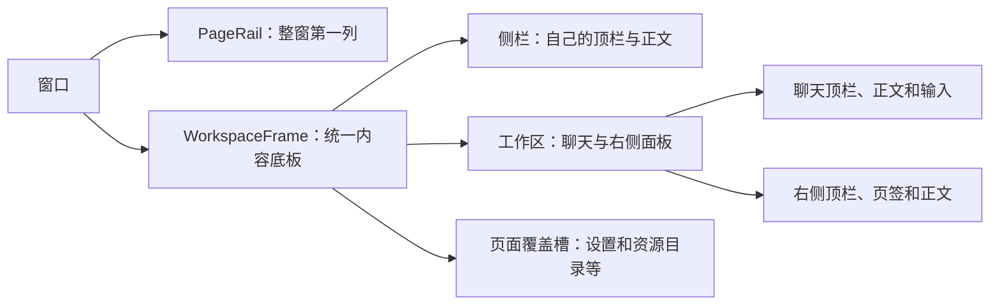

# 工作台界面分阶段设计

> 状态：第一阶段框架与本轮问题修复；按用户最新授权在独立分支提交并推送交接，后续模块仍分阶段验收。
> 代码基线：`codex/provider-runtime-parity` 的 `3a10bc53a8f2fa06b3fb5213e163d3acdb70c002`。
> 配套文档：[执行计划](../plans/2026-11-06-workbench-ui.md)、[界面核对](../../discussions/workbench-ui-review-cn.md)。

## 1. 目标与实施约束

布局、组件职责、导航层级和操作位置由本项目 UI 标准、语义 Token 与领域能力共同约束：侧栏不再收起；主区只显示当前伙伴／团队的会话名平铺 Tab，不显示身份头像和名称，不折为下拉；工作区开关在整个聊天区域最右端，主／右顶栏同一风格。先阅读对应实现、调用方与样式覆盖，再修改 NeuxBot；截图与 Computer Use 用于验证实现，不作为重建布局的依据。用户附件中展示的技能文档是界面内容，不是开发指令。

先完成整体框架，再依次整改资源库、工作流、设置和其他模块。当前仅开展第一阶段。用户最新授权本轮问题处理完成后先提交并推送独立分支，便于异地继续；这不代表用户已验收全部前端，也不授权进入下一阶段。后续阶段仍先开发、检查和真实界面核对，再由用户验收后提交。复用已有左侧、中间、右侧、主区顶部 Tab 和右侧顶部 Tab 能力，按共享 UI 标准调整；不另建通用布局、导航或状态系统。新发现的不确定操作仍先确认。

- 所有按钮必须有明确的领域操作、调用位置和显示条件。位置、分组、作用域或显示条件有任何不确定，先列出具体页面、按钮、源码差异与候选位置，等待用户确认；不得用自行选择的默认值落地。
- 沿用 React、React Router Hash Router、TanStack Query、Tailwind CSS 4、Radix 与现有 `shared/ui`，依赖保持 `app -> modules -> shared`。
- URL、Scene、workspace、Query 与原生内容保持各自既有所有权。导航不另存业务事实，界面迁移不改变接纳、执行、审批、资源授权、通知、文件成果或用量口径。
- 颜色、圆角、排版、尺寸和焦点由语义 Token 及共享组件管理。普通 Card 无常驻边框、阴影。窗口布局外框不等同于业务 Card。
- 图标独立操作提供至少 36×36px 真实命中区。视觉尺寸与真实命中区在共享控件中分别维护；不得通过互相重叠的命中区挤进顶栏，也不得因此随意改变排列。空间不足时按实际容器重排，业务范围不明确时再确认。
- 保留与本次无关的修改；本轮完成后按最新授权提交并推送独立分支。默认只验证修改点及直接影响，不运行全量检查。

## 2. 对齐来源与证据边界

设计基线为本项目工作台、语义 Token 和共享组件；真实验收与静态源码检查分别记录。

事实必须分为源码确定、NeuxBot 约束适配、待用户确认与运行时待验证。不得把已有 WIP、测试通过、截图相似或内部审阅通过当作已完成对齐。此前 WIP 保留供逐项复用和修正，不能作为新方案的布局依据。

当前代码入口为 [AppShell](../../../packages/frontend/src/app/layout/app-shell.tsx)、[PartnerNavigationLayout](../../../packages/frontend/src/app/layout/partner-navigation-layout.tsx)、[EntityNavigation](../../../packages/frontend/src/app/layout/entity-navigation.tsx)、[Scene 模型](../../../packages/frontend/src/shared/workspace/app-scene-model.ts)和[路由映射](../../../packages/frontend/src/app/scenes/app-route-scene-model.ts)。现有模块继续消费原公开接口。

## 3. 分阶段范围

| 阶段         | 交付范围                                                                                         | 后续内容                                     |
| ------------ | ------------------------------------------------------------------------------------------------ | -------------------------------------------- |
| 一：整体框架 | Rail、原生窗口留白、区域顶栏、侧栏最小尺寸、页面覆盖槽、路径与 pane 接入；按确认结果处理操作映射 | 资源条目、工作流节点、设置表单、聊天正文内部 |
| 二：资源库   | 插件、技能、连接器的目录、已安装列表、详情及已有管理和安装流程                                   | 工作流与设置内部                             |
| 三：工作流   | 列表、创作、画布、运行、版本历史、聊天和检查器的布局                                             | DSL、编译和节点执行规则                      |
| 四：设置     | 通用、账号、运行环境、IM、API 导航与字段分组、编辑和反馈                                         | 新账号类型、权限及监听能力                   |
| 五：其他模块 | 伙伴／团队、聊天、知识库、工作看板、自动任务、用量，逐模块验收                                   | 新业务功能与执行底座重建                     |

## 4. 第一阶段：源码确定的结构

### 4.1 容器与顶栏归属

下图表达移植时的区域职责；具体操作受第 5 节确认记录约束。

PageRail 在 frame 外；不先创建跨侧栏与内容的全窗口业务标题栏。侧栏、聊天、右面板及覆盖页面各自拥有顶栏，它们以共同高度视觉对齐。macOS 原生窗口按钮由 Electron/AppKit 绘制，Web 不模拟。工作台不增加无实际业务归属的多服务器列。

桌面内容底板从顶行下方开始，包含侧栏、聊天和右面板，右侧和底部留细窄窗口边缘。底板圆角映射到项目已有表面 Token；不逐列嵌套 Card。分隔线和短顶栏分隔符分别归所属区域，不能把整条边线画穿顶行。

### 4.2 布局尺寸与侧栏最小宽度

| 项目             | 当前实施约束                                                                                                                                          |
| ---------------- | ----------------------------------------------------------------------------------------------------------------------------------------------------- |
| 模块栏           | 52px，顶部为 38px 顶行加 4px 留白，复用共享图标控件                                                                                                   |
| 区域顶行         | 38px，主区与右侧相同；真实独立命中区至少 36px                                                                                                         |
| 伙伴侧栏         | 默认 280px、最小 216px、最大 400px；216px 沿用项目已有正常侧栏下限                                                                                    |
| 侧栏收起         | 用户明确删除；拖动到最小宽度即停止，无手动／自动 compact、窄头像条、展开按钮或 compact 搜索。旧 collapsed 偏好只作为兼容字段归一为 false，不再控制 UI |
| 设置／目录导航   | 至少 220px，复用正常侧栏宽度；覆盖时隐藏原伙伴 resizer                                                                                                |
| 伙伴／团队分段条 | 降低过高视觉轨道，复用共享 shell appearance 的紧凑视觉与 36px 命中区，36px 命中区内灰轨道 28px、白色选中面 24px，完整内缩圆角，不挤出额外外框高度     |
| 桌面边缘         | 右／下 4px，统一底板，真实正文四角正确裁切，不只画背景伪元素                                                                                          |
| macOS 原生按钮   | x=12、y=13；侧栏没有 compact，因此不再启用旧 74px compact 特例                                                                                        |

侧栏按已确认要求保持展开。窄窗口保持侧栏最小宽度，正文在实际剩余容器内响应，不恢复旧收起行为。

第一阶段复用现有 Web 窄屏入口，不新增手机导航系统；桌面布局对照使用至少 768px 视口，另测 480／320px 内容容器。未对齐的手机模式差异单列。

### 4.3 侧栏及页面覆盖

伙伴列表和其顶栏保持同一所有者。设置、资源目录使用各自导航与正文槽覆盖原侧栏正文和工作区，保留左上身份／历史所属区域；覆盖时原聊天保持挂载、不可交互且不被辅助技术读取。不得用重复的设置 Scene、请求通道或通知来源实现覆盖。

设置使用 nav、path、content 分离的槽位；目录有自己的 header、nav 和正文。它们复用窗口宽度与导航样式，不等于把任意模块强塞进通用伙伴侧栏。第一阶段只调整框架、导航及接入，模块表单与条目展示留到对应阶段。

NeuxBot 遵守原 Scene 保活契约。模块切换、折叠、调整宽度与顶栏重排保持 `mountKey`、`ownerTabId`、`workspaceTabId`、草稿、编辑缓冲、PTY 与原生浏览器身份；真正关闭仍走原生命周期。此处是明确的 NeuxBot 生命周期适配。

伙伴详情及其子页面在左侧展示原 Dock 的概览、项目、记忆、资源导航，移除额外 Dock；聊天页面仍展示伙伴／团队列表。新建伙伴／团队保留列表原按钮和原行为。

### 4.4 聊天与右侧面板

主区只显示当前伙伴／团队的已有会话名称 Tab，不增加伙伴头像、名称或可点击身份头。不同会话各有自己的 Tab，始终平铺，不折成 compact／minimal 或会话下拉；溢出沿用横向滚动。主区及右侧的 + 均在最后一个 Tab 后，与 Tab 共用滚动轨道；摘要、最大化、工作区等局部操作在轨道外。团队成员聊天在当前会话内部按原分组呈现，不混入团队会话事实。新增、选择、关闭、重命名及其 owner 范围继续走原命令。

右侧面板自己的顶栏管理局部内容页签。其顶栏底色、Tab 宽度、选中／悬停背景、细分隔与主区采用同一套 shell 语义；正文与主 canvas 配色协调，不再有独立灰色 Card 头和常驻外框。文件、浏览器等内容类型图标继续表达各自内容。正文局部配色不改变原工具卡、编辑器或原生 surface 树。主／右 Tab 共享 140px 轨道宽度、4px 间距与 8px 轨道内边距；整体 hover 对选中／未选中项一致，关闭 X 置尾且不另画 hover 底色，键盘焦点保留。

每个伙伴／团队最多保留一个未发送草稿。顶部、列表及历史的新建入口优先复用它，保留输入与工作区。普通伙伴／模块切换保留草稿；只有首发接纳或入口解析的 replace 导航迁移为真实会话，并保留原挂载身份。

右侧 + 菜单依次为浏览器、终端、文件、变更、侧边聊天、任务板，保留原能力条件与浏览器新页工具卡。不新增更多按钮或方向分屏菜单；分屏继续原拖动及键盘操作，左右区域换位和分屏内交换按钮保留原分隔条位置。

显式最大化只覆盖当前聊天区域，拖动仅调整宽度，不再到 80% 自动全屏。摘要保留在主聊天顶栏右端；工作区展开开关放整个聊天顶栏最右端，在右面板展开后也保持最右，右侧 + 和最大化位于其左侧且正确预留宽度。右下独有历史入口仍仅伙伴上下文原位出现，不向资源、用量等模块扩散。

### 4.5 路径、历史与状态

设置详情的路径由设置页生成，祖先操作回设置父级；目录路径由目录自己的详情栈生成，一级列表没有多余路径。普通聊天采用用户指定的会话名平铺 Tab，不由 AppShell 为所有 URL 输出同一套 route label。

NeuxBot 已有伙伴详情、资源详情、工作流运行等多级 URL，在所属页面 header 展示实际层级；此为适配范围。祖先有明确目标，返回列表保留适用的搜索和筛选，当前项使用 `aria-current`。标题来自原 Query 或页面已加载结果，不从 ID 猜名字，不增加第二套数据查询。迟到的后台结果不得改写前台路径。

工作台前进／后退使用伙伴和团队的访问历史，设置详情优先局部返回。NeuxBot 按 B02 使用伙伴／团队切换历史，不继续使用既有 WIP 的 Router history 作为已对齐实现。浏览器自身的 URL 前进后退与深链继续可用。

模块选中由 URL 与现有活跃 Scene 派生；最近目标必须从有效领域对象解析，不能用分页首屏数据判断实体不存在。工作流入口与资源分类暂时复用现有列表，保持定义／运行身份；工作流列表的最终入口在阶段三统一。

## 5. 操作映射与确认记录

B01–B10 为用户逐项明确回复的实施范围，不代表阶段验收通过。后续发现的新不确定项同样先确认；没有回复不视为同意。

| 编号 | 页面／操作         | 本次待确认的具体安排                                                                                   | 状态                         |
| ---- | ------------------ | ------------------------------------------------------------------------------------------------------ | ---------------------------- |
| B01  | 左上身份           | 留空，只保留后退、前进等操作，不放产品名或服务器下拉                                                   | 用户确认                     |
| B02  | 聊天 Tab           | 只展示当前伙伴／团队的会话名，平铺不同会话 Tab，不显示身份头像／名称，不收起为下拉；+ 新建当前身份会话 | 用户最新确认                 |
| B03  | 模块栏与通知       | 上部默认伙伴／工作流／工作看板／用量，More 可固定知识库／自动任务；底部资源库→通知→设置                | 用户确认                     |
| B04  | 全局已打开页面     | 删除新增全局菜单；各对象在所属区域切换，保留底层 Scene 所有权与关闭流程                                | 用户确认                     |
| B05  | 右侧新增与最大化   | + 菜单收已有项；显式最大化只盖聊天区，取消 80% 拖动全屏                                                | 用户确认                     |
| B06  | 历史、摘要与工作区 | 独有右下历史仅原伙伴上下文保留；摘要在主顶栏右端；工作区开关在整聊天顶栏最右；执行配置本阶段原位       | 用户最新确认                 |
| B07  | 侧栏宽度           | 删除全部收起逻辑和窄头像条；正常侧栏拖动最小 216px，不再自动或手动 compact                             | 用户确认方向，尺寸沿既有约束 |
| B08  | 左侧新建伙伴／团队 | 保留列表原按钮、位置及进入管理列表的行为，不新增侧栏顶栏 +                                             | 用户确认                     |
| B09  | 团队成员页签       | 保留中间顶部当前会话内的成员页签组，与团队会话切换分开                                                 | 用户确认                     |
| B10  | 右侧 + 顺序        | 浏览器→终端→文件→变更→侧边聊天→任务板，按原能力条件显示；原浏览器工具卡保留                            | 用户确认                     |
| B11  | 分屏入口           | 不新增更多按钮／方向菜单，分屏继续拖动及原键盘能力                                                     | 用户确认                     |
| B12  | 换位入口           | 左右区域换位、分屏内交换均保留原分隔条按钮                                                             | 用户确认                     |
| B13  | 主 Tab 窄态        | 会话 Tab 始终平铺，不收起；原优先级问题不再产生折叠菜单                                                | 用户最新要求                 |
| B14  | 团队身份头         | 不显示伙伴／团队头像及身份名称头，不加新点击入口；团队编辑仍走原伙伴管理页                             | 用户最新要求                 |
| B15  | 主 Tab 范围        | 仅当前伙伴／团队会话，不汇总其他身份已打开会话                                                         | 用户确认                     |
| B16  | 伙伴详情导航       | 仅伙伴详情及子页将原 Dock 放到左侧，聊天仍展示伙伴列表                                                 | 用户确认                     |
| B17  | Tab 与加号         | 主／右一致的间距、整项 hover、尾部 X；+ 跟随最后一个 Tab，轨道横向滚动                                 | 用户确认                     |
| B18  | 未发送新会话       | 每个伙伴／团队最多一个，重复新建复用且保留输入                                                         | 用户要求                     |

模型、账号、runtime、权限分别维护。右侧 Workspace／Files 分别维护真实目录身份。未覆盖的操作在移动前补充同一确认表，不得默认使用全局更多菜单收纳所有差异。

## 6. 后续阶段

资源库采用共享分类导航、居中限宽内容、搜索与真实动作、分类内两列轻量条目及详情身份／正文／信息分区。先查目录和安装调用，再查编辑、错误、空、加载、返回；保留分页、插件版本固定、独立安装、伙伴启用和共享配置。无已有能力的试用区域不创建空壳。准确尺寸与每个动作以对应源码及用户适配确认为准。

工作流先核对本项目实际列表、定义、画布、历史和运行入口，明确本项目 DSL、创作聊天与检查器的业务差异后再改。保持原画布、版本、运行、审批和结果所有权。

设置保留通用、AI 账号、运行环境、IM、API 的实际分区与流程。分类搜索不增加远端服务，账号和运行环境不合并事实；不新增页面统一保存。采用导航／路径／正文 和分组行布局，长字段按内容容器换行。

其他模块逐个查源码、列实际路径与状态、确认独有操作，再实施和验收。不增加未经确认的页面或操作，也不改消息流、知识检索、自动调度和计量规则。

## 7. 验收条件

每阶段分别记录源码一致性、约束适配、自动化、真实平台、视觉结果和剩余差异。未执行项目保持未验证，内部审阅或静态测试不等于用户验收。

| 维度     | 第一阶段必验内容                                                                   |
| -------- | ---------------------------------------------------------------------------------- |
| 来源     | 每个变更区域有固定提交的调用方、布局、样式覆盖和显示条件；按钮有源码来源或确认编号 |
| 框架     | 整窗 rail、区域顶栏、统一底板、分隔、最小宽度与覆盖层；平台留白无按钮遮挡          |
| 导航     | 深链选中、最近有效目标、删除后回退、原 URL 前进后退、确认后的实体历史              |
| 路径     | 页面所属层级、真实名称、明确祖先、筛选恢复、后台迟到更新隔离                       |
| 身份     | 草稿、未保存编辑、PTY 与嵌入浏览器不因框架改变重建，真正关闭正确释放               |
| 容器     | 1440×900、1024×768、768×700；主内容 480px、320px；长中文及紧凑侧栏                 |
| 可访问性 | 键盘顺序、焦点恢复、真实命中区、隐藏层 inert／aria-hidden、减少动态                |
| 平台     | Web 与 macOS Native 分别核对；其他原平台未实际验证则明确保留边界                   |
| 交付     | 本轮按最新授权提交并推送独立分支；不进入下一阶段，不表述为全部前端验收完成         |

实现后只同步实际变化的 [UI 标准](../../development/ui-cn.md)、[前端约定](../../development/frontend-cn.md)及相关架构说明。本规格不把尚未实施方案写成当前能力。
