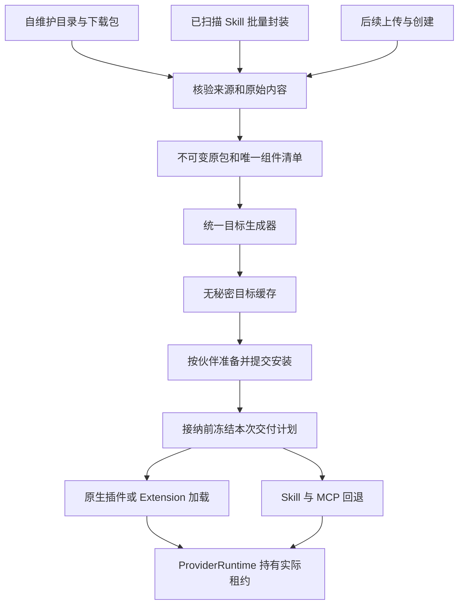
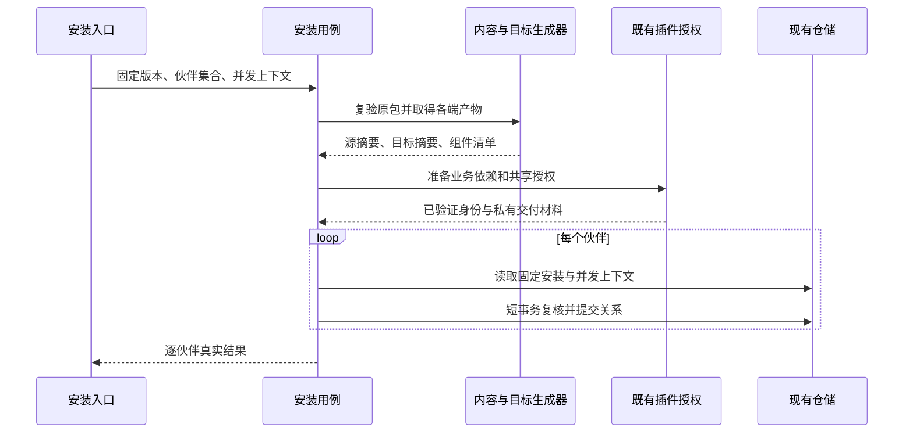
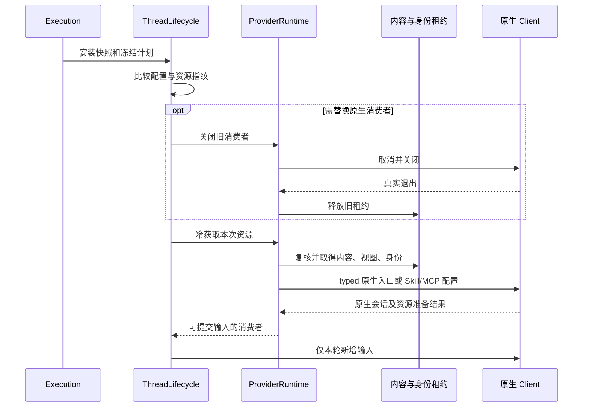

# 多 CLI 插件生成、分发与加载设计

> 状态：待开发的设计方案，不表示相应能力已经实现或通过真实 CLI 验收。
>
> 范围：NeuxBot、独立 `neux-plugins` 插件仓库和独立 `acp-go`。核对日期：2026-11-09。

> 实施性质：插件子系统整体重构，不承担历史插件格式、目录、快照、数据库序列化契约或旧交付材料的兼容与迁移。

## 1. 目标与范围

用户安装插件后，所选伙伴的下一次执行自动取得其能力，无须另行编辑 CLI 配置、复制 Skill 或安装 MCP。一个插件可以安装给多个伙伴，一个伙伴可以安装多个插件；切换已支持的 CLI 时复用同一插件身份、固定版本、配置和插件账号。

本设计确定以下行为：

1. 自维护目录下载的插件、现有批量 Skill 封装、后续上传与创建入口，使用同一套组件解析和目标生成能力。
2. 优先使用包内真实有效的原生入口。缺少入口时，代码根据实际 Skill／MCP 生成对应声明；当前 CLI 或适配器缺少可靠原生加载能力时，自动交付 Skill／MCP。
3. 覆盖当前十类 CLI：Codex、Claude、Cursor、WorkBuddy、Qoder、Kimi、Gemini、Grok、OpenCode、Pi；Qoder CN 按实际 profile 和版本核对。
4. 原包和派生产物分别保存，伙伴目录保存可重建的加载视图；安装、启停、版本和账号继续由已有领域数据持有。
5. 插件目录、README、Skill 正文和完整资料不编译进 Go。目录只保存展示和定位下载所需的关键信息；完整资料通过下载或已经核验的本地内容读取。
6. 保留启动后后台下载自维护插件包的行为；下载不创建安装关系、不授权、不执行包内代码。

当前必须完整覆盖飞书、企业微信、GitHub 和现有 skills-only 本地插件。它们的实际 Skill、MCP、辅助资源和既有授权流程不能因 CLI 未命中 Codex／Claude 分支而无法使用。

后续任意插件上传页、全新插件编辑器和发布 UI 不在本次实现范围。本次必须提供可复用的内部准备入口，由目录准备和现有 `/plugins/from-skills` 两个真实入口完成接线。未来新增来源仍须独立校验接纳范围和信任，不能借本设计自动开放任意本地路径导入。

任意第三方 JS 插件、hooks、agents、LSP 等不天然具有跨 CLI 等价实现。本次不建立万能代码翻译器，不恢复旧 provider 私有清单。合法原生扩展可以保留，但额外执行内容必须进入明确的可信组件清单；不能丢弃后宣称完整兼容。

## 2. 当前基线与职责变化

开发前重新核对工作树，保留无关修改。下表是形成设计时的源码事实，不是待开发行为的验收记录。

| 现有位置                                                               | 当前事实                                                            | 设计要求                             |
| ---------------------------------------------------------------------- | ------------------------------------------------------------------- | ------------------------------------ |
| [包解析](../../../server/internal/plugins/package.go)                  | 固定读取 portable 根清单、`skills/` 和 `mcp.json`，拒绝若干原生目录 | 接受并校验已登记多端入口，保留原包   |
| [原生目标工具](../../../server/internal/plugins/native_target.go)      | 仅处理 Codex／Claude，动态生成 Claude 清单，尚未接入生产原生交付    | 统一生成器准备产物，执行时选择并加载 |
| [执行准备](../../../server/services/execution/plugins.go)              | 已有面向全部 CLI 的通用 Skill／MCP 投射                             | 保留正式回退，增加原生优先和去重     |
| [授权绑定](../../../server/internal/plugins/authentication_binding.go) | 声明仅准两端，已有等价约束跨端复用                                  | 转为组件约束及显式目标差异           |
| [Runtime 资源](../../../server/internal/agent/provider_runtime.go)     | 原生目录字段是 Claude 专用                                          | 改为有类型的通用原生交付描述         |
| [Skill 封装](../../../server/internal/plugins/skill_bundle.go)         | 生成 portable 清单及所选 Skill                                      | 封装后复用统一生成器                 |
| [目录模块](../../../server/internal/plugins/catalog)                   | `bundled.go` 通过 `go:embed` 编译目录和全部详情                     | 撤除数据内嵌、生成及回退链路         |
| [目录刷新](../../../server/internal/plugins/catalog/index_cache.go)    | 发布索引前取得全部详情，随后预取 ZIP                                | 索引、按需详情、ZIP 下载解耦         |

不能根据 `nativePluginVersionSupported` 的名称或过时注释推断执行只支持两端，应检查实际调用链。

保持[架构总览](../../architecture/overview-cn.md)、[插件资源](../../architecture/plugin-resources-cn.md)、[智能体与账号](../../architecture/runtimes-and-accounts-cn.md)和[工作区与存储](../../architecture/workspace-and-storage-cn.md)定义的领域所有权；插件内部格式和接口按本设计重新建立。与本方案冲突的当前能力说明在实现时更新，不提前写成已实现。

### 2.1 开发期统一契约

主仓库、打包工具和插件仓库按同一套新契约交付，不双读、双写或回退到重构前格式：

| 契约                              | 本次目标                                     |
| --------------------------------- | -------------------------------------------- |
| 宿主归一化包快照                  | `neuxbot-plugin/1`                           |
| 自有包的 `extensions.com.neuxbot` | `schemaVersion: 1`，按组件声明授权和目标差异 |
| 目录与公开资料                    | 各自 `schemaVersion: 1`                      |
| 新增派生产物描述                  | `schemaVersion: 1`，与源包版本独立           |

Agent Plugins 根清单及各 CLI 官方格式遵守对应上游标准；它们的版本不是本应用的历史兼容层。现有 `neuxbot-auth/1` 请求协议若字段含义不变可以复用，但旧安装保存的交付材料不因此自动成为新契约材料。

不增加旧清单解析器、版本别名、目录迁移、旧缓存兜底或安装记录自动转换；不能只修改契约标记让旧快照进入新执行链。历史缓存不符合新契约时不参与展示／执行，从新源重新下载。历史插件记录不接入新执行，使用新插件须正常准备和安装；新版本的授权材料按新组件约束重新取得。

本次重构不授权自动清空业务数据库、用户文件或凭据。上述规则通过明确校验边界实现，无须构建历史迁移流程或为历史记录另设产品页面。

当前仍处开发期，自有 schema 全部保持 `1`，按新设计直接重构，不引入版本升级、版本分支或历史迁移。公开资料、原包和打包工具按同一来源绑定；发布前通过显式开发源验证，不把本地构建伪装为正式源。正式发布及远端推送独立于本地实现和用户验收。

## 3. 整体结构



- `internal/plugins` 拥有解析、组件归一化、目标生成、内容校验和无秘密产物，不将纯生成逻辑放入 API 或宽泛 Service。
- 插件安装用例拥有来源接纳、配置／账号复核、伙伴关系提交及批量结果；真实共享的准备机制继续放在现有安装模块。
- Execution 选择本次获准组件和路线；ThreadLifecycle 判断兼容与会话替换；ProviderRuntime 持有进程、账号和资源租约。
- `acp-go` 拥有各 CLI 的真实参数、配置和协议，不拥有业务安装关系。
- `neux-plugins` 拥有业务内容、供应商授权、依赖、许可和来源记录，不按 CLI 复制业务插件。
- 前端使用现有查询和事件，不保存第二套生成／安装状态，也不在资源页展开内部 CLI 兼容矩阵。

## 4. 撤除 Go 内嵌，分离轻目录与详情

### 4.1 交付边界

撤除 `catalog/bundled.go`、`catalog/bundled/`、内置目录／详情回退及将发布资料复制进 Go 源目录的快照脚本和测试。Go 只保留默认来源地址、协议与通用代码，不保留具体插件名单、图标、简介、README 或 Skill 正文。

本设计默认安装包也不预置插件目录或详情。未来明确要求首次完全离线展示时，最多单独评估安装资源层的外部轻索引；该选项不在本次实现范围。不得换一种资源形式继续预置完整详情。Native、Web、独立 Core 共用外部来源和缓存，不依赖 Electron 安装资源。

### 4.2 目录内容

目录与公开资料使用第 2.1 节的新契约，复用必要的下载校验机制，不保留旧结构读取。轻索引只包含：

- 稳定目录键、名称／本地化名称、短简介、版本、分类及已有规则允许的小图标；
- 来源提交、逻辑包路径、归档地址与摘要；
- 公开资料地址、摘要和大小。

图标沿用现有安全格式、大小限制和默认回退，不将完整资产集加入索引。目录不携带 README、完整 Skill 内容、MCP 命令／参数／请求头、授权入口或秘密。

继续使用 `Plugins/catalog/`、`Plugins/details/`、`Plugins/archives/`。保留默认与自定义来源的身份隔离、ETag、Last-Modified、摘要及固定版本读取边界。

| 行为                    | 数据来源                                         | 不触发的工作                       |
| ----------------------- | ------------------------------------------------ | ---------------------------------- |
| Core 启动               | 已有轻索引；后台条件更新索引，再有界预取完整 ZIP | 等待全部详情、创建安装、授权或执行 |
| 列表／搜索／分页        | 轻索引和真实本地资源摘要                         | 逐项读取详情、下载 ZIP、检查账号   |
| 目录详情／README／Skill | 精确版本的公开资料缓存，缺少时下载该项           | 取得所有其他插件详情、静默切到最新 |
| 准备安装                | 已核验 ZIP；缺少或损坏时下载固定归档             | 以展示资料代替包解析               |
| 查看已安装内容          | 安装固定版本的真实资料                           | 用新目录正文替换旧安装版本         |

首版继续使用独立公开资料文件，打开详情时按需下载，下载不要求用户先安装或授权插件。若未来复用完整本地包提取资料，必须精确匹配来源、提交、归档摘要和逻辑路径；这不是首版前置要求，也不能掩盖明确声明资料的损坏。

索引校验通过即可原子发布并刷新查询，禁止先对所有条目调用 `loadDetails`。详情失败仅影响该详情；ZIP 预取失败仅影响对应包缓存，不能把有效索引标为不可用。

目录同步、详情和归档下载共用 Core 取消／退出所有者，但有独立完成边界。索引查询和显式目录刷新不等待全部 ZIP。安装与预取共享同摘要下载；详情读取传递调用 Context，不能以无界后台 Context 替代。

### 4.3 离线与故障

- 首次无缓存且离线时，立即呈现来源不可用或获取中，不伪造可浏览条目或真实空库。
- 有符合新契约的缓存索引时立即展示，更新失败保留陈旧状态；不读取历史协议缓存兜底。
- 详情未缓存且断网时保留轻摘要，正文区域显示可重试错误，不显示其他版本正文。
- 同摘要下载合并并发，完整校验后原子发布；取消和退出不发布半包。
- 沿用[现有事件通道](../../architecture/notifications-and-work-board-cn.md)，不增加页面永久轮询或业务连接。

## 5. 原包与统一生成器

### 5.1 一份内容，多种入口

自维护包采用 portable 根 `plugin.json`、`skills/`、`mcp.json` 和本设计的 NeuxBot 扩展；允许随源保存已登记的原生入口，参考 [Superpowers 固定快照](https://github.com/obra/superpowers/tree/22f0b463e7a5e579904dd6211a520321035526f7)的共享内容和多端薄适配。

已有原生入口先校验再复用，不覆盖作者定义；缺少时从唯一组件清单补齐。默认生成范围是 Skill、MCP、明确建模的辅助路径及现有授权绑定。

原生与 portable 对同一组件的路径、端点或权限冲突时返回包校验错误，不猜测优先项或合并更大权限。额外执行组件必须进入信任与权限清单，不能直接交给 CLI 自动发现。

SkillBundle 只继承所选 Skill 完整资源树及必要许可，不继承来源根 MCP、认证或 hooks；生成器只能根据实际继承的组件生成声明。

### 5.2 内部契约

以下为职责契约，具体类型名称由开发者在现有模块内确定，不是新增公开 API。

| 对象       | 必须携带                                                                     | 不能携带／推导                   |
| ---------- | ---------------------------------------------------------------------------- | -------------------------------- |
| 原包快照   | 来源身份、固定版本、真实路径、完整源摘要及信任信息                           | 可原地改写的源内容               |
| 组件清单   | 稳定键、类型、路径、摘要、MCP 传输／端点及已解析原生组成                     | 根据 UI 简介猜测的能力           |
| 目标配置档 | CLI 家族、加载格式版本、已验证组件／传输能力及必要平台条件                   | 只有 supported 布尔值的白名单    |
| 目标产物   | 源摘要、配置档、组件集合、目标摘要、文件清单与模板                           | 令牌、绝对私有账号路径、会话身份 |
| 交付计划   | 所有者、实际 cwd、固定安装、组件路线、目标摘要、配置修订、账号代次和能力证据 | 未获准组件、明文凭据、随机工具名 |

规则集中于 `internal/plugins` 有明确职责的模块，所有入口复用。自维护仓库可预带原生入口，发布检查验证其与共享内容一致；缺失入口交给统一生成器，不能再维护一套不一致的十端转换。

生成过程确定、无秘密，不调用模型、不执行包程序、不读取用户全局 CLI 配置。同输入同结果；缓存键覆盖来源身份与摘要、组件清单摘要、CLI 格式配置档，仅在产物实际有差异时加入平台。

目标保存在 `<DATA>/plugins/targets/<目标键>/`。全部校验后原子发布，命中时复核清单和摘要；损坏可重建，不回写原包。同键并发只发布一份，失败不留下成功标记。

ZIP 的 `archiveSHA256`、解包后的源摘要和目标摘要分别记录。生成器升级可产生新目标，不伪造新业务版本；生成器和目标变化必须参与会话兼容判断。

发布工具冻结输入时可将合法源内链接改写为可迁移的相对链接。回执的 `sourceDigest` 绑定原始输入并接受 `--source-digest` 校验，`normalizedSourceDigest` 绑定生成器实际消费的冻结树；逐目标内容摘要和 ZIP 回读使用最终工件字节，不将规范化后的摘要冒充原始来源摘要。

链接按已捕获的目录／链接图逐组件解析，展开目录别名后也不能曾经越出来源根；越出后再折返统一作为内容非法，而不是某 CLI 不受支持。原始冻结字节须直接匹配已接纳源摘要，随后只按冻结图重定位链接，不重新解析活源目标。

### 5.3 生成时机

| 时机                       | 完成的工作                                     | 边界                                           |
| -------------------------- | ---------------------------------------------- | ---------------------------------------------- |
| 启动下载                   | 核验并缓存原始 ZIP                             | 不创建资源，不执行授权，不生成含私密路径的视图 |
| 目录准备／SkillBundle 入库 | 校验源和组件，生成十端通用声明／回退描述       | 失败不提交半成品版本；原包和扫描批次可重试     |
| 伙伴安装                   | 复验各端工件，准备插件授权及依赖，提交伙伴关系 | 不把尚未选择的 CLI 或 AI 账号当作已验证        |
| 切换 CLI／生成器升级       | 选择缓存，缺少时重建派生产物                   | 不要求重装插件或重建账号                       |
| 每轮执行                   | 复核固定版本、租约和范围，激活本次路线         | 不无条件重新转换十端或读取全部正文             |

生成十端声明不要求十个 CLI 都已安装。CLI 尚未安装或 AI 账号未登录不阻止资源入库，不自动触发 CLI 安装或模型登录；执行时如实报告 Runtime 未就绪。插件自身配置、业务账号和依赖仍按现有安装流程准备。

### 5.4 独立 CLI 的构建与发布契约

独立 CLI 安装使用按目标生成的自包含工件，不能要求它读取宿主私有缓存，也不能承诺同一个 portable 原始 ZIP 可被所有 CLI 直接安装。

共享生成逻辑位于主仓库 `internal/plugins`。主仓库增加薄打包命令 `server/cmd/pluginpack` 调用同一实现，作为开发／CI 工具发布；它不启动 Core、不依赖业务数据库、不执行插件，也不将插件资料编进工具。运行时宿主直接调用内部模块，不通过子进程运行此命令。

独立插件仓库的发布脚本固定打包工具版本和制品摘要，在明确的源目录上调用它。开发可显式指定同版本的本机构建，正式发布不能调用未锁定版本或另写 JS 转换器。跨仓库发布顺序为：主仓库提供可取得的生成器版本 → 插件仓库固定该版本并生成 → 验证并发布插件工件。不能只依赖开发机目录。

工具接收源根、来源身份、源摘要、目标配置档和输出目录；输出各目标的自包含目录、ZIP 及工件描述。描述绑定源版本／摘要、目标配置档、目标内容摘要和 ZIP 摘要，不包含机器私有路径或秘密。各目标保留其引用的 Skill、脚本、资产和许可，不能引用工件根外的共享文件。

`neux-plugins` 负责验证并发布两类工件：

- 原始 portable 包和现有轻量 HTTP 目录，供 NeuxBot 下载、校验并在本机派生目标；不为支持独立安装而强迫宿主额外下载十份包。
- `<插件名>-<CLI>.zip` 等原生目标工件，供独立 CLI 按官方支持的 ZIP 或解包后本地目录方式安装。需要 Git marketplace 的 CLI，发布对应版本的生成目录和索引，索引只能指向同批自包含目标，不能指回有清单冲突的原始根。

原生分发目录／索引属于插件仓库的生成发布物，不是另一套手工业务源码。其具体 Git 发布分支、制品文件名和工具命令参数可由开发者确定，但必须固定版本、可按摘要复验，并通过该 CLI 的实际安装路径测试。普通列表索引不增加十端完整工件描述；独立安装入口在插件仓库说明和发布资料中提供。

生成的原生包安装后不依赖打包工具或运行中的 Core。Grok 的根清单替换、各端 MCP 文件名等差异必须在这些独立工件中完成，而不只在宿主缓存中完成。

## 6. 各 CLI 加载策略

下表是已查阅能力与接入方向，不是当前集成的验收结果。实现需核对真实版本、固定 `acp-go` 接口及对应测试。

| CLI                                                                                                                                                     | 原生入口与加载方向                                        | 重点与回退                                                                                                             |
| ------------------------------------------------------------------------------------------------------------------------------------------------------- | --------------------------------------------------------- | ---------------------------------------------------------------------------------------------------------------------- |
| [Codex](https://developers.openai.com/plugins/build/plugins)                                                                                            | portable 根包，受管 marketplace 和启用配置                | `.agents/plugins/marketplace.json` 是索引，不自动安装所有子目录；OpenAI inline 扩展与兼容 overlay 不合并               |
| [Claude](https://code.claude.com/docs/en/plugins-reference)                                                                                             | `.claude-plugin/plugin.json` 和 typed 插件目录            | 原生自动发现不能扩大工具范围；否则交付 Skill／MCP                                                                      |
| [Cursor](https://cursor.com/docs/cli/reference/parameters)                                                                                              | 原生包与可重复 `--plugin-dir`                             | 补 typed 资源字段，不能用 IDE 扫描证明 CLI 已加载，不能绕过 PrefixArgs 保护                                            |
| [WorkBuddy](https://www.workbuddy.ai/docs/zh/cli/plugins-reference)                                                                                     | `.codebuddy-plugin/plugin.json` 和会话目录参数            | `codebuddy`／`cbc` 属同一 Runtime；市场安装与会话加载分开                                                              |
| [Qoder](https://docs.qoder.com/cli/plugins-reference)                                                                                                   | `.qoder-plugin/plugin.json` 与原生目录／注册              | 市场 feature flag 关闭不等于组件不可用；CN profile 单独核对                                                            |
| [Kimi](https://www.kimi.com/code/docs/en/kimi-code-cli/customization/plugins)                                                                           | `kimi.plugin.json`／`.kimi-plugin/plugin.json` 与托管注册 | 以当前实际接入程序为准；缺少可靠隔离注册时回退，不新增旧代际专门兼容                                                   |
| [Gemini](https://geminicli.com/docs/extensions/reference/)                                                                                              | `gemini-extension.json` 和受管 Extension 注册             | 缺少可靠隔离入口时回退，不虚构 `.gemini-plugin` 格式                                                                   |
| [Grok](https://github.com/xai-org/grok-build/blob/2bdd1d6a6369de0e8c68132ea4539e9abd9e14a8/crates/codegen/xai-grok-pager/docs/user-guide/09-plugins.md) | 优先 ACP 会话目录，独占进程可用目录参数                   | 处理清单优先级、启用和信任，不依赖全局扫描                                                                             |
| [OpenCode](https://opencode.ai/docs/plugins/)                                                                                                           | JS／TS／package 和当前支持版本的原生配置注册              | 纯 Skill／MCP 直接等价交付；本次不增加 V1 兼容分支                                                                     |
| [Pi](https://pi.dev/docs/latest/packages)                                                                                                               | package 的 `pi` 声明、受管配置或按次加载                  | 按当前接入版本的[原生 MCP](https://pi.dev/docs/latest/mcp)能力选择；确需桥接时走单一受管端口，不保留已淘汰版本专用链路 |

原生优先要求本次加载能满足完整组成、账号隔离和权限；不能为纯 Skill 包增加无业务用途的可执行插件代码。

Grok 的[固定源码](https://github.com/xai-org/grok-build/blob/2bdd1d6a6369de0e8c68132ea4539e9abd9e14a8/crates/codegen/xai-grok-agent/src/plugins/manifest.rs#L260)按根 `plugin.json`、`.grok-plugin/plugin.json`、`.claude-plugin/plugin.json` 顺序取首个，且默认 `.mcp.json` 不同于 portable `mcp.json`。生成器应在派生目标根提供它真正读取的格式，不能只新增被遮住的目录。各端变量、HTTP 类型和路径规则按目标规范生成，不能文本全局替换猜测。

## 7. 路线选择、去重与权限

接纳前选择过程：

1. 从真实启用安装冻结版本、配置修订、插件账号代次与组件集合。
2. 根据实际家族／profile、程序身份和版本能力选择配置档。未知版本默认进入已有可验证的 Skill／MCP 路线，不直接判整个插件不支持。
3. 原生入口存在或可生成，且加载接口、组件与权限均满足时选择原生。
4. 否则从同一组件清单交付 Skill／MCP；MCP 根据真实传输能力准备，转换仅使用已有且验证过的桥接。
5. 混合包只在能明确关闭原生重复组成时允许组件级组合；否则整包选择一种满足要求的路线。
6. 显式插件必须交付本次获准且必要的组成。损坏、缺配置、认证失败、命名冲突和权限禁止分别报准确原因，不伪装成功或统一折叠为“CLI 不支持插件”。

同一组件只交付一次。原生 Skill 从 `FreezeSkills` 普通投射中移除，原生 MCP 不再由宿主重复注册。组件身份继续用插件 ID 与稳定键，不因临时路径、别名或路线改变。

保留技能冲突规则：同名同完整内容可以共用，不同内容报具体冲突，并在安装阶段尽早发现；不静默覆盖，不自动改写作者正文／frontmatter 伪造命名空间。原生技术名冲突同样明确处理；用户显示名称重复不表示技术身份可以合并。

流程和独立任务的工具白名单优先于原生便利性。原生加载会自动启用排除的 MCP／hooks／工具时，选择可约束回退；Runtime 本身无法证明范围时维持准确权限拒绝，不借本次兼容放宽权限。

## 8. 存储与多个插件

`<DATA>` 为程序数据根，`<MANAGED>` 为既有受管业务文件根；新增目录是设计结果。

```text
<DATA>/
  plugins/
    content/<源摘要>/                 # 已有：唯一不可变原包
    targets/<目标键>/                 # 新增：无秘密派生产物
  ai-accounts/                        # 已有：AI 账号所有权不变

<MANAGED>/
  Plugins/{catalog,details,archives}/  # 分发缓存，不代表安装
  Agents/<伙伴ID>/                    # 伙伴固定 cwd
    .neuxbot/plugin-views/
      <资源集合摘要>/<CLI>/
        <插件A-ID>/                   # 自包含原生加载根
        <插件B-ID>/
    <CLI技能目录>/skills/             # 仅回退组件，沿用已有发现机制
```

多个插件各占独立根，由一次 typed 目录列表／注册配置组合加载；不复制到用户全局目录，不为每个插件建立 CLI HOME。确需 registry 的目标只在受控运行配置内写入可重建记录。

Codex 的 marketplace 索引、安装缓存和启用配置随受管账号租约隔离创建，不依赖 cwd 中一个 `.agents/plugins/` 目录自动扫描。系统账号缺少可隔离的原生配置时使用 Skill/MCP 投射。

伙伴拥有安装关系，实际 cwd 也可能属于团队成员或工作流 worker。构建接收真实执行所有者与规范 cwd：普通聊天用伙伴目录，团队／工作流按现有所属目录准备局部入口；不得强改任务 cwd，也不能让成员互相覆盖发现文件。

资源集合摘要覆盖启用插件、固定版本／源摘要、目标摘要、路线、组成和加载配置档。不同集合发布到不同不可变目录，不覆盖活动视图。账号变化是否可共用无秘密文件由内容决定，进程兼容仍检查账号代次和配置修订。

回退 Skill 仍在固定 cwd 的发现目录发布，继续使用已有预约、冲突检测和租约。新旧集合不能并存时先安全切换消费者，不能因增加新目录就任意覆盖固定技能目录。

凭据仍位于程序数据的私有账号／插件边界。资源不能以环境变量覆盖账号租约的 ConfigHome。目录、生成 JSON 和原生 registry 都是派生视图，数据库仍是安装版本与启停的唯一权威。

## 9. 安装和执行生命周期

### 9.1 安装成功的边界



安装完成代表源内容有效、各端声明生成、插件依赖／授权满足原有规则、安装关系提交；不代表模型业务调用通过。应用的 CLI 和 AI 账号由本次执行选择，并非伙伴安装的固定属性。因此加载视图在下一次执行接纳、实际 CLI、权限和 cwd 已知后自动发布，由消费者租约持有；安装不预先启动 CLI。CLI／AI 账号未就绪时保持独立状态，不能宣称原生加载已验证。

文件、网络和进程工作都在事务外。提交前复核源版本、配置修订、账号代次、伙伴及其资源组合，变化时重读或报具体冲突，不提交过时准备结果。

保留逐伙伴批量结果；一个失败不撤销其他成功。重复安装保留原版本与启停，换版／启用走现有明确操作。文件准备成功、事务失败时不制造安装记录，无引用产物由统一边界回收；已完成共享授权不因单个伙伴失败自动清除。

### 9.2 下一轮生效与租约



安装、启停、升级、CLI／生成器变化下一轮比较新指纹，不修改活动轮次快照。会话替换继续现有近期完整轮次／总结接力，不每轮重发 Skill 正文和完整历史。

原生根、Extension／package 和注册配置通过有类型资源字段传入 `acp-go`；不能塞进 PrefixArgs 绕过保护。独立适配器修改先发布可引用版本，再更新主仓库固定依赖，不能仅用本机 workspace 替换宣称独立构建可用。

真实进程退出前保留旧内容、视图和身份租约；关闭失败保留原所有者供重试，不新建平行会话注册表。

## 10. 授权和独立 CLI

插件业务账号继续由已有共享账号和 `neuxbot-auth/1` 管理，不按伙伴、CLI、路线复制。绑定改为真实组件的精确 MCP 端点／头或 Skill 环境允许键；确有目标差异时显式声明，不猜等价或扩大权限。

产物只保存合法占位和模板。秘密在冷获取时走现有私有通道，绑定版本、源摘要、组件、端点、修订和账号代次，不进入目标缓存、伙伴文件、公开详情、日志或模型描述。不能为原生加载使用不确定生效的认证 overlay。

独立 CLI 使用第 5.4 节的目标发布工件，不理解宿主授权协议。自维护插件提供包内 setup／launcher，复用供应商授权与依赖代码，按实际原生入口接线；辅助程序核验真实登录、依赖摘要和退出。纯 Skill 包无需无用途的启动 hook。

独立 CLI 默认在其原生私有数据边界授权；NeuxBot 内由宿主共享账号拥有状态。二者复用代码和能力，不导出宿主凭据，也不要求独立 CLI 连接运行中的 Core。

本地 Skill 插件生成相同的无秘密原生结构。本次不增加“导出到全局 CLI”的按钮或 API；生成结果保留可复用结构和注册描述供后续入口使用。

## 11. 并发、恢复和回收

- 下载共用 Core 生命周期，退出取消并等待请求、锁等待和临时文件清理。
- 生成按目标键合并，完成校验后发布，不执行包程序。
- 原生与回退均取得现有内容和身份占用，同插件跨伙伴共享原内容与账号。
- 卸载、换版不删其他伙伴和活动消费者资源，关闭的安装也属于保留引用。
- 最后引用、账号退出、授权失败沿现有所有者处理，不新增独立扫描器。
- 目标和视图仅在没有保留引用与活跃租约后回收，重启按真实安装重建；文件存在不能表示已安装。
- 目标损坏可重建，源损坏须从固定可信归档恢复；不能重打源摘要、改版本或补标记伪造有效包。

## 12. 实施范围与依赖

本节界定改动范围，不替代逐步执行计划。

| 工作面           | 主要位置                                                                  | 完成条件                                            |
| ---------------- | ------------------------------------------------------------------------- | --------------------------------------------------- |
| 撤内嵌和分发解耦 | `internal/plugins/catalog`、快照脚本、构建说明                            | 无具体插件数据内嵌，索引独立展示，详情和 ZIP 可取消 |
| 解析与生成       | `internal/plugins` 的 package、native target、skill bundle、content store | 原包不变、入口共用、产物确定可复验                  |
| 安装准备         | `apis/plugins`、`services/plugininstallation`                             | 目录和 SkillBundle 接线，逐伙伴提交前准备目标       |
| 路线与租约       | `services/execution`、`internal/agent`                                    | 原生优先、回退、无重复、切换不破坏活动工作          |
| 原生接口         | 独立 `acp-go` 和 client 装配                                              | typed 加载真实接通，版本能力明确                    |
| 插件源           | 独立 `neux-plugins`                                                       | 三包独立入口、授权、依赖、许可和发布一致            |
| 查询与文档       | 详情 API、共享 Query、权威文档                                            | 真实状态，契约通过现有生成命令更新                  |

先处理分发解耦和目标模型，再接安装与原生适配；随后提供共享打包工具，完成插件仓库固定版本构建和发布，最后三包实测。工具函数或静态清单完成不等于生产加载完成。

按整体重构替换包解析、目标生成、授权声明和原生资源接口；无用旧实现直接移除，不为保持旧函数或数据格式建立转接层。正确的底层内容校验、租约和下载机制可以复用。

不新建按 CLI 复制的插件、安装、账号表或 Runtime 生命周期。派生缓存不需要新持久业务模型；模型通过现有 AutoMigrate 表达新结构，不增加历史数据迁移流程。确需新增公开字段／错误时使用现有 `status_error`、OpenAPI 和前端 Client 生成链。

## 13. 验证与验收

遵守[后端约定](../../development/backend-cn.md)、[前端约定](../../development/frontend-cn.md)和[文档约定](../../development/documentation-cn.md)。仅验证变更及直接影响范围，不例行全量 `pnpm check` 或 `go test ./...`。

### 13.1 自动化必测行为

| 范围       | 必须证明                                                                             |
| ---------- | ------------------------------------------------------------------------------------ |
| 去内嵌     | Core 无插件数据 embed／Go 常量／硬编码表，独立 Core 和 Web 不依赖 Electron 资源      |
| 统一契约   | schema 保持 `1` 且目录／资料／源包及宿主快照一致；无历史双读、迁移、补标记或兜底执行 |
| 轻目录     | 详情失败不阻塞索引，列表不请求详情／ZIP，首次无缓存与陈旧缓存分别表达                |
| 下载       | 固定来源摘要、并发合并、取消、损坏恢复、同名来源隔离、慢 ZIP 不阻塞索引              |
| 生成       | 确定性、源摘要不变、升级换键、损坏重建、入口冲突、路径与秘密校验                     |
| 来源       | 两个当前入口共用模块，SkillBundle 不继承未选能力，未来入口内部契约可复用             |
| 加载       | 十类目标和 CN profile、未知版本回退、真实 Client 消费参数／注册配置，而非只检查文件  |
| 多插件     | 三插件并存、同内容去重、异内容冲突、MCP 不重复、伙伴隔离、批量部分失败               |
| 权限与认证 | 精确范围、端点和环境，失败不匿名降级，原生不可约束时回退或准确拒绝                   |
| 生命周期   | 下一轮生效、活动快照不变、退出失败保留租约、重启可重建                               |
| 热续聊     | 无变化不重生成／重复挂载，不重发历史和正文，模型可见工具身份稳定                     |

选择现有相关 Go 包／用例和 `acp-go` 对应包定向验证。前端仅在读取／安装行为改变时运行对应测试、类型和格式检查；协议变化校验生成契约。

### 13.2 真实验收矩阵

逐一记录十类 CLI 的真实版本、平台、路线和未核实能力：

1. 纯 Skill 插件安装后能发现并使用技能。
2. MCP 插件能初始化、发现工具并完成获准实际调用。
3. 飞书、企微、GitHub 在真实账号及权限具备时完成最小业务调用；没有账号时保留未验收项。
4. 同伙伴多插件、安装后下一轮生效、切换 CLI 无需手工复制配置或重建插件账号。
5. 续聊、取消、停用、升级、重启和最后引用卸载不重复工具、不残留消费者。
6. 自维护插件按独立 CLI 原生安装方式使用，setup／launcher 不依赖 Core 或宿主秘密。

真实 Native／Web 交互与视觉验收需用户明确授权；本设计不授权打开、控制或截图应用。静态、协议测试、真实模型和真实平台验收分开报告。

## 14. 交接约束

确定的默认选择为：整体重构且无历史兼容／迁移；不预置插件数据；保留启动包预取；详情按需下载；统一生成器补齐声明；接当前真实入口；原生和回退共用领域事实；伙伴目录保存视图；保持冲突与权限规则。

开发者可确定同职责文件拆分、内部类型名称和并发实现，但不能扩大来源、放宽权限、复制账号或将未知路线写成可用。实现前据本文形成执行计划，并重读当前工作树、CLI 版本和独立仓库引用。

完成时更新权威架构／构建文档，移除内嵌说明和脚本入口，保留许可和 provenance。代码提交、依赖发布、插件发布与真实验收分别交付。
