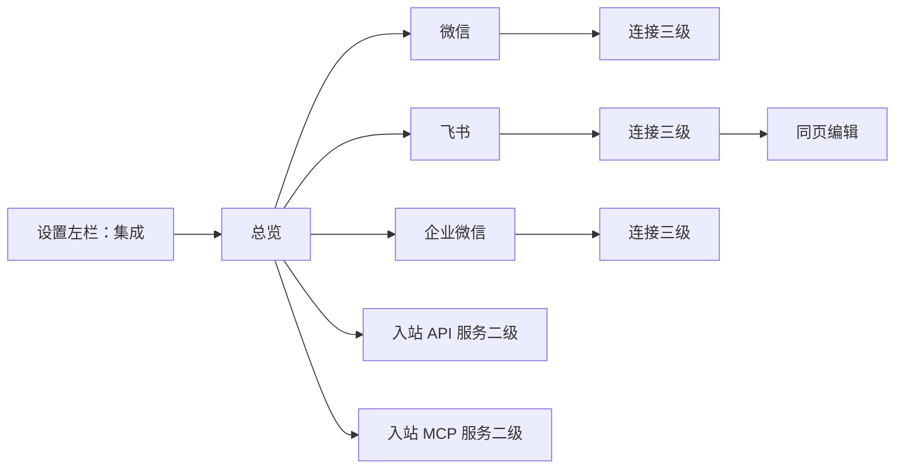
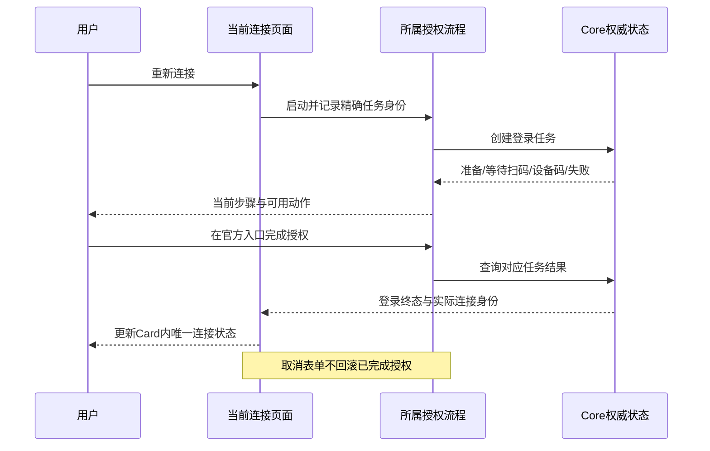

# 设置与集成 UIUX 设计

> 状态：实施依据。本文指导设置与集成开发，不表示现有界面已经对齐或通过视觉验收。
> 固定参考：OpenBot v0.62.0，提交 `fcb35746d4919798ff889a8a58449f5d58de5f65`。全部源端结论来自该提交的本地源码及样式声明，本次没有打开、控制或截图应用。

## 1. 目标与设计依据

设置应让用户从明确的对象进入配置，在同一页面理解当前状态、修改参数并处理问题。布局负责区分导航、配置、授权和危险操作，避免为每层重复添加名称、状态、计数和说明。

本次设计覆盖设置 Shell、普通与高级设置的共享规则，以及集成总览、IM 平台、IM 连接、入站 API 和入站 MCP 的完整页面。后续实施保留现有连接、聊天授权、运行配置、对话、密钥和服务能力，不从参考界面推导新后端能力。

以下三类依据分别使用，不能互相替代：

| 类别             | 内容与约束                                                                                                                                                                                                                                                                         |
| ---------------- | ---------------------------------------------------------------------------------------------------------------------------------------------------------------------------------------------------------------------------------------------------------------------------------- |
| 源端事实         | 固定提交的组件职责、实际宿主、CSS 级联和主题 Token；重要依据见下节。源端确有 Slack、Discord、Telegram、WhatsApp 聊天平台集成。                                                                                                                                                     |
| 用户明确要求     | 左侧唯一“集成”；右侧 IM／API／MCP 三个竖排区块；IM 平台二级、连接三级；连接查看和编辑均在页面；三级无重复标题、身份头、图标、悬停返回，顶栏 breadcrumb 承担定位及父级导航；保留白色语义 Card、完整危险区，不增加重复计数和说明。                                                   |
| 本产品能力与适配 | 微信、飞书、企业微信、伙伴／团队执行者、智能体与模型、权限、项目／目录范围、工作流交付、入站 API／MCP 服务及密钥均以本产品代码为准。源端 orchestrator 自动创建、解绑时删除 agent 等业务不能照搬。按钮圆角、常红色危险文字、主题色键盘焦点、Skeleton 与容器响应式沿本产品既有规则。 |

当前 [UI 标准](../../development/ui-cn.md) 中“详情复用身份头及悬停返回”的一般规定，后续实施时应同步限定适用层级；本次用户明确取消 IM 连接三级的身份头与悬停返回，优先于该一般规定。本文不会将未实现目标写入当前能力说明。

## 2. 固定源码证据与实际级联

### 2.1 阅读范围与证据

| 证据                                                                                                                                                                   | 直接核对所得                                                                                                                                                                                                                          |
| ---------------------------------------------------------------------------------------------------------------------------------------------------------------------- | ------------------------------------------------------------------------------------------------------------------------------------------------------------------------------------------------------------------------------------- |
| [SettingsPage.tsx:74][source-page]、[SettingsPageFrame.tsx:7][source-frame]                                                                                            | 设置页面分为 nav／path／content 三个独立挂载区。搜索结果打开真实分类或字段，导航与正文分别滚动，搜索不是另一套设置数据。                                                                                                              |
| [SettingsDialogShell.tsx:223][source-shell]                                                                                                                            | 导航 Portal 到 page.nav，路径 Portal 到 page.path，正文 section 才带 `.settings-modal.settings-modal-page` 与调用方 shell class。不能按组件树假设导航仍是 `.settings-modal` 后代。                                                    |
| [window.css:616][source-window]、[settings-modal.css:389][source-shell-css]、[settings-modal.css:885][source-page-top]                                                 | 页面正文外宽 784px。app/server 宿主正文水平 32px、底部 32px；最后规则再补顶部 24px。正文分区标题在该宿主最终是 13/18、400、secondary，header 横 padding 为 0。导航被 Portal 到 shell 外，继续用基础 13px，而非 shell 内的 14px 覆盖。 |
| [SettingsGeneralTab.tsx:68][source-general]                                                                                                                            | 普通设置直接从分区开始，没有为通用设置复制身份头。Select、Switch 各自是局部控件；平台不可用功能不显示可操作的假入口，依赖功能按事实禁用。                                                                                             |
| [SettingsVoiceTab.tsx:168][source-voice]、[SettingsVoiceTab.tsx:278][source-voice-models]、[SettingsVoiceTab.tsx:643][source-voice-server]                             | 语音是多个真实分区和状态相关动作：云密钥在所属行内输入并单独保存；下载、取消、重试、使用各按状态出现；服务路由影响语言／语音字段，不能把配置当无依赖静态表格。密钥不读回，成功后清空草稿。                                            |
| [ProviderSettingsPage.tsx:227][source-provider-list]、[ProviderSettingsPage.tsx:491][source-provider-detail]                                                           | provider 目录与详情是不同上下文。目录整行进入，正常摘要安静；详情才用身份头并分账号、API、运行时、模型、使用、危险区。不是所有设置页都必须套详情身份。                                                                                |
| [ProviderSettingsPage.tsx:1078][source-provider-login]、[ProviderSettingsPage.tsx:1265][source-provider-key]、[ProviderSettingsPage.tsx:1315][source-provider-runtime] | 登录、密钥、程序版本各有自己的操作所有权。下载进度在版本行，取消和重试占同一位置；运行时不重复已在登录行显示的同一错误；安装／鉴权／更新不是同一个事实。                                                                              |
| [ProviderSettingsPage.tsx:636][source-provider-accounts]、[ProviderSettingsPage.tsx:854][source-provider-account-row]                                                  | 账号分区的添加、重命名、重连、取消、移除按账号身份和能力判断；系统默认账号、密钥账号与额外订阅账号不能互换。只把当前需要用户的动作露在行尾，其他动作进所属菜单。                                                                      |
| [ProviderSettingsPage.tsx:1478][source-provider-advanced]、[provider-settings-page.css:65][source-provider-model-css]                                                  | 高级缓存为独立单值行；模型分区实际管理可见性，列表有独立搜索与32px紧凑行、最大360px滚动区。它不等于本产品默认模型表单，不能把普通64px行机械套给所有嵌套模型行。                                                                       |
| [VoiceServerDialog.tsx:88][source-voice-form]、[VoiceServerDialog.tsx:316][source-voice-submit]                                                                        | 高级语音服务表单区分连接测试与保存；改地址／密钥使旧测试失效，保留已知路由但锁定，旧测试结果不能覆盖新输入；同源空密钥保留凭据，改目的地址不能携带旧凭据。此业务不是本产品集成页的新需求。                                            |
| [ChannelParts.tsx:145][source-channel-page]、[ChannelParts.tsx:227][source-channel-row]                                                                                | 源端真实聊天平台共用 ChannelPage、ChannelConnectionRow。平台页分连接与其他领域分区；连接行按 attention／paused／live 提供重连／恢复／暂停，并有独立移除动作。                                                                         |
| [SlackIntegrationPanel.tsx:306][source-slack]、[TelegramIntegrationPanel.tsx:175][source-telegram]、[WhatsAppIntegrationPanel.tsx:279][source-whatsapp]                | Slack／Discord 按 workspace/server、Telegram 按 chat、WhatsApp 按 number 组织连接。它们实际属于 Marketplace Apps，不能把源端 settings 宿主字体覆盖自动套到这些页面。                                                                  |
| [WhatsAppIntegrationPanel.tsx:450][source-whatsapp-access]                                                                                                             | 允许发送者和待审批请求是独立 Section→Card→Item，空提示仍留在 Card 内，添加／批准／拒绝属于所属分区或具体行。此结构比单用 Provider 首页更接近本产品聊天授权。                                                                          |
| [IntegrationLayout.tsx:150][source-integration]                                                                                                                        | IntegrationPage 规定分区用一张填充 Card；行用 Item，其他正文／表单放同一 card body，备注在 Card 内。危险区最后。此约束属于 IntegrationPage，上述通用与独立 MCP 编辑表单不能无差别视为同一个宿主。                                     |
| [IntegrationLayout.tsx:230][source-danger]、[ChannelParts.tsx:444][source-channel-confirm]                                                                             | DangerZone 是完整专用结构；单连接移除还可用列明影响的确认流程。两者均不是在页面末尾放一个裸红字链接。                                                                                                                                 |
| [ServerMcpPanel.tsx:797][source-mcp-form]、[server-mcp.css:118][source-mcp-css]                                                                                        | 高级编辑表单直接组合 SettingsSection、Field、Input、传输选项及重复键值行；这里没有强制把每个 Field 包成 Item 白卡。密码、命令、URL、重复字段按职责分组。                                                                              |
| [ServerSettingsModal.tsx:588][source-save-use]、[SettingsDialogShell.tsx:85][source-save-dock]、[settings-modal.css:649][source-save-css]                              | MCP 保存条归 shell footer，与正文滚动区是兄弟；仅有更改时展开，关闭阶段 inert；保存失败保留输入并在条内显示，动作在右。                                                                                                               |

### 2.2 必须保留的样式推导链

实现者每次选择外观都按“调用 variant／size → 基础 CSS → 实际 DOM 宿主 → 更具体或后置覆盖 → 当前主题 Token”核对，不能凭同名 `sm`、一个 class 或截图估数。

| 角色             | 完整推导与结果                                                                                                                                                                                                                                                                                                                               |
| ---------------- | -------------------------------------------------------------------------------------------------------------------------------------------------------------------------------------------------------------------------------------------------------------------------------------------------------------------------------------------- |
| 设置行           | [Item 默认 size=default][source-item] → [primitives.css:1253][source-item-css] 给 64px 最小高度、12px 纵向 padding、16px 横向 padding → [settings-modal.css:261][source-card-css] 清除 ItemGroup 外框、12px 圆角、surface 填充、内缩 16px 分隔 → `:320` 将实际 settings 宿主标题／说明改为 14/20、13/18，说明允许换行。Item 自身无透明边框。 |
| Card 表面        | 基础 ItemGroup 的普通边框由 `.settings-modal-card:is(.ui-card,.ui-item-group)` 移除；`.settings-modal` 在 [第 5 行][source-host-alias] 将 surface 重绑定到 control，muted 重绑定到 settings-text-muted。浅色 control 为白色，暗色为 `#212121`。不能拿全局 surface-tertiary 灰色冒充此 Card。                                                 |
| 分区标题         | [SettingsSection][source-section] 调 Heading size=sm、tone=secondary → [基础 14/20][source-type-css] → app/server settings 宿主 `:424` 最终改为 13/18；普通 Marketplace 不命中该宿主，仍是 14/20。                                                                                                                                           |
| 设置文字按钮     | [Button size=sm][source-button] → [基础 size-sm][source-button-css] 引 control-md=32px、横 padding=12px、gap=6px、圆角=8px → `.ui-button` 的 14px 字号比 `:where(size-sm)` 更强 → settings 宿主补 20px 行高。default 在宿主变 accent，outline／secondary 背景变 raised。本产品按钮圆角覆盖保持已有 radius-control。                          |
| 危险区动作       | DangerZone 调 `destructive-ghost + sm` → 基础透明背景、muted 文字 → hover 为 danger-soft 背景、danger 文字；无额外“危险区红框”规则，settings 也未将 ghost 强制改为实心。本产品常态危险文字使用既有危险 Token，是用户覆盖；保留完整 Section／Card／影响说明／右侧动作结构。                                                                   |
| 设置字段         | [Input 基础 CSS][source-fields]：md=32px、13/18、control 背景、strong 边线、8px 圆角 → settings 宿主文字 14/20。自定义 SelectTrigger 未包含在该字体覆盖列表，sm=32px、12/18；不能把所有控件都说成 14/20，也不能把普通项目 36px 默认 Input 当源端 md。                                                                                        |
| 状态标签         | [IntegrationLayout.tsx:53][source-status] 选择success-light／warning-light／secondary／outline → [Badge基础CSS][source-badge-css] 的22px、12/16、500、胶囊透明1px边界 → [integration-layout.css:35][source-status-css] 补4px gap及6px状态点，unavailable点为空心。该透明边界仅属Badge，不能加到Item造成额外行高。                            |
| Marketplace 集成 | ChannelPage 在 Marketplace 实际宿主中 → 共享 settings-modal-card 几何仍生效，但没有 `.settings-modal` 祖先，因此 Item 标题／说明通常保持基础 13/18、12/16。本设计将这套结构放入 NeuxBot 设置时，明确选 settings 文字密度，而非声称源端 IM 原页就是 14/20。                                                                                   |
| 页面底部         | `.settings-modal-main` 两行 grid `minmax(0,1fr) auto` → scroll frame + footer；SaveBar 最小 60px、12px 24px padding、16px gap、surface 背景与顶边分隔。本产品采用同一宿主结构，不能用短内容底部 `sticky` 代替。                                                                                                                              |

源端 [styles.css:1][source-style-order] 的导入顺序为字体、brand dark/light、UI primitives、共享 settings、renderer settings、window、integration、provider、server、Marketplace，最后还有 window-glass。后者只在透明窗口条件下覆盖表面；本文普通浅／暗设置值不能作为透明窗口所有平台的 computed-style 验收结论。

### 2.3 浅／暗主题参照

源端 [tokens.css:33][source-dark]、[tokens-light.css:22][source-light]、[tokens.css:284][source-size] 是数值权威；本产品通过共享语义 Token 映射，不在页面复制色值。

| 语义                     | 源端浅色                         | 源端暗色                         | 本产品职责                                 |
| ------------------------ | -------------------------------- | -------------------------------- | ------------------------------------------ |
| canvas                   | `#f5f5f6`                        | `#1a1a1a`                        | Settings Scene 底板                        |
| surface／control         | `#ffffff`                        | `#212121`                        | 填充 Card／字段角色分别保留                |
| raised                   | `#fcfcfc`                        | `#242424`                        | 图标槽、settings outline 控件              |
| hover／active            | `#f0f0f2`／`#e8e8eb`             | `#242424`／`#2a2a2a`             | 可交互行与控件反馈，不给静态 Card 加 hover |
| primary／secondary       | `#141414`／`#3a3a3c`             | `#ffffff`／`#dcdcdc`             | 正文与次要层次                             |
| settings muted           | `rgba(20,20,20,.6)`              | `rgba(255,255,255,.59)`          | 设置帮助和必要次要事实，区别于全局 muted   |
| border                   | `rgba(20,20,20,.07)`             | `rgba(255,255,255,.035)`         | 内缩分隔和明确结构边界                     |
| danger-text／danger-soft | `#c0141d`／`rgba(232,34,45,.12)` | `#ff6069`／`rgba(253,47,59,.16)` | 本产品危险文字与安静 hover 背景            |

## 3. 信息架构与导航



- 左栏仅有一个“集成”分类。IM、API、MCP 不成为左栏子菜单或右侧 Tab。
- 总览右侧按 IM、API、MCP 顺序上下排列。IM 是三个真实平台导航行；API 和 MCP 是本产品已有服务导航行，不能把出站连接器资源列表搬入设置。
- 顶栏路径总览为“集成”；平台二级为“集成 / 飞书”；连接三级为“集成 / 飞书 / 团队助手”；服务二级为“集成 / API 服务”或“集成 / MCP 服务”。示例名称为虚构名称。
- 每个祖先是明确的导航链接，当前项带 `aria-current=page`。三级不渲染 PageHeader、身份图标、重复连接名、状态 pill 或 hover 返回；连接当前状态只在配置 Card 内出现一次。
- 二级平台／服务保留紧凑身份头用于识别不同集成，沿已有 48px 槽位；IM 平台、API 与 MCP 服务均使用共享的悬停／键盘焦点返回，回到集成总览，顶栏 breadcrumb 仍可导航。三级不添加该返回。平台没有可靠聚合状态时不放状态，不派生“全部正常”或连接数量。服务状态只在身份头出现，正文不重复状态行。
- 切换页面沿既有 URL 和 Scene 导航，保留原聊天、工作区和原生资源生命周期。旧 connection／binding／chat 深链直接进入所属连接三级；平台资料未读到时保留父级“集成”和加载中的当前路径，禁止先显示错误平台后跳动。
- 三级返回平台二级，保留该平台原滚动位置；平台／服务返回完整总览。删除成功返回所属平台，其余保存、取消、授权、新对话均停留当前连接。

## 4. 共享视觉角色矩阵

正文外宽 784px，宽度包含水平留白；宽容器横向 32px、窄容器 16px，上下 24px，分区间 24px。这保留本产品当前底部 24px 适配，源端 app/server 宿主底部实际为 32px，不能混记。字体使用既有 Inter；设置角色只在共享组件中选择，不用业务 class 覆盖控件尺寸。

| 角色            | 结构、外观与几何                                                                                         | 交互与禁止项                                                                                           |
| --------------- | -------------------------------------------------------------------------------------------------------- | ------------------------------------------------------------------------------------------------------ |
| 顶栏路径        | 13/18、中等字重，父项次要色，当前项正文色，尾项允许截断并提供完整可访问名称                              | 常驻父级导航；长名称压缩尾项，祖先保持可达；三级不重复内容返回                                         |
| 普通设置页      | 直接从 SettingsGroup 开始；可有隐藏的页面 heading                                                        | 通用、语音、连接三级均不因“详情”二字自动加身份头                                                       |
| 二级身份头      | 48px 图标槽，名称 16/22、600，必要副文 12/16，头内 gap=12px                                              | 仅平台／服务／智能体等身份上下文；二级使用共享悬停／键盘返回，不带假计数，三级不套用                   |
| 分区标题        | settings 13/18、400、secondary；标题与 Card gap=8px；右侧所属动作；无重复副标题                          | 说明仅在权限、格式、影响或前置条件不显然时出现；不添加“配置管理”等解释型上级分组                       |
| 分组 Card       | settings surface，浅色白、暗色 `#212121` 的对应语义；12px 圆角、无外框、无阴影                           | 一组一张 Card；禁止 Card 内再套不同底色 FieldGroup；静态 Card 无整卡 hover                             |
| 普通静态只读行  | 最小 64px，padding=12px 16px，标题 14/20、500，必要说明 13/18；值可选择、换行                            | 状态、ID、创建时间用值而非 disabled Input；不带箭头、不点击、不 hover                                  |
| 可点击导航行    | 同一 Card 内整行 64px 起，名称／必要摘要、可选媒体、末尾箭头，横向 gap=16px                              | 整行按钮或链接；hover 只由行绘制，键盘局部 focus-visible；不在整行导航里嵌套编辑／删除按钮             |
| 同级分隔        | 单一 1px 细线，左右各内缩 16px；首行无分隔                                                               | 分隔由父容器统一拥有；不得父级 divide-y 与子级 before 同时绘制                                         |
| 可编辑字段行    | 标签与控件明确关联，最小 64px 起、12px 16px padding；长 URL／路径可整列；窄时标签在上                    | 只读和编辑复用同一 Card 表面／内缩分隔。字段本身仍是 field 背景及轻边界，不是“一字段一卡”              |
| Input／Textarea | 复用 settings 或已有同密度 catalog 外观；目标主 Input 32px、14/20、横12px、8px字段圆角；Textarea至少76px | 显式标签；秘密字段 password、不读回原值、保存后清空；字段空值保留／清除语义遵既有接口                  |
| 选择字段        | 共享 settings Select 或执行配置控件；sm Trigger 32px；真实选项与依赖                                     | 不改造成按钮灰块；弹层跟随触发框并限制 pane；模型／执行配置保留既有领域控件与数据源                    |
| 状态            | StatusPill 22px、12/16、500、6px 点、4px gap，成功／警告／中性／停用依真实事实                           | 每一事实在同一可视页仅一处主状态。未知不能显示未连接；程序可用不能显示已登录；错误详情不重复 pill 文案 |
| 分区文字操作    | Button settings：32px、14/20、500、横12px、gap6px；outline、主提交、ghost依职责                          | 在分区标题右侧或具体行尾；禁止页面局部重新定义尺寸；本产品既有圆角覆盖保留                             |
| 图标操作        | 独立 36px 命中区、既有 glyph阶梯、Tooltip和访问名称                                                      | 添加账号／密钥继续纯加号；本设计连接新增也沿已有纯加号。复制、刷新、编辑各有具体名称；状态图标不是按钮 |
| 危险区          | 最后一组“危险操作”标题→同样白色语义 Card→左侧具体动作名及影响→右侧32px危险 ghost按钮                     | 危险文字保持本产品常红规则；hover为danger-soft。禁止裸红字、红色整卡、装饰警告图标墙或普通主色提交     |
| 删除确认        | 现有领域确认 Dialog；标题指明对象，正文列实际后果／依赖，取消优先焦点，右侧危险确认                      | 读取依赖失败不显示可执行的假确认；请求中防重复。影响信息来自接口，不照搬源端删除orchestrator说明       |
| 空状态          | Section→同一 Card→一句有意义的空提示，必要下一步归该分区右侧                                             | 空授权无重复说明；空记录无0条计数、表头、分页；不使用居中大插画挤占设置密度                            |
| 初始加载        | 对应 Card／字段／行结构 Skeleton，Shell及路径先挂载                                                      | 只占所属区域；aria-busy与可访问名称，骨架本体隐藏于辅助技术                                            |
| 失败与后台刷新  | 失败在所属 Card或操作处，必要重试右对齐；已有数据保留                                                    | 读取失败不是空数据；同一错误不在身份头、状态行和页尾重复；后台刷新不覆盖草稿或禁用无关字段             |

字段文字值、只读设置行和带局部操作的设置行可以共用行几何；可点击导航必须单独具备整行命中语义。高级表单可以在 Card 内使用垂直字段 body，不强求所有多行字段套左右 Item 布局；这参照源端独立 MCP 表单，属于本产品对复杂表单的明确组合方式。

### 4.1 普通设置与高级表单的适用模板

| 上下文                       | 应用方式                                                                                           | 保留的职责边界                                                                                                             |
| ---------------------------- | -------------------------------------------------------------------------------------------------- | -------------------------------------------------------------------------------------------------------------------------- |
| 通用／语音等无独立资源身份页 | 从灰色分区标题与填充Card开始，设置项左、局部Select／Switch右；能力相关字段仅在真实条件满足时可操作 | 不创建logo身份头，不强加整页保存，不把控制项全部改为导航行。                                                               |
| 智能体目录                   | 默认行、已安装列表及局部搜索、可安装项，整行进入                                                   | 目录安静摘要不等于实时鉴权；不展开全部账号与版本表单。                                                                     |
| 智能体详情                   | 原有48px身份头与账号／API／版本／模型分区；下载安装进度在版本行，登录在所属账号                    | 本产品纯加号添加、默认账号／模型／推理／Fast、官方安装能力保持既有约定；本次集成三级取消身份头不外溢成全资源详情删除身份。 |
| 高级多字段表单               | 标签、Input／秘密字段／可重复键值行组成一个form；相关字段共用body或Card，错误就近；明确提交边界    | 独立草稿、field error、dirty、保存、取消由所属领域拥有；不将源端“先测试再保存”变成本产品所有表单的强制探测门槛。           |
| 局部模型／选项长列表         | 在所属Card内按真实角色保留紧凑列表、局部搜索与可见性开关                                           | 32px嵌套选项行和64px顶层设置行分别命名；不重复设置整页搜索，不因勾选重新排序导致行跳动。                                   |

源端 VoiceServerDialog 会测试保存的服务，并对目的地址和凭据保持来源约束；本产品页面只读不探测的现有边界继续保留。源端账号分区也有数量说明和卡外错误，这些源码事实不必全部复制；本产品按用户要求省去冗余数量，错误归所属Card。借鉴的是状态与表单职责，而非每个历史页面的所有特例。

## 5. 集成总览与 IM 平台二级

### 5.1 总览线框

```text
顶栏：集成

IM
┌ 白色语义 Card ───────────────────────────┐
│ [微信]  微信                        ›   │
│         必要的平台用途摘要              │
│   ───────── 内缩分隔 ───────────────    │
│ [飞书]  飞书                        ›   │
│   ───────── 内缩分隔 ───────────────    │
│ [企微]  企业微信                    ›   │
└─────────────────────────────────────────┘

API
┌─────────────────────────────────────────┐
│ [图标] API 服务     当前真实可用状态  ›   │
└─────────────────────────────────────────┘

MCP
┌─────────────────────────────────────────┐
│ [图标] MCP 服务     当前真实可用状态  ›   │
└─────────────────────────────────────────┘
```

三个区块常驻，不显示可切换 Tab，不添加“3个平台”“1个服务”或区块副说明。IM 平台行不显示从已加载部分数据推导的连接数量；必要摘要应说明真实接入对象。服务行只显示 API/MCP 实际入站服务，读取中是行骨架，读取失败在对应 Card 内显示重试，不能显示“已关闭”。

### 5.2 平台二级线框

```text
顶栏：集成 / 飞书

[48px 平台图标] 飞书
                 必要的平台用途说明

连接                                 [+]
┌ 白色语义 Card ───────────────────────────┐
│ 团队助手       [当前真实状态]       ›    │
│ 已知 App ID 或需要处理的具体问题         │
│   ───────── 内缩分隔 ───────────────    │
│ 值班助手       [当前真实状态]       ›    │
└─────────────────────────────────────────┘
```

平台只负责连接目录和新增，不编辑连接、不显示全部授权表单、不提供跨连接的假“删除全部”。行只进入所属三级。新增位于“连接”标题右侧；支持的扫码／手动凭据创建复用原有流程。设计选择保持当前完成位置：创建确认成功关闭新增Dialog并留在平台二级，刷新后显示真实新连接，用户点击该行进入三级；不以出现二维码当已连接。

无连接时，该 Card 只显示“还没有飞书连接”；新增仍在同一标题右侧。连接列表读取失败显示原地重试，禁止以空态覆盖；后台刷新保留已有连接。微信／飞书／企业微信分别保留真实平台说明和认证模式，不将源端 Slack workspace、Telegram bot 或 WhatsApp phone 文案替换名称后照搬。

## 6. IM 连接三级与同页编辑

### 6.1 查看页线框与操作归属

```text
顶栏：集成 / 飞书 / 团队助手

连接配置                            [编辑]
┌ 白色语义 Card ───────────────────────────┐
│ 连接状态                    [已连接]    │
│   ───────── 内缩分隔 ───────────────    │
│ App ID                      cli_demo    │
│   ───────── 内缩分隔 ───────────────    │
│ 创建时间                    2026/11/09  │
└─────────────────────────────────────────┘

聊天授权                            [授权]
┌ 白色语义 Card ───────────────────────────┐
│ 项目协作群                  [已授权]    │
│ 执行者 / 智能体与模型 / 范围摘要         │
│                               [配置]    │
└─────────────────────────────────────────┘

对话记录                          [新对话]
┌ 白色语义 Card ───────────────────────────┐
│ 排查任务             当前对话    [打开] │
│ 所属聊天 · 时间 · 轮次                   │
└─────────────────────────────────────────┘

危险操作
┌ 白色语义 Card ───────────────────────────┐
│ 删除连接                        [删除] │
│ 删除凭据与聊天绑定；内部对话保留         │
└─────────────────────────────────────────┘
```

该页没有内容身份头、连接名称大标题、平台图标或 hover 返回。breadcrumb 已标识连接。连接名只在编辑表单中作为真正可修改字段出现，不能因查看页无身份头就再造“连接概览标题”。错误或登录恢复状态在配置 Card 内说明原因及下一步，不在 Card 外悬挂多份状态。

配置分区的“编辑”只管理连接名称、凭据和连接恢复。授权分区的“授权”启动现有专用授权流程；各授权项的“配置”在本页进入对应授权字段的编辑。对话分区的“新对话”启动既有流程；打开跳至真实聊天／团队工作，不在设置中再复制工作详情。

### 6.2 空授权与空记录

```text
聊天授权                            [授权]
┌ 白色语义 Card ───────────────────────────┐
│ 等待外部聊天发送第一条消息               │
└─────────────────────────────────────────┘

对话记录                          [新对话]
┌ 白色语义 Card ───────────────────────────┐
│ 还没有对话记录                          │
└─────────────────────────────────────────┘
```

空授权提示按平台真实规则区分“等待首条消息”与可主动授权，不重复分区说明。不能同时显示“聊天授权”“聊天名称说明”“暂无聊天授权”“等待聊天”四层文字。空记录不渲染“0条”、空 TableHeader 或分页。若没有可用于创建对话的已授权目标，则保留分区动作但禁用，并用可访问说明关联真正前置条件；是否可创建由现有能力判断，不因空态直接隐藏恢复路径。

有数据时，授权复用一张 Card 内的 Item 与展开字段；每项摘要显示聊天名称、授权状态、执行者／范围等必要事实。默认不为每个授权项再生成独立小标题加另一张灰色 FieldGroup。对话记录改为同一 Card 中的设置列表行，保留真实名称、当前标记、时间、轮次和打开动作。现有查询一次读取记录，组件按每页10条进行客户端分页；保留此能力，不新增服务端分页契约，不把已读集合宣称服务端完整计数。数量只在必要的分页语义中出现一次，空集合无分页。

### 6.3 同页编辑决策

编辑以“连接配置”及需要修改的授权项为作用域，保持三级路由，不创建编辑 Modal、不更换成身份详情页。默认展示只读值；进入编辑后，在原 Card 内将可编辑值换为控件，保持分区位置、表面与分隔一致。编辑过程中授权／对话分区可保留只读内容，但禁止同时启动可能改变同一配置的互斥流程。

| 字段或事实                     | 查看时                                             | 编辑时与保存边界                                                                                           |
| ------------------------------ | -------------------------------------------------- | ---------------------------------------------------------------------------------------------------------- |
| 连接名称                       | 顶栏 breadcrumb 唯一显示                           | 配置 Card 新增名称字段，必填、最多120字符，沿已有验证；保存成功后更新 breadcrumb，输入中不实时改写路由标题 |
| 连接状态／错误                 | 配置 Card 单处状态，失败时附具体安全原因和恢复动作 | 保留只读状态；登录恢复不伪装为普通字段自动保存；不再在表单下方复制第二个状态组                             |
| 平台账号／App ID／Bot ID       | 可选择的只读值，缺失用真实未知／尚未连接文案       | 已存在身份按既有能力锁定，不显示“可改”假字段；无身份的新建或恢复流程才按平台规则提供输入                   |
| App Secret／Bot Secret         | 不回显，不生成遮罩假原值                           | password新值输入；已有凭据时空白表示保持，替换按既有接口，成功清空；帮助明确真实空值语义                   |
| 创建时间、外部聊天ID、聊天类型 | 只读文字                                           | 仍只读，不用 disabled Input，不能从配置编辑修改领域身份                                                    |
| 执行者                         | 授权项内真实伙伴／团队名                           | 选择既有执行者；团队使用团队默认规则，不伪造逐模型覆盖；失效目标就近提示                                   |
| 智能体、账号、模型、推理、Fast | 只显示接口实际保存和支持的项                       | 复用现有执行配置控件；不能照搬源端模型可见性设置；依赖当前执行者和runtime能力                              |
| 工作范围                       | 项目／目录或受管范围真实值                         | 复用已有项目／目录能力；选择器不可用时明确能力限制；权限与范围在同一授权配置作用域保存                     |
| 权限、允许工作流交付           | 展示真实策略                                       | 保留已有字段、条件和校验，使用本产品权限语义，不照搬源端orchestrator策略                                   |

多个授权项通过所点项进入本页编辑，顶栏仍为连接路径，授权分区内明确当前聊天名称；切换授权项前保留该项草稿或提示处理修改，不因为换了 selector 的 key 丢失输入。设计选择：同一时间只编辑一个配置作用域，避免一条全局保存按钮暗含互不原子的多项写入。

若现有提交需要先写连接再写授权，必须按现有真实事务边界处理：前一步成功、后一步失败时保留后一步草稿并明确失败所属项，不能显示“全部未保存”后重复创建连接。此处只约束反馈与重试，不要求本轮新增原子后端接口。

### 6.4 页面保存条

```text
正文滚动区：原Card内的名称、凭据或授权字段
──────────────── pane footer ────────────────
未保存的更改                     [取消] [保存]
```

保存条挂所属 Settings Scene／pane 的 footer slot，与正文滚动节点平级，覆盖所属 pane 的宽度；内部对齐正文。短表单贴底、长表单不遮字段，窄容器可换行。进入编辑但没有修改时，取消可回查看，保存禁用；有修改时条内显示一次未保存状态。此“编辑开始即有退出动作”是本产品页内编辑适配，源端 SaveBarDock 通常只在 dirty 后展开。

- 保存只提交当前作用域；请求中按钮保留焦点、表达 busy、防重复提交，并禁用互斥写入。取消按真实请求可取消能力执行，不能把请求中隐藏表单当取消后端写入。
- 成功停留当前连接，读回该作用域后恢复查看；后台目录读回失败不撤销已经成功写入的事实，也不伪造完整刷新成功。
- 校验失败聚焦首个字段错误；服务失败保留草稿，条内显示一次操作失败，字段错误留在字段处。
- 取消丢弃当前普通表单草稿并回查看，焦点回到所属编辑动作；已经成功完成的外部授权不是可被“取消编辑”回滚的草稿，见登录生命周期。

### 6.5 危险区与删除确认

源端 DangerZone 的“专用”是组件结构与动作分工，不存在应照搬的红色Card外框。NeuxBot组合如下：

```text
SettingsGroup（危险操作）
└─ Settings Card（同一surface、12px圆角、无阴影和常驻外框）
   └─ SettingsRow（64px起、12px/16px padding）
      ├─ Content：删除连接（14/20、500）
      │           删除凭据与聊天绑定，内部对话保留（13/18）
      └─ Actions：删除（destructive-ghost角色、settings尺寸）
                   └─ ConnectionDeleteDialog（真实依赖与影响确认）
```

动作普通态透明底、危险文字；hover使用danger-soft背景及危险文字，保持本产品常红要求；整行与Card无危险hover。窄时按钮换到行尾下一行，不能压扁说明或变为孤立红字。

本产品删除精确语义是删除该连接、凭据和聊天绑定，已产生的内部对话保留。正在接纳或发送消息需稍后重试；确认框先读取真实依赖，保留工作流与发送节点业务名称。沿现有 `ConnectionDeleteDialog` 发送当前 `revision` 与 `dependencyDigest`；`pendingDeliveries > 0` 或工作流依赖存在 `runId` 时阻止确认，失败重新读取依赖。删除成功才离开当前连接，取消与失败均留在本页并恢复触发动作焦点。不能用源端“解绑并删除orchestrator”的语义覆盖本产品历史与执行资源。

## 7. API 与 MCP 服务二级

### 7.1 API 服务

```text
顶栏：集成 / API 服务
[48px 服务图标] API 服务  [当前真实状态]

连接配置                            [编辑]
┌ 白色语义 Card ───────────────────────────┐
│ 对外地址             URL        [复制] │
│ 监听地址             127.0.0.1          │
│ 端口                 8431               │
│ 启用                 当前配置值         │
└─────────────────────────────────────────┘

API 密钥                              [+]
┌ 白色语义 Card ───────────────────────────┐
│ 自动化客户端       prefix…       [更多]│
│ 创建／到期／最近使用等必要真实摘要       │
└─────────────────────────────────────────┘

编辑时：同一连接配置Card替换为字段
pane footer：未保存的更改          [取消][保存]
```

当前服务可用状态在二级身份头显示一次，配置中的“启用”是用户意图值，与“当前监听是否可用”分别表达。监听地址、端口、启用和对外 URL 是同一配置草稿，统一保存；禁止在草稿开关点击后马上显示“服务已启用”。端口沿现有整数1–65535校验；URL、绑定地址的合法性与权限继续遵现有接口，不增加未经支持的协议。

地址复制以已保存的真实对外 URL 为准；编辑中的 URL 不冒充已发布地址。服务未就绪时保留已知配置和具体问题。展开“高级设置”可用于隐藏低频字段，但不能套成白 Card→灰 FieldGroup→独立地址灰块三种表面；也不能把主要连接配置藏到只有说明和小箭头才能找到的位置。

密钥创建沿现有专用 Dialog，纯加号位于密钥标题右侧。密钥列表采用一张白色语义 Card 的行结构，前缀而非明文密钥，动作归具体行；长的时间元数据允许次行，不为默认设置宽度保留六列横向表格。保留已有服务端分页以及10／30／50每页选项，与对话记录的客户端分页分开；布局变化不修改查询范围、总数权威或URL分页状态。空密钥仍为白 Card，无空表头；完整密钥仅在既有创建结果流程中显示，成功后清理敏感草稿。编辑、吊销、删除、到期等语义按现有API分别表达并确认，不混为服务启停。入站服务自身没有“删除服务”能力时不编造页尾危险区。

### 7.2 MCP 服务

```text
顶栏：集成 / MCP 服务
[48px 服务图标] MCP 服务  [当前真实状态]

服务
┌ 白色语义 Card ───────────────────────────┐
│ 启用 MCP 服务                   [开关] │
│ 必要的真实依赖说明                      │
└─────────────────────────────────────────┘

客户端配置                         [复制]
┌ 白色语义 Card ───────────────────────────┐
│ 配置代码：真实服务URL，不含伪造密钥       │
└─────────────────────────────────────────┘
```

MCP 是本产品对外提供的入站服务，不是资源库可添加的 STDIO／HTTP 出站连接器。源端 ServerMcpPanel 用于外部 MCP 的字段和保存栏，只参考高级表单组织与宿主，不能据此给本页新增 command、args、env、timeout。

- MCP 开关沿现有独立更新接口就地保存，不引入整页确定按钮；保存中局部 busy，失败显示在此 Card。打开成功但服务不可达仍显示真实不可用状态。
- API 未启用时，开关禁用；在同一服务 Card 内说明依赖并提供“打开 API 配置”outline动作。不要在 Card 外另放孤立按钮，也不自动替用户开启 API。
- 配置代码属于独立分区，不在一张外层 Card 内再嵌套 SettingsGroup。代码使用既有代码阅读表面与滚动，不为整块容器添加浏览器默认焦点外框；复制给出局部成功／失败状态。
- URL 未知时不生成猜测配置；无可复制配置时显示该 Card 内的具体原因。保存意图、可用性、复制结果是三个不同事实，每个只在所属位置出现。
- 若未来新增多个真实服务，按真实数据扩展总览条目；当前单服务不先设计多服务创建／删除流程。

## 8. 返回、草稿、登录与操作生命周期

### 8.1 返回与未保存更改

breadcrumb 是正常导航。未改动时直接返回。本设计提出统一保护普通未保存草稿：离开当前编辑作用域提示“继续编辑／放弃更改”，不默默保存，也不让每个链接各实现一份对话框；这是本产品页内编辑的设计决定，不作为源端原生机制描述。页面内取消已明确是放弃当前作用域，不再额外叠加第二次确认。浏览器后退、顶栏父级和分类切换遵同一处理。

在本页展开或收起只读授权摘要不丢草稿。数据后台刷新不重新初始化dirty字段。已有revision冲突就近提示重新读取／核对，不静默覆盖；不能为解决冲突而清空密钥输入或误报保存成功。

### 8.2 登录／扫码生命周期

源端 [ChannelParts.tsx:347][source-channel-flow] 用连接步骤与等待状态区分行为，[WhatsAppIntegrationPanel.tsx:270][source-whatsapp-cleanup] 在关闭与卸载时结束对应链接流程；[IntegrationLayout.tsx:365][source-wizard] 的授权 Dialog 可阻止点击外部误关闭。借鉴的是生命周期与明确反馈，具体请求、二维码、设备码、取消身份及认证结果继续复用本产品现有实现。



- 查看页只读不自动启动登录、扫码、连接测试或模型调用。新建扫码与专用授权可保留原有 Dialog；连接普通参数编辑仍在页面。
- 正在准备、等待用户、确认连接、成功、失败、过期、取消各有真实反馈；没有后端证据时不显示“浏览器已打开”或虚构完成百分比。
- 取消携带当前任务身份。旧页面／旧弹层清理不得取消后续任务；关闭或卸载释放当前订阅与定时器，是否终止任务遵现有接口能力。
- 已完成授权是持久业务变化；表单取消仅丢弃普通配置草稿。成功后清理二维码、设备码、秘密输入，连接状态从权威查询更新。
- 过期提供当前流程的重新生成或重试，不重复创建连接。认证失败保留无敏感信息的具体原因；未知鉴权不等于已连接。

## 9. 浅暗、窄容器、键盘与故障

| 情境           | 设计要求                                                                                                                                                 |
| -------------- | -------------------------------------------------------------------------------------------------------------------------------------------------------- |
| 浅／暗         | 同一布局与角色，surface／field／raised／hover分别映射；白色指浅色语义，不写死white；确认危险文本与Card背景对比度；暗色不变成重边框表格。                 |
| 窄pane         | 按所属实际容器而非全窗宽度重排。横padding降16px；行内容允许换行，控件和动作可另起一行；标题／状态不抢固定宽度。字段URL／路径整列可读，动作命中区不缩小。 |
| 长中文／长ID   | 标题可换行或有完整可访问名；ID／URL可选择且break-anywhere，代码区可横向滚动；错误不挤出保存／取消。                                                      |
| 键盘           | 路径祖先、整行导航、行内操作、输入按视觉顺序可达。导航行与局部按钮不能嵌套；每个编辑／复制／新增图标有Tooltip及名称；仅focus-visible局部强调。           |
| 程序化focus    | 页面切换聚焦语义heading或路径时不添加整块外框；关闭确认／授权恢复到原触发动作；删除后恢复到平台列表合理位置。                                            |
| 首次读取       | Shell、breadcrumb及父级链接先挂载；配置、授权、记录各自Skeleton，不能整页Spinner。                                                                       |
| 无数据         | 仅成功读取后显示空Card。未知连接和已删除连接区分，路径父级仍可达；不自动导航隐藏读错。                                                                   |
| 后台读取失败   | 保留旧配置与列表，在所属区显示失败／重试；不将旧成功状态当新鲜连接验证，也不清掉编辑草稿。                                                               |
| 局部写失败     | 错误靠近字段／保存条／所属开关；重试不重复已成功前置步骤；不同时在Card外、Toast和条内重复正文。                                                          |
| 删除依赖失败   | 沿现有依赖读取与digest校验，失败可重试，确认禁用；活动任务等真实阻止条件保留。                                                                           |
| reduced-motion | 保留静态步骤与状态，禁用装饰性流动；保存条退出时inert，不可在隐藏动作上停留焦点。                                                                        |

## 10. 实现落点与共享组件职责

下表保留设计核对时的基线差距，并明确对应实现职责；具体完成情况以代码和验证为准。实施只改本任务相关部分，保留其他已有修改。当前[源码对照](../../discussions/openbot-ui-source-alignment-cn.md)是历史审计入口，不能代替本次DOM宿主和角色核验。

| 实现位置                                                          | 基线差距                                                                                                 | 实施要求                                                                                                                      |
| ----------------------------------------------------------------- | -------------------------------------------------------------------------------------------------------- | ----------------------------------------------------------------------------------------------------------------------------- |
| `modules/im/im-connection-detail-page.tsx`                        | 三级仍渲染48px平台图标、连接标题、状态及PageHeader backAction；编辑在该头部                              | 删除三级整个身份头装配，编辑移到“连接配置”标题右侧；保留顶栏breadcrumb，状态只在Card内。                                      |
| `modules/im/im-connection-details.tsx`                            | 查看状态与头部重复；授权项标题和空提示散在灰底；deleteAction裸div                                        | 将配置、授权、记录、危险区装配为统一Section→白Card；只保留一处状态，完整DangerZone替换裸删除。                                |
| `modules/settings/components/settings-field-group.tsx:27`         | `bg-surface-tertiary`与`divide-y`产生灰底和通栏分隔；FieldRow默认12/16，与设置标签14/20角色不同          | FieldGroup允许设置语义表面；设置上下文统一surface及内缩分隔；标签、值、说明分别命名角色。不改全局tertiary值以免影响其他领域。 |
| `modules/settings/components/settings-section-layout.tsx`         | SettingsRow的内部40px加上下24px，实际64px，属正确几何；SettingsGroup `type-resource-body`实际13/18也正确 | 保留正确角色，补统一Card容器和分隔所有权；不要把SettingsRow再加64px内层导致88px，也不要仅按Token名称改错字号。                |
| `modules/im/im-page.tsx`                                          | 平台连接容器`divide-y`与SettingsNavigationRow自身before分隔可能叠加；二级PageHeader自带返回              | 父级只管理Card，分隔只选一处；二级身份头悬停／键盘返回与breadcrumb指向同一总览，连接行仅导航，新增仍属分区。                  |
| `modules/im/components/binding-overview.tsx`                      | 每个授权项再套FieldGroup，主标题与状态在Card外                                                           | 归并同一授权Card中的摘要及按需展开只读字段；不可删除真实执行者、范围与工作流交付信息。                                        |
| `modules/im/components/connection-conversations-table.tsx`        | 空记录仍显示0条、TableHeader，记录操作使用普通sm默认                                                     | 空态专用Card；有数据使用紧凑Item列表和所属打开动作，保留真实当前标记及分页能力；不重复总数。                                  |
| `modules/im/components/connection-dialog.tsx`、`binding-form.tsx` | 复用页内表单后仍有原Dialog式组装、重复状态，连接与授权写入边界耦合                                       | 分离展示宿主与原有业务控制器；明确当前编辑作用域；页内只改布局和反馈，复用现有平台认证与配置校验。                            |
| `modules/im/components/form-footer.tsx`                           | page分支仅普通div，随正文滚动                                                                            | page分支接入Settings Scene footer槽，Dialog分支继续DialogFooter。禁止为解决保存条在业务表单重复实现sticky或fixed。            |
| `modules/settings/pages/settings-scene.tsx`                       | 已有独立breadcrumb与正文滚动，但尚无明确设置footer挂载位                                                 | 在Scene内容下建立主滚动区+footer兄弟结构，沿已有ResourcePageFooter思路复用宿主机制；footer不因784px正文限宽成为悬浮小条。     |
| `modules/settings/components/api-service-settings.tsx`            | 外层Card又有灰地址块、展开配置与灰FieldGroup，保存按钮在正文尾                                           | 用单一配置Card的查看／编辑字段，复杂修改归pane footer；公开URL复制仍以已保存值为准。                                          |
| `modules/settings/components/api-integration-section.tsx`         | 密钥空态已有Card，属可保留结构；非空六列表格不适合设置窄pane                                             | 复用密钥业务与Dialog，非空迁移Card行及必要元数据；不要为迁移删掉日期、有效期、吊销等真实能力。                                |
| `modules/settings/components/mcp-integration-section.tsx`         | 外层Card里嵌套SettingsGroup、灰代码面与状态提示；API依赖操作在上级Card外                                 | 拆成服务Card、客户端配置Card；依赖说明／入口留服务Card，状态只在身份头及必要错误处各负其责。                                  |

共享组件优先在现有设置模块改造，不新建另一套全局设计系统：

1. 保留 `SettingsContentShell`、`SettingsGroup`、`SettingsRow`、`SettingsNavigationRow`，新增或完善共用的设置Card容器，统一surface、圆角和分隔；导航／只读／表单字段使用明确角色。
2. `SettingsFieldGroup`只拥有fieldset语义和所选表面，`SettingsFieldRow`拥有标签／值布局；需要直接文本body时复用同样12px／16px内边距。禁止层层嵌套Card产生灰白交替。
3. 新增设置危险区组合，直接复用同一Group、Card、Row及Button危险变体，接入现有ConnectionDeleteDialog；不增加红卡视觉系统。
4. 设置footer槽与现有资源页footer宿主优先复用机制；只增加设置装配，草稿、dirty、revision和请求仍由所属表单拥有。
5. 先迁移IM三级与空态，再收敛平台和API/MCP；通用／智能体现有正确角色只做直接受影响的统一，不扩大为全设置重写。

后续实现计划应将“样式共享”“页面组合”“领域控制器”分开验收：组件外观一致不代表登录成功，导航正确不代表危险删除影响正确，自动化通过不代表用户已接受视觉。

## 11. 验收清单与剩余边界

- [ ] 固定源 commit不变；按钮、Item、Card、字段、Section和footer均记录实际宿主及最终覆盖，普通Marketplace与Settings不混用。
- [ ] 左栏只有“集成”；总览同时可见IM／API／MCP三个竖排区块，无Tab、重复计数或说明墙。
- [ ] 三个IM平台二级目录只负责导航与新增；连接三级没有PageHeader、重复title、平台icon或hover返回，breadcrumb的每个父级正确。
- [ ] 三级连接状态仅在配置Card显示一次；授权状态属于对应授权项，服务状态属于服务，不把不同事实统一猜成已连接。
- [ ] 只读、编辑、空、加载、失败均使用一致白色语义Card与内缩分隔；静态内容无整卡hover；无灰FieldGroup夹层或两份分隔线。
- [ ] 空授权Card保留平台真实下一步；空记录不显示0条、表头和分页；新增／授权／新对话动作仍在所属分区。
- [ ] 编辑和保存／取消始终停留当前连接；字段依赖、秘密替换、错误重试、revision冲突及多步骤部分成功按真实接口表达。
- [ ] 短／长表单保存条均归pane底部；键盘可达、退出不可聚焦、窄容器错误换行不遮最后字段。
- [ ] 删除是完整危险区和领域确认，列真实影响和依赖；未知或阻止条件不能确认；成功回所属平台。
- [ ] API服务配置、密钥、MCP依赖与复制保持现有能力；不新增出站MCP字段、服务删除或自动授权行为。
- [ ] 浅／暗、长中文、320／400px内容pane、放大字体、键盘及reduced-motion分别核对；不缩字体或点击命中区解决溢出。
- [ ] 定向测试覆盖导航层级、无三级头、单一状态、空态无表头、footer归属、保存取消与原有危险依赖；样式／类型检查限本次受影响范围。
- [ ] 文档链接与私人路径检查通过；不将定向自动化结果写成真实视觉、登录或平台验收。

本次不操作应用，因此最终计算样式、实际命中区、真实焦点恢复、窄pane视觉及平台登录均未实机验收。后续视觉检查需用户明确授权，按上表逐页、逐状态核对；不得先以“迁移完成”替代验收。

[source-page]: https://github.com/nightly-labs/openbot/blob/fcb35746d4919798ff889a8a58449f5d58de5f65/src/renderer/src/features/window/SettingsPage.tsx#L74
[source-frame]: https://github.com/nightly-labs/openbot/blob/fcb35746d4919798ff889a8a58449f5d58de5f65/src/renderer/src/features/window/SettingsPageFrame.tsx#L7
[source-shell]: https://github.com/nightly-labs/openbot/blob/fcb35746d4919798ff889a8a58449f5d58de5f65/packages/ui/src/features/settings/SettingsDialogShell.tsx#L223
[source-window]: https://github.com/nightly-labs/openbot/blob/fcb35746d4919798ff889a8a58449f5d58de5f65/src/renderer/src/features/window/window.css#L616
[source-shell-css]: https://github.com/nightly-labs/openbot/blob/fcb35746d4919798ff889a8a58449f5d58de5f65/packages/ui/src/features/settings/settings-modal.css#L389
[source-page-top]: https://github.com/nightly-labs/openbot/blob/fcb35746d4919798ff889a8a58449f5d58de5f65/packages/ui/src/features/settings/settings-modal.css#L885
[source-general]: https://github.com/nightly-labs/openbot/blob/fcb35746d4919798ff889a8a58449f5d58de5f65/src/renderer/src/features/settings/SettingsGeneralTab.tsx#L68
[source-voice]: https://github.com/nightly-labs/openbot/blob/fcb35746d4919798ff889a8a58449f5d58de5f65/src/renderer/src/features/settings/SettingsVoiceTab.tsx#L168
[source-voice-models]: https://github.com/nightly-labs/openbot/blob/fcb35746d4919798ff889a8a58449f5d58de5f65/src/renderer/src/features/settings/SettingsVoiceTab.tsx#L278
[source-voice-server]: https://github.com/nightly-labs/openbot/blob/fcb35746d4919798ff889a8a58449f5d58de5f65/src/renderer/src/features/settings/SettingsVoiceTab.tsx#L643
[source-provider-list]: https://github.com/nightly-labs/openbot/blob/fcb35746d4919798ff889a8a58449f5d58de5f65/packages/ui/src/features/settings/ProviderSettingsPage.tsx#L227
[source-provider-detail]: https://github.com/nightly-labs/openbot/blob/fcb35746d4919798ff889a8a58449f5d58de5f65/packages/ui/src/features/settings/ProviderSettingsPage.tsx#L491
[source-provider-login]: https://github.com/nightly-labs/openbot/blob/fcb35746d4919798ff889a8a58449f5d58de5f65/packages/ui/src/features/settings/ProviderSettingsPage.tsx#L1078
[source-provider-key]: https://github.com/nightly-labs/openbot/blob/fcb35746d4919798ff889a8a58449f5d58de5f65/packages/ui/src/features/settings/ProviderSettingsPage.tsx#L1265
[source-provider-runtime]: https://github.com/nightly-labs/openbot/blob/fcb35746d4919798ff889a8a58449f5d58de5f65/packages/ui/src/features/settings/ProviderSettingsPage.tsx#L1315
[source-provider-accounts]: https://github.com/nightly-labs/openbot/blob/fcb35746d4919798ff889a8a58449f5d58de5f65/packages/ui/src/features/settings/ProviderSettingsPage.tsx#L636
[source-provider-account-row]: https://github.com/nightly-labs/openbot/blob/fcb35746d4919798ff889a8a58449f5d58de5f65/packages/ui/src/features/settings/ProviderSettingsPage.tsx#L854
[source-provider-advanced]: https://github.com/nightly-labs/openbot/blob/fcb35746d4919798ff889a8a58449f5d58de5f65/packages/ui/src/features/settings/ProviderSettingsPage.tsx#L1478
[source-provider-model-css]: https://github.com/nightly-labs/openbot/blob/fcb35746d4919798ff889a8a58449f5d58de5f65/packages/ui/src/features/settings/provider-settings-page.css#L65
[source-voice-form]: https://github.com/nightly-labs/openbot/blob/fcb35746d4919798ff889a8a58449f5d58de5f65/src/renderer/src/features/settings/VoiceServerDialog.tsx#L88
[source-voice-submit]: https://github.com/nightly-labs/openbot/blob/fcb35746d4919798ff889a8a58449f5d58de5f65/src/renderer/src/features/settings/VoiceServerDialog.tsx#L316
[source-channel-page]: https://github.com/nightly-labs/openbot/blob/fcb35746d4919798ff889a8a58449f5d58de5f65/packages/ui/src/features/settings/ChannelParts.tsx#L145
[source-channel-row]: https://github.com/nightly-labs/openbot/blob/fcb35746d4919798ff889a8a58449f5d58de5f65/packages/ui/src/features/settings/ChannelParts.tsx#L227
[source-slack]: https://github.com/nightly-labs/openbot/blob/fcb35746d4919798ff889a8a58449f5d58de5f65/packages/ui/src/features/settings/SlackIntegrationPanel.tsx#L306
[source-telegram]: https://github.com/nightly-labs/openbot/blob/fcb35746d4919798ff889a8a58449f5d58de5f65/packages/ui/src/features/settings/TelegramIntegrationPanel.tsx#L175
[source-whatsapp]: https://github.com/nightly-labs/openbot/blob/fcb35746d4919798ff889a8a58449f5d58de5f65/packages/ui/src/features/settings/WhatsAppIntegrationPanel.tsx#L279
[source-whatsapp-access]: https://github.com/nightly-labs/openbot/blob/fcb35746d4919798ff889a8a58449f5d58de5f65/packages/ui/src/features/settings/WhatsAppIntegrationPanel.tsx#L450
[source-integration]: https://github.com/nightly-labs/openbot/blob/fcb35746d4919798ff889a8a58449f5d58de5f65/packages/ui/src/features/settings/IntegrationLayout.tsx#L150
[source-danger]: https://github.com/nightly-labs/openbot/blob/fcb35746d4919798ff889a8a58449f5d58de5f65/packages/ui/src/features/settings/IntegrationLayout.tsx#L230
[source-channel-confirm]: https://github.com/nightly-labs/openbot/blob/fcb35746d4919798ff889a8a58449f5d58de5f65/packages/ui/src/features/settings/ChannelParts.tsx#L444
[source-mcp-form]: https://github.com/nightly-labs/openbot/blob/fcb35746d4919798ff889a8a58449f5d58de5f65/src/renderer/src/features/servers/ServerMcpPanel.tsx#L797
[source-mcp-css]: https://github.com/nightly-labs/openbot/blob/fcb35746d4919798ff889a8a58449f5d58de5f65/src/renderer/src/features/servers/server-mcp.css#L118
[source-save-use]: https://github.com/nightly-labs/openbot/blob/fcb35746d4919798ff889a8a58449f5d58de5f65/src/renderer/src/features/servers/ServerSettingsModal.tsx#L588
[source-save-dock]: https://github.com/nightly-labs/openbot/blob/fcb35746d4919798ff889a8a58449f5d58de5f65/packages/ui/src/features/settings/SettingsDialogShell.tsx#L85
[source-save-css]: https://github.com/nightly-labs/openbot/blob/fcb35746d4919798ff889a8a58449f5d58de5f65/packages/ui/src/features/settings/settings-modal.css#L649
[source-item]: https://github.com/nightly-labs/openbot/blob/fcb35746d4919798ff889a8a58449f5d58de5f65/packages/ui/src/item.tsx#L18
[source-item-css]: https://github.com/nightly-labs/openbot/blob/fcb35746d4919798ff889a8a58449f5d58de5f65/packages/ui/src/styles/primitives.css#L1253
[source-card-css]: https://github.com/nightly-labs/openbot/blob/fcb35746d4919798ff889a8a58449f5d58de5f65/packages/ui/src/features/settings/settings-modal.css#L261
[source-host-alias]: https://github.com/nightly-labs/openbot/blob/fcb35746d4919798ff889a8a58449f5d58de5f65/packages/ui/src/features/settings/settings-modal.css#L5
[source-section]: https://github.com/nightly-labs/openbot/blob/fcb35746d4919798ff889a8a58449f5d58de5f65/packages/ui/src/settings.tsx#L12
[source-type-css]: https://github.com/nightly-labs/openbot/blob/fcb35746d4919798ff889a8a58449f5d58de5f65/packages/ui/src/styles/primitives.css#L43
[source-button]: https://github.com/nightly-labs/openbot/blob/fcb35746d4919798ff889a8a58449f5d58de5f65/packages/ui/src/button.tsx#L12
[source-button-css]: https://github.com/nightly-labs/openbot/blob/fcb35746d4919798ff889a8a58449f5d58de5f65/packages/ui/src/styles/primitives.css#L100
[source-fields]: https://github.com/nightly-labs/openbot/blob/fcb35746d4919798ff889a8a58449f5d58de5f65/packages/ui/src/styles/primitives.css#L549
[source-status]: https://github.com/nightly-labs/openbot/blob/fcb35746d4919798ff889a8a58449f5d58de5f65/packages/ui/src/features/settings/IntegrationLayout.tsx#L53
[source-badge-css]: https://github.com/nightly-labs/openbot/blob/fcb35746d4919798ff889a8a58449f5d58de5f65/packages/ui/src/styles/primitives.css#L342
[source-status-css]: https://github.com/nightly-labs/openbot/blob/fcb35746d4919798ff889a8a58449f5d58de5f65/packages/ui/src/features/settings/integration-layout.css#L35
[source-style-order]: https://github.com/nightly-labs/openbot/blob/fcb35746d4919798ff889a8a58449f5d58de5f65/src/renderer/src/styles.css#L1
[source-dark]: https://github.com/nightly-labs/openbot/blob/fcb35746d4919798ff889a8a58449f5d58de5f65/packages/brand/src/tokens.css#L33
[source-light]: https://github.com/nightly-labs/openbot/blob/fcb35746d4919798ff889a8a58449f5d58de5f65/packages/brand/src/tokens-light.css#L22
[source-size]: https://github.com/nightly-labs/openbot/blob/fcb35746d4919798ff889a8a58449f5d58de5f65/packages/brand/src/tokens.css#L284
[source-channel-flow]: https://github.com/nightly-labs/openbot/blob/fcb35746d4919798ff889a8a58449f5d58de5f65/packages/ui/src/features/settings/ChannelParts.tsx#L347
[source-whatsapp-cleanup]: https://github.com/nightly-labs/openbot/blob/fcb35746d4919798ff889a8a58449f5d58de5f65/packages/ui/src/features/settings/WhatsAppIntegrationPanel.tsx#L270
[source-wizard]: https://github.com/nightly-labs/openbot/blob/fcb35746d4919798ff889a8a58449f5d58de5f65/packages/ui/src/features/settings/IntegrationLayout.tsx#L365
