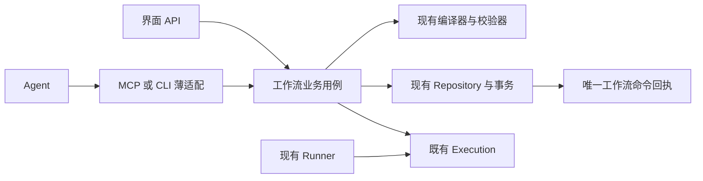
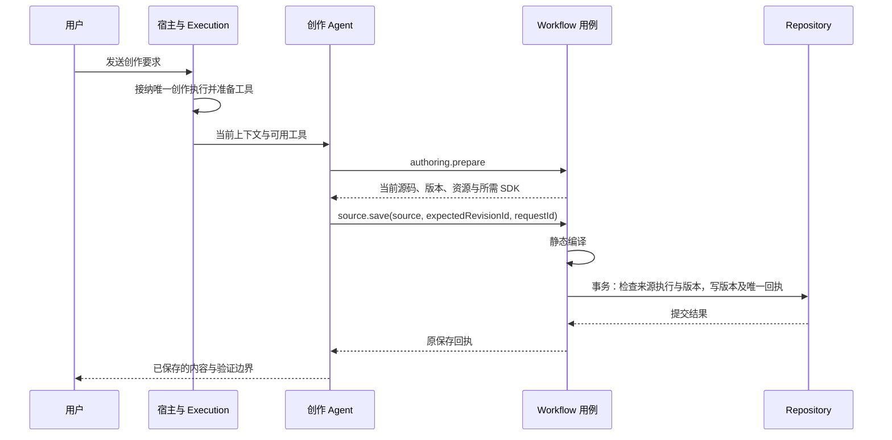

# 工作流 Agent 接入与业务边界收敛设计

状态：待评审方案，尚未实施。本文中的新行为是设计目标，不代表当前版本已经支持。

## 1. 目标与范围

保留现有工作流语言和业务 Schema，重做 Agent 使用工作流的接入方式、校验归属、请求回执与连接恢复。正常创作只需要获取当前上下文、生成源码、提交保存；模型无需管理凭证、执行授权或连接生命周期。

用户已明确的约束：

- 保留已经定义的 Schema，重点解决 Agent 使用与校验、转换的问题。
- 不保留历史实现的重复机制，不建设旧、新授权或旧、新工具路由的双轨兼容。
- 认证可以在服务启动时初始化，不要求每个模型回合更换 token。
- 并发与旧请求的处理由业务入口负责，不依赖模型遵守提示词。
- 连接故障由宿主恢复，不能把“请再发一条消息”作为恢复方案。

本文建议保留 DSL、编译器、Manifest、Revision、Run、节点输入输出、人工问题、重试声明及文件引用的现有语义。Runner、Fiber、Effect 和检查点继续承担耐久运行；不以本次接入重构为理由重写执行引擎。

## 2. 设计结论

整个接入只保留一条业务路径：

MCP、CLI 和 HTTP 只处理各自传输的解析、输出与错误映射。操作直接进入对应业务用例，不再转换为另一套通用 `Action/Type` 指令。

| 责任                               | 唯一所有者                       |
| ---------------------------------- | -------------------------------- |
| 工具名、参数与输出 Schema          | 现有 Operation 目录              |
| 语言、Schema 与源码编译            | 现有 DSL 编译器                  |
| 工作流归属、保存、版本与运行接纳   | Workflow 业务用例                |
| 模型输入、执行身份、取消与原生会话 | 既有 Execution / ThreadLifecycle |
| 内部工具连接、调用关联与传输恢复   | 宿主的 Agent 接入适配            |
| 保存、启动等命令的幂等结果         | 一份 Workflow 命令回执           |
| 执行过程和聊天消息                 | 既有 ConversationStore           |

这是对既有模块的职责收敛，不新增通用工作流网关、Broker、Manager 或第二个执行调度器。

## 3. 保持不变的契约

下列契约保持现有字段、类型和业务语义：

- `ally.workflow`、`meta`、`scripts`、原语与节点选项。
- 输入、输出、worker 结果、人工问题、文件引用的 Schema。
- Manifest、画布投影、源码位置与稳定节点身份。
- 完整源码保存和精确补丁保存，以及 `expectedRevisionId`、补丁摘要、`requestId`。
- 已保存版本不可变、运行固定版本、节点结果为真实业务值。
- `workflow_source_get`、`workflow_source_save`、`workflow_results_submit` 等模型可见工具名及参数。

保留 Schema 不要求保留重复实现：工具说明、错误恢复指引、内部认证字段、调用适配和回执存储可以收敛。由同一个 Schema 生成传输声明和类型，不能手写第二份字段映射。

沿用已有公共响应信封，`data` 严格符合对应 Operation 的输出 Schema；诊断进入既有诊断字段或错误详情，不增加额外结果外壳、不重复 JSON 编码。prepare 中已有的可选知识与契约字段按需返回；减少重复内容不改变字段类型或必填约束。

## 4. 认证、场景和执行身份分开处理

### 4.1 一份服务级认证

Core 启动时生成一份内部能力服务 token，供受管 MCP/CLI 桥访问内部工具入口，持续使用到 Core 退出。它与桌面管理 token、外部知识 MCP 的 API Key 分开，不能用内部工具认证访问全部管理 API。

token 只保存在宿主私有连接配置和请求头中。正常续聊、保存、worker 提交和连接重建均不轮换 token；Core 重启后由宿主重新物化连接配置。

删除工作流路径中的每轮 Grant token、创作 `AuthToken`、consumer token 和 worker 结果 token/digest 的重复认证用途。其他业务领域不在本次删除范围内，不能全局删除仍有调用方的通用设施。

### 4.2 场景来自宿主绑定

创作连接固定绑定工作流与创作 Chat；worker 连接固定绑定 Effect 和 Attempt；消费者只绑定用户已明确选择的工作流集合。不增加普通聊天的工作流使用入口。

上述身份来自创建连接时的宿主上下文，不能由模型的工具参数覆盖。可选 `workflowId` 仍只是归属断言，错误值返回对象冲突。角色工具集合在连接初始化时即可确定，工具目录与静态 SDK 不依赖某个执行已开始。

场景描述不是另一份带 active、过期时间、续期和随机凭证的 Grant。它只是对已有 Chat、Workflow、Effect、Attempt 的引用，业务状态回到各自所有者读取。

该内部入口采用受管桥可信、模型工具参数不可信的边界；不声称能隔离同一系统用户权限下主动窃取凭证并伪造桥请求的恶意程序。若以后需要这种隔离，应作为独立的进程安全能力设计，不能靠不断轮换同目录文件中的 token 宣称已经解决。

### 4.3 旧请求身份不能跟随“当前执行”漂移

固定 token 只解决服务认证，不能据此把所有写入算给当前活跃执行。

每个工具请求在宿主接纳时冻结来源：原生连接身份、Chat、`OriginExecutionID`、工具调用身份和业务场景。业务 handler 持有这份不可变调用上下文，排队、编译、重试和换传输均不得重新读取当前执行来改写来源。

有可靠原生调用关联时，由适配器提供调用所属的 invocation。只有 stdio 会话关联时，宿主复用 ThreadLifecycle 的单 Turn 席位，在提交输入前绑定该连接的 Turn；请求进入 Core 时捕获它。下一 Turn 只能在上一 Turn 终止、已进入请求排空且原生消费者不再产生上一轮调用后绑定。

取消后无法确认调用已收敛的 Runtime，必须退役该原生连接及其场景引用，再以新连接继续；旧连接不能重新绑定下一轮。不能只把旧 MCP 进程能读取的“当前 executionId”文件改成新值。正常结束后的热复用也须经过同一收敛验收；未通过的 Runtime 使用不可重新绑定的执行级桥连接，认证 token 仍保持不变。

连接身份和活动 Turn 复用 ProviderRuntime / ThreadLifecycle 的事实。实现若需要可调用端口，只增加窄的关联查询与关闭通知，不再维护独立活跃执行表。

## 5. 创作只保留一条明确路径

一个工作流关联一个正式创作 Chat；多窗口打开时复用该 Chat。清空原生上下文不创建第二个业务创作会话。历史版本继续独立保留。

创作消息统一通过工作流接纳入口交给 Execution。同一 Chat 只允许一个尚未结束的创作执行，重复提交同一输入重放已有接纳结果；另一个新输入返回明确的“正在编辑”。停止后才能接纳下一轮，不能静默抢占。

并发席位归 Execution 所有。Workflow 仅保存工作流与创作 Chat 的关系，不再镜像一套 `ActiveExecutionID`、认证 token 与 accepted 状态；消息幂等及跨存储接纳对账复用 Execution 已有输入、接纳记录。

HTTP 手工保存、版本恢复等没有来源 Execution 的管理操作，也经过同一编辑冲突检查：存在活跃创作执行时返回忙碌，不能跳过接纳约束直接覆盖；用户明确停止当前创作后才可提交。这类操作仍保留自身的 revision CAS，不伪造一个模型执行身份。

`prepare` 是便利的上下文读取，不是注册、授权、续期或保存的前置握手。已有准确源码与基准版本时可以直接保存；`source.validate` 保持可选。

正式源码继续只由成功保存的 Revision 拥有。无法编译的源码可以保留在现有 scripts 草稿中，但不新增一套草稿版本数据库或伪装成可运行版本。源码能否保存与当前机器能否运行分开判断，避免因临时环境问题丢失可编译创作结果。

## 6. 校验按事实所有者分配

| 校验                                                   | 负责位置                   | 触发时机                 |
| ------------------------------------------------------ | -------------------------- | ------------------------ |
| JSON 字段、类型、必填、大小限制                        | Operation 同源契约         | 业务入口解析一次         |
| 连接认证和宿主来源                                     | Agent 接入适配             | 每个实际传输请求         |
| 工作流归属与允许操作                                   | 对应业务用例               | 读取或修改已有业务对象时 |
| 语法、静态 Schema、控制流、稳定身份、补丁基准          | 共享源码检查实现           | validate 或新的 save     |
| 当前编辑执行是否被取消、接替                           | 保存事务                   | 新版本实际提交前         |
| 当前 Head 是否仍为预期 revision                        | 保存事务                   | 新版本实际提交前         |
| 账号、模型、资源安装、连接器可用性、执行权限与重试能力 | Run 接纳及实际资源使用边界 | 显式运行时               |
| worker 结果匹配节点 Schema                             | 结果提交用例               | 接纳候选时               |
| 对应执行的真实成功或失败                               | Runner 的 worker 收敛      | 确认节点结果时           |

传输库可以按同源 Schema 做必要的边界校验，但不增加另一套业务规则，也不把原业务错误改写成 Schema 错误。

保存不依赖编辑 Agent 的账号、模型或只读配置，不要求连接器当前在线。静态无效的声明仍报编译错误；当前资源不存在、运行配置不支持已声明重试等问题进入运行诊断，不能静默删除策略或放宽权限。

validate 与 save 共用编译和诊断实现；运行能力诊断可作为准备结果按需返回，不创建强制的“预检许可”或持久 ready 状态。Run 启动根据真实目标配置重新判断。资源使用时保留必要的撤销、删除与真实失败检查，不以接纳时通过为永久许可。

取消检查在最终写事务内保留；入口读取和提交检查之间可能经过编译，不能只检查入口一次。删除的是 `agentOwner → 假能力查询 → handleTool → 再次身份查询` 的重复链路。

## 7. 保存与幂等只有一个提交边界

HTTP、MCP、CLI 直接调用同一个 `SaveSource` 用例。它接收既有保存参数与宿主调用上下文，返回既有保存回执和诊断，不接收创作 token。

处理顺序：

1. 解析参数、确定允许访问的工作流，计算规范请求摘要。
2. 按业务归属、操作、原 requestId 查找唯一回执；存在则比较摘要并返回原结果，不重新编译、不重新产生版本。
3. 没有回执时应用补丁并静态编译；这段工作不占用数据库事务。
4. 写事务内再次检查同请求回执，解决并发重放；没有回执才检查来源执行、Head 与批注归属。
5. 在同一事务写 Revision、Head、批注处理、保存回执和领域事件。

取消与保存必须有同一个可线性化的提交边界：最终写事务由 Execution 的原执行提交许可包围，取消与输入接替先撤销该许可，再等待已有提交退出。许可只覆盖最终数据库提交，不覆盖编译、网络或模型等待，也不签发新凭证。若保存先完成，取消保留该已提交版本；若取消先取得该边界，保存被拒绝。Chat 日志与业务 SQLite 并非同一存储，不能仅在数据库事务内读取一次执行状态就宣称解决了这项竞态。

回执的读取需要当前仍有该工作流访问范围，但不要求原编辑执行仍活跃。因此模型已结束、连接重建或 Core 重启后仍可恢复已提交事实。原执行取消后只能查询原结果，不能借查询重新提交。

工作流统一使用 `WorkflowCommandReceipt` 作为命令回执来源。唯一身份为“业务归属 + 操作 + requestId”；若既有内部索引不足，调整该表的键，而不建立别名回执表。保存、启动、取消、人工回答与 worker 结果提交均由所属用例在事务内登记回执；通用 `receipts_get` 只适配查询此来源。

移除工作流对 `AgentCommandReceipt` 的同结果副本和重复请求身份哈希。其他领域仍在使用的通用回执设施保留。一次操作的日志记录只引用该权威回执，不成为第二份可重放结果。

同 requestId 不同内容明确冲突；修正源码使用新的 requestId。新的显式保存仍按既有语义生成版本，本方案不顺带改变“相同源码的新保存”行为。

## 8. worker 只使用一个结构化结果契约

无结果 Schema 的 worker 继续返回执行成功后的最终文本。有结果 Schema 的 worker 统一使用既有 `workflow.results.submit(data, requestId)`；数据 Schema 以及候选与成功分开的语义保持不变。

- 宿主在输入中一次提供结果 Schema；`results.schema` 是按需读取，不强制再查一次。
- Schema 不合法时，工具把字段诊断返回给同一个 worker，由它在本次正常工具循环中修正。
- 第一次合法提交保存候选与回执；同键同内容返回原结果，候选不被不同内容覆盖。
- Runner 等待该 Attempt 的 Execution 真正成功后才确认候选；失败、取消或异常终止不会因已有候选而成功。
- 删除从任意最终正文猜测结构化 JSON、再额外启动模型修复格式的隐式通道。最终聊天文字不成为另一个结构化结果来源。
- worker 正常结束却没有提交候选时，返回明确的结果缺失错误，不重新执行可能含业务副作用的 worker。

这项选择减少结果来源，而不减少对真实成功的确认。候选与已确认结果分别表示提交事实和执行终态，继续保留。

## 9. 连接与恢复归宿主

### 9.1 工具在提交模型输入前准备

保留 `ally_capabilities` MCP 与 CLI 两种传输，但一轮只由宿主选择一种，二者使用同一契约、业务调用上下文和 requestId。

MCP 初始化只读取角色工具定义，不需要执行已激活。宿主在提交业务 Prompt 前确认实际工具加载，不能把“传入配置”当成“可调用”。缺少真实加载观察、连接重建或调用关联能力的 Runtime，初始就选择 CLI；其能力以验收结果为准，不凭声明推断。

加载确认只发生在新建或重建连接时。热续聊复用已确认连接，不每轮探测工具、账号或模型目录；可选目录探测失败不阻断已有执行。

工具已加载后不再要求模型进行 CLI discovery 或探测连接。原生 CLI 自带的通用工具检索仍由它自己管理，宿主不能假定能控制其内部索引。

MCP 加载失败发生在 Prompt 提交前时，宿主重建一次；仍失败则选择可用 CLI 后再提交，不能让用户重复输入。CLI 也不可用时返回明确准备失败，保留原输入供既有重试入口继续。

### 9.2 故障处理规则

| 故障                                 | 宿主行为                                                                                                                                                     |
| ------------------------------------ | ------------------------------------------------------------------------------------------------------------------------------------------------------------ |
| 只读请求连接失败                     | 在同一来源和范围内重连并自动重试一次                                                                                                                         |
| 写请求确定尚未进入业务入口           | 保留内容与 requestId，恢复传输后自动重试一次                                                                                                                 |
| 写请求已提交、响应丢失               | 查原回执并返回；不重新保存或启动                                                                                                                             |
| 写结果未知                           | 先查原回执；保存、运行接纳等已保证事务性幂等的工作流命令，可在原执行仍可提交时同键重试一次，由事务内回执复查与唯一约束收敛；不能以“回执未找到”判定原请求失败 |
| 模型端显示工具丢失                   | 使用 Runtime 的结构化连接诊断修复原连接。不能通过解析自由文本猜测重发整个任务                                                                                |
| 当前 Runtime 无法在执行中重建工具    | 先核对原生输入接纳和已发生调用；不能盲目重发 Prompt。恢复不了时通过原执行的重试入口继续原输入，不要求用户重新描述任务                                        |
| 版本冲突、源码错误、候选 Schema 错误 | 返回具体业务诊断，由 Agent 修正；不重连、不换凭证                                                                                                            |
| 用户取消、对象删除、访问范围被撤销   | 停止对应工作；不自动恢复权限或重做业务                                                                                                                       |
| Core 重启                            | 用新启动认证重建连接，查询待确认回执；运行按原检查点恢复，已取消任务不复活                                                                                   |

自动传输恢复最多一次，复用现有请求截止时间；不新增持久重试状态机。连续失败返回具体故障，避免无限重连。

上述同键重试仅适用于本方案保证业务事实与回执同事务提交的命令，不需要先证明原 HTTP 请求已退出。原调用与恢复调用竞争时，只有一个事务能产生新的业务事实，另一个返回原回执。任意外部工具调用、整轮模型 Prompt 和结果未知的实际发送不具有此保证，不能套用这项重试规则。

原请求的 exact payload、requestId 和来源在调用未决期间保留。模型业务工具调用及原回执关联复用 ConversationStore 的工具记录；若需要补全持久字段，扩展该记录，不另建命令重放日志。服务重启后仅依据能完整恢复的原请求和接纳证据处理；缺少载荷或接纳状态不明时不猜测重放。

更换传输只能由宿主执行，并保留同一业务来源和请求身份。接纳不明的模型输入不能因换传输重跑；外部发送等未知效果也不能由接入重试策略重做。

## 10. Agent 需要知道什么

创作模式提供一份稳定简短指令：本次编辑当前工作流，使用产品 DSL，取得真实资源，保存后按实际回执说明结果。常规路径是 `prepare → save`，按需读取源码、SDK、证据或运行诊断。

完整方法指南只提供一次。prepare 不重复返回已经内联的创作指南，也不再次发布已经通过工具系统提供的完整保存 Schema；只组合所需语言知识、当前资源、源码、批注与实际运行能力诊断。

模型可见错误保留既有结构化响应，区分输入错误、版本冲突、忙碌、连接失败、取消与未知结果。删除要求模型管理 `refresh_context`、重新签发授权或要求用户发消息续权的产品流程；服务内部认证失败由宿主诊断。

正常用户说明仅包含业务改动、是否保存、是否运行、结果与需要处理的真实问题，不暴露连接文件、token 或内部接纳步骤。

## 11. 模块与删除范围

| 现有位置                               | 收敛后的职责                                                         |
| -------------------------------------- | -------------------------------------------------------------------- |
| `internal/agent/capability`            | 同源 Operation 契约和通用传输边界；工作流不再通过每轮 Grant 管理连接 |
| `internal/agent/cli`                   | MCP/CLI 解析与同源调用适配，不持有工作流业务状态                     |
| `services/execution`、`internal/agent` | 原执行接纳、调用关联、取消、连接所有权与恢复；不接管工作流规则       |
| `services/workflow`                    | 被 HTTP、Agent、Runner 真实复用的保存、运行、结果等用例              |
| `apis/workflows`                       | HTTP 专有参数与输出适配、单入口流程                                  |
| `internal/workflow/dsl`                | 保留现有编译与 JSON Schema 实现                                      |
| `internal/workflow/state`              | 保留 Runner 共享协调，不增加创作授权状态                             |
| Workflow Repository                    | 权威版本、运行事实、唯一命令回执                                     |

明确移除：工作流每轮秘密凭证与续权路径、重复 active 状态、`workflowAgentInput` 和 `Input.Action/Type` 中转、`agentOwner` 的伪能力查询、工作流双份命令回执、重复完整指南、结构化结果正文猜测及额外格式修复、要求用户重发消息的授权恢复指引。

当前临时增加的 MCP catalog 启动例外随最终静态目录路径合并，不保留第二套 bootstrap 授权入口。通用能力设施的其他调用方、用户的无关修改、既有源码和运行文件均不在清理范围内。

对本机运行库和调用关系一次性切换，不建设旧 token 或旧 Action 路由的兼容层。旧活跃进程须先停止并确认退出，升级后重建连接。持久业务 Revision、Run、节点 Schema 和已提交结果保留；唯一回执布局若调整，按实际字段做一次性数据整理和重复冲突检查，不能通过删除业务数据实现“无历史包袱”。具体上线操作属于实施计划，不由本文授权执行。

## 12. 验收标准

所有自动化检查按改动包和直接影响用例执行，真实 Runtime 验收独立记录。至少验证：

1. 现有 DSL、Schema、画布与文件契约样本保持通过，不要求已有工作流改写。
2. 从首次创作到多轮续聊，MCP 初始化不依赖执行激活，无 token 轮换；也覆盖初始 CLI 路径。
3. 同一工作流两个并发创作输入只接纳一个，重复原请求重放原接纳结果；其他工作流及 worker 并行不受影响。
4. 保存 A 编译期间取消并开始 B，A 在提交前被拒绝；旧连接迟到调用不能变成 B 的请求。
5. 编辑 Agent 的模型、权限或当前资源可用性不影响静态有效源码的保存；运行接纳按实际执行配置给出明确诊断。
6. HTTP、MCP、CLI 对同输入返回一致业务结果和诊断，只有传输编码差异；没有重复 Action 路由和重复回执。
7. 保存提交后丢响应、执行结束或 Core 重启，仍可查询原回执；同键重放不产生第二个版本。
8. 相同 requestId 不同内容冲突；版本冲突不自动覆盖；原请求取消后不能重新提交。
9. 工具加载失败在 Prompt 前恢复或改选 CLI；中途故障保留原请求身份，不能重发接纳不明的整轮模型输入。
10. 有 Schema 的 worker 只从正式候选产生结构化结果；Schema 修正、重复提交、正常结束未提交、提交后执行失败分别有确定结果。
11. 节点检查点、人工等待、部分失败收集、固定版本重试、文件成果及未知外部效果的原保护保持有效。
12. 真实 WorkBuddy 验收覆盖首次加载、停止后续发、工具连接失败和保存回执丢失；各 Runtime 未验收的能力保持未知，不声称已支持恢复。

## 13. 依据与设计决定

当前行为依据：[工作流架构](../../architecture/workflows-cn.md)、[语言与编译](../../architecture/workflow-language-cn.md)、[系统能力](../../architecture/agent-capabilities-cn.md)、[当前保存实现](../../../server/services/workflow/source.go)、[Agent 适配](../../../server/services/workflow/agent.go)、[结果确认](../../../server/services/workflow/worker.go)。这些是重构基线，本文不将现有缺陷解释为已实现的新行为。

本方案提出、尚待用户评审的决定：内部服务级 token 与管理认证分开；一个正式创作 Chat；静态保存与运行能力分离；结构化 worker 保留工具提交这一条结果通路；自动传输恢复有界且不重发未知业务效果；不扩展 DSL、不增加新的工作流状态机。
