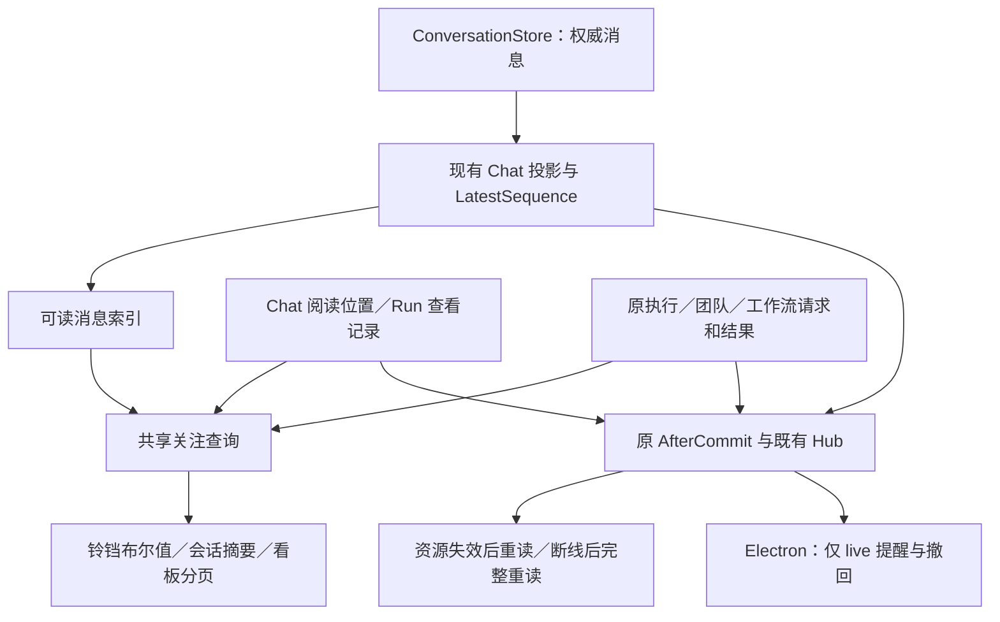
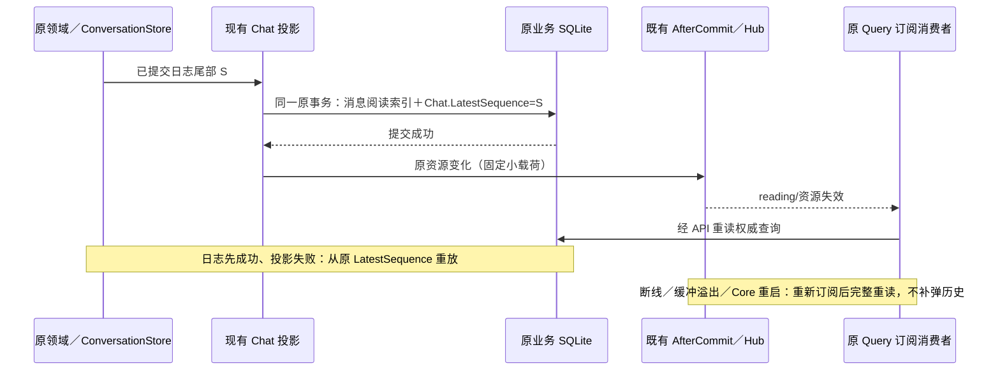

# 会话阅读、待处理与桌面提醒重建设计

> 本文是本次改造的设计依据，源码对照和验收记录见[实施计划](../plans/2026-11-10-conversation-reading-and-attention.md)。

## 1. 范围与收敛结论

已确认：废弃旧通知业务、无兼容；铃铛只有小点；保留任务看板的“需要操作”“待我查看”和工作记录；参考 OpenBot，由 Go 后端准确处理多个会话。

采用 OpenBot 的职责分法：**消息及原请求是事实、阅读位置是用户事实、侧栏/看板是派生查询、系统通知是实时呈现。**不另建全局关注状态机。保留本仓库的 ConversationStore、业务 SQLite 和既有认证 WS，不移植 OpenBot 整套数据库事件溯源。

本方案收敛为三个功能数据表和一个一次性初始化标记：可读消息索引、Chat 阅读位置、运行查看记录、初始化标记。复用 Chat.LatestSequence 做唯一消息投影覆盖；不保存 Bot 聚合计数、铃铛状态、请求副本或系统通知历史。

### 1.1 本次审查明确删除的设计

| 前版设计                                                       | 审查发现                                                             | 收敛结果                                                                  |
| -------------------------------------------------------------- | -------------------------------------------------------------------- | ------------------------------------------------------------------------- |
| ChatReadingProjection.AppliedSequence                          | 与原 Chat.LatestSequence 和现有投影 CAS 重复                         | 删除整张表；索引加入原投影事务                                            |
| workspace_state、workspace_changes、全域 Revision 和耐久派发器 | 迫使所有业务接入新的全局写入顺序；恢复又不补弹，缺乏所需业务保证     | 删除；使用原资源提交后失效事件与完整重读                                  |
| view_snapshots、view_snapshot_targets 及跨重启批量任务         | 把一次阅读操作做成持久任务系统；重启后还可能继续改变用户阅读意图     | 删除；按 OpenBot 捕获具体目标边界，再分批调用幂等阅读命令                 |
| WorkflowRun/AutomaticRun.ReviewVersion、ReviewAvailableAt      | 错按同 Run 重试建模；实际工作流重试创建新 RunID                      | 删除原模型新增字段；按独立原 RunID 保存已查看                             |
| 动态分配阅读者与运行期 initializing/ready 状态                 | 本机阶段不提供多用户；查询完整性不应成为第二套业务生命周期           | 固定本机阅读者身份；初始化只在首次切换执行                                |
| 全局移动 internal/notification/events                          | 文件夹名字不决定业务归属；为此次阅读功能重排所有领域事件调用扩大范围 | 保留纯 Hub 基础设施及既有导入；删其中旧通知专属调用，日后目录归位单独处理 |

关键漏洞同时修正：显式打开不是永久 true 的资格。一次打开命令冲突后不得取得新代次重放，否则仍会清掉另一窗口刚标记的未读。

## 2. OpenBot 实现依据与适配边界

参考源码固定为 OpenBot 0.66.0 / `22cd028e7c99c41e49bbab434dbda63ff9e56304`；本机安装版为 0.65.0。本次为源码审查，没有将静态结论冒充安装版实时验收。

| 机制         | OpenBot 原实现                                                                                                                                                                                                                                                                                                                                                        | NeuxBot 采用方式                                                                                     |
| ------------ | --------------------------------------------------------------------------------------------------------------------------------------------------------------------------------------------------------------------------------------------------------------------------------------------------------------------------------------------------------------------- | ---------------------------------------------------------------------------------------------------- |
| 阅读事实     | [ConversationReadStore](https://github.com/nightly-labs/openbot/blob/22cd028e7c99c41e49bbab434dbda63ff9e56304/src/backend/conversation-read-store.ts#L129) 保存 member/thread 的消息边界，普通 read 只前进；mark-unread 独立后退                                                                                                                                      | 固定本机 reader + Chat 边界；使用原公开消息展示顺序，不用终态到达顺序代替                            |
| 未读资格     | [共享规则](https://github.com/nightly-labs/openbot/blob/22cd028e7c99c41e49bbab434dbda63ff9e56304/packages/contracts/src/conversation-read.ts#L28) 排除用户本人、commentary、plan、Agent exchange 等                                                                                                                                                                   | 按本仓库公开 messageview 的正文/actor 分类，一条稳定消息只计一次                                     |
| 多线程聚合   | [主会话加子线程](https://github.com/nightly-labs/openbot/blob/22cd028e7c99c41e49bbab434dbda63ff9e56304/src/renderer/src/features/conversation/conversation-context.tsx#L171)、[未归档线程求和](https://github.com/nightly-labs/openbot/blob/22cd028e7c99c41e49bbab434dbda63ff9e56304/src/renderer/src/features/agent-tasks/agent-tasks-state.ts#L443)                 | 聚合公式保留，但放在 Go 完整查询，不依赖前端曾访问过的子线程缓存                                     |
| 读取之后刷新 | [ConversationReader](https://github.com/nightly-labs/openbot/blob/22cd028e7c99c41e49bbab434dbda63ff9e56304/src/backend/agent/conversation-reader.ts#L144) 更新游标后发 conversation-invalidated，其他消费者重读                                                                                                                                                       | 原事务 AfterCommit 发窄失效事件；复用 use-query-events 对账                                          |
| 手动未读     | [前端持有 hold、串行阅读命令](https://github.com/nightly-labs/openbot/blob/22cd028e7c99c41e49bbab434dbda63ff9e56304/src/renderer/src/features/conversation/conversation-context.tsx#L991)，[显式重开解除](https://github.com/nightly-labs/openbot/blob/22cd028e7c99c41e49bbab434dbda63ff9e56304/src/renderer/src/features/conversation/conversation-context.tsx#L367) | 采用一次打开动作；为本机多个窗口共享阅读补充一个持久 UnreadGeneration/HoldUnread，防跨窗口旧意图覆盖 |
| 请求恢复     | [完整/部分 Runtime 快照对账](https://github.com/nightly-labs/openbot/blob/22cd028e7c99c41e49bbab434dbda63ff9e56304/src/renderer/src/features/agents/agent-runtime-snapshot.ts#L82)                                                                                                                                                                                    | 原请求所有者提供有效集合；完整快照才能删除缺席请求                                                   |
| 系统提醒     | [主进程实时消费及内存请求 Map](https://github.com/nightly-labs/openbot/blob/22cd028e7c99c41e49bbab434dbda63ff9e56304/src/main/renderer-forwarders.ts#L324)                                                                                                                                                                                                            | 同样只消费 live 事件，内存去重/撤回，不建立通知数据表                                                |
| 全部已读     | [逐线程捕获边界再调用](https://github.com/nightly-labs/openbot/blob/22cd028e7c99c41e49bbab434dbda63ff9e56304/src/renderer/src/features/conversation/conversation-context.tsx#L1128)                                                                                                                                                                                   | 服务端提供过滤范围内的准确目标，前端保留操作快照并分批提交；不跨重启继续                             |

OpenBot 的 `ConversationReadStore.#saveCursor` 确实通过其现有 [DatabaseCore.dispatch](https://github.com/nightly-labs/openbot/blob/22cd028e7c99c41e49bbab434dbda63ff9e56304/src/backend/database/database-core.ts#L108) 保存领域事件与投影，并非“完全无持久事件”。但那是整个产品共用的数据库架构，不能据此为 NeuxBot 的铃铛另造一套 WorkspaceChange。这里采用它的阅读/请求/提醒边界，沿用 NeuxBot 已有日志、事务和 Hub。

公开正文资格和“最近失败”优先于未读是 NeuxBot 的产品选择。OpenBot 的未读过滤按作者和 itemType，普通失败也没有单独插入侧栏状态优先级。沿用它的约束是消息页、未读计数、读到某条和从某条标未读必须使用同一排序。

实施计划逐项列出了固定提交的源码入口、对照行为和验收记录。 [按任务查看 OpenBot 源码](../plans/2026-11-10-conversation-reading-and-attention.md#openbot-源码对照与验收)

本仓库依据：[Chat 投影 CAS](../../../server/services/chat/live_projection.go)、[Chat.LatestSequence](../../../server/repositories/models/chat.go)、[提交后事件缓冲](../../../server/internal/notification/events/hub.go)、[事务边界](../../../server/repositories/controllers/transaction_controller.go)、[工作流重试新 Run](../../../server/apis/workflows/retry_workflow_run.go)、[新 Run 回归用例](../../../server/apis/workflows/recovery_commands_test.go)、[自动机会恢复](../../../server/services/schedule/runs.go)。

## 3. 事实与唯一归属

| 事实      | 唯一来源                                    | 不另存什么                                           |
| --------- | ------------------------------------------- | ---------------------------------------------------- |
| 消息/执行 | ConversationStore 日志；SQLite 是可重建投影 | 不另存消息正文、执行状态副本                         |
| 阅读      | ChatReadCursor、RunViewMark                 | 不持久化未读计数、Bot 计数、铃铛小点                 |
| 有效请求  | 原执行、团队验收、工作流人工请求            | 不建通用 pending 表，不由通知结束请求                |
| 聚合      | 一致的 SQLite 查询及 Go 归属组装            | 不建全局关注实体或聚合生命周期                       |
| 桌面提醒  | 原已提交 live 事件                          | 不存 dismissed/read/noticeId，不保证短暂弹窗耐久交付 |

`WorkRef={kind,id}` 引用原容器，不创建 WorkID。kind 为 chat/team_thread/workflow_run/automatic_run。实际请求始终保留原 Chat/Run/Task/Request 身份，WorkRef 只用于分组与导航。

| 来源                                          | 唯一全局归属与阅读目标                                                                        |
| --------------------------------------------- | --------------------------------------------------------------------------------------------- |
| 普通/分叉/工作流创作 Chat                     | 原 Chat，归所属 Bot；各自阅读，分叉继承部分初始已读                                           |
| 团队对话及成员正式报告                        | team_thread；只计公开主对话的合格消息，正式报告一份；成员内部日志不重复计，审批仍定位真实成员 |
| 工作流 worker/joined 子运行                   | 归最近的用户可见所属运行；子请求可在根未终态时进入需要操作，结果只在所属运行发布后待查看      |
| detached 子运行                               | 独立可见运行，不能再计祖先                                                                    |
| 自动任务有 Chat/Thread/WorkflowRun            | 归其已接纳的真实目标；automatic 只作来源标签                                                  |
| 自动机会无目标且 admission=failed/interrupted | 原 automatic_run 的安全失败详情；pending/skipped 不作为待查看                                 |
| IM                                            | 归原 Chat/团队；外部送达不等于本机已读                                                        |
| 知识库整理、安装、同步                        | 原页面内处理，不进入本方案的关注集合                                                          |

归属、可见性和请求有效性在一个共享查询规则中定义，REST、铃铛、看板都调用它。不能因 Request 属于成员而把成员内部消息计为公开未读。归档退出默认待查看、保留阅读事实；有有效请求时禁止归档，不能用隐藏绕过待办。

## 4. Go 架构与最少数据

### 4.1 ChatReadableMessage：索引，不是第二份会话

表 `chat_readable_messages`；主键 `(chat_id,message_id)`；唯一范围索引 `(chat_id,order_sequence)`。

| 字段          | Go 类型／默认                     | 含义                                                                 |
| ------------- | --------------------------------- | -------------------------------------------------------------------- |
| ChatID        | string，必填                      | 原 Chat 身份                                                         |
| MessageID     | string，必填                      | 原公开消息身份；同一答复的流式修改不增加行                           |
| OrderSequence | int64 > 0                         | 原公开 Message.CreatedSequence；与消息页的展示顺序一致，不另分配序号 |
| ExecutionID   | string，默认空                    | 原执行，成员报告等没有执行时允许空；不强制伪造执行身份               |
| Kind          | 枚举 answer/failure/member_report | 安全可读类型，零值非法                                               |
| CreatedAt     | int64，必填                       | 原消息创建时间，非阅读时间                                           |

只要原持久公开消息已具有合格正文即可计入，不必须等待整轮结束；执行完成事件只用于完成提醒，不再制造第二条未读。这与 OpenBot 的“消息身份＋过滤规则”一致。明确的公开失败说明可计入；空占位、用户本人、commentary、工具过程和内部 Agent 交换不计。正式成员报告按 actor 判断，即使底层事件类型为 user-message 也不漏算。

团队目前以时间、角色和 ID 重新排序。同毫秒先提交 Z 报告，再提交 A 报告，会显示 A → Z，但 Chat 序号为 Z → A。实施时统一采用主 Chat 的 CreatedSequence 排列已持久化公开消息。团队历史分页、实时合并、定位和阅读边界使用同一顺序。未投递输入作为临时行排在已持久消息之后，按原入队顺序展示，持久化时用稳定消息身份替换，从未确认的临时行不作阅读边界。既有工作记录排序不受此约束。

正文/文件/终态是同一 MessageID 的内容更新，不自动重新变成未读。读到展示顺序边界意味着该前缀内既有消息均已读；边界之前同一消息后来完善内容也不重新计数。需要再次告知的独立交付必须由原会话创建新消息，不由阅读器给旧消息改序。索引分类可能由原消息修正，查询据当前公开资格计数；不能用 Token/最后终态到达的时间排列消息。

投影把索引 upsert/delete 与原 Chat.AdvanceProjection 放进**同一个现有 SQLite 事务**。覆盖位置只有 Chat.LatestSequence；若需快速排除无新消息候选，在原 Chat 查询投影增加 `LatestReadableSequence int64=0`，含义是最大 OrderSequence，仅为可重建查询提示，不是第二个覆盖位置。索引修复与该提示一起更新。逐条提交、批量创建、分叉发布、启动追平及完整重建都必须覆盖该不变量，不能只接入 catchUpLiveProjection。对尾部影响的消息，用原消息索引在冻结的日志末尾解析必要正文，事务外计算索引改动。遇到 CAS 冲突重新取覆盖位置和受影响消息，不能拿旧分类覆盖更新。

投影重建可以替换 Chat 行及可重建索引。现有重建使用 Delete/Create，因此读取游标的清理必须放在确认永久删除的聚合用例中。重建、追平和替换行都保留原 Cursor、代次及 HoldUnread。永久删除才在同一事务清理该 Chat 的索引与游标。

### 4.2 ChatReadCursor：用户阅读事实

表 `chat_read_cursors`；主键 `(reader_id,chat_id)`。

| 字段             | Go 类型／默认    | 含义                                                                       |
| ---------------- | ---------------- | -------------------------------------------------------------------------- |
| ReaderID         | string，必填     | Core 固定本机 UUID 常量 `00000000000000000000000000000001`；客户端不可指定 |
| ChatID           | string，必填     | 只影响这个 Chat                                                            |
| ThroughSequence  | int64，默认 0    | 原公开展示顺序边界；正常读单调前进，手动未读独立后退                       |
| UnreadGeneration | int64，默认 0    | 仅每次成功手动标未读递增，隔离旧阅读意图；普通读不增加                     |
| HoldUnread       | bool，默认 false | 手动未读后阻止自动读；只由新的显式打开/已读动作解除                        |
| UpdatedAt        | int64，必填      | 用户阅读更新时间，不更新工作活动时间                                       |

普通读命令携带 `throughMessageID、observedUnreadGeneration、intent=automatic/explicit`。事务内校验消息归属，解析原展示边界；Generation 不匹配返回冲突。automatic 还要求 HoldUnread=false；explicit 可在代次匹配时清 HoldUnread。ThroughSequence 取当前与合法目标最大值，多个普通读不互相冲突。命令返回通用成功；事件触发权威重读，不能将旧回执整对象覆盖新缓存。

手动未读携带 `fromMessageID、observedUnreadGeneration`；校验代次后设置边界为该公开消息之前的原顺序、Generation+1、HoldUnread=true，同事务完成。Cursor 不依赖边界消息仍存在：删除该消息保留数值边界，不能像新线程一样自动清空未读。正常删消息同步删索引并更新候选提示；底层日志截短/损坏明确失败，不擅自重设用户阅读位置。

### 4.3 RunViewMark：一次原运行的查看事实

表 `run_view_marks`；主键 `(reader_id,owner_kind,owner_id)`。字段仅：ReaderID string、OwnerKind 枚举 workflow_run/automatic_run、OwnerID string、ViewedAt int64。记录存在代表此原运行结果已查看；不另存结果、副本状态或版本。

工作流结果来自原 Run.Result/Failure/Status/CompletedAt；资格为 succeeded 且有公开 Result，或 failed 且有安全 Failure。用户主动 cancelled、空成功终态不新增待查看；不能用任意 terminal 状态一概算未读。当前 retry 创建新 RunID，原终态结果不改写；新运行自然具有新的未查看身份。内部节点/worker 重试在运行终态之前，不能当成多次公开结果发布。禁止为了阅读增加 ReviewVersion 或改写原重试模型。

自动接纳前失败/中断来自原 Admission、ErrorCode、UpdatedAt，且必须没有业务目标；原 schedule 的 ReconcileRun 仅处理 pending。查看 API 重新校验其已形成明确最终失败且不能再接纳同一机会；若实现中发现合法 failed/interrupted→pending 原生产路径，先收口该机会生命周期，不用 UpdatedAt 当虚假的结果版本。

查看只确认**请求明确给出的原 RunID**。查询/打开定义页、列表页不确认；原结果区域已呈现才提交。工作流终态追加技术元信息不会使结果再次未查看；未来若产品支持修改同一 Run 的公开结果，须另评估真实结果身份，当前不预建版本层。

### 4.4 首次初始化标记

表 `reading_initialization` 单行：ID string（固定 32 位 UUID）、StartedAt int64、BaselineCompletedAt *int64、CompletedAt *int64（各阶段未完成为 nil）。只用于这次无兼容切换，不参与日常聚合、无持续恢复调度。

首次启动在原启动屏障内暂停新接纳、调度与 IM 派发。从 ConversationStore 枚举真实 Chat 日志，覆盖 SQLite 投影缺失的 Chat。现有 Chat 启动恢复会同时追平投影并写入中断执行的终态，首次初始化需要先复用其中的投影重放能力。逐 Chat 在同一事务重建历史可读索引并写入缺失的初始 Cursor，已有 Cursor 保留。运行查看记录按历史可见终态逐批初始化。中断后继续缺失目标。

基线逐 Chat 分类。单个损坏日志沿用现有恢复诊断和隔离规则，保留已存在的 Cursor，缺失 Cursor 不创建虚假的已读记录。健康 Chat 和历史运行完成基线后即可开放后续恢复。对含隔离 Chat 的读取返回范围明确的 incomplete，仍允许查看健康列表及操作已确认请求。基础设施故障仍按原启动故障处理。

初始化完成后，所有新 Chat 必须在建立查询投影时同步创建 Cursor，普通新会话从 0 开始，分叉使用继承边界。旧 Chat 被隔离而缺失 Cursor，后来恢复时以可核验的旧日志边界初始化。无法确认历史与新消息分界时保守从 0 计数，已有可读消息可能显示未读，不以修复时的最新位置自动标已读。

可恢复的历史 Chat 和历史运行完成基线后，先持久提交 BaselineCompletedAt，再执行原 Runtime 恢复对账：失联请求由原执行结束，可恢复工作流等待保留；恢复新提交的真实中断失败说明是新消息，可以未读。按第 9 节完成旧表清理后标记 CompletedAt 并开放业务。若恢复期间崩溃，重启看见 BaselineCompletedAt 就必须跳过全部基线工作，不能把恢复已产生的新消息/失败运行重新标已看；仅继续原领域恢复及最终清理。该顺序须由启动用例测试，不能让 scheduler 或 Runtime 恢复偷偷先写入新事实。

所有新模型按项目注册/AutoMigrate；Go 每个字段有准确注释。除了上述三表与初始化标记，不再建立本功能的持久表。ReaderID 固定是本机范围选择，不代表新增账号、多用户或远程权限。

## 5. 聚合、看板与查询一致性

### 5.1 指标

| 指标                  | 准确口径                                                   |
| --------------------- | ---------------------------------------------------------- |
| unreadMessageCount    | 合格公开消息中 OrderSequence 超过阅读位置的条数            |
| unreadChatCount       | 有上述未读的可见公开对话容器数；团队一个主对话容器         |
| waitingWorkCount      | 存在有效请求的不同 WorkRef 数                              |
| pendingRequestCount   | 有效原请求数；审批、输入、团队验收、工作流人工操作分别定位 |
| awaitingViewWorkCount | 有未读消息或未查看最终结果的不同 WorkRef 数                |
| runningChatCount      | 原生命周期中的运行对话数，与未读/待处理独立                |
| hasAction / hasUnread | 上述请求/待查看集合是否非空；铃铛为二者 OR                 |

不把数字相加成为总通知数。不持久化这些指标。Bot 的多个 Chat 求和由 Go 处理；团队成员内部日志和工作流 worker 不再重复加入个人 Bot。

示例：Bot A 的 A1 未读 2，A2 未读 3 且有 2 个审批，A3 运行中：未读消息=5、未读 Chat=2、等待工作=1、请求=2、运行 Chat=1。读 A1 只减 2；处理 A2 一个审批只减一个请求；只要任一未读或请求存在，铃铛仍有点。

### 5.2 查询实现

共享 `WorkspaceAttentionQuery` 是无后台生命周期的查询对象，仅由 workspace-attention API、工作看板 API、Bot/团队列表摘要复用。查询原有效请求、原运行及阅读表；过滤和唯一归属规则只维护一次，不能把旧 NotificationService 改名继续保留。

步骤：先确定可见原容器与所属关系，批量读取 Cursor 和 Chat 候选提示；对有未读候选的 Chat 每批至多 128 个，用各自 `(chat_id=? AND order_sequence>?)` 的索引范围 COUNT/首条定位；按原身份批量补齐当前页标题及原请求位置，再用 Go 聚合。查询数按批次增长，不能逐 Chat 查询或加载历史正文。

全局铃铛、Bot 摘要和看板日常读取只查 SQLite，并观察原 Chat 投影所有者已登记的失败或隔离范围。启动检查和提交点负责发现落后。单 Chat 查询可以按现有入口定向追平，已登记失败由第 7.1 节重试。全局读取不枚举日志、不逐 Chat 调 catchUpLiveProjection、不逐 Chat 执行 stat 或覆盖记录查询。短读事务内也不等待文件或原生进程。

如果查询范围包含未修复资源，或查询期间发现新的投影故障，返回 complete=false 并保留可核实的结果，已知 true 可显示小点，未知不得写成 false。范围不完整时拒绝准备“全部标为已查看”目标。

SQLite 短事务提供当次列表/计数一致性，不需要全局持久 Revision。事务之后的新业务提交由原资源失效事件触发下一次查询。多个 HTTP 查询不是同一原子快照，不对外承诺铃铛和全部看板分页跨请求永远处于同一瞬间。

### 5.3 看板与全部已查看

保留执行记录、来源、执行对象和原日期筛选；“需要操作”每个原有效请求一行，“待我查看”每个 WorkRef 一行，两类可同时出现同一个工作。待办与待查看不限历史日期；工作记录按日期过滤。summary 预览最多 5 条，准确总数不能从预览推断。列表默认 50、最大 100；稳定游标按原时间和身份排序。

看板 GET、预览、铃铛点击均不阅读。只有打开准确 Chat/Run 且内容呈现时提交；文件预览没有独立未读，也不代替整份运行结果呈现。

“全部标为已查看”参考 OpenBot 的边界捕获。服务端在短读事务返回过滤范围内全部准确目标及其边界与代次。投影不完整时返回恢复错误。前端在确认前冻结这份操作数组，之后每批至多 128 项提交同一批量阅读 API。单次最多准备 10000 个 WorkRef，超限明确要求缩小范围。

Chat 目标为 WorkRef、ChatID、ThroughMessageID、ObservedUnreadGeneration；Run 目标为原 OwnerKind/OwnerID。服务器逐项重新校验权限/归属/边界，客户端提供目标不代表授权。每批原子提交，有删除/代次冲突的目标跳过并返回结果；不批准任何请求。不为一条冲突回滚其他合法目标。

批量返回 applied/skippedConflict/skippedDeleted 计数是用户明确需要的部分操作结果，作为通用写响应例外。HTTP 中断可以原样重试当前批：读边界 max 和固定代次使其幂等，不重新获取更大的边界。进程/页面关闭后停止，未提交项保持未读，重开后显示真实状态；不跨启动自动继续、不持久化命令进度。不承诺整个 10000 项操作跨批全有或全无。

## 6. 命令、阅读意图与权限

### 6.1 API 概要

以下相对现有 `/api`，POST 除明确例外返回通用成功；类型/错误通过原 toolx/OpenAPI 命令生成。旧端同版本切换，不保留旧通知结果协议。

| 方法／路径                             | 输入／输出与边界                                                                            |
| -------------------------------------- | ------------------------------------------------------------------------------------------- |
| GET /workspace-attention               | hasAction、hasUnread、complete、incompleteReason、epoch；无 totalCount，无持久全局 Revision |
| GET /chats/:chatId/reading             | Cursor、未读数、首条/最新可读 MessageID、complete、epoch                                    |
| POST /chats/:chatId/reading            | throughMessageID、observedUnreadGeneration、intent；只确认此 Chat 的合法顺序前缀            |
| POST /chats/:chatId/unread             | fromMessageID、observedUnreadGeneration；独立手动未读命令                                   |
| GET /runs/:ownerKind/:ownerId/viewing  | 原运行最终结果是否可看、viewed、原 Run 定位；不新造结果版本                                 |
| POST /runs/:ownerKind/:ownerId/viewing | 确认路径中的原 Run，不确认其他运行；必须有当前可见最终结果                                  |
| GET /work-board、/work-board/summary   | mode=all/action/awaiting_view；原筛选、分页与独立指标、complete、incompleteReason、epoch    |
| GET /work-board/view-targets           | 当前过滤范围的准确目标、targetCount、epoch；上限 10000，单响应体上限 4 MiB，超限明确失败    |
| POST /work-board/mark-viewed           | targets 数组最多 128 项；返回本批 applied/skippedConflict/skippedDeleted，不建立 snapshotID |

鉴权复用原本机会话/CSRF/桌面 Bearer；ReaderID 由 Core 固定提供。Chat/消息必须存在且归属匹配，内部隐藏内容不能通过阅读 API 获得正文。BadRequest 用于越界/非法参数，原 NotFound/Forbidden 用于源资源，稳定 ReadingIntentConflict 用于代次不匹配或 automatic 试图解除 hold。索引尚未就绪为恢复状态，不成功返回 0。

批量 targets 必须重复校验原对象和子 Chat 映射；每条失败原因安全返回，传输失败和数据库故障不是“已删除”，不能在结果中静默跳过。原审批、回答、验收接口不经阅读 API 转发。

### 6.2 一次打开动作，不能自动重放的意图

前端每个 Chat 的读/未读写操作串行，参考 OpenBot.conversationReadOperations。服务器只负责目标验证、代次与边界，不保存打开会话身份。

| 操作                            | 前端与服务器规则                                                                                                              |
| ------------------------------- | ----------------------------------------------------------------------------------------------------------------------------- |
| 自动读                          | Scene 在前台、窗口有焦点、公开正文实际呈现、无 hold；发送捕获的边界和代次；服务端再次检查无 hold                              |
| 用户显式打开                    | 一次性 openIntent 绑定动作发生时已知的 Generation 和目标 Chat，正文呈现后发 explicit。成功、冲突或离开目标 Scene 时消费该意图 |
| 用户主动标已读                  | 在操作时冻结已知 Generation 和准确可读边界，直接发 explicit                                                                   |
| 手动未读                        | 立刻阻止本窗口自动读，串行排在已有写操作后；服务端 Generation+1、hold=true，其他窗口事件刷新后也停止                          |
| explicit 在途时另一窗口手动未读 | explicit 的代次失效；只刷新，不能拿新代次重试旧 openIntent，须下一次真实用户打开/已读动作                                     |
| 普通传输失败                    | 查询是否已应用；未应用可原样重试相同边界与代次；不得为重试升级代次、扩大边界                                                  |
| 启动恢复、焦点回来、事件刷新    | 不是显式打开动作；hold 未解除时不读                                                                                           |
| 重启后真正重新打开              | 新用户动作使用当前代次，明确解除持久 hold；不能永久未读                                                                       |

自动读以当前前台实际呈现的最新合格消息作为展示顺序前缀的边界。预取、加载完成和滚动区外的正文不推进该边界。动作发生时代次未知时先读取状态，后续响应不能为该动作补绑代次并解除 hold；用户可用已知代次重新打开或标已读。选中 Bot 只处理实际打开的 Chat，不能清其他 Chat。前端旧写回执不直接回填服务器对象；Query 请求代次及原失效调度负责拒绝迟到响应。

## 7. 提交、失效事件与恢复

### 7.1 直接复用原提交边界

数据库成功才发 AfterCommit；原事务 busy 重试不提前发，失败事务的回调丢弃。回调同步、无网络等待，不受请求已经取消影响。发布 fixed-size 资源引用，超过资源数量限制折叠 global，不让 Hub 的超大帧静默丢弃路径承载此消息。

聊天索引写入失败时原日志已成功，不回滚答复；后续读取或现有恢复机制从原 LatestSequence 追平。不能先推进原游标后补写阅读索引。活进程内投影失败发布范围失效，原 Chat 投影所有者登记最多 256 个不同 Chat 并用一个可取消计时器按 1/2/4 秒至最多 30 秒定向重试。成功后只发查询失效。第 257 个失败触发一次全局 incomplete 与原日志目录的分批核对，复用同一所有者，先登记溢出再开始核对。核对期间再发生溢出则标记需要下一轮，直到没有新溢出且已登记失败均已修复或进入既有隔离。该例外扫描只由溢出触发，按原日志身份续批，常规查询不扫描。启动恢复用原日志与 LatestSequence 重新发现未投影事实。这是本仓库 JSONL/SQLite 跨存储所需的修复，不能从 OpenBot 同库事务直接推导无需修复。阅读 SQL 成功但事件尚未发时进程崩溃，重启后读持久 Cursor 即可；短暂系统提示允许未显示，不影响找回待办/未读。

业务提交后、回调前的普通返回不绕过回调；发布器缺失属于装配错误，启动不进入正常服务。回调异常不能被 HTTP recover 吞掉后留下永远不同步的连接：立即关闭受影响订阅要求 resync，无法隔离时使 Core 进入失败恢复。原 Hub 慢消费者关闭队列同样要求重新查询。

### 7.2 事件只做失效，不重建事件存储

全局铃铛、看板和桌面主进程复用既有 `work-board/global`，它是一次全局订阅。现有 chat/team/workflow 只允许按资源订阅，Chat 的历史补读和实时事件还共用帧类型，因此这些主题继续用于具体页面。保留旧代码中发布 work-board 失效的原业务提交点，并把它从旧通知投影和收据发布中拆出来。未打开的 Chat 有新合格正文、请求增删或终态时也发布。团队、工作流、自动任务、归属和可见性变更从原提交处进入同一通路。Bot/团队摘要沿用原 entities 的定向失效。

work-board.changed 只携带资源引用，用于重读。桌面可提醒的完成、失败、请求建立/结束用同一主题下的独立实时帧，仅携带原 WorkRef、消息或请求身份和操作类型。该帧只从真实新提交发布，订阅 ready、历史补读、初始化和修复只发失效，不能从 chat.event 推断实时提醒资格。Chat 和运行阅读写入通过现有 Hub 的窄 reading 主题通知详情，同时触发 work-board 及所属实体失效。

对一个源提交的重复事件可合并，消费者只失效查询，不按事件次数加减计数。原资源有 Revision/Sequence 就沿用；它们不能跨资源相互比较。请求结束仍保留准确 Request 身份给桌面撤回，不能只有 global 失效而丢掉关闭哪个请求的信息。

订阅先登记，再发送 ready 并触发权威 GET；查询在途又有变化时，复用现有 useQueryEvents 的 dirty/请求代次机制，丢弃落后查询并补读。新加入共享订阅的消费者也必须走 ready/resync，不能把连接仍在线当成已有数据。缓冲溢出或断线后重新订阅并完整重读。仅成功且完整的权威 GET 确认对应 dirty。查询失败或可重试的 incomplete 保留旧事实和未同步状态，由同一 Query owner 对待完成的失效按 1/2/4 秒至最多 30 秒退避，隐藏时暂停，恢复后继续，避免与 Query 自带重试叠加。已隔离资源造成的非暂时 incomplete 等待修复事件或用户重试。返回安全的完整性原因以区分这两类。无未完成失效时没有重试计时器。

epoch 使用既有 Hub.Epoch；新握手确立新进程身份后取消旧请求，旧 epoch REST 不能覆盖。没有握手时 HTTP 可以显示初始结果，但只能显示为未确认实时连接；后续 ready 必须重读。无持久全局 Revision，不承诺多个资源 snapshot 的跨请求强一致。

### 7.3 请求和系统通知的恢复边界

请求不搬家：Chat 用原 ApprovalID/ElicitationID+ExecutionID，团队验收用 TaskID+CurrentFence，工作流人工请求用原请求 UUID+RunID。Provider 原始 request ID 可能重用，不能单独当全局身份。未决请求查询必须验证原执行、期限和当前 fence；只读 bool waiting 不足以证明可操作。

Runtime/请求快照完整时才移除缺席项，部分快照只合并；用户提交中应由原请求所有者提供幂等/冲突保护。原生调用等待不能持有 SQL 事务。进程退出后不可恢复的原生请求由原恢复流程结束，可持久工作流等待保留。

桌面参考 OpenBot：主进程仅消费 work-board/global 的 live 完成/失败、请求建立/结束帧；启动快照、补读、投影重建均不发送系统通知。内存 Map 按真实消息/请求身份去重并撤回；断线时关闭当前请求提醒并清空待构造句柄，重连先恢复原有效集合，不重新弹历史请求，后续关闭事件仍可按身份处理。系统关闭、权限拒绝、发送失败不改变阅读或请求。

### 7.4 故障与并发矩阵

| 场景                         | 正确结果                                                                               |
| ---------------------------- | -------------------------------------------------------------------------------------- |
| 日志提交、阅读索引事务失败   | 原 Chat.LatestSequence 未越过未投影内容，原恢复只重放一次                              |
| 原投影成功、WS 未发送即退出  | 新启动/ready 重读持久事实，无耐久弹窗保证                                              |
| 活进程回调异常／消费者队列满 | 明确 resync/关闭订阅，不能把“等下次事件”作为唯一恢复                                   |
| 查询在途遇提交／订阅登记窗口 | dirty 保留并补读，旧响应不能覆盖                                                       |
| 旧 epoch HTTP 与新连接交错   | 旧响应丢弃，新 ready 后重读                                                            |
| 读边界之后有新消息           | 旧边界不清新消息                                                                       |
| 标未读与旧 explicit 重试     | 代次拒绝，旧意图不得升级代次重放                                                       |
| 一次 Run 被重跑              | 新 RunID 独立未查看，旧 RunViewMark 不影响它；原 Run 不改成 running                    |
| 批量第 3 批断线/退出         | 前两批已读；第 3 批状态重查；后面保持未读，无跨重启后台阅读                            |
| 请求/目标被删除或 fence 变更 | 原接口拒绝过期操作、刷新准确对象，不错清新请求                                         |
| 日志/索引损坏                | 用户 Cursor 保留，唯一投影所有者修复；无法证明完整则明确错误，不重置为已读或全历史未读 |

## 8. 前端与看板展示

铃铛只显示一个小点，条件为 hasAction||hasUnread；无数字、不按每次事件摇铃、点击不清状态。点击保留原任务看板入口：有操作优先“需要操作”，否则“待我查看”，都没有则工作记录。离线保留最后点状态并提示未同步，不显示假正常。可访问名称表达当前类别。

Bot/团队主标记按需要操作 > 工作中 > 最近失败 > 未读 > 空闲。被高优先级遮住的未读仍保存；会话列表逐行显示真实未读数与请求类型。一个待处理会话可直接定位，多个先展示“需要操作”的会话选择，不能随便打开最近 Chat。工作流请求归运行入口/看板，不制造 Bot 行。

看板仍保留原筛选与工作记录 Shell，两类可共存；预览不阅读，点击行打开精确原对象，目标正文/结果呈现才确认。文件结果组件保留，但旧“文件成果版本驱动全局未读”的模型删除。

Electron 一个主进程决定系统通知，应用任意有效窗口有焦点时不弹；支持全部/仅需要我/关闭和安全正文预览。Web 保留同样业务入口，第一版不新增浏览器系统推送。点击通知前校验目标有效性，失效则进入看板；任何通知点击都不代用户审批。

## 9. 删除与首次切换

旧通知和成果追踪全部删除：server/services/notification、apis/notifications、NotificationItem/Target/Facts、NotificationController、AttentionNoticeAck/attention_notice_acks、WorkResultReceipt/work_result_receipts、WorkResultTracking/work_result_tracking、WorkResultController、Chat/团队/工作流对它们的发布调用；前端旧 Presenter、通知列表/Toast、带数铃铛、work-result-reading/notification-presentation；旧 notifications/work-results 主题及旧结果查看/清空 API。生成 SDK/OpenAPI 只通过命令更新，不能留别名、fallback、双写或旧状态转换。

保留纯 EventHub、AfterCommit、原连接、认证、背压、useQueryEvents、文件成果数据、原请求和业务日志；这些不是要废弃的通知业务。当前纯 Hub 虽位于 internal/notification/events，本次无需为目录名移动所有调用方。

一次性切换：停止旧 Core → 新表和初始化标记 → 暂不接纳新业务，按第 4.4 节建立历史基线 → 原执行恢复对账 → 只 drop 明确旧通知/阅读追踪表 → 标记初始化完成 → 开放新端。drop-if-exists、每 Chat 初始化幂等；不能在已开放业务后再次初始化用户 Cursor。

历史消息/原已终态运行初始已查看，原有效请求保留；恢复新增的中断失败可成为未读。不从旧 Ack/成果收据迁移状态，不删除原聊天、运行、配置、文件或整个 DB。不支持旧新 Core 混跑，不实现降级兼容；回退必须停 Core 并使用用户选择的完整备份与匹配旧端。本文不执行真实删表、备份或切换。

## 10. 实施验收与未验证边界

- 真临时 SQLite：游标单调、手动未读代次、多个窗口旧打开不重试、RunID 重跑、归属和计数、跨存储逐断点恢复、首次初始化中断。
- 故障用例覆盖未打开会话 B、超过 128 个 Chat、无 Chat Renderer、连接健康时 GET 失败后恢复、dirty 容量溢出、一个损坏历史 Chat、投影重建保留手动未读。
- 查询规模：100/1000/10000 Chat、稀疏/大量未读、超过 1000 子会话、2000 请求；记录 EXPLAIN、全请求 SQL 数、日志 stat 次数和耗时，验证无变化的全局读取零日志 stat，无正文扫描或逐 Chat 查询。数字是测试规模，不是容量承诺。
- 消息语义：正文首次持久化、同 MessageID 流式/文件/终态更新不重复；按实际展示顺序读取旧消息不会清后面的消息。对 steering、继承、同毫秒反序 ID 的团队报告加定向用例，覆盖分页、实时合并、读到某条和从某条标未读。
- 事件：先订阅后 GET、请求中失效、共享新消费者、回调异常、旧 HTTP、新 epoch、缓冲溢出；系统通知只验证 live，不要求历史补弹。
- 看板：两类共存、预览不读、10000 目标上限、128 项一批、过滤准确、部分批次失败不虚报完成、不清新消息/另一窗口手动未读。
- 删除检查：无旧生产调用、接口、表或兼容层，原请求/业务数据保留。
- 前端定向测试、类型、格式、UI 策略、生成契约、文档检查按范围执行。真实 CLI 审批和 Electron 权限/焦点/点击定位必须另外授权验收，静态检查不能代替。

本次采用操作优先的铃铛跳转、历史已查看基线、原消息的文件更新以及可部分完成的批量阅读。验收记录见配套计划。
