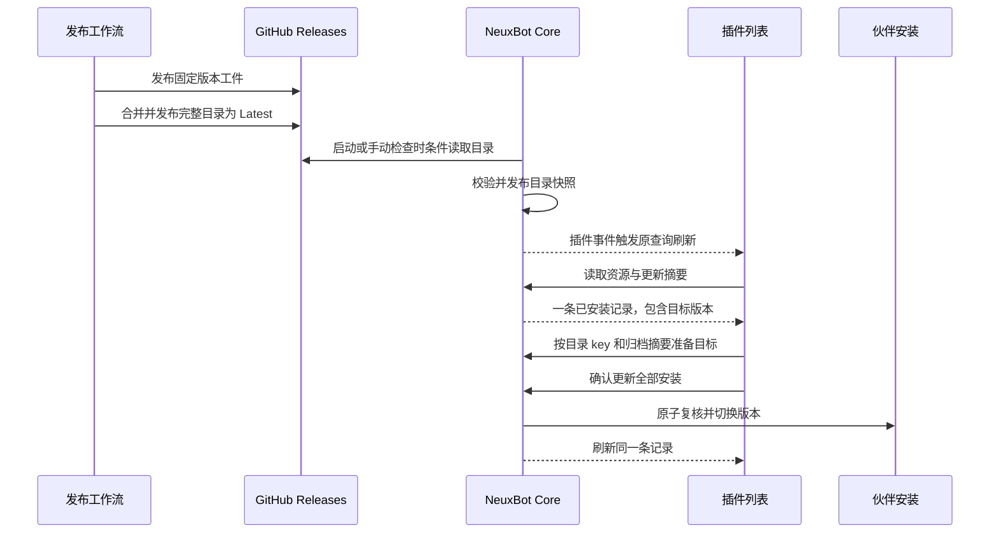

# 插件独立发布与原位更新

本设计覆盖 NeuxBot 自有插件的独立发布、目录同步和已安装条目的更新操作。CLI 原生第三方插件另行设计。

基线为 NeuxBot `main` 的 `ffef15a4` 和 neux-plugins `main` 的 `bbd774e`。应用侧的资源身份、目录缓存、版本安装、配置和账号归属沿用[插件资源架构](../../architecture/plugin-resources-cn.md)。

## 当前状态

- 三个插件已有独立 `plugin.json`。现有构建遍历全部插件，包和目录共同挂在仓库 Release 下。线上 `v0.1.2` 到 `v0.1.3` 的目录条目更换了归档摘要，包版本都仍是 `0.1.1`。Core 比较包版本，仓库标签或归档摘要变化本身不会产生升级候选。 [旧目录](https://github.com/JieWaZi/neux-plugins/releases/download/v0.1.2/catalog.json) · [当前目录](https://github.com/JieWaZi/neux-plugins/releases/download/v0.1.3/catalog.json)
- NeuxBot 已按 `sourceKey` 合并目录与真实安装，并通过 `update.available` 返回升级候选。默认目录中同一 `key` 生成固定身份。自定义镜像、本地开发目录和本地技能插件有各自的身份。反馈中的重复条目仍需用实际两条记录的来源身份和客户端版本复核。 [浏览合并](../../../server/apis/plugins/browse_plugins.go) · [来源身份](../../../server/internal/plugins/catalog/catalog.go)
- 全局列表已接入更新弹窗，现有「授权」操作会盖住「可更新」。伙伴列表使用同一个卡片组件，目前只传入已安装详情，缺少更新动作。 [插件卡片](../../../packages/frontend/src/modules/plugin/components/plugin-card.tsx) · [列表接线](../../../packages/frontend/src/modules/plugin/pages/plugin-resource-collection.tsx)

## 独立发布

### 版本与产物

`plugins/<key>/plugin.json` 的 `version` 是该插件独立的 SemVer，也是客户端升级比较的依据。维护者在涉及该插件的变更中选择 patch、minor 或 major。插件目录 `key` 和 Manifest `name` 固定。供应商程序版本与上游来源版本由既有锁文件和 provenance 表达。

正式发布由插件仓库的 Git Tag 触发。例如 `github@0.1.2` 指向包含 GitHub 插件 `0.1.2` 的提交。Actions 校验该提交已进入 `main`，Tag 的 key 和稳定版本与提交内 Manifest 一致。构建只读取所选插件及其实际使用的共享许可、补丁和锁定依赖。共享输入变动实际影响哪些包，各受影响的插件分别升版和发布。

单插件 Release 上传该插件的 portable ZIP、公开详情、既有原生目标工件和回执，以及构建生成的单条目录记录。每个正式 Tag 与工件保持不可变。若同名 Release 已存在，重试先核对绑定和资产摘要，内容一致时继续，发生冲突时失败。初次独立发布沿用线上已有安装的版本序列，例如 `0.1.1 → 0.1.2`。保留旧 Release 和仍被锁文件引用的供应商资产。

原生目标继续通过共享 `pluginpack` 生成。正式 CI 优先使用 `scripts/packager.lock.json` 中按平台固定 URL、大小和 SHA-256 的工具工件。尚无正式二进制时，从锁定的公开 NeuxBot 提交及 Go 工具链构建，核对实际检出的源码，并在发布回执记录源码提交、工具链和实际二进制摘要。如果工具作为 NeuxBot 仓库的独立 Release 发布，设置 `make_latest: false`，应用自身的 Latest 继续由应用 Release 提供。 [共享生成器](../../../server/cmd/pluginpack/main.go)

### 全量目录

继续使用 `/releases/latest/download/catalog.json` 和 `schemaVersion: 1`。目录每个 key 只保留一个当前稳定版本，各条目分别绑定自己的 `sourceCommit`、`archiveSHA256`、`packagePath`、详情摘要与固定下载地址。首个目录 Release 以线上 `v0.1.3` 为起点。之后发布一个插件时，只替换该 key 的条目，其他条目保留原提交、版本、摘要和地址。

单插件 Release 设置 `make_latest: false`。产物及固定下载地址核验通过后，在同一个工作流中发布目录。目录发布段共用仓库级并发组，配置 `queue: max` 并保留正在运行的任务。每次进入队列后通过 Release API 解析当前 Latest，从该固定 Tag 读取完整目录，再校验、合并和提升。读取失败时停止本次提升。每次新发布使用 `catalog-<run-id>-<run-attempt>`，在草稿中上传完整 `catalog.json`，再在一次 Release API 更新中发布并设为 Latest。从 Release API 和客户端所用 URL 回读核对新目录。

发布前核对当前目录，等版本而绑定不同时停止发布。低于当前目录版本的首次发布也停止，已有固定资产可核验后重试。重试时复用已核验的单插件资产，并基于届时的 Latest 重新合并。候选版本等于当前目录且绑定一致时按成功处理，旧候选遇到更高版本时保留当前目录。目录提升前的失败保留上一个 Latest。发布请求结果不明时，在同一队列任务内按 Release ID 核对已发布状态，再按实际状态校验 Latest 和公开资产。 [Latest 资产链接](https://docs.github.com/en/repositories/releasing-projects-on-github/linking-to-releases) · [Release API](https://docs.github.com/en/rest/releases/releases#create-a-release) · [Actions 并发队列](https://docs.github.com/en/actions/how-tos/write-workflows/choose-when-workflows-run/control-workflow-concurrency)

## NeuxBot 同步与更新

- **一条资源记录。** 继续用 `sourceKey` 聚合。版本、提交和 ZIP 摘要属于版本快照。已安装条目显示固定版本的内容，目标版本在更新弹窗显示。同名且来源不同的条目保持各自身份。默认目录入口和插件 key 保持现有值，已有默认目录安装继续匹配。
- **用真实安装判断升级。** 同源目录版本高于至少一个伙伴的已安装版本，且不低于任何一个已安装版本时，返回升级候选。版本相同、无安装、目录回退或已安装版本无法比较时沿用现有判断。停用仍计入已安装。目录一旦同步成功即可展示更新，归档按现有规则预取或准备时下载。
- **在已有位置显示可更新。** 全局列表和详情使用后端现有的 `update.available`。伙伴列表和详情还要确认当前伙伴在 `update.wakerIds` 中。已安装且可升级时，卡片主操作为「可更新」。授权在管理详情和现有更新流程内处理。伙伴入口打开同一个更新弹窗并保留伙伴上下文。全局列表中没有伙伴安装时显示「安装」，已安装且无更新时保留原状态和适用操作。
- **确认后切换。** 复用 `PluginUpdateDialog`、按摘要准备归档和原子切换安装的接口。弹窗列出受影响伙伴和各自的已安装包版本，以及目标包版本。使用 `versions[].version` 和 `update.version`，上游版本仍用于来源信息。提交复核全部安装、原版本、配置修订与账号代次。准备阶段若目标归档变更，刷新后重新确认。切换保留各伙伴的启停状态，已接纳的任务继续使用其冻结版本。
- **沿用同步节奏。** Core 启动和点击「检查更新」走现有后台同步，目录成功发布后使用已有插件事件刷新列表和详情。离线与同步失败按当前缓存规则处理，更新下载失败保留当前安装。

## 验收

1. 用隔离的发布工件和目录验证一次单插件升级。旧目录含三项，发布 GitHub `0.1.2` 后仍含三项，只有 GitHub 的版本和工件绑定变化。
2. 验证 Tag 与 Manifest 不一致、同版本内容冲突、旧版本重试及并发提升目录。失败时 Latest 保留最后一个完整目录，两个不同插件成功发布后均出现在完整目录中。
3. 安装 GitHub `0.1.1` 到两个伙伴，其中一个停用。同步后列表仍只有一条 GitHub 记录，安装数量不变，全局列表、伙伴列表和详情显示「可更新」。覆盖搜索、分页和同时需要授权的情况。
4. 确认更新后两个伙伴固定到 `0.1.2`，启停状态保留，活动回合仍持有旧版本。另测一个伙伴已在目标版本时，其伙伴页保留已安装状态，较低版本的伙伴页显示「可更新」。取消、归档校验失败和并发安装变化保留原安装。验证同版本归档变化、目录回退和不同来源的同名条目。
5. 用当前 `main` 的 Core 验证新目录可读取并能准备 ZIP。发布脚本、Core 插件包及前端卡片和列表按变更范围定向验证。
