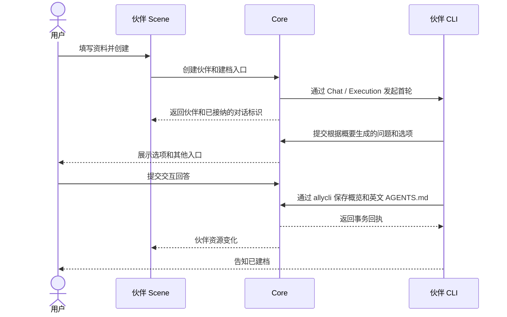

# 伙伴创建与对话建档设计

## 创建与建档

侧栏「新建伙伴」打开右侧 Scene，左栏保留伙伴列表。参考 OpenBot 的新增助手页，右侧使用约 420px 的居中单列。依次排列大头像预览、两行色点、形状选项、名称、两行概要和默认模型。头像选项保留可访问名称，界面省去分组标签。默认模型在同一行显示标签和当前值。主按钮紧接模型行居中。视口不足时表单可滚动，头像选项随内容宽度换行。

名称必填，概要可空。模型选择复用聊天的智能体、账号和模型数据，默认提供「跟随全局默认」。创建页和伙伴维护入口移除角色预设选择及管理。

创建成功后打开新伙伴的首个普通对话。伙伴结合概要生成两到三个问题及每题的选项，覆盖核心职能、工作风格和工作方式，并通过现有交互式问答卡展示。每题允许多选，用户选择「其他」时展开自填框，可以和预设选项一起提交。Core 校验每题至少提供一种有效答案。回答后，伙伴用用户语言生成标题与说明组成的核心职能卡片、简短的工作风格标签，以及包含名称和有序步骤的工作方式，同时生成精简的英文 Markdown 档案。伙伴直接通过 allycli 保存，收到成功回执后结束建档，用户可以在原对话继续工作。

创建记录先于模型执行提交。重复提交复用同一个伙伴和首个建档对话。模型无法启动或首轮未完成有效交互问答时，在原建档入口重试。Core 通过权威 Chat 日志恢复问答和执行，使用现有执行错误反馈。系统发起的首条输入采用内部来源。系统引导只对绑定的建档对话生效。

## 模型默认值

默认模型保存 `runtimeId`、`accountId`、`model`，以及用户选定时的 `reasoning`。使用 `system` 表示原生登录账号。明确绑定的配置用于首次建档及普通新聊天的初始选择。已有聊天优先恢复自己的最后一次执行配置，聊天内临时切换不更新伙伴资料。编辑伙伴时允许改绑或清除绑定。明确绑定的模型或账号不可用时展示对应错误和更换入口，发送与重试沿用本地配置校验和原生调用反馈。

## 概览与档案

概览沿用 `Expertise`、`WorkStyle`、`WorkMethods` 展示核心职能、工作风格、工作方式。建档同时根据创建概要和已接受回答生成角色名称与简介。伙伴档案区位于右栏技能和连接器下方，预览 Markdown 开头，点击标题旁的编辑动作可在弹窗修改完整正文。待建档伙伴显示「继续设置」。移除档案文件列表、三个文件行与 ZIP 下载入口。

Core 在现有伙伴文档存储中增加 `agents` 类型，名称固定为 `AGENTS.md`。页面读取与 Runtime 注入使用同一份已保存正文。独立编辑正文只写正文。展示字段只服务界面，团队的 `TEAM.md` 移除对展示型职能的读取，团队分派规则使用团队成员和已有职责上下文。项目指令、团队协作规则和系统任务指令各由原入口负责。

存量伙伴按身份、风格、方法顺序合并旧正文，并保留现有概览值。内置伙伴通过同一解析入口读取合并后的 seed 或用户覆盖。旧档案回退必须在读取和执行处一致，显式保存的 `agents` 优先，重复启动不会重复合并或覆盖。原始数据可保留作迁移来源。旧伙伴可直接工作，首次问答只从这次创建的新伙伴开始。

## 提交与恢复

建档能力按伙伴、建档 Chat 和活跃 Execution 绑定。Core 核验原对话已有有效交互回答和待建档状态，在 SQLite 同一事务写展示字段、英文档案、建档完成状态与幂等回执。重复请求重放原回执。已回答但尚未建档的伙伴可以在原对话继续设置，复用已有回答。更新完成后使用现有资源事件通知前端刷新伙伴及档案查询。下一轮由 ThreadLifecycle 按实际指令摘要判断是否重用原生会话。

## 前后端契约

- `POST /wakers`（`createWaker`）接收 `requestId, name, avatar?, bio?, defaultModel?`。同一标识同一输入重放，输入变化报冲突。响应 `{ wakerId, chatId?, startError? }`。请求已持久但启动失败时通过 `startError` 提供可展示原因。资料校验或重名按正常 API 错误返回。
- `POST /wakers/:wakerId/onboarding`（`startWakerOnboarding`）接收空请求，返回相同结构。已存在且可继续的对话直接返回其标识。
- 伙伴响应附带 `defaultModel?`、`onboardingStatus?`（`pending` 或 `ready`）、`onboardingChatId?`。缺省建档状态表示已有可用伙伴。更新伙伴允许保存 `defaultModel`，省略表示沿用，空对象表示清除。
- 档案 GET/PUT 复用 `/wakers/:wakerId/documents/:kind`，新界面使用 `kind=agents`，现有 `content` 字段承载 Markdown。
- CLI 提供 `waker.profile.interview` 和 `waker.profile.save`。问答接收伙伴生成的问题和选项，Core 统一追加「其他」入口。保存提交 `roleName, bio, expertise, workStyle, workMethods, content` 和既有 `requestId`，返回保存回执。实际参数以能力目录为准。
- Core 在完成建档后发布 `resources.changed`，资源为 `{ kind: "waker", id: wakerId }`。
