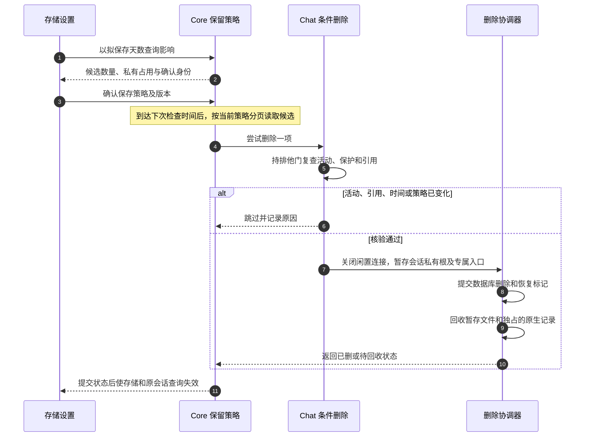

# 存储管理与受管文件回收设计

本文定义待实现的存储功能与受管文件回收。已有实施计划提供任务拆分，本次补充的统计口径、清理范围、确认及调度行为以本文为准。当前布局见[工作区与存储](../../architecture/workspace-and-storage-cn.md)，任务拆分见[实施计划](../plans/2026-11-15-storage-management.md)。

## 1. 目标与已确认范围

新增「设置 → 存储」，回答文件保存在哪里、各类文件占多少空间、哪些可以清理。提供缓存与日志一键清理、闲置会话预览及可配置自动删除，同时修复本次审计确认的受管文件生命周期缺口。

自动删除默认关闭，默认保留 15 天，可配置。范围为普通伙伴会话及其独占数据，包含该会话的受管上传副本、会话私有交付文件和成果快照。伙伴共用 cwd 里的生成文件由用户自行管理，真实项目和厂商原生数据仍由各自的所有者管理。

### 1.1 方案选择

| 方案                                   | 收益                                                                   | 代价与边界                                             | 结论   |
| -------------------------------------- | ---------------------------------------------------------------------- | ------------------------------------------------------ | ------ |
| 统一统计与编排，原所有者回收           | 复用会话删除、资源租约、程序维护和宿主缓存能力；功能入口与自动维护一致 | 需要为各所有者补齐测量、回收结果和定向测试             | 采用   |
| 只做存储页，清理现有目录               | 页面实现较快                                                           | 旧版本、暂存和日志仍持续增长，用户需要反复手动处理     | 不采用 |
| 新建通用文件删除引擎，按路径和时间清理 | 表面上入口统一                                                         | 无法单靠文件时间判断引用、活动执行、恢复记录及成果归属 | 不采用 |

### 1.2 不在本次范围

- 数据目录迁移、用户可视化更换目录、旧产品目录自动迁移。
- 自动删除伙伴业务文件、真实项目文件、知识原件、团队空间或工作流运行产物。
- 清理系统安装的 CLI、系统临时目录中的其他应用文件、厂商账号及历史目录。
- 把归档当成删除、额外增加回收站或备份系统、自动压缩聊天历史。
- 对业务 SQLite 自动执行 VACUUM；删除记录后的数据库空闲页继续由 SQLite 复用。
- 以存储管理为理由增加账号状态、额度、模型目录或原生会话前置探测。

## 2. 当前事实与问题证据

本次只读样本中，两个默认根目录文件逻辑大小约 329.5 MB，Electron 数据约 278.1 MB，其中 HTTP 和 JS 缓存合计约 271.9 MB。该值仅用于说明优先级，不写入产品默认值，也不作为后续验收固定基线。读取没有跟随内部软链接，不包含应用安装包和外部项目。

`system-skills` 有三个摘要目录，每份约 10.0 MB、18 个文件。逐文件摘要比较表明只有 `scripts/botcli` 不同，其余 17 个文件相同。一个版本与当前桌面打包 CLI 及伙伴空间副本一致；另外两个是旧版本回收候选，删除前仍需核验引用。

证据等级区分「本机观察」「源码确认的缺口」「需要故障注入验证」。没有运行故障注入的项目不能宣称已复现，更不能宣称已修复。

| 编号 | 问题与证据                                                                              | 根因及本次处理                                                                                                                                                                                                                          |
| ---- | --------------------------------------------------------------------------------------- | --------------------------------------------------------------------------------------------------------------------------------------------------------------------------------------------------------------------------------------- |
| L01  | 系统技能旧摘要累积：本机观察和源码确认                                                  | [SystemDirectory](../../../server/internal/skills/builtin/system.go) 发布不可变目录；[技能回收](../../../server/internal/skills/storage_cleanup.go)仅覆盖普通技能。补充系统技能当前版本保护与旧摘要回收。                               |
| L02  | 插件派生目标和修复副本缺少回收覆盖：源码确认                                            | [目标发布](../../../server/internal/plugins/target_cache.go)保留已返回目录；[ContentStore](../../../server/internal/plugins/content_store.go)只覆盖 content/data。增加目标生成、引用和清理共用的保护机制，不能直接扩展 RemoveAll 范围。 |
| L03  | 执行授权上下文留下空父目录，异常退出可留旧描述：源码确认                                | [执行授权](../../../server/services/execution/agent.go)撤销时只删除 connection.json，路径还包含每次 Core 的 epoch。补充精确父目录释放及旧 epoch 启动清理。                                                                              |
| L04  | 桌面字节附件缺少移除与接纳后的及时释放：源码确认                                        | 变更前桌面字节附件只在窗口释放时删除，未接入 discard_attachment。桌面字节附件复用 Core 上传租约，消除第二套长期暂存。                                                                                                                   |
| L05  | 桌面日志持续追加，无大小或保留上限：源码确认                                            | [日志入口](../../../desktop/electron/main/index.ts)直接 appendFile。补充串行写入、轮转和按保留周期回收，清理与写入使用同一所有者。                                                                                                      |
| L06  | 受管 CLI 多次更新保留历史 version-*；异常退出可留安装 staging：源码缺口，崩溃路径需验证 | [安装器](../../../server/internal/agent/installation/installer.go)发布新目录，正常退出使用 defer 清理；当前卸载有恢复日志，但不等于历史版本 GC。增加维护围栏内的旧版本回收和已失去操作所有者的暂存恢复。                                |
| P01  | 开发 Core 与桌面默认程序数据根可能分叉：条件性源码风险                                  | [开发配置](../../../server/configs/local.yaml)使用相对数据库路径，[dev-server](../../../scripts/dev-server.mjs)未指定默认数据根。对齐默认根解析，保留显式覆盖；不搬迁已有数据。                                                         |
| P02  | 不同程序数据根可共用业务文件根，现有跨进程锁覆盖不足：条件性源码风险                    | [Core 锁](../../../server/internal/localweb/lock.go)只锁程序数据根；日志使用受管业务根。两个规范根分别独占，同根去重，锁获取失败释放已持有锁。                                                                                          |
| C01  | 插件分发包和资料是持久缓存，缺少用户清理入口：能力缺口                                  | [目录所有者](../../../server/internal/plugins/catalog/index_cache.go)拥有索引同步和归档预取。增加缓存清理与预取协调，保留轻索引，避免清理后立即全量预取。                                                                               |
| V01  | 授权描述、安装和技能 staging 主要依赖正常 defer；进程被强制终止后需恢复证据             | 通过临时目录和子进程强制退出测试判断残留；只对可证明属于已结束操作的文件增加启动清理。未知归属进入诊断。                                                                                                                                |

以下已有正确机制，本次扩展测试并复用，不以「没有清理」为名重写：

- [Core 上传](../../../server/internal/uploads/store.go)：30 分钟租约、主体撤销、接纳后清字节、重启清上次目录；新增 I/O 失败重试证据，不能清活动 Claim。
- [普通技能](../../../server/internal/skills/storage_cleanup.go)：无引用版本、导入与版本暂存回收。
- [插件内容](../../../server/internal/plugins/content_store.go)：数据库引用与活动使用保护。
- [会话删除](../../../server/services/chat/chat.go)和[删除协调器](../../../server/internal/chatstorage/deletion.go)：排他操作、目录归属、事务提交、分片引用清理、崩溃恢复。
- [成果快照回收](../../../server/internal/chat/changes/retention.go)：保留耐久记录引用，清理无引用私有对象。
- [账号租约](../../../server/services/aiaccount/service.go)：关闭失败仍保留原所有者。账号旧代次可能包含历史与凭据，不作为通用缓存；本次不按年龄删除。

## 3. 参考 OpenBot 的范围

截图提供总量、分类、伙伴和大对话的页面层次。代码核对使用本地 OpenBot 工作副本 `7183ebd6b0ab6f3fd9c735816fdd952836eae8f2`，另只读核对本机 OpenBot 0.67.1 的磁盘元数据。两项证据各自成立，页面版本与字节数按实际扫描时点理解。

| 核对项   | 本地源码与磁盘证据                                                                                                                                                                                                        | NeuxBot 设计                                                                                     |
| -------- | ------------------------------------------------------------------------------------------------------------------------------------------------------------------------------------------------------------------------- | ------------------------------------------------------------------------------------------------ |
| 占用     | 概览按宿主分组，数据库及 WAL、SHM 一起计量。伙伴与聊天明细结合工作区、附件归属及消息查询。按需扫描，缓存 60 秒，同范围共享在途请求，修改后使快照失效。本机可见 `openbot.db` 及伴随文件、`provider-runtimes/` 和 `logs/`。 | 延用按需统计与页面层次，使用自己的受管根、私有目录和共享原生分片。扫描不完整与列表截断分别标记。 |
| 手动清理 | 存储页逐类确认缓存和日志，存储文件按业务身份删除，旧程序及下载由程序所有者处理。删除对话历史另走会话用例，会复查活跃工作并处理关联附件。                                                                                  | 存储页提供可确认的资源清理与会话清理，复用各所有者的生命周期和删除恢复机制。                     |
| 自动回收 | 程序所有者在启动、更新检查时回收超出保留窗且无人使用的旧版本，并在删除前复查使用戳。远端附件缓存只回收缓存副本。此次在存储 UI、IPC、服务端存储路由、聊天服务中未找到可配置闲置天数的会话定时删除入口。                    | 会话保留策略由 NeuxBot Core 管理，按持久化活动与所有权判断，复用已有排他删除。                   |

源码入口见 [统计与清理服务](https://github.com/nightly-labs/openbot/blob/7183ebd6b0ab6f3fd9c735816fdd952836eae8f2/src/backend/storage-usage.ts)、[存储页](https://github.com/nightly-labs/openbot/blob/7183ebd6b0ab6f3fd9c735816fdd952836eae8f2/packages/ui/src/features/files/StorageOverview.tsx)、[IPC](https://github.com/nightly-labs/openbot/blob/7183ebd6b0ab6f3fd9c735816fdd952836eae8f2/src/main/ipc/storage-handlers.ts)、[宿主目录装配](https://github.com/nightly-labs/openbot/blob/7183ebd6b0ab6f3fd9c735816fdd952836eae8f2/src/main/application-services.ts)、[程序回收](https://github.com/nightly-labs/openbot/blob/7183ebd6b0ab6f3fd9c735816fdd952836eae8f2/src/main/provider-runtime-manager.ts)、[附件缓存](https://github.com/nightly-labs/openbot/blob/7183ebd6b0ab6f3fd9c735816fdd952836eae8f2/src/main/remote-attachment-cache.ts)和[会话历史删除](https://github.com/nightly-labs/openbot/blob/7183ebd6b0ab6f3fd9c735816fdd952836eae8f2/src/backend/agent-service.ts)。

## 4. 目录清单与计量归属

定义 `$DATA` 为 Core 实际程序数据根，`$FILES` 为实际受管业务文件根。二者使用现有配置解析后的真实绝对目录；页面不能猜测主目录。存储页显示真实配置，默认路径仅作说明。

| 目录或文件                                                 | 统计分类             | 生命周期与保护                                                           |
| ---------------------------------------------------------- | -------------------- | ------------------------------------------------------------------------ |
| `$DATA/bot.db`                                             | 应用数据             | 业务权威配置与投影；只通过所属用例更改                                   |
| `$DATA/memory.db`、`knowledge/knowledge.db`                | 知识与记忆           | 数据库及实际伴随文件按各组件模式计量，不修改模式                         |
| `$DATA/skills/versions`                                    | 程序与资源           | 普通技能版本按数据库引用回收                                             |
| `$DATA/system-skills`                                      | 程序与资源           | 当前系统技能及活动引用保护；旧摘要回收                                   |
| `$DATA/plugins/{content,data}`                             | 程序与资源           | 原内容和插件数据按原引用与使用计数回收                                   |
| `$DATA/plugins/targets`                                    | 缓存                 | 派生目标、repair、staging 按目标所有者回收                               |
| `$DATA/ai-accounts`、`account-workspaces`                  | 账号数据             | 凭据与原生历史保护，存储页仅统计                                         |
| `$DATA/runtime-installations`                              | 程序与资源           | 当前配置引用、最新有效版本及使用者保护；其余已核验版本可回收             |
| `$DATA/agent-contexts`                                     | 临时数据             | 当前授权与关闭失败所有者保护；旧 epoch 恢复清理                          |
| `$DATA/electron`                                           | 桌面缓存或应用数据   | 仅已识别缓存计入缓存；Cookie、偏好、站点数据仍受保护                     |
| `$DATA/logs`                                               | 日志                 | 桌面日志所有者管理写入、轮转与清理                                       |
| `$DATA/web-uploads-*`                                      | 临时数据             | Core 上传租约拥有，不由通用目录清理处理                                  |
| `$DATA/integration-api.json`、外观及提醒偏好、其他配置     | 应用数据             | 保留现有唯一配置来源                                                     |
| `$DATA/storage-policy.json`                                | 应用数据             | 新增服务端保留策略及最近维护结果，原子提交；不存会话正文或第二份引用索引 |
| `$FILES/Agents/<id>`                                       | 工作文件或程序与资源 | 业务文件属于伙伴；经既有 manifest 核验的系统技能物化文件单列程序资源     |
| `$FILES/Conversations/<id>/{log,attachments,file-results}` | 会话与附件           | 会话私有日志、原件、成果快照及私有 Git 对象，随领域删除                  |
| `$FILES/NativeConversation`                                | 会话与附件           | 共享原生分片，全局只计一次，按引用清理                                   |
| `$FILES/conversation-index.db`                             | 应用数据             | 派生索引及组件实际伴随文件；运行中不直接移除                             |
| `$FILES/Plugins/{catalog,details,archives}`                | 缓存                 | 保留可离线浏览的轻索引；资料与归档由分发所有者处理                       |
| `$FILES/Knowledge/raw`                                     | 知识与记忆           | 原件仅由知识生命周期删除                                                 |
| `$FILES/Workspaces`                                        | 工作文件             | 团队共享及成员空间，按团队对话生命周期处理                               |
| `$FILES/WorkflowWorkspaces`、`WorkflowFiles`               | 工作文件             | 脚本、状态、运行产物及原件保护，cache/tmp 名字不构成通用删除授权         |
| `$FILES/IM/{inbox,deliveries}`                             | 会话与附件           | 按 IM 交付关系处理，不按会话闲置策略直接删除                             |
| `$FILES/{Forks,Deletions,Provisioning}`                    | 恢复数据             | 先完成既有恢复，再测量；不能当普通缓存删掉                               |
| 两根内未识别文件                                           | 其他                 | 计入已知总量，默认不可清理并报告路径归属状态                             |

`plugins` 与 `Plugins` 职责不同，保留现有名称。外部真实项目和厂商目录不进入本应用总占用，不通过链接递归扫描。目录前缀本身不能证明文件是内部资源；无法核验 manifest 的文件保守计入工作文件或其他。

### 4.1 会话私有目录与清理落点

`$FILES` 默认是 `~/.neuxbot/`，可由 `NEUXBOT_MANAGED_FILES_DIR` 覆盖。每个已建立的会话有自己的 `$FILES/Conversations/<chat-id>/`，子目录按使用创建。普通伙伴会话的执行 cwd 是 `$FILES/Agents/<waker-id>/`，同一伙伴的聊天共享该 cwd。

| 当前路径                                            | 内容及过期会话清理行为                                                                                                                       |
| --------------------------------------------------- | -------------------------------------------------------------------------------------------------------------------------------------------- |
| `Conversations/<chat-id>/log/`                      | 记录用户消息、会话事件、原生绑定与消息指针。随会话删除其 `<chat-id>.jsonl`。                                                                 |
| `Conversations/<chat-id>/attachments/<message-id>/` | 上传文件在应用内保存的受管副本，以及实际归该会话独占的受管附件。随会话删除，用户选择时的源文件继续由原目录管理。                             |
| `Conversations/<chat-id>/file-results/`             | 该会话的成果记录、差异数据和 `changes/repository.git/` 内的私有快照对象。随会话删除，cwd 与真实项目里的成品、用户 Git 仓库及其历史留在原处。 |
| `Agents/<waker-id>/projects/<chat-id>/`             | 部分 CLI 使用的专属受管项目入口。经过归属校验后随会话删除入口自身，链接目标及同级目录保留。                                                  |
| `NativeConversation/<分片>.jsonl`                   | 多个会话共用的原生日志。删除协调器只回收可证实由被删会话独占的记录，保留分片与仍被引用的记录。                                               |
| `Agents/<waker-id>/` 与真实项目目录                 | 用户及智能体在共享 cwd 或项目中创建的文件继续由用户管理，包括能够从聊天成果记录追溯的文件。                                                  |

普通会话当前的私有子目录就是 `log/`、`attachments/` 和 `file-results/`。上传副本落在 `attachments/`，程序捕获的文件内容和差异落在 `file-results/`，智能体直接写到空间目录的成品位于共享 cwd。Chat 删除协调器处理该会话的整个私有根。仓库当前的落盘与删除路径见[布局](../../../server/internal/chatstorage/layout.go)、[附件接纳](../../../server/services/execution/work.go)、[附件物化](../../../server/internal/workspace/attachments.go)、[私有快照](../../../server/internal/chat/changes/snapshot.go)及[会话删除](../../../server/services/chat/chat.go)。

## 5. 计量与快照契约

### 5.1 全局与实体计量

- 默认以常规文件的逻辑字节数计量，MB 使用十进制；不把该值称为保证可回收的物理空间。
- 根目录先规范化并去重。根相同、嵌套或同一文件被多个布局引用时只计一次；硬链接按可用的文件身份去重。两个根不相同时，分类按明确归属计算，不能简单分别递归后相加。
- 不跟随内部软链接，不遍历特殊文件。根通过配置显式选择，可以规范化其真实位置；子项软链接不扩张扫描或删除范围。
- 全局分类包含所有已读文件；列表分页与 Top 列表截断不改变已知总量。扫描本身不完整时显示「至少」与不完整原因，不能显示成完整总数。
- 伙伴汇总区分业务文件、会话私有文件和内部资源；内部技能副本不算用户成果。
- 会话排名明确命名为「会话私有占用」，只包含该会话私有目录。共享原生日志在全局单列，不按会话数量重复分摊。首版不为排行构建第二套原生字节归属索引。
- 清理预览提供已核验文件大小的小计。会话删除的共享分片额外回收量不预先承诺；删除 SQLite 行也不等于数据库文件立即缩小。
- 分别读取两根所在磁盘的容量与可用空间，同一卷只显示一次，不把不同卷剩余空间合并为一个可用值。

### 5.2 扫描预算与缓存

每次完整扫描最多检查 100,000 个目录项，最长 30 秒，最大目录深度 64；预算在整个扫描内共享，不按目录重置。权限失败、遍历中变化、目录消失和取消分别记录。不存在的尚未使用目录为零，访问失败不得伪装成零。

Core 在后台扫描并合并同范围在途请求，完成结果缓存 60 秒。页面离开可停止等待，不使其他消费者的扫描失败；Core 关闭取消并等待全部扫描。显式「重新统计」绕过有效缓存，但仍合并同一代在途扫描。清理、策略变更和会话删除推进代次，旧代扫描不能回填新代缓存。

页面不周期扫描磁盘、不按 Token 事件刷新。自身操作、已有资源删除事件、重新进入及显式重新统计触发精确失效。无事件覆盖的外部文件变更最多保留当前 60 秒快照，界面显示统计时间。

## 6. 清理语义与所有者

### 6.1 一键清理

一键清理默认处理已识别缓存、日志及已证明无引用的程序资源。普通会话删除单独进入保留策略与会话确认，不能混入缓存清理确认。

预览返回各类已知大小、可执行性及跳过原因。执行请求只接受固定清理种类或由服务端签发的短期预览身份，不接受任意路径。首次执行前确认实际类别和影响。执行前重新校验引用、活动和文件身份；新活动导致该项跳过，不强行取消执行。

Core 清理与桌面缓存清理可能部分成功。页面分别保留成功和失败结果，重试只提交失败类别。清理失败仍使快照失效；已经删掉的文件不能因响应失败再次显示为保证可释放。

### 6.2 系统技能与授权上下文

系统技能生成保持不可变发布和完整摘要校验。Core 在当前系统技能路径发布完成、执行接纳开始之前，保留当前摘要并回收已核验旧摘要及失去所有者的 system-skill-staging。运行中回收必须保护当前发布路径和实际未释放引用；无法证明无使用者的版本只报告候选。不同摘要之间不覆盖文件，不擅自用软链接替代 CLI 所需完整物化。

执行授权撤销后删除自身描述，再用非递归 Remove 删除空父目录。删除前核对描述中的 grant/epoch，避免旧释放回调删除下一轮文件。Core 启动在新授权创建前清理可核验旧 epoch 的描述和 staging；未知文件保留诊断，关闭失败的活动所有者仍保留。

### 6.3 插件内容、派生目标与分发缓存

ContentStore 继续保护 content/data。派生目标增加与生成/发布/交付共用的引用保护：返回目录至本次原生资源租约关闭期间保持占用；安装准备和缓存修复也持有短期保护。回收目标只处理本应用可核验目标、repair 和失去操作所有者的 staging，不删除活动 `.locks` 文件。

手动缓存清理在同一分发所有者内暂停并等待归档预取，清理未被当前安装读取占用的 details/archives，保留轻索引。该清理不立即再次预取；下一次应用启动、显式目录刷新或实际安装按现有分发入口恢复下载。后台成功索引更新可回收不再被索引引用且无下载使用者的旧资料与归档，当前索引引用的离线包不因年龄自动失效。

### 6.4 受管程序与安装暂存

每个基础 Runtime 的回收复用 BeforeRuntimeMaintenance、账号使用保护和 Installer 自身维护锁。活动工作或原生关闭失败时跳过，不另开探测进程。

保留全部 Runtime 配置当前选中的受管版本、最新有效受管版本及仍有实际使用者的版本。其余归属已核验的旧 version-* 才可回收；外部安装、包管理器文件、未知或损坏归属的旧目录保留并诊断。安装后只有配置提交成功才允许回收旧版本，失败继续保留旧配置所需文件。

启动恢复和维护入口处理本应用已失去操作所有者的 `.staging-*`、`.package-maintenance-*`。创建暂存时记录有界操作身份并持有操作锁；恢复核对归属、锁和真实进程所有者，不能只因上次 Core 已退出就假定安装子进程也已退出。没有可核验标记的历史残留仅报告。`.uninstall.json` 及 `.uninstall-*` 继续按 Installer 既有恢复规则处理，不能绕过删除日志。对普通 defer、取消和强制退出分别建立证据。

### 6.5 上传与桌面缓存、日志

桌面剪贴板和其他只有字节的附件改用现有 `/uploads`，与 Web 共用上传客户端和 Core Store；真实用户文件路径继续按现有批准文件入口使用，discard 对非 upload 引用不做删除。Core 接纳立即释放暂存字节，同一请求的不确定结果仍按原幂等键恢复，失败但可重试的上传保留到租约结束。移除附件显式释放，活动 Claim 保持保护。

移除桌面自建 `bot-attachments-*` 新写入链和对应字节暂存 IPC。已有系统临时目录残留不按前缀全盘删除：没有可靠所有者标记的历史目录只报告，不纳入自动回收。

HTTP 和代码缓存由 Electron Session 接口清理，当前读写中的缓存不由 Go RemoveAll。Cookie、Local Storage、IndexedDB、界面偏好和登录不清理。首版不承诺运行中 GPU 缓存全部可回收。

桌面缓存 Bridge 不接受文件路径；主进程核对当前 Core 的程序数据根与自身实际根相同后才启用。外部 Core 指向其他根时不混合两台宿主的清理能力。Web 仍能看到 Core 对目录的统计，但没有本地 Electron 所有权时不显示可执行缓存清理。

Core 的清理 API 只编排自身拥有的类别。前端的一次清理确认可以组合 Core 维护任务与固定的 Electron 缓存、日志调用，分别对账并显示部分成功；Go 不通过反向 RPC 调用 Electron。宿主调用完成后重新读取 Core 计量，不能将桌面目录大小再次加到已包含它的总量中。

桌面日志单个活动文件达到 10 MB 后轮转，最多保留 5 个历史文件，历史最长保留 15 天。写入、轮转与用户清理串行；清理删除历史并截短活动日志，下一次正常写入继续记录。大小、份数、天数来自统一稳定常量，不散落调用方。排队失败及清理失败返回可重试事实，不能影响 Core 生命周期收尾。

## 7. 闲置会话保留策略

### 7.1 策略与保留例外

- 全局 enabled 默认 false，retentionDays 默认 15，允许整数 1–3650；界面提供 15、30、60、90 天及自定义。
- 唯一服务端策略放 `$DATA/storage-policy.json`，原子写入并带 revision；读取损坏时报告错误并停止自动删除，不以默认策略覆盖原文件。
- 新增会话「保留此会话」，保存在 Chat 权威日志，SQLite 仅投影；重建索引不丢失该选择。默认 false，分叉子会话默认 false，不继承父会话的例外。
- 从权威事件重建 `LastActivityAt`，取已接纳输入、实际执行开始或终态、已提交的新消息及用户对审批和提问作答的最近时间。新会话以创建时间作为下限。标题编辑、阅读、保护设置、页面打开、索引修复和原生历史重放均不续期。旧日志按同一规则重建，缺失或无法核验的活动时间在投影中保持未知。
- 用现有 AutoMigrate 为 `chats` 可重建投影补充活动时间、保留标记及候选索引。新增可恢复的存量回填，从权威日志读取活动时间，覆盖已经追到日志尾部、没有增量可读的会话。正常提交和回放共用活动分类。每个会话具备完整性和已核验活动时间后才进入候选。策略和保留选择分别以策略文件和 Chat 日志为权威。

不能直接复用目前随各种权威事件推进的 UpdatedAt 来代表工作活动，否则新增保护事件等元数据会意外改变过期时间。

### 7.2 候选与删除边界

每轮按 Core 时钟固定截止点 `runStartedAt - retentionDays × 24h`。`LastActivityAt` 严格早于这个时间才满足期限，正好等于或未来时间继续保留。会话必须归普通伙伴所有，没有保留例外，也没有活动执行、审批、问答或接纳占位。

排除 `HiddenFromWakerHistory`、团队成员或负责人会话、工作流创作和 worker、自动任务运行及 IM 关联。查询使用单表过滤和有索引的 `NOT EXISTS`，并按候选 ID 有界补齐。未核验引用、隔离索引、损坏日志或仍存在涉及该 Chat 的未完成删除或分叉恢复时跳过。已经发布的分叉保有自己的附件和成果，其存在本身不阻止源会话清理。

预览按当前数据给出候选数、已知私有大小小计、分页列表及不完整状态。统计侧的目录测量、预览缺失或请求断开均不授权删除。手动批量删除须确认所选会话的身份、日志序号及策略版本，同一次提交只处理这组身份。过期筛选在自动清理关闭时仍可手动使用。

删除在现有 Chat 排他边界内重新读取权威活动、保护选择、活动执行和外部领域引用，核验通过后才关闭闲置连接或准备文件。新的接纳、绑定、保护与变更引用的领域入口参与同一排他边界，避免核验后新增引用。调度器在文件暂存前逐项核验策略代次。

调用原子删除机制，不调用会先 CancelAndWait 的普通删除 API。逐个或有界小批处理，活动冲突按项跳过，不阻止其他过期会话。数据库提交后沿原删除记录清理共享分片独占记录和投影，保留其他 Chat 引用。无法核验原生引用时沿原保守保留规则处理，真实 I/O 失败按原提交记录恢复。

上传副本、独占交付文件和成果快照的存在本身不构成保留例外，按第 4.1 节随过期会话删除。跨域引用的归属无法核验时跳过，保留现有引用。伙伴 cwd 和真实项目文件始终按第 4.1 节处理。

### 7.3 调度、关闭和结果

首次开启或缩短已启用的期限时，先按拟保存的天数展示当前受影响数量与清除内容，再提交 `expectedRevision` 和绑定该天数的确认预览。保存完成后界面展示下一次检查时间。已启用的策略按届时状态重新计算全量候选。候选数为零时仍须确认启用。关闭或延长期限可直接保存，修改使旧调度代次失效。

启用时在同一策略文件保存 `nextCheckAt = enabledAt + 24h`，重启继续遵守这个时间。Core 恢复完成后，只为已经到期的检查补跑一次，休眠错过多次同样只补一次。一轮自动检查完成后安排 24 小时后的下一轮。调整已启用策略的期限保留原检查时间，停用时清除该时间。调度更新与用户配置原子提交，只有用户配置变化才递增 policy revision。默认关闭时不启动候选自动扫描。

用户可在预览中确认立即清理。手动与自动会话清理共用一个运行席位。手动提交遇忙时返回当前运行，已到期的自动检查等待席位释放后用当前策略复查一次，保留原到期时间直至自动检查完成。

每批开始与单项进入文件暂存前核验当前策略代次和取消状态。单项进入删除与策略写入按同一短操作边界确定先后；关闭成功后无需等待下一批即可停止尚未进入删除的单项。已经进入删除的单项按原协议完成或回滚。Core 关闭先停止调度并等待当前安全边界，再关闭 Chat、资源所有者和数据库。

最近结果保存开始和结束时间、已删/跳过/失败数量及有界原因摘要。数据库已提交且文件尚待回收时显示「会话已删除，文件待回收」，按原删除记录恢复，避免重复提交。界面显示已移除文件的逻辑大小，实际剩余容量由重新统计取得。

## 8. API、模块与事件边界

### 8.1 所有权

- `internal/storage`：有界文件遍历、规范身份去重、磁盘测量、保守路径分类，不依赖 Repository 或业务删除。
- `services/storage`：供多个 API 与后台调度复用的快照、维护和保留策略；依赖原 Chat、插件、程序与日志端口，不持有第二份业务引用图。
- `apis/storage`：一个 Operator 一个文件，校验分页/预览/策略请求，组装 HTTP 结果。单入口请求组合保留在 API；Service 不定义 HTTP 专属 View。
- Chat 拥有保留例外、活动投影和条件删除；各资源模块拥有 GC；Electron 拥有 Session 缓存与日志。
- `global` 与 Core main 只负责装配、两个根的锁、恢复和关闭顺序。

### 8.2 接口行为

接口前缀 `/api/v1/storage`，复用现有本机认证：

| 操作                            | 用途                                                               |
| ------------------------------- | ------------------------------------------------------------------ |
| GET `/usage`                    | 概览、分类、真实根、卷信息、统计时间与完整性；force 参数显式重测   |
| GET `/entities`                 | 伙伴汇总或会话私有占用，稳定大小/身份游标分页                      |
| POST `/cleanup-preview`         | 签发固定类别的清理预览                                             |
| POST `/cleanup`                 | 提交已确认预览，返回前端确需展示的运行身份                         |
| GET `/maintenance`              | 当前及最近维护状态，用于进入、恢复与已有事件对账                   |
| GET/PUT `/policy`               | 读取与按 expectedRevision 更新策略；写入默认 CommonSuccessResponse |
| GET `/expired-chats`            | 按当前或拟保存期限读取过期候选、大小小计和分页                     |
| POST `/expired-chats/preview`   | 冻结手动选择或签发拟保存策略的影响确认身份                         |
| POST `/expired-chats/cleanup`   | 提交冻结候选预览，返回运行身份                                     |
| PUT `/chats/:chatId/protection` | 记录会话保留选择；返回 CommonSuccessResponse                       |

预览最长有效 5 分钟，Core 重启失效；上限单次 256 个手动会话。更多候选由用户继续分页或已启用的后台策略有界处理。清理与保留共用维护状态，但资源清理不会隐式开启会话删除。

精确 OpenAPI 字段、枚举和稳定错误由实现生成；不在本文复制完整 Schema。错误至少区分只读能力、忙碌、预览失效、策略冲突、根身份变化、所有权未知、扫描不完整和实际 I/O 失败。取消沿用原取消通道。

### 8.3 事件与客户端

新增 `storage` 主题的全局维护状态变化，复用 EventHub 与唯一 WS。状态来源为服务端实际维护与原子策略提交，不按文件逐条广播。使用运行身份和单调 revision，包含快照失效代次；提交失败不发布成功事件。

前端使用生成客户端、TanStack Query 和原本地错误面，隐藏 Scene 释放订阅；重新进入和 WS resync 通过 GET 恢复。手动清理失败保留已有快照并提示陈旧，不把失败结果显示为零。

桌面缓存读写使用固定可选宿主能力；业务统计和会话删除不改成 IPC。移除桌面字节暂存 IPC 时同步更新共享契约、Schema、preload、适配器与边界测试。

## 9. 设置页与交互

唯一 Settings Scene 新增「存储」平铺分类，沿用现有搜索、路径与独立滚动，不在正文重复大标题。使用 SettingsContentShell、SettingsGroup、SettingsCard、SettingsRow、SettingsDangerZone 和共享确认组件。

正文顺序：

1. 总占用、分类条、统计时间和重新统计；卷剩余空间按实际根展示。
2. 分类明细，可展开真实路径；未知及不完整数据就地表达。
3. 伙伴汇总，区分业务与内部资源；空数据不堆叠零计数。
4. 会话私有占用 Top 5，进入原会话；更多项使用服务端分页。
5. 可清理项、已知大小与一键清理确认；部分失败支持按类重试。
6. 「自动清理会话」开关和「保留天数」，启用时展示下次检查时间，附「预览待清理会话」及最近结果。预览行显示会话名、伙伴、最后活动时间和私有占用。展开后展示日志、附件和成果快照三类路径及已知大小。永久删除动作进入危险区并确认。

会话保留例外同时出现在过期预览行与已有聊天操作菜单。首次启用及缩短期限确认框使用同一影响预览，文案为「超过 {N} 天无活动的会话将永久删除，包括会话内的上传副本和私有成果。伙伴空间和项目里的文件会保留。」后台检查直接按已保存策略执行。

中英文、浅暗主题、窄内容容器、长路径、键盘、focus-visible、首次骨架、旧数据刷新、离线、扫描不完整和清理失败都需要对应状态。普通 Card 不增加常驻边框或阴影，不额外堆叠次级说明。

## 10. 项目全局约束

- 本次仅交付 spec 与实施计划，不实施业务代码或清理真实数据。
- 实施保留无关修改；生成文件只通过对应命令更新，不手改生成文件。
- 不打开、控制或截图运行中的页面、浏览器和桌面应用，真实视觉验收需要用户明确授权。
- 只运行修改点与直接影响范围的定向验证；不运行 pnpm check、pnpm --dir desktop check、全量前端测试或 go test ./...。
- 沿用现有依赖、业务 SQLite 默认日志模式、原业务权威与已有事件连接。
- SQL 默认单表；关联存在性使用有索引的 EXISTS/NOT EXISTS 与有界批量补齐，不新增无证据 JOIN。
- 智能体发送、续聊、steering、恢复和分叉不增加账号、额度或模型目录诊断。
- 所有 Go 结构体字段有准确注释；internal/agent 使用英文，其余目录使用中文，API 标签保持简短。
- 未知归属、活动引用和恢复记录保守保留；不以路径名称或文件年龄单独授权删除。

## 11. 验收矩阵

| 要求                | 必须验证的行为                                                                                                                                                                               |
| ------------------- | -------------------------------------------------------------------------------------------------------------------------------------------------------------------------------------------- |
| ST01 根一致性       | 开发/桌面/Web 默认解析一致；显式覆盖保留；相同、别名、嵌套根去重；两个进程共享任一根都不能同时拥有写入权；锁失败和退出无泄漏                                                                 |
| ST02 统计           | 合计与实际临时文件一致；软链接、环、特殊文件不遍历；硬链接不重复；10 万项/深度/超时标不完整；权限失败不变零；两卷剩余空间不相加                                                              |
| ST03 快照           | 同范围并发只扫描一次；60 秒命中；force、清理与代次失效；旧扫描不覆盖新结果；Core 关闭释放任务                                                                                                |
| ST04 系统资源       | 同 CLI 不重复生成；更新后旧摘要在无引用时回收；活动/当前保留；未知和改指向目录保留；旧 epoch 描述与空目录正确释放                                                                            |
| ST05 插件与程序     | 目标活动占用、生成/repair、下载安装并发和关闭失败被保护；已提交配置引用保留；旧归档回收不造成下载循环；安装中断可恢复，卸载日志不被旁路                                                      |
| ST06 上传           | 桌面与 Web 字节附件同一 Store；移除、接纳、过期和重启清字节；失败可重试；Claim 活动和相同幂等键恢复；真实源文件永不被 discard                                                                |
| ST07 桌面缓存与日志 | 缓存清理保留登录/偏好；外部 Core 根不匹配禁用；10 MB/5 份/15 天边界；并发写、轮转、清理和 I/O 失败重试                                                                                       |
| ST08 会话候选       | 严格期限边界、已追到日志尾部的旧会话回填、活动与保护例外、元数据不续期、领域引用排除、附件和快照不自动豁免，验证分页计数和查询计划。                                                         |
| ST09 删除与调度     | 私有日志、附件、成果及专属入口随会话清理。伙伴 cwd、用户源文件、真实项目、共享原生记录和分叉保留。覆盖续聊、绑定、保护与清理竞态，同批首项后停用，启用后立即重启、错过检查后补跑及删除恢复。 |
| ST10 UI 与契约      | 生成协议可重现；中英文键一致；导航深链、完整/部分/离线状态、部分成功重试、首次开启确认、键盘和窄容器；真实 UI 未运行则明确剩余边界                                                           |

验收需区分自动化通过、真实平台与视觉验收。先在临时目录和 Fake 原生端口建立红绿回归，不能以清理真实用户目录验证实现。
